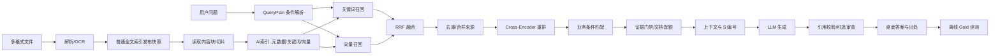

# everything-finder RAG 开发实现分析

> 核对日期：2026-11-11。分析对象：`E:/code/everything-finder` 当前工作区代码及截至 11 月 10 日的验证记录。本文讲的是已经存在的实现、它解决的业务问题和已观察到的局限；实验脚本或计划不等于默认问答功能。工作区含大量未提交改动，本文不表示这些改动已发布到安装包。文中“默认”指 `AppSettings` 代码默认值，实际运行应以用户设置、模型与已发布 AI 索引为准。

## 一、项目定位和业务场景

这是一个 Windows 本地多格式资料搜索桌面程序，在已有全文检索基础上扩展了资料智能问答。典型资料是设备手册、维护教材、液路/硬件培训 PDF、PPT、Word、Excel 和扫描件；典型问题是“某型号某报警如何处理”“单项目样本检测发光值偏低应排查什么”“两种定标异常分别对应什么操作”“某参数在指定版本是多少”。用户期待的不只是找到文件，还要得到**适用于其对象和条件的答案**，并能打开出处核对。

传统全文搜索解决“哪些文件含这些字”，但无法稳定覆盖同义问法，也不会把分散在几页的事实组织为答案。直接将整库交给大模型不可行：资料量大、成本高、引用不清，且容易把相似机型、不同阶段或表格另一行当作正确依据。本项目的 RAG 目标是让本机先找到少量可追溯证据，再由配置的 LLM API 生成回答。`RagPage` 明确提示：问题、文档和引用在本机检索，**生成请求会把问题和检索上下文发往所配置的 LLM API**；因此“本地检索”不等于“答案生成完全离线”。

### 端到端架构

核心编排在 [`AnswerService`](../local_full_text_search/rag/answer_service.py)；桌面入口在 [`MainWindow`](../local_full_text_search/ui/main_window.py) 和 [`RagQueryWorker`](../local_full_text_search/workers/rag_query_worker.py)。这是一个分阶段流水线，每一层都可能把正证据丢掉，不能只看最终模型回答定位问题。

## 二、模块总览

| 模块 | 输入 → 输出 | 已实现的核心能力 | 直接解决的业务问题 |
|---|---|---|---|
| 资料采集与解析 | 文件 → 带位置的内容块 | 多格式解析、OCR、增量索引、来源定位 | 业务资料分散，不能统一搜索 |
| AI 索引构建 | 内容块 → RAG chunk/关键词/向量索引 | 切片、模型校验、候选建包、断点恢复和发布 | 文档过长、模型不能逐篇读全库 |
| 问题理解 | 原话 → QueryPlan | 关键词、实体、意图和业务条件 | “单项目/全部项目”“样本检测/定标”等范围易混 |
| 双路召回 | QueryPlan → 两路候选 | 词面/BM25 与语义向量检索 | 专用代码和口语同义词难由同一路线兼顾 |
| 融合去重 | 两路候选 → 统一候选池 | RRF 排名融合、相同内容合并来源 | 两路分数不共标尺，重复片段占预算 |
| 重排与适用性 | 候选 → 业务相关排序 | Cross-Encoder、辅助分、条件判定 | “看起来相关”但机型/阶段不适用 |
| 证据选择与上下文 | 排序候选 → 实际入模正文 | 阈值、TopK、每文档配额、字符预算、S 编号 | 控制噪声、成本和来源追溯 |
| 回答与校验 | 问题+证据 → 答案/追问/资料不足 | API 生成、引用格式校验、可选二次审查 | 将证据组织为可读、可查的答案 |
| 桌面交互与运维 | 任务状态 → 页面与日志 | 下载模型、建索引、问答、停止、来源打开、诊断 | 非开发者可使用、可观察、可中断 |
| Gold 评测 | 人工标签+运行轨迹 → 分段报告 | 审核门禁、来源匹配、分阶段指标、答案裁判 | 量化质量并找到首次失败环节 |

以下逐块展开实现和业务作用。

## 三、资料接入：先把知识变成可追溯数据

### 3.1 普通全文索引是 RAG 的上游

[`ParserRegistry`](../local_full_text_search/parsers/parser_registry.py) 根据文件类型选择解析器；[`IndexManager`](../local_full_text_search/core/index_manager.py) 负责目录扫描、增量规划、解析任务调度、失败恢复和写库；数据库保存文件、文档、内容块以及全文检索结构。已有应用还处理 OCR、归档文件、旧 Office 格式等，并提供普通文件搜索。RAG 没有重新写一套文件解析器，而是从已发布的普通全文索引快照读取内容块。这样两个功能共享同一份可定位原文，避免问答引用和搜索结果各有一套页码。

业务价值：技术资料往往存放在多个目录、格式混杂，传统逐个打开资料效率低。统一解析后，用户可按内容搜索并直接定位文件、页、幻灯片、表格单元格或行。对 RAG 而言，这些位置元数据是引用可信的基础。若源文件没有成功解析，后续换模型、调提示词都无法补出真实证据。

边界：OCR 可能错字，PPT 文本框的视觉归属、表格行列/单位、跨页标题继承不一定在纯文本里完整保留。2026-11-05 的[资料结构验证](rag_structured_material_validation_20261105.md)在 74 份 PPTX 中识别 491 个原生表格，保守方案只接受 256 个、回退 235 个；这项是**隔离实验**，并不能说明结构化表格已普遍进入正式问答。

### 3.2 BlockReader 与来源模型

[`BlockReader`](../local_full_text_search/rag/block_reader.py) 从已发布源库迭代读取，构造成 [`SourceBlock/SourceRef`](../local_full_text_search/rag/models.py)。数据包含源 generation、文件/文档 ID、路径、扩展名、块 ID、页/幻灯片/sheet/单元格/行位置、来源类型及 OCR 置信度。`SourceRef` 沿着切片、召回、上下文、最终答案传递。

它解决“答案从哪里来”的问题：比如同一报警码在不同型号手册中出现，系统至少能够指明实际引用的是哪份文件、哪一页。需要注意：**有路径和页码只证明可追溯，不证明答案在业务上适用**。跨机型使用仍需核验对象、条件和原句。

## 四、AI 索引构建：从内容块到可检索证据

### 4.1 切片及稳定身份

[`ChunkBuilder`](../local_full_text_search/rag/chunk_builder.py) 对来源块按文档、页/幻灯片、sheet、来源类型等边界分组，再按段落/句子与字符窗口切片。代码默认目标 900 字、最大 1200 字、重叠 120 字。每片得到稳定 chunk ID、规范化文本、文本哈希与 `SourceRef`，由 [`RagIndexStore`](../local_full_text_search/rag/index_store.py) 存入 AI 包的元数据库。

业务价值：一份手册可能有数百页，问题只需要一小段。切片让检索、重排、送模预算可控；稳定 ID 让多次实验能比较“同一条证据在何处消失”。重叠用于减轻句子被边界切断。

代价：短片可能没有标题、机型和表头；大片可能同时包含目标行和相似错误行。项目中“多项目 DEV 场景在第 13 张、处理步骤在第 14 张”的案例说明：按页边界可保留精确出处，却不会自动让后页继承前页场景。仅仅相邻也不应自动合并，因为第 15 张已切换到单项目场景，见[上游验证](../reports/rag_post_gold_upstream_20261110_02/report.md)。

### 4.2 Embedding 与向量索引

[`LocalBgeEmbeddingProvider`](../local_full_text_search/rag/embeddings/local_bge.py) 在本机生成文档与查询向量；[`EmbeddingVectorCache`](../local_full_text_search/rag/embedding_cache.py) 通过文本哈希复用已有向量；[`ChromaVectorStore`](../local_full_text_search/rag/vector_store/chroma.py) 保存并查询向量。模型 ID、revision、维度均写入 AI bundle，问答时进行一致性校验；不一致会拒绝沿用旧索引，避免“新模型查询旧向量”。HNSW 的 `M`、`construction_ef`、`search_ef` 可配置，影响空间、建库和查询性能。

项目同时支持两种向量后端：`legacy` 为父 chunk 向量；`unit_v2` 把父 chunk 拆成细粒度 token 单元建向量，检索后归并回父 chunk。细粒度单元默认目标 128 token、最大 192、重叠 32；返回给后续问答的仍是父 chunk，不是把每个单元当成独立引用。11 月 5 日的[现场盘点](RAG当前实现与问题全景说明_20261105.md)记录当时实际使用 `unit_v2`、52,282 个单元和 11,769 个父 chunk；这是当日索引快照，不能直接当成今日实时数量。

业务价值：用户口语和资料术语不完全相同，语义检索可找回意思接近的页面。局限是型号、报警代码、数值、否定和一字之差的部件号不一定被向量区分清楚，因此不能只靠向量路线。

### 4.3 索引生命周期

[`RagIndexBuilder`](../local_full_text_search/rag/index_builder.py) 持有普通全文索引的 active generation，统计片段、建立候选 bundle、批量嵌入和写入；可对未变化的资料复用旧索引/向量，也可按构建签名恢复未完成候选。构建完成后检查源 generation 是否切换，再由 `RagIndexStore.publish()` 更新 AI manifest。`LexicalIndexBuilder` 和 `VectorIndexBuilder` 管理附属关键词/细粒度向量索引。查询端只读已发布包；源索引更新而 AI 包未同步时会提示旧资料风险。

业务价值：大资料库建索引可能耗时很长，不能让一次中断毁掉整个构建；更新也不能让用户读到半成品。候选构建、完整性检查和发布指针把可用索引与正在构建的索引分开。索引管理还提供数量上限和模型缺失/索引损坏/源变化等明确错误，而非静默返回空答案。

## 五、查询理解：把用户原话变成检索约束

[`QueryAnalyzer`](../local_full_text_search/rag/query_analyzer.py) 从原问提取词项、实体、意图、原文 span 和条件；[`QueryInterpreter`](../local_full_text_search/rag/query_interpreter.py) 构造成 `QueryPlan`，保留原问、规范化文本、词法表达式、语义查询和可选变体。条件枚举包括 `scope`、`stage`、`object`、`direction`、`model`、`device`、`topic`，每条条件记录来源短句、极性、强/软/模糊程度和理由。可选 LLM 解析器有注入点，但默认确定性规则可独立运行；同类不同值会降级为模糊条件，避免直接生成相互冲突的硬过滤。

业务价值：用户说“单个项目样本检测发光值偏低”，系统不能误用“所有项目定标失败”的处理流程。型号、阶段、方向共同决定资料是否适用。保留原文 span 可检查解析器有没有擅自补条件。

局限：规则词表不可能覆盖所有业务属性。`_missing_fields()` 当前返回空元组，意在避免“用户未提阶段就必须追问”这种机械判断；它也意味着不能只靠该字段判断真实业务缺失。多分支问题中的条件归属依然是难点：例如“部分项目变差，而另一种情况所有项目都变差”，不能把第一分支的属性强行加给第二分支。11 月 10 日的[分支试验](../reports/rag_post_gold_upstream_20261110_02/report.md)在 040 上有效，但给 008 带来跨机型风险，因此未进入默认链路。

## 六、召回：关键词和向量各自负责什么

### 6.1 关键词路线

[`LexicalRetriever`](../local_full_text_search/rag/retrieval/lexical.py) 支持 `legacy` 与 `word_v2`。后者使用独立词项索引、BM25、标题权重和完整匹配加成，且绑定明确的 AI bundle 与分析器指纹。默认代码参数 `k1=1.2`、`b=0.75`、标题权重 `0.2`；`word_v2` 与旧多路线模式不能同时启用。`RagQuery` 默认关键词候选 50 条，可按根目录、扩展名、OCR 及置信度过滤。

业务价值：精确查找 `CSDB`、`CL-8000i`、`SDM3.0`、`40次以上` 等编码/数值。BM25 可提升高价值词匹配；标题加权帮助定位章节。局限是口语改写、缩写和跨页省略会漏召回，且高词面重合不代表当前业务条件相符。

### 6.2 向量路线

[`VectorRetriever`](../local_full_text_search/rag/retrieval/vector.py) 对问题嵌入，查 Chroma，`unit_v2` 模式先超采样细单元再归并父 chunk，尽量得到足够不同的父候选；可选 focused 语义变体默认关闭。`RagQuery` 默认向量父候选 50 条。

业务价值：处理“信号弱/发光值低”等非完全同词的问法，也可能补词法没有找到的处理页。局限是部分关键页虽被找到却排得太深：Gold v4.3 的 019 处理页向量第 41、融合第 60，未进入去重后的 30 候选；040 另一分支页向量第 44，但未进入融合返回候选。深层存在不等于真实链路已召回。

### 6.3 双路融合

[`HybridRetriever`](../local_full_text_search/rag/retrieval/hybrid.py) 将同一稳定 chunk ID 的两路候选合并，按 `1/(rrf_k+关键词名次) + 1/(rrf_k+向量名次)` 计算 RRF，默认 `rrf_k=60`。它先保留 `fusion_top_k` 的两倍（默认 60）给去重器留空间；[`CandidateDeduplicator`](../local_full_text_search/rag/candidate_deduplicator.py) 合并重复正文和多来源，最终限制到默认 30 条。记录候选进入、代表片段、合并来源和截断原因。

业务价值：不必把 BM25 分与向量相似度直接相加；一条两路都找到的证据可提高优先级；重复教材内容不反复占满重排预算。风险是正确但单路排名较深的证据在 60/30 的截断口被丢弃，或者过度去重误合并不同事实。项目有正文和规范化一致性检查，但相似内容是否在业务上等价仍需审核。

## 七、重排和业务条件匹配

[`LocalBgeReranker`](../local_full_text_search/rag/reranking/local_bge.py) 对默认前 20 个去重候选使用 BGE Cross-Encoder，输入是问题与候选正文，最大长度默认 512 token。代码还计算答案支持度和检索排名先验，综合分默认 `0.65×模型分 + 0.05×检索先验 + 0.30×答案支持度`；排名保护默认限制相对融合排名最大后移 3 位。模型分表示相关性信号，**不是“答对概率”**。重排器保留完整排序供诊断；`AnswerService` 后续使用的候选顺序需看其 `last_scored_candidates`，不能把返回的多样化列表与实际送入条件检查的列表混同。

[`ConstraintMatcher`](../local_full_text_search/rag/constraint_matcher.py) 对每条候选的业务条件标注匹配、冲突或未知，并作适用性排序。硬冲突不能支持目标结论；未知并非自动冲突，但也不能被无条件当作已证实适用。问题中的“所有项目”是范围条件，“定标”是阶段条件，“发光值偏低”含方向；手册中的目标机型、表格行或数值还需要和结论在原文中正确绑定。

业务价值：例如“CL-8000i 暗计数排查”与另一机型资料可能有许多相似术语；只看相似度会导致错机型步骤。条件层为回答提供一层保护，同时给出“为什么被降权/拒绝”的可解释记录。局限是规则误判会伤害正证据：旧[阶段诊断](rag_eval_20261030_stage_analysis.md)中 027、037 的正确证据在重排阶段分别第 2、第 1，条件检查后均掉到第 12；040 新[验证](rag_040_retrieval_validation_result_20261110.md)也发现两段正确证据重排后第 1/2、条件排序后第 12/13。最终答案差时，必须先检查该层是否误伤。

## 八、证据门禁与实际送模上下文

[`EvidencePolicy`](../local_full_text_search/rag/evidence_policy.py) 先拒绝硬条件冲突、重排分太低、且没有关键词命中的低向量分候选；再沿条件层已排序的顺序选择证据。默认阈值：最低向量分 `0.35`、最低重排分 `0.10`；最多 8 段、同一文档最多 3 段。对明确的范围/阶段/方向/设备/主题硬条件，还要求最终证据至少有一条直接确认该条件，否则返回资料不足。该机制能避免用不明场景的证据强行给确定答案，但也可能把已有正确资料挡在配额外。

[`ContextBuilder`](../local_full_text_search/rag/context_builder.py) 按正文哈希做防御性合并，给证据编号 `S1`、`S2`，写入文件名、位置和适用性提示，再在默认 12,000 字预算内形成最终上下文。它记录每条实际 `included_text`、是否截断和被排除项。评测应核对这份**实际送给模型的文字**；候选命中原页、完整父 chunk 有引文，都不能证明截断后的上下文仍包含那句关键事实。

业务价值：控制 API 输入成本与噪声，提供稳定引用编号，并避免一份长手册完全挤占答案证据。真实代价见[Gold v4.3 重测](../reports/rag_gold_v4_3_retest_20261110/report.md)：006 的空瓶警告页在条件后第 18，因最终 TopK 未送达；023 的 CSDB 行已在原文与索引，条件后第 11，却被同文档三段配额排除。它们属于**选段问题**，不能说解析器没有读到、向量模型完全没找到。11 月 10 日的保守选择候选未满足全部门槛，仍未采用，见[后续计划](rag_post_gold_v4_3_development_validation_plan_20261110.md)。

## 九、回答生成、状态、引用与安全

### 9.1 生成调用与数据边界

[`OpenAICompatibleGateway`](../local_full_text_search/rag/generation/openai_compatible.py) 支持 `chat_completions` 与 `responses` 两种请求格式。请求包含用户问题、结构化问题条件摘要和实际检索上下文；系统提示要求只依据证据回答、保留范围/对象/阶段/方向、事实结论附 `S` 编号、资料不足时给固定答复，并将资料正文中的“指令”视作不可信文本。接口名、模型、地址、超时由设置指定；默认超时 90 秒。API Key 通过 [`WindowsCredentialSecretStore`](../local_full_text_search/rag/secrets.py) 保存/读取，日志对敏感信息脱敏。

业务价值：把多个来源的信息整合成步骤、条件分支或比较结论。安全与质量边界：资料可能包含提示注入，故文档内容不具指令权；LLM 仍可能漏答、误归属或产生无依据数值，提示本身不是事实校验器。问答路径需要 API，检索/索引用本地模型。

### 9.2 追问、资料不足与正常答案

[`ClarificationPolicy`](../local_full_text_search/rag/clarification.py) 先检查规则层的必要澄清，也可在候选条件竞争时追问；语义澄清接口存在，但代码默认关闭。当前回答状态枚举为 `ANSWERED`、`NEEDS_CLARIFICATION`、`INSUFFICIENT`，见 [`models.py`](../local_full_text_search/rag/models.py)。无候选、低质量候选、关键条件无证据等可返回资料不足。生成模型若输出固定“资料中没有足够依据。”也映射为不足状态。

业务问题在于区分三种情况：用户没给决定当前操作的条件，需要问；现有资料没有依据，应说明边界；部分问题有依据，应答有据部分并说明缺口。当前普通生成提示对后两种复合情形的处理仍不稳定。11 月 5 日的[单请求决策候选](rag_answer_decision_validation_20261105.md)未通过目标门槛，未接入生产；不能把其协议当成系统现有功能。11 月 6 日用户纠正了 021 的业务口径：这是解释 LVC 方法分支的问题，允许直接给两种条件路径，见[独立验证](rag_021_method_validation_20261106.md)。

### 9.3 引用校验与可选二次审查

[`CitationValidator`](../local_full_text_search/rag/citation_validator.py) 检查答案是否使用允许的 `S` 编号，并在正常答案发布前做硬校验；最终返回实际被引用的来源。可选答案二次审查会再调用 LLM，逐条判断初稿的结论是否受证据支持，并输出修订答案；严格模式下审查失败会报错，非严格模式可带警告退回初稿。代码默认开启复核，但旧设置迁移及用户实际设置可能保持关闭；[11 月 5 日现场盘点](RAG当前实现与问题全景说明_20261105.md)记录当时为关闭。

引用编号存在只能证明结构合法，不能证明 `S2` 的原文支持“R2 消耗量更大”等断言。业务验收必须按“答案的每个事实→实际引用编号→实际入模原句→对象/范围/单位”逐条核对。错误答案可能是证据缺失、生成漏用，也可能是自动裁判误判，三者需要分开。

## 十、桌面交互、后台执行与诊断

[`RagPage`](../local_full_text_search/ui/rag_page.py) 提供模型下载/校验、AI 索引构建、提问、停止当前任务、答案与来源列表，双击来源可打开对应位置；还可查看检索诊断。[`RagEvalPage`](../local_full_text_search/ui/rag_eval_page.py) 提供 Gold 预检和批量评测。`MainWindow` 将页面按钮接到下载、建包、问答、评测及连接测试 Worker，并阻止同一时间启动多个 AI 任务或在数据库迁移中建索引。后台任务运行在 Qt 线程中，带进度、取消和失败信号，避免桌面界面长时间无响应。

[`RagQueryWorker`](../local_full_text_search/workers/rag_query_worker.py) 加载本地 Embedding/重排模型，构造 `AnswerService`，记录阶段耗时和可公开指标；[`trace.py`](../local_full_text_search/rag/trace.py) 与 [`diagnostics.py`](../local_full_text_search/rag/diagnostics.py) 提供候选快照、请求 ID、错误处理及脱敏。用户看到的“资料不足”与网络超时、模型缺失、索引损坏属于不同事件，诊断信息应保持区分。UI 的可取消操作和后台日志解决了大索引、慢本地重排、外部 API 等长任务的可用性问题。

## 十一、Gold 测试集和分阶段评测

[`GoldCase`](../local_full_text_search/rag/evaluation/gold_loader.py) 的 JSONL 标签包含问题、组、预期行为、业务条件、正向引文、强负例、必须事实、禁止主张、缺失字段、索引快照及审核状态。人工 `reviewed` 才进入正式批量计分，`pending`、`disputed` 保留在数据集中但不混入正式分母。Gold 是独立人工依据，不由系统现有答案反推。

[`RagEvalRunner`](../local_full_text_search/rag/evaluation/runner.py) 支持 `retrieval-only` 和 `full`：前者走检索及上下文、不调用生成，适合定位召回；后者运行答案与裁判。运行前检查 Gold 的 `corpus_snapshot` 是否等于 active AI bundle；允许不一致的覆盖只用于显式诊断。[`evidence_matcher`](../local_full_text_search/rag/evaluation/evidence_matcher.py) 将 Gold 引文映射到索引片段及实际原文，必要时区分等价、疑似或冲突来源。[`metrics`](../local_full_text_search/rag/evaluation/metrics.py) 按关键词、向量、融合、去重、重排、条件、最终证据、上下文八层计算命中、平均完整证据覆盖、MRR 和指定强负例出现次数；`stage_scoring` 检查阶段实际正文。完整问答还调用 [`GoldAnswerJudge`](../local_full_text_search/rag/evaluation/answer_judge.py) 检查预期行为与事实，再输出 HTML/JSON 报告。

这套评测解决“总分差却不知道哪个模块坏了”的问题。例如早期 50 题 retrieval-only 诊断中，46 题有正证据，融合层至少命中 45/46，最终上下文只剩 39/46，提示主要损失在后续候选/选材而非原始资料完全缺失，见[阶段诊断](rag_eval_20261030_stage_analysis.md)。不过自动裁判和来源等价映射会有争议：同页不同表行不等于命中，另一本手册也可能是真正等价来源；指标必须连同审核口径与样本版本看。

### 截至最新正式重测的可陈述数据

11 月 10 日[Gold v4.3 报告](../reports/rag_gold_v4_3_retest_20261110/report.md)使用已发布 AI 包 `g000033-71ec3c52f3` 和当时的模型，完成 99 次真实问答。正式题 50 道中 48 道 `reviewed`，007 `disputed`、024 `pending`；正式 48 题首轮自动裁判一致 37 题，其他包括不完整、需澄清、错误与不确定。三份历史回归各 10 题和历史独立 12 题均单列为待审，不能加到正式分母。与上一轮未改的 44 题同口径对照均为 35/44，实际上下文 44/44 逐字相同；因而 Gold 题面/口径修订或生成波动不能宣传为算法提升。

目前最有解释力的失败分类是：006、023 正确候选已存在但最终选段丢失；019、040 的必要分支或步骤在上游候选预算中丢失；001、035 正确资料已送达而回答漏项；014 涉及澄清行为；028/029 还存在 Gold 必答范围与来源归属争议。050 既要看替代来源是否真正适用，也要看实际答案是否漏了必要方向。这里有明确层次，不宜用单一“准确率低”替代诊断。

## 十二、已经实现、可选、实验候选的边界

| 能力 | 当前判断 | 说明 |
|---|---|---|
| 多格式解析/普通全文搜索 | 产品已有 | RAG 共享其发布快照，不另造资料库 |
| AI 建包、词法/向量索引、RRF、去重、重排、条件检查、选段、生成与引用 | 正常问答链路已有 | 具体后端与开关由运行配置决定 |
| `word_v2` 和 `unit_v2` | 可选后端；11 月 5 日现场已启用 | 代码默认仍可为 legacy，不能把配置快照当通用默认 |
| 规则澄清、无证据拒答 | 正常链路已有 | 对复合问题的业务判断仍有缺口 |
| 语义澄清、生成后二次审查 | 有代码与开关 | 现场盘点时关闭；今日是否启用须查实际配置 |
| Gold 分阶段评测、来源与实际正文计分 | 评测链路已有 | 只有 reviewed 正式计分；自动裁判有误差 |
| PPT 表格行补充 H8、跨页/分支召回、保守选段、结构化回答决策、来源范围候选 | 隔离实验或计划 | 相关收益/失败见各报告，均不能直接称为默认能力 |

11 月 10 日[上游候选报告](../reports/rag_post_gold_upstream_20261110_02/report.md)显示：固定规划的分支召回让 040 三次回答均完整，但 008 引入特定机型资料的无条件推广，因此未采用；跨页 019 缺可靠的章节/场景关系元数据。11 月 11 日的[通用分支与范围方案](rag_general_branch_scope_development_validation_plan_20261111.md)仍是待执行计划，不是新功能上线结果。

## 十三、从业务问题反推实现层：四个具体例子

1. **“多项目 DEV 报警，处理后如何复核？”** 正确步骤在同一 PPT 的后页。原流程命中场景页，但步骤页向量第 41、融合第 60，没有进入后续池；即使实验性插入，最终同文档配额也会挡住。说明需要分别解决可核实的跨页关系与最终配额，不能只改提示词。
2. **“CSDB 对应什么现象和处理？”** 原文件、索引和候选都包含目标表行，最终因同文件三段上限丢弃。问答失败的第一断点是证据选择。行级补充 H8 在隔离实验对这题有效，但尚未证明跨业务泛化，不能把它描述成正式表格检索。
3. **“小样本量项目变差与所有项目都变差分别查什么？”** 两个分支分别对应不同幻灯片。原问检索缺第二分支，模型甚至对已有第一分支整体拒答；实验分支召回补回第二页后答案改善，却又在其他题带入跨机型风险。一个改动可能同时增加正证据和不适用来源，必须看事实级回归。
4. **“质控失控原因有哪些？”** 主要原因资料已经进入上下文，回答仍漏掉其中一项。此时应检查生成完整性和实际引用，不应把问题再次归因于 Embedding 或 TopK。

## 十四、工程上的优点、代价与主要风险

**优点。** 复用成熟的本地索引；来源贯穿全链路；AI 索引候选建包和发布避免半成品查询；词法与向量互补；每个筛选口有 trace；模型版本与快照绑定；UI 有任务取消和诊断；Gold 与实际运行结果分离。对企业维护资料，这些机制比“找到相似文本然后回答”更利于核查和追责。

**代价。** 两套索引及本地模型需要磁盘、内存、下载和建库时间；Cross-Encoder 延迟较高；外部生成 API 增加网络与费用；维护业务规则、适用性标签和人工 Gold 也有成本。固定 TopK 和文档配额在控制噪声的同时会丢掉多页步骤；更大上下文可能带来错场景资料，不能一味放宽。

**当前风险。** 表格、跨页、分栏图示中的对象归属尚未普遍结构化；多分支条件可能作用到错误片段；“未知适用性”与“明确冲突”需要区分；正确证据送达仍可能漏答或整体拒答；引用格式正确不能取代断言核查；评测中的等价来源与自动裁判需要人工审核。最近实验有局部收益，但独立验收与跨业务保护尚不足以支持统一切换。

## 十五、开发与排障的实际顺序

1. **固定现场**：记录 active AI bundle、源索引 generation、设置、模型 revision、Gold 版本、代码与提示版本。若任一输入变了，重建当日基线。
2. **核实原文**：在真实 PDF/PPT/表格找到目标句，确认页、行列、单位、机型/阶段适用关系，再到索引元数据找相同正文。
3. **找首次丢失层**：顺着 `lexical/vector→fusion→deduplicated→rerank→constraints→evidence→context` 看稳定 ID、完整原句和退出原因。命中父页不等于目标表行进入实际上下文。
4. **核对实际回答**：逐条把事实、条件、步骤和引用 S 编号对到 `included_text`，区分漏答、错对象、无依据扩展、正确拒答与应追问。
5. **单层改动、配对验证**：固定上游，只改首次失败的层；报告新增/移除的证据和实际回答；在已正确题、相似机型及新业务问题上查回退。Gold、待审与裁判分歧单列。
6. **采用判断**：只有跨业务收益、无已确认新增实质错误、来源绑定和真实入口一致时，才考虑接入默认问答；失败候选保留结果和原因。

推荐从 [`AnswerService._execute`](../local_full_text_search/rag/answer_service.py) 顺序阅读，然后按一条具体题的 trace 逐层复现。若是学习业务，先从 006、023、019、040、035 五题分别理解“最终截断、文档配额、候选池外、分支覆盖、生成漏答”五种不同问题。进一步的模块参数、指标与面试表达可接着读[学习手册](RAG模块学习与面试手册.md)。
