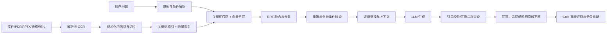

# RAG 模块学习与面试手册

> 基于 `everything-finder` 当前源码和截至 2026-11-05 的实验记录整理。本文区分**已在生产链路实现**、**可选但默认关闭**、**仅隔离实验**。实验数字仅对应指定题集、索引和评测口径，不代表线上准确率。项目是 Windows 本地多格式资料搜索和问答工具；示例业务包括免疫、生化设备培训资料中的故障排查、参数、流程与跨机型适用性。

## 先建立全局图

一次请求至少要分清四个问题：**资料有没有被正确解析和索引？正确证据在哪个阶段消失？模型拿到正确证据后有没有正确决策和作答？评测标签与裁判本身可靠吗？** 不要把“最终答案错”一概归因于模型。

## 1. 数据接入、解析与 OCR

**业务与实现。** 企业知识散落在 PDF、Word、PPTX、Excel 和扫描件中。解析层把文本、页码/幻灯片、文件路径等变成可追溯的块；扫描页走 OCR。项目复用既有全文索引的解析与 `search_blocks`，RAG 的 `BlockReader` 读取块，再建立 AI 索引。表格的“行、列、表头、单位、空值”会影响问题是否可答，例如“报警代码 CSDB 对应哪个原因”不能只提取到一整页混合报警表。入口见 [`block_reader.py`](../local_full_text_search/rag/block_reader.py)、[`parser_registry.py`](../local_full_text_search/parsers/parser_registry.py) 和 [`index_builder.py`](../local_full_text_search/rag/index_builder.py)。

**优缺点。** 复用成熟解析链路减少重复开发，来源定位便于追责；OCR 可覆盖图片资料。代价是 OCR 错字、阅读顺序错乱、跨页步骤断开、表头丢失会向后续模块传播。单纯提高检索 TopK 不能补回索引中不存在的文字。

**术语/参数。** 解析成功率＝成功处理文件数/应处理文件数；OCR 字符错误率 CER＝编辑距离/参考文字长度；覆盖率可按文件、页、表、行分别计算。项目默认 `ocr_min_confidence=0.60`，但置信度是识别器自评分，不等于事实正确率；`block_target_chars=4096` 是上游全文块目标长度，并非 RAG 片段长度。排查时先查原文件→解析块→索引正文，比较关键数值、单位、表头、页码与顺序；再看失败文件清单和 OCR 日志。

**面试表达。** “我先建立资料入库门禁，逐层核对原文、结构块和可检索文本。表格场景还核对列值绑定，避免检索到同页另一行后回答错误报警码。”可举已记录的隔离实验：74 份 PPTX 中发现 491 个原生表格，保守结构提取接受 256 个、回退 235 个；这说明覆盖边界，**不能**称所有表格已解决。见[资料结构验证](rag_structured_material_validation_20261105.md)。

## 2. 切片、元数据与索引版本

**业务与实现。** 切片把长资料转成适合检索和模型输入的证据单位，并保留文件、页码、稳定 ID。项目 `ChunkBuilder` 按来源边界分组，优先在句/行边界截断，设置重叠；AI 索引以已发布 bundle 供查询，查询时检查源 generation 与模型版本，避免索引和模型错配。见 [`chunk_builder.py`](../local_full_text_search/rag/chunk_builder.py)、[`index_store.py`](../local_full_text_search/rag/index_store.py)。

**优缺点。** 小片段定位精确、噪声少，但容易切断条件、单位和步骤；大片段保留上下文，却会把同页反例带进来，浪费 token。重叠降低边界损失，也增加重复候选和索引成本。项目默认目标 900 字、最大 1200 字、重叠 120 字；可选细粒度向量单元目标 128 token、最大 192、重叠 32，默认后端仍是 `legacy`。

**术语/参数。** chunk size、overlap、parent-child retrieval、metadata、stable ID、snapshot/bundle。查看“正确原文是否完整在某一片段”“适用机型/阶段是否与结论同片段”“源文件改动后 bundle 是否过期”。若索引中的证据缺失，先修解析/切片；若索引有证据但检索不到，才查召回。

**面试表达。** “我按来源边界切片并保留页码、稳定 ID、索引版本。调切片尺寸时同时看完整证据覆盖和反例混入，不只看文本相似度。”面试中不要把默认参数说成经过全量最优调参。

## 3. Embedding 与向量索引

**业务与实现。** 把文档片段和问题映射到向量空间，找语义相近的证据，适合“发光值偏低”与“信号偏弱”等用词不同的提问。项目本地 BGE Embedding、向量缓存和 Chroma；向量模型 ID、revision、维度与索引元数据必须一致。可选 `unit_v2` 为细粒度单元建索引并归并回父片段。见 [`local_bge.py`](../local_full_text_search/rag/embeddings/local_bge.py)、[`chroma.py`](../local_full_text_search/rag/vector_store/chroma.py)。

**优缺点。** 能找到词面不相同的语义证据；但短代号、型号、数字、否定词和细微业务范围容易混淆。向量索引占空间、构建耗时，模型换版通常需要重建。项目默认模型 `BAAI/bge-small-zh-v1.5`；HNSW 默认 `M=16`、`construction_ef=200`、`search_ef=100`，分别影响图连接数、构建搜索宽度、查询搜索宽度，通常更大意味着更多资源或耗时，实际效果需测。

**术语/参数。** 向量维度、余弦相似度、ANN/HNSW、召回率@K、索引新鲜度。若向量召回差：检查原文是否入库→Embedding 模型与版本一致→问题文本是否被错误改写→候选 K 是否太小→代号/数字是否需要关键词路线。项目 `rag_vector_top_k=50`、`rag_min_vector_score=0.35` 是默认值，不是通用阈值。

**面试表达。** “语义召回负责同义改写，型号和报警码依靠词面检索兜底；我用分阶段 Gold 命中率验证两路互补。”一次旧版检索诊断中，向量召回在有正证据的 46 题里至少命中 45 题，但这只说明该索引和题集的候选覆盖，见[阶段诊断](rag_eval_20261030_stage_analysis.md)。

## 4. 关键词检索与混合召回

**业务与实现。** 关键词路线抓精确型号、错误码、术语、数值；向量路线抓语义。项目有 `legacy` 关键词检索和可选 `word_v2`/多路方案；混合检索用 RRF 融合两个排名，然后去重。见 [`lexical.py`](../local_full_text_search/rag/retrieval/lexical.py)、[`hybrid.py`](../local_full_text_search/rag/retrieval/hybrid.py)、[`candidate_deduplicator.py`](../local_full_text_search/rag/candidate_deduplicator.py)。

**优缺点。** 混合通常比单一路线稳，尤其在精确编码与口语问法并存时；但候选合并、去重和截断可能把正证据丢掉。RRF 只用名次，跨检索器分数不必直接比较，但不理解业务适用条件。项目默认 `lexical_top_k=50`、`vector_top_k=50`、`fusion_top_k=30`、`rrf_k=60`。RRF 典型形式为 `Σ 1/(k + rank_i)`；`k` 越大，名次差距权重越平缓。

**术语/参数。** BM25 的 `k1` 控制词频饱和，`b` 控制长度归一；项目可选词检索默认 `k1=1.2`、`b=0.75`，标题权重 `0.2`。Recall@K＝含至少一条合格证据的题数/有正证据题数；多证据覆盖率＝每题完整命中证据数/该题标注证据数再求平均。若一路能召回、融合后丢失，看融合名次与 `fusion_top_k`；若两路都找不到，看解析、切片、查询表达和索引。若去重后丢失，看代表片段选择和同源证据是否被误合并。

**面试表达。** “我用关键词加向量双路召回、RRF 融合，逐阶段记录正例退出原因。在一次 50 题 retrieval-only 诊断中，融合阶段至少命中 45/46，道最终上下文只有 39/46；主要损失在后续筛选，不能把问题简单归结为召回模型。”这次运行没有调用生成模型，不能报告答案正确率。

## 5. 重排、业务条件与证据筛选

**业务与实现。** 召回的片段“相关”不等于“能回答当前问题”。重排器用 Cross-Encoder 对问题和候选一起评分；项目还结合前置排名与答案支持度。条件检查核对机型、项目范围、阶段、方向和对象，证据策略再按分数、文档配额和最终预算选材。见 [`local_bge.py`](../local_full_text_search/rag/reranking/local_bge.py)、[`constraint_matcher.py`](../local_full_text_search/rag/constraint_matcher.py)、[`evidence_policy.py`](../local_full_text_search/rag/evidence_policy.py)。

**优缺点。** Cross-Encoder 比向量距离更能看问题与证据的交互，但本地推理较慢；业务规则可挡跨机型、跨阶段的误用，也可能因泛化词误伤正确证据。文档配额增加来源多样性，却可能让同一资料的后续步骤丢失。项目默认重排入口 20、最终 8、每文档最多 3、重排最低分 0.10；混合权重为 Cross-Encoder 0.65、前置检索 0.05、答案支持度 0.30。这些是代码默认值，运行配置可能不同。

**术语/参数。** Cross-Encoder、MRR@K（首条正证据倒数名次均值）、NDCG@K（考虑分级相关性的位置质量）、hard negative（高度相似但条件不符的反例）、文档配额。排查时按 `召回→融合→去重→重排→条件检查→最终选材` 逐层对稳定 ID 和原文；查 `fusion_top_k_cutoff`、`final_top_k_cutoff`、`document_limit` 等退出原因。候选排名提高而最终上下文不变，不算答案取证改善。

**面试表达。** “我用强负例检查场景误配，并把排序指标和最终上下文指标分开。纯模型重排在一个反复调试的开发集上前 8 命中从 41/46 到 44/46，但新 10 题仍待审核、且存在等价证据口径争议，所以没有直接切换生产。”见[重排对照](rag_rerank_dev_holdout_validation_20261101.md)。

## 6. 问题理解、澄清与查询规划

**业务与实现。** 用户可能同时问多个项目、阶段或故障方向；也可能缺少决定处理路径的条件。`QueryInterpreter`/`QueryAnalyzer` 提取检索词和业务条件，`ClarificationPolicy` 判断是否追问；语义澄清候选默认关闭。见 [`query_interpreter.py`](../local_full_text_search/rag/query_interpreter.py)、[`clarification.py`](../local_full_text_search/rag/clarification.py)。

**优缺点。** 条件化检索能减少“样本检测”被“定标阶段”资料误导；但规则过严会漏检，过松会跨场景回答。追问可以防止用户条件不明时选错步骤，但泛化问题不应被迫填写机型表单。多意图问题需要逐部分判断可答、需用户补充、资料缺失或资料冲突。

**术语/参数。** query rewrite、intent、slot/constraint、hard/soft constraint、clarification rate、误追问率、漏追问率。指标不好时先核对用户原问与解析快照：是否擅自补条件，是否把“所有项目”错误作用于某一个分支，是否把“资料没有”误判为“用户没说”。项目默认 `rag_clarification_enabled=true`，语义澄清默认 `false`。

**面试表达。** “我把澄清、部分回答、拒答分成不同业务决策，先看是否缺少会改变操作路径的条件，而不是机械地要求每题都有机型。”当前单请求回答决策候选在 10 种固定输入、两方案各 3 次中未通过门槛，未接入生产；见[隔离验证](rag_answer_decision_validation_20261105.md)与[修复方案](rag_repair_plan_20261105.md)。

## 7. 上下文构造、生成与引用

**业务与实现。** 证据进入上下文后，LLM 将其组织成面向用户的答案。项目 `ContextBuilder` 为证据分配来源编号，生成网关调用兼容 OpenAI 的接口，`CitationValidator` 检查引用编号与结构；可选答案二次审查。见 [`context_builder.py`](../local_full_text_search/rag/context_builder.py)、[`openai_compatible.py`](../local_full_text_search/rag/generation/openai_compatible.py)、[`citation_validator.py`](../local_full_text_search/rag/citation_validator.py)、[`answer_service.py`](../local_full_text_search/rag/answer_service.py)。

**优缺点。** 生成可把多页资料综合成可读答案；风险是遗漏必要事实、无依据数字、跨机型套用、引用了错误行。引用格式正确只能证明编号存在，不能证明该句被引用原文支持。额外审查可能提升发现率，但增加调用、耗时和新的裁判误判；默认值 `rag_answer_review_enabled=true`，旧设置迁移可保持关闭，实际运行要查设置。

**术语/参数。** context window、token budget、groundedness/faithfulness、citation precision、answer completeness、拒答准确率、P50/P95 延迟。项目默认上下文最多 12,000 字、最终最多 8 段；网关超时默认 90 秒。若“证据已在上下文但答错”，检查实际送模文本是否截断、源编号是否对应、提示与模型输出、答案每个事实是否由对应来源支持；若同输入多次有不同答案，固定上下文重复运行并单列波动。若“只有一个子问题缺证据”，应测部分回答，不应只看全局通过率。

**面试表达。** “我把证据命中与答案事实检查分开；引用编号校验之后，还复核具体断言和原句的对象、条件、单位。若资料不足，系统应明确边界，不能让错误状态伪装成业务拒答。”当前[修复方案](rag_repair_plan_20261105.md)列出尚待解决的部分回答与追问问题，不能说已修复。

## 8. Gold 测试集、分阶段评测与实验设计

**业务与实现。** Gold 是独立于系统输出的业务标准：原问题、预期行为、条件、原文证据、强负例、必须事实、禁止主张、审核状态。只有人工 `reviewed` 进入正式计分；`pending`/`disputed` 单列。项目的 `gold_loader`、`runner`、`stage_scoring` 和 HTML 报告把各阶段候选、答案、耗时与 Gold 对照。见 [`rag_gold_v3.md`](../tests/rag/fixtures/rag_gold_v3.md)、[`gold_loader.py`](../local_full_text_search/rag/evaluation/gold_loader.py)、[`stage_scoring.py`](../local_full_text_search/rag/evaluation/stage_scoring.py)。

**优缺点。** 可定位问题、做回归和 A/B 消融；缺点是标注贵，等价证据难穷尽，人工裁判也会分歧，反复调参后的题集不再是盲测。不能根据系统现有答案反推 Gold，也不能把某次自动裁判判分当成人工准确率。

**术语/参数。** `Recall@K` 衡量候选覆盖；`MRR@K` 看首条正确证据位置；完整证据覆盖看多证据题；`NDCG@K` 适合 0/1/2 分级相关性；答案指标至少分行为匹配、必要事实覆盖、禁止主张、引用支持和错误率。服务指标看 P50/P95、超时率、额外调用数；成本指标看建索引时间、磁盘、模型调用。实验要固定索引 bundle、Gold 版本、上下文、模型、提示和参数；单改一个机制，记录输入变化、运行异常与逐题退步。外部盲测应与开发题分开。

**面试表达。** “我做了分阶段而非只看最终答对率的评测。旧版 50 题 retrieval-only 报告中有 46 题具备正证据，最终上下文命中 39/46；这直接定位到候选截断和证据筛选。后续按审核状态把正式题、待审题、回归题分开，不把待审题算进正式分数。”注意旧报告的 50 题与后续口径的 48 道正式题不能直接横向比较；见[阶段诊断](rag_eval_20261030_stage_analysis.md)、[后续方案](rag_repair_plan_20261105.md)。

## 一张排障速查表

| 现象 | 优先核对 | 常见原因与下一步 |
|---|---|---|
| 正确资料完全搜不到 | 原文件→解析块→AI bundle | OCR/表格解析丢失、索引旧、模型版本不匹配；先修入库 |
| 关键词有、向量无 | 两路前 K、问题向量、型号/数字 | 语义模型不擅长代号；保持精确路线，核对模型与索引 |
| 两路有、融合或去重后无 | 候选稳定 ID、排名、去重代表 | `fusion_top_k` 截断或误合并；调候选/代表策略并做回归 |
| 重排前有、最终上下文无 | 重排、条件、配额、字数逐层 trace | 条件误伤、同文档配额、TopK 截断；不要盲目放大所有预算 |
| 上下文正确、答案仍错 | 实际提示、输出、引用原句、重复运行 | 漏答、错用条件、幻觉、模型波动；按事实逐条复核 |
| 追问或拒答不合适 | 原问实际诉求、缺少的决定条件、资料覆盖 | 区分用户缺信息和资料缺信息；检查部分回答路径 |
| 报告突然变好/变坏 | Gold 审核与口径、索引/模型/提示哈希 | 数据集变动、裁判分歧、同输入波动；先做同口径配对 |

## 面试时可使用的完整项目叙述

> “我做的是本地多格式企业资料的 RAG 问答。资料经解析/OCR、带位置的切片、关键词和向量双路索引后，查询走问题条件解析、RRF 融合、Cross-Encoder 重排、业务条件检查和证据筛选，再由 LLM 生成带来源的答案。评测上，我建立独立 Gold，包含正证据、强负例、预期行为和审核状态，按召回、融合、重排、最终上下文、答案逐层计分。一次 50 题的检索诊断中，46 题有正证据，融合至少命中 45 题，最终上下文只命中 39 题；因此我把主要排查方向放在截断、配额和条件误伤，而不是盲目换 Embedding 模型。候选修复先做固定索引、固定预算的配对实验，对待审题和裁判争议单列，未通过门槛的不直接上线。”

这个叙述中的数字来自特定历史实验；面试追问时应补充：它是 **retrieval-only、本地资料、指定索引与题集**，不是线上用户满意率或最终答案准确率。后续某些实验用 48 道正式题、59 道总题或 10 道待审题，集合不同，必须先说清口径。项目当前有未提交的其他开发改动，本文只作为学习说明，不表示这些候选算法已发布。

## 建议学习顺序

1. 读一次 `AnswerService._execute()`，画出候选数量从 50/50 到 30、20、8 的变化，并用 trace 找一个丢失 Gold 的具体题。
2. 对同一题分别查看原文件、解析块、chunk、两路召回、最终上下文和模型答案，自己解释“哪一层首次丢失”。
3. 用 1 条正例、1 条同页错误行、1 条跨机型强负例设计 Gold；人工确认页码和完整原句。
4. 再比较切片、BM25、Embedding、RRF、重排和上下文预算，固定其他条件一次只改一项。

核心源码入口：[`answer_service.py`](../local_full_text_search/rag/answer_service.py)。历史报告均在本目录的 `rag_*.md`；阅读实验时优先看“题集/审核状态、索引版本、是否生成答案、是否改生产、是否存在回退”五项。
