# 01 现状架构分析

> 分析日期：2026-10-10 
> 分析范围：当前 Git 工作区源码、配置、测试与项目文档；未读取用户业务资料、正式索引、配置值或日志内容。 
> 阶段边界：仅分析与低风险隔离测试，未启动 GUI、未扫描真实目录、未安装或升级依赖、未修改业务源码。

## 1. 结论摘要

这是一个面向 Windows 的本地离线多格式全文搜索桌面应用，技术栈为 Python 3、PySide6、SQLite FTS5、PyMuPDF、python-docx、openpyxl、python-pptx，以及可选的 PaddleOCR。程序把文档解析成带位置元数据的 `ContentBlock`，写入 SQLite，并用 FTS5 `trigram` 做候选召回，再在 Python 中执行字符串级确认和文件级排序。

当前项目**没有** LLM、Embedding、向量数据库、RAG 或 Agent 调用链。它已有较成熟的文件解析、增量索引、内容去重、不可变索引快照、来源定位、OCR 调度和桌面 UI，这些是升级 RAG 最有价值的基础。

当前检出环境存在一个必须先处理的阻断项：`ocr_models/manifest.json` 记录的模型文件大小与实际文件不一致。例如 `PP-OCRv4_mobile_det/inference.yml` 预期 956 字节、实际 903 字节，模型完整性保护因此拒绝 OCR。代码层面的 OCR 接入已经核实，但当前模型资产没有通过运行验证。

## 2. 证据等级

| 标记 | 含义 |
|---|---|
| 已核实 | 已定位到实际代码路径与调用点 |
| 已验证 | 已通过本次隔离测试运行验证 |
| 部分实现 | 主链存在，但存在格式、依赖、稳定性或验收缺口 |
| 未验证 | 本次未启动 GUI、未使用真实大目录或真实 Office/OCR 环境验证 |
| 未实现 | 代码和依赖中均未发现相应能力 |

## 3. 主要技术栈与运行入口

| 范畴 | 当前实现 | 证据 |
|---|---|---|
| 桌面 UI | PySide6，多页面主窗口、后台线程搜索和索引 | `requirements.txt`；`local_full_text_search/ui/main_window.py:176` |
| 应用入口 | `app.py:2578` 的 `main()`；加载设置、解析索引目录、初始化控制库、创建主窗口 | `app.py:2578-2913` |
| 数据库 | SQLite，控制库 + generation 候选/发布快照 | `app.py:2811-2839`；`core/index_generation_store.py:400-955` |
| 全文索引 | SQLite FTS5，优先 `tokenize='trigram'`，不支持时回退默认 tokenizer | `core/database.py:1770-1817` |
| 文档解析 | PyMuPDF、python-docx、openpyxl、python-pptx、lxml 流式 OOXML | `requirements.txt`；`parsers/parser_registry.py:24-86` |
| OCR | PaddleOCR + 本地模型、图片/扫描 PDF、缓存与自适应区域识别 | `requirements-ocr.txt`；`ocr/ocr_engine.py:47`；`parsers/pdf_parser.py:99` |
| Windows 能力 | Office/WPS COM、USN Journal、单实例、文件定位 | `parsers/legacy_office_parser.py:348-580`；`core/usn_journal.py` |
| 打包 | PyInstaller + Inno Setup | `LocalFullTextSearch.spec:134-154`；`installer/LocalFullTextSearch.iss` |
| 当前版本 | `1.6.15` | `local_full_text_search/version.py:7` |

开发启动脚本 `run_dev.bat` 会在缺少虚拟环境时创建 `.venv`，随后升级 pip、安装 `requirements.txt` 并运行 `app.py`。因此它不是“只启动”命令，本阶段没有执行。手工入口是 `python app.py`，打包入口是 `build.bat`。

默认数据位于 `%LOCALAPPDATA%/LocalFullTextSearch/`，包括 `data`、`logs`、`config`、`cache` 和 `temp`；路径定义见 `config/constants.py:97-116`。没有发现常见的 `.env`、私钥或凭据文件，但这不代表正式用户目录中不存在敏感配置。

## 4. 代码目录与职责

| 路径 | 职责 | 关键位置 |
|---|---|---|
| `app.py` | 启动诊断、命令行验证入口、依赖加载、GUI 创建 | `app.py:32-51, 2578-2913` |
| `config/` | 支持格式、默认路径、索引/OCR/ZIP/并发参数 | `constants.py:10-115`；`defaults.py:9-117` |
| `models/` | 内容块、文件、搜索查询与搜索结果数据模型 | `content_block.py:7-20`；`search_query.py:7-29`；`search_result.py:7-50` |
| `parsers/` | 各格式解析器、ZIP 安全处理、解析器注册 | `parser_registry.py:24-86` |
| `ocr/` | OCR 模型校验、推理、缓存、微批次、自适应区域规划 | `model_manifest.py:15-47`；`ocr_engine.py:47-1018` |
| `core/database.py` | schema、迁移、文件/文档/块持久化、FTS、索引门禁 | `database.py:358-8980` |
| `core/index_manager.py` | 文件发现、任务规划、分 lane 并发、解析、写入、恢复 | `index_manager.py:1007-10797` |
| `core/index_generation_store.py` | 候选库、不可变已发布 generation、原子 manifest、租约 | `index_generation_store.py:400-1120` |
| `core/search_engine.py` | FTS/LIKE/扫描候选、精确确认、文件级聚合和排序 | `search_engine.py:71-1492` |
| `core/block_coalescer.py` | 将相邻小块合并到约 4096 字符，最大 16384 字符 | `block_coalescer.py:9-73` |
| `workers/` | Qt 后台线程中的扫描、搜索、迁移与快照任务 | `scan_worker.py:39`；`search_worker.py:27` |
| `ui/main_window.py` | UI 编排、搜索/索引线程生命周期、设置与状态显示 | `main_window.py:176-5650` |
| `services/` | 设置、日志、数据库位置、启动诊断、单实例、USN 服务 | `database_location_service.py:27-265`；`logging_service.py` |
| `tests/` | 71 个测试模块、509 个测试函数/方法 | 本次通过静态计数核实 |
| `tools/`、`benchmarks/` | 隔离测试、构建、发行校验、性能和现场验证工具 | `tools/run_pytest_isolated.ps1` 等 |

## 5. 核心数据流

```mermaid
flowchart LR
    UI[PySide6 主窗口] --> SW[ScanWorker]
    SW --> CAND[候选 generation DB]
    SW --> IM[IndexManager]
    IM --> DISC[目录扫描 / USN 增量计划]
    DISC --> REG[ParserRegistry]
    REG --> PARSE[文本 PDF Office OCR ZIP 解析]
    PARSE --> BLOCK[ContentBlock + 位置元数据]
    BLOCK --> COAL[BlockCoalescer]
    COAL --> DB[(documents / files / content_blocks)]
    DB --> FTS[(content_fts / files_fts)]
    FTS --> GATE[完整性门禁]
    GATE --> PUB[原子发布只读 generation]

    UI --> Q[SearchQuery]
    Q --> WK[SearchWorker]
    WK --> PUB
    PUB --> SE[SearchEngine]
    SE --> RET[FTS5 / LIKE / 全扫描候选]
    RET --> VERIFY[Python 字符串确认]
    VERIFY --> RANK[文件级聚合与启发式评分]
    RANK --> VIEW[结果卡片 / 预览 / 打开定位]
```

### 5.1 导入与索引调用链

1. 用户在 UI 添加搜索根目录并触发更新：`MainWindow.add_root()`、`start_scan()`，见 `ui/main_window.py:1551, 1625`。
2. `ScanWorker.run()` 创建独立候选 generation，并初始化候选数据库，见 `workers/scan_worker.py:116-218`。
3. `IndexManager.index_enabled_roots()` 遍历启用根目录，进入 `index_root()`，见 `core/index_manager.py:1654-1950, 2378`。
4. 增量路径优先尝试 NTFS USN Journal；不可用时退回目录对比，见 `core/index_manager.py:2458-2517`。
5. 扫描器排除隐藏文件、临时文件和指定目录；遍历失败会抛出异常，避免错误地把旧文件标记为删除，见 `core/scanner.py:12-58`。
6. 任务由 `ParserRegistry.parser_for()` 按后缀选择解析器，见 `parsers/parser_registry.py:82-86`。
7. `parse_file_with_registry()` 调用解析器，把逻辑块交给 `BlockCoalescer` 合并和标准化，见 `core/index_manager.py:9819-9927`。
8. `DatabaseManager.replace_document_blocks_many()` 写入文档、文件和内容块，并推进 FTS 投影，见 `core/database.py:2902-2945`。
9. `ScanWorker` 检查 readiness；通过后由 `IndexGenerationStore.publish()` 生成紧凑只读快照并原子替换 manifest，见 `workers/scan_worker.py:302-446`、`core/index_generation_store.py:890-955`。
10. 失败或取消不会替换上一版已发布索引，代码证据见 `workers/scan_worker.py:305-306, 463-499`。

### 5.2 搜索调用链与真实算法

1. UI 组装 `SearchQuery` 并启动 `SearchWorker`，见 `ui/main_window.py:2063-2103`。
2. `SearchWorker` 读取当前 manifest，取得只读 generation 和租约，再创建 `SearchEngine`，见 `workers/search_worker.py:48-91`。
3. `SearchEngine` 在一个只读事务快照内先搜索文件名/路径，再搜索正文，见 `core/search_engine.py:86-198, 439-526`。
4. 当所有查询项长度至少 3、不是正则/忽略空白/忽略连字符且 FTS 表确为 trigram 时，使用 `MATCH`；否则短词使用 `LIKE`，正则或兼容模式执行全扫描，见 `core/search_engine.py:689-806, 910-1076`。
5. FTS 只负责候选召回。候选文本在 `_matches()` 中再次执行包含、全部词、任一词或正则确认，见 `core/search_engine.py:1252-1297`。
6. 评分不是 BM25：基础分是命中次数；文件名完全相等、前缀、包含分别加 1000/500/250；元数据命中加 50；OCR 命中减 25，见 `core/search_engine.py:1356-1367`。
7. 同一文件的多个命中块被合并，默认最多处理 20 个块；结果按文件聚合，而不是按证据块排序，见 `core/search_engine.py:300-305, 395-423, 1421-1454`。

因此，项目当前是“文件名 + 路径 + 正文全文强匹配”，不是语义检索；没有同义词扩展，也没有向量相似度、BM25 排名或模型重排。

## 6. 数据结构与可追溯性

### 6.1 主要表

| 表 | 作用 | 关键字段 |
|---|---|---|
| `roots` | 搜索范围 | `id, path, enabled, include_subfolders` |
| `documents` | 按内容和解析器版本去重的逻辑文档 | `content_key, parser_name, parser_version, block_count` |
| `files` | 物理文件或 ZIP 成员引用 | `id, path, document_id, parse_status, container_file_id, internal_path, content_hash_full` |
| `content_blocks` | 原文块及定位信息 | `id, document_id, block_index, raw_text, page_number, slide_number, sheet_name, cell_start/end, line_start/end, source_type` |
| `content_fts` | 正文 trigram FTS 投影 | `block_id, normalized_text` 等 |
| `files_fts` | 文件名/路径 trigram FTS 投影 | `file_id, filename, path` |
| `parse_tasks` | 可恢复解析任务和语义进度 | 阶段、游标、重试、checkpoint、worker PID |
| `index_runs` | 索引运行指标 | 模式、耗时、峰值内存、summary |

schema 证据：`core/database.py:1165-1358, 1770-1817`。

### 6.2 来源定位能力

`ContentBlock` 已直接包含页码、幻灯片、工作表、单元格范围、行范围、来源类型和 OCR 置信度，见 `models/content_block.py:7-20`。搜索结果将这些字段复制到 `SearchHit`/`SearchResult`，见 `core/search_engine.py:1379-1418`。

打开定位也确实使用这些结构化字段：PDF 页、Word 段落/表格、Excel 工作表与行、PPT 幻灯片、文本行，见 `core/open_location.py:47-80, 159-345`。

限制：

- PDF 页码、PPT 幻灯片、Excel 工作表/行和文本行较稳定。
- DOCX 没有通用“真实页码”，主要使用段落、表格行和页眉页脚位置；分页会受 Word 排版环境影响。
- 合并块只保留首块的页码/幻灯片/工作表，并把范围放进 `location_text` 或 `extra`；这对 RAG 精细引用不够严格，见 `core/block_coalescer.py:42-73`。
- `file_id`、`block_id` 是某一 generation 内的数据库 ID；跨 generation 的稳定引用应另建稳定 `chunk_id`，不能只保存裸 `block_id`。

## 7. 文件格式能力矩阵

| 格式/能力 | 状态 | 实现与定位 | 本次验证 |
|---|---|---|---|
| TXT/LOG/CSV/MD/JSON/XML/INI | 已实现 | 分块读取并记录行范围，`parsers/text_parser.py:20-58` | 4 项通过 |
| PDF 原生文本 | 已实现 | 按页提取，`parsers/pdf_parser.py:136-292` | 原生路径相关测试通过 |
| 扫描 PDF OCR | 部分实现 | 页面判定、渲染和 OCR，`parsers/pdf_parser.py:294-1082` | 因模型清单不一致未通过当前环境验证 |
| DOCX | 已实现 | 段落、表格、页眉页脚；优先流式 OOXML，`parser_registry.py:28-42` | 基础测试通过 |
| XLSX/XLSM | 已实现 | 工作表、行、单元格范围；流式解析和共享字符串磁盘模式 | 基础测试通过 |
| PPTX | 已实现 | 幻灯片文字和备注，`ooxml/pptx_stream_parser.py:63-105` | 基础测试通过 |
| 图片 OCR | 部分实现 | `ImageParser` + `OcrEngine`，低像素跳过、自适应区域识别 | 当前模型资产完整性失败 |
| ZIP | 已实现 | 数量、总解压大小、深度、加密和路径穿越保护；支持嵌套 | 15/16 通过，失败项依赖 OCR 模型 |
| DOC/XLS/PPT | 部分实现 | Office/WPS COM 优先，LibreOffice 回退，再交给 OOXML 解析 | 依赖本机转换器；本次未做真实转换 |
| 视频 | 仅元数据 | 只索引文件名/路径，`parsers/metadata_parser.py:11-28` | 静态核实 |
| 其他压缩格式 | 未实现 | 仅 `.zip` 在支持列表 | 静态核实 |

ZIP 安全边界由 `max_zip_file_count=2000`、`max_zip_uncompressed_bytes=1 GiB`、`max_zip_depth=2` 控制，见 `config/defaults.py:93-95`；路径拒绝绝对路径和 `..`，见 `parsers/zip_parser.py:536-541`。

## 8. 功能覆盖矩阵

| 业务能力 | 结论 | 说明 |
|---|---|---|
| 文件名搜索 | 已实现、已验证 | 独立 `files_fts` 和 Python 确认 |
| 正文全文搜索 | 已实现、已验证 | FTS5 trigram + LIKE/全扫描回退 |
| 精确包含/全部词/任一词/短语/正则 | 已实现、已验证 | `SearchQuery.mode` 与 `_matches()` |
| 模糊拼写 | 未实现 | UI 中的 OCR “疑似”是置信度筛选，不是编辑距离纠错 |
| 同义词搜索 | 未实现 | 未发现词典或查询扩展 |
| 语义/向量检索 | 未实现 | 无 Embedding、向量索引或相关依赖 |
| RAG 问答与引用 | 未实现 | 无 LLM 网关、上下文组装或回答模型 |
| Agent/工具调用 | 未实现 | 无 tool schema、调度或执行记录 |
| 增量更新 | 已实现、已验证 | 文件身份、目录对比、可选 USN、删除标记 |
| 内容去重 | 已实现、已验证 | `documents` + `content_key` + parser 版本；ZIP/目录重复复用 |
| 索引原子发布与回滚 | 已实现、测试覆盖 | building DB 经 readiness 后发布；旧 generation 保留 |
| 来源定位 | 已实现，精度因格式而异 | 结构化页/幻灯片/表格/行字段 |
| 完全离线核心搜索 | 已核实 | 依赖均为本地库；未发现网络 API 调用 |
| 大规模真实语料性能 | 未验证 | 有基准和指标代码，本次未运行真实目录 |

## 9. 测试与运行证据

本次通过仓库要求的 `tools/run_pytest_isolated.ps1`，并设置独立临时 `LFTS_APP_DATA_DIR`，运行搜索、增量索引、ZIP、DOCX、XLSX、PPTX、文本、PDF、schema 去重相关模块：

- 合计 63 项：57 通过，6 失败。
- 搜索 16/16、增量索引 8/8、DOCX 1/1、XLSX 2/2、PPTX 1/1、文本 4/4、schema 去重 6/6 通过。
- ZIP 15/16、PDF 4/9；6 个失败均收敛到同一环境问题：OCR 模型 manifest 与实际文件大小不一致。
- 没有运行全部 509 项测试，也没有启动 GUI、冻结版、Office/WPS/LibreOffice 或真实大目录。
- 仓库自身状态文档也明确记载：历史完整 pytest 在约 57% 后被人工中止，不能宣称全量通过，见 `docs/当前实现进度与注意事项.md:51-57`。

## 10. 关键代码定位索引

| 主题 | 路径与位置 | 作用/调用方 |
|---|---|---|
| 应用启动 | `app.py:2578-2913` | 初始化服务并创建 `MainWindow` |
| UI 启动索引 | `ui/main_window.py:1625-1711` | 创建 `ScanWorker`/QThread |
| UI 启动搜索 | `ui/main_window.py:2040-2103` | 创建 `SearchQuery` 和 `SearchWorker` |
| 候选 generation | `workers/scan_worker.py:116-218` | 建立 building DB |
| 索引门禁与发布 | `workers/scan_worker.py:302-446` | readiness 后原子发布 |
| 增量计划 | `core/index_manager.py:2378-2517` | USN 或目录对比 |
| 解析入口 | `core/index_manager.py:9819-9927` | parser → block → coalescer → outcome |
| 解析器注册 | `parsers/parser_registry.py:24-86` | 后缀选择及共享 OCR |
| schema | `core/database.py:1165-1358` | roots/documents/files/blocks/tasks |
| FTS schema | `core/database.py:1770-1817` | trigram FTS5 |
| 搜索候选 | `core/search_engine.py:651-1076` | FTS/LIKE/扫描 SQL |
| 精确确认和评分 | `core/search_engine.py:1252-1419` | Python 匹配、启发式打分 |
| 紧凑发布快照 | `core/compact_snapshot_schema.py:29-210` | 只保留搜索必需数据 |
| 来源打开 | `core/open_location.py:47-345` | PDF/Office/文本定位 |
| 模型完整性 | `ocr/model_manifest.py:15-47` | 校验 manifest 中所有模型大小 |

## 11. 风险与技术债（按优先级）

### P0：当前 OCR 模型资产完整性失败

代码在任何图片/PDF OCR 前校验整个模型 manifest；一处大小不一致会让相关任务失败。必须先确认模型文件为何与 manifest 不一致，并用受控方式重新生成或恢复匹配的模型包。不能简单删除校验。证据：`ocr/model_manifest.py:31-43`，本次 6 个失败用例。

### P1：RAG 不能直接复用文件级 `SearchResult` 作为证据接口

现有搜索为 UI 优化，按文件聚合、每文件最多 20 块，并只对选中窗口水化正文。它适合展示文件，不适合严格的 top-k 证据块排序。RAG 应复用其 SQL/标准化逻辑，但新增“块级检索接口”。证据：`core/search_engine.py:300-305, 503-526`。

### P1：现有块粒度不等于 RAG chunk

相邻段落/行会合并到约 4096 字符，最大 16384 字符；对 embedding 和上下文窗口偏大，且跨段合并可能稀释语义。应从已解析逻辑块生成独立 RAG chunk，不应破坏当前 FTS block 或索引格式。证据：`config/defaults.py:53-54`、`core/block_coalescer.py:9-73`。

### P1：跨 generation 引用需要稳定 ID

当前 `file_id/block_id` 只在特定快照中可靠。RAG sidecar 必须记录 `generation + document content key/parser version + block order + text hash + file reference`，否则重建索引后引用可能指向错误片段。

### P1：测试基线并非全绿

本次存在 6 个 OCR 相关失败；历史全量测试也未完成。V1 不能在这一事实未记录的情况下宣称“基线稳定”。建议先固定一组不依赖 OCR 的回归集，再单独修复 OCR 资产基线。

### P1：数据出网和 Prompt Injection 尚无边界

当前应用完全本地，新增外部 LLM/Embedding 会改变隐私模型。必须默认禁用外发、明确显示在线状态、只使用公开/模拟资料测试，并把检索文本视为不可信数据，禁止其中指令改变系统规则或触发工具。

### P2：搜索排序是启发式，不是检索相关性评分

当前没有 BM25 或训练/评测过的排序。文件名奖励很高，正文结果按命中数累加，OCR固定扣分；这些规则适合强匹配 UI，但不应直接当作 RAG 相关性分数。混合检索应使用 rank fusion，不要直接相加异构分数。

### P2：紧凑快照包含自定义解码视图

`search_blocks` 依赖 `decode_text()` SQLite UDF；新模块应通过现有 `DatabaseManager.connect_read_only()` 打开快照，不要用裸 `sqlite3.connect()` 假定视图随时可读。证据：`core/compact_snapshot_schema.py:96-155`、`core/database.py:933-984`。

### P2：旧版 Office 依赖外部桌面组件

DOC/XLS/PPT 需要 Microsoft Office、WPS 或 LibreOffice；转换器缺失时不能保证正文可用，且 COM 自动化具有平台和进程生命周期风险。证据：`parsers/legacy_office_parser.py:201-299, 348-580`。

### P2：巨型单体模块增加改造风险

`database.py`、`index_manager.py`、`main_window.py` 均很大。第一阶段不应重构它们；V1 应以窄接口和 sidecar 方式叠加，并用测试保护接口边界。

## 12. 最低改造成本判断

可原样复用：文件发现与解析、OCR 调度（修复资产后）、`ContentBlock` 来源字段、内容去重、generation 原子发布、FTS 词法召回、设置/日志框架、主窗口和结果打开定位。

需要扩展：块级只读检索接口、稳定 `chunk_id`、RAG chunk 投影、Embedding/provider 接口、本地向量 sidecar、混合召回、上下文与引用组装、LLM 网关、证据不足策略、RAG UI 区域和评测工具。

第一阶段不必修改：现有解析器、索引发布格式、旧搜索入口、USN/并发调度、安装器和 Agent 能力。
