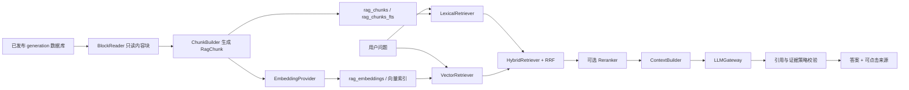

# 04 RAG 缺失模块与详细设计方案

> 本文基于当前仓库真实代码，以及本目录中的三份分析文档整理。本文是设计方案，不代表相关功能已经实现。

## 1. 先回答：分块、索引、召回、重排、生成是不是都缺少

不能简单地说“五个模块全部没有”。准确说法如下。

| RAG 环节 | 当前项目已有能力 | 真正缺少的 RAG 能力 | 结论 |
|---|---|---|---|
| 分块 Chunking | 解析器已经产生 `ContentBlock`；`BlockCoalescer` 会合并相邻小块 | 面向问答的语义块、稳定 chunk ID、重叠、格式化边界、可引用来源 | **有基础，但缺 RAG 分块层** |
| 索引 Indexing | SQLite `content_fts`、`files_fts`；generation 原子发布 | Embedding、向量索引、RAG chunk 词法索引、Embedding 缓存、RAG sidecar 发布 | **有关键词索引，但缺 RAG 索引** |
| 召回 Retrieval | FTS/LIKE 候选召回、原文精确确认、文件级聚合 | 块级 lexical、vector、hybrid、RRF、元数据过滤和证据 top-k | **有关键词召回，但缺 RAG 召回** |
| 重排 Reranking | 文件名和命中次数的启发式打分 | 面向“问题—证据块”的语义重排器 | **基本缺少** |
| 生成 Generation | 无 | 上下文构造、LLM 网关、引用校验、拒答、安全策略、答案编排 | **完全缺少** |

所以当前系统更准确的定位是：

> 已经具备“RAG 前置资料加工能力”和成熟的关键词搜索，但还没有形成“证据块检索 → 上下文构造 → 受约束生成”的 RAG 链路。

## 2. 上述结论的代码依据

### 2.1 已经有通用内容块，但它不是完整的 RAG chunk

- `local_full_text_search/models/content_block.py:6-23` 定义了 `ContentBlock`，已经保存页码、幻灯片、工作表、单元格、行号、来源类型和 OCR 置信度。
- `local_full_text_search/core/block_coalescer.py:9-51` 会把 DOCX 段落、表格行、XLSX 行和文本行合并。
- `local_full_text_search/core/block_coalescer.py:14-16` 的默认目标是 4096 字符，最大 16384 字符。
- `local_full_text_search/core/index_manager.py:9902-9905` 在解析结束后真正调用 `BlockCoalescer.coalesce()`。

这套块是为“减少数据库行数、提高全文检索吞吐量”设计的。4096～16384 字符对于关键词查找可以接受，但对于 RAG 有三个问题：

1. 一个块可能包含多个主题，向量语义不够集中；
2. 送给 LLM 会浪费上下文预算；
3. 合并后的起止位置较宽，不利于精确引用。

因此不应推翻现有 `ContentBlock`，而应在其上新增第二层 `RagChunk`。

### 2.2 已经有关键词索引，但没有向量索引

- `local_full_text_search/core/database.py:1241-1265` 的 `content_blocks` 保存原文块和位置字段。
- `local_full_text_search/core/database.py:1781-1834` 创建 `content_fts` 和 `files_fts`，优先使用 FTS5 trigram。
- `local_full_text_search/core/database.py:4749-4763` 把正文块写入 `content_fts`。
- 当前 `requirements.txt` 没有 Embedding、向量索引或 LLM SDK 依赖。
- 当前 `local_full_text_search/` 下不存在 `rag/` 包。

所以现有“索引”是关键词倒排索引，不是 RAG 所需的向量索引。

### 2.3 已经有关键词召回，但输出单位不适合 RAG

- `local_full_text_search/core/search_engine.py:266-594` 的 `_search_impl()` 完成候选、确认、聚合和分页。
- `local_full_text_search/core/search_engine.py:320-325` 明确用 `file_id` 聚合，并限制每个文件最多 20 个块。
- `local_full_text_search/core/search_engine.py:431-444` 先 `_matches()` 确认，再转为 `SearchResult`，同文件继续合并。
- `local_full_text_search/core/search_engine.py:1273-1323` 的 `_matches()` 是关键词包含关系或正则确认。
- `local_full_text_search/core/search_engine.py:1384-1401` 的分数来自命中次数、文件名加分、metadata 加分和 OCR 降权。
- `local_full_text_search/models/search_result.py:30-61` 定义的是一个文件级 `SearchResult`，内部再包含多个 `SearchHit`。

RAG 需要的输出不是“最相关的 10 个文件”，而是“最能回答当前问题的 6～10 个证据块”。因此不能直接把 `SearchResult` 列表塞给 LLM。

### 2.4 当前启发式排序不等于 RAG 重排

现有排序回答的是：关键词在哪个文件中出现得更多，文件名是否更匹配。

RAG 重排回答的是：候选文本是否真正回答了用户提出的问题。例如问题是“索引失败后如何恢复”，正文没有逐字出现该问题，语义重排仍可能把“重新构建候选库并切换 generation”的段落排到前面。

因此现有 `score` 可以继续服务旧搜索，但不能冒充 RAG reranker。

## 3. 目标架构



核心设计原则：

1. **共享解析结果，不复用错误的结果模型**：复用 `content_blocks`，但新增 `EvidenceChunk`，不拿文件级 `SearchResult` 当证据。
2. **RAG sidecar 独立**：不修改正式搜索库 schema；RAG 索引损坏或删除，不影响旧搜索。
3. **与 generation 对齐**：RAG sidecar 必须记录它来自哪个已发布 generation，二者不一致时禁止问答。
4. **模型只写答案，不编造来源**：页码、路径、sheet、行号全部由程序从数据库产生。
5. **先检索评测，再接真实模型**：先用 Mock Embedding/Mock LLM 跑通并验证，再选择真实 provider。

## 4. 模块一：RAG 分块设计

### 4.1 职责

`ChunkBuilder` 的输入是已经解析并发布的 `ContentBlock`，输出是适合检索、上下文拼装和引用的 `RagChunk`。

它不负责解析 PDF/DOCX，不负责计算向量，也不负责调用 LLM。

### 4.2 建议数据模型

```python
@dataclass(slots=True, frozen=True)
class SourceRef:
    source_id: str                 # 本次答案中的 S1、S2 由后续阶段分配
    source_generation: int
    stable_chunk_id: str
    file_id: int
    document_id: int | None
    file_path: str
    filename: str
    block_ids: tuple[int, ...]
    block_index_start: int
    block_index_end: int
    location_text: str
    page_number: int | None = None
    slide_number: int | None = None
    sheet_name: str | None = None
    cell_start: str | None = None
    cell_end: str | None = None
    line_start: int | None = None
    line_end: int | None = None
    source_type: str = "native_text"


@dataclass(slots=True, frozen=True)
class RagChunk:
    stable_chunk_id: str
    text: str
    normalized_text: str
    text_hash: str
    source: SourceRef
    chunk_policy_version: str
```

这里不能只保存一个 `block_id`。一个 RAG chunk 可能由相邻的多个小逻辑块组成，也可能是从一个过大的 `ContentBlock` 中切出的子块，所以必须保存来源块集合或起止范围。

### 4.3 稳定 ID

建议：

```text
stable_chunk_id = sha256(
    document_content_key
    + parser_name + parser_version
    + chunk_policy_version
    + source_boundary_signature
    + normalized_text_sha256
)
```

其中 `source_boundary_signature` 包含页码/slide/sheet、来源 block 范围和 chunk 序号。

它解决两个业务问题：

- 同一内容在新 generation 中没有变化，可复用原向量，避免每次全量计算；
- 文本、解析器版本或切块策略变化时，ID 必须变化，防止拿旧向量对应新文本。

不能直接把 `content_blocks.id` 当稳定 ID，因为数据库重建后自增 ID 可能变化。

### 4.4 按格式切块

首版建议把目标长度做成配置，初始值 800～1200 个中文字符，重叠约 10%，最终参数由评测决定。

| 格式 | 边界策略 | 是否允许跨边界 | 引用字段 |
|---|---|---|---|
| PDF/OCR | 同一页内按段落/句号累积 | 不跨页；native 和 OCR 不混合 | 页码、位置、OCR 置信度 |
| DOCX | 段落累积；表格按表头+若干行 | 正文与表格不混合；尽量不跨章节标题 | 段落/表格行位置 |
| XLSX | 表头 + 连续若干数据行 | 不跨 sheet；不拆散单行关键字段 | sheet、单元格范围 |
| PPTX | 一页标题、正文、备注组成一个或多个块 | 不跨 slide | 幻灯片编号 |
| TXT/日志 | 连续行窗口，保留少量重叠 | 可在相邻窗口重叠，不跳行 | 起止行号 |
| ZIP | 先按内部文件格式切 | 不跨内部文件 | 外层 ZIP 路径 + 内部路径 |

### 4.5 必须测试的边界

- PDF chunk 不跨页；
- XLSX chunk 不跨 sheet，且每块带表头；
- 相同输入、相同策略生成相同 ID；
- 文本变化后 ID 变化；
- 重叠部分不能产生重复引用污染；
- OCR 低置信度内容保留标记，不能伪装成可靠原文。

## 5. 模块二：RAG 索引设计

### 5.1 为什么用独立 sidecar

建议每个 RAG 发布版本是一个独立文件，例如：

```text
data/rag-index/
  rag.gen-12.db
  rag.gen-13.building.db
  rag.manifest.json
```

好处：

- 不修改现有 `gen-N.db`，旧搜索零迁移；
- Embedding 模型更换时，只重建 sidecar；
- 构建失败仍可继续使用旧搜索或上一份有效 RAG 索引；
- 删除 sidecar 即可彻底关闭 RAG，回滚明确。

### 5.2 sidecar schema

建议首版 SQLite 表如下：

```sql
CREATE TABLE rag_meta (
    id INTEGER PRIMARY KEY CHECK (id = 1),
    source_generation INTEGER NOT NULL,
    state TEXT NOT NULL,                 -- building / published / failed
    chunk_policy_version TEXT NOT NULL,
    embedding_model_id TEXT NOT NULL,
    embedding_model_revision TEXT NOT NULL,
    embedding_dimension INTEGER NOT NULL,
    created_at TEXT NOT NULL,
    published_at TEXT
);

CREATE TABLE rag_chunks (
    stable_chunk_id TEXT PRIMARY KEY,
    document_key TEXT NOT NULL,
    text TEXT NOT NULL,
    normalized_text TEXT NOT NULL,
    text_hash TEXT NOT NULL,
    source_json TEXT NOT NULL,
    source_type TEXT NOT NULL,
    ocr_confidence REAL
);

CREATE VIRTUAL TABLE rag_chunks_fts USING fts5(
    stable_chunk_id UNINDEXED,
    normalized_text,
    filename,
    path,
    location_text,
    tokenize='trigram'
);

CREATE TABLE rag_embeddings (
    stable_chunk_id TEXT PRIMARY KEY,
    model_id TEXT NOT NULL,
    model_revision TEXT NOT NULL,
    dimension INTEGER NOT NULL,
    vector_blob BLOB NOT NULL,
    FOREIGN KEY(stable_chunk_id) REFERENCES rag_chunks(stable_chunk_id)
);

CREATE TABLE rag_build_runs (
    run_id TEXT PRIMARY KEY,
    source_generation INTEGER NOT NULL,
    status TEXT NOT NULL,
    chunk_count INTEGER NOT NULL DEFAULT 0,
    reused_embedding_count INTEGER NOT NULL DEFAULT 0,
    generated_embedding_count INTEGER NOT NULL DEFAULT 0,
    elapsed_ms INTEGER NOT NULL DEFAULT 0,
    error_code TEXT,
    error_message TEXT
);
```

为什么 sidecar 中还要有 `rag_chunks_fts`：现有 `content_fts` 索引的是原始 `ContentBlock`，而 RAG 可能把一个大块切成三个小块。向量召回和关键词召回必须返回同一种 `stable_chunk_id`，否则融合时无法正确去重。

### 5.3 Embedding provider 接口

```python
class EmbeddingProvider(Protocol):
    @property
    def model_id(self) -> str: ...

    @property
    def model_revision(self) -> str: ...

    @property
    def dimension(self) -> int: ...

    def embed_documents(self, texts: Sequence[str]) -> list[list[float]]: ...
    def embed_query(self, text: str) -> list[float]: ...
```

必须先实现确定性的 `MockEmbeddingProvider`，才能在无网络、无模型的环境下验证索引生命周期、维度检查和召回算法。真实 provider 后接，且不得把密钥写进仓库。

缓存键至少包含：

```text
stable_chunk_id + model_id + model_revision + dimension
```

### 5.4 首版向量存储选择

首版建议直接将归一化后的 float32 向量存为 BLOB，并在查询时做精确余弦扫描。原因是当前还没有真实 chunk 数量和延迟基线，过早引入 Qdrant、Milvus 或复杂 ANN 会增加部署和回滚成本。

升级条件应由数据决定，例如精确扫描的 p95 已超出产品目标、内存不可接受时，再抽象 `VectorIndex` 接口并替换为 FAISS/HNSW。不要先凭想象选大型向量数据库。

### 5.5 构建与原子发布

```text
读取 active generation N
  → 创建 rag.gen-N.building.db
  → 构建 chunk 和 rag_chunks_fts
  → 复用旧缓存或批量生成 embedding
  → 校验 chunk 数、向量维度、外键、quick_check
  → state = published
  → 原子重命名为 rag.gen-N.db
  → 原子替换 rag.manifest.json
```

查询前必须同时满足：

```text
rag.source_generation == 当前 active generation
rag.state == published
rag.embedding_model_id/revision == 当前查询 provider
```

任何一个条件不满足，UI 显示“智能问答索引正在更新”，但旧关键词搜索仍可用。

## 6. 模块三：RAG 召回设计

### 6.1 输入输出模型

```python
@dataclass(slots=True, frozen=True)
class RagQuery:
    text: str
    top_k: int = 10
    root_ids: tuple[int, ...] = ()
    extensions: tuple[str, ...] = ()
    include_ocr: bool = True
    min_ocr_confidence: float = 0.60


@dataclass(slots=True)
class EvidenceChunk:
    chunk: RagChunk
    lexical_rank: int | None = None
    vector_rank: int | None = None
    fused_score: float = 0.0
    rerank_score: float | None = None
```

不要直接复用 `SearchQuery`：`SearchQuery` 表达 exact/all/any/regex、分页和文件级排序；`RagQuery` 表达问题、证据数量和证据过滤。两者业务含义不同。

### 6.2 三条召回路径

#### LexicalRetriever

- 查询 `rag_chunks_fts`；
- 适合错误码、型号、专有名词、精确参数；
- 返回 `stable_chunk_id + lexical_rank`；
- 短词继续保留 LIKE/兼容策略和真实文本确认；
- 不聚合成文件结果。

#### VectorRetriever

- 对问题只计算一次 query embedding；
- 与候选向量计算余弦相似度；
- 适合同义表达、自然语言改写；
- 相似度只是排序依据，不等于“答案为真的概率”。

#### HybridRetriever

- lexical 取前 30，vector 取前 30；
- 按 `stable_chunk_id` 去重；
- 使用 RRF 融合名次；
- 对同一文件或同一页设置数量上限，防止一个文档占满上下文；
- 输出约 10～20 个候选给重排或 ContextBuilder。

RRF 公式：

```text
RRF(chunk) = Σ 1 / (k + rank_i(chunk))
```

`k` 可从 60 起步，但必须由同一评测集验证。不能把 FTS 启发式分数与余弦相似度直接相加，因为二者数值范围和含义完全不同。

### 6.3 业务例子

问题：“索引中断后怎样恢复？”

- lexical 可能召回包含“索引”“中断”“恢复”的块；
- vector 可能召回没有这些原词、但写着“检测未完成 candidate 并从 checkpoint 继续”的块；
- RRF 会把两路都排名靠前的块优先，同时保留只被一种方式找到的好证据；
- 最终输出证据块，而不是只告诉模型某个文件名。

## 7. 模块四：重排设计

### 7.1 当前是否必须实现

重排模块当前缺少，但它不是第一个必须接入的真实模型。V1 可以先用：

```text
lexical + vector → RRF → 去重/来源多样性 → 最终证据
```

只有评测证明“正确块经常已经进入前 30，但排不到最终前 8”时，才说明问题主要出在排序，值得加入 reranker。

如果正确块根本没被召回，增加 reranker 没用，应先修 chunk 或 recall。

### 7.2 接口与位置

```python
class Reranker(Protocol):
    def rerank(
        self,
        question: str,
        candidates: Sequence[EvidenceChunk],
        top_n: int,
    ) -> list[EvidenceChunk]: ...
```

链路建议：

```text
两路各 top-30 → RRF top-20 → reranker → top-6～10
```

可选实现：

1. `NoOpReranker`：原样返回，保证功能可关闭；
2. 本地 cross-encoder：对“问题 + 候选文本”打相关度分；
3. LLM reranker：成本和不确定性更高，不建议作为首版默认。

验收不看“感觉更智能”，而看同一 Gold 集上的 MRR/nDCG/Recall@最终K，以及 p95 延迟和内存。无稳定收益就移除或默认关闭。

## 8. 模块五：生成设计

### 8.1 生成不是一次 `llm.ask()`

完整生成层至少包含：

1. `ContextBuilder`：去重、分配 S1/S2、控制上下文预算；
2. `LLMGateway`：隔离本地/在线模型、超时、取消和错误；
3. `AnswerService`：显式编排整个流程；
4. `EvidencePolicy`：证据不足时拒答；
5. `CitationValidator`：拒绝模型输出不存在的引用；
6. Prompt Injection 防护：文档内容永远是不可信数据；
7. `RagAnswer`：结构化返回答案、来源和警告。

### 8.2 上下文构造

程序生成的上下文示例：

```text
[S1]
文件：索引恢复设计.md
位置：第 3 页
内容：……

[S2]
文件：故障处理手册.docx
位置：正文第 18～20 段
内容：……
```

S1/S2 与真实 `SourceRef` 的映射保存在程序内。模型只能引用这些编号，不能自己产生路径或页码。

预算顺序建议：

1. 保留排名最高且内容不重复的块；
2. 限制同一文档最多 2～3 块；
3. 优先保留完整句子，不从中间硬截断；
4. 超出预算时删除低排名块，并记录被截断数量。

### 8.3 LLM 网关

```python
class LLMGateway(Protocol):
    def generate(
        self,
        question: str,
        context: str,
        allowed_source_ids: Sequence[str],
        cancel_token: CancelToken,
    ) -> "ModelAnswer": ...
```

首版必须有 `MockLLMGateway`，用于测试：

- 无证据时是否真的没有调用模型；
- 模型输出 `[S99]` 时是否被拒绝；
- 超时、取消、异常是否能回收；
- UI 是否不会被冻结。

### 8.4 AnswerService 调用链

```text
校验问题
  → 获取当前 generation 和匹配的 RAG sidecar
  → HybridRetriever.retrieve()
  → 可选 Reranker.rerank()
  → EvidencePolicy 判断是否有足够证据
  → ContextBuilder.build()
  → LLMGateway.generate()
  → CitationValidator.validate()
  → 返回 RagAnswer
```

```python
@dataclass(slots=True, frozen=True)
class RagAnswer:
    answer_text: str
    sources: tuple[SourceRef, ...]
    insufficient_evidence: bool
    warnings: tuple[str, ...]
    trace_id: str
```

关键规则：

- 没有合格证据，不调用 LLM，直接返回“资料库中没有足够依据”；
- 答案中的每个 `[Sx]` 必须存在；
- 来源名称、路径、页码由程序渲染；
- 资料冲突时展示冲突来源，不让模型偷偷裁决；
- 在线 provider 必须显式提示数据会离开本机，默认保持离线。

## 9. 五个主模块之外还缺少的工程模块

只实现“五段流水线”仍不能成为可用产品，还缺少以下横切能力。

| 模块 | 作用 |
|---|---|
| `BlockReader` | 只读取当前已发布 generation，绝不读 building DB |
| RAG models | 定义 `RagQuery`、`RagChunk`、`SourceRef`、`EvidenceChunk`、`RagAnswer` |
| `RagIndexWorker` | 后台构建 chunk/embedding/sidecar，避免卡住 Qt 主线程 |
| `RagQueryWorker` | 后台完成召回、重排和生成，支持取消与超时 |
| 配置与密钥管理 | provider、模型版本、离线/在线开关、密钥不入库 |
| Trace/可观测性 | 记录 chunk、embedding、召回、重排、生成各阶段耗时和错误 |
| 评测集与指标 | Gold、Recall@K、MRR、nDCG、引用正确率、拒答准确性、p95 延迟 |
| 安全策略 | Prompt Injection、敏感数据外发、输出引用白名单 |
| UI 证据卡片 | 展示答案所引用片段，并可打开到页码/slide/sheet/行号 |
| 生命周期与回滚 | sidecar 构建、验证、原子发布、旧版本保留、损坏降级 |

## 10. 建议目录结构

```text
local_full_text_search/
  rag/
    models.py
    block_reader.py
    chunk_builder.py
    index_store.py
    answer_service.py
    context_builder.py
    policy.py
    citations.py
    embeddings/
      base.py
      mock.py
      local.py
    retrieval/
      base.py
      lexical.py
      vector.py
      hybrid.py
      rerank.py
    generation/
      base.py
      mock.py
      local.py
  workers/
    rag_index_worker.py
    rag_query_worker.py
tests/
  rag/
evals/
  retrieval_cases.jsonl
  answer_cases.jsonl
```

不要把所有逻辑都写进一个 `rag_service.py`。分层的判断口诀是：

> 切块决定“资料如何变成证据”；索引决定“证据如何被快速找到”；召回决定“先找哪些”；重排决定“哪些最相关”；生成决定“如何只根据证据回答”。

## 11. 建议分阶段实施

### 阶段 0：基线和语料

- 固定旧搜索测试基线；
- 准备无敏感信息的 PDF/DOCX/TXT 语料；
- 人工标注 15～30 个问题及正确来源；
- OCR 资产问题未解决时，先把 OCR 用例单列，不阻塞非 OCR RAG 骨架。

验收：同一数据集可以重复构建，旧搜索结果不变。

### 阶段 1：证据层

- 新增 `SourceRef`、`RagChunk`、`EvidenceChunk`；
- 实现只读 `BlockReader`；
- 实现 PDF/DOCX/TXT `ChunkBuilder` 和稳定 ID。

验收：能从当前 generation 导出 3～5 个带准确页码/段落/行号的 chunk；不接模型。

### 阶段 2：RAG 索引

- sidecar schema、building/published、manifest；
- `rag_chunks_fts`；
- Mock Embedding、缓存和精确余弦向量检索；
- 原子发布及 generation 对齐。

验收：构建失败不影响旧搜索；删除 sidecar 后可重建；维度不一致明确报错。

### 阶段 3：召回与评测

- lexical/vector/hybrid 三种模式；
- RRF、去重、来源多样性；
- 跑 Recall@K、MRR 和延迟；
- 分析 chunk 失败、召回失败、排序失败。

验收：输出三种模式的真实对比表，不凭主观感受选方案。

### 阶段 4：生成与引用

- ContextBuilder、MockLLM、CitationValidator、EvidencePolicy；
- AnswerService 跑通；
- 再接一种批准的本地或在线 Embedding/LLM provider。

验收：有证据时答案引用可点击；无答案时拒答；伪造引用被拒绝。

### 阶段 5：UI 与可选重排

- 新增后台 worker、取消、进度和证据卡片；
- 根据评测决定是否加入真实 reranker；
- 关闭 RAG 后旧搜索入口保持原样。

验收：提问期间 UI 不冻结；重排只有在指标收益超过延迟成本时启用。

## 12. 一个完整业务场景

用户输入：“程序异常退出后，未完成的索引怎样恢复？”

1. `RagQueryWorker` 在后台接收冻结后的 `RagQuery`；
2. `AnswerService` 确认当前搜索库是 generation 13，RAG sidecar 也来自 generation 13；
3. `LexicalRetriever` 找到“异常退出、索引恢复”等精确词块；
4. `VectorRetriever` 找到“检测未完成 candidate、读取 checkpoint、继续处理”等语义相近块；
5. `HybridRetriever` 用 RRF 合并，并按 `stable_chunk_id` 去重；
6. 如果已启用，`Reranker` 从 20 个候选中选出最能回答问题的 8 个；
7. `ContextBuilder` 分配 S1～S8，并控制同一文档不要占满上下文；
8. `LLMGateway` 只能依据 S1～S8 回答；
9. `CitationValidator` 删除或拒绝不存在的 S 编号；
10. UI 显示答案及来源卡片，点击 S1 可打开原文件对应页/段落。

这才是当前项目从“关键词文件搜索”升级为“可追溯 RAG 问答”的完整链路。

## 13. 最小开工顺序

第一批不要同时上向量模型和 LLM。最小可验证切片应是：

1. `rag/models.py`：定义证据数据契约；
2. `rag/block_reader.py`：只读 active generation；
3. `rag/chunk_builder.py`：从真实 `ContentBlock` 生成可引用 `RagChunk`；
4. 测试稳定 ID、格式边界和引用准确性。

只有“证据块是什么、来自哪里”先稳定下来，后面的索引、召回、重排和生成才不会建立在错误的数据模型上。
