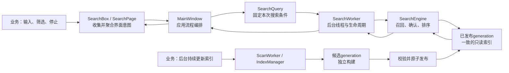
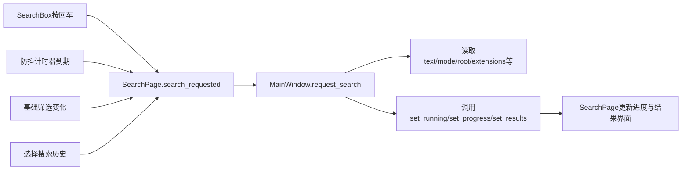

# 资料智能检索工具：架构学习笔记

## 文档的两层记忆结构

这份笔记以后同时维护两个视角。

### 视角一：经典业务场景

用于记忆具体问题。每个场景固定记录：

```text
业务现场
→ 如果直接实现会出现什么问题
→ 当前项目怎样调用
→ 哪个设计解决了问题
→ 带来了什么业务效果
→ 可以迁移到哪些其他项目
```

场景是细粒度记忆单位。例如：“搜索武汉尚未结束，用户又输入北京，怎样避免两套条件错乱？”

### 视角二：整体架构与业务目标

用于理解项目为什么要分层。每学习一个模块，都要回答：

```text
业务为什么需要这一层
→ 这一层负责什么
→ 它和上下游怎样协作
→ 如果删除或合并会出现什么具体问题
→ 对未来RAG/Agent开发有什么可复用价值
```

只记场景容易只见局部，只记分层又容易过于抽象；两种视角需要互相连接。

---

## 整体架构为什么这样设计（持续更新）

### 业务目标到代码设计的映射

| 真实业务目标 | 对应设计 | 主要代码模块 |
| --- | --- | --- |
| 回车、自动搜索、筛选等入口最终执行同一套搜索流程 | 页面聚合多个控件事件 | `SearchBox`、`SearchPage` |
| 用户继续修改界面时，旧搜索不能混入新条件 | 为每次搜索创建参数快照 | `SearchQuery` |
| 搜索较慢时界面仍能响应、停止和继续输入 | 将搜索任务移到后台线程 | `MainWindow`、`SearchWorker` |
| 搜索算法可以独立测试，将来可被CLI、API或Agent复用 | 把线程适配与检索算法分开 | `SearchWorker`、`SearchEngine` |
| 建索引可能耗时很久，但用户仍要搜索旧数据 | 新旧索引使用不同generation文件 | `ScanWorker`、`IndexGenerationStore` |
| 新索引必须完整后才能对用户可见 | 候选库校验后原子发布 | `IndexGenerationStore.publish()` |
| 多文件可以并行解析，但SQLite写入不能互相冲突 | 多进程解析、写入串行调度 | `IndexManager`、`DatabaseWriteDispatcher` |

### 从用户操作到结果显示



这套架构不是为了增加层数，而是分别解决四类会互相冲突的变化：

1. 界面交互经常变化。
2. 一次请求的数据必须保持一致。
3. 耗时任务不能阻塞界面。
4. 索引更新不能破坏正在进行的搜索。

后续章节会把表中每一项落实到真实函数。

---

## 经典业务场景库（持续追加）

| 编号 | 场景 | 核心设计 | 状态 |
| --- | --- | --- | --- |
| S001 | 搜索“武汉”尚未结束，用户又输入或提交“北京” | `SearchQuery`参数快照与任务切换 | 已学习 |
| S002 | 用户连续输入长关键词，不能每个字都查询一次 | `SearchPage.debounce`防抖 | 已学习 |
| S003 | 后台正在建立新索引，用户仍要搜索 | generation隔离 | 后续展开 |
| S004 | 用户快速连续提交多个搜索，只保留最新请求 | `pending_search`与取消清理 | 已学习 |
| S005 | 正文搜索较慢，先展示文件名和路径结果 | 部分结果信号 | 后续展开 |
| S006 | 多个文件并行解析，但SQLite不能并发乱写 | 多进程解析与串行写入 | 后续展开 |

### S001：搜索中修改或重新提交关键词

#### 业务现场

用户提交“武汉”后，后台搜索尚未结束。此时用户把输入框改成“北京”。

#### 必须满足的业务规则

- 已经开始的旧任务必须继续使用它收到的“武汉”条件，不能读到一半变成“北京”。
- 如果用户只是编辑，没有再次提交，旧任务继续运行。
- 如果用户再次提交“北京”，系统应取消旧任务，清理完成后用新条件创建新任务。

#### 容易出错的直接实现

如果`SearchWorker`在执行过程中不断读取`SearchPage`控件：

```text
查文件名时：输入框是“武汉”
用户修改输入框
查正文时：输入框变成“北京”
```

同一次搜索会混用两套条件，而且后台线程还会直接访问只能由Qt主线程操作的控件。

#### 当前项目的解决方案

第一次提交时，`MainWindow._run_search()`立即读取页面并创建：

```python
SearchQuery(text="武汉", ...)
```

随后把这个对象交给：

```text
SearchWorker
→ SearchEngine
```

页面之后变成“北京”，不会修改旧Worker持有的查询条件。

如果用户再次提交“北京”，真实调用链是：

```text
SearchPage.search_requested
→ MainWindow.request_search()
→ 发现search_thread仍存在
→ pending_search = True
→ cancel_search()
→ 旧SearchWorker结束
→ cleanup_search_thread()
→ 再次调用_run_search()
→ 从当前页面创建SearchQuery(text="北京")
```

#### 业务效果

1. 每次搜索内部条件一致。
2. 用户可以继续输入，不必等待旧搜索完成。
3. 新请求不会与旧线程同时更新同一结果页面。
4. 取消、清理、新建的生命周期顺序清楚。

#### 可迁移的通用模式

```text
可编辑的实时界面状态
→ 提交时复制为请求对象
→ 后台任务只读取请求对象
```

适用于：

- RAG聊天请求；
- 导出报表任务；
- 文件批量处理；
- 视频转码参数；
- 订单提交；
- HTTP接口请求。

#### 面试表达

> 为避免用户在搜索过程中修改输入导致同一任务条件漂移，项目在提交时把页面状态转换成独立SearchQuery，再交给后台Worker。若用户提交新关键词，MainWindow先标记pending_search并取消旧任务，线程清理后再根据当前页面创建新Query。因此每次任务的数据一致，同时界面仍可继续编辑。

### S002：连续输入时避免重复搜索

本场景的完整实现见第二章“防抖为什么是实际业务能力”。核心链路是：

```text
textChanged
→ SearchPage._on_text_changed()
→ debounce重新计时
→ 用户停止输入
→ timeout只发出一次search_requested
```

它解决的不是抽象的“性能优化”，而是避免连续输入导致大量后台搜索、取消操作和结果闪烁。

### S004：旧搜索未结束时，只执行最新请求

#### 业务现场

用户先搜索“武汉”，搜索还在后台执行，又连续提交了“湖北”和“北京”。业务真正关心的是最后一次请求“北京”，而不是把三次请求排队全部执行。

#### 容易出错的直接实现

如果每次提交都立刻创建一个新线程，会同时出现多个任务：

```text
武汉搜索 ───────────────→ 最后返回
湖北搜索 ────────→ 返回
北京搜索 ───→ 返回
```

“武汉”可能最晚完成，并把“北京”的结果覆盖掉。进度条、停止按钮和状态文字也会被三个任务同时修改。

另一种错误做法是：调用旧Worker的`cancel()`后立刻把引用清空并创建新Worker。`cancel()`只是发出协作式取消请求，旧线程此时不一定已经真正退出，两个任务仍可能短暂重叠。

#### 当前项目的真实调用链

相关实现位于`local_full_text_search/ui/main_window.py`：

```text
SearchPage.search_requested
→ MainWindow.request_search()
→ 发现 self.search_thread 仍存在
→ self.pending_search = True
→ MainWindow.cancel_search()
→ SearchWorker.cancel()
→ 旧Worker发出 cancelled / finished / failed等终止信号
→ QThread.quit()
→ QThread.finished
→ MainWindow.cleanup_search_thread()
→ 清空旧thread和worker引用
→ self._run_search()
→ 从页面此刻的最新状态创建SearchQuery(text="北京")
```

`pending_search`只是一个布尔值，不保存“湖北”和“北京”的队列。因此连续提交多次会折叠成一次待执行任务；等旧线程清理完，`_run_search()`读取页面最新状态，最终执行“北京”。

#### 为什么必须等`QThread.finished`

```text
调用cancel()
≠ 后台任务已经结束

收到QThread.finished
= 线程已经真正退出，可以清引用并启动下一次
```

这条边界让同一时间最多只有一套搜索流程更新结果页面。

#### 业务效果

1. 快速连续输入时，不浪费时间依次完成已经过时的请求。
2. 旧结果不会覆盖最新结果。
3. 进度、状态、停止按钮只有一个任务负责，不会互相打架。
4. 关闭程序时，`MainWindow`知道还有哪个线程需要取消和等待。

#### 可迁移的通用模式

这是“最新请求优先”（latest wins）模式：

```text
新请求到达
→ 取消旧任务
→ 等旧任务真正清理
→ 读取最新状态
→ 启动一个新任务
```

适合搜索联想、筛选预览、地图拖动查询、报表参数预览等场景。它不一定适合订单提交或聊天消息发送，因为那些请求通常不能丢弃中间项；设计前必须先判断业务要“全部执行”还是“只保留最新”。

#### 30秒面试表达

> 项目的交互式搜索采用latest-wins策略。用户在旧搜索运行时再次提交，MainWindow不会并发创建第二个Worker，而是设置pending_search并请求旧Worker取消。只有收到QThread.finished、完成资源清理后，才根据页面最新状态重新创建SearchQuery和Worker。这样既避免旧结果覆盖新结果，也避免多个任务竞争同一套进度和结果界面。

---

## 第一章：SearchBox 与信号分层

### 一、本系列的学习方式

后续每个模块都按以下顺序学习，一次只讲一个主要模块：

1. 这个模块解决什么业务问题。
2. 对象在哪里创建，`__init__()` 如何初始化。
3. 从哪个函数进入，依次调用哪些函数，最后返回什么。
4. 为什么要这样设计，而不是把代码合并到一起。
5. 这种设计给当前业务带来什么好处。
6. 能提炼出什么通用原则，以后开发时如何复用。
7. 用一至两个问题确认是否真正理解。

讲解必须以当前仓库的真实代码为依据。源码中的新增教学注释使用中文。

---

### 二、本课目标

理解以下两个问题：

1. `SearchBox` 是怎样被创建和初始化的？
2. 用户按回车以后，信号为什么要经过 `SearchPage`，再到 `MainWindow`？

关键代码：

- `app.py:2836`
- `local_full_text_search/ui/main_window.py:284`
- `local_full_text_search/ui/main_window.py:319`
- `local_full_text_search/ui/main_window.py:346`
- `local_full_text_search/ui/main_window.py:2780`
- `local_full_text_search/ui/main_window.py:2822`
- `local_full_text_search/ui/main_window.py:2828`
- `local_full_text_search/ui/main_window.py:3037`
- `local_full_text_search/ui/main_window.py:3368`
- `local_full_text_search/ui/main_window.py:3401`

---

### 三、三个对象分别负责什么

| 对象 | 负责 | 不负责 |
| --- | --- | --- |
| `SearchBox` | 输入框、清空按钮、停止按钮、回车事件 | 创建查询、启动线程、访问数据库 |
| `SearchPage` | 组合搜索框、筛选条件、结果区域，并对外提供统一的页面级事件 | 执行数据库检索 |
| `MainWindow` | 协调整个应用，决定何时创建查询和后台任务 | 处理输入框的具体显示细节 |

它们的包含关系是：

```text
MainWindow
└── SearchPage
    └── SearchBox
        ├── QLineEdit 输入框
        ├── 清空按钮
        ├── 历史按钮
        └── 停止按钮
```

---

### 四、初始化调用链

程序启动后，调用顺序如下：

```text
app.py 的 main()
  ↓ 创建
MainWindow(...)
  ↓ Python 自动调用
MainWindow.__init__()
  ↓ 调用
MainWindow._build_shell()
  ↓ 创建
SearchPage(settings)
  ↓ Python 自动调用
SearchPage.__init__()
  ↓ 调用
SearchPage._build()
  ↓ 创建
SearchBox()
  ↓ Python 自动调用
SearchBox.__init__()
```

#### 1. app.py 创建 MainWindow

```python
window = MainWindow(...)
```

创建对象时，Python 自动进入 `MainWindow.__init__()`。

#### 2. MainWindow 创建 SearchPage

`MainWindow.__init__()`调用：

```python
self._build_shell()
```

`MainWindow._build_shell()`内部创建搜索页面：

```python
self.search_page = SearchPage(self.settings)
```

#### 3. SearchPage 创建 SearchBox

`SearchPage.__init__()`调用：

```python
self._build()
```

`SearchPage._build()`内部创建搜索框：

```python
self.search_box = SearchBox()
```

执行这行代码时，Python自动调用`SearchBox.__init__()`。

#### 4. SearchBox 初始化内部控件

`SearchBox.__init__()`主要完成：

```python
super().__init__()              # 初始化Qt父类
self.input = QLineEdit()        # 创建输入框
self.clear_button = QPushButton()  # 创建清空按钮
self.history_button = QPushButton() # 创建历史按钮
self.stop_button = QPushButton("停止") # 创建停止按钮
```

初始化的含义是“创建对象并建立连接”，不是立即执行搜索。

---

### 五、connect 和 emit 的区别

真实代码：

```python
self.input.returnPressed.connect(self.search_requested.emit)
```

可以拆成：

```text
returnPressed                 输入框自带的“按下回车”信号
connect(...)                  登记将来要调用谁
self.search_requested.emit    将来真正发出SearchBox的搜索信号
```

`connect()`在初始化阶段执行，只建立关系。

`emit()`在用户操作发生时执行，才真正通知接收者。

---

### 六、按回车后的真实调用链

用户输入“武汉”并按回车：

```text
QLineEdit 发出 returnPressed
  ↓ 初始化时已经建立 connect
SearchBox 执行 search_requested.emit()
  ↓ SearchPage 初始化时已经建立 connect
SearchPage 执行 search_requested.emit()
  ↓ MainWindow 初始化时已经建立 connect
MainWindow.request_search()
```

对应三处真实连接：

```python
# SearchBox.__init__()
self.input.returnPressed.connect(self.search_requested.emit)

# SearchPage._build()
self.search_box.search_requested.connect(self.search_requested.emit)

# MainWindow._build_shell()
self.search_page.search_requested.connect(self.request_search)
```

因此，给`MainWindow`发出最终搜索信号的是`SearchPage`。最初的用户操作来自`SearchBox`中的输入框。

---

### 七、关键词怎样取得

`search_requested = Signal()`只表达“用户要求搜索”，没有携带关键词。

需要关键词时，外层调用`SearchPage.text()`：

```python
def text(self) -> str:
    return self.search_box.input.text().strip()
```

调用链：

```text
MainWindow
  ↓ 调用
SearchPage.text()
  ↓ 读取
SearchBox.input.text()
  ↓ 返回
"武汉"
```

这里把两类信息分开了：

- 信号表达：发生了什么——用户要求搜索。
- 方法返回值表达：具体数据是什么——关键词是“武汉”。

---

### 八、为什么不让 MainWindow 直接监听 SearchBox

下面的写法技术上能够运行：

```python
self.search_page.search_box.search_requested.connect(self.request_search)
```

但这会让`MainWindow`知道`SearchPage`的内部结构：

```text
MainWindow必须知道
SearchPage里面有search_box
search_box里面有search_requested
```

这叫作对内部实现的深层耦合。

当前写法是：

```python
self.search_page.search_requested.connect(self.request_search)
```

`MainWindow`只依赖`SearchPage`公开的页面级事件，不依赖内部使用了输入框、按钮还是其他组件。

---

### 九、为什么 SearchPage 要提供统一信号

当前项目中，搜索请求并不只有“按回车”一个来源。

#### 来源一：按回车

```text
SearchBox.search_requested
→ SearchPage.search_requested
```

#### 来源二：自动搜索计时器到期

```python
self.debounce.timeout.connect(self.search_requested.emit)
```

调用链：

```text
输入文字
→ SearchPage._on_text_changed()
→ debounce.start()
→ debounce.timeout
→ SearchPage.search_requested
```

#### 来源三：基础筛选条件改变

```python
def _filter_changed(self) -> None:
    if self.text():
        self.search_requested.emit()
```

三个来源最终统一为：

```text
SearchPage.search_requested
→ MainWindow.request_search()
```

因此`MainWindow`不需要分别监听回车、计时器和每个筛选控件。

---

### 十、这种设计给业务带来的好处

#### 1. 可以方便增加新的搜索入口

以后可以增加：

- 搜索按钮；
- 全局快捷键；
- 语音输入；
- 搜索历史中的“再次搜索”；
- 修改筛选条件后自动重搜。

这些入口只需要最终发出`SearchPage.search_requested`，`MainWindow`的后台搜索逻辑可以保持不变。

#### 2. 可以替换页面内部控件

以后把`SearchBox`换成新的组件，只要`SearchPage`仍然提供相同的公开信号，`MainWindow`不需要修改。

#### 3. 更容易测试

可以分别测试：

- `SearchBox`按回车后是否发出信号；
- `SearchPage`是否正确汇总各种搜索入口；
- `MainWindow`收到页面信号后是否启动搜索流程。

问题出现时更容易判断属于哪一层。

#### 4. 避免子组件直接依赖主窗口

`SearchBox`不需要保存`MainWindow`引用，也不需要导入`MainWindow`。它可以在其他页面或测试中独立创建。

---

### 十一、可以复用的通用原则

#### 原则一：子组件表达意图，不直接操纵上层

推荐：

```text
子组件发出“用户想做什么”
→ 上层决定“具体怎么做”
```

不推荐：

```text
子组件找到主窗口
→ 直接启动线程、访问数据库、修改其他页面
```

#### 原则二：页面负责聚合控件事件

当多个控件都会触发同一业务动作时，由页面统一转换成一个业务信号。

```text
控件事件
→ 页面级业务事件
→ 应用级用例
```

在当前项目中就是：

```text
回车/计时器/基础筛选变化
→ SearchPage.search_requested
→ MainWindow.request_search
```

#### 原则三：上层依赖公开接口，不依赖内部结构

推荐：

```python
self.search_page.search_requested.connect(...)
```

谨慎使用：

```python
self.search_page.search_box.input.returnPressed.connect(...)
```

后者跨越了多层对象，内部结构一改，上层也必须修改。

#### 原则四：同一种业务意图使用同一个入口

无论请求来自按钮、回车、快捷键还是语音，都应尽量汇总到同一个应用入口，避免复制业务流程。

---

### 十二、什么时候值得使用这种设计

适合：

- 一个业务动作有多个触发入口；
- 页面内部结构以后可能调整；
- 子组件需要复用或单独测试；
- 最终动作涉及线程、数据库或全局状态；
- 项目会持续迭代，而不是一次性演示。

不必过度设计的情况：

- 只有一个简单按钮和一个本地函数；
- 页面不会复用，也几乎不会变化；
- 增加信号转发只会制造没有收益的层级。

判断标准不是“层数越多越专业”，而是：

> 这一层是否隐藏了内部变化，或者统一了多个业务入口？

如果答案是否定的，就不应该为了分层而分层。

---

### 十三、面试表达

可以这样回答：

> `SearchBox`只负责采集用户操作并发出控件级信号；`SearchPage`聚合回车、自动搜索和基础筛选变化等多个入口，统一对外发出页面级`search_requested`；`MainWindow`只监听这个公开事件并编排后台任务。这样可以降低主窗口对页面内部控件的耦合，方便替换组件、增加搜索入口和分层测试。

---

### 十四、理解检查

1. 创建`SearchBox`的直接函数是`MainWindow._build_shell()`还是`SearchPage._build()`？
2. `connect()`是在执行搜索，还是登记以后信号发生时要调用的函数？
3. 为什么`MainWindow`监听`SearchPage.search_requested`，而不是深入访问`SearchPage.search_box.input.returnPressed`？
4. 如果增加语音搜索，应该让它最终汇入哪个统一信号？

---

## 第二章：SearchPage——搜索功能的页面聚合层

### 一、本章先给出结论

`SearchPage`不是搜索算法，也不是后台任务执行器。它解决的是一个页面级问题：

> 把搜索框、基础筛选、高级筛选、索引状态、进度、结果列表和分页组合成一个完整搜索页面，并向`MainWindow`提供稳定的输入、输出接口。

可以把它理解成“搜索功能的前台服务台”：

- 内部接收多个控件产生的操作；
- 对外只发出少量页面级业务信号；
- 外部需要搜索条件时，通过公开方法统一读取；
- 外部返回搜索状态和结果时，通过公开方法统一显示。

真实代码位于：

- `local_full_text_search/ui/main_window.py`中的`SearchPage`
- `SearchPage.__init__()`
- `SearchPage._build()`
- `SearchPage._on_text_changed()`
- `SearchPage._filter_changed()`
- `SearchPage.text()`及其他条件读取方法
- `SearchPage.set_running()`
- `SearchPage.set_search_progress()`
- `SearchPage.set_partial_results()`
- `SearchPage.set_results()`

### 二、SearchPage的输入与输出

| 方向 | 内容 | 代码形式 |
| --- | --- | --- |
| 控件进入页面 | 回车、文字变化、基础筛选变化、翻页、打开文件 | Qt控件信号 |
| 页面通知外层 | 搜索、停止、翻页、打开文件等业务意图 | `SearchPage`公开信号 |
| 外层读取页面 | 关键词、模式、目录、扩展名、OCR开关等 | getter方法 |
| 外层更新页面 | 运行状态、进度、部分结果、完整结果 | `set_*()`方法 |

核心结构如下：



图中最重要的关系是：多个入口汇总成一个`search_requested`，多项页面数据通过一组公开方法提供给`MainWindow`。

### 三、初始化调用链

上一章已经走到：

```text
MainWindow._build_shell()
  ↓
self.search_page = SearchPage(self.settings)
```

执行`SearchPage(self.settings)`时，Python自动进入：

```python
SearchPage.__init__(settings)
```

`SearchPage.__init__()`的主要顺序是：

```text
1. super().__init__()
2. 初始化页面状态字段
3. 创建防抖计时器 debounce
4. 调用 self._build() 创建全部控件
5. 调用 self.apply_settings(settings) 应用配置
```

对应代码骨架：

```python
def __init__(self, settings: AppSettings) -> None:
    super().__init__()
    self._stats = {}
    self._index_ready = False

    self.debounce = QTimer(self)
    self.debounce.setSingleShot(True)
    self.debounce.timeout.connect(self.search_requested.emit)

    self._build()
    self.apply_settings(settings)
```

这里有两个重要设计点。

第一，先`_build()`再`apply_settings()`，因为必须先创建下拉框和复选框，才能把默认搜索模式、OCR开关等设置写入控件。

第二，`SearchPage.__init__()`只在页面创建时执行一次；后面每次搜索不会重新创建整个页面。

### 四、_build()具体创建了什么

`SearchPage._build()`大致按以下顺序组装页面：

```text
SearchBox
→ 基础筛选区
→ AdvancedFilters高级筛选
→ 状态文字和耗时
→ 搜索进度条
→ 空状态/结果列表切换区
→ 翻页控件
→ 建立所有信号连接
```

#### 1. 创建并连接SearchBox

```python
self.search_box = SearchBox()
self.search_box.input.textChanged.connect(self._on_text_changed)
self.search_box.search_requested.connect(self.search_requested.emit)
self.search_box.stop_requested.connect(self.stop_requested.emit)
self.search_box.history_requested.connect(self._show_history)
```

这里不是所有信号都简单转发：

- 搜索和停止属于应用级动作，所以转发给外层；
- 历史菜单属于页面内部展示，所以由`SearchPage._show_history()`自己处理；
- 文字变化需要处理防抖和空状态，所以进入`_on_text_changed()`。

这说明信号是否转发，要根据职责决定，不能机械地全部向上抛。

#### 2. 创建基础筛选

页面创建四个主要下拉框：

```python
self.mode_combo       # 完全包含、完整短语、全部词、任意词、正则
self.file_type_combo  # PDF、Word、Excel等文件类型分组
self.scope_combo      # 全部范围或某一个索引根目录
self.sort_combo       # 相关性、时间、大小、文件名排序
```

下拉框显示给用户的是中文标签，内部保存的是稳定值。例如：

```python
self.mode_combo.addItem("全部关键词", "all")
```

用户看到“全部关键词”，程序取得的是`"all"`。这样修改界面文案时，不会影响搜索算法使用的模式值。

#### 3. 创建结果显示区

```python
self.content_stack = QStackedWidget()
self.empty_state = EmptyState()
self.result_view = ResultView()
```

`QStackedWidget`同一时间只显示一个子控件：

- 没有搜索时显示`EmptyState`；
- 有结果时显示`ResultView`；
- 没有结果、索引未就绪或搜索中断时，重新使用`EmptyState`展示不同内容。

这避免了多个状态控件同时显示和互相覆盖。

### 五、用户输入文字时的函数链

`SearchPage._build()`建立了连接：

```python
self.search_box.input.textChanged.connect(self._on_text_changed)
```

用户每输入或删除一个字符，调用链是：

```text
QLineEdit文字变化
→ QLineEdit.textChanged(text)
→ SearchPage._on_text_changed(text)
```

真实处理逻辑：

```python
def _on_text_changed(self, text: str) -> None:
    self.search_box.update_clear_button()
    if not text.strip():
        self.debounce.stop()
        self.show_idle_state()
        return
    if self.auto_search_enabled:
        self.debounce.start()
```

分成三种情况：

1. 无论输入什么，都先更新“清空”按钮是否显示。
2. 输入被删空时，取消尚未触发的自动搜索，并恢复空闲页面。
3. 输入不为空且开启自动搜索时，重新启动防抖计时器。

### 六、防抖为什么是实际业务能力

假设用户连续输入“武汉人工智能”：

如果没有防抖，可能产生：

```text
武 → 搜索一次
武汉 → 搜索一次
武汉人 → 搜索一次
武汉人工 → 搜索一次
……
```

这会反复创建后台搜索任务、取消旧任务、查询数据库并刷新界面。

现在的逻辑是：

```text
每输入一个字
→ debounce.start()重新计时
→ 用户暂时停止输入
→ debounce.timeout只触发一次
→ SearchPage.search_requested
```

实际好处：

- 减少无效数据库查询；
- 减少线程创建和取消；
- 避免结果列表频繁闪烁；
- 用户输入长关键词时仍保持界面流畅。

这是可以直接用于搜索框、接口联想、表单校验和实时预览的通用模式。

### 七、筛选变化时的函数链

基础下拉框连接到同一个函数：

```python
self.file_type_combo.currentIndexChanged.connect(self._filter_changed)
self.mode_combo.currentIndexChanged.connect(self._filter_changed)
self.scope_combo.currentIndexChanged.connect(self._filter_changed)
self.sort_combo.currentIndexChanged.connect(self._filter_changed)
```

调用链：

```text
用户修改基础筛选
→ currentIndexChanged
→ SearchPage._filter_changed()
→ 如果已有关键词，发出search_requested
```

```python
def _filter_changed(self) -> None:
    if self.text():
        self.search_requested.emit()
```

这里先判断是否有关键词，避免用户尚未输入内容时，仅切换筛选框就发起一次空搜索。

需要注意当前真实实现：高级复选框的`toggled`只连接`_update_filter_button()`，主要用于更新“筛选 · N”的提示，不会在勾选瞬间自动发起搜索。这是理解和测试当前行为时必须区分的细节。

### 八、SearchPage怎样向MainWindow提供搜索条件

`SearchPage`没有直接创建`SearchQuery`，而是提供一组读取方法：

```python
text()
mode_value()
root_ids()
extensions()
sort_value()
search_filename()
search_path()
search_content()
include_ocr()
include_ocr_fuzzy()
case_sensitive()
```

例如：

```python
def mode_value(self) -> str:
    return str(self.mode_combo.currentData())
```

```python
def root_ids(self) -> list[int]:
    value = self.scope_combo.currentData()
    return [int(value)] if value is not None else []
```

```python
def extensions(self) -> list[str]:
    label = str(self.file_type_combo.currentData())
    return sorted(FILE_TYPE_GROUPS.get(label, set()))
```

这些方法做了两件事：

1. 隐藏控件细节，外层不需要知道页面使用的是哪个下拉框或复选框。
2. 把界面数据转换成业务需要的类型，例如把“PDF”分组转换成扩展名列表。

下一章学习`MainWindow`时，会看到它怎样调用这些方法组装`SearchQuery`。

### 九、外层怎样把搜索状态交回SearchPage

页面对外提供一组更新方法：

```python
set_running(running)
set_search_progress(payload)
set_partial_results(page)
set_results(page)
show_no_results()
show_interrupted_state(title)
```

它们形成另一条方向相反的链路：

```text
后台搜索状态/结果
→ MainWindow对应槽函数
→ SearchPage的set_*方法
→ 页面控件更新
```

例如搜索开始时：

```python
self.search_page.set_running(True)
```

`SearchPage.set_running(True)`负责：

- 显示停止按钮；
- 显示进度条；
- 计算预计时间；
- 显示“正在检索索引”；
- 必要时切换正在检索的空状态。

它不会创建线程，也不会执行数据库查询。

搜索完成时，`set_results(page)`负责：

- 更新实际耗时；
- 统计正文、OCR和疑似OCR命中；
- 更新状态文字；
- 把结果交给`ResultView`；
- 决定是否显示分页。

注意：`set_results(self, page)`中的参数`page`是“一页搜索结果数据”，不是当前这个UI类`SearchPage`。两者同名容易造成初学者混淆，这也是阅读代码时应主动识别的命名上下文。

### 十、为什么不把SearchPage合并到MainWindow

如果删除`SearchPage`，`MainWindow`就必须直接负责：

- 创建搜索框和全部筛选控件；
- 处理文字变化和防抖；
- 读取每个控件的值；
- 管理空状态、进度条、结果列表和分页；
- 同时创建线程、Worker并处理应用关闭。

具体后果不是一句抽象的“耦合高”，而是：

1. 修改搜索页面布局时容易碰到线程调度代码。
2. 增加一个筛选项时，需要在巨大的MainWindow中查找多个位置。
3. 搜索页面难以单独测试和复用。
4. MainWindow会逐渐成为什么都负责的超大类。
5. UI显示错误与后台搜索错误更难分开定位。

当前设计让`MainWindow`只关心：

```text
页面要求做什么
→ 我怎样调度应用任务
→ 任务状态和结果怎样交回页面
```

让`SearchPage`只关心：

```text
搜索功能页面有哪些控件
→ 用户当前选择了什么
→ 当前状态和结果应该怎样显示
```

### 十一、这种设计方便哪些业务

#### 1. 增加搜索入口

可以增加搜索按钮、快捷键、历史记录再次搜索，只要最后发出统一的`search_requested`。

#### 2. 增加筛选条件

可以在SearchPage内部增加作者、时间、文件大小或标签筛选，再提供对应getter；MainWindow仍然通过页面公开接口读取。

#### 3. 支持渐进式结果

项目可以先调用`set_partial_results()`显示文件名和路径命中，再调用`set_results()`显示完整正文结果，而不需要让Worker直接操作界面。

#### 4. 支持不同索引状态

同一个页面可以展示尚未添加目录、索引未完成、搜索中、没有结果、部分结果和完整结果。

#### 5. 方便故障定位

可以按边界排查：

```text
输入没反应
→ 检查SearchBox到SearchPage的信号

搜索条件不正确
→ 检查SearchPage的getter转换

任务已完成但界面没结果
→ 检查MainWindow到SearchPage.set_results
```

### 十二、可以复用的通用模式

#### 模式一：页面作为功能门面

页面把内部许多控件包装成少量稳定接口：

```text
多个内部控件
→ 页面公开信号和方法
→ 外层应用协调器
```

这与后端开发中的Service接口、API接口有相似思想：调用者依赖公开能力，不依赖内部实现。

#### 模式二：事件聚合

多个界面事件表达同一种业务意图时，汇总为一个业务事件：

```text
回车 / 自动搜索 / 基础筛选 / 历史记录
→ search_requested
```

#### 模式三：表单适配

界面控件保存的是展示数据，getter把它转换成业务数据：

```text
下拉框“PDF”
→ extensions()
→ [".pdf"]等扩展名集合
```

#### 模式四：命令和展示分离

页面发出“开始搜索”的命令意图，但不执行搜索；页面接收结果数据，但不计算搜索结果。

这个原则以后可以迁移到RAG应用：

```text
聊天页面收集问题和知识库范围
→ 发出提问请求
→ 编排层调用检索与大模型
→ 页面只展示流式状态、引用和答案
```

### 十三、当前设计的边界与代价

这套设计不是没有代价：

- 信号需要经过一层转发，初学时调用链不够直观；
- `SearchPage`本身已经包含较多状态和展示逻辑；
- 如果继续增加复杂筛选、预览和历史管理，它也可能变成新的“大类”。

如果未来继续增长，可以进一步拆分：

```text
SearchForm       负责输入与筛选
SearchResults    负责结果和分页
SearchPresenter  负责页面状态转换
```

但当前阶段不应为了“层数更多”提前拆分。判断是否继续拆的标准是：是否已经出现独立变化、独立复用或独立测试的真实需求。

### 十四、30秒面试表达

> 项目中的SearchPage是搜索功能的页面聚合层。它组合SearchBox、检索模式、文件类型、目录范围、OCR选项、进度和结果列表，把回车、自动搜索、基础筛选变化等入口统一成search_requested信号。MainWindow通过公开getter读取页面条件并创建SearchQuery，后台返回后再调用set_progress或set_results更新页面。这样既避免MainWindow直接依赖所有控件，也支持防抖搜索、渐进式结果和后续增加新筛选项。

### 十五、理解检查

1. `SearchPage.__init__()`为什么必须先调用`_build()`，再调用`apply_settings()`？
2. 用户连续输入“武汉人工智能”时，防抖计时器怎样避免执行多次搜索？
3. `SearchPage`为什么提供`mode_value()`和`extensions()`，而不是让`MainWindow`直接读取下拉框？
4. `SearchPage.set_results()`负责展示结果还是计算检索结果？

### 十六、SearchPage与SearchQuery看起来重复，实际区别是什么

两者确实都出现了关键词、模式、目录和扩展名，但它们处在不同阶段：

```text
SearchPage中的实时控件状态
  ↓ MainWindow读取并转换
SearchQuery中的单次请求快照
  ↓ 交给后台线程
SearchWorker / SearchEngine执行
```

| 对比项 | `SearchPage` | `SearchQuery` |
| --- | --- | --- |
| 本质 | Qt界面对象 | 普通Python数据对象 |
| 生命周期 | 主窗口存在期间一直存在 | 每发起一次搜索就创建一个 |
| 所在线程 | Qt界面主线程 | 创建后传给搜索Worker使用 |
| 内容 | 控件、信号、状态、进度、结果展示 | 本次搜索所需的参数值 |
| 状态特点 | 用户随时可以继续修改 | 代表点击搜索那一刻固定下来的条件 |
| 是否显示界面 | 是 | 否 |
| 是否访问搜索算法 | 不直接访问 | 被SearchEngine读取 |

#### 为什么字段名称会重复

因为`SearchPage`是搜索条件的来源，`SearchQuery`是这些条件经过整理后的业务数据。

真实转换发生在`MainWindow._run_search()`：

```python
query = SearchQuery(
    text=self.search_page.text(),
    mode=self.search_page.mode_value(),
    root_ids=self.search_page.root_ids(),
    extensions=self.search_page.extensions(),
    search_content=self.search_page.search_content(),
    include_ocr=self.search_page.include_ocr(),
    page=self.page,
    sort_by=self.search_page.sort_value(),
)
```

等号右边读取“当前页面是什么状态”，等号左边构造“这一次搜索要使用什么参数”。

此外，`SearchQuery`并不只来自页面。它还组合了应用设置和MainWindow状态：

```python
ocr_min_confidence=self.settings.ocr_min_confidence
page_size=min(max(self.settings.page_size, 10), 100)
max_results=self.settings.max_results
page=self.page
```

所以`SearchQuery`是多个来源汇总后的完整请求，不是SearchPage的简单复制。

#### 为什么不能直接把SearchPage传给SearchWorker

假设用户输入“武汉”并开始搜索，搜索尚未完成时又把输入框改成“北京”。

如果后台线程不断读取`SearchPage`：

```text
查询文件名时可能读到“武汉”
查询正文时可能读到“北京”
```

同一次搜索就可能使用两套条件，结果不一致。

当前实现先创建：

```python
SearchQuery(text="武汉", ...)
```

随后即使页面显示已经改成“北京”，正在运行的Worker仍然使用本次收到的“武汉”查询对象。新的“北京”会形成下一次`SearchQuery`。

还有一个更重要的原因：Qt界面控件属于主线程。后台线程直接读取`QLineEdit`、`QComboBox`等控件，会破坏Qt的线程边界，产生不稳定行为。普通数据对象`SearchQuery`不包含Qt控件，可以安全地作为线程之间的任务数据传递。

#### 这种分离解决了什么具体问题

1. 保证一次搜索从开始到结束使用同一组条件。
2. 后台算法不依赖Qt，可以单独测试。
3. 将来增加命令行、HTTP API或Agent入口时，也能直接构造`SearchQuery`复用`SearchEngine`。
4. 页面可以继续响应用户输入，不会改变正在运行的旧请求。
5. 搜索历史可以保存参数数据，而不需要保存一个界面对象。

#### 通用开发原则

这可以提炼为：

> 界面负责维护用户正在编辑的状态；请求对象负责保存某次操作提交时的数据快照。

在其他系统中也很常见：

```text
网页表单 → HTTP请求JSON
订单编辑页面 → CreateOrderRequest
RAG聊天页面 → RetrievalQuery
配置界面 → 执行任务参数对象
```

不要因为两边字段相似就认为职责重复。判断是否应该分开，要看它们是否具有不同的生命周期、线程边界和变化原因。

#### 30秒面试表达

> SearchPage保存用户正在编辑的实时界面状态，而SearchQuery是发起搜索时创建的一次性参数快照。MainWindow把页面值、分页状态和系统配置汇总成SearchQuery，再交给后台Worker。这样用户继续修改界面时不会影响已经运行的搜索，同时避免后台线程直接访问Qt控件，SearchEngine也可以脱离UI独立测试和复用。

---

## 第三章：MainWindow——搜索流程的应用编排层

### 一、先记住一句话

> `MainWindow`不负责“怎样匹配关键词”，它负责“什么时候可以搜、用哪些条件搜、由哪个后台任务搜、结果交给谁展示，以及任务何时可以安全结束”。

可以把它理解为搜索流程的调度员：调度员认识页面、任务和线程，但不亲自执行检索算法。

### 二、MainWindow为什么会有SearchWorker

`MainWindow`持有：

```python
self.search_thread: QThread | None = None
self.search_worker: SearchWorker | None = None
```

“持有一个对象”和“承担这个对象的业务职责”不是一回事。

| MainWindow对Worker做的事 | MainWindow不做的事 |
| --- | --- |
| 创建本次Worker | 不编写SQL |
| 把Worker移入后台线程 | 不判断文件是否匹配 |
| 连接开始、结果、失败和取消信号 | 不计算相关性分数 |
| 响应停止按钮 | 不读取文件正文 |
| 在线程结束后清理引用 | 不生成SearchResult |

它必须知道`SearchWorker`，因为窗口拥有以下应用级信息：

1. 搜索页面是否又提交了新请求。
2. 数据库是否正在迁移。
3. 应用是否正在关闭。
4. 当前有没有搜索线程在运行。
5. 搜索结果应该交给哪个页面。

这些都不是检索算法本身应该知道的事情。

### 三、对象怎样一步步初始化

#### 第1步：app.py创建MainWindow

入口函数创建主窗口：

```text
app.py: main()
→ MainWindow(...)
→ MainWindow.__init__()
```

构造参数中已经传入数据库、设置、设置服务和generation基础路径。`MainWindow`因此能协调应用中的页面和后台任务。

#### 第2步：先声明“当前没有搜索任务”

`local_full_text_search/ui/main_window.py:186-231`：

```python
self.search_thread = None
self.search_worker = None
self.pending_search = False
```

三项状态分别表示：

- `search_thread`：后台执行环境是否存在。
- `search_worker`：本次搜索任务对象是否存在。
- `pending_search`：旧任务结束后，是否还要按最新页面状态再搜一次。

注意：程序启动时并没有提前创建`SearchWorker`。每次真正搜索时才创建一个新的Worker，因为每个Worker都要绑定本次独立的`SearchQuery`。

#### 第3步：MainWindow创建SearchPage

`MainWindow.__init__()`调用`_build_shell()`：

```text
MainWindow.__init__()
→ MainWindow._build_shell()
→ SearchPage(settings)
→ SearchPage.__init__()
→ SearchPage._build()
→ SearchBox()
```

所以对象包含关系是：

```text
MainWindow
└── SearchPage
    └── SearchBox
```

#### 第4步：初始化时只连接信号

`MainWindow._build_shell()`中的关键代码：

```python
self.search_page.search_requested.connect(self.request_search)
self.search_page.stop_requested.connect(self.cancel_search)
```

这里的`connect()`只是建立规则：

```text
将来SearchPage发出search_requested
→ Qt调用MainWindow.request_search
```

初始化到这里不会立即搜索，也还没有创建`SearchWorker`。

### 四、用“武汉”走一遍完整入口

用户在搜索框输入“武汉”并按回车：

```text
QLineEdit.returnPressed
→ SearchBox.search_requested
→ SearchPage.search_requested
→ MainWindow.request_search()
```

`request_search()`位于`local_full_text_search/ui/main_window.py:2067`。它先做业务门禁，而不是立刻执行SQL。

#### 门禁1：数据库是否正在迁移

```python
if self.database_migration_thread is not None:
    self.search_page.set_status("数据库正在迁移，请等待完成")
    return
```

原因：迁移期间数据库位置或结构可能变化，此时启动搜索会得到不稳定状态。

#### 门禁2：是否存在完整发布的索引

```python
if self.index_generation_store.active() is None:
    self.search_page.show_index_not_ready_state()
    return
```

原因：正在构建的候选索引可能只包含一部分文件，不能把半成品当成完整搜索结果。

#### 门禁3：关键词是否为空

```python
if not self.search_page.text():
    self.page = 1
    self.search_page.show_idle_state()
    return
```

空关键词无需占用一个后台线程。

#### 门禁4：旧搜索是否仍在运行

```python
if self.search_thread is not None:
    self.pending_search = True
    self.cancel_search()
    return
```

如果没有旧搜索，才进入：

```python
self._run_search()
```

这说明`request_search()`解决的是“现在能不能开始”，不是“具体怎样查”。

### 五、_run_search怎样组装一次后台任务

`MainWindow._run_search()`位于`local_full_text_search/ui/main_window.py:2095`。它可以分成七步。

#### 第1步：冻结本次搜索条件

```python
query = SearchQuery(
    text=self.search_page.text(),
    mode=self.search_page.mode_value(),
    root_ids=self.search_page.root_ids(),
    extensions=self.search_page.extensions(),
    search_content=self.search_page.search_content(),
    ocr_min_confidence=self.settings.ocr_min_confidence,
    page_size=min(max(self.settings.page_size, 10), 100),
    page=self.page,
    sort_by=self.search_page.sort_value(),
)
```

它把三个来源汇总成一次请求：

```text
SearchPage：关键词、模式、筛选项
AppSettings：分页大小、OCR阈值、结果上限
MainWindow：当前页码
               ↓
          SearchQuery
```

#### 第2步：创建线程和任务

```python
self.search_thread = QThread()
self.search_worker = SearchWorker(self.generation_base_path, query)
```

每次搜索都有自己的`SearchQuery`和`SearchWorker`。字段保存在`MainWindow`上，而不是只使用局部变量，原因有三点：

1. 停止按钮随后还要找到这个Worker并调用`cancel()`。
2. 程序关闭时还要判断线程是否存在并等待退出。
3. Qt对象运行期间需要保留可靠引用，不能让Python过早回收。

#### 第3步：把Worker移到后台线程

```python
self.search_worker.moveToThread(self.search_thread)
```

创建对象时，Worker最初仍属于当前主线程。`moveToThread()`明确指定：以后与该Worker关联的执行应在搜索线程中进行。

#### 第4步：规定线程启动后调用哪个函数

```python
self.search_thread.started.connect(self.search_worker.run)
```

真实含义是：

```text
QThread发出started
→ SearchWorker.run()
→ 创建本次只读DatabaseManager
→ 创建SearchEngine
→ SearchEngine.search(...)
```

所以启动线程的不是`SearchWorker`；`MainWindow`启动`QThread`，`QThread.started`再触发`SearchWorker.run()`。

#### 第5步：规定结果怎样回到界面

```python
self.search_worker.finished.connect(self.on_search_finished)
self.search_worker.partial.connect(self.on_search_partial)
self.search_worker.progress.connect(self.on_search_progress)
self.search_worker.failed.connect(self.on_search_failed)
```

Worker只发出数据和状态，不直接修改界面。`MainWindow`收到后转交给`SearchPage`：

```text
SearchWorker.finished(page)
→ MainWindow.on_search_finished(page)
→ SearchPage.set_results(page)
```

这保证Qt控件仍由主线程更新。

#### 第6步：规定所有终止路径都退出线程

```python
self.search_worker.finished.connect(self.search_thread.quit)
self.search_worker.cancelled.connect(self.search_thread.quit)
self.search_worker.failed.connect(self.search_thread.quit)
self.search_thread.finished.connect(self.cleanup_search_thread)
```

正常完成、用户取消和异常失败都必须收尾。只处理成功路径，会留下无法退出的后台线程。

#### 第7步：真正启动

```python
self.search_page.set_running(True)
self.search_thread.start()
```

`start()`之后，`_run_search()`会返回，Qt主线程继续处理输入、点击和窗口刷新；耗时搜索在后台线程运行。

### 六、一张图看清谁调用谁

```mermaid
sequenceDiagram
    actor User as 用户
    participant Box as SearchBox
    participant Page as SearchPage
    participant Main as MainWindow
    participant Thread as QThread
    participant Worker as SearchWorker
    participant Engine as SearchEngine

    User->>Box: 输入“武汉”并按回车
    Box-->>Page: search_requested
    Page-->>Main: search_requested
    Main->>Main: request_search()检查门禁
    Main->>Main: _run_search()创建SearchQuery
    Main->>Thread: 创建并连接信号
    Main->>Worker: 创建Worker并moveToThread
    Main->>Thread: start()
    Thread-->>Worker: started → run()
    Worker->>Engine: search(query)
    Engine-->>Worker: SearchResultPage
    Worker-->>Main: finished(page)
    Main->>Page: set_results(page)
    Worker-->>Thread: finished → quit()
    Thread-->>Main: thread.finished
    Main->>Main: cleanup_search_thread()
```

要区分图中的两类箭头：

- 普通函数调用：调用方当场执行目标函数。
- Qt信号连接：初始化时先登记关系，将来事件发生时由Qt触发对应槽函数。

### 七、结果为什么要经过MainWindow再交给SearchPage

`on_search_finished()`位于`local_full_text_search/ui/main_window.py:2196`：

```python
def on_search_finished(self, page: object) -> None:
    self.total_confirmed = page.available_results
    self.search_page.set_results(page)
```

MainWindow在转交结果时还要处理应用级状态，例如总结果数、搜索历史和预览面板。这些信息跨越了Worker和页面，不适合塞进检索算法。

如果让Worker直接操作页面，会产生两个问题：

1. Worker在后台线程运行，直接修改Qt控件不安全。
2. Worker将依赖具体页面，将来很难被CLI、API或测试复用。

### 八、为什么不让SearchPage自己创建Worker

表面上看，搜索页面最了解搜索功能，似乎可以直接创建Worker。但它不知道完整的应用状态：

```text
SearchPage知道：
- 当前输入和筛选
- 当前进度和结果如何显示

MainWindow知道：
- 数据库迁移是否进行中
- 应用是否正在关闭
- 后台搜索、扫描等线程是否存在
- 当前页码和全局设置
- 结果之外还要更新历史、预览和顶栏状态
```

如果SearchPage直接管理线程，它会从“搜索页面”膨胀成“应用控制中心”，索引页、设置页和关闭流程也必须反过来了解它的内部状态。

### 九、为什么不让MainWindow自己执行搜索算法

如果把`SearchWorker`、`SearchEngine`的代码都放进MainWindow：

1. SQL和匹配算法会与按钮、页面切换、窗口关闭混在一起。
2. 算法测试必须先创建Qt窗口。
3. 搜索一耗时，界面主线程就会卡住。
4. 将来增加HTTP API或Agent入口时，无法复用一套独立搜索能力。

当前边界是：

```text
MainWindow：编排一次应用流程
SearchWorker：把同步搜索适配到Qt后台线程
SearchEngine：执行可独立测试的检索算法
```

### 十、这个设计方便哪些真实业务

#### 业务1：用户点击停止

```text
SearchPage.stop_requested
→ MainWindow.cancel_search()
→ 当前SearchWorker.cancel()
```

窗口持有当前Worker，因此停止按钮能准确取消当前任务。

#### 业务2：快速提交新关键词

MainWindow统一执行“取消旧任务—等待线程退出—按最新状态重启”，不会让页面自己猜测哪个结果是最新的。完整场景见S004。

#### 业务3：程序退出

`MainWindow.closeEvent()`会检查`search_thread`，清除`pending_search`并调用`cancel_search()`。等所有后台线程安全结束后，应用才真正退出。

#### 业务4：先显示部分结果

`SearchWorker.partial`到达后，`MainWindow.on_search_partial()`调用`SearchPage.set_partial_results()`；最终结果仍走`finished`。页面不需要知道后台用了几个检索阶段。

#### 业务5：以后接入RAG

可以把MainWindow理解为应用层编排的雏形。未来RAG请求也会经历：

```text
页面提交问题
→ 应用层检查状态并创建请求快照
→ 后台任务执行检索和生成
→ 进度/引用/答案通过事件返回
→ 应用层协调取消、重试和页面更新
```

检索和模型调用不应该直接塞进窗口类。

### 十一、可以复用的通用设计

#### 1. 应用编排层

当一个业务动作跨越页面、后台任务和全局状态时，需要一个地方负责安排顺序。它不承担每个步骤的内部算法。

#### 2. 生命周期所有者

谁创建并持有后台任务，谁就应负责启动、取消、异常处理和清理，避免“创建者不知道怎么结束，使用者不知道谁创建”。

#### 3. 事件驱动的线程边界

界面通过信号发送意图，后台通过信号返回数据；两边不直接修改对方内部状态。

#### 4. latest-wins任务策略

交互式搜索通常只关心最后一次请求。取消不是瞬间完成，因此新任务要等旧任务清理后再启动。

### 十二、当前设计的取舍

`MainWindow`现在还协调扫描、迁移、快照、排除范围等多种任务，文件已经较大。这在桌面应用早期便于集中掌握全局生命周期，但功能继续增长时可能演变成“巨型窗口类”。

将来如果搜索编排继续变复杂，可以抽出`SearchController`或`SearchCoordinator`：

```text
MainWindow
→ SearchController（搜索生命周期）
→ SearchWorker
→ SearchEngine
```

是否拆分要根据变化和测试成本决定，而不是看到代码长就机械增加一层。

### 十三、30秒面试表达

> MainWindow在项目中是应用编排层，不负责SQL和匹配算法。它监听SearchPage的搜索意图，检查数据库迁移和已发布索引等前置条件，再把页面状态、全局设置和页码组装成SearchQuery。随后它创建QThread和SearchWorker，连接启动、进度、结果、取消、失败及清理信号。Worker在后台调用SearchEngine，结果通过信号回到主线程，再由MainWindow交给SearchPage展示。这样既保持界面响应，也能统一处理取消、连续搜索和应用退出。

### 十四、理解检查

1. 用户搜索“武汉”尚未结束又提交“北京”时，为什么不能在调用`cancel()`后马上创建第二个Worker，而要等`QThread.finished`？
2. `MainWindow`虽然保存了`search_worker`，但真正执行关键词匹配和排序的是哪个模块？`MainWindow`保存它的主要目的是什么？
