# 资料智能检索工具：架构学习笔记

## 文档的两层记忆结构

这份笔记以后同时维护两个视角。

### 视角一：经典业务场景

用于记忆具体问题。每个场景固定记录：

```text
业务现场
→ 如果直接实现会出现什么问题
→ 当前项目怎样调用
→ 哪个设计解决了问题
→ 带来了什么业务效果
→ 可以迁移到哪些其他项目
```

场景是细粒度记忆单位。例如：“搜索武汉尚未结束，用户又输入北京，怎样避免两套条件错乱？”

### 视角二：整体架构与业务目标

用于理解项目为什么要分层。每学习一个模块，都要回答：

```text
业务为什么需要这一层
→ 这一层负责什么
→ 它和上下游怎样协作
→ 如果删除或合并会出现什么具体问题
→ 对未来RAG/Agent开发有什么可复用价值
```

只记场景容易只见局部，只记分层又容易过于抽象；两种视角需要互相连接。

---

## 整体架构为什么这样设计（持续更新）

### 业务目标到代码设计的映射

| 真实业务目标 | 对应设计 | 主要代码模块 |
| --- | --- | --- |
| 回车、自动搜索、筛选等入口最终执行同一套搜索流程 | 页面聚合多个控件事件 | `SearchBox`、`SearchPage` |
| 用户继续修改界面时，旧搜索不能混入新条件 | 为每次搜索创建参数快照 | `SearchQuery` |
| 搜索较慢时界面仍能响应、停止和继续输入 | 将搜索任务移到后台线程 | `MainWindow`、`SearchWorker` |
| 搜索算法可以独立测试，将来可被CLI、API或Agent复用 | 把线程适配与检索算法分开 | `SearchWorker`、`SearchEngine` |
| 建索引可能耗时很久，但用户仍要搜索旧数据 | 新旧索引使用不同generation文件 | `ScanWorker`、`IndexGenerationStore` |
| 新索引必须完整后才能对用户可见 | 候选库校验后原子发布 | `IndexGenerationStore.publish()` |
| 多文件可以并行解析，但SQLite写入不能互相冲突 | 多进程解析、写入串行调度 | `IndexManager`、`DatabaseWriteDispatcher` |

### 从用户操作到结果显示

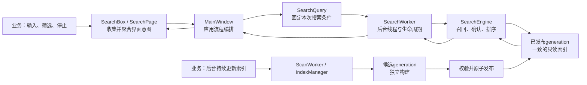

这套架构不是为了增加层数，而是分别解决四类会互相冲突的变化：

1. 界面交互经常变化。
2. 一次请求的数据必须保持一致。
3. 耗时任务不能阻塞界面。
4. 索引更新不能破坏正在进行的搜索。

后续章节会把表中每一项落实到真实函数。

---

## 经典业务场景库（持续追加）

| 编号 | 场景 | 核心设计 | 状态 |
| --- | --- | --- | --- |
| S001 | 搜索“武汉”尚未结束，用户又输入或提交“北京” | `SearchQuery`参数快照与任务切换 | 已学习 |
| S002 | 用户连续输入长关键词，不能每个字都查询一次 | `SearchPage.debounce`防抖 | 已学习 |
| S003 | 后台正在建立新索引，用户仍要搜索 | generation隔离 | 后续展开 |
| S004 | 用户快速连续提交多个搜索，只保留最新请求 | `pending_search`与取消清理 | 已学习 |
| S005 | 正文搜索较慢，先展示文件名和路径结果 | 部分结果信号 | 后续展开 |
| S006 | 多个文件并行解析，但SQLite不能并发乱写 | 多进程解析与串行写入 | 后续展开 |
| S007 | 搜索耗时期间界面仍要响应，并能安全停止 | `SearchWorker`、`QThread`与协作式取消 | 本章 |
| S008 | “武汉”命中同一文件多个位置，需要合并、排序和分页 | `SearchEngine`的候选召回、精确确认与结果封装 | 本章 |
| S009 | 搜索只读索引、取消时中断SQL、异常时确保关闭连接 | `DatabaseManager`连接生命周期 | 本章 |

### S001：搜索中修改或重新提交关键词

#### 业务现场

用户提交“武汉”后，后台搜索尚未结束。此时用户把输入框改成“北京”。

#### 必须满足的业务规则

- 已经开始的旧任务必须继续使用它收到的“武汉”条件，不能读到一半变成“北京”。
- 如果用户只是编辑，没有再次提交，旧任务继续运行。
- 如果用户再次提交“北京”，系统应取消旧任务，清理完成后用新条件创建新任务。

#### 容易出错的直接实现

如果`SearchWorker`在执行过程中不断读取`SearchPage`控件：

```text
查文件名时：输入框是“武汉”
用户修改输入框
查正文时：输入框变成“北京”
```

同一次搜索会混用两套条件，而且后台线程还会直接访问只能由Qt主线程操作的控件。

#### 当前项目的解决方案

第一次提交时，`MainWindow._run_search()`立即读取页面并创建：

```python
SearchQuery(text="武汉", ...)
```

随后把这个对象交给：

```text
SearchWorker
→ SearchEngine
```

页面之后变成“北京”，不会修改旧Worker持有的查询条件。

如果用户再次提交“北京”，真实调用链是：

```text
SearchPage.search_requested
→ MainWindow.request_search()
→ 发现search_thread仍存在
→ pending_search = True
→ cancel_search()
→ 旧SearchWorker结束
→ cleanup_search_thread()
→ 再次调用_run_search()
→ 从当前页面创建SearchQuery(text="北京")
```

#### 业务效果

1. 每次搜索内部条件一致。
2. 用户可以继续输入，不必等待旧搜索完成。
3. 新请求不会与旧线程同时更新同一结果页面。
4. 取消、清理、新建的生命周期顺序清楚。

#### 可迁移的通用模式

```text
可编辑的实时界面状态
→ 提交时复制为请求对象
→ 后台任务只读取请求对象
```

适用于：

- RAG聊天请求；
- 导出报表任务；
- 文件批量处理；
- 视频转码参数；
- 订单提交；
- HTTP接口请求。

#### 面试表达

> 为避免用户在搜索过程中修改输入导致同一任务条件漂移，项目在提交时把页面状态转换成独立SearchQuery，再交给后台Worker。若用户提交新关键词，MainWindow先标记pending_search并取消旧任务，线程清理后再根据当前页面创建新Query。因此每次任务的数据一致，同时界面仍可继续编辑。

### S002：连续输入时避免重复搜索

本场景的完整实现见第二章“防抖为什么是实际业务能力”。核心链路是：

```text
textChanged
→ SearchPage._on_text_changed()
→ debounce重新计时
→ 用户停止输入
→ timeout只发出一次search_requested
```

它解决的不是抽象的“性能优化”，而是避免连续输入导致大量后台搜索、取消操作和结果闪烁。

### S004：旧搜索未结束时，只执行最新请求

#### 业务现场

用户先搜索“武汉”，搜索还在后台执行，又连续提交了“湖北”和“北京”。业务真正关心的是最后一次请求“北京”，而不是把三次请求排队全部执行。

#### 容易出错的直接实现

如果每次提交都立刻创建一个新线程，会同时出现多个任务：

```text
武汉搜索 ───────────────→ 最后返回
湖北搜索 ────────→ 返回
北京搜索 ───→ 返回
```

“武汉”可能最晚完成，并把“北京”的结果覆盖掉。进度条、停止按钮和状态文字也会被三个任务同时修改。

另一种错误做法是：调用旧Worker的`cancel()`后立刻把引用清空并创建新Worker。`cancel()`只是发出协作式取消请求，旧线程此时不一定已经真正退出，两个任务仍可能短暂重叠。

#### 当前项目的真实调用链

相关实现位于`local_full_text_search/ui/main_window.py`：

```text
SearchPage.search_requested
→ MainWindow.request_search()
→ 发现 self.search_thread 仍存在
→ self.pending_search = True
→ MainWindow.cancel_search()
→ SearchWorker.cancel()
→ 旧Worker发出 cancelled / finished / failed等终止信号
→ QThread.quit()
→ QThread.finished
→ MainWindow.cleanup_search_thread()
→ 清空旧thread和worker引用
→ self._run_search()
→ 从页面此刻的最新状态创建SearchQuery(text="北京")
```

`pending_search`只是一个布尔值，不保存“湖北”和“北京”的队列。因此连续提交多次会折叠成一次待执行任务；等旧线程清理完，`_run_search()`读取页面最新状态，最终执行“北京”。

#### 为什么必须等`QThread.finished`

```text
调用cancel()
≠ 后台任务已经结束

收到QThread.finished
= 线程已经真正退出，可以清引用并启动下一次
```

这条边界让同一时间最多只有一套搜索流程更新结果页面。

#### 业务效果

1. 快速连续输入时，不浪费时间依次完成已经过时的请求。
2. 旧结果不会覆盖最新结果。
3. 进度、状态、停止按钮只有一个任务负责，不会互相打架。
4. 关闭程序时，`MainWindow`知道还有哪个线程需要取消和等待。

#### 可迁移的通用模式

这是“最新请求优先”（latest wins）模式：

```text
新请求到达
→ 取消旧任务
→ 等旧任务真正清理
→ 读取最新状态
→ 启动一个新任务
```

适合搜索联想、筛选预览、地图拖动查询、报表参数预览等场景。它不一定适合订单提交或聊天消息发送，因为那些请求通常不能丢弃中间项；设计前必须先判断业务要“全部执行”还是“只保留最新”。

#### 30秒面试表达

> 项目的交互式搜索采用latest-wins策略。用户在旧搜索运行时再次提交，MainWindow不会并发创建第二个Worker，而是设置pending_search并请求旧Worker取消。只有收到QThread.finished、完成资源清理后，才根据页面最新状态重新创建SearchQuery和Worker。这样既避免旧结果覆盖新结果，也避免多个任务竞争同一套进度和结果界面。

---

## 第一章：SearchBox 与信号分层

### 一、本系列的学习方式

后续每个模块都按以下顺序学习，一次只讲一个主要模块：

1. 这个模块解决什么业务问题。
2. 对象在哪里创建，`__init__()` 如何初始化。
3. 从哪个函数进入，依次调用哪些函数，最后返回什么。
4. 为什么要这样设计，而不是把代码合并到一起。
5. 这种设计给当前业务带来什么好处。
6. 能提炼出什么通用原则，以后开发时如何复用。
7. 用一至两个问题确认是否真正理解。

讲解必须以当前仓库的真实代码为依据。源码中的新增教学注释使用中文。

---

### 二、本课目标

理解以下两个问题：

1. `SearchBox` 是怎样被创建和初始化的？
2. 用户按回车以后，信号为什么要经过 `SearchPage`，再到 `MainWindow`？

关键代码：

- `app.py:2836`
- `local_full_text_search/ui/main_window.py:284`
- `local_full_text_search/ui/main_window.py:319`
- `local_full_text_search/ui/main_window.py:346`
- `local_full_text_search/ui/main_window.py:2780`
- `local_full_text_search/ui/main_window.py:2822`
- `local_full_text_search/ui/main_window.py:2828`
- `local_full_text_search/ui/main_window.py:3037`
- `local_full_text_search/ui/main_window.py:3368`
- `local_full_text_search/ui/main_window.py:3401`

---

### 三、三个对象分别负责什么

| 对象 | 负责 | 不负责 |
| --- | --- | --- |
| `SearchBox` | 输入框、清空按钮、停止按钮、回车事件 | 创建查询、启动线程、访问数据库 |
| `SearchPage` | 组合搜索框、筛选条件、结果区域，并对外提供统一的页面级事件 | 执行数据库检索 |
| `MainWindow` | 协调整个应用，决定何时创建查询和后台任务 | 处理输入框的具体显示细节 |

它们的包含关系是：

```text
MainWindow
└── SearchPage
    └── SearchBox
        ├── QLineEdit 输入框
        ├── 清空按钮
        ├── 历史按钮
        └── 停止按钮
```

---

### 四、初始化调用链

程序启动后，调用顺序如下：

```text
app.py 的 main()
  ↓ 创建
MainWindow(...)
  ↓ Python 自动调用
MainWindow.__init__()
  ↓ 调用
MainWindow._build_shell()
  ↓ 创建
SearchPage(settings)
  ↓ Python 自动调用
SearchPage.__init__()
  ↓ 调用
SearchPage._build()
  ↓ 创建
SearchBox()
  ↓ Python 自动调用
SearchBox.__init__()
```

#### 1. app.py 创建 MainWindow

```python
window = MainWindow(...)
```

创建对象时，Python 自动进入 `MainWindow.__init__()`。

#### 2. MainWindow 创建 SearchPage

`MainWindow.__init__()`调用：

```python
self._build_shell()
```

`MainWindow._build_shell()`内部创建搜索页面：

```python
self.search_page = SearchPage(self.settings)
```

#### 3. SearchPage 创建 SearchBox

`SearchPage.__init__()`调用：

```python
self._build()
```

`SearchPage._build()`内部创建搜索框：

```python
self.search_box = SearchBox()
```

执行这行代码时，Python自动调用`SearchBox.__init__()`。

#### 4. SearchBox 初始化内部控件

`SearchBox.__init__()`主要完成：

```python
super().__init__()              # 初始化Qt父类
self.input = QLineEdit()        # 创建输入框
self.clear_button = QPushButton()  # 创建清空按钮
self.history_button = QPushButton() # 创建历史按钮
self.stop_button = QPushButton("停止") # 创建停止按钮
```

初始化的含义是“创建对象并建立连接”，不是立即执行搜索。

---

### 五、connect 和 emit 的区别

真实代码：

```python
self.input.returnPressed.connect(self.search_requested.emit)
```

可以拆成：

```text
returnPressed                 输入框自带的“按下回车”信号
connect(...)                  登记将来要调用谁
self.search_requested.emit    将来真正发出SearchBox的搜索信号
```

`connect()`在初始化阶段执行，只建立关系。

`emit()`在用户操作发生时执行，才真正通知接收者。

---

### 六、按回车后的真实调用链

用户输入“武汉”并按回车：

```text
QLineEdit 发出 returnPressed
  ↓ 初始化时已经建立 connect
SearchBox 执行 search_requested.emit()
  ↓ SearchPage 初始化时已经建立 connect
SearchPage 执行 search_requested.emit()
  ↓ MainWindow 初始化时已经建立 connect
MainWindow.request_search()
```

对应三处真实连接：

```python
# SearchBox.__init__()
self.input.returnPressed.connect(self.search_requested.emit)

# SearchPage._build()
self.search_box.search_requested.connect(self.search_requested.emit)

# MainWindow._build_shell()
self.search_page.search_requested.connect(self.request_search)
```

因此，给`MainWindow`发出最终搜索信号的是`SearchPage`。最初的用户操作来自`SearchBox`中的输入框。

---

### 七、关键词怎样取得

`search_requested = Signal()`只表达“用户要求搜索”，没有携带关键词。

需要关键词时，外层调用`SearchPage.text()`：

```python
def text(self) -> str:
    return self.search_box.input.text().strip()
```

调用链：

```text
MainWindow
  ↓ 调用
SearchPage.text()
  ↓ 读取
SearchBox.input.text()
  ↓ 返回
"武汉"
```

这里把两类信息分开了：

- 信号表达：发生了什么——用户要求搜索。
- 方法返回值表达：具体数据是什么——关键词是“武汉”。

---

### 八、为什么不让 MainWindow 直接监听 SearchBox

下面的写法技术上能够运行：

```python
self.search_page.search_box.search_requested.connect(self.request_search)
```

但这会让`MainWindow`知道`SearchPage`的内部结构：

```text
MainWindow必须知道
SearchPage里面有search_box
search_box里面有search_requested
```

这叫作对内部实现的深层耦合。

当前写法是：

```python
self.search_page.search_requested.connect(self.request_search)
```

`MainWindow`只依赖`SearchPage`公开的页面级事件，不依赖内部使用了输入框、按钮还是其他组件。

---

### 九、为什么 SearchPage 要提供统一信号

当前项目中，搜索请求并不只有“按回车”一个来源。

#### 来源一：按回车

```text
SearchBox.search_requested
→ SearchPage.search_requested
```

#### 来源二：自动搜索计时器到期

```python
self.debounce.timeout.connect(self.search_requested.emit)
```

调用链：

```text
输入文字
→ SearchPage._on_text_changed()
→ debounce.start()
→ debounce.timeout
→ SearchPage.search_requested
```

#### 来源三：基础筛选条件改变

```python
def _filter_changed(self) -> None:
    if self.text():
        self.search_requested.emit()
```

三个来源最终统一为：

```text
SearchPage.search_requested
→ MainWindow.request_search()
```

因此`MainWindow`不需要分别监听回车、计时器和每个筛选控件。

---

### 十、这种设计给业务带来的好处

#### 1. 可以方便增加新的搜索入口

以后可以增加：

- 搜索按钮；
- 全局快捷键；
- 语音输入；
- 搜索历史中的“再次搜索”；
- 修改筛选条件后自动重搜。

这些入口只需要最终发出`SearchPage.search_requested`，`MainWindow`的后台搜索逻辑可以保持不变。

#### 2. 可以替换页面内部控件

以后把`SearchBox`换成新的组件，只要`SearchPage`仍然提供相同的公开信号，`MainWindow`不需要修改。

#### 3. 更容易测试

可以分别测试：

- `SearchBox`按回车后是否发出信号；
- `SearchPage`是否正确汇总各种搜索入口；
- `MainWindow`收到页面信号后是否启动搜索流程。

问题出现时更容易判断属于哪一层。

#### 4. 避免子组件直接依赖主窗口

`SearchBox`不需要保存`MainWindow`引用，也不需要导入`MainWindow`。它可以在其他页面或测试中独立创建。

---

### 十一、可以复用的通用原则

#### 原则一：子组件表达意图，不直接操纵上层

推荐：

```text
子组件发出“用户想做什么”
→ 上层决定“具体怎么做”
```

不推荐：

```text
子组件找到主窗口
→ 直接启动线程、访问数据库、修改其他页面
```

#### 原则二：页面负责聚合控件事件

当多个控件都会触发同一业务动作时，由页面统一转换成一个业务信号。

```text
控件事件
→ 页面级业务事件
→ 应用级用例
```

在当前项目中就是：

```text
回车/计时器/基础筛选变化
→ SearchPage.search_requested
→ MainWindow.request_search
```

#### 原则三：上层依赖公开接口，不依赖内部结构

推荐：

```python
self.search_page.search_requested.connect(...)
```

谨慎使用：

```python
self.search_page.search_box.input.returnPressed.connect(...)
```

后者跨越了多层对象，内部结构一改，上层也必须修改。

#### 原则四：同一种业务意图使用同一个入口

无论请求来自按钮、回车、快捷键还是语音，都应尽量汇总到同一个应用入口，避免复制业务流程。

---

### 十二、什么时候值得使用这种设计

适合：

- 一个业务动作有多个触发入口；
- 页面内部结构以后可能调整；
- 子组件需要复用或单独测试；
- 最终动作涉及线程、数据库或全局状态；
- 项目会持续迭代，而不是一次性演示。

不必过度设计的情况：

- 只有一个简单按钮和一个本地函数；
- 页面不会复用，也几乎不会变化；
- 增加信号转发只会制造没有收益的层级。

判断标准不是“层数越多越专业”，而是：

> 这一层是否隐藏了内部变化，或者统一了多个业务入口？

如果答案是否定的，就不应该为了分层而分层。

---

### 十三、面试表达

可以这样回答：

> `SearchBox`只负责采集用户操作并发出控件级信号；`SearchPage`聚合回车、自动搜索和基础筛选变化等多个入口，统一对外发出页面级`search_requested`；`MainWindow`只监听这个公开事件并编排后台任务。这样可以降低主窗口对页面内部控件的耦合，方便替换组件、增加搜索入口和分层测试。

---

### 十四、理解检查

1. 创建`SearchBox`的直接函数是`MainWindow._build_shell()`还是`SearchPage._build()`？
2. `connect()`是在执行搜索，还是登记以后信号发生时要调用的函数？
3. 为什么`MainWindow`监听`SearchPage.search_requested`，而不是深入访问`SearchPage.search_box.input.returnPressed`？
4. 如果增加语音搜索，应该让它最终汇入哪个统一信号？

---

## 第二章：SearchPage——搜索功能的页面聚合层

### 一、本章先给出结论

`SearchPage`不是搜索算法，也不是后台任务执行器。它解决的是一个页面级问题：

> 把搜索框、基础筛选、高级筛选、索引状态、进度、结果列表和分页组合成一个完整搜索页面，并向`MainWindow`提供稳定的输入、输出接口。

可以把它理解成“搜索功能的前台服务台”：

- 内部接收多个控件产生的操作；
- 对外只发出少量页面级业务信号；
- 外部需要搜索条件时，通过公开方法统一读取；
- 外部返回搜索状态和结果时，通过公开方法统一显示。

真实代码位于：

- `local_full_text_search/ui/main_window.py`中的`SearchPage`
- `SearchPage.__init__()`
- `SearchPage._build()`
- `SearchPage._on_text_changed()`
- `SearchPage._filter_changed()`
- `SearchPage.text()`及其他条件读取方法
- `SearchPage.set_running()`
- `SearchPage.set_search_progress()`
- `SearchPage.set_partial_results()`
- `SearchPage.set_results()`

### 二、SearchPage的输入与输出

| 方向 | 内容 | 代码形式 |
| --- | --- | --- |
| 控件进入页面 | 回车、文字变化、基础筛选变化、翻页、打开文件 | Qt控件信号 |
| 页面通知外层 | 搜索、停止、翻页、打开文件等业务意图 | `SearchPage`公开信号 |
| 外层读取页面 | 关键词、模式、目录、扩展名、OCR开关等 | getter方法 |
| 外层更新页面 | 运行状态、进度、部分结果、完整结果 | `set_*()`方法 |

核心结构如下：

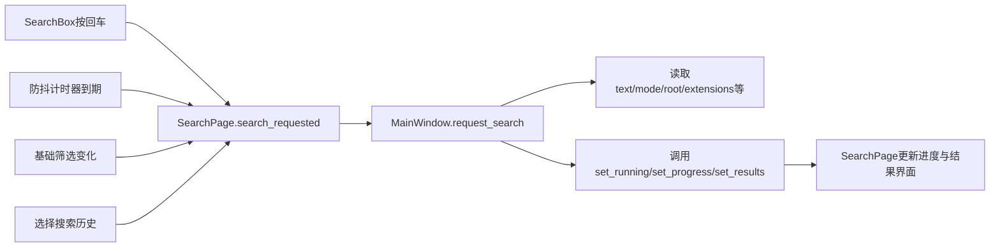

图中最重要的关系是：多个入口汇总成一个`search_requested`，多项页面数据通过一组公开方法提供给`MainWindow`。

### 三、初始化调用链

上一章已经走到：

```text
MainWindow._build_shell()
  ↓
self.search_page = SearchPage(self.settings)
```

执行`SearchPage(self.settings)`时，Python自动进入：

```python
SearchPage.__init__(settings)
```

`SearchPage.__init__()`的主要顺序是：

```text
1. super().__init__()
2. 初始化页面状态字段
3. 创建防抖计时器 debounce
4. 调用 self._build() 创建全部控件
5. 调用 self.apply_settings(settings) 应用配置
```

对应代码骨架：

```python
def __init__(self, settings: AppSettings) -> None:
    super().__init__()
    self._stats = {}
    self._index_ready = False

    self.debounce = QTimer(self)
    self.debounce.setSingleShot(True)
    self.debounce.timeout.connect(self.search_requested.emit)

    self._build()
    self.apply_settings(settings)
```

这里有两个重要设计点。

第一，先`_build()`再`apply_settings()`，因为必须先创建下拉框和复选框，才能把默认搜索模式、OCR开关等设置写入控件。

第二，`SearchPage.__init__()`只在页面创建时执行一次；后面每次搜索不会重新创建整个页面。

### 四、_build()具体创建了什么

`SearchPage._build()`大致按以下顺序组装页面：

```text
SearchBox
→ 基础筛选区
→ AdvancedFilters高级筛选
→ 状态文字和耗时
→ 搜索进度条
→ 空状态/结果列表切换区
→ 翻页控件
→ 建立所有信号连接
```

#### 1. 创建并连接SearchBox

```python
self.search_box = SearchBox()
self.search_box.input.textChanged.connect(self._on_text_changed)
self.search_box.search_requested.connect(self.search_requested.emit)
self.search_box.stop_requested.connect(self.stop_requested.emit)
self.search_box.history_requested.connect(self._show_history)
```

这里不是所有信号都简单转发：

- 搜索和停止属于应用级动作，所以转发给外层；
- 历史菜单属于页面内部展示，所以由`SearchPage._show_history()`自己处理；
- 文字变化需要处理防抖和空状态，所以进入`_on_text_changed()`。

这说明信号是否转发，要根据职责决定，不能机械地全部向上抛。

#### 2. 创建基础筛选

页面创建四个主要下拉框：

```python
self.mode_combo       # 完全包含、完整短语、全部词、任意词、正则
self.file_type_combo  # PDF、Word、Excel等文件类型分组
self.scope_combo      # 全部范围或某一个索引根目录
self.sort_combo       # 相关性、时间、大小、文件名排序
```

下拉框显示给用户的是中文标签，内部保存的是稳定值。例如：

```python
self.mode_combo.addItem("全部关键词", "all")
```

用户看到“全部关键词”，程序取得的是`"all"`。这样修改界面文案时，不会影响搜索算法使用的模式值。

#### 3. 创建结果显示区

```python
self.content_stack = QStackedWidget()
self.empty_state = EmptyState()
self.result_view = ResultView()
```

`QStackedWidget`同一时间只显示一个子控件：

- 没有搜索时显示`EmptyState`；
- 有结果时显示`ResultView`；
- 没有结果、索引未就绪或搜索中断时，重新使用`EmptyState`展示不同内容。

这避免了多个状态控件同时显示和互相覆盖。

### 五、用户输入文字时的函数链

`SearchPage._build()`建立了连接：

```python
self.search_box.input.textChanged.connect(self._on_text_changed)
```

用户每输入或删除一个字符，调用链是：

```text
QLineEdit文字变化
→ QLineEdit.textChanged(text)
→ SearchPage._on_text_changed(text)
```

真实处理逻辑：

```python
def _on_text_changed(self, text: str) -> None:
    self.search_box.update_clear_button()
    if not text.strip():
        self.debounce.stop()
        self.show_idle_state()
        return
    if self.auto_search_enabled:
        self.debounce.start()
```

分成三种情况：

1. 无论输入什么，都先更新“清空”按钮是否显示。
2. 输入被删空时，取消尚未触发的自动搜索，并恢复空闲页面。
3. 输入不为空且开启自动搜索时，重新启动防抖计时器。

### 六、防抖为什么是实际业务能力

假设用户连续输入“武汉人工智能”：

如果没有防抖，可能产生：

```text
武 → 搜索一次
武汉 → 搜索一次
武汉人 → 搜索一次
武汉人工 → 搜索一次
……
```

这会反复创建后台搜索任务、取消旧任务、查询数据库并刷新界面。

现在的逻辑是：

```text
每输入一个字
→ debounce.start()重新计时
→ 用户暂时停止输入
→ debounce.timeout只触发一次
→ SearchPage.search_requested
```

实际好处：

- 减少无效数据库查询；
- 减少线程创建和取消；
- 避免结果列表频繁闪烁；
- 用户输入长关键词时仍保持界面流畅。

这是可以直接用于搜索框、接口联想、表单校验和实时预览的通用模式。

### 七、筛选变化时的函数链

基础下拉框连接到同一个函数：

```python
self.file_type_combo.currentIndexChanged.connect(self._filter_changed)
self.mode_combo.currentIndexChanged.connect(self._filter_changed)
self.scope_combo.currentIndexChanged.connect(self._filter_changed)
self.sort_combo.currentIndexChanged.connect(self._filter_changed)
```

调用链：

```text
用户修改基础筛选
→ currentIndexChanged
→ SearchPage._filter_changed()
→ 如果已有关键词，发出search_requested
```

```python
def _filter_changed(self) -> None:
    if self.text():
        self.search_requested.emit()
```

这里先判断是否有关键词，避免用户尚未输入内容时，仅切换筛选框就发起一次空搜索。

需要注意当前真实实现：高级复选框的`toggled`只连接`_update_filter_button()`，主要用于更新“筛选 · N”的提示，不会在勾选瞬间自动发起搜索。这是理解和测试当前行为时必须区分的细节。

### 八、SearchPage怎样向MainWindow提供搜索条件

`SearchPage`没有直接创建`SearchQuery`，而是提供一组读取方法：

```python
text()
mode_value()
root_ids()
extensions()
sort_value()
search_filename()
search_path()
search_content()
include_ocr()
include_ocr_fuzzy()
case_sensitive()
```

例如：

```python
def mode_value(self) -> str:
    return str(self.mode_combo.currentData())
```

```python
def root_ids(self) -> list[int]:
    value = self.scope_combo.currentData()
    return [int(value)] if value is not None else []
```

```python
def extensions(self) -> list[str]:
    label = str(self.file_type_combo.currentData())
    return sorted(FILE_TYPE_GROUPS.get(label, set()))
```

这些方法做了两件事：

1. 隐藏控件细节，外层不需要知道页面使用的是哪个下拉框或复选框。
2. 把界面数据转换成业务需要的类型，例如把“PDF”分组转换成扩展名列表。

下一章学习`MainWindow`时，会看到它怎样调用这些方法组装`SearchQuery`。

### 九、外层怎样把搜索状态交回SearchPage

页面对外提供一组更新方法：

```python
set_running(running)
set_search_progress(payload)
set_partial_results(page)
set_results(page)
show_no_results()
show_interrupted_state(title)
```

它们形成另一条方向相反的链路：

```text
后台搜索状态/结果
→ MainWindow对应槽函数
→ SearchPage的set_*方法
→ 页面控件更新
```

例如搜索开始时：

```python
self.search_page.set_running(True)
```

`SearchPage.set_running(True)`负责：

- 显示停止按钮；
- 显示进度条；
- 计算预计时间；
- 显示“正在检索索引”；
- 必要时切换正在检索的空状态。

它不会创建线程，也不会执行数据库查询。

搜索完成时，`set_results(page)`负责：

- 更新实际耗时；
- 统计正文、OCR和疑似OCR命中；
- 更新状态文字；
- 把结果交给`ResultView`；
- 决定是否显示分页。

注意：`set_results(self, page)`中的参数`page`是“一页搜索结果数据”，不是当前这个UI类`SearchPage`。两者同名容易造成初学者混淆，这也是阅读代码时应主动识别的命名上下文。

### 十、为什么不把SearchPage合并到MainWindow

如果删除`SearchPage`，`MainWindow`就必须直接负责：

- 创建搜索框和全部筛选控件；
- 处理文字变化和防抖；
- 读取每个控件的值；
- 管理空状态、进度条、结果列表和分页；
- 同时创建线程、Worker并处理应用关闭。

具体后果不是一句抽象的“耦合高”，而是：

1. 修改搜索页面布局时容易碰到线程调度代码。
2. 增加一个筛选项时，需要在巨大的MainWindow中查找多个位置。
3. 搜索页面难以单独测试和复用。
4. MainWindow会逐渐成为什么都负责的超大类。
5. UI显示错误与后台搜索错误更难分开定位。

当前设计让`MainWindow`只关心：

```text
页面要求做什么
→ 我怎样调度应用任务
→ 任务状态和结果怎样交回页面
```

让`SearchPage`只关心：

```text
搜索功能页面有哪些控件
→ 用户当前选择了什么
→ 当前状态和结果应该怎样显示
```

### 十一、这种设计方便哪些业务

#### 1. 增加搜索入口

可以增加搜索按钮、快捷键、历史记录再次搜索，只要最后发出统一的`search_requested`。

#### 2. 增加筛选条件

可以在SearchPage内部增加作者、时间、文件大小或标签筛选，再提供对应getter；MainWindow仍然通过页面公开接口读取。

#### 3. 支持渐进式结果

项目可以先调用`set_partial_results()`显示文件名和路径命中，再调用`set_results()`显示完整正文结果，而不需要让Worker直接操作界面。

#### 4. 支持不同索引状态

同一个页面可以展示尚未添加目录、索引未完成、搜索中、没有结果、部分结果和完整结果。

#### 5. 方便故障定位

可以按边界排查：

```text
输入没反应
→ 检查SearchBox到SearchPage的信号

搜索条件不正确
→ 检查SearchPage的getter转换

任务已完成但界面没结果
→ 检查MainWindow到SearchPage.set_results
```

### 十二、可以复用的通用模式

#### 模式一：页面作为功能门面

页面把内部许多控件包装成少量稳定接口：

```text
多个内部控件
→ 页面公开信号和方法
→ 外层应用协调器
```

这与后端开发中的Service接口、API接口有相似思想：调用者依赖公开能力，不依赖内部实现。

#### 模式二：事件聚合

多个界面事件表达同一种业务意图时，汇总为一个业务事件：

```text
回车 / 自动搜索 / 基础筛选 / 历史记录
→ search_requested
```

#### 模式三：表单适配

界面控件保存的是展示数据，getter把它转换成业务数据：

```text
下拉框“PDF”
→ extensions()
→ [".pdf"]等扩展名集合
```

#### 模式四：命令和展示分离

页面发出“开始搜索”的命令意图，但不执行搜索；页面接收结果数据，但不计算搜索结果。

这个原则以后可以迁移到RAG应用：

```text
聊天页面收集问题和知识库范围
→ 发出提问请求
→ 编排层调用检索与大模型
→ 页面只展示流式状态、引用和答案
```

### 十三、当前设计的边界与代价

这套设计不是没有代价：

- 信号需要经过一层转发，初学时调用链不够直观；
- `SearchPage`本身已经包含较多状态和展示逻辑；
- 如果继续增加复杂筛选、预览和历史管理，它也可能变成新的“大类”。

如果未来继续增长，可以进一步拆分：

```text
SearchForm       负责输入与筛选
SearchResults    负责结果和分页
SearchPresenter  负责页面状态转换
```

但当前阶段不应为了“层数更多”提前拆分。判断是否继续拆的标准是：是否已经出现独立变化、独立复用或独立测试的真实需求。

### 十四、30秒面试表达

> 项目中的SearchPage是搜索功能的页面聚合层。它组合SearchBox、检索模式、文件类型、目录范围、OCR选项、进度和结果列表，把回车、自动搜索、基础筛选变化等入口统一成search_requested信号。MainWindow通过公开getter读取页面条件并创建SearchQuery，后台返回后再调用set_progress或set_results更新页面。这样既避免MainWindow直接依赖所有控件，也支持防抖搜索、渐进式结果和后续增加新筛选项。

### 十五、理解检查

1. `SearchPage.__init__()`为什么必须先调用`_build()`，再调用`apply_settings()`？
2. 用户连续输入“武汉人工智能”时，防抖计时器怎样避免执行多次搜索？
3. `SearchPage`为什么提供`mode_value()`和`extensions()`，而不是让`MainWindow`直接读取下拉框？
4. `SearchPage.set_results()`负责展示结果还是计算检索结果？

### 十六、SearchPage与SearchQuery看起来重复，实际区别是什么

两者确实都出现了关键词、模式、目录和扩展名，但它们处在不同阶段：

```text
SearchPage中的实时控件状态
  ↓ MainWindow读取并转换
SearchQuery中的单次请求快照
  ↓ 交给后台线程
SearchWorker / SearchEngine执行
```

| 对比项 | `SearchPage` | `SearchQuery` |
| --- | --- | --- |
| 本质 | Qt界面对象 | 普通Python数据对象 |
| 生命周期 | 主窗口存在期间一直存在 | 每发起一次搜索就创建一个 |
| 所在线程 | Qt界面主线程 | 创建后传给搜索Worker使用 |
| 内容 | 控件、信号、状态、进度、结果展示 | 本次搜索所需的参数值 |
| 状态特点 | 用户随时可以继续修改 | 代表点击搜索那一刻固定下来的条件 |
| 是否显示界面 | 是 | 否 |
| 是否访问搜索算法 | 不直接访问 | 被SearchEngine读取 |

#### 为什么字段名称会重复

因为`SearchPage`是搜索条件的来源，`SearchQuery`是这些条件经过整理后的业务数据。

真实转换发生在`MainWindow._run_search()`：

```python
query = SearchQuery(
    text=self.search_page.text(),
    mode=self.search_page.mode_value(),
    root_ids=self.search_page.root_ids(),
    extensions=self.search_page.extensions(),
    search_content=self.search_page.search_content(),
    include_ocr=self.search_page.include_ocr(),
    page=self.page,
    sort_by=self.search_page.sort_value(),
)
```

等号右边读取“当前页面是什么状态”，等号左边构造“这一次搜索要使用什么参数”。

此外，`SearchQuery`并不只来自页面。它还组合了应用设置和MainWindow状态：

```python
ocr_min_confidence=self.settings.ocr_min_confidence
page_size=min(max(self.settings.page_size, 10), 100)
max_results=self.settings.max_results
page=self.page
```

所以`SearchQuery`是多个来源汇总后的完整请求，不是SearchPage的简单复制。

#### 为什么不能直接把SearchPage传给SearchWorker

假设用户输入“武汉”并开始搜索，搜索尚未完成时又把输入框改成“北京”。

如果后台线程不断读取`SearchPage`：

```text
查询文件名时可能读到“武汉”
查询正文时可能读到“北京”
```

同一次搜索就可能使用两套条件，结果不一致。

当前实现先创建：

```python
SearchQuery(text="武汉", ...)
```

随后即使页面显示已经改成“北京”，正在运行的Worker仍然使用本次收到的“武汉”查询对象。新的“北京”会形成下一次`SearchQuery`。

还有一个更重要的原因：Qt界面控件属于主线程。后台线程直接读取`QLineEdit`、`QComboBox`等控件，会破坏Qt的线程边界，产生不稳定行为。普通数据对象`SearchQuery`不包含Qt控件，可以安全地作为线程之间的任务数据传递。

#### 这种分离解决了什么具体问题

1. 保证一次搜索从开始到结束使用同一组条件。
2. 后台算法不依赖Qt，可以单独测试。
3. 将来增加命令行、HTTP API或Agent入口时，也能直接构造`SearchQuery`复用`SearchEngine`。
4. 页面可以继续响应用户输入，不会改变正在运行的旧请求。
5. 搜索历史可以保存参数数据，而不需要保存一个界面对象。

#### 通用开发原则

这可以提炼为：

> 界面负责维护用户正在编辑的状态；请求对象负责保存某次操作提交时的数据快照。

在其他系统中也很常见：

```text
网页表单 → HTTP请求JSON
订单编辑页面 → CreateOrderRequest
RAG聊天页面 → RetrievalQuery
配置界面 → 执行任务参数对象
```

不要因为两边字段相似就认为职责重复。判断是否应该分开，要看它们是否具有不同的生命周期、线程边界和变化原因。

#### 30秒面试表达

> SearchPage保存用户正在编辑的实时界面状态，而SearchQuery是发起搜索时创建的一次性参数快照。MainWindow把页面值、分页状态和系统配置汇总成SearchQuery，再交给后台Worker。这样用户继续修改界面时不会影响已经运行的搜索，同时避免后台线程直接访问Qt控件，SearchEngine也可以脱离UI独立测试和复用。

---

## 第三章：MainWindow——搜索流程的应用编排层

### 一、先记住一句话

> `MainWindow`不负责“怎样匹配关键词”，它负责“什么时候可以搜、用哪些条件搜、由哪个后台任务搜、结果交给谁展示，以及任务何时可以安全结束”。

可以把它理解为搜索流程的调度员：调度员认识页面、任务和线程，但不亲自执行检索算法。

### 二、MainWindow为什么会有SearchWorker

`MainWindow`持有：

```python
self.search_thread: QThread | None = None
self.search_worker: SearchWorker | None = None
```

“持有一个对象”和“承担这个对象的业务职责”不是一回事。

| MainWindow对Worker做的事 | MainWindow不做的事 |
| --- | --- |
| 创建本次Worker | 不编写SQL |
| 把Worker移入后台线程 | 不判断文件是否匹配 |
| 连接开始、结果、失败和取消信号 | 不计算相关性分数 |
| 响应停止按钮 | 不读取文件正文 |
| 在线程结束后清理引用 | 不生成SearchResult |

它必须知道`SearchWorker`，因为窗口拥有以下应用级信息：

1. 搜索页面是否又提交了新请求。
2. 数据库是否正在迁移。
3. 应用是否正在关闭。
4. 当前有没有搜索线程在运行。
5. 搜索结果应该交给哪个页面。

这些都不是检索算法本身应该知道的事情。

### 三、对象怎样一步步初始化

#### 第1步：app.py创建MainWindow

入口函数创建主窗口：

```text
app.py: main()
→ MainWindow(...)
→ MainWindow.__init__()
```

构造参数中已经传入数据库、设置、设置服务和generation基础路径。`MainWindow`因此能协调应用中的页面和后台任务。

#### 第2步：先声明“当前没有搜索任务”

`local_full_text_search/ui/main_window.py:186-231`：

```python
self.search_thread = None
self.search_worker = None
self.pending_search = False
```

三项状态分别表示：

- `search_thread`：后台执行环境是否存在。
- `search_worker`：本次搜索任务对象是否存在。
- `pending_search`：旧任务结束后，是否还要按最新页面状态再搜一次。

注意：程序启动时并没有提前创建`SearchWorker`。每次真正搜索时才创建一个新的Worker，因为每个Worker都要绑定本次独立的`SearchQuery`。

#### 第3步：MainWindow创建SearchPage

`MainWindow.__init__()`调用`_build_shell()`：

```text
MainWindow.__init__()
→ MainWindow._build_shell()
→ SearchPage(settings)
→ SearchPage.__init__()
→ SearchPage._build()
→ SearchBox()
```

所以对象包含关系是：

```text
MainWindow
└── SearchPage
    └── SearchBox
```

#### 第4步：初始化时只连接信号

`MainWindow._build_shell()`中的关键代码：

```python
self.search_page.search_requested.connect(self.request_search)
self.search_page.stop_requested.connect(self.cancel_search)
```

这里的`connect()`只是建立规则：

```text
将来SearchPage发出search_requested
→ Qt调用MainWindow.request_search
```

初始化到这里不会立即搜索，也还没有创建`SearchWorker`。

### 四、用“武汉”走一遍完整入口

用户在搜索框输入“武汉”并按回车：

```text
QLineEdit.returnPressed
→ SearchBox.search_requested
→ SearchPage.search_requested
→ MainWindow.request_search()
```

`request_search()`位于`local_full_text_search/ui/main_window.py:2067`。它先做业务门禁，而不是立刻执行SQL。

#### 门禁1：数据库是否正在迁移

```python
if self.database_migration_thread is not None:
    self.search_page.set_status("数据库正在迁移，请等待完成")
    return
```

原因：迁移期间数据库位置或结构可能变化，此时启动搜索会得到不稳定状态。

#### 门禁2：是否存在完整发布的索引

```python
if self.index_generation_store.active() is None:
    self.search_page.show_index_not_ready_state()
    return
```

原因：正在构建的候选索引可能只包含一部分文件，不能把半成品当成完整搜索结果。

#### 门禁3：关键词是否为空

```python
if not self.search_page.text():
    self.page = 1
    self.search_page.show_idle_state()
    return
```

空关键词无需占用一个后台线程。

#### 门禁4：旧搜索是否仍在运行

```python
if self.search_thread is not None:
    self.pending_search = True
    self.cancel_search()
    return
```

如果没有旧搜索，才进入：

```python
self._run_search()
```

这说明`request_search()`解决的是“现在能不能开始”，不是“具体怎样查”。

### 五、_run_search怎样组装一次后台任务

`MainWindow._run_search()`位于`local_full_text_search/ui/main_window.py:2095`。它可以分成七步。

#### 第1步：冻结本次搜索条件

```python
query = SearchQuery(
    text=self.search_page.text(),
    mode=self.search_page.mode_value(),
    root_ids=self.search_page.root_ids(),
    extensions=self.search_page.extensions(),
    search_content=self.search_page.search_content(),
    ocr_min_confidence=self.settings.ocr_min_confidence,
    page_size=min(max(self.settings.page_size, 10), 100),
    page=self.page,
    sort_by=self.search_page.sort_value(),
)
```

它把三个来源汇总成一次请求：

```text
SearchPage：关键词、模式、筛选项
AppSettings：分页大小、OCR阈值、结果上限
MainWindow：当前页码
               ↓
          SearchQuery
```

#### 第2步：创建线程和任务

```python
self.search_thread = QThread()
self.search_worker = SearchWorker(self.generation_base_path, query)
```

每次搜索都有自己的`SearchQuery`和`SearchWorker`。字段保存在`MainWindow`上，而不是只使用局部变量，原因有三点：

1. 停止按钮随后还要找到这个Worker并调用`cancel()`。
2. 程序关闭时还要判断线程是否存在并等待退出。
3. Qt对象运行期间需要保留可靠引用，不能让Python过早回收。

#### 第3步：把Worker移到后台线程

```python
self.search_worker.moveToThread(self.search_thread)
```

创建对象时，Worker最初仍属于当前主线程。`moveToThread()`明确指定：以后与该Worker关联的执行应在搜索线程中进行。

#### 第4步：规定线程启动后调用哪个函数

```python
self.search_thread.started.connect(self.search_worker.run)
```

真实含义是：

```text
QThread发出started
→ SearchWorker.run()
→ 创建本次只读DatabaseManager
→ 创建SearchEngine
→ SearchEngine.search(...)
```

所以启动线程的不是`SearchWorker`；`MainWindow`启动`QThread`，`QThread.started`再触发`SearchWorker.run()`。

#### 第5步：规定结果怎样回到界面

```python
self.search_worker.finished.connect(self.on_search_finished)
self.search_worker.partial.connect(self.on_search_partial)
self.search_worker.progress.connect(self.on_search_progress)
self.search_worker.failed.connect(self.on_search_failed)
```

Worker只发出数据和状态，不直接修改界面。`MainWindow`收到后转交给`SearchPage`：

```text
SearchWorker.finished(page)
→ MainWindow.on_search_finished(page)
→ SearchPage.set_results(page)
```

这保证Qt控件仍由主线程更新。

#### 第6步：规定所有终止路径都退出线程

```python
self.search_worker.finished.connect(self.search_thread.quit)
self.search_worker.cancelled.connect(self.search_thread.quit)
self.search_worker.failed.connect(self.search_thread.quit)
self.search_thread.finished.connect(self.cleanup_search_thread)
```

正常完成、用户取消和异常失败都必须收尾。只处理成功路径，会留下无法退出的后台线程。

#### 第7步：真正启动

```python
self.search_page.set_running(True)
self.search_thread.start()
```

`start()`之后，`_run_search()`会返回，Qt主线程继续处理输入、点击和窗口刷新；耗时搜索在后台线程运行。

### 六、一张图看清谁调用谁

```mermaid
sequenceDiagram
    actor User as 用户
    participant Box as SearchBox
    participant Page as SearchPage
    participant Main as MainWindow
    participant Thread as QThread
    participant Worker as SearchWorker
    participant Engine as SearchEngine

    User->>Box: 输入“武汉”并按回车
    Box-->>Page: search_requested
    Page-->>Main: search_requested
    Main->>Main: request_search()检查门禁
    Main->>Main: _run_search()创建SearchQuery
    Main->>Thread: 创建并连接信号
    Main->>Worker: 创建Worker并moveToThread
    Main->>Thread: start()
    Thread-->>Worker: started → run()
    Worker->>Engine: search(query)
    Engine-->>Worker: SearchResultPage
    Worker-->>Main: finished(page)
    Main->>Page: set_results(page)
    Worker-->>Thread: finished → quit()
    Thread-->>Main: thread.finished
    Main->>Main: cleanup_search_thread()
```

要区分图中的两类箭头：

- 普通函数调用：调用方当场执行目标函数。
- Qt信号连接：初始化时先登记关系，将来事件发生时由Qt触发对应槽函数。

### 七、结果为什么要经过MainWindow再交给SearchPage

`on_search_finished()`位于`local_full_text_search/ui/main_window.py:2196`：

```python
def on_search_finished(self, page: object) -> None:
    self.total_confirmed = page.available_results
    self.search_page.set_results(page)
```

MainWindow在转交结果时还要处理应用级状态，例如总结果数、搜索历史和预览面板。这些信息跨越了Worker和页面，不适合塞进检索算法。

如果让Worker直接操作页面，会产生两个问题：

1. Worker在后台线程运行，直接修改Qt控件不安全。
2. Worker将依赖具体页面，将来很难被CLI、API或测试复用。

### 八、为什么不让SearchPage自己创建Worker

表面上看，搜索页面最了解搜索功能，似乎可以直接创建Worker。但它不知道完整的应用状态：

```text
SearchPage知道：
- 当前输入和筛选
- 当前进度和结果如何显示

MainWindow知道：
- 数据库迁移是否进行中
- 应用是否正在关闭
- 后台搜索、扫描等线程是否存在
- 当前页码和全局设置
- 结果之外还要更新历史、预览和顶栏状态
```

如果SearchPage直接管理线程，它会从“搜索页面”膨胀成“应用控制中心”，索引页、设置页和关闭流程也必须反过来了解它的内部状态。

### 九、为什么不让MainWindow自己执行搜索算法

如果把`SearchWorker`、`SearchEngine`的代码都放进MainWindow：

1. SQL和匹配算法会与按钮、页面切换、窗口关闭混在一起。
2. 算法测试必须先创建Qt窗口。
3. 搜索一耗时，界面主线程就会卡住。
4. 将来增加HTTP API或Agent入口时，无法复用一套独立搜索能力。

当前边界是：

```text
MainWindow：编排一次应用流程
SearchWorker：把同步搜索适配到Qt后台线程
SearchEngine：执行可独立测试的检索算法
```

### 十、这个设计方便哪些真实业务

#### 业务1：用户点击停止

```text
SearchPage.stop_requested
→ MainWindow.cancel_search()
→ 当前SearchWorker.cancel()
```

窗口持有当前Worker，因此停止按钮能准确取消当前任务。

#### 业务2：快速提交新关键词

MainWindow统一执行“取消旧任务—等待线程退出—按最新状态重启”，不会让页面自己猜测哪个结果是最新的。完整场景见S004。

#### 业务3：程序退出

`MainWindow.closeEvent()`会检查`search_thread`，清除`pending_search`并调用`cancel_search()`。等所有后台线程安全结束后，应用才真正退出。

#### 业务4：先显示部分结果

`SearchWorker.partial`到达后，`MainWindow.on_search_partial()`调用`SearchPage.set_partial_results()`；最终结果仍走`finished`。页面不需要知道后台用了几个检索阶段。

#### 业务5：以后接入RAG

可以把MainWindow理解为应用层编排的雏形。未来RAG请求也会经历：

```text
页面提交问题
→ 应用层检查状态并创建请求快照
→ 后台任务执行检索和生成
→ 进度/引用/答案通过事件返回
→ 应用层协调取消、重试和页面更新
```

检索和模型调用不应该直接塞进窗口类。

### 十一、可以复用的通用设计

#### 1. 应用编排层

当一个业务动作跨越页面、后台任务和全局状态时，需要一个地方负责安排顺序。它不承担每个步骤的内部算法。

#### 2. 生命周期所有者

谁创建并持有后台任务，谁就应负责启动、取消、异常处理和清理，避免“创建者不知道怎么结束，使用者不知道谁创建”。

#### 3. 事件驱动的线程边界

界面通过信号发送意图，后台通过信号返回数据；两边不直接修改对方内部状态。

#### 4. latest-wins任务策略

交互式搜索通常只关心最后一次请求。取消不是瞬间完成，因此新任务要等旧任务清理后再启动。

### 十二、当前设计的取舍

`MainWindow`现在还协调扫描、迁移、快照、排除范围等多种任务，文件已经较大。这在桌面应用早期便于集中掌握全局生命周期，但功能继续增长时可能演变成“巨型窗口类”。

将来如果搜索编排继续变复杂，可以抽出`SearchController`或`SearchCoordinator`：

```text
MainWindow
→ SearchController（搜索生命周期）
→ SearchWorker
→ SearchEngine
```

是否拆分要根据变化和测试成本决定，而不是看到代码长就机械增加一层。

### 十三、30秒面试表达

> MainWindow在项目中是应用编排层，不负责SQL和匹配算法。它监听SearchPage的搜索意图，检查数据库迁移和已发布索引等前置条件，再把页面状态、全局设置和页码组装成SearchQuery。随后它创建QThread和SearchWorker，连接启动、进度、结果、取消、失败及清理信号。Worker在后台调用SearchEngine，结果通过信号回到主线程，再由MainWindow交给SearchPage展示。这样既保持界面响应，也能统一处理取消、连续搜索和应用退出。

### 十四、理解检查

1. 用户搜索“武汉”尚未结束又提交“北京”时，为什么不能在调用`cancel()`后马上创建第二个Worker，而要等`QThread.finished`？
2. `MainWindow`虽然保存了`search_worker`，但真正执行关键词匹配和排序的是哪个模块？`MainWindow`保存它的主要目的是什么？

### 十五、补充答疑：QThread和Worker到底是什么关系

#### 1. 每次搜索和索引都会创建Worker吗

需要按“实际启动了一轮任务”来理解。

| 业务动作 | 实际创建方式 | 不是怎样创建 |
| --- | --- | --- |
| 一次真正开始的搜索 | 一个新`SearchQuery`、一个新`SearchWorker`、一个新`QThread` | 不是程序启动时创建一个Worker永久复用 |
| 一轮真正开始的索引 | 一个新`ScanWorker`、一个新`QThread` | 不是每个文件创建一个ScanWorker |

搜索的创建位置是`MainWindow._run_search()`：

```python
self.search_thread = QThread()
self.search_worker = SearchWorker(self.generation_base_path, query)
```

但用户快速提交多个搜索时，不是每个操作都一定创建Worker。若旧搜索仍在运行，`request_search()`会先设置`pending_search`并取消旧任务；中间的过时请求可能被合并，最后只为最新条件创建下一只Worker。

索引的创建位置是`MainWindow.start_scan()`：

```python
self.scan_thread = QThread()
self.scan_worker = ScanWorker(...)
```

如果已有索引线程，新的索引请求会先合并到待处理状态，不会立即创建第二个`ScanWorker`，避免两份候选generation同时写入。一个`ScanWorker`负责一整轮索引；该轮中的多个文件之后由`IndexManager`分配到解析进程池，这和界面层的`ScanWorker`不是同一概念。

#### 2. 先区分三个对象

```text
QThread      = 提供一条独立执行通道
SearchWorker = 封装“这次搜索任务怎样开始、取消、报错和发信号”
SearchEngine = 执行关键词召回、确认、评分和分页算法
```

`SearchWorker`继承`QObject`，它本身不是线程。只写：

```python
worker = SearchWorker(path, query)
```

只是创建了一个普通任务对象，并不会自动在后台执行。

`QThread`也不知道应该搜索什么。只写：

```python
thread = QThread()
thread.start()
```

只是启动了一条线程执行通道，并不会自动猜测要调用哪个Worker。

项目用下面两行把“任务对象”和“执行通道”关联起来：

```python
self.search_worker.moveToThread(self.search_thread)
self.search_thread.started.connect(self.search_worker.run)
```

第一行表示：Worker后续接收Qt事件和执行槽函数时，线程归属是`search_thread`。

第二行表示：当`search_thread`启动后，由Qt触发`SearchWorker.run()`。

所以它们不是创建时天然绑定，而是`MainWindow`通过`moveToThread()`和信号连接，为这一次任务建立一对一协作关系。

#### 3. 完整启动顺序

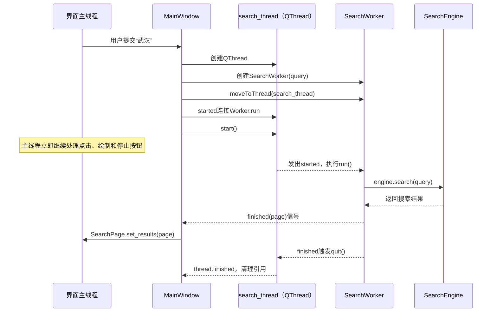

`self.search_thread.start()`启动的是线程；真正的业务入口则是之前连接好的`SearchWorker.run()`。

#### 4. 什么叫“后台线程”

桌面程序启动后，Qt界面运行在主线程。主线程不断处理一个事件循环：

```text
检查鼠标点击
→ 处理键盘输入
→ 重绘窗口
→ 更新进度条
→ 再处理下一个事件
```

如果在主线程直接调用：

```python
self.search_worker.run()
```

那么主线程必须等搜索全部完成后才能继续处理下一个界面事件。在这段时间中：

- 输入框不能及时响应；
- 窗口不能正常重绘；
- 停止按钮的点击也得不到处理；
- Windows可能显示“未响应”。

“后台线程”不是另一个隐藏程序，而是同一个应用进程中的另一条执行通道。搜索在线程B运行时，线程A仍能服务界面：

```text
同一个应用进程
├── 主线程A：Qt界面、按钮、重绘、结果展示
└── 搜索线程B：SearchWorker.run() → SearchEngine.search()
```

两个线程共享同一进程中的对象和内存，但各自拥有独立的执行栈，可以由操作系统交替调度。

#### 5. 为什么后台Worker不能直接修改界面

Qt控件属于界面主线程。`SearchWorker`在搜索线程中运行，因此它只发出信号：

```python
self.finished.emit(page)
```

`MainWindow`在主线程接收：

```python
self.search_worker.finished.connect(self.on_search_finished)
```

然后由`on_search_finished()`调用`SearchPage.set_results()`。因此数据可以跨线程返回，但界面控件仍只在主线程中修改。

#### 6. 为什么不把QThread和SearchWorker写成一个类

当前代码采用Qt常见的“Worker Object”模式：线程只负责运行环境，Worker负责任务生命周期。好处是：

1. 同一套`SearchWorker`代码不需要继承和管理底层线程。
2. `MainWindow`能统一连接成功、取消、失败和清理信号。
3. `SearchEngine`仍然是普通同步算法，可以脱离Qt单独测试。
4. 以后改变线程调度方式时，不必重写检索算法。

可以提炼为：

> 线程回答“代码在哪里执行”，Worker回答“这项任务怎样执行和汇报”，Engine回答“核心业务算法是什么”。

#### 7. 一个形象类比

```text
MainWindow   = 店长，安排任务并接收结果
界面主线程   = 前台服务员，要持续接待点击、输入和窗口刷新
QThread      = 新开的后台工位
SearchWorker = 被安排到该工位的搜索任务负责人
SearchEngine = 搜索任务负责人使用的检索方法
```

如果让前台服务员自己去仓库找两分钟资料，前台就无人接待；新开后台工位后，前台仍可响应用户，资料找到后再通知前台展示。

#### 8. 面试表达

> 项目采用QThread加Worker Object模式。QThread只提供后台执行环境，SearchWorker封装一次搜索的生命周期和跨线程信号，真正的召回、确认和排序由SearchEngine同步完成。MainWindow创建Worker后用moveToThread指定线程归属，再通过QThread.started触发Worker.run。这样耗时搜索不会阻塞Qt主事件循环，结果通过信号安全返回主线程更新界面。每轮实际搜索创建独立Worker和线程；索引同样按整轮任务创建ScanWorker，而不是每个文件一个Worker。

---

## 第四章：SearchQuery——任务参数，不是任务执行者

### 一、前置基础：什么是Qt程序

Qt是跨平台桌面图形界面框架，项目通过PySide6在Python中使用Qt。普通脚本通常从第一行执行到最后一行后退出；Qt程序则进入事件循环，持续等待用户操作。

当前项目在`app.py`中的真实启动顺序是：

```text
main()
→ QApplication(sys.argv)
→ MainWindow(...)
→ window.show()
→ app.exec()
```

各对象的作用是：

```text
QApplication：代表整个桌面应用
MainWindow：应用的主窗口
show()：请求显示窗口
app.exec()：进入主事件循环
```

事件循环可以理解为永不停止的接待队列：

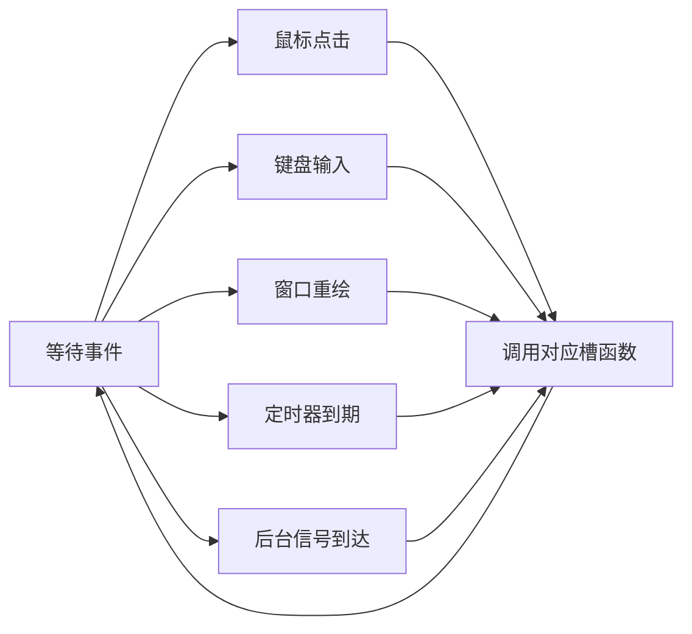

这些事件默认由Qt主线程依次处理。因此主线程中的函数需要尽快返回事件循环。如果某个槽函数连续搜索数据库十秒钟，后面的点击、输入和重绘就只能排队等待，窗口表现为卡顿或“未响应”。

后台线程的意义不是让每一段代码都并行，而是把少数耗时工作从这条界面事件队列中移走。

### 二、SearchQuery在哪里定义

真实文件：`local_full_text_search/models/search_query.py`

核心结构：

```python
@dataclass(slots=True)
class SearchQuery:
    text: str
    mode: str = "exact"
    root_ids: list[int] = field(default_factory=list)
    extensions: list[str] = field(default_factory=list)
    search_filename: bool = True
    search_path: bool = True
    search_content: bool = True
    include_ocr: bool = True
    page_size: int = 100
    page: int = 1
    sort_by: str = "relevance"
```

`@dataclass`让Python自动生成初始化方法，所以可以直接写：

```python
query = SearchQuery(
    text="武汉",
    mode="exact",
    extensions=[".pdf"],
    page=1,
)
```

`slots=True`限制对象只能使用已经声明的字段，减少拼错字段或随意附加状态的机会。它不表示线程，也不负责执行搜索。

### 三、SearchQuery解决什么业务问题

它保存“某一次搜索确定使用的完整参数”。

用户提交时，`MainWindow._run_search()`从三个来源收集信息：

```text
SearchPage
├── 关键词
├── 搜索模式
├── 目录和扩展名
└── OCR、大小写等开关

AppSettings
├── 每页数量
├── 最大结果数
└── OCR置信度

MainWindow
└── 当前页码

以上内容
→ SearchQuery
```

例如：

```python
SearchQuery(
    text="武汉",
    mode="exact",
    extensions=[".pdf"],
    search_filename=True,
    search_path=True,
    search_content=True,
    page_size=100,
    page=1,
    sort_by="relevance",
)
```

它相当于一次搜索的“申请单”或“任务参数快照”。

### 四、SearchQuery与SearchWorker为什么必须区分

两者的差别不是字段多少，而是一个代表数据，一个代表执行过程。

| 对比项 | SearchQuery | SearchWorker |
| --- | --- | --- |
| 本质 | 普通参数数据 | Qt任务对象 |
| 回答的问题 | 这次要搜什么 | 这次任务怎样启动、取消和汇报 |
| 主要内容 | 关键词、模式、筛选、分页 | CancelToken、数据库引用、锁、信号、run() |
| 是否继承QObject | 否 | 是 |
| 是否有Qt信号 | 否 | 有finished、progress、failed等 |
| 是否负责线程生命周期 | 否 | 配合QThread管理一次任务 |
| 能否直接交给SearchEngine测试 | 能 | 测试算法时不需要它 |

真实创建代码：

```python
query = SearchQuery(...)
self.search_worker = SearchWorker(
    self.generation_base_path,
    query,
)
```

这里的关系是：

```text
SearchQuery是申请单
→ 交给SearchWorker保管
→ SearchWorker在后台调用SearchEngine
→ SearchEngine读取申请单并执行搜索
```

类比成快递：

```text
SearchQuery  = 快递单：地址、物品、配送要求
SearchWorker = 快递员：接单、执行、取消、报告状态
QThread      = 快递员工作的运输通道
SearchEngine = 具体的路线和配送方法
```

快递单不会自己送货；快递员也不应该把地址、物品和配送规则全部写死在自己的身体里。

### 五、如果把SearchQuery合并进SearchWorker会怎样

可以把`text`、`mode`等字段直接写进`SearchWorker`，程序短期仍可能运行，但会产生以下问题。

#### 问题1：检索算法依赖Qt

现在测试可以直接调用：

```python
engine.search(SearchQuery(text="武汉"))
```

仓库中的大量`test_search_engine.py`测试就是这样构造查询。若查询参数只能存在于`SearchWorker`中，测试搜索算法也要创建Qt对象，边界会变重。

#### 问题2：数据和运行状态混在一起

关键词属于业务数据；取消标记、数据库锁和finished信号属于任务运行状态。两类内容的变化原因不同，混合后对象很难理解和保存。

#### 问题3：其他入口难以复用

将来增加CLI、HTTP API或RAG检索入口时，它们可以构造`SearchQuery`并调用`SearchEngine`，不需要伪造一个Qt Worker。

#### 问题4：搜索历史难以表达

历史记录需要保存“搜过什么”，适合保存Query中的参数；不需要保存线程、锁、取消令牌和Qt信号。

因此通用原则是：

> 请求对象描述意图，Worker管理一次执行，Engine实现核心规则。

### 六、为什么会出现这么多线程冲突

线程本身不等于冲突。只有满足下面的条件才会发生并发冲突：

```text
两个执行单元在相近时间运行
+ 访问同一个可变资源
+ 至少一个执行单元修改它
= 可能发生冲突
```

项目需要并发，是因为业务同时要求：

1. 搜索时界面仍能点击和停止。
2. 建索引时界面仍能使用。
3. 后台建立新索引时仍能搜索旧索引。
4. 用户可以快速提交新关键词。
5. 程序关闭时不能留下数据库连接和后台任务。

如果所有操作都放在主线程排队，冲突少了，但用户每次搜索或索引时整个软件都会卡住。因此项目选择并发，再明确管理共享资源。

### 七、当前项目中四类真实冲突

#### 冲突1：后台线程修改Qt控件

```text
SearchWorker线程
→ 直接修改结果列表
→ 与Qt主线程重绘同一控件
→ 可能崩溃或显示异常
```

当前解决方案：Worker只发信号，`MainWindow`在主线程调用`SearchPage.set_results()`。

#### 冲突2：旧搜索结果覆盖新搜索结果

```text
武汉任务先开始、后完成
北京任务后开始、先完成
→ 武汉结果最后到达并覆盖北京结果
```

当前解决方案：同时只保留一个搜索线程；新请求设置`pending_search`，取消并清理旧任务后再启动最新任务。

#### 冲突3：多个任务同时写SQLite

```text
文件解析任务A写数据库
文件解析任务B也写同一数据库
→ database is locked或事务状态互相影响
```

当前解决方案：解析可以并行，但`DatabaseWriteDispatcher.execution_lock`把同一数据库的写事务串行化。

#### 冲突4：索引发布或清理时，搜索仍在读取旧数据库

```text
SearchWorker仍在读gen-5.db
索引任务发布gen-6.db并准备清理旧版本
→ 如果立即删除gen-5.db，搜索可能失败
```

当前解决方案：搜索获取generation租约；旧搜索释放租约前，旧数据库不能被清理。新搜索则读取已经发布的最新generation。

### 八、项目不是制造冲突，而是在隔离冲突

最重要的架构变化是generation隔离：

```text
搜索线程：读取 gen-5.db
索引线程：写入 gen-6.building.db
```

两个任务使用不同SQLite文件，大量读写冲突从根源上消失。待gen-6完整校验并发布后，新搜索才读取gen-6；旧搜索继续使用租约保护的gen-5。

因此，多线程相关代码看起来很多，并不一定说明设计混乱。它反映的是项目在处理：

```text
界面响应性
+ 后台耗时任务
+ 数据一致性
+ 安全取消和退出
```

真正应该追求的不是“完全没有并发”，而是让每一种共享资源都有明确所有者和访问规则。

### 九、30秒面试表达

> 这是一个PySide6 Qt桌面应用。QApplication启动主事件循环，主线程负责处理输入、点击和界面重绘，因此耗时搜索与索引不能直接在主线程执行。项目把一次搜索的业务参数封装成SearchQuery，把任务生命周期、取消和跨线程信号放在SearchWorker中，再由SearchEngine执行检索算法。并发带来的共享资源风险通过主线程更新UI、latest-wins搜索策略、SQLite写入串行化以及generation快照租约来控制。

### 十、理解检查

1. `SearchQuery(text="武汉")`创建后会不会自己启动搜索？如果不会，谁负责把它交给`SearchEngine`？
2. 如果后台索引写`gen-6.building.db`，用户搜索读`gen-5.db`，为什么这两个任务可以同时运行而不争用同一个SQLite文件？

### 十一、补充答疑：Qt信号、Qt控件与合理分层

#### 1. 怎样判断SearchWorker依赖Qt

看它直接导入和继承了什么：

```python
from PySide6.QtCore import QObject, Signal, Slot

class SearchWorker(QObject):
    finished = Signal(object)
    partial = Signal(object)
    progress = Signal(object)
    cancelled = Signal()
    failed = Signal(str)

    @Slot()
    def run(self) -> None:
        ...
```

这表示`SearchWorker`使用了三项Qt机制：

1. 继承`QObject`，进入Qt对象生命周期和线程归属体系。
2. 使用`Signal`声明通知出口。
3. 使用`@Slot()`把`run()`标记为Qt可以调度的槽函数。

因此“依赖Qt”不是抽象评价，而是：没有PySide6时该模块无法正常导入；Worker的跨线程执行和信号投递需要遵循Qt规则。

`SearchQuery`则只导入Python标准库：

```python
from dataclasses import dataclass, field
from datetime import datetime
```

它不继承`QObject`，没有`Signal`和`Slot`，因此是普通Python数据对象。

#### 2. Qt信号究竟是什么

信号可以理解为“发生了某件事”的通知出口。

定义出口：

```python
finished = Signal(object)
```

MainWindow登记接收者：

```python
self.search_worker.finished.connect(self.on_search_finished)
```

Worker搜索完成后发出通知：

```python
self.finished.emit(page)
```

Qt随后调用：

```python
self.on_search_finished(page)
```

信号的价值不只是“少写一次函数调用”，而是发送者不需要保存接收者引用；跨线程时，Qt还会按照对象的线程归属把槽函数安排到正确线程。

```mermaid
flowchart LR
    Worker[SearchWorker<br/>搜索线程] -->|finished.emit(page)| Qt[Qt信号队列]
    Qt -->|调用槽函数| Main[MainWindow.on_search_finished<br/>主线程]
    Main --> Page[SearchPage.set_results]
```

#### 3. 为什么普通算法测试不需要Qt Worker

真实`SearchEngine.search()`签名是：

```python
def search(
    self,
    query: SearchQuery,
    cancel_token: CancelToken | None = None,
    ...,
) -> SearchPage:
```

所以仓库中的真实测试可以直接写：

```python
database = DatabaseManager(test_database_path)
database.initialize()
engine = SearchEngine(database)
query = SearchQuery(text="真空")

page = engine.search(query)

assert page.total_confirmed == 1
```

测试的目标是确认搜索算法是否正确，因此只准备：

```text
测试数据库
+ 查询条件
→ 调用SearchEngine
→ 直接检查返回值
```

不需要准备：

- `QApplication`；
- `QThread`；
- `moveToThread()`；
- `finished.connect(...)`；
- 等待异步信号返回。

如果删除`SearchQuery`，把所有查询字段只放进`SearchWorker`，并让`SearchEngine`读取Worker，那么测试会变成：

```python
worker = SearchWorker(
    test_database_path,
    text="武汉",
    mode="exact",
    ...,
)
result = engine.search(worker)  # Engine开始依赖Qt类型
```

或者只能运行`worker.run()`并监听`finished`信号：

```python
results = []
worker.finished.connect(results.append)
worker.run()
# 还要等待或处理Qt事件，才能检查results
```

语法上并非绝对不能测试，但算法测试被迫认识Qt任务机制，准备成本和失败原因都会增加。

如果为了避免Qt依赖，又把Worker字段复制成字典传给Engine：

```python
params = {
    "text": worker.text,
    "mode": worker.mode,
}
```

这个`params`实际上又承担了`SearchQuery`的职责，只是失去了明确类型和字段校验。

#### 4. CLI、HTTP和RAG为什么更适合使用SearchQuery

桌面Qt入口使用：

```text
SearchPage → SearchQuery → SearchWorker → SearchEngine
```

命令行可以使用：

```text
命令行参数 → SearchQuery → SearchEngine
```

HTTP接口可以使用：

```text
JSON请求 → SearchQuery → SearchEngine
```

RAG检索可以使用：

```text
用户问题/检索改写 → SearchQuery → SearchEngine
```

后三种入口有自己的并发和生命周期机制，不应该为了复用检索算法而引入桌面Qt的`QObject`、`QThread`和信号。

#### 5. Qt控件是什么

Qt控件（Widget）是窗口上可显示、可交互或负责展示状态的界面对象。当前项目中的真实例子包括：

| 控件类型 | 项目中的用途 |
| --- | --- |
| `QLineEdit` | 搜索关键词输入框 |
| `QPushButton` | 搜索、停止、上一页、下一页按钮 |
| `QComboBox` | 搜索模式、文件类型、目录范围选择 |
| `QCheckBox` | 是否搜索正文、OCR、大小写敏感 |
| `QProgressBar` | 搜索和索引进度 |
| `QLabel` | 状态文字 |
| `QMainWindow` | 整个主窗口 |

例如`SearchBox.__init__()`中：

```python
self.input = QLineEdit()
self.clear_button = QPushButton()
self.stop_button = QPushButton("停止")
```

它们不只是普通数据对象，还包含系统窗口资源、绘制状态、焦点、鼠标事件和父子对象关系。Qt要求这些图形界面对象由主线程创建和操作。

所以正确流程是：

```text
主线程读取QLineEdit
→ 转换成普通字符串
→ 放入SearchQuery
→ 后台Worker只读取SearchQuery
```

而不是让后台线程不断访问`QLineEdit.text()`。

#### 6. 分层是不是越细越好

不是。分层本身有成本：类更多、调用跳转更多、理解路径更长、修改时可能需要穿过更多文件。

合理目标不是“层数最多”，而是：

> 把变化原因、生命周期或技术边界真正不同的职责分开；没有独立变化理由的代码不要为了形式强行加层。

可以用五个问题判断是否值得分开：

1. 生命周期是否不同？例如`SearchPage`长期存在，`SearchQuery`每次搜索新建。
2. 所在线程是否不同？例如界面控件在主线程，Worker在搜索线程。
3. 技术依赖是否不同？例如Worker依赖Qt，Engine不依赖Qt。
4. 是否有多个消费者？例如SearchQuery未来可供GUI、CLI、HTTP和RAG使用。
5. 是否需要独立测试和替换？例如搜索算法应脱离窗口测试。

满足其中一项重要边界，就可能值得分开；如果一个类只是把参数原样转发给下一个类，没有策略、生命周期或复用价值，通常是过度分层。

#### 7. 当前搜索链路为什么这些层基本合理

| 模块 | 独立存在的具体原因 |
| --- | --- |
| `SearchBox` | 可复用输入控件，处理回车、停止、清空 |
| `SearchPage` | 聚合整页筛选、结果、分页和状态 |
| `SearchQuery` | 一次请求的普通数据快照 |
| `MainWindow` | 应用级门禁和任务生命周期编排 |
| `SearchWorker` | Qt线程适配、取消和跨线程信号 |
| `SearchEngine` | 可独立测试的检索算法 |
| `DatabaseManager` | SQLite连接、事务和持久化规则 |

这不是为了“看起来架构高级”，而是每一层恰好跨越了不同的生命周期、线程或技术依赖。

但也存在继续观察的地方：`MainWindow`已经很大，如果搜索、扫描、迁移继续增长，可以按业务变化抽出Controller；如果功能没有继续增长，提前再加很多Controller、Service和Facade反而会使调用链更难追踪。

#### 8. 判断分层好坏的两个反例

过少分层：

```text
MainWindow
├── 读取输入框
├── 启动线程
├── 写SQL
├── 匹配关键词
├── 计算分数
└── 绘制结果
```

结果是无法独立测试，任何变化都修改同一个巨型类。

过度分层：

```text
SearchStarter
→ SearchRequestForwarder
→ SearchCommandAdapter
→ SearchExecutionFacade
→ SearchWorker
```

如果前四层都只是原样传递同一组参数，它们没有解决新问题，只增加理解成本。

更好的原则是高内聚、低耦合：

```text
同一变化原因的代码放在一起
不同生命周期和依赖的代码适度分开
```

#### 9. 面试表达

> 我不会把分层理解成越多越好，而是根据生命周期、线程边界、技术依赖、复用入口和可测试性划分。在这个项目中，SearchQuery是普通请求数据，SearchWorker是Qt线程适配器，SearchEngine是检索算法，因此分开有明确收益。反过来，如果某个新类只是原样转发参数，没有独立规则和变化原因，我会保留在现有模块中，避免过度设计。

### 十二、重点答疑：停止链路与“合并以后究竟坏在哪里”

#### 1. 用户点击停止以后，其实有两段方向相反的链路

用户描述的：

```text
SearchBox → SearchPage → MainWindow → SearchWorker
```

基本正确，但它只表示“主线程发出停止请求”。如果说的是搜索，应称为“停止搜索”；停止索引走的是`IndexPage → MainWindow → ScanWorker`，不是`SearchWorker`。

##### 第一段：把停止意图送到Worker

真实代码关系：

```text
用户点击停止按钮
→ QPushButton.clicked                      Qt信号
→ SearchBox.stop_requested.emit            Qt信号转发
→ SearchPage.stop_requested.emit           Qt信号转发
→ MainWindow.cancel_search()               Qt调用已连接的接收函数
→ SearchWorker.cancel()                    普通Python方法调用
→ 设置CancelToken并中断SQLite连接          发出取消请求
```

对应代码：

```python
# SearchBox
self.stop_button.clicked.connect(self.stop_requested.emit)

# SearchPage
self.search_box.stop_requested.connect(self.stop_requested.emit)

# MainWindow
self.search_page.stop_requested.connect(self.cancel_search)

def cancel_search(self):
    self.search_worker.cancel()
```

##### 第二段：Worker确认任务确实已经停止

```text
SearchEngine检查到CancelToken
→ 抛出CancelledError
→ SearchWorker捕获异常
→ SearchWorker.cancelled.emit()             Qt跨线程信号
├── MainWindow.on_search_cancelled()        更新界面文字
└── QThread.quit()                          请求线程退出
→ QThread.finished                          Qt信号
→ MainWindow.cleanup_search_thread()        清理Worker和线程引用
```

对应代码：

```python
except CancelledError:
    self.cancelled.emit()

self.search_worker.cancelled.connect(self.on_search_cancelled)
self.search_worker.cancelled.connect(self.search_thread.quit)
self.search_thread.finished.connect(self.cleanup_search_thread)
```

因此取消不是一条单向链路，而是：

```mermaid
sequenceDiagram
    actor User as 用户
    participant Box as SearchBox
    participant Page as SearchPage
    participant Main as MainWindow
    participant Worker as SearchWorker
    participant Thread as QThread

    User->>Box: 点击停止
    Box-->>Page: stop_requested信号
    Page-->>Main: stop_requested信号
    Main->>Worker: cancel()普通调用
    Note over Worker: 设置取消标记并中断SQLite
    Worker-->>Main: cancelled信号
    Worker-->>Thread: cancelled → quit()
    Thread-->>Main: thread.finished
    Main->>Main: cleanup_search_thread()
```

第一段是“请停止”，第二段是“我已经停止”。不能刚发出请求就直接把线程当作已经结束。

#### 2. 信号和普通函数调用有什么本质区别

普通调用：

```python
self.search_worker.cancel()
```

调用者明确知道接收对象和函数，并在当前调用路径中直接进入该函数。

Qt信号：

```python
self.cancelled.emit()
```

发送者只宣布“取消已经发生”，不必知道有谁接收。可能没有接收者，也可能同时连接多个接收者。在本项目中，同一个`cancelled`同时连接了界面状态处理和线程退出。

跨线程时，Qt还会把接收函数安排到接收对象所属的线程执行。这是`SearchWorker`使用Qt信号的核心原因。

#### 3. 为什么Engine接收SearchWorker就依赖Qt类型

“A依赖B”不只表示文件中出现`import B`。只要A要正常工作就必须知道B的结构、创建B或调用B的方法，也属于依赖。

假设把接口改成：

```python
def search(self, worker: SearchWorker):
    text = worker.text
    mode = worker.mode
```

此时调用`SearchEngine.search()`必须先提供一个`SearchWorker`。而创建`SearchWorker`需要：

```text
SearchWorker
→ 继承QObject
→ 使用Signal和Slot
→ 来自PySide6.QtCore
```

依赖链变成：

```text
SearchEngine.search的输入契约
→ SearchWorker
→ PySide6 / Qt
```

即使使用“只要对象有text字段就行”的鸭子类型，Engine仍然知道Worker字段和生命周期结构，只是没有写显式import，耦合仍然存在。

若再创建一个不依赖Qt的对象只保存`text`、`mode`等字段给Engine，这个对象就是`SearchQuery`承担的角色。

#### 4. 合并实验一：把SearchPage和SearchQuery合并

假设不创建Query，直接把页面传给Worker：

```python
worker = SearchWorker(path, self.search_page)
```

Worker执行中读取：

```python
text = page.search_box.input.text()
mode = page.mode_combo.currentData()
```

立即产生两个问题：

1. Worker在后台线程访问Qt控件，破坏主线程边界。
2. 用户把“武汉”改成“北京”后，同一任务不同阶段可能读到不同参数。

若解决办法是在启动前把页面值复制到一个字典：

```python
params = {
    "text": page.text(),
    "mode": page.mode_value(),
}
```

这个字典实际上又是一个缺少类型定义的`SearchQuery`。

结论：这里分开主要解决线程安全和一次请求的数据一致性，属于强边界。

#### 5. 合并实验二：把SearchQuery和SearchWorker合并

合并后Worker可能变成：

```python
class SearchWorker(QObject):
    def __init__(
        self,
        db_path,
        text,
        mode,
        root_ids,
        extensions,
        search_filename,
        search_path,
        search_content,
        include_ocr,
        page_size,
        page,
        sort_by,
        ...,
    ):
        ...
```

短期看只是少了一个类，但查询条件与以下运行状态进入同一个对象：

```text
普通业务数据：text、mode、extensions、page
Qt任务机制：Signal、Slot、QObject线程归属
取消状态：CancelToken、threading.Event
共享资源保护：threading.Lock、DatabaseManager引用
诊断状态：request_id、日志字段
```

具体后果：

- 搜索历史想保存关键词和筛选条件，却要从一个带锁和信号的运行对象中挑字段。
- HTTP/RAG只想表达查询，却必须创建Qt Worker，或重新复制一份参数结构。
- 单元测试只想验证匹配算法，却需要构造包含无关生命周期状态的对象。
- 查询字段变化与线程机制变化都修改同一个类，回归范围扩大。

结论：不是绝对不能合并，而是合并后每一个查询使用者都被迫接触桌面任务机制。

#### 6. 合并实验三：把SearchWorker和SearchEngine合并

合并后：

```python
class SearchWorker(QObject):
    def run(self):
        # 这里直接包含所有SQL、候选召回、确认、评分和分页代码
```

具体后果：

1. 检索算法变成Qt对象的方法。
2. CLI、HTTP或RAG想复用算法时只能创建SearchWorker，或复制算法。
3. 测试失败时很难快速区分是SQL算法、线程、取消还是信号问题。
4. 更换任务运行方式时，容易误改检索算法；修改算法时也可能破坏任务收尾。

当前设计中：

```text
SearchWorker变化：取消方式、线程信号、任务日志、generation租约
SearchEngine变化：召回策略、匹配规则、相关度评分、分页
```

两者的变化原因明显不同，因此分开有价值。

#### 7. 合并实验四：把MainWindow和SearchWorker合并

MainWindow拥有Qt控件，必须留在主线程；耗时搜索必须在后台线程。

如果让MainWindow直接运行搜索算法：

```text
MainWindow在主线程搜索
→ Qt事件循环被占用
→ 界面卡住，停止按钮也无法处理
```

如果试图把MainWindow移动到搜索线程：

```text
MainWindow及其子控件离开GUI主线程
→ 违反Qt图形控件线程规则
```

同一个对象不能同时既作为主线程窗口，又作为后台耗时任务执行者。这是最强的线程边界之一。

#### 8. 哪些合并没有那么严重

并非所有层都同样“不能合并”。

```text
SearchBox + SearchPage
```

技术上可以合并，通常不会立刻造成线程错误；代价主要是页面变大、输入组件难以复用、控件事件与整页状态混在一起。

```text
SearchPage + MainWindow
```

也可以合并，但MainWindow会继续膨胀，搜索页的局部变化会影响整个应用窗口。

因此边界强度可以这样理解：

| 分离 | 主要价值 | 边界强度 |
| --- | --- | --- |
| MainWindow / SearchWorker | GUI主线程与后台线程安全 | 很强 |
| SearchWorker / SearchEngine | Qt任务机制与纯检索算法复用 | 很强 |
| SearchPage / SearchQuery | 可变控件与单次参数快照 | 很强 |
| SearchQuery / SearchWorker | 普通请求数据与任务生命周期 | 较强 |
| SearchBox / SearchPage | 组件复用和页面可维护性 | 中等 |
| SearchPage / MainWindow | 控制文件规模和职责范围 | 中等 |

#### 9. 用三个未来变化检验设计价值

##### 场景A：增加命令行搜索

当前设计：

```text
解析命令行
→ SearchQuery(text="武汉")
→ SearchEngine.search(query)
```

不需要窗口和QThread。

全部合并后：命令行要么引入Qt Worker，要么复制搜索算法和参数字段。

##### 场景B：给RAG增加检索入口

当前设计：RAG把改写后的问题放进Query，再调用Engine；桌面的Worker不参与。

全部合并后：RAG服务被迫认识`QObject`、`Signal`、桌面取消流程和窗口生命周期。

##### 场景C：把桌面界面换成Web

当前设计可以保留`SearchQuery + SearchEngine + DatabaseManager`，主要替换Qt页面、MainWindow和SearchWorker适配层。

全部合并后，检索算法埋在窗口和Worker里，界面迁移接近重写搜索功能。

#### 10. 最核心的设计价值

分层不是为了减少当前代码行数，而是为了限制变化的传播范围：

```text
界面变化，尽量只影响界面层
线程变化，尽量只影响Worker和编排层
算法变化，尽量只影响Engine
查询字段变化，通过Query形成统一契约
数据库变化，尽量集中在DatabaseManager
```

可以把这理解成防火墙：不是让每个房间距离更远，而是一个房间发生变化时，不要让整栋楼一起改造。

---

## 第五章：谁负责接收结果，以及怎样设计另一个项目

### 一、搜索结果到底先回到谁

答案是：先回到`MainWindow`，再由`MainWindow`交给`SearchPage`显示。

这里有一个容易混淆的同名对象：`SearchEngine`返回的`page`是`core/search_engine.py`中的结果分页数据类`SearchPage`；`self.search_page`则是`ui/main_window.py`中的界面类`SearchPage(QWidget)`。前者是数据，后者是界面。命名上更清楚的做法可以是把结果数据类改称`SearchResultPage`，但当前代码尚未改名。

真实调用链：

```text
SearchEngine.search()
→ 返回搜索结果数据page
→ SearchWorker.finished.emit(page)
→ MainWindow.on_search_finished(page)
→ SearchPage.set_results(page)
→ ResultView.set_results(page.results, query_text)
```

关键代码：

```python
def on_search_finished(self, page):
    self.total_confirmed = page.available_results
    self.search_page.set_results(page)

    if self.settings.save_search_history:
        self._start_search_history_update(...)

    if page.total_confirmed <= 0:
        self.hide_preview()
```

因此`MainWindow`确实先收到结果。它处理应用级影响：

- 保存可用结果总数；
- 决定是否记录搜索历史；
- 没有结果时关闭预览；
- 协调搜索任务和其他页面状态。

随后`SearchPage.set_results()`处理页面级展示：

- 设置“第几页”；
- 计算并展示正文、OCR命中数量；
- 更新耗时文字；
- 切换空状态或结果列表；
- 控制分页按钮；
- 把文件结果交给`ResultView`绘制。


“负责整个应用”不等于“亲自完成所有细节”。更准确的理解是：

```text
MainWindow决定结果交给谁、还要影响哪些全局功能
SearchPage决定搜索页面怎样展示
ResultView决定结果列表每一项怎样绘制
```

类似公司负责人：经理接收项目结果、决定后续动作，但不会亲自绘制每张报表。

若直接连接：

```python
self.search_worker.finished.connect(self.search_page.set_results)
```

Qt跨线程投递本身可以工作，但保存历史、预览状态、应用级统计等逻辑仍需要另一个地方处理，流程会分散。当前统一经过MainWindow更容易看清一次搜索完成后的全部应用动作。

### 二、是不是每个应用都有MainWindow

不是。`MainWindow`是当前Qt桌面应用选择的一种顶层窗口形式，不是所有程序的必备架构层。

| 应用类型 | 可能的顶层入口 |
| --- | --- |
| Qt桌面主窗口应用 | `QMainWindow` |
| 简单Qt工具或弹窗 | `QWidget`或`QDialog` |
| Qt/QML应用 | `ApplicationWindow` |
| 托盘后台程序 | `QSystemTrayIcon`，可能没有主窗口 |
| 命令行工具 | `main()`函数，没有窗口 |
| Web后端 | HTTP路由/控制器，没有MainWindow |
| 后台服务 | 服务入口和任务调度器，没有界面 |
| 多窗口桌面应用 | 多个顶层窗口，不一定有唯一MainWindow |

当前项目适合使用`MainWindow`，因为它有：

- 搜索页、索引页、失败页和设置页；
- 顶栏、侧边栏、页面切换；
- 搜索、扫描、迁移等多个后台任务；
- 应用关闭时统一清理线程的需求。

通用概念不是“每个项目必须有MainWindow”，而是：

> 一个跨越多个功能页面和后台任务的应用，通常需要某种应用级编排者；它可能叫MainWindow、AppController、Coordinator、Router或ApplicationService。

### 三、设计其他项目时的核心口诀

推荐记住：

> 先场景，画主链；数据定契约，流程归编排；规则归能力，外部做适配；同变放一起，异变再拆开；耗时过边界，结果用事件回来。

逐句解释。

#### 1. 先场景，画主链

不要一开始先设计十个类，先写清楚用户真正完成什么。

```text
用户输入什么
→ 系统做什么
→ 数据从哪里来
→ 最终向用户返回什么
```

当前项目是：

```text
输入关键词
→ 形成一次查询
→ 后台检索索引
→ 匹配和排序
→ 展示文件结果
```

#### 2. 数据定契约

先定义跨模块传递的普通数据：

```text
输入：SearchQuery
输出：SearchResult / SearchPage结果数据
```

数据契约让UI、后台任务和算法对“传什么”达成一致，不互相读取内部控件或状态。

#### 3. 流程归编排

谁负责安排先后顺序、检查门禁、开始、取消和收尾？

当前项目由`MainWindow`负责：

```text
检查索引是否可用
→ 创建Query
→ 创建Worker和线程
→ 接收结果
→ 清理线程
```

编排者负责顺序，不负责每一步内部算法。

#### 4. 规则归能力

把真正的业务规则集中到可独立调用的能力模块：

```text
SearchEngine
├── 候选召回
├── 精确确认
├── 相关度评分
└── 分页
```

这些规则不应该埋在按钮事件或线程类中。

#### 5. 外部做适配

Qt、HTTP、数据库、文件系统、模型API都是外部技术。用适配层把它们接到核心能力，而不是让核心能力依赖所有框架。

```text
Qt线程适配：SearchWorker
SQLite适配：DatabaseManager
Qt页面适配：SearchPage / MainWindow
```

#### 6. 同变放一起，异变再拆开

判断两段代码是否应该放在一起，不看名字像不像，而看它们是否因为同一原因变化。

```text
修改匹配算法 → SearchEngine变化
修改线程取消 → SearchWorker变化
修改页面布局 → SearchPage变化
增加筛选字段 → SearchQuery契约变化
```

不同变化原因混在一个类里，才值得拆分。若两个小函数总是一起修改，也没有独立复用和生命周期，就不必强行分层。

#### 7. 耗时过边界，结果用事件回来

只有真正耗时且会阻塞入口的任务才进入后台执行环境：

```text
主线程收集普通数据
→ 后台任务执行
→ 信号/事件返回普通结果数据
→ 主线程更新界面
```

没有界面或任务很快时，不需要为了“架构完整”强行加Worker和线程。

### 四、设计新项目的七步法

#### 第1步：写一个具体业务场景

例如“用户上传合同，系统提取条款并生成风险摘要”。

#### 第2步：画最短成功链路

```text
上传合同
→ 解析文本
→ 分析条款
→ 生成摘要
→ 展示结果
```

#### 第3步：圈出输入和输出数据

```text
ContractAnalysisRequest
ContractAnalysisResult
```

#### 第4步：找到核心业务能力

```text
ContractAnalyzer
```

它负责条款识别和风险规则，不负责按钮、HTTP或线程。

#### 第5步：识别外部依赖

```text
文件解析器
数据库
大模型API
桌面Qt或Web框架
```

把这些放在适配器或基础设施边界。

#### 第6步：决定是否需要编排和异步

若流程包含上传、解析、模型调用、取消和进度，就增加`AnalysisController`与`AnalysisWorker`。若只是一个几十毫秒的同步命令，就直接调用`ContractAnalyzer`，不要预先增加线程层。

#### 第7步：用变化问题检验边界

问自己：

1. 换成Web界面，核心算法要不要重写？
2. 换数据库，页面需不需要大改？
3. 增加CLI入口，能不能直接复用能力？
4. 测试算法时，能不能绕过界面和线程？
5. 新增一个字段，需要改多少无关文件？

如果每次变化都会穿透整个系统，边界太少；如果一个小字段需要经过十个纯转发类，边界太多。

### 五、一个可以套用但不能机械照搬的框架

```text
输入/展示层
→ 请求与结果数据
→ 应用编排层
→ 异步/框架适配层（需要时才有）
→ 核心业务能力
→ 数据库、文件、外部API
```

映射到当前项目：

```text
SearchBox / SearchPage
→ SearchQuery / SearchResult
→ MainWindow
→ SearchWorker
→ SearchEngine
→ DatabaseManager / SQLite
```

这个结构不是固定模板。命令行小工具可能只有：

```text
命令行参数
→ Request
→ Service
→ 文件/数据库
```

没有必要创建MainWindow、Page或Worker。

### 六、最短版设计检查表

开始写代码前先回答：

```text
1. 用户场景是什么？
2. 输入和输出数据是什么？
3. 核心业务规则在哪里？
4. 谁安排流程和生命周期？
5. 哪些是框架或外部依赖？
6. 哪些任务真的耗时，需要异步？
7. 未来最可能变化什么，能否只改一小块？
```

### 七、面试表达

> 我设计架构时不会先套层数，而是先从用户场景画出端到端主链，定义输入输出契约，再区分应用编排、核心业务规则和外部技术适配。只有生命周期、线程、技术依赖或变化原因不同，才拆成独立模块；耗时任务通过Worker等适配器离开入口线程，结果以事件返回。最后用换界面、换数据库、增加CLI和独立测试等变化场景验证边界，避免既有巨型类，也避免纯转发式过度设计。

## 第六章：SearchWorker——把一次搜索放进后台并管好它

### 一、本章只解决一个问题

用户在武汉的资料目录里搜索“武汉”，如果数据库查询、正文命中确认和排序都在界面主线程中同步完成，窗口就要等搜索结束后才能继续处理输入、点击和重绘。`SearchWorker`负责把“这一次搜索”接入后台线程，并把结果、进度、取消和错误等状态通知给应用层。

先记住这个定位：

> `SearchWorker`不是搜索算法，也不是线程本身；它是一次搜索任务的Qt工作对象，负责任务启动、资源准备、取消协作和状态通知。

本课依据的真实实现：

- `local_full_text_search/workers/search_worker.py`：`SearchWorker`、`__init__()`、`run()`、`cancel()`。
- `local_full_text_search/ui/main_window.py`：`MainWindow._run_search()`、`cancel_search()`、`on_search_finished()`、`cleanup_search_thread()`。
- `local_full_text_search/core/search_engine.py`：`SearchEngine.search()`和结果数据类`SearchPage`。
- `local_full_text_search/models/search_query.py`：一次搜索的条件；`local_full_text_search/models/search_result.py`：单个文件结果`SearchResult`。

### 二、先看对象关系，而不是背类名

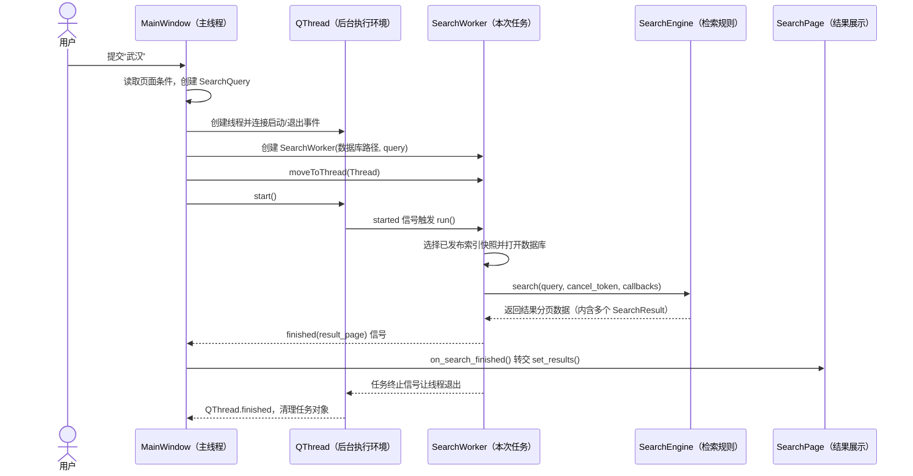

图里最值得分清的是三个对象：

| 对象 | 它是什么 | 在本次武汉搜索中做什么 |
| --- | --- | --- |
| `QThread` | 后台执行环境 | 提供与界面主线程分开的执行通道 |
| `SearchWorker` | 一次搜索任务的Qt工作对象 | 准备数据连接、调用算法、发进度/结果/失败/取消通知 |
| `SearchEngine` | 可同步调用的检索能力 | 根据`SearchQuery`从数据库召回、确认、排序并分页 |

`SearchWorker`通过`moveToThread()`被安排到`QThread`的执行环境中；这不等于把`QThread`对象本身搬进后台。可以把`QThread`想成后台工位，`SearchWorker`是被安排去这个工位工作的任务对象，`SearchEngine`是它执行任务时调用的一套检索方法。

### 三、谁创建它，什么时候创建

程序启动时，`MainWindow.__init__()`把`self.search_worker`初始化为`None`，表示当前没有搜索任务。用户真正提交搜索后，才进入`MainWindow._run_search()`。

当前项目中的关键顺序在`local_full_text_search/ui/main_window.py`的`MainWindow._run_search()`（约2095行）：

```python
# 1. 主线程把当前界面值整理为本次搜索的参数快照。
query = SearchQuery(
    text=self.search_page.text(),
    mode=self.search_page.mode_value(),
    # 这里还会收集目录、扩展名、正文/OCR开关、页码和排序方式。
)

# 2. 创建后台执行环境和本次搜索任务对象。
self.search_thread = QThread()
self.search_worker = SearchWorker(self.generation_base_path, query)

# 3. 指定Worker的线程归属；然后登记线程启动时要调用的任务入口。
self.search_worker.moveToThread(self.search_thread)
self.search_thread.started.connect(self.search_worker.run)

# 4. 登记结果、取消、失败等通知的接收者，以及线程退出后的清理函数。
self.search_worker.finished.connect(self.on_search_finished)
self.search_thread.finished.connect(self.cleanup_search_thread)

# 5. 真正启动后台执行；_run_search()不会等到检索完成才返回。
self.search_thread.start()
```

注意两个常见误解：

1. `SearchWorker(...)`只是创建任务对象，本身还没有开始检索；`moveToThread(...)`指定线程归属，也不会自动运行`run()`。
2. `self.search_thread.start()`才启动线程。线程发出`started`后，先前登记的连接才调用`SearchWorker.run()`。

为什么保存为`self.search_worker`，不只写成`worker = SearchWorker(...)`局部变量？因为搜索期间`MainWindow`还需要接收它的信号、响应停止按钮、记录搜索历史，并在真实线程结束后清理这一轮任务。主窗口是本轮任务的生命周期协调者，所以保留对象引用。

### 四、`__init__()`为这一轮任务准备了什么

真实位置：`local_full_text_search/workers/search_worker.py`的`SearchWorker.__init__()`（约37行）。

```python
def __init__(self, db_path: Path, query: SearchQuery) -> None:
    super().__init__()                       # 初始化Qt对象基类
    self.db_path = db_path                    # 这套索引的基础数据库路径
    self.query = query                        # 本轮固定使用的搜索条件
    self.token = CancelToken()                # 给搜索算法检查是否收到停止请求
    self._database = None                     # 暂存活动数据库管理器，便于请求SQLite中断
    self._database_lock = threading.Lock()    # 保护主线程和搜索线程共享的数据库引用
    self._cancel_event = threading.Event()    # 记录取消请求已经到达
    self.request_id = ...                     # 为日志和诊断标识本轮请求
```

用武汉搜索来理解这些输入：

- `query`相当于搜索申请单，包含关键词“武汉”、检索模式、目录/文件类型、是否搜正文、当前页等条件。
- `db_path`告诉Worker去哪里定位已发布索引；Worker之后会通过`IndexGenerationStore`选取可以安全读取的版本。
- `token`是算法可观察到的取消状态。用户点停止时，Worker把取消请求写入token；`SearchEngine.search()`在执行过程中检查它。
- `_database`和锁不是搜索条件，而是任务运行时需要协调的资源状态：取消方需要找到正在执行SQL的数据库连接管理器，并请求中断。
- `request_id`让“武汉”这轮搜索的日志可以和别的请求区分开。

因此`SearchQuery`与`SearchWorker`不重复：一个回答“要搜什么”，另一个回答“这一轮任务如何运行、如何停止、怎样汇报”。

### 五、`run()`怎样把任务交给检索算法

真实位置：`search_worker.py`的`SearchWorker.run()`（约48行）。函数大体按下面顺序走：

```text
先检查是否已经取消
→ 找到当前已完整发布的索引generation
→ 为正在读取的generation取得租约
→ 打开数据库（已发布快照使用只读模式）
→ 创建SearchEngine
→ 调用SearchEngine.search(query, token, callbacks)
→ 收到SearchPage结果后发出Worker.finished
→ finally中释放租约、清理数据库引用
```

把“武汉”放进这条链路：

1. Worker先检查用户是否在搜索实际开始前就按了停止。
2. Worker从`IndexGenerationStore`选出当前可读的已发布索引，例如`gen-12.db`。如果后台正在生成`gen-13`，搜索仍可读取已发布版本，不会读半成品。
3. Worker取得该generation的租约，表示“我还在读这份索引，请暂时不要清理它”。
4. 创建`DatabaseManager`并打开数据库；generation快照以只读方式打开。
5. Worker创建`SearchEngine`，把本轮`SearchQuery`与取消token交给`engine.search()`。算法实际执行期间，`run()`在搜索线程里同步等待；因为它不在界面主线程，窗口仍可响应。
6. `SearchEngine.search()`返回核心层的结果分页对象`core.search_engine.SearchPage`。它里面的`results`是若干`SearchResult`文件结果，并携带候选/确认数量、页码、页大小、是否部分结果等分页信息。
7. Worker发出自己的`finished`信号。`MainWindow.on_search_finished()`接收结果、更新应用状态并调用界面`SearchPage.set_results(page)`。
8. 不论成功、失败还是取消，`finally`都会发送租约状态、归还generation租约并清理数据库引用，避免搜索结束后继续占用旧索引。

这里有两个都叫“SearchPage”的东西，读代码时必须按文件识别：

- `core/search_engine.py`的`SearchPage`：结果数据，不是界面控件。
- `ui/main_window.py`的`SearchPage(QWidget)`：真正展示搜索框、结果列表和分页的UI页面。

`SearchWorker`还把`QuiesceTimeout`、超时、取消和其他异常映射到不同信号，因此应用能显示不同的中断原因，而不是把所有情况都当成“没有结果”。

### 六、信号到底报告什么

真实信号定义在`search_worker.py`的`SearchWorker`类开头（约27行）：

| Worker发出的信号 | 含义 | MainWindow后续处理 |
| --- | --- | --- |
| `finished(object)` | 本次检索成功返回一页结果数据 | `on_search_finished()`记录数量、交给页面展示 |
| `partial(object)` | 一部分结果已先准备好 | `on_search_partial()`先显示部分结果 |
| `progress(object)` | 进度信息发生变化 | `on_search_progress()`更新页面进度 |
| `cancelled()` | 算法响应取消并退出 | `on_search_cancelled()`更新“已停止”等状态 |
| `failed(str)` | 搜索遇到未分类错误 | `on_search_failed()`显示失败信息 |
| `timed_out(str)` | 搜索超过允许时间 | `on_search_timed_out()`显示超时状态 |
| `quiesce_timeout(str)` | 等待索引安全条件超时 | 显示索引协调超时 |
| `lease_status(str)` | 索引/搜索租约状态变化 | 更新“等待索引”“正在使用旧快照”等提示 |

#### 重要区分：Worker的`finished`与线程的`finished`

它们不是同一个通知：

- `SearchWorker.finished`表示：`run()`成功拿到了搜索结果，并把结果数据发出来。
- `QThread.finished`表示：后台线程已真正退出。

结果信号到达后，`MainWindow.on_search_finished()`可以先更新UI；而`cleanup_search_thread()`连接的是`QThread.finished`，它负责把`search_thread`和`search_worker`清为`None`，并在有更新搜索排队时启动最新请求。

这就是为什么取消一个搜索后不能马上假定它结束：取消只是请求，Worker还需要从数据库调用中返回、释放租约并走完`finally`。等到`QThread.finished`，才说明这条后台执行通道确实收尾完毕。

### 七、点击停止时发生什么

真实函数位置：

- `ui/main_window.py`：`SearchPage.stop_requested`连接到`MainWindow.cancel_search()`（约356行）；`cancel_search()`约2151行。
- `workers/search_worker.py`：`SearchWorker.cancel()`约146行。

```text
用户点停止
→ SearchPage.stop_requested
→ MainWindow.cancel_search()
→ SearchWorker.cancel()
→ CancelToken标记取消 + 请求中断活动SQLite连接
→ SearchEngine检查取消状态/从SQL中返回
→ SearchWorker.run()发出cancelled并执行finally
→ QThread退出并发出QThread.finished
→ MainWindow.cleanup_search_thread()
```

为什么不只做`token.cancel()`？因为如果后台正卡在一条耗时SQLite语句里，算法暂时没有机会运行到下一次token检查。`cancel()`还会通过`DatabaseManager.interrupt_active_connections()`请求SQLite中断活动查询，帮助它尽快返回。

还有一个线程细节值得记住：当前`MainWindow.cancel_search()`是直接调用`self.search_worker.cancel()`这个Python方法，不是通过Worker信号排队调用。这个方法会从调用它的主线程立即执行，因此实现用`threading.Lock`安全读取数据库管理器引用，并使用线程安全的取消原语。真正的搜索循环仍在Worker所属的搜索线程中。

取消是“请求尽快停止”，不是强行杀掉线程。强制终止会让数据库连接、租约或其他清理逻辑来不及收尾。

### 八、为什么Worker和Engine要分开

把Worker理解成“本轮任务的运行壳”，把Engine理解成“检索能力本身”：

```text
SearchWorker：线程、取消、Qt信号、请求ID、数据库/快照生命周期、错误上报
SearchEngine：根据SearchQuery执行检索规则并返回结果分页数据
```

如果把检索算法塞进Worker，CLI、HTTP API或RAG想复用检索时就会被迫创建Qt对象，或者复制一份算法；纯算法测试也会被线程和Qt信号干扰。现在算法测试可以直接构造`SearchQuery(text="武汉")`并调用`SearchEngine.search(...)`，不必启动窗口和`QThread`。

反过来，如果把所有取消信号、Qt对象、线程锁和UI生命周期塞进`SearchEngine`，一个命令行搜索也会依赖Qt任务机制。那会让检索算法因“桌面界面怎样启动任务”而变化。

所以分开的价值不是类越多越好，而是两种变化原因不同：

- 算法/排序/分页策略变化，主要改`SearchEngine`。
- Qt任务信号、取消及线程收尾变化，主要改`SearchWorker`。

### 九、武汉业务场景：为什么这个设计值得保留

设想你在武汉的共享办公点，临时要从几万份合同、方案和会议纪要中找到“武汉”相关材料。正文检索需要时间，但你可能同时想缩小目录范围，或者发现查询词输错后立即停止。

如果搜索在主线程：窗口会像“按下搜索后暂时失去响应”，无法正常停止或继续操作。

现在的安排是：主窗口从页面读取条件并创建`SearchQuery`；`SearchWorker`负责把本轮任务移出界面线程、执行并发出进度/部分结果/终态；`SearchEngine`专注检索规则；MainWindow在收到结果后再交给页面显示。于是用户可以继续操作，任务可取消，检索算法又能脱离Qt复用。

以后这些业务都能借鉴同一思路：

- 上传很多文件并生成索引：`ScanWorker`负责后台任务生命周期，索引服务负责解析和入库规则。
- 批量导入客户数据：导入Worker负责进度、取消和错误报告，导入Service负责校验与落库。
- 调用耗时模型生成摘要：模型任务Worker负责状态、取消与UI事件，摘要Service负责提示词/模型调用流程。

前提是任务确实耗时并需要异步状态；很快的同步操作不必为了套结构而增加Worker和线程。

### 十、这一层可以记成的通用设计

> 把“执行能力”与“任务运行机制”分开：能力接受普通请求数据并返回普通结果；任务适配层负责线程、进度、取消、错误和生命周期。

判断一个工作类是否有价值，可以问：

1. 这个操作是否耗时，会阻塞GUI或接口请求线程吗？
2. 是否需要进度、取消、超时和明确的结束状态？
3. 核心能力是否还要从CLI、API、测试或RAG入口复用？

若前两项为“是”而第三项也希望成立，Worker + 可同步调用的核心Service通常有清楚的收益。不要只看项目里有几个类来判断架构好坏。

### 十一、30秒面试表达

> 这个项目采用QThread加Worker Object模式。MainWindow在主线程把界面条件汇总成SearchQuery，创建QThread和SearchWorker，并把Worker迁移到后台线程。线程启动后触发Worker.run()；Worker选择可读索引、管理数据库和generation租约，再同步调用SearchEngine完成检索。结果、进度、部分结果和错误通过Qt信号交回MainWindow，主线程再更新SearchPage。取消则通过CancelToken并请求中断SQLite查询；线程真正结束后再释放任务对象。这样GUI保持响应，同时SearchEngine不需要依赖Qt，可以独立测试和复用。

### 十二、理解检查——请先用自己的话回答

1. 搜索“武汉”时，`QThread`、`SearchWorker`、`SearchEngine`分别承担什么角色？为什么`SearchWorker.finished`不等于`QThread.finished`？
2. 用户按停止后，为什么代码既设置`CancelToken`，又中断SQLite连接；为什么`MainWindow`要等`QThread.finished`再清理本轮Worker？

### 十三、答疑：CLI、HTTP和RAG为什么更适合使用`SearchQuery`

先把`SearchQuery`理解成：

> 项目内部统一描述“这次要怎样搜索”的普通请求数据对象。

它不是Qt控件，不是线程，也不负责执行。真实定义在`local_full_text_search/models/search_query.py`的`SearchQuery`类（约8行），是一个Python dataclass，字段包括关键词`text`、匹配模式`mode`、目录范围`root_ids`、文件类型`extensions`、是否搜文件名/路径/正文、OCR选项、分页和排序等。检索入口在`local_full_text_search/core/search_engine.py`的`SearchEngine.search(query, ...)`（约86行），它接收这个普通数据对象。

这就让不同入口都可以把自己的输入转成同一种内部请求：

| 使用入口 | 入口拿到的原始信息 | 转为内部请求 | 后续调用 |
| --- | --- | --- | --- |
| Qt桌面界面 | 输入框、筛选控件、当前页 | `MainWindow._run_search()`组装`SearchQuery` | 交给`SearchWorker`，再由它调用`SearchEngine` |
| CLI命令 | 命令行参数，例如关键词“武汉” | CLI入口把参数解析/校验后创建`SearchQuery` | 可同步调用`SearchEngine.search()` |
| HTTP接口 | JSON请求体 | API入口校验外部字段，再转换为`SearchQuery` | 调用应用服务或搜索能力；不需要创建Qt Worker |
| RAG流程 | Agent/RAG检索步骤产生的关键词和过滤条件 | 检索适配器把适合全文检索的部分转换为`SearchQuery` | 调用全文检索能力，再把结果交给后续RAG步骤 |

用业务例子说：无论用户是在桌面搜索框输入“武汉”，在终端执行搜索命令，还是HTTP客户端发来“搜索武汉”的请求，最后都能把“关键词是武汉、搜正文、限制武汉项目资料目录、取第1页”等条件整理成同一种结构。核心检索算法只需读取这份结构，不用知道条件来自哪个入口。

```text
桌面控件 ──┐
CLI参数 ────┼→ 转换为 SearchQuery → SearchEngine.search(query)
HTTP JSON ─┤
RAG检索步骤 ┘
```

#### 为什么不把`SearchWorker`当成通用请求对象

`SearchWorker`在`local_full_text_search/workers/search_worker.py`继承`QObject`，并使用PySide6信号、`QThread`线程归属、取消状态及数据库连接中断。它解决的是“Qt桌面程序如何运行并管理一次后台搜索”，不是“搜索条件是什么”。

- CLI没有Qt界面时，通常可以直接调用同步的`SearchEngine.search()`，不必创建`QApplication`、`QThread`和`SearchWorker`。
- HTTP服务有自己的请求生命周期和并发模型；若需要后台执行，也应由Web框架/应用任务机制管理，而不是引入桌面Qt Worker。
- RAG或Agent应该调用一项检索能力，不应为了搜一批候选材料而创建桌面窗口和Qt对象。

仓库里已有这种“请求对象与能力解耦”的真实用法：`tests/test_search_engine.py`大量直接创建`SearchQuery`并调用`SearchEngine.search()`；`benchmarks/index_benchmark.py`和`local_full_text_search/core/corpus_validation.py`也不通过搜索界面和Worker来测检索。这说明搜索算法可独立使用。需要区分的是：当前仓库没有一个面向用户的通用CLI搜索命令，也没有HTTP搜索API或完整RAG模块；这里说的是这些入口以后可以怎样复用现有核心能力，并非声称它们已经实现。

#### 一个重要边界：`SearchQuery`不是万能的RAG请求

当前`SearchQuery`描述的是这个项目的全文检索条件。如果未来RAG只想用关键词检索候选资料，可以把问题和过滤条件映射到`SearchQuery`。如果未来增加向量检索、混合检索、重排、权限过滤等能力，则可能需要更丰富的`RetrievalQuery`或RAG专用请求，再由检索服务分别调用全文和向量检索。可复用的是“入口适配器把外部输入转成核心可理解的数据契约”这个思路，不是保证所有未来查询都塞进当前这个类。

#### 关于“快照”的准确说法

`SearchQuery`定义使用`@dataclass(slots=True)`，没有`frozen=True`，所以从Python类型机制上它不是不可变对象。这里称它为“本次搜索的参数快照”，是因为`MainWindow._run_search()`在启动Worker前创建一份请求，之后搜索流程使用这份对象，不再逐次读取页面控件；不是因为Python强制禁止修改它。当前构造传入的目录和扩展名列表也应避免在搜索过程中被其他代码改动。

### 十四、答疑：为什么停止后要等`QThread.finished`再清理Worker

核心区别是：

> `cancel()`表示“请尽快停止”；`QThread.finished`表示“后台执行已经真正结束”。

在当前实现中，`MainWindow.cancel_search()`调用`SearchWorker.cancel()`。`cancel()`设置线程安全的`CancelToken`，并在数据库已打开时调用`interrupt_active_connections()`。但此刻`SearchWorker.run()`可能仍在`SearchEngine.search()`中，也可能正在处理SQLite中断结果；它必须先从当前调用返回，继续执行`finally`里的收尾，再让`run()`返回。

```text
主线程                                  搜索线程
MainWindow.cancel_search()
  → SearchWorker.cancel()
  → 设置CancelToken / 请求中断SQL ───→ SearchEngine.search()察觉取消或SQL中断
                                         → run()捕获取消/结束
                                         → finally释放generation租约
                                         → 清理数据库引用
                                         → run()返回
                                         → QThread退出
MainWindow.cleanup_search_thread() ←─── QThread.finished
```

为什么Worker自己的终态信号还不够？看`SearchWorker.run()`的结构：

```text
try:
    ...
    self.finished.emit(result)     # 成功时发；取消/错误有各自的终态信号
finally:
    释放generation租约
    清理数据库引用
```

成功、取消或失败信号是在`finally`清理之前发出的。因此，收到`SearchWorker.finished`或`cancelled`只能说明任务已经走到某个业务终态，不能说明数据库引用和generation租约等资源都已经释放，也不能证明线程已经退出。

当前`MainWindow._run_search()`把Worker的`finished`、`cancelled`、`failed`、超时等终态信号连接到`search_thread.quit()`，请求线程退出；而`search_thread.finished`才连接`cleanup_search_thread()`。所以清理发生在`run()`返回、线程退出之后。此时`MainWindow`才把`self.search_worker`和`self.search_thread`置空；如果用户期间又提交了新条件（`pending_search=True`），这里再按最新页面条件启动下一轮。

#### 太早清理的具体风险

1. **旧任务还在使用资源。** 它可能仍在访问数据库或generation文件，过早放弃Worker/线程对象会让对象生命周期和后台执行脱节。
2. **资源清理顺序被打乱。** 取消请求不是数据库连接、generation租约已经释放的证明；下一次搜索若立刻启动，就可能和旧任务重叠使用资源或页面状态。
3. **新旧任务交错。** 当前项目采用“旧线程真实结束—清理—再启动最新搜索”的顺序，避免旧任务尚未退出时新任务已经开始。
4. **Qt线程对象不能带着运行状态被丢弃。** 如果线程对象仍在运行就销毁或失去正确管理，Qt会报告线程仍运行时对象被销毁，严重时造成不稳定退出。

所以精确地说，不是“取消后一定要等待很久”，而是“把清理挂在真实的线程结束事件上”。若取消后马上响应，`QThread.finished`很快到来；若SQLite或清理步骤还没返回，就要等它安全收尾。

### 十五、把两个问题合成一句面试表达

> 我把SearchQuery作为跨入口的普通查询契约，因为它不依赖Qt，桌面、脚本、测试或服务层都能把各自输入映射成同一种请求，再调用SearchEngine。SearchWorker则只服务Qt桌面任务生命周期。取消时我只发出协作式停止请求，不立即销毁Worker；Worker仍需退出检索调用并执行finally释放数据库和generation租约，所以主窗口等到QThread.finished后才清理对象或启动排队的新搜索。

## 第七章：SearchEngine——真正执行“找哪些文件、为什么命中、怎样排序”的核心

### 一、本章先记住一句话

`SearchWorker`解决“这次搜索如何在后台运行”；`SearchEngine`解决“输入关键词后，哪些文件算命中，以及结果应该怎样返回”。

以用户搜索“武汉”为例，`SearchEngine`要完成的不是简单地执行一句SQL，而是一条完整的检索业务链：

```text
检查索引是否可搜索
→ 解析并归一化关键词
→ 从文件名/路径/正文召回候选
→ 读取真实文本做精确确认
→ 把数据库行转换成SearchResult
→ 合并同一文件的多个命中
→ 计算相关度并排序
→ 按页封装SearchPage
```

真实代码主要在：

- `local_full_text_search/core/search_engine.py`：`SearchEngine.__init__()`、`search()`、`_search_impl()`。
- 同文件中的`_metadata_query()`、`_content_query()`：生成文件名/路径和正文候选查询。
- 同文件中的`_matches()`：最终确认文本是否真的命中。
- 同文件中的`_row_to_result()`、`_merge_result()`、`_build_page()`：生成、合并和分页结果。
- `local_full_text_search/models/search_result.py`：`SearchHit`和`SearchResult`数据模型。

### 二、从Worker进入SearchEngine

上一课的`SearchWorker.run()`中有这段调用关系：

```python
# SearchWorker已经在QThread中运行，所以这里调用同步检索不会卡住界面。
engine = SearchEngine(
    db,
    generation_isolated=active is not None,
    snapshot_generation=active.generation if active is not None else None,
)

# SearchEngine只接收普通SearchQuery、取消token和可选回调函数。
result_page = engine.search(
    self.query,
    self.token,
    request_id=self.request_id,
    status_callback=self.lease_status.emit,
    progress_callback=self.progress.emit,
    partial_callback=self.partial.emit,
)
```

随后Worker才发出：

```python
# SearchEngine返回的是结果数据，不是Qt控件。
self.finished.emit(result_page)
```

因此完整链路是：

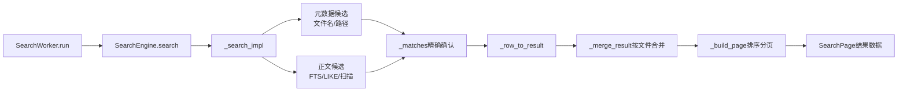

这里的`SearchPage`仍然是`core/search_engine.py`中的**结果数据类**；不是`ui/main_window.py`中负责展示控件的`SearchPage(QWidget)`。

### 三、`SearchEngine.__init__()`初始化的是什么

真实位置：`local_full_text_search/core/search_engine.py`约72行。

```python
def __init__(
    self,
    db: DatabaseManager,
    *,
    generation_isolated: bool = False,
    snapshot_generation: int | None = None,
) -> None:
    self.db = db
    # True表示正在读取不可变的已发布generation，不需要暂停另一个索引文件的写入。
    self.generation_isolated = bool(generation_isolated)
    # 记录当前读取的是哪一版索引，便于日志和问题定位。
    self.snapshot_generation = snapshot_generation
    # 检查数据库是否是紧凑快照结构，后面选择对应的读取表/视图。
    self.compact_snapshot = self._detect_compact_snapshot()
    # 缓存某个FTS表是否使用trigram，避免每次查询都读取表结构。
    self._trigram_tables: dict[str, bool] = {}
    # 一次完整搜索期间复用同一个只读连接和事务快照。
    self._snapshot_connection = None
```

它没有创建线程，也没有创建Qt对象。它只准备数据库访问、索引版本和查询策略所需的状态。

### 四、`search()`是外层保护和一致性协调器

真实位置：`SearchEngine.search()`约86行。它不是所有匹配细节都写在里面，而是负责给一次搜索建立安全的执行环境：

```text
记录请求日志
→ 判断是generation隔离模式还是旧版共享数据库模式
→ 必要时申请搜索租约
→ 启动120秒超时取消计时器
→ 打开只读连接并开始事务快照
→ 调用_search_impl执行检索规则
→ finally中取消计时器、释放租约
```

#### 1. generation隔离时

搜索读取例如`gen-12.db`，索引器可以同时写另一份`gen-13.building.db`。`SearchEngine`不需要为了读取而暂停索引器。

#### 2. 旧版共享数据库时

如果搜索和索引可能访问同一个数据库，`search()`会向`get_search_index_coordinator().request_search(...)`申请搜索租约，让写入在这段读取期间安全协调。

#### 3. 为什么使用同一个只读连接和事务快照

一次搜索可能先查文件名，再查正文。如果每个阶段随意创建连接，索引恰好在中间发布新版本，就可能出现：文件名来自版本A，正文来自版本B。当前代码用：

```python
# 整次搜索使用同一个只读连接和事务快照。
with self.db.connect_read_only(timeout_seconds=2.0) as connection:
    connection.execute("BEGIN")
    self._snapshot_connection = connection
    try:
        result = self._search_impl(query, token, ...)
        return result
    finally:
        self._snapshot_connection = previous
```

这保证“武汉”这一次搜索看到的是一致的数据视图。

### 五、为什么`search()`接收回调函数，而不是直接依赖Qt信号

`SearchEngine.search()`的参数是：

```python
progress_callback: Callable[[dict[str, object]], None] | None = None
partial_callback: Callable[[SearchPage], None] | None = None
```

它只知道“有一个可调用函数”，不知道这个函数是Qt的`Signal.emit()`、日志函数，还是测试中的普通列表追加函数。

桌面端才把Qt信号的`emit`方法传进来：

```python
# Worker把自己的Qt信号适配成普通回调参数。
progress_callback=self.progress.emit
partial_callback=self.partial.emit
```

这是一种很实用的“依赖倒置”：核心算法向外报告进度，但不认识Qt。于是：

- 测试可以传一个普通函数，收集进度后断言结果；
- CLI可以不传回调，直接等待最终结果；
- HTTP服务可以把进度转成日志、WebSocket事件或任务状态；
- RAG调用可以只拿最终结果，不引入桌面线程机制。

### 六、`_search_impl()`第一步：先判断索引能不能搜索

真实位置：`_search_impl()`约266行。

它首先调用`self._compact_readiness()`或`self.db.search_projection_readiness()`。如果索引尚未完成、投影不可用或仍有阻塞文件，就抛出`IndexNotReadyError`，而不是返回一个容易误解的“0条结果”。

业务上，这个门禁很重要：用户搜索“武汉”没有结果，可能是关键词确实不存在，也可能是索引还没有准备好。两种情况应该给出不同提示。

### 七、关键词怎样被解析和归一化

`_search_impl()`随后执行三步：

```python
# 1. 按exact/all/any/regex等模式切分原始输入。
raw_terms = parse_terms(query.text, query.mode)

# 2. 使用和建立索引时一致的规则规范化关键词。
normalized_terms = [
    normalize_text(
        term,
        case_sensitive=query.case_sensitive,
        ignore_spaces=query.ignore_spaces,
        ignore_hyphens=query.ignore_hyphens,
    )
    for term in raw_terms
    if term.strip()
]

# 3. 过滤归一化后为空的项。
normalized_terms = [term for term in normalized_terms if term]
```

例如用户输入：

```text
武汉  人工智能
```

如果是中文普通模式且没有主动要求保留空格，代码会复制一份`SearchQuery`并打开`ignore_spaces`，避免输入法或用户分隔词语产生不符合预期的匹配。它不会直接修改调用方原来的查询对象。

如果归一化后没有有效关键词，函数会直接返回空的`SearchPage`，不去扫描大表。

注意：代码中的`exact`模式不是要求整个文件内容必须与关键词完全相等；`_matches()`当前是检查规范化文本中是否包含完整查询串（`terms[0] in text`）。可以把它理解为“完整查询短语连续出现”，而不是“整份文档完全等于关键词”。

### 八、`_source_flags()`决定查哪些数据来源

`SearchQuery`中有三个重要开关：

```text
search_filename：搜索文件名
search_path：搜索路径
search_content：搜索正文
```

`_source_flags(query)`会把它们转换成真正的执行范围。特殊的`filename`模式会强制只搜文件名；如果三个开关都关闭，代码会默认开启正文搜索，避免出现“用户提交了查询却完全没有数据源”的情况。

所以用户搜索“武汉”时，系统可能分别从：

1. `files`/`files_fts`中的文件名和路径；
2. `content_blocks`或紧凑快照`search_blocks`中的正文块；
3. OCR正文块（根据`include_ocr`和置信度过滤）

得到候选。

### 九、最关键的概念：候选召回不等于最终命中

这是理解搜索引擎最重要的一步。

#### 1. 候选召回

`_metadata_query()`和`_content_query()`先用数据库能力快速找出“可能相关”的行：

- 关键词长度和索引条件合适时，使用SQLite FTS匹配；
- 不适合FTS时，使用`LIKE`兼容查询；
- 正则、忽略空格/连字符等情况需要更完整的扫描；
- 短中文词无法使用trigram FTS时，代码会走兼容扫描/LIKE路径。

这些结果只是候选，目的是缩小范围，不能直接当作最终结果。

#### 2. 精确确认

`_matches()`读取真实文本或已经存储的规范化文本，再按照查询模式确认：

```python
if mode in {"exact", "phrase", "filename"}:
    return terms[0] in text        # 完整目标串出现
if mode == "all":
    return all(term in text for term in terms)
if mode == "any":
    return any(term in text for term in terms)
if mode == "regex":
    return regex_pattern.search(text) is not None
```

为什么必须分两步？

假设“武汉”被某个FTS/LIKE策略召回，但它可能因为分词、规范化、索引兼容策略或查询表达式产生假阳性。只有经过`_matches()`对真实文本确认，才会进入`confirmed_by_file`。

这个模式可以概括为：

> 先用便宜的索引扩大候选覆盖，再用准确规则确认命中。

它也是很多RAG检索系统中“召回—重排/过滤”思想的基础，只是当前项目的确认规则是全文匹配，不是向量相似度模型。

### 十、用“武汉”走一遍候选与确认

假设数据库中有三个文件：

```text
武汉项目方案.docx       文件名中命中“武汉”
2025会议纪要.docx        正文第3页出现“武汉”
湖北资料.xlsx             正文OCR中出现“武汉”，置信度0.72
```

用户选择搜索文件名、路径和正文，并开启OCR：

1. `_metadata_candidates()`可能召回第一个文件。
2. `_content_candidates()`可能召回第二、第三个文件的正文块。
3. `consume()`逐行检查取消状态，并统计候选数量。
4. `_matches()`确认原文确实包含“武汉”。
5. `_row_to_result()`为每个确认行创建一个`SearchResult`，并记录具体页码、上下文、来源和命中次数。
6. 如果第二个文件有第3页和第8页两个正文块命中，`_merge_result()`会把两个`SearchHit`合并到同一个文件级结果中，而不是在结果列表重复显示两行。

### 十一、`_row_to_result()`怎样把数据库行变成可展示结果

真实数据模型在`local_full_text_search/models/search_result.py`：

- `SearchHit`：文件内部的一处命中，例如PDF第3页、Excel某个单元格或OCR位置。
- `SearchResult`：用户结果列表中的一个文件，可以包含多个`SearchHit`。

`_row_to_result()`主要完成四类工作：

1. 从数据库行取得文件路径、文件名、扩展名、大小和修改时间。
2. 统计命中次数，并调用`make_context()`生成关键词附近的上下文摘要。
3. 记录来源：`metadata`、`native_text`或`ocr`，以及页码、工作表、行号等定位信息。
4. 计算基础相关度分数。

当前代码中的分数规则是可读的业务规则：

```text
正文命中次数                         基础分
文件名完全等于关键词                 +1000
文件名以关键词开头                   +500
文件名包含关键词                     +250
文件名/路径等元数据命中               +50
OCR命中                              -25
```

这解释了为什么搜索“武汉”时，文件名叫“武汉项目方案.docx”的结果通常排在只有正文命中的文件前面；OCR结果在同等情况下略微降权。

### 十二、同一文件多个命中为什么要合并

数据库是按正文块、页、表格单元格等粒度存储内容的，所以同一个文件可能产生多行候选。用户却更希望看到：

```text
武汉项目方案.docx
  ├─ 第3页：武汉项目背景……
  ├─ 第8页：武汉实施计划……
  └─ 共命中2处
```

`confirmed_by_file`以`file_id`为字典键：

```python
# 一个文件只保留一个顶层SearchResult。
confirmed_by_file: dict[int, SearchResult] = {}

if existing is None:
    confirmed_by_file[result.file_id] = result
else:
    # 后续命中并入同一个文件结果。
    self._merge_result(existing, result)
```

`_merge_result()`会去重命中位置、累加分数和命中次数，并保留更高的OCR置信度。随后`_finalize_result()`会把命中位置排序、合并上下文，并确定文件的主要来源类型。

这是一个典型的“存储粒度”和“展示粒度”不同的设计：数据库按块存，界面按文件展示。

### 十三、排序、分页和几个数量分别代表什么

`_build_page()`负责最后的结果整理：

```text
复制确认结果
→ finalize每个文件的命中信息
→ 按sort_by排序
→ 应用max_results上限
→ 计算当前页的起止位置
→ 返回SearchPage
```

默认`sort_by="relevance"`时，`_result_sort_key()`按：

```text
相关度分数降序
→ 修改时间降序
→ 文件名升序
→ 路径升序
```

其他选项还包括按修改时间、文件大小或文件名排序。

结果对象中的几个数量不要混淆：

| 字段 | 含义 |
| --- | --- |
| `total_candidates` | 数据库阶段检查过多少候选行，不等于最终文件数 |
| `total_confirmed` | 引擎用于分页展示的匹配文件总数；普通/扫描路径会根据确认结果统计 |
| `available_results` | 应用`max_results`后允许提供的结果数 |
| `results` | 当前页实际返回的`SearchResult`列表 |
| `truncated` | 是否因为`max_results`上限而截断 |

例如引擎用于分页的总数为47，`page_size=10`、`page=2`、`max_results=1000`：

```text
total_confirmed = 47
available_results = 47
results = 排序后第11～20个文件，共10个
truncated = False
```

实现细节：当正文查询走非全扫描的延迟加载路径时，代码会遍历轻量候选行以统计候选文件ID，但只加载当前窗口候选文件的原文并执行`_matches()`精确确认。这是为了避免大索引时把所有正文块都读入内存。因此`total_confirmed`是当前引擎用于分页的数量字段；不要仅凭字段名推断“每一个候选文件在所有页面上都已逐一加载原文并确认”。

如果`max_results=15`，则只允许返回前15个：

```text
total_confirmed = 47
available_results = 15
truncated = True
```

如果正文候选已经按当前窗口延后确认，`_build_page()`还会使用`page_already_selected`避免对结果再次错误偏移。这是为了在大索引中控制正文加载量，同时保持分页语义。

### 十四、部分结果和进度怎样返回

`_search_impl()`先搜索文件名和路径。若已经有确认结果，会调用：

```python
# 先构造一页“部分结果”，让用户不用等正文全部确认。
partial_callback(
    self._build_page(
        confirmed_by_file,
        query,
        total_candidates,
        started,
        partial=True,
    )
)
```

之后再搜索正文，最后返回`partial=False`的完整结果。

进度则通过`_report_progress()`传递：搜索阶段、已检查候选数、已确认文件数、耗时、是否可取消和慢速原因都会放在普通字典中。`SearchWorker`再把这个字典通过Qt信号送给主窗口。

这体现了三层分工：

```text
SearchEngine：产生业务进度数据
SearchWorker：把回调适配为Qt信号
MainWindow/SearchPage：决定怎样显示进度
```

### 十五、为什么SearchEngine没有继续拆成很多小服务

当前`SearchEngine`已经有不少私有辅助函数，但它们仍围绕同一个核心变化原因：搜索策略变化。它们共享：

- `DatabaseManager`和当前只读连接；
- `SearchQuery`的匹配条件；
- 候选、确认、结果合并的中间状态；
- FTS表结构和快照模式判断。

所以把候选查询、匹配确认、结果封装、分页放在同一个核心类中，目前比拆成十几个只转发参数的类更容易追踪。

但它没有把以下内容塞进来：

- Qt线程启动和停止：属于`SearchWorker`；
- 页面控件更新：属于`SearchPage`/`MainWindow`；
- 具体SQLite连接实现：属于`DatabaseManager`；
- 一次搜索的输入字段：属于`SearchQuery`。

判断边界的口诀是：

> SearchEngine管“搜索规则”，SearchWorker管“任务运行”，SearchQuery管“搜索条件”，SearchPage管“界面展示”。

### 十六、武汉场景下的设计价值

当用户输入“武汉”时，系统不是把所有文件全文读入内存再逐个判断，而是：

1. 先利用索引或兼容查询缩小候选范围；
2. 再对真实文本精确确认，减少假阳性；
3. 将多个块命中合并成文件级结果；
4. 通过相关度、时间和文件名稳定排序；
5. 只返回当前页，避免一次把几万个结果全部交给UI。

这个设计方便的真实业务包括：

- 大量资料中的关键词搜索；
- 搜索结果分页和排序；
- 文件名、正文、OCR同时参与检索；
- 先展示元数据命中、后补充正文命中；
- 将全文检索结果作为RAG的候选资料来源。

### 十七、30秒面试表达

> SearchEngine是项目的核心检索能力，不负责Qt线程。它先检查索引可用性，解析并归一化SearchQuery，再分别从文件元数据和正文索引召回候选。候选只代表可能命中，随后通过_matches读取真实文本做精确确认；确认结果按file_id合并多个命中位置，_row_to_result生成上下文和相关度分数，_build_page完成排序、max_results限制和分页。SearchEngine通过普通回调报告进度和部分结果，因此可以脱离SearchWorker被测试、脚本或未来RAG入口复用。

### 十八、理解检查——请先回答这两个问题

1. 为什么`SearchEngine`要分“候选召回”和“精确确认”两步？如果直接相信FTS或`LIKE`返回的行，可能出现什么问题？
2. “武汉”确认命中47个文件，`page_size=10`、`page=2`时，`total_confirmed`、`available_results`和`results`分别代表什么？

## 第八章：SearchEngine进阶答疑——FTS、LIKE、元数据、回调与分页

这一章专门回答上一课中容易混淆的五个概念。先给出总流程：

```text
数据库中的文件记录/正文块记录
→ FTS或LIKE先找“可能相关”的候选
→ _matches()读取真实文本确认
→ 同一file_id的多个命中合并
→ 生成SearchResult
→ _build_page()排序和分页
→ 通过回调把进度/部分结果交给SearchWorker
```

### 一、FTS是什么？LIKE是什么？

#### 1. LIKE：数据库提供的“包含字符串”条件

SQL中的`LIKE`可以理解成：在某个字段里查找符合模式的文本。当前项目的`_like_predicates()`（`core/search_engine.py`约1235行）会为关键词生成类似条件：

```sql
LOWER(f.filename) LIKE '%武汉%'
```

- `%`表示前后可以有任意字符。
- `'%武汉%'`表示字段中只要包含“武汉”就先作为候选。
- 它可以用于文件名、路径或兼容正文查询。

| 文件名 | `LIKE '%武汉%'`结果 |
| --- | --- |
| `武汉项目方案.docx` | 候选 |
| `2025武汉会议纪要.pdf` | 候选 |
| `北京项目.docx` | 不是候选 |

LIKE简单、兼容性好；但数据量很大时可能扫描很多文本，而且它只负责字符串粗筛，不理解相关度和业务语义。

#### 2. FTS：全文检索索引

FTS是`Full-Text Search`的缩写，即全文检索。当前项目使用SQLite FTS表：

- `files_fts`：文件名和路径索引；
- `content_fts`：正文块索引。

它们不是普通业务表，而是为快速搜索文字准备的索引结构。建立索引时，程序把可搜索文本放入FTS结构；搜索时使用：

```sql
content_fts MATCH ?
```

快速定位可能包含关键词的记录。

当前`_can_use_fts_match()`（约1012行）只有在以下条件满足时才使用FTS：

```text
不是正则或强制全扫描
关键词已经归一化
每个关键词长度至少3
FTS表确实使用trigram结构
```

`trigram`可以先理解为把文本拆成连续三个字符的片段，便于较长关键词快速定位。因此只有两个字的“武汉”在当前判断中不能走trigram FTS，会进入LIKE或兼容扫描；“武汉项目”长度足够时才可能走FTS。

#### 3. 怎么进入候选

`SearchEngine._search_impl()`先用`_source_flags(query)`确定搜索文件名、路径和正文中的哪些来源。

```text
_metadata_candidates()
→ _metadata_query()
→ files_fts MATCH ...               条件适用时
   或 LOWER(filename) LIKE '%武汉%' 条件不适用时
→ 文件名/路径候选行

_content_candidates()
→ _content_query()
→ content_fts MATCH ...             条件适用时
   或正文LIKE/兼容扫描              条件不适用时
→ 正文块候选行
```

候选行进入`consume()`。正文延迟加载时，代码先保留轻量的`file_id`和`block_id`；真正确认时，由`_hydrate_content_row()`读取正文，再交给`_matches()`。

所以“进入候选”不是指用户已经看到结果，而是数据库先把某一行交给引擎，表示“这行值得进一步检查”。

#### 4. 为什么候选还要确认

FTS和LIKE的目标是快速缩小范围，不完全等于业务规则：

- FTS分词可能和完整短语要求不同；
- LIKE不了解`all`、`any`和正则模式；
- OCR、空格、连字符和大小写需要统一处理；
- 兼容搜索可能只提供较粗的候选条件。

因此`_matches()`还会根据`query.mode`确认`exact/phrase`、`all`、`any`或`regex`。

> FTS/LIKE负责“尽快找出可能命中的行”，`_matches()`负责“最终能不能算命中”。

### 二、为什么同一个文件最终只显示一条顶层结果

先区分三个层次：

```text
文件（用户关心的资料）
└── 正文块/页面/表格单元格（数据库存储和定位单位）
    └── 一处关键词命中
```

#### 1. 为什么数据库有多条正文块

一个PDF有几十页，Word可拆成多个段落，Excel有多个工作表和单元格。为了支持定位和预览，索引不会把整份文件只存成一条巨大字符串，而会拆成正文块：

```text
武汉项目方案.pdf
├── block_id=101，第3页
├── block_id=102，第8页
└── block_id=103，第12页
```

如果“武汉”在第3页和第8页出现，候选查询可能返回两行。这是正确的，因为每行保留各自页码、上下文和位置。

#### 2. 为什么UI按文件展示

用户真正想知道的通常是“哪些资料与武汉有关、应该打开哪个文件”，而不是“数据库有多少正文块包含武汉”。

如果一个文件命中10个正文块，结果页直接显示10行相同文件名：

- 同一文件会占满列表；
- 用户看不出有多少份不同资料；
- 排序和分页会把同一文件重复计算；
- 点击打开的是同一个文件，却需要看很多重复行。

所以当前产品选择：顶层按文件显示，文件内部保留多个命中位置。

```text
武汉项目方案.pdf             页面只显示一个文件
  命中1：第3页，项目背景……
  命中2：第8页，实施计划……
```

这不是丢掉两处信息，而是把它们放在一个文件结果的`matches`中。

#### 3. 代码怎样合并

```python
# file_id作为字典键，因此每个文件只有一个顶层SearchResult。
confirmed_by_file: dict[int, SearchResult] = {}

if existing is None:
    confirmed_by_file[result.file_id] = result
else:
    self._merge_result(existing, result)
```

- `SearchHit`表示文件内部一处命中。
- `SearchResult`表示列表中的一个文件汇总结果。
- `_merge_result()`把同一文件后续命中加入`matches`，并累加命中次数和分数。

如果未来产品决定“每个命中位置显示一行”，也可以更改展示策略；当前按文件聚合是面向资料查找业务的产品选择，不是数据库强制要求。

### 三、元数据是什么

元数据就是**描述文件的信息，而不是文件正文本身**。

```text
元数据：文件名、路径、扩展名、文件大小、修改时间、所属根目录、解析状态
正文：文件中真正写的句子、段落、页面和单元格文字
```

搜索“武汉”可能出现：

```text
元数据命中：文件名叫“武汉项目方案.docx”
正文命中：文件名普通，但正文第3页写了“武汉”
```

`_metadata_query()`负责文件名和路径候选，并在SQL结果中设置：

```sql
'metadata' AS source_type
```

`_row_to_result()`看到`source_type == "metadata"`时，将位置标为文件名/路径并给予元数据命中加分。元数据检索很有用，因为用户可能只记得文件名或目录，而且它通常比加载正文便宜，可以先展示这些结果。

### 四、`search()`接收回调函数是什么意思

“回调函数”就是：**把一个函数作为参数传给另一个函数，等某个时机发生时，由后者反过来调用它。**

先看一个普通Python例子：

```python
def download(on_progress=None):
    for percent in (0, 50, 100):
        if on_progress is not None:
            on_progress(percent)       # 到达某个阶段时通知外部

def show_progress(percent):
    print(f"进度：{percent}%")

download(show_progress)               # 把函数本身传进去，没有括号
```

可以把回调理解成“留下一个电话号码”：`SearchEngine`搜索到某个阶段时，按这个号码通知外部。它不需要知道接电话的是界面、日志、测试还是HTTP服务。

#### 1. 当前项目中传了什么函数

`SearchWorker.run()`调用`SearchEngine.search()`时传入：

```python
engine.search(
    self.query,
    self.token,
    status_callback=self.lease_status.emit,
    progress_callback=self.progress.emit,
    partial_callback=self.partial.emit,
)
```

这里没有写`self.progress.emit()`，因为不是现在立刻发信号；传入的是`self.progress.emit`这个可调用函数，让Engine稍后需要时调用。

完整链路是：

```text
SearchEngine调用progress_callback(payload)
→ 实际等于SearchWorker.progress.emit(payload)
→ MainWindow.on_search_progress(payload)
→ SearchPage.set_search_progress(payload)
```

`SearchEngine`只知道自己调用了一个函数，并不知道它是Qt信号。

#### 2. 进度回调传什么

`_report_progress()`构造普通字典，例如：

```python
{
    "stage": "searching_content",
    "phase_label": "正在搜索正文...",
    "checked_candidates": 1200,
    "confirmed_files": 86,
    "percent": None,
    "can_cancel": True,
}
```

然后执行`callback(payload)`。桌面端的callback恰好是Worker的`progress.emit`，于是MainWindow收到进度字典并更新界面。

测试时则可以完全不用Qt：

```python
progress_events = []
page = engine.search(
    SearchQuery(text="武汉"),
    progress_callback=progress_events.append,
)
```

这里回调是Python列表的`append`方法。每当Engine报告进度，字典就被追加到列表中，测试可以检查这些事件。

#### 3. 部分结果回调传什么

Engine先搜索文件名和路径。如果先找到“武汉项目方案.docx”，但正文仍在搜索，会构造`partial=True`的结果页并执行：

```python
partial_callback(partial_page)
```

实际链路：

```text
SearchEngine.partial_callback(partial_page)
→ SearchWorker.partial.emit(partial_page)
→ MainWindow.on_search_partial(partial_page)
→ UI SearchPage.set_partial_results(partial_page)
→ 先显示文件名/路径结果，正文继续搜索
```

这就是“边搜索边展示”。Engine没有直接操作进度条或结果列表，只报告普通数据。

#### 4. 状态回调传什么

`status_callback`发送较粗粒度的状态字符串，例如：

```text
waiting_for_index：等待索引完成
waiting：等待搜索租约
active：已经取得搜索租约
snapshot_active：正在使用已发布快照
```

Worker把它适配成`lease_status`信号，MainWindow再决定显示什么中文提示。

#### 5. 为什么不用Engine直接调用MainWindow

如果Engine直接写`mainwindow.progress_bar.setValue(...)`，检索算法就依赖Qt窗口，测试、CLI、HTTP和RAG都会被迫创建界面。回调让Engine只报告“发生了什么”，由外层决定“怎样显示或记录”。

> 回调是核心能力向外通知事件的普通Python接口；Qt信号是Worker把这些通知送过线程边界的框架机制。

### 五、截图中的分页变量逐行解释

截图条件：

```text
total_confirmed = 47
page_size = 10
page = 2
max_results = 1000
```

#### 1. `total_confirmed = 47`

表示引擎用于分页的匹配**文件**总数是47，不是正文块数。

```text
武汉方案.docx：内部命中5处 → 算1个文件
武汉纪要.pdf：内部命中2处 → 算1个文件
```

上述例子对`total_confirmed`贡献2，不是7。

当前正文延迟加载路径为了性能，会先遍历轻量候选文件ID，只对当前窗口的候选加载有限正文块并精确确认。因此这里应理解成“引擎用于文件级分页的总数”，不要据字段名推断所有页面的每个正文块都已经加载进内存。

#### 2. `available_results = 47`

代码计算：

```python
available_results = min(total_confirmed, max_results)
```

`min(47, 1000)=47`，表示47个结果都在允许展示的上限内。

如果`max_results=15`：

```text
available_results = min(47, 15) = 15
```

即只允许用户查看前15个结果。

#### 3. `results = 第11～20个文件，共10个`

`page_size=10`表示每页最多10个文件，`page=2`表示第二页：

```text
第1页：第1～10个文件
第2页：第11～20个文件
第3页：第21～30个文件
第4页：第31～40个文件
第5页：第41～47个文件
```

所以`results`是当前页的列表，包含排序后的第11～20个文件，不是全部47个，也不是“第2条结果”。

#### 4. `truncated = False`

代码计算：

```python
truncated = total_confirmed > available_results
```

当前`47 > 47`为False：没有因为`max_results`上限截断，只是通过分页每次展示10个。

若`max_results=15`：

```text
total_confirmed = 47
available_results = 15
truncated = True
```

这表示实际用于分页的总数有47，但产品设置只允许展示前15个，后面的不会进入可查看结果。

#### 5. `page_already_selected`是什么意思

普通情况是`confirmed`包含全部结果，所以`_build_page()`自己计算：

```python
start = (page - 1) * page_size
end = start + page_size
```

但为了节省正文加载量，搜索过程可能已经提前只收集当前页窗口的候选。例如第二页已经只收集第11～20个候选，传给`_build_page()`的`confirmed`本来就只有这批结果。

如果此时再跳过10个，就会把已有的10个全部跳过，第二页变成空页或错位。因此：

```python
page_already_selected=True
```

让`_build_page()`使用：

```python
start = 0
end = len(confirmed)
```

也就是“不要再次偏移，这批结果之前已经按当前页窗口选过了”。

```text
状态A：confirmed包含全部结果
→ _build_page负责取第11～20个

状态B：confirmed本来就只包含第11～20个候选窗口
→ _build_page直接使用，不能再跳过10个
```

### 六、把五个问题串起来

```text
“武汉”
→ FTS或LIKE找可能相关的文件/正文块
→ _matches精确确认
→ _row_to_result生成命中信息
→ _merge_result把同一文件的多个SearchHit合成一个SearchResult
→ _build_page排序、限制最大结果数、取当前页
→ 回调报告进度或部分结果
→ SearchWorker转成Qt信号
→ MainWindow交给UI显示
```

### 七、面试版总结

> FTS是SQLite全文检索索引，LIKE是字符串包含的兼容查询；两者先召回候选，再由匹配函数按业务规则确认。数据库按页、段落或内容块保存文本，所以一个文件可能产生多条命中；UI按文件展示，内部保留多个SearchHit，避免同一文件占满列表。元数据是文件名、路径、大小和修改时间等描述信息。SearchEngine通过普通回调报告进度、状态和部分结果，不直接依赖Qt，Worker再把回调适配成跨线程信号。分页中total_confirmed是文件级总数，available_results受max_results限制，results只包含当前页，truncated表示是否被最大结果数截断。

### 八、理解检查

1. “武汉项目方案.pdf”在第3页和第8页都命中，为什么数据库可以有两条正文块记录，而UI只显示一个文件？用户还能不能看到两处命中？
2. `progress_callback=self.progress.emit`中，SearchEngine知道它在调用Qt信号吗？测试时可以传什么替代函数？
3. `page=2`、`page_size=10`时，为什么不能把`results`理解成第2条结果？

### 九、补充答疑：为什么需要回调，什么时候使用

#### 1. 返回值只能在结束时返回一次，回调可以在过程中通知多次

如果`SearchEngine.search()`只使用`return`：

```text
开始搜索
→ 搜索文件名
→ 搜索正文
→ 排序
→ 全部结束后return SearchPage
```

外部只能在最后收到一次结果。搜索10秒时，前9秒外部不知道当前在等待索引、搜索文件名、搜索正文还是排序，也无法先显示部分结果。

使用回调后：

```text
等待索引时       → status_callback("waiting_for_index")
开始搜索文件名   → progress_callback({...})
文件名结果已找到 → partial_callback(partial_page)
搜索正文过程中   → progress_callback({...})，可以多次
全部完成         → return final_page
```

因此当前项目的选择是：

- 最终完整结果用`return`；
- 搜索过程中的状态、进度和部分结果用回调。

#### 2. 回调把“产生事件”和“怎样处理事件”分开

`SearchEngine`知道“现在查了1200条候选”“先找到5个文件名结果”，但它不应该决定：

- Qt进度条怎样显示；
- CLI是否打印一行文字；
- HTTP服务是否写任务状态；
- 测试是否把事件加入列表。

它只执行：

```python
progress_callback(payload)
```

外层传入什么函数，就采用什么处理方式。这使核心搜索规则不依赖Qt界面。

#### 3. 当前真实调用时机

`SearchWorker.run()`传入：

```python
status_callback=self.lease_status.emit
progress_callback=self.progress.emit
partial_callback=self.partial.emit
```

`SearchEngine`在搜索线程中同步调用这些函数。因为实际函数是Qt信号的`emit`，信号再把数据安全投递给主线程的`MainWindow`。

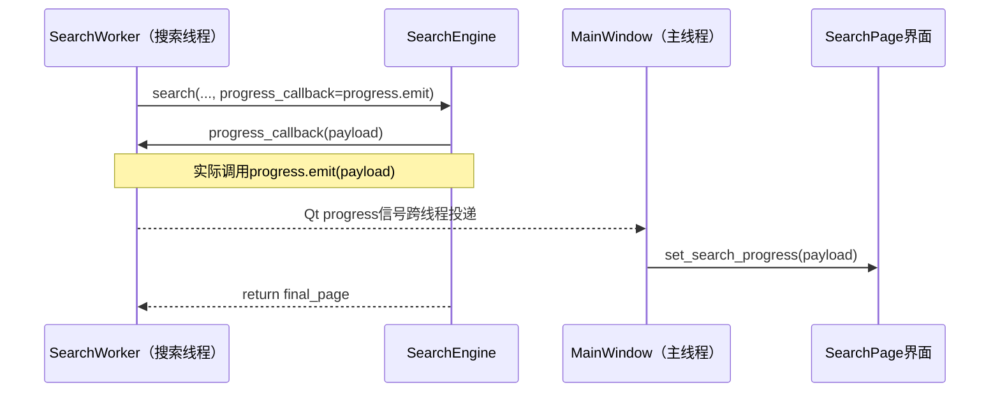

回调本身不等于多线程，也不等于异步。这里回调是在搜索线程里由`SearchEngine`直接调用；真正负责跨线程投递的是Worker的Qt信号。

#### 4. 什么时候适合使用回调

适合：

1. 一个操作执行较久，中间要多次报告进度。
2. 最终结果前就能产生部分结果或流式数据。
3. 核心模块需要通知事件，但不想依赖UI、日志或网络框架。
4. 调用者需要自定义处理方式，例如测试收集事件、GUI发信号、CLI打印文字。

不一定需要：

1. 函数执行很快，只返回一个最终值——直接`return`更清楚。
2. 被调用方明确只服务一个内部对象，不存在替换、复用或线程边界——直接调用普通方法可能更简单。
3. 为每一行简单顺序代码都增加回调，会使调用链难以追踪，属于过度设计。

可以记成：

> 最终答案用返回值；过程事件用回调；跨Qt线程再由Worker把回调适配成信号。

### 十、补充答疑：LIKE到底作用于什么对象

`LIKE`不是一张表，它是SQL的字符串匹配运算符，可以作用于查询中可访问的任何文本列。FTS表则是一种专门用于全文检索的虚拟表。两者不要放在同一维度比较：

```text
LIKE：怎样比较文本
普通表/FTS表/视图：文本存放在哪里
MATCH：使用FTS全文索引进行检索的专用运算
```

因此，技术上`LIKE`也可以写在FTS表的文本列上，但这不等于使用了FTS的`MATCH`索引能力。

#### 1. 文件名和路径查询

`_metadata_query()`先构造字段：

```python
if search_filename:
    fields.append("LOWER(f.filename)")
if search_path:
    fields.append("LOWER(f.path)")
```

能够使用FTS时：

```sql
FROM files_fts
JOIN files f ON ...
WHERE files_fts MATCH ?
```

不能使用FTS且不要求全扫描时：

```sql
FROM files f
WHERE LOWER(f.filename) LIKE '%武汉%'
   OR LOWER(f.path) LIKE '%武汉%'
```

所以元数据的LIKE作用于普通`files`表中的`filename`和`path`列，不搜索文件大小或修改时间，也不在这条路径上使用`files_fts MATCH`。

#### 2. 正文查询

能够使用FTS时：

```sql
FROM content_fts
WHERE content_fts MATCH ?
```

不能使用FTS时分两种数据库形态：

- 普通/旧结构：代码对`content_fts.normalized_text`使用`LIKE`，然后取得对应正文块ID。此时确实读取FTS虚拟表中的文本列，但使用的是`LIKE`，不是FTS的`MATCH`索引查询。
- 紧凑快照：代码对`search_blocks`视图的`raw_text`使用`LIKE`，再取得正文块ID。

例如两字中文“武汉”不符合当前trigram FTS的长度条件：

```text
文件名/路径 → files表的filename/path LIKE
正文普通结构 → content_fts.normalized_text LIKE
正文紧凑快照 → search_blocks.raw_text LIKE
```

如果查询是“武汉项目”，条件合适时则可能变成：

```text
文件名/路径 → files_fts MATCH
正文 → content_fts MATCH
```

#### 3. LIKE到底搜索哪些内容，由传入字段决定

通用函数`_like_predicates(fields, ...)`并不知道“文件名”或“正文”，它只对调用者传入的字段生成条件：

```python
for field in fields:
    field_predicates.append(f"{field} LIKE ?")
```

因此：

```text
传入LOWER(f.filename) → 搜文件名
传入LOWER(f.path) → 搜路径
传入normalized_text → 搜规范化正文
传入raw_text → 搜原始正文
```

这也说明LIKE不是只搜索名字。它的作用对象取决于SQL左边写的是哪一个字段。

### 十一、这一轮最简结论

```text
回调：让SearchEngine在最终return之前，多次报告状态、进度和部分结果；
      同时避免SearchEngine直接依赖Qt界面。

LIKE：字符串匹配运算符，不限定只能搜文件名；
      当前项目会用它搜files表的文件名/路径，也会在兼容路径中搜正文列。

FTS：专门的全文索引结构；真正使用其索引检索能力时，SQL写的是MATCH。
```

### 十二、理解检查

1. 为什么`SearchEngine.search()`最终结果适合用`return`，而“正在搜索正文”适合用回调？
2. 查询“武汉”时，如果SQL是`content_fts.normalized_text LIKE '%武汉%'`，这条语句虽然读取FTS表，是否等于使用了FTS的`MATCH`全文索引能力？

### 十三、MATCH是什么，以及为什么不能所有查询都使用FTS

#### 1. MATCH不是表，而是FTS专用查询入口

当前项目中：

```sql
content_fts MATCH '武汉项目'
```

可以理解为“到`content_fts`已经建立好的全文索引中查找与查询表达式匹配的正文块”。它与LIKE的核心区别是：

```text
LIKE：拿文本列逐条做字符串模式比较
MATCH：利用FTS预先建立的词元/字符片段索引定位候选
```

当前项目使用trigram索引。例如“武汉项目”可拆出连续三字符片段：

```text
武汉项
汉项目
```

索引建立阶段已经记录“每个片段出现在哪些正文块”。查询时MATCH先查这些映射，得到可能同时含有这些片段的block_id，再由`_matches()`读取真实文本确认完整的“武汉项目”是否连续出现。

所以MATCH负责快速召回，不负责替代最后的业务确认。

#### 2. FTS的优势

1. 大数据量下不用从头比较所有长文本，候选召回通常明显快于兼容扫描。
2. 文件名、路径和正文可分别建立专用索引。
3. 支持组合查询表达式，例如多个词的AND/OR。
4. 先召回少量候选，再加载正文确认，可以降低磁盘读取和内存压力。

#### 3. FTS的代价和限制

1. 需要额外建立、更新、发布和存储FTS索引。
2. 能查什么受tokenizer和建索引时的归一化规则限制。
3. 当前trigram查询至少需要3个字符；“武汉”只有2个字符，没有完整三字符片段。
4. 正则表达式不能直接等价翻译成当前MATCH表达式。
5. `ignore_spaces`或`ignore_hyphens`会改变文字形态，可能与已建立索引中的字符片段不一致。
6. MATCH给出的仍是候选，项目还要通过`_matches()`避免假阳性。

#### 4. 为什么代码要先判断能不能用FTS

真实判断在`SearchEngine._can_use_fts_match()`：

```python
return (
    not self._requires_full_scan(query)
    and bool(normalized_terms)
    and all(len(term) >= 3 for term in normalized_terms)
    and self._fts_table_uses_trigram(table)
)
```

而`_requires_full_scan()`判断：

```python
return query.mode == "regex" or query.ignore_spaces or query.ignore_hyphens
```

这不是单纯的性能判断，而是“先保证不漏结果，再争取速度”：

```text
FTS能够表达当前查询语义
→ 用MATCH快速召回

FTS不能表达，或可能漏掉正确结果
→ 使用LIKE或全扫描保证正确性
```

例如：

| 查询 | 当前策略 | 为什么 |
| --- | --- | --- |
| `武汉项目` | 条件合适时FTS MATCH | 长度至少3，可由trigram索引召回 |
| `武汉` | LIKE/兼容扫描 | 只有2字，无法形成完整trigram |
| 正则`武汉.*项目` | 全扫描后Python正则确认 | 当前MATCH不能表达完整正则语义 |
| 忽略空格搜索 | 全扫描 | 查询归一化与既有字符片段可能不一致 |

如果为了速度强行对所有查询使用MATCH，最危险的结果不是“慢”，而是**漏掉本该命中的文件**。因此当前设计采用“快速路径+正确性兜底路径”。

#### 5. 可以迁移到其他项目的设计原则

> 索引是有适用前提的性能优化，不是业务真相；先判断索引能否完整表达查询语义，能则走快速路径，不能则回退到更慢但正确的验证路径。

在RAG中同样适用：向量召回很快但可能不精确，通常仍需关键词过滤、权限检查或重排；不能因为已有向量索引，就强迫所有问题只走一种检索方式。

### 十四、后续固定教学格式

从本节开始，每个新技术点都按以下顺序讲解：

```text
1. 它解决什么真实业务问题
2. 当前项目从哪个函数进入
3. 核心执行链是什么
4. 为什么这样设计
5. 好处与代价分别是什么
6. 什么时候适用，什么时候不适用
7. 能提炼成什么通用设计原则
8. 面试时怎样结合项目表达
```

只解释“是什么”只能帮助阅读名词；补齐“为什么、适用边界和取舍”，才能帮助以后独立设计项目和回答面试问题。

## 第九章：DatabaseManager第一课——数据库连接的统一入口

### 一、为什么DatabaseManager值得单独学习

`local_full_text_search/core/database.py`有数千行，包含连接、事务、表结构、迁移、索引维护、就绪检查和大量数据方法。如果一次全部展开，很容易只记住SQL细节，看不清它在架构中的位置。

所以DatabaseManager分四课学习：

```text
第1课：对象怎样创建，怎样打开/关闭读写连接（本课）
第2课：files、content_blocks、files_fts、content_fts怎样关联
第3课：事务、WAL、只读快照、写入串行化和线程安全
第4课：搜索与索引分别调用哪些DatabaseManager方法
```

本课先记住一句话：

> DatabaseManager不是数据库文件，也不是一条永久连接；它是项目访问SQLite的统一网关，负责按统一规则打开连接、提交或回滚事务、关闭连接、跟踪活动连接并执行中断。

真实代码位置：

- `local_full_text_search/core/database.py:358`：`DatabaseManager`类。
- `DatabaseManager.__init__()`：约366行。
- `DatabaseManager.connect()`：约380行，写连接。
- `DatabaseManager.interrupt_active_connections()`：约530行。
- `DatabaseManager.initialize()`：约582行。
- `DatabaseManager.connect_read_only()`：约940行，搜索读连接。

### 二、先分清四个容易混淆的对象

| 对象 | 是什么 | 当前项目中的例子 |
| --- | --- | --- |
| SQLite数据库文件 | 磁盘上的数据文件 | `index_control.db`、某个已发布generation数据库 |
| `DatabaseManager` | 保存路径和数据库访问规则的Python对象 | `DatabaseManager(search_path, read_only=True)` |
| `sqlite3.Connection` | 一次实际打开的数据库连接 | `connect_read_only()`内部的`con` |
| `SearchEngine` | 使用连接执行候选查询和匹配规则 | `SearchEngine(db).search(query)` |

关系可以画成：

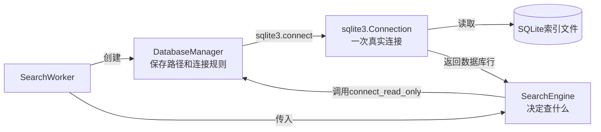

最重要的区别：

```python
db = DatabaseManager(path)
```

这里只创建Manager对象，通常还没有打开SQLite连接。真正执行：

```python
with db.connect_read_only() as connection:
```

才会调用`sqlite3.connect(...)`打开一条连接。

### 三、程序中DatabaseManager在哪里第一次出现

应用启动入口`app.py`中：

```python
generation_base_path = database_location.store_root / "search_index.db"
control_path = database_location.store_root / "index_control.db"

# 创建控制数据库网关。
db = DatabaseManager(control_path)

# 初始化或检查表结构；startup_fast允许已有大数据库的检查延后到后台。
db.initialize(startup_fast=True)

# 把控制数据库网关交给MainWindow。
window = MainWindow(
    db,
    ...,
    generation_base_path=generation_base_path,
)
```

这里的`db`主要指向`index_control.db`。它负责应用控制、索引状态和其他持久化数据。

搜索时还会创建另一只DatabaseManager。`SearchWorker.run()`先通过`IndexGenerationStore`找到当前已发布的索引版本，然后：

```python
search_path = active.path if active is not None else self.db_path

# 搜索专用Manager指向当前已发布的索引文件。
db = DatabaseManager(
    search_path,
    read_only=active is not None,
)

# 把它交给搜索算法。
engine = SearchEngine(db, ...)
```

因此不要把所有名为`db`的变量都理解成同一个对象：

```text
应用启动的DatabaseManager → 通常指向index_control.db
本轮搜索的DatabaseManager → 指向当前可搜索generation快照
```

它们使用同一个类，是因为都需要统一的SQLite访问规则；但路径、生命周期和读写权限可以不同。

### 四、`__init__()`到底做了什么

真实代码约366行：

```python
def __init__(self, db_path: Path, *, read_only: bool = False) -> None:
    self.db_path = db_path
    self.read_only = bool(read_only)
    self.db_path.parent.mkdir(parents=True, exist_ok=True)
    self._connections_lock = threading.Lock()
    self._active_connections: set[sqlite3.Connection] = set()
    # 后面还有繁忙日志、就绪缓存和迁移状态字段。
```

输入：

- `db_path`：要管理哪一个SQLite文件。
- `read_only`：这只Manager是否只允许读取。

处理：

- 保存路径和权限意图；
- 确保父目录存在；
- 创建锁，保护活动连接集合；
- 准备记录当前打开的连接。

输出：

- 一个DatabaseManager对象。
- 不是搜索结果，也不是已经打开的数据库连接。

为什么构造函数不长期保持一条连接？当前应用有主线程、搜索线程、索引写入流程、迁移流程和取消操作。让不同操作通过短生命周期连接工作，可以明确每次事务边界，并在`finally`中可靠关闭；避免一条全局连接被多个线程随意共享。

### 五、搜索“武汉”时怎样打开只读连接

真实调用链：

```text
SearchWorker.run()
→ DatabaseManager(search_path, read_only=True)
→ SearchEngine(db)
→ SearchEngine.search(SearchQuery(text="武汉"))
→ db.connect_read_only(timeout_seconds=2.0)
→ sqlite3.connect(file:...?mode=ro)
→ connection.execute("BEGIN")
→ _search_impl()执行FTS/LIKE和精确确认
→ 离开with块
→ DatabaseManager在finally中关闭连接
```

`SearchEngine.search()`中的真实代码：

```python
with self.db.connect_read_only(timeout_seconds=2.0) as connection:
    connection.execute("BEGIN")
    self._snapshot_connection = connection
    try:
        return self._search_impl(query, token, ...)
    finally:
        self._snapshot_connection = previous
```

`connect_read_only()`内部的重要步骤：

```python
# SQLite URI的mode=ro从数据库层禁止写入。
uri = f"file:{self.db_path.as_posix()}?mode=ro"
con = sqlite3.connect(uri, uri=True, timeout=timeout)

# 登记活动连接，取消搜索时可以找到它。
self._active_connections.add(con)

# 让上层用row["filename"]读取列，而不是row[3]。
con.row_factory = sqlite3.Row

# 再增加一道连接级只读保护。
con.execute("PRAGMA query_only = ON")

yield con

# 无论成功、失败还是取消，finally都会执行。
self._active_connections.discard(con)
con.close()
```

### 六、为什么使用`with`，而不是手动open和close

直接写：

```python
con = sqlite3.connect(path)
rows = con.execute(sql).fetchall()
con.close()
```

正常时可以工作，但如果`execute()`或后续匹配抛出异常，`close()`可能没有机会执行。连接、文件句柄和事务就容易残留。

DatabaseManager把连接做成上下文管理器：

```python
with db.connect_read_only() as con:
    rows = con.execute(sql).fetchall()
```

它保证：

```text
进入with → 打开并登记连接
with内部正常结束 → 关闭连接
with内部抛异常 → 仍进入finally并关闭连接
搜索被取消 → 仍进入finally并关闭连接
```

这类设计不只适用于SQLite，也适用于文件、网络连接、锁和事务：凡是“使用后必须释放”的资源，都适合用上下文管理器表达生命周期。

### 七、为什么有`connect()`和`connect_read_only()`两个入口

#### `connect()`：写事务入口

它会：

```text
申请同一数据库的进程内写锁
→ sqlite3.connect()
→ 配置外键、busy_timeout等规则
→ yield连接给业务代码
→ 成功时commit
→ 异常时rollback
→ finally关闭连接并释放写锁
```

如果这只Manager以`read_only=True`创建，调用`connect()`会立即抛错：

```python
if self.read_only:
    raise sqlite3.OperationalError("活动搜索快照是只读数据库，禁止写入")
```

#### `connect_read_only()`：搜索读取入口

它用SQLite URI的`mode=ro`和`PRAGMA query_only=ON`双重防护，不执行commit或rollback写事务。

为什么不合并成一个`connect(read_only=True/False)`？分开的公开方法能让调用代码一眼表达意图，并让写入路径统一承担写锁、commit、rollback等额外职责。对于已发布索引快照，误走写入口会立刻失败，不会悄悄修改正在被搜索的版本。

### 八、停止搜索时DatabaseManager做什么

`SearchWorker.cancel()`调用：

```python
database.interrupt_active_connections()
```

DatabaseManager保存了当前活动连接集合：

```python
self._active_connections: set[sqlite3.Connection] = set()
```

中断函数会先在线程锁保护下复制连接列表，再逐一调用：

```python
con.interrupt()
```

业务效果：如果搜索线程正执行一条耗时SQLite查询，仅设置Python的`CancelToken`可能要等SQL返回以后才被检查；`Connection.interrupt()`可以请求SQLite尽快停止当前语句。随后SearchEngine把SQLite中断转换成取消异常，Worker继续执行`finally`清理。

这解释了为什么DatabaseManager不只是“SQL工具类”：它还拥有连接生命周期，才能在取消时找到当前正在运行的SQLite连接。

### 九、为什么不让SearchEngine直接到处调用`sqlite3.connect()`

如果每个算法函数自行连接：

```python
sqlite3.connect(path)
```

每个调用点都要重复并保持一致：

- 只读保护；
- 超时和busy处理；
- `row_factory`；
- 连接登记和取消中断；
- commit、rollback与关闭；
- 日志和慢事务诊断；
- generation快照不可写规则。

一处忘记关闭或忘记只读模式，就可能出现数据库锁、资源泄漏或误写已发布索引。

集中到DatabaseManager后：

```text
SearchEngine负责：查什么、怎样匹配、怎样排序
DatabaseManager负责：怎样安全连接、事务怎样结束、连接怎样关闭/中断
SQLite文件负责：实际持久化数据
```

方便的业务变化包括：

1. 所有搜索连接统一调整缓存或超时，只改DatabaseManager。
2. 增加只读generation快照保护，不改每一个搜索SQL。
3. 用户停止搜索，可以从统一位置中断连接。
4. 记录数据库繁忙和慢事务，不把日志散落到所有业务模块。

### 十、这种设计的代价与边界

优点：

- 连接、事务和关闭规则统一；
- 核心搜索算法更容易阅读和测试；
- 支持取消、诊断和只读保护；
- 写入串行化策略集中。

代价：

- `database.py`目前非常大，不只是连接网关，还包含schema、迁移和大量领域数据方法；
- 新人容易把DatabaseManager误解成“一只全局数据库连接”；
- 如果未来继续增长，可能需要按连接/迁移/索引仓储等变化原因拆分。

所以这里不是“所有数据库逻辑永远放一个类最好”，而是当前先用统一网关确保关键规则一致。是否继续拆分，要看模块是否因不同原因频繁变化，而不是为了层数好看。

### 十一、可以迁移的通用设计原则

> 业务模块描述要读写什么，基础设施网关统一管理怎样连接、提交、回滚、关闭、中断和记录故障。

适用于：

- Web项目中的数据库Session管理；
- RAG中的向量数据库客户端；
- 对象存储、搜索引擎和外部API连接；
- 文件读写和模型推理资源。

只要资源有“获取—使用—必须释放”的生命周期，就应避免让业务代码到处自行创建和清理。

### 十二、30秒面试表达

> 项目用DatabaseManager作为SQLite访问网关。它不是永久连接，而是保存数据库路径和访问策略，通过上下文管理器按操作创建短生命周期连接。搜索Worker为当前已发布generation创建只读DatabaseManager，SearchEngine通过connect_read_only取得同一事务快照执行检索；连接使用mode=ro和query_only双重只读保护，并登记到活动连接集合，取消搜索时可以调用SQLite interrupt。写连接则由connect统一处理进程内写锁、commit、rollback和关闭。这样SearchEngine专注匹配排序，数据库并发、事务和资源清理集中管理。

### 十三、理解检查——本课只回答两个问题

1. 执行`db = DatabaseManager(path)`以后，SQLite连接是否已经打开？真正在哪一行调用链中打开？
2. 为什么搜索使用`connect_read_only()`，而不能让SearchEngine到处直接写`sqlite3.connect(path)`？请至少说出两个业务风险。

## 第九章补充：先从业务理解为什么在SearchWorker里创建DatabaseManager

上一节先讲了连接技术，却没有先交代项目为什么同时存在控制库、候选库和已发布库。这会让`DatabaseManager`显得像人为增加的一层。下面改用真实业务场景重新建立关系。

### 一、真实业务场景：用户搜索时，后台恰好正在生成新索引

假设上午9点：

- 已发布的第41版索引包含10000个文件，可以稳定搜索；
- 用户新加入了一个资料目录，后台正在构建第42版；
- 第42版目前只处理到一半，里面的数据还不完整；
- 此时用户搜索“武汉”。

系统必须保证搜索第41版，不能搜索尚未完成的第42版。第42版只有经过完整性检查并正式发布后，下一次搜索才能使用它。

```text
第41版：search_index.gen-000041.db          已发布，可以搜索
第42版：search_index.gen-000042.building.db 正在构建，禁止搜索
当前指针：search_index.manifest.json        指向第41版
管理账本：index_control.db                  保存范围、检查点和控制状态
```

如果本次搜索进行到一半时第42版正式发布，当前搜索仍继续读取第41版；下一次搜索才选择第42版。这样同一次搜索不会前半段来自旧索引、后半段来自新索引。

### 二、为什么SearchWorker在`run()`里创建DatabaseManager

MainWindow创建Worker时传入的是：

```python
self.search_worker = SearchWorker(self.generation_base_path, query)
```

这里的`generation_base_path`通常是`search_index.db`。它主要是索引家族的命名和定位入口，并不等于本次一定查询这个文件。本次真正搜索第41版还是第42版，要等Worker开始执行时读取manifest才能确定。

`SearchWorker.run()`完成以下业务动作：

```python
# 1. 找到当前已经完整发布的版本。
store = IndexGenerationStore(self.db_path)
active = store.active()

# 2. 得到本次搜索真正要读取的文件，例如gen-000041.db。
search_path = active.path if active is not None else self.db_path

# 3. 登记“第41版正在被本次搜索使用”，防止清理程序提前删除它。
active_lease = store.lease_registry.acquire(active.generation)

# 4. 针对本次选定的第41版创建只读数据库网关。
db = DatabaseManager(search_path, read_only=True)

# 5. 把已经选定且稳定的数据库交给检索算法。
engine = SearchEngine(db, generation_isolated=True)
```

因此，Worker不是在“实现数据库查询”，而是在为一次真实搜索准备执行环境：

```text
选择当前正式版本
→ 锁定该版本的使用期
→ 创建该版本的只读数据库网关
→ 发生取消时中断该网关中的活动连接
→ 搜索结束后释放版本租约
```

这几件事都只在“一次搜索任务”的开始到结束期间存在，正好属于SearchWorker的任务生命周期。

### 三、能不能让SearchEngine自己创建DatabaseManager

技术上当然能，但那会让SearchEngine同时承担两类不同问题：

```text
检索算法问题：关键词怎样匹配、候选怎样确认、结果怎样排序
任务运行问题：选哪个generation、何时加租约、取消时中断谁、何时释放租约
```

一旦把第二类问题塞进Engine：

1. Engine不能只接收一个普通测试数据库来验证匹配算法，还必须准备manifest和generation环境。
2. CLI、HTTP或未来RAG调用Engine时，也被迫知道Qt搜索任务的生命周期。
3. 用户取消时，Worker仍然需要拿到Engine内部创建的DatabaseManager才能中断SQLite，控制关系会倒置。
4. Engine既负责“选资料库”，又负责“在资料库中怎么找”，修改版本机制可能影响搜索算法。

所以当前分工是：

```text
SearchWorker：为本次搜索选定并保护一份稳定的数据
SearchEngine：在已经选定的数据中执行检索算法
DatabaseManager：安全地打开、关闭和中断这份数据的SQLite连接
```

也可以设计一个独立的`SearchDatabaseProvider`或工厂来完成版本选择，并不是永远只能放在Worker里；但不适合直接塞进负责匹配排序的Engine。

### 四、`index_control.db`到底保存什么

可以把它理解为“索引管理账本”，而不是用户搜索正文的正式书库。

它主要保存：

- 用户选择了哪些搜索目录、目录是否启用和排除规则；
- 索引任务和控制状态；
- 已成功发布的USN增量检查点；
- 搜索历史等需要持续修改的管理数据。

已发布generation则保存供搜索使用的文件信息、正文块和FTS投影。它一旦发布就保持只读，后台索引不会在它上面继续修改。

例如用户在界面增加`D:\武汉项目资料`：

```text
1. 新目录配置先写入index_control.db
2. 后台根据控制库中的范围构建新的building候选库
3. 候选库解析文件、生成正文块和FTS索引
4. 完整性门禁通过后发布为新的gen-xxxxxx.db
5. manifest原子切换到新版本
6. 下一次SearchWorker选择新版本搜索
```

为什么不直接修改当前已发布库？因为用户可能正在搜索。直接修改会让分页总数、正文内容和排序依据在同一次搜索中途变化；索引失败还可能破坏原来可用的结果。使用控制库加不可变快照后，新索引失败时仍可继续搜索上一版。

### 五、把这三种数据记成一个业务画面

```text
index_control.db
    像管理员的工作账本：搜索哪些目录、上次处理到哪里

*.building.db
    像正在编写的新版本资料册：没完成，不能交给用户

gen-xxxxxx.db
    像已经审核发布的资料册：只读，用户可以稳定查询

manifest.json
    像公告牌：当前正式使用哪一版资料册
```

### 六、这套设计解决的业务问题

- 边索引边搜索时，用户始终读取一份完整版本；
- 新索引失败或取消，不会覆盖上一份可用索引；
- 搜索期间即使新版发布，本次分页仍基于同一版本；
- 新增或禁用目录可以先保存，下一版发布后再对搜索生效；
- 停止搜索时能精确中断本次数据库连接，并在结束后安全清理旧版本。

可复用原则不是“数据库一定要拆成两个”，而是：

> 当后台更新不能影响前台正在进行的读取时，用“可变控制状态 + 不可变已发布快照 + 原子版本指针”隔离读写。

这也可以迁移到RAG知识库：后台重新切块和生成向量时构建新版本，校验成功后再切换知识库指针，在线问答继续使用旧版本，不读取半成品。

### 七、重新检查理解

1. 第42版索引只构建到一半时，用户搜索“武汉”，本次应该搜索第41版还是第42版？是谁在任务开始时做出这个选择？
2. 用自己的话分别说出`index_control.db`和`gen-xxxxxx.db`在业务上的区别。

### 八、manifest文件是什么

`search_index.manifest.json`是一个很小的JSON文件。它不保存正文，也不保存FTS索引；它只记录“当前哪一个已发布generation是正式搜索版本”，相当于索引版本的公告牌或指针。

例如：

```json
{
  "format_version": 1,
  "active_generation": 41,
  "active_file": "search_index.gen-000041.db",
  "previous_file": "search_index.gen-000040.db",
  "published_at": "2026-10-14T09:00:00+00:00",
  "file_count": 10000,
  "document_count": 9800,
  "block_count": 56000,
  "partial": false
}
```

其中最重要的是：

- `active_generation`：当前正式版本号；
- `active_file`：本次搜索应该打开的数据库文件；
- `previous_file`：上一版文件，便于保留和清理；
- `file_count`、`document_count`、`block_count`：该版本的规模摘要；
- `partial`：是否为部分发布版本。

`IndexGenerationStore.active()`读取manifest，再验证`active_file`确实存在、位于索引目录内，并检查数据库内部的generation与manifest一致。`SearchWorker.run()`随后使用返回的真实路径创建只读`DatabaseManager`。

发布新版本时，程序不会直接逐字覆盖正在使用的manifest，而是先完整写入`.tmp`临时文件，再用`os.replace()`一次性替换正式manifest。因此搜索线程看到的要么是完整旧指针，要么是完整新指针，不会读到只写了一半的JSON。已经开始的搜索继续持有旧generation；切换后新开始的搜索才使用新版。

## 第十章：DatabaseManager第二课——一份文件为什么分散在多张表中

### 零、先解释本课会出现的专业名词

在理解表关系前，先统一词义。可以暂时把数据库想象成一个结构严格的Excel工作簿。

| 专业名词 | 简单解释 | 本项目例子 |
| --- | --- | --- |
| SQLite | 帮Python保存和查询结构化数据的数据库软件；数据通常保存在一个`.db`文件中 | `index_control.db`、`search_index.gen-xxxxxx.db` |
| 数据库 | 多张相互关联的数据表组成的整体 | 一个已发布generation数据库 |
| 表（table） | 保存同一类对象，类似Excel的一张工作表 | `files`、`content_blocks` |
| 行/记录（row/record） | 表中的一条具体数据 | `files`中“武汉项目方案.pdf”这一行 |
| 列/字段（column/field） | 每条记录都可能具有的属性 | `filename`、`path`、`page_number` |
| `id` | 数据库分配的唯一编号，用来准确找到一条记录 | 文件的`id=101` |
| 主键（primary key） | 保证一张表中每条记录唯一的字段，通常就是`id` | `files.id` |
| 外键（foreign key） | 一张表保存另一张表的`id`，表示两条记录之间的关系 | `files.root_id=3`表示该文件属于`roots.id=3` |
| 一对多 | 一条上级记录可以对应多条下级记录 | 一个目录有多个文件；一份文档有多个正文块 |
| 元数据（metadata） | 描述文件的信息，而不是文件正文 | 路径、文件名、大小、修改时间、扩展名 |
| 解析器（parser） | 读取PDF、Word、Excel等格式并提取文字和位置的代码 | PDF解析器提取每页文字 |
| `file` | 磁盘路径上的一个文件实体 | `D:\武汉项目资料\武汉项目方案.pdf` |
| `document` | 项目内部的一份可复用“解析结果身份”，不等于文件路径 | 两个内容相同的PDF可以共享一个document |
| 正文块（content block/chunk） | 从一份文档中拆出的一小段可定位文字 | PDF第7页的一段正文 |
| 原始正文（raw text） | 从文件中提取出来、用于展示的原文字 | `武汉项目实施计划……` |
| 规范化正文（normalized text） | 为匹配而统一大小写、空白等形式的文字 | 用于搜索比较，不一定直接展示 |
| FTS | Full Text Search，SQLite的全文搜索能力，用“词到记录编号”的结构快速找候选 | `files_fts`、`content_fts` |
| FTS表/虚拟表 | SQLite为全文检索维护的特殊表；它是快速目录，不是唯一真实数据 | `content_fts`命中后仍回到`content_blocks`取原文 |
| JOIN/关联查询 | 根据相同ID把多张表的相关记录临时拼起来读取 | 根据`block_id`取得正文，再根据`file_id`取得文件名 |

这里最容易混淆的是“索引”一词，它有两个含义：

```text
整个文件搜索索引：一份已发布generation数据库，包含文件、正文和各种辅助结构
FTS全文索引：数据库内部用于快速找关键词候选的一种目录结构
```

### 零点五、一份文件进入数据库的真实顺序

仍以这个业务操作为例：用户把`D:\武汉项目资料`加入搜索范围，里面有`武汉项目方案.pdf`。

#### 第1步：先登记搜索目录

`roots`表增加一条记录：

```text
roots
id = 3
path = D:\武汉项目资料
```

`root`在这里不是系统根目录，而是“用户要求程序扫描的一个资料目录”。

#### 第2步：扫描程序发现物理文件

`files`表增加一条记录：

```text
files
id = 101
root_id = 3
filename = 武汉项目方案.pdf
path = D:\武汉项目资料\武汉项目方案.pdf
extension = pdf
parse_status = pending
```

关系`root_id=3`表示：文件101属于目录3。此时程序可能只知道文件元数据，还没有解析出正文，所以状态是`pending`。

#### 第3步：解析器读取PDF

PDF解析器打开文件，提取文字、页码等信息。解析成功后，`documents`表建立一份解析结果：

```text
documents
id = 55
content_key = 这份内容的识别键
parser_name = PDF解析器名称
parse_status = success
block_count = 2（示例）
```

随后`files.document_id`更新为55：

```text
files.id = 101  ──指向──>  documents.id = 55
```

这表示：“文件101当前使用解析结果55”。

##### 为什么`files.id`和`documents.id`要分成两个编号

它们不是给同一个对象重复编号：

```text
files.id     编号的是“一个路径上的文件”
documents.id 编号的是“文件内容被解析后的结果”
```

复制文件时最容易看出区别。假设同一份PDF有两个副本：

```text
files.id=101  D:\武汉项目资料\方案.pdf  ──┐
                                            ├──> documents.id=55（相同内容）
files.id=102  E:\备份\方案副本.pdf      ──┘
```

路径不同，所以必须有两个`files.id`；内容完全相同，所以可以共享一个`documents.id`以及它下面的正文块，避免重复解析和存储。

如果之后用户修改了第一个文件的内容：

```text
files.id=101  ──> documents.id=56（修改后的新内容）
files.id=102  ──> documents.id=55（原来的旧内容）
```

`files.id=101`仍然表示同一路径上的文件记录，而它的`document_id`从55变成56，表示该路径现在装的是一份新内容。由此可见，文件位置和文件内容具有不同的变化原因，必须分别编号。

只有一个文件、没有副本时，表面上会看到“一条file对应一条document”；但数据库结构必须同时支持复制、改名、内容更新和解析缓存，所以不能把二者假设成永远同一个对象。

#### 第4步：把解析结果拆成正文块

示例中得到两块正文：

```text
content_blocks第1行
id = 9001
document_id = 55
file_id = 101
page_number = 2
raw_text = 武汉项目建设目标……

content_blocks第2行
id = 9002
document_id = 55
file_id = 101
page_number = 7
raw_text = 武汉项目实施计划……
```

这里两个块的`document_id`都是55，表示它们都属于解析结果55；`file_id=101`保留了产生/承载该解析结果的文件关联。

所以当前关系是：

```text
资料目录3
└── 文件101：武汉项目方案.pdf
    └── 使用解析结果55
        ├── 正文块9001：第2页
        └── 正文块9002：第7页
```

这就是“一对多”：一份解析结果可以包含多条正文块。

#### 第5步：生成FTS快速目录

为了不在每次搜索时逐行阅读所有文字，程序再生成两类FTS记录：

```text
files_fts
file_id = 101
filename = 武汉项目方案.pdf
path = D:\武汉项目资料\武汉项目方案.pdf

content_fts
block_id = 9001，索引第2页文字
block_id = 9002，索引第7页文字
```

它们没有创造新的文件或正文，只是为已有记录建立快速目录：

```text
files_fts中的101  ──找到──> files中的101
content_fts中的9001 ──找到──> content_blocks中的9001
content_fts中的9002 ──找到──> content_blocks中的9002
```

#### 第6步：最终形成的完整关系

```text
roots.id=3
    │ 一个目录包含多个文件
    ▼
files.id=101，root_id=3，document_id=55
    │ 这个文件使用哪份解析结果
    ▼
documents.id=55
    │ 一份解析结果包含多个正文块
    ├───────────────┐
    ▼               ▼
content_blocks     content_blocks
id=9001            id=9002
第2页               第7页

files_fts ──通过file_id=101定位files
content_fts ──通过block_id=9001/9002定位content_blocks
```

用一句业务语言概括：

> 程序先登记“文件是谁”，再记录“它解析成哪份内容”，然后保存“内容被拆成哪些段落”，最后为文件名和正文段落建立快速检索目录。

### 一、本课真实业务问题

假设程序索引文件：

```text
D:\武汉项目资料\武汉项目方案.pdf
```

文件名中有“武汉”，PDF正文第2页和第7页也出现了“武汉”。程序既要支持按文件名快速找到它，又要支持按正文找到具体命中页，还要在文件改名、正文更新和重复文件出现时正确维护数据。

因此项目没有把所有数据塞进一张表，而是把“原始事实”和“用于快速查找的索引”分开。

### 二、先看一份文件进入数据库后的关系

下面的ID只是帮助理解的示例：

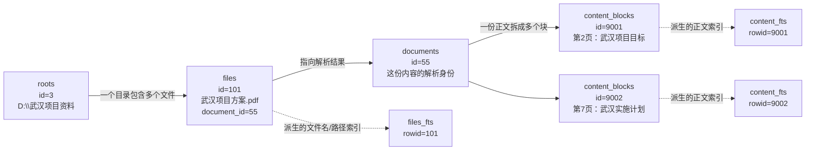

实线代表业务数据之间的归属关系；虚线代表为了快速搜索生成的派生索引。

### 三、`files`表：回答“这是什么文件”

真实表结构在`DatabaseManager._create_schema()`。`files`保存一条物理文件记录的身份和状态，例如：

```text
id                101
root_id           3
path              D:\武汉项目资料\武汉项目方案.pdf
filename          武汉项目方案.pdf
extension         pdf
size_bytes        文件大小
modified_time     修改时间
parse_status      success
document_id       55
```

它主要解决：

- 文件在哪里；
- 文件叫什么；
- 属于哪个索引目录；
- 大小和修改时间是否发生变化；
- 是否解析成功；
- 解析出的正文属于哪个`document`。

扫描阶段调用`upsert_file_metadata()`或`upsert_file_metadata_many()`写入或更新这里。`upsert`的含义是：不存在就插入，已经存在就根据新状态更新。

为什么不能只靠`content_blocks`保存文件？因为文件路径、大小、修改时间和解析状态属于整份文件；若每个正文块都重复一遍，100个块就重复100遍元数据。

### 四、`documents`表：回答“这是哪一份解析内容”

当前真实代码在`files`与`content_blocks`之间还有`documents`表。它保存一份解析结果的身份，例如内容指纹、解析器名称、解析器版本、解析状态和块数。

它主要用于正文去重和缓存复用。假设：

```text
D:\武汉项目资料\方案副本.pdf
E:\备份\方案副本.pdf
```

路径不同，所以`files`中有两条记录；如果内容完全相同并由同版本解析器处理，它们可以指向同一个`document_id`，无需把相同正文块解析和保存两遍。

所以：

```text
files代表“这个路径上的文件”
documents代表“这份可复用的解析内容”
```

### 五、`content_blocks`表：回答“文件的哪一部分说了什么”

解析器不会只把整份Word或PDF保存成一个超长字符串，而是产生多个`ContentBlock`。`_insert_content_block()`把每一个块写入`content_blocks`。

一个块包含：

- `block_index`：在文档中的顺序；
- `raw_text`：原始正文；
- `normalized_text`：为匹配准备的规范化正文；
- `page_number`：PDF或文档页码；
- `slide_number`：PPT页码；
- `sheet_name`、`cell_start`、`cell_end`：Excel位置；
- `source_type`、`ocr_confidence`：正文来源和OCR置信度。

业务价值是：搜索“武汉”后可以告诉用户“命中第7页”，只加载命中的局部正文生成摘要，而不是每次把整份大文件读进内存。

一份文件出现多条`content_blocks`是正常的。它表示一份文件被拆成多个可定位正文块，不表示结果列表一定显示多份文件。搜索阶段可以从多个命中块中选择最佳命中并按文件聚合。

### 六、`files_fts`：文件名和路径的快速候选索引

`files_fts`是SQLite FTS5虚拟表，主要索引：

```text
filename
path
```

扫描写入文件元数据后，`_upsert_file_fts()`同步这张索引表。搜索文件名“武汉”时，`SearchEngine._metadata_candidates()`优先执行：

```sql
files_fts MATCH ?
```

FTS先快速返回可能匹配的`file_id`，代码再连接`files`取得真实路径、扩展名、大小和状态，并做后续精确确认。

`files_fts`不是业务事实的唯一来源。真正的文件记录仍在`files`中；FTS损坏或规则改变时可以根据`files`重建。

### 七、`content_fts`：正文块的快速候选索引

`content_fts`主要索引：

```text
filename
path
location_text
normalized_text
```

每插入一个`content_blocks`正文块，`_insert_content_fts()`可以写入对应的FTS记录，`rowid`与`block_id`对应。

正文搜索“武汉”时，`SearchEngine._content_candidates()`的核心链路是：

```text
content_fts MATCH “武汉”
→ 得到候选block_id
→ JOIN content_blocks取得原文和页码
→ JOIN files取得文件名和路径
→ _matches()精确确认
→ 按文件匹配和排序
→ 构造SearchResult
```

FTS解决的是“从大量正文块中快速缩小候选范围”；`content_blocks`解决的是“候选块的真实正文、位置和OCR信息是什么”。

### 八、为什么不把四种数据合并成一张表

假设一份文件有100个正文块。如果全部合并：

1. 文件路径、大小、修改时间会重复100次；
2. 文件改名需要更新100行；
3. 很难区分真实正文与为了加速生成的FTS数据；
4. 同内容的两个文件无法方便复用同一解析结果；
5. 重建搜索索引时容易误伤真实业务数据；
6. 整篇正文放一行又无法准确返回页码、工作表和单元格。

当前分工可以记成：

```text
files          文件身份和元数据——“它是谁、在哪里”
documents      可复用解析结果——“这是哪份内容”
content_blocks 真实分块正文——“具体哪一段说了什么”
files_fts      文件名/路径的快速目录
content_fts    正文块的快速目录
```

这和图书馆类似：书本和目录卡不能合并。目录卡用来快速定位，找到编号后仍要回到书本读取真实内容。

### 九、对未来RAG有什么直接价值

RAG通常也不会只有一张“知识表”：

```text
source/document  保存资料身份
chunk            保存分块正文和位置
embedding index  保存向量检索结构
metadata filter  保存类型、目录、权限等过滤字段
```

当前项目的`files/documents/content_blocks/FTS`已经体现了RAG数据层的基本骨架。未来增加向量检索时，可以在`content_blocks`基础上增加embedding索引，而不必破坏文件身份和原始正文。

### 十、30秒面试表达

> 项目把文件身份、可复用解析结果、分块正文和全文倒排索引分开存储。files记录路径与解析状态，documents支持相同内容的解析复用，content_blocks保留页码等位置和原始正文；files_fts与content_fts只是可重建的候选索引。搜索先通过FTS缩小候选，再根据ID回表取得真实数据并精确确认。这样既减少元数据重复，也支持分页、命中定位、索引重建和未来接入向量检索。

### 十一、理解检查

1. `武汉项目方案.pdf`正文有100个块时，为什么`files`只适合保存一条文件记录，而`content_blocks`可以保存100条？
2. `content_fts`已经保存了可搜索文字，为什么搜索命中后还要回到`content_blocks`和`files`？

### 十二、为什么真实表里有文字，仍然需要FTS表

这五个名字逻辑上都属于同一个SQLite数据库中的表。其中前三个是普通业务表，后两个是SQLite FTS5虚拟表：

```text
普通表：files、documents、content_blocks
FTS虚拟表：files_fts、content_fts
```

`files`与`files_fts`看起来都出现了文件名和路径，但用途不同：

```text
files     保存真实文件记录，是事实来源
files_fts 把文件名和路径加工成适合全文查询的倒排目录
```

例如`files`保存：

```text
id=101，filename=武汉项目方案.pdf
```

FTS内部会建立近似“关键词片段 → 记录编号”的查找结构：

```text
武汉项 → 101
汉项目 → 101
项目方 → 101
```

实际内部格式由SQLite FTS5管理，不是应用手写上述三行。搜索时SQLite可以从关键词迅速定位101，而不必把`files`中的所有文件名逐行读取比较。

`content_blocks`与`content_fts`同理：

```text
content_blocks 保存原文、规范化正文、页码、OCR置信度等真实数据
content_fts    保存用于快速定位block_id的全文倒排目录
```

它们之间可以类比：

```text
files/content_blocks = 书本正文
files_fts/content_fts = 书后的关键词索引页
```

关键词索引页确实重复出现了一些词，但它的排列方式是为了“快速定位页码”，不是为了替代书本。FTS可以根据普通表重建；普通表不能因为FTS存在就删除。

#### 用同一份PDF逐列比较四张表

假设文件为`D:\武汉资料\武汉项目方案.pdf`，数据库分配`file_id=101`；PDF第7页的一段正文被分配`block_id=9002`。

##### `files`实际保存什么

`files`是一张普通业务表，示例行可以理解成：

```text
id               101
root_id          3
path             D:\武汉资料\武汉项目方案.pdf
filename         武汉项目方案.pdf
extension        pdf
size_bytes       5242880
modified_time    1791943200
document_id      55
parse_status     success
parser_name      pdf_parser
indexed_at       2026-10-14T10:00:00
is_deleted       0
```

它既保存可搜索的文件名和路径，也保存大量不参与全文匹配但业务必需的信息：属于哪个目录、文件大小、更新时间、解析状态、解析结果编号、是否删除等。

这些字段用于：

- 在UI显示文件详情；
- 按扩展名、目录、大小筛选；
- 判断文件是否变化、是否要重新解析；
- 排除解析失败或已经删除的文件；
- 从搜索结果打开真实文件。

##### `files_fts`实际保存什么

真实定义只有：

```text
file_id   UNINDEXED
filename  参与FTS索引
path      参与FTS索引
```

`UNINDEXED`表示`file_id`只用于把结果关联回`files`，不会被当作关键词搜索。

从应用视角看，写入的是：

```text
file_id = 101
filename = 武汉项目方案.pdf
path = D:\武汉资料\武汉项目方案.pdf
```

但SQLite FTS5在内部会进一步建立倒排结构。使用trigram时可以近似理解为：

```text
武汉项  → rowid 101
汉项目  → rowid 101
项目方  → rowid 101
目方案  → rowid 101
```

这是帮助理解的示意，实际分词、段表和位置表由SQLite FTS5管理。`files_fts`没有文件大小、解析状态、document_id等完整业务信息，所以命中101后必须`JOIN files`。

普通表直接查子串通常类似：

```sql
SELECT * FROM files WHERE filename LIKE '%武汉项目%';
```

数据库可能需要检查大量文件名。FTS查询是：

```sql
SELECT rowid FROM files_fts WHERE files_fts MATCH '武汉项目';
```

它利用预先建立的倒排目录直接缩小到相关rowid。

##### `content_blocks`实际保存什么

第7页正文块示例：

```text
id               9002
file_id          101
document_id      55
block_index      18
block_type       paragraph
location_text    第7页
page_number      7
raw_text         武汉项目将在十月份进入实施阶段。
normalized_text  武汉项目将在十月份进入实施阶段。
source_type      text
ocr_confidence   NULL
extra_json       {...}
created_at       2026-10-14T10:00:00
```

它保存的不只是可搜索文字，还保存结果展示与精确确认需要的原文、页码、顺序、类型、OCR来源和置信度。`raw_text`用于展示上下文，`normalized_text`用于统一规则后的匹配。

##### `content_fts`实际保存什么

真实定义包含：

```text
block_id         UNINDEXED
file_id          UNINDEXED
filename         参与FTS索引
path             参与FTS索引
location_text    参与FTS索引
normalized_text  参与FTS索引
```

示例写入：

```text
block_id = 9002
file_id = 101
filename = 武汉项目方案.pdf
path = D:\武汉资料\武汉项目方案.pdf
location_text = 第7页
normalized_text = 武汉项目将在十月份进入实施阶段。
```

SQLite内部可以近似理解为建立：

```text
武汉项 → block 9002
汉项目 → block 9002
项目将 → block 9002
实施阶 → block 9002
```

`content_fts`没有完整的`raw_text`展示语义、页码数值、block_type、OCR置信度和其他业务字段。它命中9002后，程序仍需要回到`content_blocks.id=9002`读取可靠的完整信息。

##### “重复存一遍”换来了什么

确实存在有意的数据重复：文件名、路径和规范化正文同时出现在普通表与FTS表中。这个重复换来的是检索速度和职责分离：

```text
普通表按对象组织数据：给定file_id/block_id，取出完整事实
FTS按关键词组织数据：给定关键词，快速找出file_id/block_id
```

两种访问方向正好相反：

```text
files/content_blocks：编号 → 完整信息
files_fts/content_fts：关键词 → 编号
```

例如UI要打开文件101，直接查`files.id=101`，不需要FTS；用户输入“武汉项目”但不知道编号时，先查FTS获得101或9002。

##### 更新时怎样保持一致

新增或修改文件元数据时，`_upsert_file_fts()`会先删除旧FTS行，再按照`files`中的新文件名和路径插入FTS行。正文解析完成时，`_insert_content_block()`写真实正文块，`_insert_content_fts()`再写对应的快速目录记录。

因此普通表是事实来源，FTS是同步生成的派生数据。如果FTS结构需要更换分词规则，可以根据普通表重建；反过来不能只依靠FTS恢复全部文件业务状态和正文定位信息。

#### 容易混淆：正文分块不等于FTS分词

正文进入检索系统时经历两种不同的“切分”：

```text
解析器分块：整份PDF → 多个content_blocks
FTS分词：每个block的normalized_text → trigram等搜索词元
```

解析器分块的目的是保存页码、段落、工作表等业务位置，产生`block_id`；FTS分词的目的是建立“词元到block_id”的倒排目录，不会再产生新的业务正文块。

FTS召回也不宜表述成“准确率很低”。更准确的说法是：FTS负责快速、尽量完整地找出可能命中的候选，候选不等于最终结果；项目随后通过`_matches()`按照精确、all、any或正则等规则确认。前者偏向查全率和速度，后者保证项目定义下的查准率。

精确确认通常读取`content_blocks`中已经保存的`raw_text`或`normalized_text`，而不是重新打开原始PDF。只有索引构建阶段的解析器需要读取PDF；正常搜索阶段主要读取已发布SQLite快照。

### 十三、召回和精确匹配是否调用两次DatabaseManager搜索

不是。准确分工是：

```text
DatabaseManager：提供一个安全的只读SQLite连接
SearchEngine：在这条连接上组织召回、精确确认、合并、排序和分页
```

`SearchEngine.search()`先调用一次`db.connect_read_only()`，并在同一连接上开启事务快照。随后：

```text
第1阶段：候选召回
SearchEngine执行FTS MATCH或LIKE SQL
→ SQLite返回可能命中的file_id/block_id

第2阶段：补齐真实数据（只在需要时）
SearchEngine仍使用同一连接，根据ID读取files/content_blocks

第3阶段：精确匹配
SearchEngine._matches()读取候选行中的raw_text/normalized_text
→ 在Python中用in、all、any或正则确认
```

所以“召回”和“精确匹配”是一次`SearchEngine.search()`中的两个算法阶段，不是调用两次`DatabaseManager.search()`；实际上`DatabaseManager`没有负责整套搜索的`search()`方法。一次搜索可以在同一数据库连接上执行多条SQL，但这不等于创建了两个Manager或启动了两次搜索任务。

## 第十一章：DatabaseManager第三课——事务、WAL、快照和写入串行化

### 一、先解释专业名词

| 名词 | 简单含义 | 当前项目中的作用 |
| --- | --- | --- |
| 事务（transaction） | 把多条数据库修改当成一个不可分割的业务动作 | 文件、document、正文块和FTS要么一起成功，要么一起撤销 |
| 提交（commit） | 正式确认本次事务的所有修改 | `connect()`正常退出时调用`con.commit()` |
| 回滚（rollback） | 事务失败时撤销本次尚未提交的修改 | `connect()`捕获异常后调用`con.rollback()` |
| 锁（lock） | 控制多个任务不能同时修改同一资源 | 同一个SQLite文件的写操作进入同一把写锁 |
| 串行化 | 原本可能同时发生的多个写任务依次执行 | 写任务A结束后，写任务B才能进入数据库事务 |
| 并发读取 | 多个读取任务可以在相近时间进行 | 多次搜索可以分别获得只读连接 |
| WAL | Write-Ahead Logging，修改先追加到`-wal`日志，再检查点合并回主数据库 | 降低普通读写互相阻塞，并提供提交边界 |
| checkpoint | 把已经提交的WAL内容整理回主`.db`文件 | 初始化和维护阶段使用`wal_checkpoint` |
| 快照（snapshot） | 一次操作持续看到同一个已提交数据版本 | 一次搜索的文件名查询、正文查询、计数与分页不混用不同版本 |
| 线程安全 | 多线程同时运行时，共享状态不会被竞争破坏 | 写锁、活动连接集合锁、每个线程使用自己的连接 |

### 二、为什么索引一个文件必须使用事务

假设后台正在保存`武汉项目方案.pdf`，需要完成：

```text
1. 更新files记录
2. 创建或更新documents记录
3. 写入100条content_blocks
4. 写入对应content_fts
5. 把parse_status改为success
```

如果第60个正文块写入时程序异常，而前59块已经永久生效，会形成半成品：文件可能显示`success`，搜索却只能找到前半部分；或者正文块存在但FTS目录没有同步。

`DatabaseManager.connect()`把`with`内部修改包成一个事务：

```python
with self.connect() as con:
    # 多条INSERT/UPDATE/DELETE
    ...
# 正常离开with：commit
# 中途抛异常：rollback
```

它的真实控制流程是：

```text
申请同一数据库的写锁
→ 打开sqlite3.Connection
→ yield连接给业务方法执行多条SQL
→ 正常：commit，所有修改一起生效
→ 异常：rollback，本次修改一起撤销
→ finally：关闭连接并释放写锁
```

例如`replace_document_blocks_many()`把一批正文块、搜索投影状态等修改放在同一个`with self.connect()`中。事务保护的是业务完整性，不只是避免报错。

超大文档是一个特殊情况：如果数万块全部放进一个事务，会长时间占住SQLite写入口。`replace_document_blocks_chunked()`会把正文先分批写入一个尚未与用户文件关联的staging document，每批使用短事务；只有所有块都安全落盘后，才在最终事务中把`files.document_id`切换过去。中途失败可能留下待清理的staging数据，但用户仍然指向旧的完整document，不会看到半份新正文。这是“数据库事务较短，但业务可见切换仍保持原子性”。

### 三、为什么同一个数据库只允许一个写任务进入

SQLite同一数据库文件在一个时刻只允许一个写者。项目可能同时出现：

```text
索引写正文块
搜索历史写入关键词
失败页修改排除状态
后台维护统计
```

如果每个线程直接`sqlite3.connect()`后同时写，SQLite会竞争写锁，频繁出现`database is locked`，甚至使任务长时间互相等待。

项目按数据库绝对路径维护`threading.RLock`：

```text
index_control.db       → 写锁A
gen-000042.building.db → 写锁B
```

写同一个文件的任务依次进入；写不同数据库文件的任务不必争夺同一把全局锁。这就是“按资源串行，而不是把整个程序串行”。

写锁不等于QThread。QThread决定代码在哪个执行线程运行；DatabaseManager写锁决定多个线程谁可以先修改同一SQLite文件。

### 四、WAL是什么，解决什么业务问题

传统模式下，写数据库时读者和写者更容易互相阻塞。WAL模式把新修改先追加到旁边的日志文件：

```text
index_control.db      主数据库
index_control.db-wal  已提交但尚未全部合并回主库的新页面
index_control.db-shm  读写协调的共享内存索引
```

可以简化理解为：

```text
读者继续读旧的稳定页面
写者把新修改追加到WAL
事务commit后，新读者可以看到新版本
checkpoint再把WAL整理回主数据库
```

WAL的价值是提高普通读写并发能力，但它不是备份，也不代表允许多个写者同时提交；“一个数据库一个写者”的约束仍然存在。

项目在`DatabaseManager.initialize()`中执行：

```python
con.execute("PRAGMA journal_mode = WAL")
```

不能在程序运行时随意删除`-wal`文件，因为其中可能还有已经提交、尚未检查点合并回主库的数据。

### 五、搜索为什么需要同一个只读事务快照

一次搜索并不只有一条SQL，它可能依次执行：

```text
查文件名候选
查正文候选
补齐正文原文
统计确认数量
进行分页
```

如果每一步各自打开连接，而数据库恰好在中间更新：

```text
第1步看到版本A有47个文件
索引提交版本B，增加3个文件
第2步看到版本B有50个文件
```

同一次搜索的总数、分页和结果就可能互相矛盾。

`SearchEngine.search()`因此只打开一次只读连接，并开启一次读取事务：

```python
with self.db.connect_read_only() as connection:
    connection.execute("BEGIN")
    self._snapshot_connection = connection
    result = self._search_impl(...)
```

后续候选查询、回表和计数尽量复用`_snapshot_connection`，从同一个已提交视图读取。这里的`BEGIN`不是“开始修改数据库”，而是开始一次一致的读取事务。

### 六、WAL快照与generation快照是什么关系

二者解决层级不同：

```text
WAL/事务快照：同一个SQLite文件内部如何保持一致读写
generation快照：让搜索和下一轮索引使用两个物理数据库文件
```

当前业务场景：

```text
SearchWorker搜索 gen-000041.db（已发布、只读）
ScanWorker写 gen-000042.building.db（候选库）
```

它们是两个文件，因此搜索不会读到候选库的半成品。generation是第一层物理隔离；每个文件内部仍使用事务、WAL和连接规则保证自身完整性。

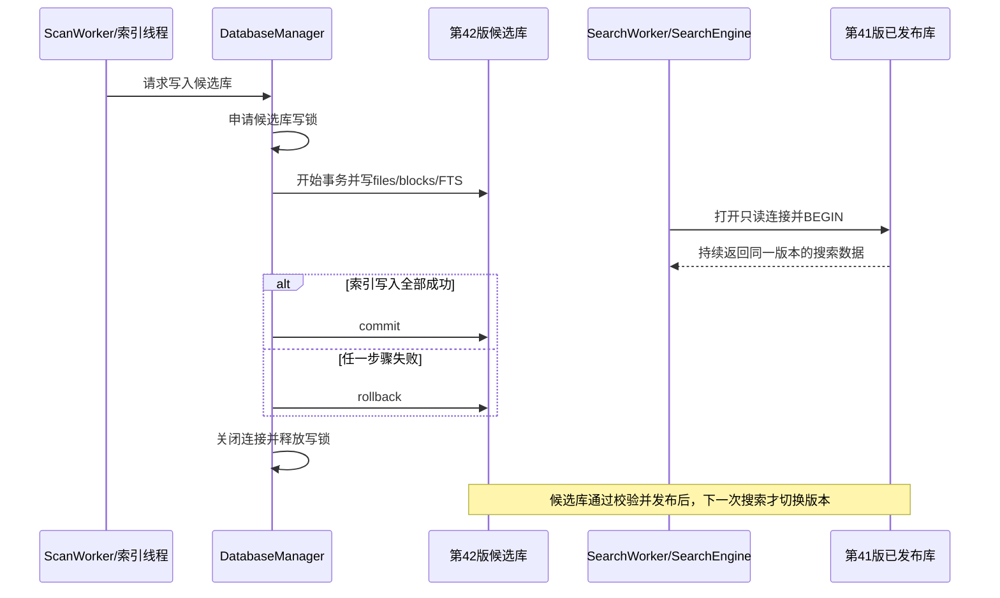

### 七、线程安全具体体现在哪里

1. `DatabaseManager`不把一条SQLite连接永久共享给所有线程，而是在执行操作的线程内打开短生命周期连接。
2. `_DATABASE_WRITE_LOCKS`按数据库路径给写事务排队。
3. `_active_connections`集合由`_connections_lock`保护，避免取消线程与搜索线程同时修改集合。
4. 搜索使用只读连接，`mode=ro`和`PRAGMA query_only=ON`双重禁止写入已发布快照。
5. `finally`无论成功、失败还是取消都关闭连接、释放写锁。

线程安全不等于完全没有并发，而是：允许安全的并发读取，把会冲突的同库写入有序化，并保证资源最终释放。

### 八、为什么这样设计以及可复用原则

解决的业务问题：

- 索引一个文件失败时不留下半份正文；
- `files`、`content_blocks`和FTS保持同步提交；
- 多个后台任务不会同时争抢同一个SQLite写入口；
- 一次搜索的候选、总数和分页来自同一数据版本；
- 后台建立新索引时，用户继续搜索上一份完整版本。

可复用原则：

> 先识别一个业务动作必须共同成功的修改，把它们放进同一事务；同一资源的写入串行化，读取固定到同一快照；大版本更新则在新副本完成后原子切换。

这套原则也适用于RAG：同一批chunk和embedding必须共同发布；如果向量只写了一半，不能把新知识库切给在线问答。

### 九、30秒面试表达

> 项目通过DatabaseManager统一管理SQLite事务和并发。写操作按数据库路径取得进程内可重入锁，并在上下文管理器中执行，正常时commit、异常时rollback。数据库采用WAL提高同一个可写数据库内部的读写并发；更高层再用不可变generation隔离在线搜索与后台索引。当前generation主路径中，已发布库本身不会变化，读事务不是防止候选库干扰搜索的必要条件；它主要统一一次搜索中多条SQL的读取边界，并兼容旧数据库路径和未来可能出现的可变数据源。

### 九点五、既然索引库与搜索库已经分开，为什么仍需要WAL

先区分三个实际数据库角色：

```text
已发布库 gen-000041.db：搜索读取，只读且不可变
候选库 gen-000042.building.db：本轮索引持续写入，也可能被状态检查读取
控制库 index_control.db：目录范围、USN检查点、搜索历史和管理状态持续读写
```

对于已发布库，generation物理隔离已经消除了“索引写入与搜索读取同一个文件”的主要冲突。它被封存后，搜索阶段确实不依赖WAL来协调后台索引写入；这里generation承担了最重要的隔离作用。

但应用中另外两个可写数据库仍然有内部并发：

- 候选库正在写正文块时，索引状态、失败页或完整性检查可能需要读取已经提交的数据；
- 控制库可能同时被UI读取目录、扫描任务更新状态、搜索历史Worker写入关键词、USN逻辑更新检查点。

WAL解决的是“同一个可写SQLite文件内部，读者与写者怎样较少互相阻塞”；generation解决的是“在线搜索与下一轮索引怎样使用不同物理版本”。即使没有并发搜索，候选库和控制库仍需要事务日志、崩溃恢复和提交边界。WAL不是generation的替代品，generation也不能替代每个数据库内部的事务机制。

### 九点六、事务快照到底是什么

事务快照不是把整个数据库复制一份文件。它是SQLite在一次读取事务期间提供的“固定观察视角”。

假设同一个数据库开始时有47条结果：

```text
时间T1：搜索连接BEGIN，并第一次读取，看到47条
时间T2：另一个连接commit了3条新数据，数据库最新状态变成50条
时间T3：原搜索连接继续执行第二、第三条SELECT，仍按T1视角看到47条
时间T4：搜索事务结束
时间T5：下一次新搜索开始，可以看到50条
```

它不是禁止别人提交，而是让当前读者保持一致。WAL中可以同时保留读者需要的旧页面和写者提交的新页面，因此旧读取事务继续看旧视角，新读取事务看新视角。

当前generation已发布库本身不可变，因此要把结论说准确：

> 在当前generation主路径中，即使不执行`BEGIN`，候选索引也不可能把正在搜索的`gen-N.db`改成另一版。真正隔离搜索和索引的是两个物理文件，而不是这个读事务。

代码仍保留事务快照，是因为`SearchEngine`不只服务于这一种调用环境：

1. 明确规定一次搜索的多条SQL属于同一次一致读取；
2. `SearchWorker.run()`在没有找到已发布generation时，会退回原始`self.db_path`，这条兼容路径未必不可变；
3. `SearchEngine`以后被CLI、测试或别的入口复用，并连接可写数据库时，不必重新补一致性规则；
4. 一次搜索复用同一连接，也减少反复建连，并让取消时可以明确中断这一组SQL。

所以它在当前主路径中属于“统一契约和防御性保护”，不是“防止generation在搜索中改变”的第一道防线。删掉它在当前不可变库上通常不会造成版本漂移，但会削弱`SearchEngine`面对其他数据源时的通用保证。

两个“快照”可以这样区分：

| 对比项 | 事务快照 | generation快照 |
| --- | --- | --- |
| 形态 | 同一数据库中的固定读取视角 | 一个独立的物理SQLite文件 |
| 生命周期 | 一次搜索连接/事务期间 | 从发布到退休清理期间 |
| 解决问题 | 多条SQL看到同一提交点 | 搜索绝不读取正在构建的半成品版本 |
| 是否复制整个库 | 否 | 是一份独立发布数据库 |

### 九点七、WAL在磁盘上到底是什么

WAL不是另一份可供业务查询的数据库。SQLite启用WAL后，数据库打开和写入期间，通常会在主文件旁边自动维护三个文件：

```text
gen-000042.building.db       候选数据库主文件
gen-000042.building.db-wal   二进制预写日志，保存尚未checkpoint回主文件的已修改页面
gen-000042.building.db-shm   WAL索引和读写协调信息
```

控制库同样可能出现`index_control.db-wal`和`index_control.db-shm`。它们的特点是：

- `-wal`不是本项目定义的表，也不能单独交给`DatabaseManager`查询；
- `-shm`不是业务数据表，而是SQLite用于快速定位WAL页面和协调连接的辅助文件；
- 它们可能只在数据库打开或尚未完成checkpoint时存在，关闭或checkpoint后可能缩小、清空或消失；
- 已经commit但还没checkpoint的数据，可能主要位于`-wal`中，但SQLite会把主文件和WAL合起来呈现为一份完整数据库；
- 数据库仍打开时，不能只复制主`.db`而忽略它旁边的WAL文件，否则可能漏掉已提交的数据。

`DatabaseManager.initialize()`在`core/database.py`的`initialize()`中执行`PRAGMA journal_mode = WAL`。候选库正式发布前，`IndexGenerationStore._seal_candidate_database()`会执行`wal_checkpoint(TRUNCATE)`，再切回`journal_mode=DELETE`。也就是说，正式generation会先把WAL中的结果收回主文件并封存，再交给搜索。

可以把它记成：

```text
事务决定“一组修改是否共同成功”
WAL决定“SQLite用什么日志方式安全记录这些事务”
checkpoint决定“何时把WAL中的已提交页面整理回主db”
generation决定“哪一个完整db版本对搜索可见”
```

### 九点八、候选库中四种情况对应什么真实业务

#### 场景一：写到一半程序崩溃

真实业务例子：索引`武汉项目验收报告.pdf`，解析出了100个正文块，数据库正在写第60个时，用户强制结束程序、Windows关机、磁盘写入报错，或者PDF/OCR组件导致进程退出。

普通文件会通过`DatabaseManager.replace_document_blocks_many()`进入一个`connect()`事务。`connect()`正常结束才`commit`，抛出异常则`rollback`。如果整个进程突然消失，SQLite重开时会利用主库和WAL识别事务边界：已经完整commit的事务保留，没有完整commit的本次事务不会被当成成功数据。

业务结果不是“正式索引里留下前59块”，而是：

```text
已发布 gen-N.db：完全不受影响，用户继续搜索旧的完整版本
候选 gen-(N+1).building.db：本次未提交事务不生效，候选也不会通过发布检查
```

超大文件还有一层保护：`replace_document_blocks_chunked()`先把多批正文写进一个尚未和`files`关联的staging document，全部写完后才切换文件关系。中途崩溃即使已经提交了几个小批次，用户也看不到半份新正文；下一次初始化由`cleanup_orphan_staging_documents()`清理孤立暂存数据。

#### 场景二：写正文块时，状态检查正在读取

这里的“读取者”不是在线搜索。在线搜索仍只读已发布generation。

真实读取者是管理界面的索引状态/失败文件页面：

1. `ScanWorker.run()`创建`gen-(N+1).building.db`并持续写入文件状态、解析任务和正文；
2. `DatabaseSnapshotWorker.run()`调用`generation_store.building_candidate()`找到正在建设的候选库；
3. `collect_live_candidate_failure_snapshot()`以只读方式读取候选库中已经commit的`pending`、`processing`、`failed`等状态；
4. 它自己执行`BEGIN`，保证失败总数、当前页和“全选ID”来自同一个观察点。

例如，索引任务刚把A.pdf的失败状态commit，界面刷新便可以看到A；与此同时写入线程继续处理B.docx。WAL允许读者继续读一个稳定的已提交视角，写者把下一次修改追加到WAL。读者不会看到B写到一半的字段，也不会让界面去读取尚未commit的数据。

#### 场景三：多个索引任务需要依次写入

这里的“多个索引任务”主要是同一轮扫描中并行解析的多个文件，不是说用户一定同时启动了多轮全盘扫描。

例如PDF解析任务和Word解析任务几乎同时完成：

```text
PDF解析结果 ─┐
             ├─> IndexWriter队列 ─> 一批一批写同一个候选库
Word解析结果 ─┘
```

`IndexWriter.submit()`把解析产物放进有界队列；它内部只有一个`lfts-index-writer`线程执行`_run()`和`_flush()`，因此并行解析结果不会各自随意写SQLite。再往下，`DatabaseManager.connect()`按照数据库绝对路径取得`RLock`。即使有其他写入口，同一个候选数据库也只能依次进入写事务；控制库和候选库是不同路径，使用不同的锁，不会被一把全局锁无故串在一起。

为什么还需要串行：WAL提高“一个写者与多个读者”的并发，不会让SQLite变成“多个写者同时提交”。因此本项目采用“解析可以并行，落库集中排队”的通用模式。

#### 场景四：本批正文与FTS必须保持一致

以`武汉项目验收报告.pdf`中的正文块“项目于10月验收完成”为例：

- `content_blocks`有正文，但`content_fts`没有对应索引：用户搜“验收”时召回不到这段，产生漏检；
- `content_fts`有索引，但`content_blocks`没有对应原文：FTS召回了`block_id`，回表时却找不到正文，形成悬空结果。

普通小批次在`replace_document_blocks_many()`的同一个`connect()`事务中调用`_replace_document_item()`；后者先`_insert_content_block()`取得`block_id`，再用同一个ID调用`_insert_content_fts()`。两者要么一起commit，要么一起rollback。

当前项目为了避免大文件长时间占住SQLite，还支持延迟FTS。这不是放弃一致性，而是把一致性边界提高到“发布”阶段：

1. 大批正文先提交，并把`content_fts_dirty`标记为`1`；
2. `IndexWriter`记录需要补建FTS的文件，后续用较短事务同步；
3. readiness检查发现`content_fts_dirty`或`projection_incomplete`时，禁止候选库发布；
4. 只有正文、FTS和投影状态全部就绪，`ScanWorker`才能调用`generation_store.publish()`。

因此精确说法是：普通批次让正文和FTS在同一事务中原子提交；超大或延迟批次允许分阶段落库，但不允许一个正文与FTS不一致的候选版本成为正式搜索版本。

### 十、理解检查

1. 写100个正文块时，第60个发生异常，事务应该保留前59个还是全部撤销？为什么？
2. WAL事务快照和generation快照分别解决“同一个数据库文件内部”还是“两个索引版本之间”的问题？

## 第十二章：DatabaseManager第四课——搜索怎样使用DatabaseManager

本课只讲搜索侧，不展开索引写入侧。需要先纠正一个容易产生的误解：

> 当前代码中并不是`DatabaseManager.search("武汉")`。`SearchEngine`决定查什么、生成什么SQL以及怎样匹配；`DatabaseManager`负责安全地提供数据库连接和数据库就绪信息。

### 一、这两个模块各解决什么问题

可以把它们理解成：

```text
SearchEngine：检索业务负责人
决定搜文件名、路径还是正文，使用FTS还是LIKE，怎样精确确认、合并、排序和分页

DatabaseManager：SQLite访问网关
决定打开哪个文件，怎样只读连接，怎样关闭和中断连接，数据库投影是否已经可以搜索
```

所以关键词“武汉”主要由`SearchEngine`处理。`DatabaseManager`一般不需要理解“武汉”是什么，只负责让Engine安全读到数据库。

### 二、真实函数调用链

用户默认搜索“武汉”时，`SearchQuery`的三个来源开关都是`True`，因此同时搜索文件名、路径和正文：

```text
SearchWorker.run()
→ DatabaseManager(已发布generation路径, read_only=True)
→ SearchEngine(db)
→ SearchEngine.search(SearchQuery(text="武汉"))
→ db.connect_read_only()
→ SearchEngine._search_impl()
   → 判断索引是否可搜索
   → _metadata_query()生成文件名/路径SQL
   → _content_query()生成正文SQL
   → _stream_rows()使用只读连接执行SQL
   → _matches()读取真实文字精确确认
   → _row_to_result()转换成SearchResult
   → _merge_result()按file_id合并同一文件的多个命中
   → _build_page()排序并生成SearchPage
```

这里可以分成三个阶段：

```text
生成SQL：_metadata_query()、_content_query()
执行SQL：_stream_rows()通过DatabaseManager提供的连接执行
处理结果：_matches()、_row_to_result()、_build_page()
```

### 三、第一步：DatabaseManager只负责把“数据库门”打开

`SearchEngine.search()`中的核心代码位于`core/search_engine.py`：

```python
# 请DatabaseManager打开一条只读连接。
with self.db.connect_read_only(timeout_seconds=2.0) as connection:
    # 给本次完整搜索建立统一读取边界。
    connection.execute("BEGIN")

    # 保存连接，后面的文件名查询、正文查询和回表都复用它。
    self._snapshot_connection = connection

    # 开始执行真正的检索业务。
    result = self._search_impl(query, token, ...)
```

`DatabaseManager.connect_read_only()`负责：

```text
用mode=ro打开SQLite
→ 设置query_only，禁止写入
→ 设置Row类型、缓存和超时
→ 登记活动连接，方便取消时interrupt
→ 把connection交给SearchEngine
→ 搜索结束后在finally中关闭连接
```

注意：到这里还没有决定用FTS还是LIKE。DatabaseManager只把安全的数据库访问能力交给Engine。

### 四、第二步：SearchEngine根据SearchQuery生成SQL

`_search_impl()`先调用`_source_flags(query)`。默认的`SearchQuery(text="武汉")`相当于：

```python
search_filename = True
search_path = True
search_content = True
```

因此会生成两组查询。

#### 文件名和路径查询

`_metadata_query()`负责生成文件名/路径SQL。因为“武汉”只有两个汉字，当前trigram FTS通常不能直接使用，所以会形成类似条件：

```sql
LOWER(f.filename) LIKE '%武汉%'
OR LOWER(f.path) LIKE '%武汉%'
```

如果关键词是适合trigram的“武汉市”，则可能改用：

```sql
files_fts MATCH ?
```

`_metadata_query()`此时并不访问数据库，只返回三个值：

```python
sql, params, strategy
```

- `sql`：准备执行的SQL模板；
- `params`：需要安全绑定进去的关键词和筛选条件；
- `strategy`：本次使用`fts_match`、`like`还是`scan`，用于进度提示和诊断。

#### 正文查询

`_content_query()`负责正文候选SQL。搜索“武汉”时，已发布压缩快照会对`search_blocks.raw_text`进行兼容候选过滤；适合FTS的关键词则先查询`content_fts`，取得可能命中的`block_id`，再关联正文块和文件：

```text
content_fts找到候选block_id
→ 关联search_blocks/content_blocks取得正文块
→ 关联files取得文件名、路径、大小等信息
```

为什么SQL由SearchEngine生成？因为是否搜索正文、是否包含OCR、扩展名、目录、日期、大小和匹配模式，都属于`SearchQuery`表达的检索业务规则，而不是数据库连接规则。

### 五、第三步：`_stream_rows()`才真正执行SQL

`_metadata_query()`和`_content_query()`只是“写好取数方案”；`_stream_rows()`才执行：

```python
# 取得search()之前保存的同一个只读连接。
connection = self._snapshot_connection

# 执行Engine生成的SQL和参数。
cursor = connection.execute(sql, params)

# 每次最多取512行，避免一次把大量候选全部装入内存。
rows = cursor.fetchmany(512)
```

它还给SQLite设置取消检查。用户点击停止后，`CancelToken`或`connection.interrupt()`可以让耗时SQL尽快退出。

输入：

```text
SQL + 参数 + CancelToken
```

输出：

```text
一批一批的sqlite3.Row候选记录
```

这些行还不是最终`SearchResult`。

### 六、第四步：候选为什么还要经过`_matches()`

候选召回目标是“尽量不要漏掉可能命中的内容”，最终结果要求“真实文字确实符合SearchQuery”。因此`consume()`会继续调用：

```python
if self._matches(row, normalized_terms, query, regex_pattern, token):
    result = self._row_to_result(...)
```

以“武汉”为例：

```text
SQL/FTS阶段：快速找出可能含有“武汉”的文件或正文块
_matches阶段：读取raw_text或normalized_text，确认真的包含“武汉”
_row_to_result阶段：生成上下文、分数、位置和SearchResult
```

同一份PDF可能在文件名和第2页、第10页都命中。`_merge_result()`用`file_id`把它们合并成一条文件结果，并保存多个命中位置；最后`_build_page()`排序和分页。

### 七、为什么不把这些全部写成`DatabaseManager.search()`

如果全部合并进去，DatabaseManager会同时负责：

```text
SQLite连接、事务、迁移、WAL
+ 关键词模式、OCR规则、候选召回
+ 精确确认、评分、合并、分页
```

这样会产生三个直接问题：

1. 增加一种搜索模式，也要修改负责事务和迁移的大类；
2. 测试匹配排序时，很难绕开大量数据库管理职责；
3. 将来增加向量召回或混合RAG时，连接管理和检索算法会缠在一起。

当前分层带来的业务便利是：

- 调整SQLite只读、超时或取消机制，主要修改DatabaseManager；
- 调整FTS/LIKE选择、匹配规则或排序，主要修改SearchEngine；
- SearchWorker仍只负责让这套同步检索在后台线程运行。

不过也要诚实看到边界：当前`SearchEngine`会直接生成SQLite SQL，所以它仍然了解表结构，并不是完全与SQLite解耦。如果未来引入向量库、关键词库和重排模型三种数据源，可以进一步抽出`SearchRepository`或`CandidateRetriever`。当前项目规模下没有为了层数而提前增加这一层。

### 八、场景记忆和面试表达

场景口诀：

> Manager开门并看管连接，Engine写查询方案并判断结果，Query携带本次搜索条件。

30秒表达：

> 用户搜索“武汉”时，SearchWorker先为当前已发布generation创建只读DatabaseManager，再交给SearchEngine。DatabaseManager统一提供只读连接、超时、关闭和取消中断；SearchEngine根据SearchQuery生成文件名和正文候选SQL，通过同一连接分批读取，再对真实文本精确确认，按file_id合并、排序并分页。这样数据库资源管理与检索业务规则分开，后续调整搜索算法不会影响事务和连接生命周期。

### 九、理解检查

1. `DatabaseManager`会直接接收“武汉”并决定使用FTS还是LIKE吗？真正由哪个函数决定？
2. `_metadata_query()`返回SQL后，真正在哪个函数里通过数据库连接执行？

### 十、补充：为什么DatabaseManager有九千多行

`core/database.py`当前约9018行，`DatabaseManager`从约358行开始，拥有约169个方法。原因不是“打开SQLite本来就需要九千行”，而是这个类已经不只是连接管理器，而是同时扮演了数据库门面、多个Repository和部分索引业务Service。

按真实代码大致可以分成：

| 代码范围 | 实际职责 | 代表函数 |
| --- | --- | --- |
| 连接与事务 | 打开读写连接、锁、重试、中断、commit/rollback | `connect()`、`connect_read_only()`、`interrupt_active_connections()` |
| 建表和升级 | 创建schema、版本迁移、FTS结构升级和备份恢复 | `initialize()`、`_create_schema()`、`_migrate_schema_v3()`到`v10()` |
| 目录和文件 | 管理根目录、文件元数据、ZIP成员、删除和移动 | `add_root()`、`upsert_file_metadata_many()`、`sync_zip_members()` |
| 文档和正文 | 文档复用、正文分块、暂存文档、垃圾清理 | `find_cached_documents()`、`replace_document_blocks_many()` |
| 搜索投影 | 写入、同步和重建files/content FTS及统计投影 | `_insert_content_fts()`、`sync_content_fts_for_files()`、`rebuild_content_fts()` |
| 索引任务 | parse task、索引run、心跳、进度、失败恢复 | `create_parse_tasks()`、`start_index_run()`、`reconcile_stale_parse_tasks()` |
| USN增量索引 | 保存检查点、目录变化和增量状态 | `load_usn_checkpoint()`、`save_usn_checkpoint()`、`import_usn_state()` |
| 管理和诊断 | 失败文件、排除、完整性、readiness和统计 | `failed_snapshot()`、`index_readiness()`、`search_projection_readiness()` |
| 搜索历史 | 保存、读取和清除用户关键词 | `add_search_history()`、`search_history()`、`clear_search_history()` |

早期这样集中有现实好处：

1. 项目快速形成时，所有SQLite规则集中，调用方只需要使用一个对象；
2. `files`、`documents`、`content_blocks`、FTS和任务状态经常需要在同一个事务里一起修改；
3. schema和业务写入放得近，较容易保证字段与SQL同步；
4. 不必一开始创建很多小类，降低了原型开发成本。

但现在它已经表现出典型的“大类”问题：

1. 修改搜索历史和修改正文索引是完全不同的原因，却都要改同一个文件；
2. 新人很难从169个方法中找到真正调用链；
3. 单元测试某一项能力时，容易依赖完整数据库schema；
4. 多人开发容易在同一个文件产生合并冲突；
5. 一个迁移、索引任务或状态修复的改动可能意外影响其他数据库功能。

所以正确结论不是“分层越细越好”，也不是“九千行都应该保留在一起”，而是：

> 当前DatabaseManager是一个已经长大的数据库门面。连接和事务规则集中是合理的，但目录、文件、文档、索引任务、就绪检查、搜索历史等不同变化原因，未来适合逐步拆成职责明确的组件。

可能的演进结构：

```text
SQLiteConnectionManager   连接、事务、WAL、重试、中断
SchemaMigrator            建表、版本升级、备份恢复
RootRepository            搜索目录
FileRepository            文件元数据
DocumentRepository        documents和content_blocks
IndexTaskRepository       parse_tasks和index_runs
SearchProjectionService   FTS和搜索投影
IndexReadinessQuery       完整性、统计和发布门禁
SearchHistoryRepository   搜索历史
```

拆分时不能简单按行数剪文件。比如“保存一个解析完成的PDF”需要同时修改document、content blocks、FTS和task状态，这些修改仍必须共享同一个事务。合理方式是让上层索引服务开启一次事务，再把同一`connection`交给各Repository，而不是每个小类各自commit。

面试时可以这样评价：

> 这个项目早期使用DatabaseManager统一SQLite访问，便于快速保证事务和schema一致性。随着索引任务、文档缓存、FTS投影、失败恢复和管理查询持续加入，它已经演变成约九千行的数据库门面，具有Large Class或God Object倾向。连接与事务应继续集中，但可以按Root、File、Document、IndexTask和Projection等业务边界逐步拆分，同时由应用服务维持跨表事务，不能为了减小文件而破坏原子性。

## 第十三章：DatabaseManager索引侧——解析结果怎样写入候选库

本课只跟踪一份文件从“被扫描发现”到“正文和FTS提交”的过程。

### 一、先认识四个角色

| 角色 | 解决的问题 | 不负责什么 |
| --- | --- | --- |
| `scanner.iter_files()` | 遍历目录，发现文件路径 | 不解析正文、不写数据库 |
| `IndexManager` | 规划任务、调度不同解析通道、接收解析结果 | 不让每个解析进程直接修改SQLite |
| `IndexWriter` | 将并行完成的解析结果排队、合批，交给唯一写入通道 | 不定义files/documents等表的持久化细节 |
| `DatabaseManager` | 用事务把文件、文档、正文、FTS和任务状态安全写入候选库 | 不解析PDF、Word或Excel |

可以把它们记成：

```text
Scanner找原材料
→ Parser加工内容
→ IndexWriter排队收货
→ DatabaseManager按数据库规则入库
```

### 二、真实业务例子：索引“武汉项目验收报告.pdf”

#### 第一步：扫描得到文件路径

`core/scanner.py`的`iter_files()`遍历用户选择的目录，排除隐藏文件、排除目录和不需要的文件模式，然后产出：

```python
Path("D:/资料/武汉项目验收报告.pdf")
```

它只负责“发现这个文件存在”。

#### 第二步：先登记文件身份

`DatabaseManager.upsert_file_metadata_many()`读取文件大小、修改时间等信息，并在一个写事务中调用`_upsert_file_metadata_in_connection()`。

输出中最重要的是：

```text
file_id：数据库给这条文件路径分配的身份ID
changed：文件相对旧索引是否发生变化
```

如果文件没变，可以复用旧解析结果；如果变化了，IndexManager才安排新的解析任务。

#### 第三步：解析器产生ParseOutcome

IndexManager把PDF交给相应解析通道。解析完成后得到一个`ParseOutcome`，可以简化理解为：

```text
file_id = 42
file_path = D:/资料/武汉项目验收报告.pdf
blocks = [第1页正文块, 第2页正文块, ...]
parser_name = pdf
status = success
task_id = 本次解析任务ID
```

这里的`ParseOutcome`仍然只是内存中的解析产物，还没有成为SQLite中的正式记录。

### 三、为什么解析结果不直接调用DatabaseManager

同一时刻可能有多个解析通道完成：

```text
PDF解析任务完成 ─┐
Word解析任务完成 ├─→ 都想写候选数据库
Excel解析任务完成┘
```

如果每个解析任务直接写SQLite：

- 多个结果会竞争SQLite唯一写者；
- 每个文件单独commit，事务数量过多；
- 解析速度大于磁盘写入速度时，大量结果堆在内存；
- 大文件FTS写入可能长期占住写入口，其他任务状态无法提交。

所以`IndexManager`在`core/index_manager.py`中创建一只`IndexWriter`，解析完成后调用：

```python
writer.submit(outcome, cancel_token=token)
```

### 四、IndexWriter怎样排队

`IndexWriter.__init__()`创建两个关键对象：

```python
# 有容量上限的队列。
self._queue = queue.Queue(maxsize=...)

# 唯一负责取队列并写数据库的Python线程。
self._thread = threading.Thread(
    target=self._run,
    name="lfts-index-writer",
    daemon=True,
)
```

`submit()`只是把`ParseOutcome`放进队列：

```python
self._queue.put(artifact, timeout=0.1)
```

队列有上限非常重要。假设解析器每秒完成20个文件，但数据库每秒只能写5个：队列满以后，`submit()`会等待，从而让上游解析速度自然降下来，避免未写结果无限堆积。这叫背压。

`IndexWriter._run()`不断取出结果，并根据三种条件决定何时调用`_flush()`：

```text
累计正文块数量达到上限
或累计字节数达到上限
或等待时间达到上限
```

因此它可以把几个小文件合成一次数据库事务，同时避免为了凑批次等待太久。

### 五、IndexWriter与DatabaseManager为什么都要控制写入

它们解决的不是同一个问题：

```text
IndexWriter：业务调度层
决定哪些解析结果一起写、什么时候写、队列满了怎么办、大文件是否延迟FTS

DatabaseManager.connect()：数据库安全层
无论谁发起写入，都保证同一路径只有一个写事务，并统一commit/rollback
```

IndexWriter通常已经提供唯一写线程，但数据库还存在状态修复、管理操作等其他写入口。DatabaseManager的按路径写锁是最后一道安全保护。

通用结论：

> 队列负责组织流量和批次，数据库锁负责保护共享资源。二者不是重复设计。

### 六、解析结果怎样变成多张表的数据

`IndexWriter._flush()`先调用`_to_item()`，把`ParseOutcome`转换成DatabaseManager需要的字典：

```python
{
    "file_id": 42,
    "filename": "武汉项目验收报告.pdf",
    "path": "D:/资料/武汉项目验收报告.pdf",
    "blocks": [...],
    "parser_name": "pdf",
    "status": "success",
    "task_id": 1008,
}
```

普通批次随后调用：

```python
self.db.replace_document_blocks_many(items, update_fts=True)
```

`DatabaseManager.replace_document_blocks_many()`使用一个`connect()`写事务，并对每个文件调用`_replace_document_item()`：

```text
检查文件是否已被用户排除
→ 创建或更新documents
→ 删除这份document的旧正文块
→ 逐块写入content_blocks
→ 使用相同block_id写入content_fts
→ 更新files.document_id和parse_status
→ 把parse_tasks标记为complete或failed
→ 清理不再被任何文件引用的旧document
→ 正常结束后统一commit
```

其中关键关系是：

```python
# 保存真实正文，获得正文块ID。
block_id = self._insert_content_block(...)

# 用相同ID保存FTS检索投影。
self._insert_content_fts(..., block_id, ...)
```

所以正文块和它的FTS目录可以一一对应。

### 七、一个事务保护的不只是正文

对“武汉项目验收报告.pdf”来说，一次正常写入共同提交的是：

```text
documents：解析内容身份和状态
content_blocks：真实正文
content_fts：正文检索投影
files：文件指向哪个document、解析是否成功
parse_tasks：后台任务是否完成
```

假如写第20个正文块时报错，`DatabaseManager.connect()`会rollback。不会出现：

```text
files显示success
但正文只有前19块
parse_tasks又显示complete
```

这就是为什么这些看似不同的表，要在同一个业务事务中更新。

### 八、大文件为什么走另一条路

当文件正文块或字节数过大时，`IndexWriter._flush()`会调用`replace_document_blocks_chunked()`，并暂时设置`update_fts=False`：

```text
正文分成多个短事务写入staging document
→ 全部正文完成后切换files.document_id
→ 记录该文件的FTS待同步状态
→ 后续以短事务补建FTS
→ FTS未完成时禁止候选generation发布
```

这是性能和一致性的折中：不让一个超大Excel或PDF用单次长事务占住SQLite，同时不允许半成品成为正式搜索版本。

### 九、这一段架构解决了哪些真实业务

1. 多种文件可以并行解析，提高CPU利用率；
2. SQLite写入仍然有序，不会因为并行解析而互相抢锁；
3. 有界队列避免解析结果无限占用内存；
4. 小文件自动合批，减少事务次数；
5. 大文件拆成短事务，状态和其他文件仍能继续提交；
6. 文件、正文、FTS和任务状态保持一致；
7. 程序异常时，已发布generation仍不受候选库影响。

### 十、场景口诀和面试表达

场景口诀：

> 解析可以多路并行，结果先进入有界队列；IndexWriter单路合批，DatabaseManager事务落库。

面试表达：

> 索引阶段的文件解析是CPU和IO密集任务，可以由多个解析通道并行执行，但SQLite同一时刻只适合一个写者。因此项目让IndexManager收集ParseOutcome，通过有界队列交给单独的IndexWriter线程，实现背压、合批和大文件FTS延迟；IndexWriter再调用DatabaseManager，在同一事务中更新documents、content_blocks、content_fts、files和parse_tasks。这样既保留了解析并发，又保证数据库写入有序和跨表一致性。

### 十一、理解检查

1. `IndexWriter`已经只有一个写线程，为什么`DatabaseManager.connect()`仍然需要按数据库路径加写锁？
2. 如果解析速度长期快于数据库写入速度，有界队列会怎样保护程序内存？

## 第十三章补充：IndexWriter、DatabaseManager和人工启动索引

### 一、修正“DatabaseManager只是数据库大门”的说法

“数据库大门”只能解释`DatabaseManager.connect()`和`connect_read_only()`这一部分，不能描述整个九千行类。更准确的说法是：

```text
DatabaseManager.connect()：数据库大门
整个DatabaseManager：大门 + 各仓库柜台 + 入库规则 + 维修和盘点规则
```

从当前代码职责看，这个类叫`DatabaseFacade`或`IndexDatabase`可能更贴切。它既管理连接，也知道每一类数据具体如何持久化。

### 二、IndexWriter和DatabaseManager到底怎样分工

| 问题 | IndexWriter | DatabaseManager |
| --- | --- | --- |
| 多个解析结果谁先写 | 负责，用队列排队 | 不负责解析结果的到达顺序 |
| 什么时候凑成一批 | 负责，按块数、字节数、等待时间 | 接收已经形成的items |
| 队列满了怎么办 | 负责背压，让`submit()`等待 | 不管理解析结果队列 |
| 大文件是否分块、是否延迟FTS | IndexWriter先按大小选择写入策略 | 提供普通写、分块写和FTS同步方法 |
| `documents`如何INSERT | 不负责SQL细节 | 负责 |
| `content_blocks`与`content_fts`怎样对应 | 不直接操作表 | 负责使用相同`block_id`写入 |
| `files.parse_status`怎样更新 | 不直接操作表 | 负责 |
| `parse_tasks`何时标记完成 | 传入`task_id`和解析状态 | 在同一事务中更新 |
| commit或rollback | 不直接控制SQLite事务 | `connect()`统一负责 |
| 表结构和数据库升级 | 不负责 | 负责建表、迁移和修复 |
| 发布前数据是否完整 | 不负责最终门禁 | 提供`index_readiness()`检查 |

用业务例子理解：

```text
三个解析任务同时完成
→ IndexWriter决定排队顺序，并把三个小结果合成一批
→ DatabaseManager收到这一批后，决定每个结果怎样写documents、blocks、FTS、files和tasks
→ 整批正常完成才commit，异常则rollback
```

所以IndexWriter代码较少，是因为它只关心“写入流量怎样组织”；DatabaseManager代码多，是因为它包含“所有数据具体怎样存、怎样升级、怎样修复和怎样查询”的规则。

### 三、用户点击“更新全部范围”的真实链路

应用确实支持人工启动索引。普通模式入口如下。

#### 1. 用户点击按钮

`IndexPage.__init__()`中：

```python
self.start_button.clicked.connect(self._normal_mode_clicked)
```

按钮文字是“更新全部范围”。

#### 2. IndexPage发出请求信号

`IndexPage._normal_mode_clicked()`：

```python
def _normal_mode_clicked(self) -> None:
    if self.running:
        ...
        return
    self.scan_requested.emit(None)
```

`None`表示没有限定某一个root，即更新所有已启用搜索范围。某张目录卡片上的“更新”按钮则会发出具体`root_id`。

#### 3. MainWindow接收信号

`MainWindow._build_shell()`初始化时已经连接：

```python
self.index_page.scan_requested.connect(self.start_scan)
```

因此信号发出后进入`MainWindow.start_scan(root_ids=None)`。

#### 4. MainWindow判断能不能启动

`start_scan()`先检查数据库迁移、排除任务和现有扫描线程。如果已经有一轮索引在运行，它不会再创建第二个`ScanWorker`，而是把新请求合并到pending状态，等当前任务结束后再次检查变化。

这说明：

> 用户可以人工点击很多次，但程序不会让多轮generation构建同时运行；“多个索引任务并行”主要指一轮索引内部多个文件的解析任务并行。

#### 5. MainWindow创建索引后台线程

没有冲突时，`start_scan()`执行：

```python
self.scan_thread = QThread()
self.scan_worker = ScanWorker(...)
self.scan_worker.moveToThread(self.scan_thread)
self.scan_thread.started.connect(self.scan_worker.run)
self.scan_thread.start()
```

主线程只完成任务编排，真正耗时的索引从`ScanWorker.run()`开始，因此界面不会因为遍历和解析文件而卡死。

#### 6. ScanWorker创建候选generation

`ScanWorker.run()`：

```text
IndexGenerationStore.begin_candidate()
→ 创建gen-(N+1).building.db
→ DatabaseManager(candidate.path)
→ 初始化候选数据库
→ 从控制库同步搜索范围和USN状态
```

此时旧的`gen-N.db`继续给用户搜索。

#### 7. ScanWorker创建IndexManager

```python
self.manager = IndexManager(db, effective_settings, ...)
summary = self.manager.index_enabled_roots(...)
```

IndexManager负责：

```text
判断全量还是增量
→ 枚举有变化的文件
→ 登记files和parse_tasks
→ 把PDF、Office、OCR等任务交给相应解析通道
→ 创建IndexWriter
```

#### 8. 解析结果进入IndexWriter

每个文件解析完成：

```python
writer.submit(outcome, cancel_token=token)
```

IndexWriter排队、合批后调用：

```python
db.replace_document_blocks_many(...)
# 或大文件使用replace_document_blocks_chunked(...)
```

DatabaseManager在事务中更新具体表。

#### 9. 等待全部写入并检查候选库

解析通道结束后：

```text
writer.finish()
→ 等队列全部提交
→ 补建延迟FTS
→ ScanWorker调用db.index_readiness()
```

如果仍有未完成任务、失败阻断项或FTS脏状态，候选库不能正常发布。

#### 10. 发布新generation并通知界面

检查通过后：

```python
generation_store.publish(candidate, ...)
```

manifest切换到新generation。之后ScanWorker发出`finished/ended`，MainWindow更新界面并让`scan_thread`退出；下一次搜索才会选择新版本。

完整链路可以压缩成：

```text
点击“更新全部范围”
→ IndexPage.scan_requested
→ MainWindow.start_scan
→ QThread启动ScanWorker.run
→ 创建候选generation和DatabaseManager
→ IndexManager发现变化并并行解析
→ IndexWriter排队合批
→ DatabaseManager事务写表
→ readiness检查
→ publish切换generation
→ 信号返回MainWindow更新界面
```

除了人工点击，启动后的增量扫描和文件监控也会复用`MainWindow.start_scan()`，区别只是请求来源不同，后面的候选库、解析、写入和发布链路相同。

## 第十四章：DatabaseManager职责地图与界面控件归属

### 一、DatabaseManager不是主动执行所有业务的总控制器

DatabaseManager大多数时候是“被调用者”。MainWindow、ScanWorker、IndexManager等上层对象决定业务何时发生，再调用DatabaseManager的方法保存或读取相应状态。

而且程序中不只有一个DatabaseManager对象：

```text
应用控制库Manager → 指向index_control.db
候选索引Manager   → 指向gen-(N+1).building.db
搜索只读Manager   → 指向已发布gen-N.db
```

同一个Python类被用于不同数据库角色，是它代码越来越多的另一个原因。

### 二、十二类职责分别对应什么业务

| 职责 | 真实业务场景 | DatabaseManager具体负责 | 代表函数 |
| --- | --- | --- | --- |
| 连接和事务 | 保存一份PDF时，正文、FTS、文件状态和任务状态必须共同成功 | 打开连接、同库写入加锁、正常commit、异常rollback、搜索只读和取消interrupt | `connect()`、`connect_read_only()`、`interrupt_active_connections()` |
| 建表和版本迁移 | 用户从旧版本软件升级，新代码增加了表或字段，但不能要求删除原索引 | 检查schema版本、备份旧库、创建表、执行v3到v10迁移、失败时恢复备份 | `initialize()`、`_create_schema()`、`_migrate_schema_v*()` |
| 搜索目录管理 | 用户添加`D:/武汉资料`、关闭某个目录或选择是否递归子目录 | 在`roots`表保存路径、启用状态和递归规则，读取当前启用范围 | `add_root()`、`set_root_enabled()`、`list_roots()` |
| 文件元数据 | 扫描发现PDF，需要判断它是新文件、已修改文件还是无需重建 | 保存路径、文件名、大小、时间、指纹、删除状态并返回`file_id`和`changed` | `upsert_file_metadata_many()`、`mark_deleted_paths()`、`relocate_file_reference()` |
| 文档和正文块 | PDF解析出100页文字；两条路径也可能指向可复用的同一内容 | 创建`documents`，写`content_blocks`及页码位置，让`files.document_id`关联解析内容，清理孤立document | `replace_document_blocks_many()`、`replace_document_blocks_chunked()`、`find_cached_documents()` |
| FTS维护 | 用户以后要快速搜“武汉”，正文变化后FTS也必须同步；大批索引可能延迟构建FTS | 写入`files_fts/content_fts`、记录FTS脏状态、按文件同步或整体重建搜索投影 | `_insert_content_fts()`、`sync_content_fts_for_files()`、`rebuild_content_fts()` |
| 解析任务 | 一份PDF从等待、运行到成功或失败；程序崩溃后还要知道哪些任务没完成 | 创建`parse_tasks`、标记running/spooled/complete/failed、记录尝试次数和恢复未完成任务 | `create_parse_tasks()`、`mark_tasks_running()`、`mark_task_failed()`、`reconcile_stale_parse_tasks()` |
| 索引运行状态 | 用户点击一次“更新全部范围”，需要知道整轮任务何时开始、是否还活着、处理多少文件 | 写`index_runs`，保存运行模式、心跳、结束状态、耗时和统计摘要，用于检测僵死任务 | `start_index_run()`、`heartbeat_index_run()`、`finish_index_run()` |
| USN增量检查点 | Windows已经记录磁盘变化，下一次索引只处理上次以后新增、修改和删除的文件 | 保存journal id、next USN、卷序列号和目录引用，下次从检查点继续读取变化 | `load_usn_checkpoint()`、`save_usn_checkpoint()`、`apply_usn_directory_changes()` |
| 失败文件和排除 | 加密PDF解析失败；用户在失败页选择重试，或确认永远不索引该文件 | 保存失败码和错误信息、重新排队、记录人工排除、删除相应搜索投影并支持恢复 | `record_failure()`、`queue_files_for_retry()`、`exclude_files_from_index()`、`restore_files_to_index()` |
| readiness检查 | 候选库看似写完，但可能还有任务未结束或FTS未补齐，不能直接切给用户搜索 | 汇总根目录、任务、阻断文件、FTS脏状态和投影代数，判断候选库能否发布或当前库能否搜索 | `index_readiness()`、`quick_index_readiness()`、`search_projection_readiness()` |
| 搜索历史 | 用户搜索过“武汉验收”，下次可以从历史中选择，同时只保留最近若干条 | 去重保存关键词、限制数量、读取最近记录、清空历史 | `add_search_history()`、`search_history()`、`clear_search_history()` |

可以按业务阶段记忆，而不是背169个方法：

```text
配置阶段：搜索目录管理
发现阶段：文件元数据、USN检查点
解析阶段：解析任务、文档和正文块
检索准备：FTS维护、readiness检查
运行治理：索引运行状态、失败与排除
通用基础：连接事务、建表迁移
用户辅助：搜索历史
```

### 三、SearchBox是否监听所有界面控件

不是。每个页面或组件只监听自己拥有的控件：

```text
MainWindow
├─ SearchPage
│  ├─ SearchBox
│  │  ├─ 关键词输入框
│  │  ├─ 清空按钮
│  │  ├─ 历史按钮
│  │  └─ 停止按钮
│  ├─ 搜索模式、文件类型、范围和高级筛选
│  ├─ 结果列表
│  └─ 上一页/下一页
└─ IndexPage
   ├─ 更新全部范围
   ├─ 性能模式
   ├─ 暂停/继续
   ├─ 取消
   └─ 各搜索范围卡片
```

`SearchBox`只连接自己内部控件：

```python
self.input.returnPressed.connect(self.search_requested.emit)
self.clear_button.clicked.connect(self.input.clear)
self.history_button.clicked.connect(self.history_requested.emit)
self.stop_button.clicked.connect(self.stop_requested.emit)
```

搜索筛选、自动搜索、结果和翻页属于`SearchPage`；索引按钮属于`IndexPage`。所以“更新全部范围”的链路从：

```python
IndexPage.start_button.clicked
```

开始，而不是经过SearchBox。

页面再把业务意图发给MainWindow：

```text
SearchBox内部控件 → SearchPage信号 → MainWindow搜索方法
IndexPage内部控件 → IndexPage信号 → MainWindow索引方法
```

这种设计的价值是：SearchBox不用认识索引按钮，IndexPage也不用认识关键词输入框；MainWindow只监听页面公开的业务信号，不需要直接操作每一个内部按钮。

## 第十五章：SearchHit、SearchResult、SearchPage与结果显示链路

本课回答两个问题：搜索引擎为什么不直接返回一堆字符串，以及后台结果怎样安全回到Qt界面。

### 一、先区分三个结果层级

假设文件`武汉项目验收报告.pdf`有三个命中：

```text
文件名包含“武汉”
第3页正文包含“武汉”
第8页OCR文字包含“武汉”
```

系统不会显示三条互相独立的文件结果，而是显示一张文件卡片，卡片内包含三个位置。因此需要三个层级：

```text
SearchHit：一个文件里的一个命中位置
SearchResult：一个文件级结果，里面包含多个SearchHit
SearchPage：一次搜索的一页结果，里面包含多个SearchResult和分页统计
```

### 二、SearchHit代表“具体在哪里命中”

`models/search_result.py`中的`SearchHit`保存：

```text
block_id          命中了哪个正文块；文件名命中时可以为空
location_text     第3页、Sheet1!A1:B4、文件名/路径等位置说明
context           关键词附近的上下文
hit_count         这个位置命中了几次
source_type       metadata、native_text或ocr
page_number       PDF页码
slide_number      PPT页码
sheet/cell        Excel工作表和单元格
line_start/end    文本行号
ocr_confidence    OCR置信度
is_fuzzy          是否属于低置信度疑似命中
```

业务作用：用户展开一条文件结果时，可以看到所有命中位置，并点击某一位置尝试跳转。

### 三、SearchResult代表“一份文件”

`SearchResult`保存：

```text
file_id、file_path、filename、extension
size_bytes、modified_time、parse_status
score             文件级相关度分数
hit_count         这个文件的总命中次数
matches           该文件内部的全部SearchHit
location/context  为列表卡片整理出的主要位置和摘要
```

`SearchEngine._row_to_result()`处理一条确认命中的数据库行：

```text
计算命中次数和上下文
→ 根据文件名/正文/OCR计算score
→ 创建一个SearchHit
→ 创建一个临时SearchResult(matches=[hit])
```

同一个`file_id`再次命中时，`_merge_result()`不会再增加一条文件卡片，而是：

```text
把新的SearchHit加入matches
→ 分数相加
→ 命中次数相加
→ 合并OCR置信度和疑似标记
```

最后`_finalize_result()`排序命中位置，并把前三个位置概括成列表摘要，例如：

```text
文件名/路径、第3页、第8页
```

超过三个时显示“等N处”。

### 四、SearchPage代表“一页搜索响应”

`core/search_engine.py`顶部还定义了一个数据类`SearchPage`：

```text
results             当前页的SearchResult列表
total_candidates    一共检查了多少条候选记录
total_confirmed     最终确认命中的文件数
elapsed_ms          搜索耗时
page/page_size      当前页和每页数量
available_results   max_results限制后允许展示多少条
truncated           是否被max_results截断
partial             是否只是提前返回的部分结果
```

这里有一个命名容易混淆的地方：

```text
core.search_engine.SearchPage  → 纯数据对象，一页搜索结果
ui.main_window.SearchPage      → Qt页面控件，负责搜索界面
```

它们不是同一个类。当前代码能工作，但命名可读性一般；未来可以把数据类改名为`SearchResultPage`或`SearchResponsePage`。

### 五、搜索引擎怎样创建一条结果

以数据库返回的第3页正文行为例，`SearchEngine._row_to_result()`完成：

```text
读取raw_text
→ 计算“武汉”出现次数
→ 截取关键词前后的context
→ 根据文件名和来源计算score
→ 生成SearchHit(page_number=3)
→ 生成SearchResult(matches=[这个hit])
```

评分的当前规则包括：

```text
基础分：正文命中次数
文件名完全等于关键词：+1000
文件名以关键词开头：+500
文件名包含关键词：+250
metadata命中：+50
OCR命中：-25
```

评分不是DatabaseManager完成的，因为它属于检索业务规则。

### 六、为什么不能只返回SearchHit列表

如果每个命中位置都独立展示：

```text
武汉项目验收报告.pdf 第3页
武汉项目验收报告.pdf 第8页
武汉项目验收报告.pdf 文件名
```

会产生三个问题：

1. 同一文件重复占据列表；
2. 用户不知道一共有多少份不同文件；
3. 分页可能把同一文件的不同位置拆到不同页面。

所以系统先用`file_id`合并成SearchResult，再按文件排序和分页。

### 七、完整结果怎样从后台线程返回界面

#### 1. SearchEngine返回数据SearchPage

```python
page = engine.search(query, token, ...)
```

#### 2. SearchWorker发出finished信号

`SearchWorker.run()`位于搜索QThread：

```python
self.finished.emit(page)
```

Worker只发送普通数据对象，不创建QLabel、QListWidget或ResultCard。

#### 3. MainWindow在主线程接收

启动搜索时已经连接：

```python
self.search_worker.finished.connect(self.on_search_finished)
```

Qt跨线程信号把`page`排入主线程事件循环，然后调用：

```python
def on_search_finished(self, page):
    self.total_confirmed = page.available_results
    self.search_page.set_results(page)
```

这样后台线程不会直接修改Qt控件。

#### 4. UI SearchPage处理页面级状态

`ui.main_window.SearchPage.set_results()`负责：

```text
显示总文件数
显示候选记录数和耗时
统计正文/OCR/疑似命中
显示或隐藏分页
无结果时切换空状态
把page.results交给ResultView
```

关键调用：

```python
self.result_view.set_results(page.results, self.text())
```

#### 5. ResultView创建文件卡片

`ResultView.set_results()`清空旧卡片，然后对每个SearchResult创建一个`ResultCard`：

```text
文件名和图标
总命中次数
命中位置按钮
文件路径、大小和修改时间
OCR、疑似匹配和解析状态标签
```

用户双击卡片可以打开文件，点击位置按钮可以尝试定位到PDF页、PPT页、Excel单元格或文本行。

### 八、部分结果为什么也使用SearchPage

文件名/路径搜索通常比正文搜索先完成。SearchEngine可以通过`partial_callback`提前返回：

```text
SearchEngine部分SearchPage
→ SearchWorker.partial信号
→ MainWindow.on_search_partial()
→ UI SearchPage.set_partial_results()
→ ResultView先显示文件名/路径命中
```

此时`partial=True`，界面显示“正在继续搜索正文”，并暂时隐藏分页。完整结果到达后，再由`set_results()`替换。

### 九、为什么后台只传数据，不传Qt控件

Qt控件只能由主线程安全创建和修改。如果SearchWorker直接创建ResultCard或调用列表控件：

- 可能出现跨线程界面崩溃；
- SearchEngine会依赖Qt，无法被CLI、HTTP或测试复用；
- 数据计算与界面展示无法独立测试。

当前边界是：

```text
后台线程：SearchHit/SearchResult/SearchPage纯数据
Qt主线程：SearchPage页面和ResultView控件
```

这套结构可以迁移到RAG：

```text
SearchHit    ≈ 一个chunk或引用片段
SearchResult ≈ 一份来源文档及其多个引用
SearchPage   ≈ API返回的检索响应包
```

### 十、完整链路口诀

> Engine把数据库行变成命中位置，按文件合并成结果，再封装成一页；Worker用信号传数据，MainWindow转交页面，ResultView创建卡片。

完整调用链：

```text
SearchEngine._row_to_result()
→ SearchHit + SearchResult
→ _merge_result()/ _finalize_result()
→ _build_page()生成数据SearchPage
→ SearchWorker.finished.emit(page)
→ MainWindow.on_search_finished(page)
→ UI SearchPage.set_results(page)
→ ResultView.set_results(page.results)
→ ResultCard显示文件和命中位置
```

### 十一、理解检查

1. 同一个PDF第3页和第8页都命中时，系统应创建两个SearchResult，还是一个SearchResult中包含两个SearchHit？
2. 为什么SearchWorker不能直接创建ResultCard并加入结果列表？

## 第十六章：完整搜索链路复盘——用户输入“武汉”后发生了什么

本章把前面学过的模块串成一条真实业务链。

### 一、业务场景

用户在搜索框输入“武汉”，希望找到文件名、路径或正文中包含“武汉”的文件，并看到文件名、命中位置和上下文。

```text
用户输入武汉
→ 形成固定搜索请求
→ 后台读取已发布索引
→ 先召回候选，再精确确认
→ 按文件合并、排序、分页
→ 返回主线程显示结果卡片
```

### 二、控件事件变成业务信号

真实代码位于`ui/main_window.py`：

```python
# SearchBox内部：按回车只发出“请求搜索”意图。
self.input.returnPressed.connect(self.search_requested.emit)

# SearchPage转发SearchBox信号。
self.search_box.search_requested.connect(self.search_requested.emit)

# MainWindow监听页面级业务信号。
self.search_page.search_requested.connect(self.request_search)
```

分工是：

```text
SearchBox：知道输入框和按钮
SearchPage：知道搜索页面、筛选和结果
MainWindow：知道应用级任务怎样启动
```

SearchBox不创建`SearchQuery`，也不认识`SearchWorker`。

### 三、MainWindow冻结SearchQuery

`MainWindow._run_search()`读取页面当前状态：

```python
query = SearchQuery(
    text=self.search_page.text(),
    mode=self.search_page.mode_value(),
    root_ids=self.search_page.root_ids(),
    extensions=self.search_page.extensions(),
    search_filename=self.search_page.search_filename(),
    search_path=self.search_page.search_path(),
    search_content=self.search_page.search_content(),
    page=self.page,
    sort_by=self.search_page.sort_value(),
)
```

例如得到：

```text
text=“武汉”
mode=exact
文件名、路径、正文都搜索
page=1
```

`SearchQuery`是本次搜索的固定申请单。用户随后修改输入框，也不会改变已经启动的这次搜索。

### 四、创建后台搜索任务

```python
self.search_thread = QThread()
self.search_worker = SearchWorker(self.generation_base_path, query)
self.search_worker.moveToThread(self.search_thread)
self.search_thread.started.connect(self.search_worker.run)
self.search_thread.start()
```

```text
QThread：后台执行环境
SearchWorker：保存本次查询、��消状态和信号
SearchEngine：真正执行检索算法
```

MainWindow不直接执行SQL，主线程因此可以继续响应界面操作。

### 五、SearchWorker选择已发布generation

`SearchWorker.run()`通过`IndexGenerationStore`找到当前完整发布版本：

```text
manifest指向gen-000041.db
→ 申请第41版租约
→ DatabaseManager(gen-000041.db, read_only=True)
→ SearchEngine(db)
```

即使后台正在构建`gen-000042.building.db`，本次搜索仍然读取第41版。

```text
SearchWorker：选哪一版数据
DatabaseManager：怎样安全打开它
SearchEngine：在这版数据中怎样检索
```

### 六、SearchEngine检查索引并生成候选查询

`_search_impl()`先调用`self.db.search_projection_readiness()`，确认当前投影可以搜索。随后根据`SearchQuery`生成：

```text
_metadata_query()：文件名和路径
_content_query()：正文块
```

适合的关键词使用FTS，不适合的短词或特殊模式使用LIKE或扫描。候选查询的含义是“可能命中”，不是最终答案。

### 七、候选召回和精确确认

```text
_stream_rows()执行SQL并分批取候选行
→ _hydrate_content_row()必要时补读原文
→ _matches()确认真实文本
```

候选阶段追求不漏，`_matches()`负责最终准确。

### 八、构造结果模型

```text
_row_to_result()
→ SearchHit：一个具体命中位置
→ SearchResult：一份文件
→ _merge_result()：同一file_id合并多个命中
→ _build_page()：排序分页，生成数据SearchPage
```

同一个PDF第3页和第8页都命中时，是1个`SearchResult`和2个`SearchHit`。

### 九、结果返回界面

```text
SearchWorker.finished.emit(page)
→ MainWindow.on_search_finished(page)
→ SearchPage.set_results(page)
→ ResultView.set_results(page.results)
→ 每个SearchResult创建一个ResultCard
```

后台只传纯数据，不直接创建Qt控件；控件由主线程创建和更新。

### 十、停止搜索的反向链路

```text
SearchBox停止
→ SearchPage.stop_requested
→ MainWindow.cancel_search()
→ SearchWorker.cancel()
→ CancelToken取消 + DatabaseManager.interrupt_active_connections()
→ SearchEngine退出SQL和匹配循环
→ QThread退出并清理
```

取消是协作式的：代码检查取消标记，SQLite连接通过`interrupt()`尽快中断当前语句。

### 十一、面试表达

> 用户输入关键词后，SearchBox只发出界面意图，SearchPage汇总筛选条件，MainWindow把它们冻结成SearchQuery并创建SearchWorker运行在QThread中。Worker选择当前已发布generation，以只读DatabaseManager打开索引；SearchEngine先用FTS或LIKE召回候选，再用真实正文精确确认，按file_id合并成SearchResult并封装为SearchPage。结果通过Qt信号回到MainWindow，再由SearchPage和ResultView在主线程创建结果卡片。

### 十二、最终验收题

1. 请用自己的话说明：用户输入“武汉”后，从按回车到看到结果，至少经过哪8个步骤？
2. 如果搜索过程中用户又输入“北京”，为什么不能直接修改当前SearchWorker的`query.text`，而要取消旧任务后创建新SearchQuery？

## 第十七章：面试模拟一——为什么SearchBox不直接创建SearchWorker

### 一、对本题回答的校准

你的核心回答是正确的：

```text
SearchBox：监听输入框和按钮
SearchPage：管理搜索页面的筛选、状态和结果展示
MainWindow：编排应用级任务，创建和管理后台线程
```

还需要补充一个重要原因：SearchBox直接创建SearchWorker，会把UI输入组件和搜索基础设施强耦合。

### 二、真实代码依据

`SearchBox`只发出用户意图：

```python
# local_full_text_search/ui/main_window.py:3467
self.input.returnPressed.connect(self.search_requested.emit)
```

`SearchPage`把内部控件信号转发成页面级信号：

```python
# local_full_text_search/ui/main_window.py:2865
self.search_box.search_requested.connect(self.search_requested.emit)
```

`MainWindow`统一接收并创建搜索任务：

```python
# local_full_text_search/ui/main_window.py:355
self.search_page.search_requested.connect(self.request_search)
```

随后在`_run_search()`中读取页面条件、创建`SearchQuery`、创建`QThread`和`SearchWorker`。

### 三、为什么不能让SearchBox直接启动Worker

如果SearchBox直接做：

```text
读取数据库路径
→ 创建SearchQuery
→ 创建QThread
→ 选择generation
→ 创建SearchWorker
→ 响应取消和失败
→ 清理线程
```

会产生四类问题：

1. **职责混杂**：输入框组件同时负责UI、数据库、generation和线程生命周期。
2. **复用困难**：CLI或HTTP接口不需要SearchBox，却不得不绕过一大堆界面逻辑重新实现搜索启动。
3. **测试困难**：测试一个输入框要准备数据库和线程；测试搜索任务又依赖具体Qt控件。
4. **生命周期混乱**：每个输入组件都可能创建线程，难以统一处理重复搜索、取消、清理和关闭应用。

如果SearchBox直接调用`worker.run()`，因为它位于主线程，搜索SQL会同步执行，界面可能卡住；如果它自己创建QThread，又会重复MainWindow的任务编排职责。

### 四、面试标准回答

> SearchBox是纯输入组件，只负责监听回车、停止和历史等控件事件，并发出用户意图。SearchPage负责聚合搜索页面中的关键词、模式、范围和筛选条件，并向外提供页面级信号。MainWindow是应用级编排者，负责把页面状态组装成SearchQuery，创建QThread和SearchWorker，连接结果、错误、取消和清理信号。这样SearchBox不依赖数据库和线程，SearchPage不依赖具体执行方式，搜索任务也可以被CLI或HTTP接口复用；同时耗时检索运行在后台，不会阻塞主线程。

## 第十八章：RAG算法问题台账与实现结论（2026-10-19）

本章持续记录RAG开发和测试中提出的问题，后续形成面试总结时以真实代码、诊断截图和测试结果为依据。

### 一、已经提出的问题

1. Chroma是不是公开数据库，是项目自己实现还是第三方下载？它具体替项目完成什么工作？
2. BM25是什么？为什么不能把完整自然语言问句直接作为关键词表达式？
3. 是否应该先分析问题、提取型号和业务词，再执行关键词召回和BM25排序？
4. BGE是什么缩写？为什么选择`bge-small-zh-v1.5`和`bge-reranker-base`，其他模型是否更合适？
5. BGE模型和Chroma索引在软件重启后是否仍能复用，为什么不应要求用户每次重新下载、重新建索引？
6. RRF解决了什么问题？为什么使用`1 / (k + 排名)`，为什么当前`k=60`？
7. 如何从诊断界面区分关键词召回、向量召回、融合、重排、证据筛选和LLM生成阶段？
8. 当前引用校验只检查引用编号存在，怎样进一步验证“结论确实受到对应正文支持”？
9. 如何在检索诊断中同时保留最终答案，并一键导出全部阶段，形成可复现、可提交的测试证据？
10. “正式索引不包含`search_blocks`视图”是否等于“还没有发布全文索引”？
11. `search_blocks`具体是什么，它与`content_blocks`、`locations`、`files`、FTS和RAG chunk分别是什么关系？
12. RAG通过`search_blocks`读取正文后，底层数据库变化到什么程度可以不修改RAG代码？
13. 当前项目的RAG整体框架是什么，离线建库、在线问答、诊断和评测之间是什么关系？
14. 问题解析、候选去重、业务条件检查和最终证据筛选各自是什么逻辑，分别解决什么业务问题？
15. SQLite FTS5关键词检索读取哪个数据库，RAG目录中的`metadata.db`、`chroma.sqlite3`和BIN文件分别做什么？
16. RAG bundle是什么，目录存在是否代表已经正式发布？
17. 问题解析是否会改变向量召回使用的查询文本？
18. Chroma中的collection、segment、embedding和metadata分别对应什么业务对象？
19. 当前问题解析的每条具体规则是什么，如何测试它不会误解析？
20. RRF是否负责正文近似去重，分块为什么会出现相同或相似内容？
21. 不调用大模型时，业务条件检查和最终证据筛选如何工作，固定规则是否可能判断错误？
22. 从建库到答案的所有步骤分别解决什么业务问题？
23. 问题解析可能出错时，会不会比完全不解析更差，怎样判断它是否值得保留？
24. Chunk、Embedding、HNSW、BM25、RRF等名称用白话分别是什么意思？
25. 面试中遇到“RAG召回率低如何解决”，应该怎样分阶段定位、调参和验证？
26. 后续如何统一解释专有名词，并以面试官视角系统学习当前全部RAG模块的详细功能和业务作用？
27. 后续如何给英文专有名词补充国际音标，并继续学习正式全文快照、`search_blocks`和`BlockReader`？
28. 为什么RAG建库必须读取稳定的正式全文快照，`SourceBlock`和`RagChunk`的具体区别是什么？
29. `RagChunk`如何生成向量并同时写入关键词索引和向量索引，`metadata.db`、Chroma和RAG bundle分别承担什么职责？
30. `metadata.db`和Chroma在当前机器上的具体路径是什么，`rag_vector_refs`数量为什么不等于“它就是Chroma向量”，没有变化的Chunk为什么可以复用旧向量？
31. `rag_vector_refs`具体由谁管理、在建库和查询中怎样使用，既然`stable_chunk_id`与`point_id`当前相同，为什么还需要这张表？
32. 后续讲解怎样避免把“现有代码采用了某种实现”误说成“这种实现一定正确或最优”，并区分RAG核心能力、工程辅助机制和可能的冗余？
33. 当前用户问题怎样经过`QueryAnalyzer`和`QueryInterpreter`变成`QueryPlan`，固定规则直接影响哪些阶段、不会影响哪些阶段，规则误判会有什么后果？
34. 能否给出一个当前规则一定会误解析的具体案例，并沿关键词召回、向量召回、业务条件检查和最终证据筛选追踪它的后果？
35. 更成熟的RAG系统怎样处理问题解析中的否定、转折、歧义和置信度，哪些条件可以硬过滤，哪些只适合软排序或澄清？
36. 针对当前项目，如何先形成一版“问题解析与业务条件门禁安全改造”需求，明确范围、优先级、期望流程、验收标准和测试用例？
37. P0代码更新后，新的问题解析怎样识别否定、转折、不确定和同类冲突，Hard、Soft、Ambiguous条件又怎样影响关键词、候选排序与最终证据？
38. 候选排序中的Hard拒绝、Hard UNKNOWN、constraint_score和rerank_score分别是什么意思，候选阶段条件检查与答案阶段证据门禁有什么区别和联系？
39. `scope、stage、direction`分别表示什么业务信息，问题解析结果究竟在哪些检索、融合、候选检查、证据筛选和答案生成阶段使用？
40. `ConstraintMatcher`既然已经知道候选与Hard条件冲突，为什么候选条件检查阶段只标记和排序，而不立刻从列表中删除？
41. 候选条件检查和最终证据筛选处理的是不是同一批数据，除了增加条件标签外，对候选对象和底层索引分别发生了什么变化？
42. 问题解析给后面的关键词召回传了什么，关键词召回实际使用了查询计划中的哪些字段？
43. 向量召回接收什么数据，如何查询Chroma，当前问题解析是否真的改变了向量查询？
44. Top-K是什么，BAAI/BGE和Chroma分别负责什么，它们是否必须使用，生产级RAG通常怎样选型？
45. BGE全称是什么，为什么不同业务和部署场景会选择不同模型，哪些差异其实是数据库选型而不是模型选型？
46. RRF怎样融合关键词和向量候选，为什么只看名次，相同Chunk与相似正文分别在哪个阶段去重？
47. BM25如何给关键词候选排序，本项目的三字符分词、多字段索引、升序规则和后置过滤分别有什么影响？
48. BM25是不是已经实现好的算法，项目还需要开发、训练和调节哪些部分？
49. 问题解析是不是把提取出的关键词交给BM25，业务关键词提取和SQLite trigram分词是什么关系？
50. `fts_expression`是什么，它与`lexical_terms`、SQLite `MATCH`和BM25分别是什么关系？
51. 候选近似去重为什么需要三层规则，重复Chunk从哪里产生，Jaccard阈值0.92如何影响误删和漏删？
52. 能否把跨文档完全相同的正文合并成一份证据并保留多个来源，当前各阶段数量上限为什么这样设置？
53. 如何在当前候选去重阶段把完全相同正文合并成一个多来源候选，并准确说明每条输入因重复或达到数量上限而未进入下一阶段的原因？
54. 去重后的候选如何经过本地BGE Cross-Encoder重排，`reranker_top_k`、批次、最大词元长度、重排分数和文档多样性分别怎样影响后续答案？
55. 重排后的候选怎样通过固定规则完成业务条件检查，Hard、Soft、Ambiguous、MATCH、CONFLICT、UNKNOWN和`constraint_score`分别怎样影响候选顺序与下一阶段？
56. `EvidencePolicy`怎样正式拒绝候选，Hard冲突、重排阈值、关键词或向量门槛、`final_top_k`、每文档上限和关键条件覆盖之间是什么关系？
57. `ContextBuilder`怎样把最终证据组装成带`[S1]`编号的模型上下文，一个编号如何映射多个来源，12000字符预算又怎样截断或舍弃证据？

### 二、关键词查询改造结论

旧实现把完整问题加引号后交给FTS。例如：

```text
"如何解决免疫底物本底不通过的问题"
```

资料原文是“底物本底检测未通过处理思路”时，整句并不存在，因此关键词分支可能漏召回。

现在增加确定性的`QueryAnalyzer`，不调用LLM，执行以下固定步骤：

```text
原问题
→ 规范化大小写和标点
→ 去掉“如何解决、请问、的问题”等问句外壳
→ 保留CL-8000i等型号
→ 生成中文短语窗口
→ 扩展“不通过/未通过/失败”等稳定状态表达
→ 使用OR组成FTS表达式
→ SQLite FTS召回并使用BM25排序
```

这种方案可复现、可单元测试、无网络费用。后续如果规则召回仍不足，再把LLM查询改写作为可选增强，而不是唯一入口。

### 三、本地模型和AI索引的重启复用

```text
BGE模型：下载到应用RAG模型缓存目录
AI元数据：保存到metadata.db
正文向量：保存到Chroma持久化目录
正式版本指针：保存到rag.manifest.json
```

软件重启会清空内存，所以模型必须重新从磁盘加载进内存；这不是重新下载。已经发布的AI索引也直接从manifest指向的SQLite和Chroma目录打开，不需要重新构建。

启动检查必须是只读的：只验证本地模型文件、已发布manifest和Chroma向量数量，不自动下载、不自动重建。全文索引发布了新generation而AI索引尚未更新时，继续使用旧的已发布AI索引，并明确提示可能不包含最新资料。

### 四、RRF的作用和公式

BM25分数与向量相似度不是同一种尺度，不能直接相加：

```text
关键词名单：A第1、B第2
向量名单：  C第1、A第2
```

RRF只使用名次进行融合：

```text
RRF(内容块) = Σ 1 / (k + 该内容块在每一路的排名)
```

当前`k=60`。例如A在关键词第1、向量第2：

```text
A = 1/(60+1) + 1/(60+2) ≈ 0.032522
```

只在向量第1出现的C：

```text
C = 1/(60+1) ≈ 0.016393
```

因此两路都靠前的A通常优先。使用倒数是为了让前排贡献更大，同时不让后排贡献突然变成零；`k`用于平滑名次差异，防止某一路第一名过度支配。`60`是常用起点，不是不可改变的真理，后续必须用本项目Gold问题集测试不同参数。

### 五、诊断证据闭环

检索诊断不能只停在LLM请求，否则无法确认“最终展示给用户的答案”是否与请求响应、引用编号一致。现在一次问答的证据链为：

```text
关键词召回 → 向量召回 → RRF融合 → Cross-Encoder重排
→ 证据筛选 → 实际引用上下文 → 实际LLM请求 → 最终结果
```

“最终结果”页保存答案正文、证据不足状态、服务商、模型、Trace ID、警告和引用来源。诊断窗口还提供两类互补的交付物：

1. 全部页签长截图：适合快速展示当时各阶段界面和可见数据。
2. 完整诊断文本：包含所有候选、完整正文、分数和最终结果，适合排查滚动区域未出现在截图中的细节。

LLM请求预览只保存业务请求参数，不保存API Key。新问题开始时会清空上一轮诊断，避免把两次问答的数据混在同一份测试证据中。

### 六、`search_blocks`：全文索引提供给搜索与RAG的兼容视图

#### 1. “没有正式索引”和“正式索引缺少视图”不是同一件事

需要区分三种状态：

| 状态 | 实际含义 | 当前代码行为 |
| --- | --- | --- |
| 没有已发布全文索引 | `IndexGenerationStore.active()`返回`None`，没有可用generation | `MainWindow.build_rag_index()`提示先完成全文索引，不启动RAG建库 |
| 有已发布全文索引，但缺少`search_blocks` | manifest已经选中正式数据库，但数据库结构不符合当前RAG读取契约 | `BlockReader.iter_blocks()`抛出`RuntimeError` |
| 没有已发布AI索引 | 全文索引可能正常，但尚未生成RAG SQLite bundle和Chroma目录 | 问答读取`RagIndexStore.active()`时报告尚未构建AI索引 |

对应代码位置：

```text
local_full_text_search/ui/main_window.py:537
local_full_text_search/core/index_generation_store.py:240
local_full_text_search/rag/block_reader.py:28
local_full_text_search/rag/index_store.py:312
```

因此错误：

```python
RuntimeError("当前正式索引不包含可供 RAG 使用的 search_blocks 视图")
```

准确含义不是“没有发布索引”，而是：

```text
已经找到正式全文索引数据库
+
数据库中没有当前RAG要求的search_blocks视图
```

按照当前发布流程，新生成的紧凑快照会创建该视图。正常情况下缺失通常意味着旧版本快照、结构不兼容、快照异常，或调用时传错数据库路径。

#### 2. `search_blocks`是什么

`search_blocks`不是独立保存正文的普通表，而是SQLite视图。视图保存的是一条查询定义，查询时再从底层表组合结果。

定义位于：

```text
local_full_text_search/core/compact_snapshot_schema.py:148
```

它把两类底层数据组合为统一正文接口：

```text
content_blocks
    保存正文块ID、文件ID、文档ID、顺序、来源类型、
    正文压缩blob、codec和OCR置信度

locations
    保存页码、幻灯片、工作表、单元格、行号和位置说明

content_blocks LEFT JOIN locations
    ↓
search_blocks
```

视图主要执行四种转换：

1. 使用`decode_text(text_blob, codec)`把压缩正文还原成`raw_text`。
2. 把`block_order`对外命名为`block_index`。
3. 把内部`source_kind`整数转换为`native_text`、`ocr`或`metadata`。
4. 将`locations`中的页码、工作表、单元格和行号放到正文块同一行。

`search_blocks`本身没有完整文件路径，因此`BlockReader`还会连接`files`表：

```sql
FROM search_blocks sb
JOIN files f ON f.id = sb.file_id
```

由`files`补充`root_id`、`file_path`、`filename`、`extension`和`content_hash`，最后转换为`SourceBlock`。

完整关系是：

```text
content_blocks + locations
          ↓
     search_blocks
          ↓ JOIN files
      BlockReader
          ↓
      SourceBlock
          ↓
      ChunkBuilder
          ↓
       RagChunk
```

#### 3. 一行`search_blocks`不等于一份文件，也不必然等于一个RAG chunk

一份PDF可以产生很多上游正文块：

```text
售后政策.pdf
├── 第1页块1
├── 第1页块2
├── 第2页块1
└── 第12页块1
```

`search_blocks`通常一行对应一个上游正文块。之后`ChunkBuilder`可能把几个短块合并，也可能把一个长块切成多个带重叠区域的`RagChunk`，所以：

```text
search_blocks一行
≠ 一个文件
≠ 必然对应一个RagChunk
```

#### 4. `search_blocks`与FTS、Chroma的区别

| 对象 | 主要用途 |
| --- | --- |
| `search_blocks` | 读取真实正文、来源类型和结构化引用位置 |
| 全文快照的`content_fts` | 普通全文搜索的快速关键词候选索引 |
| RAG bundle的`rag_chunks_fts` | RAG重新分块后的关键词召回索引 |
| Chroma | 保存RAG chunk向量并执行向量近邻召回 |

`search_blocks`回答“这一块真实正文是什么、位于哪里”；FTS和Chroma回答“哪些块可能与查询有关”。

#### 5. 它不是RAG私有接口

当前紧凑快照中，普通`SearchEngine`和RAG都使用`search_blocks`：

```text
已发布全文快照
└── search_blocks
    ├── SearchEngine：普通全文搜索
    └── BlockReader：RAG建库
```

实际引用位置：

```text
local_full_text_search/core/search_engine.py:755
local_full_text_search/rag/block_reader.py:52
```

因此修改视图契约时，至少要同时评估普通搜索和RAG两个消费者。

#### 6. 什么变化可以不修改RAG

可以把`search_blocks`理解为已发布全文索引的兼容接口。底层实现可以改变，但对外数据契约必须保持稳定。

通常不需要修改RAG的变化：

- 更换正文压缩算法，但`decode_text()`仍返回相同正文；
- 调整`content_blocks`或`locations`的内部结构，但视图继续输出原字段；
- 增加内部索引；
- 在视图中增加上层不依赖的新列；
- 调整内部整数编码，同时视图仍转换为相同业务值。

会要求修改或重新验证RAG的变化：

- 删除或重命名`raw_text`、`file_id`、页码等已有字段；
- 修改字段类型，例如将整数页码改成“第12页”字符串；
- 改变`source_type`取值；
- 改变OCR置信度量纲却不提供兼容转换；
- 改变一行所代表的业务对象；
- 破坏`file_id`与`files.id`的关联；
- 改变正文顺序，导致RAG切块边界和稳定chunk ID发生非预期变化。

因此“语义大体不变”还不够，准确说法应该是：

> 只要`search_blocks`的字段名称、类型、含义、关联关系和顺序语义保持兼容，底层数据库可以独立演进，RAG的`BlockReader`通常不需要修改。

#### 7. 测试验证点

1. 压缩正文能通过视图正确解码。
2. 没有位置记录的正文仍能通过`LEFT JOIN`读出。
3. `source_kind`能够正确映射为原生正文、OCR和元数据。
4. 多页PDF、多工作表Excel的输出顺序稳定。
5. `search_blocks`与`files`连接后，路径、正文和位置属于同一文件。
6. OCR置信度的整数缩放值能够还原并正确执行阈值过滤。
7. 缺少视图时报告结构不兼容，而不是误报为“尚未发布索引”。
8. 视图契约升级时，同时运行普通搜索测试和RAG `BlockReader`测试。

已有直接测试：

```text
tests/rag/test_block_reader.py
```

#### 8. 面试表达

> 项目使用`search_blocks`作为已发布全文快照的兼容视图。底层把正文压缩保存在`content_blocks`，把页码、工作表和行号保存在`locations`；视图负责解码正文、转换来源类型并组合结构化位置。普通搜索和RAG都依赖这个契约，RAG再通过`BlockReader`连接`files`并转换为`SourceBlock`。因此底层存储可以独立演进，但视图对外提供的字段名称、类型、含义、关联和顺序必须保持兼容。

最短记忆口诀：

```text
底层结构可以变
对外契约不能随便变
```

### 七、当前项目的RAG整体框架

#### 1. 一句话结论

当前项目不是“把问题向量化后直接问大模型”的简单RAG，而是一个**以已发布全文索引为上游、以本地混合检索为核心、以证据门禁和引用校验控制答案质量、以外部OpenAI兼容接口完成最终生成**的桌面端RAG系统。

从架构上可以分成四部分：

1. 全文索引层：解析文件、OCR并发布不可变全文快照；
2. RAG建库层：读取`search_blocks`，重新分块，建立FTS关键词索引和Chroma向量索引；
3. RAG问答层：问题解析、双路召回、融合、去重、重排、业务条件检查、证据筛选、上下文组装和答案生成；
4. 质量保障层：检索诊断、批量评测、答案复核和引用校验。

#### 2. 总体架构图

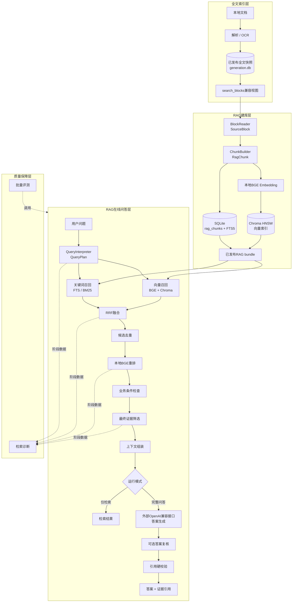

#### 3. 两条主链路

**文档进入RAG索引：**

```text
本地文件
→ 全文解析/OCR
→ 发布全文快照
→ search_blocks
→ BlockReader读取SourceBlock
→ ChunkBuilder生成RagChunk
→ SQLite rag_chunks + rag_chunks_fts
→ 本地BGE生成向量
→ Chroma保存向量
→ 发布RAG bundle
```

核心入口是：

```text
local_full_text_search/rag/index_builder.py:73  RagIndexBuilder.build()
local_full_text_search/rag/block_reader.py:14  BlockReader.iter_blocks()
local_full_text_search/rag/chunk_builder.py:28 ChunkBuilder.iter_chunks()
local_full_text_search/rag/index_store.py:227 RagIndexStore.publish()
```

**问题得到答案：**

```text
用户问题
→ QueryPlan
→ 关键词召回 + 向量召回
→ RRF融合
→ 候选去重
→ Cross-Encoder重排
→ 业务条件检查
→ EvidencePolicy最终证据门禁
→ ContextBuilder组装上下文
→ LLM生成答案
→ 可选答案复核
→ 引用校验
→ 返回答案或拒答/澄清
```

主编排入口是：

```text
local_full_text_search/ui/main_window.py:548             MainWindow.ask_rag()
local_full_text_search/workers/rag_query_worker.py:33    RagQueryWorker
local_full_text_search/rag/answer_service.py:97          AnswerService._execute()
local_full_text_search/rag/retrieval/hybrid.py:29        HybridRetriever.retrieve()
local_full_text_search/rag/evidence_policy.py:33         EvidencePolicy.evaluate()
local_full_text_search/rag/context_builder.py:20         ContextBuilder.build()
local_full_text_search/rag/generation/openai_compatible.py:107 OpenAICompatibleGateway.generate()
```

#### 4. 各阶段为什么不能混为一谈

| 阶段 | 解决的问题 | 输入 | 输出 |
| --- | --- | --- | --- |
| 关键词召回 | 找到包含明确术语、型号、错误码的chunk | 查询表达式 | 带BM25排名的候选 |
| 向量召回 | 找到措辞不同但语义接近的chunk | 语义查询文本 | 带向量相似度的候选 |
| RRF融合 | 合并两路排名，避免直接比较异构分数 | 两路候选及名次 | 融合候选 |
| 去重 | 删除高度重复的候选，给多样证据留空间 | 融合候选 | 去重候选 |
| 重排 | 用问题与正文成对判断相关性 | 前若干候选 | 带rerank分数的候选 |
| 业务条件检查 | 检查型号、阶段、方向等条件是否匹配 | QueryPlan + 候选 | match/conflict/unknown |
| 最终证据筛选 | 执行阈值、冲突、每文档上限和最终条数规则 | 全部评分结果 | 最终证据 |
| 上下文组装 | 把证据编号为S1、S2并控制总长度 | 最终证据 | LLM上下文文本 |
| 答案生成 | 严格依据上下文组织自然语言答案 | 问题 + 上下文 | 带引用的答案草稿 |
| 答案复核/引用校验 | 检查答案是否受证据支持、引用是否合法 | 答案 + 证据 | 最终答案或失败/拒答 |

关键关系是：

> 召回负责“尽量别漏”，重排负责“相关的往前放”，业务条件负责“别答错型号或阶段”，证据策略负责“哪些内容真正有资格喂给LLM”，上下文组装负责“怎么喂”，生成模型只负责“基于已选证据怎么说”。

#### 5. 不是每次都会执行的阶段

| 阶段 | 触发条件 |
| --- | --- |
| RAG建库 | 用户发起构建，并且已有可读取的正式全文快照 |
| 重新计算全部向量 | 文本或Embedding模型发生变化；相同文本和相同模型可复用旧向量 |
| 问题前置澄清 | `rag_clarification_enabled=True`且问题缺少必要字段 |
| 竞争阶段澄清 | 检索后发现多个相互竞争的业务阶段，并满足澄清策略 |
| 业务条件检查 | `rag_constraint_matching_enabled=True` |
| LLM答案生成 | 不是`retrieval_only`模式，并且证据门禁认为证据足够 |
| 答案复核 | 已生成答案且`rag_answer_review_enabled=True` |
| 严格复核失败即报错 | `rag_answer_review_strict=True` |
| 批量评测仅检索模式 | 评测配置选择retrieval-only；此时不调用外部LLM |

#### 6. 本地与外部边界

当前实现中，本地完成：

- 问题规则解析；
- 关键词召回；
- BGE向量化与Chroma检索；
- RRF融合、去重和BGE重排；
- 业务条件检查、证据筛选和上下文组装；
- 检索诊断与仅检索批量评测。

外部OpenAI兼容接口主要负责：

- 最终答案生成；
- 开启时的答案复核。

因此没有配置外部API时，仍然可以构建本地RAG索引、运行检索诊断和retrieval-only评测，但不能完成正常答案生成。

#### 7. 关键配置漏斗

默认候选数量是：

```text
关键词召回50 + 向量召回50
→ 融合候选30
→ 重排候选20
→ 最终证据8
→ 上下文最多12000字符
```

配置位置：

```text
local_full_text_search/config/defaults.py:110-125
```

这里要把它理解成“候选逐层收窄的漏斗”，而不是每个阶段各自返回互不相关的结果。

#### 8. 贴近项目的例子

用户提问：

```text
如何解决免疫底物本底不通过的问题？
```

可能发生的过程：

1. `QueryInterpreter`提取“免疫底物”“本底”“不通过”等检索表达，并识别业务条件；
2. 关键词召回优先找包含这些精确术语的操作规程；
3. 向量召回补回使用“背景偏高”“质控失败”等不同说法的相关段落；
4. RRF合并两路候选，去重后交给Cross-Encoder重排；
5. 业务条件检查排除型号、阶段或处理方向冲突的内容；
6. EvidencePolicy只保留达到阈值且条件可信的少量证据；
7. ContextBuilder将证据组装为`[S1]`、`[S2]`上下文；
8. LLM基于这些上下文生成答案，随后进行答案复核和引用校验。

这只是对真实代码路径的示例化说明；某个具体问题最终命中哪些文档，必须以实际索引和诊断结果为准。

#### 9. 面试可能会问

1. 为什么项目同时使用BM25和向量召回，而不是只选一种？
2. 为什么融合后还要去重和重排，RRF是否已经足够？
3. 业务条件检查和最终证据筛选有什么区别？
4. 为什么答案生成前要做证据门禁，生成后还要做答案复核和引用校验？
5. 怎样在不调用LLM的情况下定位RAG效果差发生在哪一层？

#### 10. 测试角度如何验证

1. **阶段单测**：分别验证关键词召回、向量召回、融合、重排、条件判断和证据策略。
2. **漏斗断言**：验证候选数量按配置收窄，且被淘汰项有明确原因。
3. **双路互补用例**：准备精确术语题和同义改写题，确认BM25与向量召回各自贡献候选。
4. **冲突条件用例**：让正文主题相关但型号或阶段冲突，确认不能进入最终证据。
5. **拒答用例**：没有足够证据时不得调用LLM编造答案。
6. **仅检索评测**：使用`RagEvalRunner`的retrieval-only模式离线比较召回、融合、重排和最终证据指标。
7. **引用校验**：构造不存在的`[S9]`、遗漏引用和引用与正文不一致的答案，检查校验与复核行为。
8. **快照一致性**：全文索引更新但RAG bundle尚未更新时，检查界面警告、继续使用旧bundle的行为和评测语料一致性检查。

评测入口：

```text
local_full_text_search/rag/evaluation/runner.py:58  RagEvalRunner
local_full_text_search/rag/evaluation/runner.py:136 RagEvalRunner.run()
```

#### 11. 已确认事实、推断与不确定项

**已确认事实：**以上模块顺序、默认Top-K、开关条件、本地BGE、SQLite FTS5、Chroma、外部OpenAI兼容生成、答案复核和引用校验都能在当前代码中直接找到。

**用于理解的推断：**把四部分称为“全文索引层、RAG建库层、RAG问答层、质量保障层”是为了学习而做的架构归类，不是代码中的正式类名。

**目前不确定：**在不运行真实语料、模型和外部API的前提下，无法确认当前实际索引的命中质量、各阈值是否最优，以及答案复核对真实业务问题的收益。

#### 12. 架构知识清单

**已经学过：**

- `search_blocks`是全文快照的兼容视图，不等于RAG chunk；
- RAG有独立bundle，包含SQLite元数据/FTS索引和Chroma向量索引；
- 整体系统有离线建库链路、在线问答链路和诊断/评测横切能力；
- 在线问答是“召回→排序→条件检查→证据门禁→生成→校验”的漏斗。

**容易混淆：**

- 全文快照与RAG bundle；
- `search_blocks`、`SourceBlock`和`RagChunk`；
- BM25分数、向量相似度、RRF分数和rerank分数；
- 业务条件检查与最终证据筛选；
- 答案复核与引用编号校验；
- “没有发布全文索引”与“正式快照缺少`search_blocks`视图”。

**下一步建议阅读：**

```text
第一步：local_full_text_search/rag/index_builder.py:73
第二步：local_full_text_search/rag/block_reader.py:14
第三步：local_full_text_search/rag/chunk_builder.py:28
第四步：local_full_text_search/rag/index_store.py:43
```

下一课从文档索引链路第一步开始：`RagIndexBuilder.build()`怎样取得正式全文快照、判断是否可以复用旧bundle，以及怎样创建候选bundle。

### 八、从RAG建库到证据门禁：bundle、查询计划、去重与筛选

#### 1. 先从RAG建库层看整体数据流

RAG建库的主入口是：

```text
local_full_text_search/rag/index_builder.py:73  RagIndexBuilder.build()
```

真实步骤如下：

```text
取得已发布全文快照
→ 检查现有RAG bundle能否整体复用
→ 创建候选bundle目录
→ 从search_blocks读取SourceBlock
→ ChunkBuilder生成RagChunk
→ 复用旧向量或调用本地BGE生成新向量
→ 将chunk正文写入metadata.db
→ 将向量写入Chroma
→ 校验chunk数、向量引用数和Chroma向量数
→ 确认全文快照在构建期间没有切换
→ 原子替换rag.manifest.json，正式发布新bundle
```

关键代码位置：

```text
local_full_text_search/rag/index_builder.py:95   取得正式全文快照
local_full_text_search/rag/index_builder.py:108  尝试复用旧bundle
local_full_text_search/rag/index_builder.py:165  创建候选bundle
local_full_text_search/rag/index_builder.py:208  读取SourceBlock
local_full_text_search/rag/index_builder.py:214  生成RagChunk
local_full_text_search/rag/index_builder.py:369  分批写SQLite和Chroma
local_full_text_search/rag/index_builder.py:290  校验Chroma数量
local_full_text_search/rag/index_builder.py:295  检查全文快照是否切换
local_full_text_search/rag/index_builder.py:313  发布bundle
```

这个设计解决的核心问题是：**用户查询永远只读取已经完整构建并校验通过的RAG索引，不能看到只写了一半的数据。**

#### 2. RAG bundle是什么

`RagBundle`的数据类定义在：

```text
local_full_text_search/rag/index_store.py:19
```

一个完整bundle至少包含：

```text
rag.g000008-xxxxxxxxxx/
├── metadata.db
└── chroma/
    ├── chroma.sqlite3
    └── <Chroma内部segment UUID>/
        ├── data_level0.bin
        ├── header.bin
        ├── length.bin
        ├── link_lists.bin
        └── index_metadata.pickle（不同版本或状态下可能没有）
```

bundle根目录之外还有：

```text
rag.manifest.json
```

它不是正文数据库，而是“当前正式bundle指针”。查询端先读manifest，再检查目标目录、`metadata.db`、Chroma目录、发布状态、bundle ID和数量是否一致。

因此：

```text
目录存在
≠ 构建完成
≠ 已正式发布
≠ 查询端会使用
```

正式发布需要满足：

1. `metadata.db`完整性检查通过；
2. `rag_chunks`数量、`rag_vector_refs`数量和Chroma向量数量一致；
3. chunk数量大于0；
4. `rag_meta.state`改成`published`；
5. `rag.manifest.json`原子切换到该目录。

对应代码：

```text
local_full_text_search/rag/index_store.py:227  RagIndexStore.publish()
local_full_text_search/rag/index_store.py:292  原子替换manifest
local_full_text_search/rag/index_store.py:312  RagIndexStore.active()
```

#### 3. 本次截图对应的真实磁盘状态

本次只读检查发现：

```text
rag.manifest.json当前指向：rag.g000008-9f01fc283b
source_generation：8
verified_source_generation：9
chunk_count：11769
vector_count：11769
```

正式bundle的`metadata.db`中：

```text
rag_meta.state = published
rag_chunks = 11769
rag_chunks_fts = 11769
rag_vector_refs = 11769
```

正式bundle的`chroma.sqlite3`中记录了一个collection和11769条embedding。

截图打开的是：

```text
rag.g000009-8650c01011
```

这个目录目前没有`metadata.db`，而且manifest没有指向它，所以它不是当前正式RAG bundle。它只能确定为“未被正式启用的残留或不完整目录”；在不查看当时日志和进程状态的情况下，不能确定它是异常中断、旧候选还是其他过程留下的。

代码的正常异常处理会调用：

```text
local_full_text_search/rag/index_store.py:300  RagIndexStore.abort()
```

删除失败的候选目录；但进程被强制终止或发生代码流程之外的异常时，磁盘仍可能留下不完整目录。

#### 4. SQLite FTS5关键词索引读取哪个数据库

结论：**RAG在线关键词检索读取当前正式bundle中的`metadata.db`，查询其中的`rag_chunks_fts`，不是读取全文快照的`generation.db`，也不是读取`chroma.sqlite3`。**

真实调用关系：

```text
AnswerService
→ bundle = RagIndexStore.active()
→ LexicalRetriever(bundle.metadata_path)
→ 只读打开metadata.db
→ SELECT ... bm25(rag_chunks_fts)
  FROM rag_chunks_fts
  WHERE rag_chunks_fts MATCH ?
```

代码位置：

```text
local_full_text_search/rag/answer_service.py:140  取得当前bundle
local_full_text_search/rag/answer_service.py:154  传入bundle.metadata_path
local_full_text_search/rag/retrieval/lexical.py:21  只读连接metadata.db
local_full_text_search/rag/index_store.py:397  lexical_search()
local_full_text_search/rag/index_store.py:414  FTS5/BM25查询
```

两个SQLite数据库不能混淆：

| 文件 | 所属 | 用途 |
| --- | --- | --- |
| `metadata.db` | 本项目RAG层 | 保存chunk正文、来源、RAG FTS5关键词索引、向量ID映射和bundle元信息 |
| `chroma/chroma.sqlite3` | Chroma内部 | 保存collection、segment、embedding记录和Chroma内部元数据 |

向量召回时，Chroma先返回`stable_chunk_id`和相似度；项目再根据ID回到`metadata.db`读取完整`RagChunk`正文与来源。

#### 5. 截图中Chroma文件大致做什么

项目代码不会逐个读取这些BIN文件，而是通过`chromadb.PersistentClient`打开整个`chroma`目录：

```text
local_full_text_search/rag/vector_store/chroma.py:28-50
```

| 文件 | 大致职责 | 事实边界 |
| --- | --- | --- |
| `chroma.sqlite3` | Chroma的collection、segment、embedding和元数据目录 | 已从当前数据库表结构确认 |
| UUID目录 | 某个Chroma内部向量segment | UUID由Chroma生成，不是项目chunk ID |
| `data_level0.bin` | HNSW底层向量/节点数据 | 根据Chroma HNSW持久化结构判断 |
| `link_lists.bin` | HNSW图的邻接链接 | 根据文件名和HNSW结构判断 |
| `header.bin` | HNSW索引头部和配置 | 根据文件名和HNSW结构判断 |
| `length.bin` | HNSW内部长度/层级相关数据 | 属于Chroma内部格式，项目不直接解释 |
| `index_metadata.pickle` | 部分Chroma版本保存的索引辅助元数据 | 不保证每个segment都存在 |

测试和运维时不应手工修改这些文件。项目只保证通过Chroma API创建、写入、查询和计数。

#### 6. 问题解析逻辑

入口：

```text
local_full_text_search/rag/query_interpreter.py:16 QueryInterpreter.interpret()
local_full_text_search/rag/query_analyzer.py:89    QueryAnalyzer.analyze()
```

当前默认实现是本地确定性规则，不调用LLM。它生成一个`QueryPlan`：

```text
original_text       原始问题
normalized_text     规范化文本
intent              general / troubleshooting / explanation
entities            型号、业务词等实体
constraints         范围、阶段、方向、对象、型号等条件
lexical_terms       关键词召回使用的词项
lexical_expression  FTS5 MATCH表达式
semantic_query      向量召回使用的文本
fallback_terms      FTS表达式为空时的LIKE兜底词
missing_fields      故障排查问题缺少的必要字段
```

具体规则：

1. 去掉“如何解决、怎么处理、请问”等问句壳词；
2. 用正则识别同时含字母和数字的型号/标识符；
3. 从业务词典中优先识别较长词，例如“免疫底物”优先于“底物”；
4. 为“不通过/未通过/失败”“报错/错误/异常”等稳定表达加入同义变体；
5. 词典命中太少时，用少量三字片段兜底；
6. 生成用`OR`连接的FTS表达式；
7. 提取`scope/stage/direction/object/model`业务条件；
8. 故障排查问题没有阶段信息时，将`stage`标为缺失，供澄清策略使用。

解决的业务问题：

- 用户问的是自然语言，FTS需要稳定的查询词；
- 型号和错误码不能被普通中文切词破坏；
- “如何解决……的问题”这些壳词没有检索价值；
- 后续必须知道用户问的是定标、质控还是样本检测；
- 信息不完整时应先澄清，不能盲目检索后拼答案。

限制：词典和规则只覆盖代码中明确配置的领域表达，不是通用自然语言理解系统。

#### 7. 问题解析会影响向量召回吗

准确回答要分为“数据流”和“当前实际效果”。

**数据流上会经过问题解析：**

```text
QueryInterpreter生成QueryPlan.semantic_query
→ VectorRetriever读取plan.semantic_query
→ Embedding模型生成查询向量
```

代码位置：

```text
local_full_text_search/rag/query_interpreter.py:32
local_full_text_search/rag/retrieval/vector.py:20
```

**但当前实际实现没有改写向量查询：**

```python
semantic_query=analysis.original_text
```

所以当前关键词提取、同义词扩展和业务条件提取不会直接改变查询向量；Embedding仍然编码用户的完整原问题。

它有两种间接影响：

1. 问题解析发现缺少必要信息时，可能在向量召回前直接要求用户澄清；
2. 提取出的业务条件会在召回和重排之后检查向量候选，排除语义相近但场景冲突的内容。

因此最准确的面试表达是：

> 当前架构让向量召回消费`QueryPlan.semantic_query`，为未来查询改写预留了接口；但v1实际把原始问题原样放入该字段，所以规则解析目前主要影响关键词召回、澄清和后置业务条件门禁，并不直接改写向量检索文本。

#### 8. 候选去重逻辑

入口：

```text
local_full_text_search/rag/candidate_deduplicator.py:30
```

执行位置：RRF融合之后、Cross-Encoder重排之前。

```text
关键词候选 + 向量候选
→ RRF融合并按分数排序
→ 候选去重
→ Cross-Encoder重排
```

判断顺序：

1. `stable_chunk_id`相同：直接判重复；
2. 同一`document_key`内`text_hash`相同：判重复；
3. 同一文档内，去掉空白和标点后生成字符3-gram；
4. 计算Jaccard相似度，默认大于等于`0.92`判为近重复；
5. 保留融合排名更靠前、也就是更早遍历到的候选；
6. 保留数量达到`fusion_top_k`后停止。

它只对同文档执行正文哈希和3-gram近重复判断，避免不同文档中相同标准条款被过早合并掉。

解决的业务问题：

- 文档分块有最多120字符的有意重叠，相邻chunk会共享边界正文；普通900字符窗口的正常重叠通常达不到0.92近重复阈值，但短块或异常切分仍需防护；
- 同一段内容可能同时被关键词和向量检索命中；
- PDF分页、OCR和段落抽取可能产生轻微标点或换行差异；
- 如果不去重，20个重排名额可能被同一段话占满，既浪费计算，也降低证据多样性。

#### 9. 业务条件检查逻辑

入口：

```text
local_full_text_search/rag/constraint_matcher.py:41
```

对问题中的每个必需条件，候选正文会得到三态判断：

```text
MATCH     正文明确描述相同条件
CONFLICT  正文明确描述互斥条件
UNKNOWN   正文没有明确说明
```

当前支持：

- `scope`：单个项目、多个项目、全部项目；
- `stage`：定标、质控、样本检测、开机；
- `direction`：偏低、偏高、异常；
- `object`：发光值、底物、本底等；
- `model`：能够从问题中提取，但当前matcher没有型号的确定性互斥词典，因此通常为`UNKNOWN`。

特殊规则：

- 对象条件只判断“提及”或“未明确提及”，不会轻易判冲突；
- “异常”与“偏低/偏高”不互相判冲突；
- 检查关键词前5个字符的简单否定，例如避免把“并非所有项目”判断为`all`；
- 条件分数为`(匹配数 - 2 × 冲突数) / 条件总数`；
- 明确匹配的候选排在UNKNOWN之前，同等级沿用rerank顺序。

非常重要：`ConstraintMatcher`本身并不删除候选。它给候选添加`constraint_decision`并重排；真正淘汰冲突候选的是下一步`EvidencePolicy`。

解决的业务问题：

```text
用户问：只有一个项目在定标时发光值偏低
错误候选：所有项目在质控时发光值偏高
```

两段文字在“项目、发光值、异常处理”上可能语义相近，Cross-Encoder也可能给出较高相关度，但实际处理流程可能完全不同。业务条件检查就是为了防止这种“主题相关、适用场景错误”的答案。

#### 10. 最终证据筛选逻辑

入口：

```text
local_full_text_search/rag/evidence_policy.py:33 EvidencePolicy.evaluate()
```

它是真正的最终门禁，顺序如下：

1. 有必需业务条件冲突：淘汰；
2. 没有rerank分数或分数低于默认`0.10`：淘汰；
3. 如果没有关键词命中，同时向量相似度低于默认`0.35`：淘汰；
4. 条件明确匹配的排在UNKNOWN之前；
5. 同等级按rerank分数排序；
6. 每个文档最多保留3条；
7. 最终最多保留`final_top_k`，默认8条；
8. 如果问题明确限定`scope/stage/direction`，最终证据中至少要有一条直接确认每个关键条件；
9. 没有合格证据或关键条件没有被确认：返回证据不足，不进入LLM生成。

第3条的含义是：

```text
关键词命中的候选：主要依赖rerank门槛
纯向量命中的候选：除了rerank门槛，还必须达到向量相似度门槛
```

解决的业务问题：

- 阻止冲突场景进入答案上下文；
- 阻止低相关候选仅靠某一路召回混入；
- 防止一个大文档垄断全部证据；
- 对用户明确提出的关键条件要求“正面证据”，不能仅凭正文没有反对就默认成立；
- 证据不足时拒答，降低幻觉风险。

#### 11. 四个阶段的边界

| 阶段 | 核心问题 | 是否删除候选 |
| --- | --- | --- |
| 问题解析 | 用户究竟在问什么，关键词和业务条件是什么 | 不删除；可能触发前置澄清并终止本次检索 |
| 候选去重 | 是否有相同或近似相同的正文重复占位 | 删除重复候选 |
| 业务条件检查 | 候选是否与范围、阶段、方向等条件一致 | 不直接删除，只标注和排序 |
| 最终证据筛选 | 哪些候选最终有资格进入LLM上下文 | 执行硬门禁、文档上限和最终TopK |

最短记忆：

```text
问题解析：先把问题说明白
候选去重：别让同一段话占满名额
条件检查：识别场景是否匹配
证据筛选：决定最终能不能用
```

#### 12. 完整例子

问题：

```text
只有一个项目在定标时发光值偏低，怎么排查？
```

问题解析可能得到：

```text
intent = troubleshooting
scope = single
stage = calibration
direction = low
object = 发光值
semantic_query = 原始完整问题
```

后续过程：

1. 当前规则生成的FTS主词是“发光值偏低”和“发光值”；“定标”和“偏低”会进入业务条件，但因不足3个字符不会进入本题的FTS主表达式；
2. 向量模型仍然编码完整原问题；
3. RRF合并两路候选；
4. 去重删除同文档中重叠度超过0.92的重复段落；
5. Cross-Encoder重新判断问题与正文的相关性；
6. 条件检查把“全部项目”“质控阶段”“发光值偏高”的候选标成冲突；
7. EvidencePolicy淘汰冲突和低分候选，限制每文档最多3条；
8. 如果最终证据没有任何一条明确支持“单个项目、定标、偏低”，返回证据不足；
9. 只有门禁通过的证据才会组装为`S1/S2`上下文并交给LLM。

#### 13. 测试角度

可以按四层分别验证：

1. **问题解析参数化测试**：覆盖问句壳词、型号、同义词、范围、阶段、方向和缺失字段。
2. **去重边界测试**：同ID、同hash、Jaccard为0.91/0.92、跨文档相同正文、标点换行变化。
3. **条件三态测试**：同条件、互斥条件、正文未说明、否定表达、“异常”与“偏低”的兼容关系。
4. **证据门禁测试**：rerank阈值、纯向量阈值、关键词命中例外、每文档上限、关键条件未确认、最终TopK。
5. **bundle发布测试**：metadata/向量数量不一致不能切换manifest；候选失败后旧bundle仍可查询。
6. **磁盘文件测试**：只认manifest指向的bundle，不按目录名中的最大generation自动选择。

已有测试入口：

```text
tests/rag/test_query_analyzer.py
tests/rag/test_rag_quality_pipeline.py
tests/rag/test_rag_gold_cases.py
tests/rag/test_index_store.py
tests/rag/test_chroma_vector_store.py
tests/rag/test_rag_batching.py
```

#### 14. 已确认、推断与尚不确定

**已确认事实：**当前活动manifest、正式bundle ID、11769条chunk/FTS/vector引用、关键词查询读取`metadata.db`、问题解析规则、去重阈值、条件三态和证据门禁都通过实际代码或只读数据库检查确认。

**合理推断：**截图中各BIN文件的具体职责根据Chroma/HNSW持久化结构和文件名判断；项目代码只把它们视为Chroma内部文件，不直接解析。

**尚不确定：**`rag.g000009-8650c01011`为何残留，仅凭当前目录不能还原当时原因，需要对应时间的构建日志或进程记录。

#### 15. 架构知识清单更新

**本轮已经学过：**

- RAG bundle是一次可原子切换的SQLite+Chroma完整索引快照；
- 在线FTS5读取RAG bundle的`metadata.db`；
- `chroma.sqlite3`和HNSW BIN文件属于Chroma内部持久化结构；
- 问题解析、去重、条件检查和证据筛选是不同层次；
- 当前问题解析不直接改写向量查询文本；
- 目录存在不等于已经正式发布，manifest才是当前正式指针。

**下一步建议：**沿文档索引链路继续精读`RagIndexBuilder.build()`的“旧bundle复用”和“候选bundle发布”两个分支，并用一张状态表区分`building / published / active / stale / orphaned`。

### 九、Chroma业务映射、规则解析可靠性、分块与RRF去重边界

#### 1. Chroma四个概念与业务对象的对应关系

当前正式Chroma中只有一个collection：

```text
collection.name = rag_chunks
dimension = 512
```

对应关系如下：

| Chroma概念 | 当前实际对象 | 对应的业务含义 |
| --- | --- | --- |
| collection | `rag_chunks` | 当前RAG bundle内所有可做向量检索的chunk集合 |
| vector segment | HNSW持久化segment | 负责按余弦距离查找与问题向量接近的chunk |
| metadata segment | SQLite metadata segment | 负责保存每个向量点的ID及可过滤字段 |
| embedding record | 一个`stable_chunk_id`对应的一条512维向量 | 一段RAG正文在语义空间中的数字表示 |
| embedding metadata | `root_id`、扩展名、OCR类型等 | 在向量检索时按资料范围、文件类型、OCR开关过滤 |

当前collection下实际存在两个segment：

```text
VECTOR   urn:chroma:segment/vector/hnsw-local-persisted
METADATA urn:chroma:segment/metadata/sqlite
```

这两个segment不是两个业务文档，而是同一个collection的两种物理存储职责。

项目写入Chroma的每条记录是：

```text
point_id = RagChunk.stable_chunk_id
embedding = BGE生成的512维向量
metadata = {
    stable_chunk_id,
    source_generation,
    root_id,
    extension,
    source_type,
    ocr_confidence,
    document_id
}
```

代码位置：

```text
local_full_text_search/rag/index_builder.py:424-437
local_full_text_search/rag/vector_store/chroma.py:55-62
```

这些metadata字段的业务关系：

| 字段 | 业务用途 |
| --- | --- |
| `stable_chunk_id` | 将Chroma命中结果关联回`metadata.db.rag_chunks`中的正文和引用来源 |
| `source_generation` | 追踪该向量来自哪一代全文快照 |
| `root_id` | 按用户选择的资料根目录过滤 |
| `extension` | 按PDF、Word、图片等文件类型过滤 |
| `source_type` | 区分原生正文、OCR、元数据，支持关闭OCR结果 |
| `ocr_confidence` | 记录OCR置信度；当前Chroma查询未直接使用该值，返回chunk后由应用层再次过滤 |
| `document_id` | 追踪上游文档身份，便于关联和诊断 |

Chroma中没有保存完整的业务正文和完整文件引用。向量查询返回ID和相似度后，`VectorRetriever`会用`stable_chunk_id`回到`metadata.db`加载`RagChunk`：

```text
Chroma：擅长回答“哪几个向量最近”
metadata.db：回答“这些ID对应什么正文、文件和位置”
```

代码位置：

```text
local_full_text_search/rag/retrieval/vector.py:22-54
local_full_text_search/rag/index_store.py:378-395
```

#### 2. collection、segment和embedding不是一一对应文档

常见误解：

```text
一个collection ≠ 一个文件
一个segment ≠ 一个文件
一个embedding ≈ 一个RagChunk
```

当前项目把整个RAG bundle的chunk放在一个名为`rag_chunks`的collection中。一个PDF可能切成几十个chunk，因此对应几十条embedding；一个embedding也可能覆盖由多个短`SourceBlock`合并而成的正文窗口。

#### 3. 问题解析的完整确定性流程

当前默认没有调用LLM，入口是：

```text
local_full_text_search/rag/query_analyzer.py:89 QueryAnalyzer.analyze()
local_full_text_search/rag/query_interpreter.py:16 QueryInterpreter.interpret()
```

处理顺序：

1. 原问题去首尾空白；
2. 使用NFKC统一全角/半角字符；
3. 统一换行、删除零宽字符和控制字符；
4. 合并连续空白并转小写；
5. 去除开头的问句壳词，例如“请问、如何解决、怎么处理”；
6. 去除结尾的问句壳词，例如“怎么办、怎么排查、是什么原因”；
7. 正则识别同时含字母和数字的标识符，例如`AU5800`；
8. 按长度倒序匹配业务词典，优先识别“免疫底物”而不是“底物”；
9. 扩展代码中明确列出的稳定同义词；
10. 如果业务词典命中少于两个，才从残余自由文本生成少量三字片段兜底；
11. 只把长度至少3的词放入FTS主词表，最多20个；
12. 用双引号包裹每个词，并用`OR`生成FTS5表达式；
13. 单独提取范围、阶段、方向、对象和型号条件；
14. 判断意图是故障排查、解释还是普通问题；
15. 故障排查没有阶段条件时，在`missing_fields`中记录`stage`；
16. `QueryInterpreter`把分析结果组装为统一`QueryPlan`。

文本规范化代码：

```text
local_full_text_search/core/normalizer.py:14-36
```

#### 4. 用一个问题逐行追踪解析结果

问题：

```text
只有一个项目在定标时发光值偏低，怎么排查？
```

当前代码实际产生的核心结果是：

```text
intent = troubleshooting
lexical_terms = (发光值偏低, 发光值)
lexical_expression = "发光值偏低" OR "发光值"
semantic_query = 原始完整问题
constraints = {
    scope: single,           来源“只有一个项目”
    stage: calibration,      来源“定标”
    direction: low,          来源“偏低”
    object: 发光值,
    object: 项目
}
missing_fields = ()
```

“定标”和“偏低”虽然是重要业务条件，但只有两个汉字，被`len(term) >= 3`规则排除在FTS主表达式之外。它们仍然参与后面的业务条件检查。

这说明解析结果不能只看关键词列表，还必须同时查看`constraints`。

另一个问题：

```text
只有某个项目的发光值异常，这个时候该怎么排查
```

代码测试确认：

```text
intent = troubleshooting
scope = single
object = 发光值
lexical_terms包含“发光值异常”和“发光值”
semantic_query等于原问题
missing_fields = (stage,)
```

但`missing_fields`出现`stage`并不会立即中断检索。当前澄清策略是：

- 问题太短，或既无有效词也无实体：检索前追问；
- 仅缺少阶段：先继续检索；
- 如果高排名候选同时覆盖定标、质控等至少两个阶段：检索后再追问用户确认阶段。

代码位置：

```text
local_full_text_search/rag/clarification.py:21-31
local_full_text_search/rag/clarification.py:33-54
```

#### 5. 固定规则如何保证问题解析不出错

不能保证“永远不出错”。固定规则的优势是可解释、可复现、容易测试；缺点是只认识代码中列出的词和表达。

当前已有的安全设计：

1. 规则输出完整`QueryPlan`，诊断界面可直接检查词项、FTS表达式和条件；
2. 业务词按长词优先匹配，减少“免疫底物”被泛化成“底物”；
3. 只扩展少量语义稳定的同义词，不进行开放式联想；
4. 解析不确定时保留原问题给向量召回和重排；
5. 缺少阶段时先观察检索证据，只有阶段竞争时再追问；
6. 条件检查使用`UNKNOWN`，没有明确文字时不强行判断匹配或冲突；
7. 最终证据策略对关键条件要求至少有一条正面匹配证据。

仍可能出错的情况：

- 业务同义词不在词典中；
- 否定、反问或长距离语义超出5字符否定窗口；
- “项目”既可能表示检测项目，也可能表示软件项目；
- 型号不是“字母+数字”形式；
- 正文用隐含表达，没有出现规则词；
- 两个汉字的重要词被长度至少3的FTS规则排除；
- 同一个词在不同业务中有不同含义。

可靠性不能靠“相信规则”，而应靠以下验证闭环：

```text
业务问题集
→ 人工标注期望QueryPlan
→ 参数化单元测试
→ 检索诊断查看真实QueryPlan
→ retrieval-only批量评测
→ 统计漏召回/错约束
→ 只增加经过业务确认的词典和规则
→ 回归全部金标问题
```

当前直接测试：

```text
tests/rag/test_query_analyzer.py:28-68
tests/rag/test_rag_quality_pipeline.py:63-114
```

#### 6. RRF到底是否去重

RRF本身的数学作用是融合排名：

```text
fused_score += 1 / (rrf_k + rank)
```

当前`rrf_k=60`。

实现时使用：

```text
merged: dict[stable_chunk_id, EvidenceChunk]
```

因此同一个`stable_chunk_id`同时被关键词和向量召回时，只生成一个融合候选，并累加两路RRF贡献。

这只能叫“按ID合并”，不能叫“正文近似去重”。

```text
RRF阶段：合并同一stable_chunk_id
CandidateDeduplicator：删除不同ID但正文相同或高度相似的候选
```

代码位置：

```text
local_full_text_search/rag/retrieval/hybrid.py:59-78
local_full_text_search/rag/candidate_deduplicator.py:30-76
```

#### 7. 文档具体如何分块

分块入口：

```text
local_full_text_search/rag/chunk_builder.py:28
```

第一步先按以下边界分组：

```text
document_key
file_id
page_number
slide_number
sheet_name
source_type
```

这意味着默认不会跨PDF页、幻灯片、Excel工作表或正文/OCR来源拼接chunk。

第二步把同组的短`SourceBlock`用换行连接成连续文本。

第三步按窗口切分：

```text
目标长度：900字符
最大长度：1200字符
最大重叠：120字符
```

算法：

1. 先尝试在目标900字符之前寻找换行、句号、感叹号、问号或分号；
2. 只有边界位置超过目标长度一半时才采用；
3. 找不到合适边界则最多切到1200字符；
4. 下一块从`上一块结尾 - 120`附近开始；
5. 如果重叠区内有合适句子边界，再向后移动起点，实际重叠可能小于120；
6. chunk ID由文档键、来源块范围、页/表信息、字符起止、切块策略版本和正文hash共同生成。

#### 8. 分块为什么会出现重复或相似内容

分成三种情况：

1. **同一chunk被双路召回**：关键词和向量都命中同一ID，由RRF阶段按ID合并。
2. **有意的窗口重叠**：相邻chunk最多共享120字符，用于避免答案刚好被切在边界两侧。普通900字符窗口只有约13%的重叠，通常不会达到0.92近重复阈值。
3. **来源本身重复或提取差异**：同一文档重复段落、页眉页脚、OCR和原生正文、标点换行差异，可能形成不同ID但正文几乎相同的chunk，由`CandidateDeduplicator`处理。

近似去重只在同一`document_key`内比较，避免不同文档都引用同一标准条款时被误删。

#### 9. 不调用大模型，业务条件检查如何“理解”

严格说，它没有真正理解自然语言，而是在执行有限的业务判定表。

例如问题条件是：

```text
stage = calibration
```

规则表中：

```text
calibration     定标 / 校准 / 校正
quality_control 质控 / 质控品 / 质量控制
sample_test     样本检测 / 标本检测 / 样本 / 标本
startup         开机 / 启动 / 自检
```

候选正文：

```text
“定标失败时检查校准液” → MATCH
“质控失败时检查质控品” → CONFLICT
“检查试剂状态”           → UNKNOWN
```

它还查看匹配词前5个字符，遇到“不是、并非、并不、不属于、非所有”时不把该词当作正面命中。

所以这里的“理解”应准确表述为：

> 基于业务词典、互斥关系和少量否定规则的确定性分类，而不是通用语义理解。

#### 10. 最终证据筛选更不负责理解正文

`EvidencePolicy`不重新阅读或解释正文。它消费前面已经产生的结构化字段：

```text
constraint_decision
rerank_score
lexical_rank
vector_score
document_key
```

然后执行硬规则：冲突淘汰、重排阈值、纯向量阈值、每文档上限、最终TopK和关键条件覆盖。

因此职责边界是：

```text
ConstraintMatcher：用固定词典给正文贴业务条件标签
EvidencePolicy：根据标签和分数执行准入规则
```

#### 11. 固定规则可能弄错吗

可能，主要有两类：

**误杀：**正文实际上适用，但没有写出规则认识的词，被标为UNKNOWN；关键条件没有正面覆盖时可能拒答。

**误放：**正文碰巧出现匹配词，但上下文含义并不一致，规则仍可能标为MATCH。

当前安全倾向是“宁可UNKNOWN或拒答，不轻易把未知当匹配”，但它不是形式化证明。最终可靠性必须依赖：

- 真实业务金标问题；
- `match/conflict/unknown`混淆矩阵；
- 高分错误候选专项集；
- 否定、转折和隐含表达测试；
- 检索诊断逐题查看条件判断原因；
- 批量评测约束违规数和最终证据覆盖率；
- 规则变更后的全量回归。

已有用例明确验证：即使错误候选rerank分数为0.98，只要与“单个项目”条件冲突，也必须淘汰；正确候选即使只有0.72仍然保留：

```text
tests/rag/test_rag_gold_cases.py:43-71
```

#### 12. 从建库到答案的所有步骤与业务关系

| 步骤 | 技术作用 | 解决的业务问题 |
| --- | --- | --- |
| 全文解析/OCR | 把PDF、Office、图片变成可读正文和位置 | 原始资料格式不同，必须统一成可检索内容 |
| `search_blocks` | 提供稳定的正文读取契约 | RAG不应依赖全文库内部表结构 |
| RAG分块 | 把长文档变成有位置引用的窗口 | 整篇文档太长，向量语义和引用位置不精确 |
| Embedding | 将每个chunk变成512维向量 | 支持不同措辞但相同含义的召回 |
| RAG FTS5 | 为chunk建立精确词项索引 | 型号、错误码、业务术语需要精确召回 |
| Chroma/HNSW | 持久化向量并近邻搜索 | 在大量chunk中快速找语义相近内容 |
| bundle发布 | 校验后原子切换完整索引 | 防止用户读到半成品索引 |
| 问题解析 | 生成关键词、条件、意图和语义问题 | 把自然语言转换成后续阶段可使用的结构 |
| 前置澄清 | 拦截过短或无检索对象的问题 | 没有有效线索时检索只会产生噪声 |
| 关键词召回 | FTS5/BM25找精确词候选 | 找到型号、术语和错误码明确匹配的资料 |
| 向量召回 | BGE+Chroma找语义候选 | 补回同义改写和不同措辞 |
| RRF融合 | 按排名合并两路同ID候选 | BM25分数与余弦相似度不能直接相加 |
| 候选近似去重 | 删除同文档几乎相同的正文 | 避免重复内容浪费重排名额 |
| Cross-Encoder重排 | 联合阅读问题和候选正文评分 | 初召回追求不漏，重排提高精度 |
| 业务条件检查 | 标注范围、阶段、方向等是否匹配 | 避免主题相近但处理场景错误 |
| 竞争阶段澄清 | 多个互斥阶段同时出现时追问 | 防止把定标、质控等步骤混成一个答案 |
| 最终证据策略 | 执行冲突、阈值、多样性和覆盖门禁 | 只有足够可靠的证据才能进入LLM |
| 上下文组装 | 生成S1/S2、保留文件位置并限制长度 | 给模型提供可引用、受预算约束的证据 |
| 答案生成 | 根据证据组织自然语言 | 将技术资料转换为用户可读回答 |
| 答案复核 | 检查结论与证据支持关系 | 降低生成模型无依据扩展 |
| 引用硬校验 | 检查引用编号是否合法 | 防止引用不存在的S编号 |
| 诊断与评测 | 保存每阶段候选和指标 | 定位问题发生在召回、排序、条件还是生成 |

#### 13. 本轮测试清单

1. 解析同一句话的全角/半角、大小写和不同问法，`QueryPlan`应保持业务等价。
2. 逐条验证词典中每个scope/stage/direction词及其互斥关系。
3. 重点测试“并非所有”“不是质控阶段”等否定表达。
4. 验证两字业务词虽然不进入FTS主词表，仍能进入constraints。
5. 验证同ID双路命中只产生一个RRF候选且分数累加。
6. 验证正常120字符重叠不会被误判为0.92近重复。
7. 验证同文档标点/换行差异被去重，跨文档相同条款保留。
8. 验证高rerank但条件冲突的候选仍被最终证据策略淘汰。
9. 验证关键条件只有UNKNOWN时系统拒答，而不是默认成立。
10. 在诊断界面对照`QueryPlan → fused → deduplicated → reranked → constraint → evidence`逐层检查淘汰原因。

#### 14. 架构知识清单更新

**已经确认：**

- Chroma collection是整个bundle的chunk向量集合，不是单个文档；
- segment是Chroma内部物理组件，embedding才大致一一对应RagChunk；
- RRF只按相同chunk ID合并，近似正文去重由独立模块完成；
- 正常分块重叠与0.92近重复是两个不同概念；
- 问题解析和条件检查是确定性规则，不具备通用语义理解能力；
- EvidencePolicy不理解正文，只执行结构化门禁；
- 固定规则不能保证永不出错，必须通过金标、诊断和批量评测持续验证。

**容易混淆：**

- Chroma metadata与项目`metadata.db`；
- RRF同ID合并与CandidateDeduplicator近似去重；
- `missing_fields`记录缺失与立即触发澄清；
- 条件检查的`UNKNOWN`与条件已经匹配；
- rerank相关度高与业务条件正确。

**下一步建议：**下一课只选择一个真实问题，在不调用LLM的retrieval-only诊断中逐层阅读`QueryPlan、关键词候选、向量候选、融合、去重、重排、条件判断和最终证据`，把抽象架构映射到一条完整诊断记录。

### 十、从“名词迷茫”到能够诊断召回率低

#### 1. 问题解析出错会不会比不解析更差

会，关键取决于错误发生后是否会破坏原始信息，以及错误结果是否被用于硬过滤。

问题解析可能产生四种效果：

| 解析结果 | 后果 |
| --- | --- |
| 正确提取关键词 | 关键词召回更准确 |
| 漏掉重要关键词 | 关键词召回可能漏掉正确证据 |
| 多扩展了错误同义词 | 召回噪声增加，占用TopK名额 |
| 错误提取业务条件 | 正确候选可能被标成冲突并在证据门禁中淘汰 |

其中风险最大的是“错误业务条件”，因为它不是增加噪声，而是可能直接删除正确答案。

当前项目有几层缓冲：

1. 向量召回仍然编码完整原问题，关键词解析错误不会直接改写向量查询；
2. 关键词和向量双路召回，一路漏掉时另一路可能补回；
3. 条件判断有`UNKNOWN`状态，没有明确文字时不强制判MATCH或CONFLICT；
4. 缺少阶段不会立即追问，先看实际证据是否覆盖竞争阶段；
5. 最终诊断保存各阶段候选，可以找到正确证据在哪一步丢失。

但当前并非完全安全：如果固定词典把正确正文错误判断为`CONFLICT`，`EvidencePolicy`会将其淘汰。因此不能只凭设计判断解析有用，必须做对照评测。

正确验证方法：

```text
同一组Gold问题
├── 基线：尽量少解析，保留原问题
└── 当前解析：关键词扩展 + 业务条件

比较：
关键词召回率、融合召回率、最终证据召回率、反例数量、拒答率
```

只要解析提高最终Gold召回、减少hard negative，而且没有显著增加误拒答，才说明整体收益为正。

#### 2. 第一层只需要掌握的八个白话概念

| 名称 | 白话解释 | 本项目中的作用 |
| --- | --- | --- |
| Chunk | 从长文档剪下来的一小段 | RAG检索和引用的基本单位 |
| Embedding | 把一段话变成一串数字坐标 | 让措辞不同但含义接近的文本靠得更近 |
| Vector | Embedding得到的数字数组 | 当前BGE输出512维坐标 |
| FTS5 | SQLite自带的全文关键词索引 | 快速寻找包含术语、型号、错误码的chunk |
| BM25 | 关键词搜索结果排序方法 | 关键词越匹配、越有区分度，排名通常越靠前 |
| HNSW | 一种近似向量搜索图结构 | 不逐条比较11769个向量，而是沿相似邻居快速找到近邻 |
| RRF | 按两路结果的名次融合 | 不直接比较BM25分数和向量分数 |
| Reranker | 对少量候选重新精排的模型 | 同时阅读问题和候选正文，重新判断相关性 |

HNSW可以理解为：

```text
每个chunk是地图上的一个站点
相似chunk之间修建道路
查询时从入口沿着越来越相似的道路前进
不用把查询与全部chunk逐个比较
```

它解决的是“搜索速度”，不是业务理解，也不决定答案是否正确。

#### 3. 第二层再学习的质量概念

| 名称 | 白话解释 |
| --- | --- |
| Recall / 召回率 | 应该找回的正确证据，实际找回了多少 |
| Precision / 准确率 | 找回的候选里，有多少是真正相关的 |
| TopK | 某阶段最多保留前多少条 |
| Threshold / 阈值 | 分数低于多少就淘汰 |
| Gold evidence | 人工确认的正确证据 |
| Hard negative | 看起来很像、但业务上错误的证据 |
| MRR | 第一条正确证据排得是否靠前 |
| Context | 最终真正送给生成模型的证据文本 |

召回率和准确率经常互相拉扯：提高TopK通常能减少遗漏，但会带来更多噪声、延迟和重排成本。

#### 4. 面试官说“召回率低”时，第一句不要立刻调参数

先问清楚：

```text
哪个阶段的召回率低？
```

本项目可以分别测量：

```text
关键词召回
向量召回
融合
去重
重排
业务条件检查
最终证据
上下文
```

项目已有指标：

- `gold_hit_rate`：多少题至少找回一条正确证据；
- `mean_evidence_recall`：正确证据总数中找回多少；
- `MRR`：第一条正确证据排得是否靠前；
- `hard_negative_candidate_count`：错误但相似的指定反例出现多少。

代码位置：

```text
local_full_text_search/rag/evaluation/metrics.py:10-28
local_full_text_search/rag/evaluation/metrics.py:31-68
```

#### 5. 召回率低的分阶段诊断树

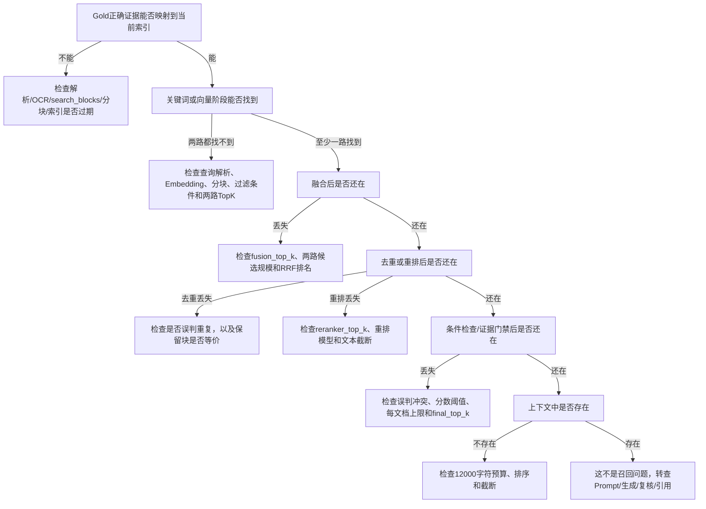

#### 6. 每个阶段召回低时具体查什么

##### 6.1 Gold证据没有进入索引

症状：人工知道正确答案在某文件某页，但Gold无法映射到任何chunk。

检查：

- 文件是否被扫描；
- 解析器是否成功提取正文；
- 图片内容是否需要OCR；
- OCR置信度是否被过滤；
- `search_blocks`是否包含该正文；
- 分块是否把关键句切散；
- RAG bundle是否基于最新全文快照。

这一层的问题不能靠增加TopK解决。

##### 6.2 关键词召回低

检查：

- `QueryPlan.lexical_terms`是否包含关键术语；
- 型号、错误码是否被正确提取；
- 两字业务词是否被长度规则排除；
- 同义词是否缺失或扩展错误；
- `lexical_top_k=50`是否过小；
- 文件范围、扩展名、OCR过滤是否误伤。

可能措施：修正领域词典、保留关键短词、增加经过验证的同义词、适度增加关键词TopK。

##### 6.3 向量召回低

检查：

- Gold chunk是否语义完整；
- chunk太长导致主题混杂，或太短缺少上下文；
- 当前中文Embedding是否适合业务语料；
- `semantic_query`是否应该进行受控改写；
- `vector_top_k=50`是否过小；
- root/extension/OCR过滤是否误伤；
- 索引模型版本与查询模型是否一致。

可能措施：调整chunk策略、评估领域Embedding、做查询改写A/B、适度增加向量TopK。

##### 6.4 融合阶段丢失

症状：关键词或向量阶段能找到Gold，但融合结果没有。

检查：

- Gold在单路中排名是否太靠后；
- `fusion_top_k=30`截断是否过早；
- 另一召回通道的大量高排名噪声是否挤占位置；
- `rrf_k=60`是否适合当前排名分布。

通常先增加候选预算并观察，不要一开始就盲调`rrf_k`。

##### 6.5 去重或重排阶段丢失

去重检查：

- Gold是否被0.92 Jaccard误判为重复；
- 被保留的chunk是否实际包含同等证据；
- Gold标注是否只绑定了被删除ID，造成指标假下降。

重排检查：

- Gold是否进入`reranker_top_k=20`；
- reranker是否把hard negative排到前面；
- 512 token截断是否丢掉关键内容；
- 问题或chunk是否包含太多无关信息。

##### 6.6 条件检查或最终证据阶段丢失

检查：

- 正确证据是否被错误标成`CONFLICT`；
- 业务同义词、否定表达是否未覆盖；
- rerank阈值`0.10`是否误杀；
- 纯向量阈值`0.35`是否误杀；
- 每文档最多3条是否丢掉同文档必要的多段证据；
- `final_top_k=8`是否不足；
- 关键条件正面覆盖要求是否过严。

##### 6.7 上下文里已有正确证据

如果Gold已经进入Context，但答案仍然错误，这不再是召回率问题。应检查：

- Prompt是否要求严格依据证据；
- 生成模型是否遗漏事实；
- 12000字符上下文是否包含大量干扰内容；
- 答案复核是否有效；
- 引用是否真正支持结论。

#### 7. 调参原则

不要一次改多个参数。每次只改一个变量，并同时观察四类结果：

```text
Gold召回是否上升
MRR是否改善
Hard negative是否增加
延迟/内存是否恶化
```

典型权衡：

| 调整 | 可能收益 | 可能代价 |
| --- | --- | --- |
| 增大lexical/vector TopK | 初召回提高 | 噪声和耗时增加 |
| 增大fusion TopK | 更多候选进入重排 | 重排成本增加 |
| 增大reranker TopK | 减少过早截断 | CPU耗时增加 |
| 降低证据阈值 | 最终召回提高 | 错误证据增加 |
| 增大final TopK | 多证据覆盖提高 | 上下文更嘈杂 |
| 缩小chunk | 定位更精确 | 上下文可能不完整、chunk数量增加 |
| 增大chunk | 语境更完整 | 主题混杂、向量不聚焦 |

#### 8. 面试时的标准回答框架

> 我不会先盲目增加TopK，而是先定义Gold证据，并按索引覆盖、关键词召回、向量召回、融合、重排、条件门禁和上下文逐层测量召回率。如果Gold没有进入索引，优先修复解析、OCR或分块；如果单路召回失败，检查查询解析、Embedding、chunk策略和过滤条件；如果单路能找到但后续丢失，再检查融合TopK、重排输入规模、错误条件冲突和证据阈值。每次只改一个变量，用Gold召回率、MRR、hard negative、延迟和内存做回归，避免只提升召回却显著降低准确率。

#### 9. 适合测试背景的学习方法

不要按名词表死记，应该把RAG当作一个多阶段被测系统：

```text
每个阶段都有：
输入 → 处理规则 → 输出 → 判定标准 → 边界条件
```

建议学习顺序：

**第一阶段：只建立地图**

- 能说出文档如何变成chunk；
- 能说出问题如何经过两路召回到最终证据；
- 暂时不研究HNSW数学原理。

**第二阶段：只追一条真实问题**

- 在retrieval-only诊断中查看QueryPlan；
- 找关键词和向量候选；
- 记录Gold第一次出现和第一次消失的阶段。

**第三阶段：建立10到20条Gold问题**

- 精确术语题；
- 同义改写题；
- 型号题；
- 多阶段歧义题；
- 应拒答题；
- hard negative题。

**第四阶段：一次只研究一个旋钮**

- 本周只研究chunk大小；
- 下一次只研究TopK；
- 再下一次只研究阈值；
- 每次保留基线报告和新报告。

**第五阶段：形成面试故事**

按“问题—定位—假设—实验—指标—结果—副作用”讲一个完整案例，而不是罗列模型名和参数。

#### 10. 现在最适合的下一课

选择Gold数据集中的一个真实问题，逐阶段回答：

1. 正确证据是否已经进入RAG索引？
2. 关键词召回是否命中？
3. 向量召回是否命中？
4. 第一次出现在哪个阶段？
5. 如果消失，第一次消失在哪个阶段？
6. 是候选不足、排序过低、误去重、误判冲突还是阈值淘汰？

完成这一题后，再学习第二题。这样比继续背HNSW、RRF名词更容易形成真正的调试能力。

当前“只学习架构、不运行真实模型”的阶段，先读取已有Gold、单元测试和历史评测结果做纸面追踪；等后续明确进入实操阶段，再运行retrieval-only。虽然retrieval-only不调用外部LLM，但仍会加载本地Embedding和reranker模型，所以本轮不执行。

#### 11. 架构知识清单更新

**已经学过：**

- 问题解析可能带来正收益，也可能因误解析降低召回；
- 当前向量原问题分支是关键词解析错误的一层缓冲；
- HNSW主要解决大量向量的快速近邻搜索，不负责业务理解；
- 召回率低必须先定位发生在哪个阶段；
- 提高TopK只是一个手段，不是统一答案；
- Context已有Gold但答案错误时，应转查生成链路，而不是继续调召回。

**容易混淆：**

- 召回率低与最终答案错误；
- Gold未进入索引与检索没有找到Gold；
- RRF参数问题与候选TopK过早截断；
- 提高召回与提高准确率；
- 业务规则可解释与业务规则绝不会判断错误。

**下一步：**用一个真实Gold问题和现有测试记录完成第一次只读逐阶段诊断，暂时不修改参数，也不运行本地模型。

### 十一、后续讲解规范与全模块学习路线

#### 1. 专有名词书写规范

后续每个专有名词第一次出现时统一按以下格式说明：

```text
英文全称（缩写，/国际音标/，中文名称）
一句白话解释
它在当前项目中的具体作用
```

示例：

```text
Optical Character Recognition（OCR，/ˈɒptɪkəl ˈkærəktə ˌrekəɡˈnɪʃən/，光学字符识别）
白话：从图片或扫描件中识别文字。
项目作用：让没有文本层的图片和扫描PDF也能进入全文索引和RAG索引。

Top K Results（Top-K，/tɒp keɪ rɪˈzʌlts/，排名前K条结果）
白话：某个阶段最多保留排名最靠前的K条候选。
项目作用：控制关键词召回、向量召回、融合、重排和最终证据的候选数量。
```

本文音标采用常见英式读音。像`BlockReader`这样的代码类名没有官方词典音标，文中给出的是按组成单词读取的近似音标，目的是帮助认读，不把它当成行业标准。

项目专用名称不强行编造行业全称。例如：

```text
search_blocks（检索正文块兼容视图）
```

这是当前项目定义的SQLite视图名称，不是通用英文缩写。讲解时需要说明它的字段、消费者和业务契约，而不是把它解释成行业标准。

#### 2. 每个模块固定采用的讲解模板

以后讲解每个模块时都回答以下问题：

1. **全称与白话定义**：先解决“这个词是什么意思”；
2. **代码位置与入口函数**：给出真实文件、函数和行号；
3. **输入数据**：模块接收什么对象、哪些关键字段；
4. **处理逻辑**：按真实代码逐步说明，不根据通用RAG流程猜测；
5. **输出数据**：产生什么对象、分数或状态；
6. **业务作用**：解决用户资料检索中的什么具体问题；
7. **执行条件**：是否每次执行，什么时候跳过；
8. **失败表现**：模块出错时界面、诊断或指标会出现什么现象；
9. **测试方法**：正常、边界、异常、回归和性能如何验证；
10. **面试官视角**：可能怎么问，合格回答和追问方向是什么；
11. **事实边界**：区分代码已确认事实、用于理解的推断和尚未验证的效果。
12. **核心性等级**：这是RAG不可缺少的核心目标、可替换的实现机制，还是工程辅助结构；
13. **正反评价**：说明当前实现解决了什么，同时说明它引入的复杂度、风险和局限；
14. **替代方案**：至少说明一种可替代设计，以及替代后会失去和得到什么；
15. **当前判断**：结合本项目规模和约束给出有条件的结论，不把“代码存在”当成“最佳实践”。

后续统一遵守：

```text
代码中存在 ≠ 设计一定合理
测试能够通过 ≠ 业务效果一定最好
当前方案有作用 ≠ 它就是RAG核心组件
发现冗余 ≠ 可以不分析影响就直接删除
```

#### 3. 本次“全部模块”的范围

当前学习范围解释为所有RAG相关模块，而不是整个PySide6桌面程序的每个页面：

**A. 上游资料与RAG建库模块**

```text
全文解析与OCR
正式全文快照
search_blocks兼容视图
BlockReader
ChunkBuilder
本地Embedding模型
RagIndexStore / metadata.db / SQLite FTS5
Chroma / HNSW向量索引
RagIndexBuilder
RAG bundle发布与复用
```

**B. 在线检索与证据模块**

```text
RagQuery / QueryPlan / EvidenceChunk数据模型
QueryAnalyzer / QueryInterpreter问题解析
ClarificationPolicy澄清策略
LexicalRetriever关键词召回
VectorRetriever向量召回
HybridRetriever / RRF融合
CandidateDeduplicator候选去重
LocalBgeReranker重排
ConstraintMatcher业务条件检查
EvidencePolicy最终证据策略
ContextBuilder上下文组装
```

**C. 答案与质量保障模块**

```text
AnswerService总编排
OpenAICompatibleGateway答案生成
AnswerReview答案二次复核
CitationValidator引用校验
检索诊断与阶段追踪
Gold数据集、批量评测和指标
PySide6 Worker与界面触发边界
```

#### 4. 学习顺序

不按文件名顺序硬读，而按面试时能够讲清楚的一条业务链路学习：

```text
第一阶段：一份资料怎样进入RAG索引
第二阶段：一个问题怎样生成检索计划
第三阶段：关键词和向量怎样召回候选
第四阶段：候选怎样融合、去重和重排
第五阶段：怎样检查业务条件并筛出最终证据
第六阶段：证据怎样组装、生成答案和校验引用
第七阶段：召回率低、准确率低和答案错误怎样定位
第八阶段：怎样用测试案例和指标证明优化有效
```

每个阶段只讲少量相邻模块，讲完给出：

- 一个本项目例子；
- 一到两个面试问题；
- 测试验证点；
- 当前知识清单；
- 下一步阅读文件。

#### 5. 面试官希望听到的层次

面试回答不只说“使用了某个技术”，而应包含四层：

```text
为什么需要这个模块
→ 当前项目具体怎样实现
→ 它失败会造成什么业务后果
→ 你怎样通过测试和指标验证它
```

例如不能只说：

```text
项目使用HNSW。
```

应说明：

```text
Hierarchical Navigable Small World（HNSW，/ˌhaɪəˈrɑːkɪkəl ˈnævɪɡəbəl smɔːl wɜːld/，分层可导航小世界图）
用于在大量chunk向量中快速执行近似最近邻搜索。它主要解决性能问题，
不负责业务正确性；需要通过召回率、查询延迟、索引体积和不同ef_search配置做验证。
```

#### 6. 下一步课程

下一步从第一阶段开始，但不一次讲完整建库链路。先讲三个连续对象：

```text
正式全文快照
→ search_blocks（检索正文块兼容视图）
→ BlockReader（正文块读取器）
```

重点回答：它们分别是什么、为什么不能直接让RAG读取底层表、输入输出数据结构是什么、缺少或损坏时会怎样、面试官会如何追问。

### 十二、第一阶段第1课：从正式全文快照读取RAG建库原料

本课只讲以下边界，不进入下一步分块算法：

Retrieval-Augmented Generation（RAG，/rɪˈtriːvəl ɔːɡˈmentɪd ˌdʒenəˈreɪʃən/，检索增强生成）白话就是：先从资料库找到证据，再让生成模型依据证据回答。本课讲的是它的建库入口。

```text
全文索引候选库
  │ 发布并切换正式版本
  ▼
Published Full-Text Snapshot（已发布全文快照）
  │ 通过稳定的SQL视图读取
  ▼
search_blocks（检索正文块兼容视图）
  │ BlockReader转换和过滤
  ▼
SourceBlock（来源正文块）对象流
  │ 下一课再讲
  ▼
ChunkBuilder（分块构建器）
```

#### 1. 本课专有名词

**Published Full-Text Snapshot（/ˈpʌblɪʃt fʊl tekst ˈsnæpʃɒt/，已发布全文快照）**

- 白话：已经完整建好、校验通过并正式切换为可搜索版本的一份SQLite数据库文件。
- 项目作用：给普通全文搜索和RAG建库提供同一代、不会构建到一半又变化的正文数据。

**Immutable Snapshot（/ɪˈmjuːtəbl ˈsnæpʃɒt/，不可变快照）**

- 白话：发布以后只读，不再在原文件上继续改写。
- 项目作用：RAG建库从头到尾读取同一个全文索引代次，避免前半批来自旧数据、后半批来自新数据。

**Generation（/ˌdʒenəˈreɪʃən/，索引代次）**

- 白话：一次正式索引版本的编号，例如第8代。
- 项目作用：标明RAG索引究竟基于哪一代全文索引构建，方便追踪数据是否过期。

**Manifest（/ˈmænɪfest/，版本清单或活动指针）**

- 白话：一个JavaScript Object Notation（JSON，/ˈdʒɑːvəskrɪpt ˈɒbdʒekt nəʊˈteɪʃən/，JavaScript对象表示法）文件，告诉程序当前应该打开哪个正式数据库文件。
- 项目作用：目录里即使同时有旧快照和正在构建的候选库，搜索仍只读取`active_file`指向的正式版本。

**Generation Lease（/ˌdʒenəˈreɪʃən liːs/，索引代次读取租约）**

- 白话：读取者登记“我还在使用这一代索引”。
- 项目作用：旧代次已经被新代次替换后，只要仍有人在读取，清理逻辑就不会删除它。

**Structured Query Language View（SQL View，/ˈstrʌktʃəd ˈkwɪəri ˈlæŋɡwɪdʒ vjuː/，结构化查询语言视图）**

- 白话：保存在数据库里的查询定义；它看起来像表，但本身不是再复制一份正文。
- 项目作用：本项目在SQLite（/ˈsiːkwəl laɪt/，轻量级关系型数据库）中用它把底层正文、解压逻辑和位置字段整理成消费者容易读取的统一字段。

**`search_blocks`（近似读音 /sɜːtʃ blɒks/，检索正文块兼容视图）**

- 这是项目专用SQL视图名，不是行业缩写，因此没有所谓“官方英文全称”。
- 白话：全文索引向搜索和RAG公开的一张稳定“正文读取窗口”。
- 项目作用：RAG依赖这张视图的字段契约，而不直接绑定底层压缩存储细节。

**`BlockReader`（近似读音 /blɒk ˈriːdə/，正文块读取器）**

- 白话：把`search_blocks`的一行数据库记录转换成一个Python业务对象。
- 项目作用：只读打开正式快照、排除空正文、按规则过滤光学字符识别结果，并产出`SourceBlock`。

**`SourceBlock`（近似读音 /sɔːs blɒk/，来源正文块）**

- 白话：一小段已经解析好的原始正文，以及它来自哪个文件、哪一页等来源信息。
- 项目作用：作为`ChunkBuilder`的输入；它还不是最终进入关键词索引和向量索引的RAG Chunk（/tʃʌŋk/，RAG正文片段）。

#### 2. 三者不要混为一谈

| 对象 | 它是什么 | 是否存正文 | 业务职责 |
|---|---|---:|---|
| 已发布全文快照 | 一个正式的SQLite数据库文件 | 是 | 固定一代完整、可重复读取的全文数据 |
| `search_blocks` | 快照内部的SQL视图 | 不额外复制正文 | 向上提供稳定的正文和定位字段 |
| `BlockReader` | Python读取适配器 | 否 | 只读查询视图、过滤OCR、转换成`SourceBlock` |

可以把它们类比成：

```text
已发布全文快照 = 已经盖章的档案库
search_blocks   = 档案库对外统一格式的阅览窗口
BlockReader     = 按规则从窗口取档案并填写标准卡片的人
SourceBlock     = 填好的标准卡片
```

#### 3. 真实调用链路

##### 第一步：RAG建库只申请当前正式全文快照

RAG建库入口在[`RagIndexBuilder.build()`](E:/code/everything-finder/local_full_text_search/rag/index_builder.py:95)中调用：

```python
with self.source_store.acquire_active() as (source, _lease):
```

`acquire_active()`位于[`IndexGenerationStore.acquire_active()`](E:/code/everything-finder/local_full_text_search/core/index_generation_store.py:239)。它先调用`active()`寻找正式版本；若找不到，抛出：

```text
FileNotFoundError("尚无完整发布的搜索数据库")
```

`active()`的真实判断见[`IndexGenerationStore.active()`](E:/code/everything-finder/local_full_text_search/core/index_generation_store.py:164)：

1. 读取manifest；
2. 取得`active_generation`和`active_file`；
3. 检查文件位于规定目录、存在且不是空文件；
4. 校验数据库内部generation与manifest一致；
5. 返回`PublishedGeneration`。

`PublishedGeneration`的数据结构见[`PublishedGeneration`](E:/code/everything-finder/local_full_text_search/core/index_generation_store.py:58)，关键字段是：

```text
generation       索引代次
path             正式数据库绝对路径
published_at     发布时间
file_count       文件数
document_count   文档数
block_count      正文块数
partial          是否为不完整扫描结果
scan_signature   扫描清单签名
```

正在构建的`*.building.db`属于`CandidateGeneration`，代码明确规定它不作为可搜索数据源，见[`building_candidate()`](E:/code/everything-finder/local_full_text_search/core/index_generation_store.py:191)。

发布时，代码先校验数据库，再把候选文件切换成正式`gen-xxxxxx.db`，最后通过临时manifest加`os.replace`原子切换活动指针，见[`publish()`](E:/code/everything-finder/local_full_text_search/core/index_generation_store.py:920)和[`manifest切换`](E:/code/everything-finder/local_full_text_search/core/index_generation_store.py:962)。这里的“原子切换”白话意思是：读取者只会看到完整旧指针或完整新指针，不会读到写了一半的JSON。

取得快照后会登记读取租约；即使新快照后来发布，只要旧快照仍被读取，清理逻辑也跳过旧文件，见[`cleanup_retired()`](E:/code/everything-finder/local_full_text_search/core/index_generation_store.py:1129)。

##### 第二步：快照内部用`search_blocks`统一暴露正文

紧凑快照的真实建表代码位于[`create_compact_snapshot_schema()`](E:/code/everything-finder/local_full_text_search/core/compact_snapshot_schema.py:44)。底层主要有：

- `content_blocks`：保存文件编号、文档编号、块顺序、来源种类、压缩编码、压缩正文和OCR置信度；
- `locations`：保存页码、幻灯片编号、工作表、单元格和行号；
- `files`：保存路径、文件名、扩展名、内容哈希等文件属性；
- `search_blocks`：把`content_blocks`与`locations`整理成统一读取字段。

`search_blocks`的定义见[`CREATE VIEW search_blocks`](E:/code/everything-finder/local_full_text_search/core/compact_snapshot_schema.py:148)。它实际做了四件事：

1. 把`block_order`改名为消费者使用的`block_index`；
2. 调用`decode_text(text_blob, codec)`把压缩正文解码成`raw_text`；
3. 把数值`source_kind`映射成`ocr`、`metadata`或`native_text`；
4. 左连接`locations`，补充页码、幻灯片、工作表、单元格和行号。

因此，“只要大体语义不变化就不用动”还不够精确。真正的兼容条件是：

```text
视图名称仍为search_blocks
+ BlockReader读取的字段仍存在
+ 字段含义和数据单位不变
+ 解码函数仍能正确返回正文
```

底层表可以重构；但如果把`ocr_confidence`从0到10000改成别的单位、删除`raw_text`或改变`source_type`含义，即使字段名字没变，RAG仍可能静默出错。

##### 第三步：`BlockReader`将数据库行转换为`SourceBlock`

RAG建库在[`RagIndexBuilder`](E:/code/everything-finder/local_full_text_search/rag/index_builder.py:208)中传入：

```text
database_path = source.path
generation = source.generation
include_ocr = True
min_ocr_confidence = settings.ocr_min_confidence
```

随后[`BlockReader.iter_blocks()`](E:/code/everything-finder/local_full_text_search/rag/block_reader.py:14)按以下顺序处理：

1. 用`mode=ro`只读打开SQLite文件；
2. 注册`decode_text`数据库函数；
3. 检查`search_blocks`视图是否存在；
4. 查询`search_blocks`并连接`files`；
5. 排除空正文；
6. 按文档、页码或幻灯片、工作表、块序号稳定排序；
7. 统一OCR置信度单位；
8. 按开关和阈值过滤OCR块；
9. 每行产生一个`SourceBlock`。

`SourceBlock`的真实定义见[`SourceBlock`](E:/code/everything-finder/local_full_text_search/rag/models.py:30)。为了便于理解，可把字段分为四组：

| 字段组 | 代表字段 | 作用 |
|---|---|---|
| 版本身份 | `source_generation`、`block_id`、`document_id`、`file_id` | 追踪它来自哪一代、哪份文档、哪一块 |
| 文件身份 | `root_id`、`file_path`、`filename`、`extension`、`document_key` | 支持文件过滤、去重和来源展示 |
| 正文顺序 | `block_index`、`text` | 给下一步按顺序合并和切分正文 |
| 位置与质量 | 页码、幻灯片、工作表、单元格、行号、`source_type`、`ocr_confidence` | 支持引用定位和OCR质量控制 |

注意：此处还没有计算Text Embedding（/tekst ɪmˈbedɪŋ/，文本嵌入向量），也没有写入SQLite Full-Text Search 5（FTS5，/fʊl tekst sɜːtʃ faɪv/，SQLite第五版全文搜索模块）关键词索引或Chroma（/ˈkrəʊmə/，项目使用的第三方向量数据库）向量索引。`BlockReader`只负责把“全文索引中的原料”变成“RAG分块器能读懂的标准对象”。

#### 4. OCR过滤在这一阶段怎样执行

Optical Character Recognition（OCR，/ˈɒptɪkəl ˈkærəktə ˌrekəɡˈnɪʃən/，光学字符识别）的置信度在紧凑快照中按0到10000的整数存储；旧库可能按0.0到1.0存储。代码在值大于1时除以10000，见[`BlockReader.iter_blocks()`](E:/code/everything-finder/local_full_text_search/rag/block_reader.py:62)。

随后有两个触发条件：

```text
include_ocr = False
→ 所有OCR正文块都跳过

include_ocr = True，并且OCR置信度低于min_ocr_confidence
→ 只跳过低置信度OCR正文块
```

原生文本`native_text`不走这个OCR置信度过滤。当前`RagIndexBuilder`固定传`include_ocr=True`，阈值来自`settings.ocr_min_confidence`。

#### 5. 用一个贴近项目的例子串起来

假设正式全文快照第8代中有`E:/资料/故障手册.pdf`：

```text
第2页：PDF原生文本，“底物本底检测未通过处理思路……”
第3页：扫描图片OCR结果，“清洗液管路检查……”，置信度9200
第4页：模糊图片OCR结果，“温度……”，置信度5500
```

设置`ocr_min_confidence = 0.60`时：

1. manifest让RAG选中第8代正式数据库；
2. `search_blocks`解码正文，并把9200和5500连同页码暴露出来；
3. `BlockReader`把9200换算成0.92并保留；
4. 把5500换算成0.55，因为低于0.60而丢弃；
5. 最终产生第2页原生文本和第3页OCR文本两个`SourceBlock`；
6. 下一课的`ChunkBuilder`才决定如何把这些块拼接或切成RAG Chunk。

仓库现有单元测试正验证了这个行为：[`test_reader_decodes_compressed_text_and_normalizes_scaled_ocr_confidence`](E:/code/everything-finder/tests/rag/test_block_reader.py:52)断言0.55的OCR块被过滤，0.92的OCR块被保留；[`test_reader_can_exclude_all_ocr_blocks`](E:/code/everything-finder/tests/rag/test_block_reader.py:67)验证关闭OCR后只留下原生正文。

#### 6. 两类错误必须分清

**错误A：没有可用的正式全文快照**

```text
FileNotFoundError("尚无完整发布的搜索数据库")
```

可能原因包括没有manifest、活动文件不存在、文件为空或内部generation校验不通过。这类错误发生在取得正式快照时。

**错误B：已经取得正式快照，但其结构不符合当前RAG读取契约**

```text
RuntimeError("当前正式索引不包含可供 RAG 使用的 search_blocks 视图")
```

这类错误发生在`BlockReader`打开正式数据库以后。因此它不等于“没发布索引”，而是“发布的这个索引不能按当前RAG约定读取”。常见场景是旧版本数据库、迁移不完整或错误地发布了不含该视图的数据库。

#### 7. 从业务角度解决了什么问题

| 机制 | 解决的业务问题 | 缺失时的后果 |
|---|---|---|
| 正式快照 | 用户搜索时不能读到只解析了一半的资料库 | 同一次搜索或RAG建库可能混入不完整数据 |
| generation | 能说明答案证据基于哪一版资料 | 资料更新后无法判断RAG是否过期 |
| manifest原子切换 | 新旧版本切换期间服务仍可稳定读取 | 可能读到残缺指针或打不开数据库 |
| 读取租约 | 长任务使用的旧快照不能被提前清理 | RAG建库中途文件消失 |
| `search_blocks` | 隔离底层压缩格式与上层RAG | 每次改底层表都要同时修改多个消费者 |
| `BlockReader` | 把数据库结构转换成稳定Python对象并控制OCR质量 | 分块器要承担SQL、解码和过滤，职责混乱且难测试 |

#### 8. 哪些是已确认事实、推断和待验证项

**代码已确认的事实：**

- RAG建库通过`acquire_active()`读取正式全文快照，不读正在构建的候选库；
- 快照使用manifest选择活动generation；
- `search_blocks`解码正文并连接位置字段；
- `BlockReader`以只读模式打开数据库；
- 缺少视图会抛出明确的`RuntimeError`；
- 当前RAG建库包含OCR，并用配置阈值过滤低置信度OCR块；
- `SourceBlock`之后才进入`ChunkBuilder`。

**用于理解的推断：**

- 项目选择不可变快照和视图边界，主要是为了并发一致性、可回滚性以及降低全文索引和RAG之间的耦合。代码结构强烈支持这一解释，但“设计者最初为何这样选”没有单独的设计决策文档作证。

**本课尚未验证：**

- 当前用户机器活动manifest具体指向第几代、实际有多少块；
- 当前真实快照中不同`source_type`的数量分布；
- OCR阈值0.60对当前资料集的最佳效果。

这些需要读取当前运行数据或执行评测。本轮按要求只学习架构，不运行模型，也不把配置默认值误说成已经证明的最佳值。

#### 9. 面试官可能怎么问

**问题1：为什么RAG建库不直接读正在更新的全文数据库？**

回答要点：当前项目用不可变generation快照隔离写入和读取。候选库构建、校验完成后才原子切换manifest；RAG建库取得正式快照并持有租约，所以整次任务读取一致版本，旧文件也不会中途被清理。

**问题2：为什么还要有`search_blocks`，直接查询`content_blocks`不行吗？**

回答要点：技术上可以写SQL直查，但会把正文压缩格式、来源类型编码和位置表连接方式泄漏给每个消费者。视图把这些底层细节封装成稳定字段契约，普通搜索和RAG可共享读取边界；代价是视图字段语义也必须做兼容性测试。

#### 10. 从软件测试角度怎样验证

**正常场景：**

- manifest指向合法正式库时，返回正确generation和路径；
- 原生正文、OCR正文、页码和文件属性能正确映射到`SourceBlock`；
- 输出顺序在重复运行时保持一致。

**边界场景：**

- OCR置信度恰好为0.60时应保留，因为代码过滤条件是“小于”阈值；
- OCR置信度为空时当前代码不会因阈值将其排除，需要确认这是否符合业务预期；
- 空字符串和全空格正文应被SQL过滤；
- 没有`content_hash`时，`document_key`依次回退到`document_id`和`file_path`。

**异常场景：**

- manifest缺失、活动文件缺失、零字节文件、generation不一致；
- 正式库缺少`search_blocks`；
- 视图存在但缺少字段；
- 正文压缩数据损坏导致`decode_text`失败；
- RAG建库读取旧代次时发布新代次，验证旧读取不报“文件不存在”。

**兼容性回归：**

- 底层`content_blocks`或压缩编码升级后，针对`search_blocks`的列名、类型、单位和语义做契约测试；
- 同一份测试快照在升级前后应产出等价的`SourceBlock`序列；
- 分别覆盖原生文本、OCR、元数据、PDF页码、PPT幻灯片和Excel单元格定位。

#### 11. 架构知识清单更新

**已经学过：**

- 已发布全文快照、`search_blocks`和`BlockReader`是三个不同层次；
- 正式快照由manifest选择，候选库不能直接搜索；
- generation标识资料版本，lease保护正在读取的旧版本；
- `search_blocks`是稳定读取契约，不是RAG私有数据库，也不是正文副本；
- `BlockReader`负责只读查询、解码、排序、OCR过滤和对象转换；
- `SourceBlock`是分块前原料，不等于最终RAG Chunk；
- “没有正式快照”与“正式快照缺少`search_blocks`”是两类错误。

**容易混淆：**

- SQLite表和SQLite视图；
- 全文索引的正文块与RAG重新生成的Chunk；
- 发布了数据库与数据库满足当前RAG结构契约；
- OCR置信度的存储值9200与读取后的0.92；
- `include_ocr`开关与`min_ocr_confidence`阈值。

**下一步阅读：**

```text
local_full_text_search/rag/chunk_builder.py
local_full_text_search/rag/models.py 中的 RagChunk 与 SourceRef
local_full_text_search/rag/index_builder.py 中 blocks → chunks 的调用
tests/rag/test_chunk_builder.py
```

下一课只讲`ChunkBuilder`：多个`SourceBlock`如何按文档和位置组成Chunk、为什么可能重叠、如何生成稳定ID，以及这一步如何影响召回率。不会同时跳到Embedding或Chroma。

#### 12. 第1课答题复盘：稳定快照与两种“块”的区别

##### 学习者原回答

```text
1. RAG需要根据构建完成的数据库来生成向量数据库；
   如果使用正在构建、还会变化的数据库，向量数据库就无法与正文一一对应。

2. SourceBlock是正文块，RAG Chunk是专门针对RAG生成的Chunk；
   目前还不清楚两者的具体区别。
```

##### 对第1点的评价：核心方向正确，但“一一对应”的对象需要修正

正确的部分是：RAG建库必须基于一份稳定、完整的正式全文快照。如果一边读取正文、一边允许底层数据库变化，最终可能出现以下混合状态：

```text
前500个RAG Chunk来自第8代全文索引
后500个RAG Chunk来自第9代全文索引
```

这样生成的关键词索引、向量索引和引用信息就不再代表任何一个完整资料版本。

当前项目有三层防护：

1. [`RagIndexBuilder.build()`](E:/code/everything-finder/local_full_text_search/rag/index_builder.py:95)通过`acquire_active()`取得一份不可变正式快照；
2. Generation Lease（/ˌdʒenəˈreɪʃən liːs/，索引代次读取租约）保证读取期间旧快照文件不会被清理；
3. 建库完成、准备发布前，再检查当前活动全文索引是否仍是开始时的generation，见[`构建完成前代次校验`](E:/code/everything-finder/local_full_text_search/rag/index_builder.py:290)。如果期间已经切换到新代次，会抛出`RagSourceChangedError`，要求重新构建，而不是发布一个已经落后的RAG索引。

但“一一对应”应改成：

```text
一个向量记录对应一个RagChunk，
而不是直接对应一个SourceBlock，也不是直接对应整个全文数据库。
```

项目在发布前检查`vector_count == chunk_count`，见[`向量数量校验`](E:/code/everything-finder/local_full_text_search/rag/index_builder.py:283)。

还有一个重要例外：全文索引generation变化，不一定意味着必须重新计算全部向量。代码会重新读取新正式快照、重新生成全部`RagChunk`，再逐个与当前RAG bundle比较，见[`_unchanged_bundle()`](E:/code/everything-finder/local_full_text_search/rag/index_builder.py:491)。如果：

- Embedding模型和版本相同；
- 重排模型配置相同；
- Hierarchical Navigable Small World（HNSW，/ˌhaɪəˈrɑːkɪkəl ˈnævɪɡəbəl smɔːl wɜːld/，分层可导航小世界图）参数相同；
- Chunk数量相同；
- 每个Chunk的正文、位置和引用都相同；
- Chroma向量数量正确；

那么项目会调用[`mark_source_compatible()`](E:/code/everything-finder/local_full_text_search/rag/index_store.py:280)，沿用旧RAG bundle，并记录它已经验证兼容新的全文索引generation。

因此，更准确的面试回答是：

> RAG建库必须读取同一份已发布、不可变的全文快照，保证Chunk、关键词记录、向量和引用属于同一套资料内容。当前项目在开始时持有正式快照，在发布前再次核对活动generation，并检查向量数等于Chunk数。如果新generation生成的RAG内容与现有bundle逐项相同，可以复用旧bundle，而不是机械地重新计算所有向量。

##### 对第2点的解释：`SourceBlock`是解析结果，`RagChunk`是检索单元

**Source Block（代码名`SourceBlock`，/sɔːs blɒk/，来源正文块）**

- 来源：全文解析和OCR完成后，由`search_blocks`读取出来；
- 粒度：更接近解析器保存的一条原始正文记录；
- 身份：只有一个`block_id`；
- 内容：原始`text`以及文件、页码、工作表、行号、来源类型和OCR置信度；
- 用途：给RAG分块器提供原材料，本身不会直接决定最终检索粒度。

**Retrieval-Augmented Generation Chunk（代码名`RagChunk`，/rɪˈtriːvəl ɔːɡˈmentɪd ˌdʒenəˈreɪʃən tʃʌŋk/，检索增强生成正文片段）**

- 来源：`ChunkBuilder`把一个或多个`SourceBlock`重新组织后生成；
- 粒度：专门为关键词召回、向量召回、重排和上下文组装设计的检索单元；
- 身份：有`stable_chunk_id`、顺序号`ordinal`和正文哈希`text_hash`；
- 内容：用于检索的`text`、规范化后的`normalized_text`和`SourceRef`来源引用；
- 用途：写入RAG的SQLite FTS5关键词索引和Chroma向量索引。

两者的真实数据结构分别位于[`SourceBlock`](E:/code/everything-finder/local_full_text_search/rag/models.py:30)和[`RagChunk`](E:/code/everything-finder/local_full_text_search/rag/models.py:55)。

##### 它们不是简单的一对一关系

```text
多个短SourceBlock
    │ 同一文件、同一页、同一来源类型，并且总长度合适
    ▼
可以合成一个RagChunk

一个很长的SourceBlock
    │ 超过分块长度
    ▼
可以切成多个RagChunk
```

所以从结构上看，它们是“先分组，再重新切窗”的关系，不是固定一对一。

`ChunkBuilder.iter_chunks()`见[`chunk_builder.py`](E:/code/everything-finder/local_full_text_search/rag/chunk_builder.py:28)。它先用以下字段组成Boundary Key（/ˈbaʊndri kiː/，分组边界键）：

```text
document_key   文档身份
file_id        文件身份
page_number    PDF页码
slide_number   幻灯片编号
sheet_name     工作表名称
source_type    原生文本、OCR或元数据
```

只要其中一个字段变化，就结束当前组，再生成下一组的Chunk。因此当前实现不会让一个Chunk跨越：

- 不同文档；
- 不同文件；
- 不同PDF页；
- 不同PPT幻灯片；
- 不同Excel工作表；
- 原生文本与OCR文本的边界。

现有测试[`test_chunking_never_crosses_page_boundary()`](E:/code/everything-finder/tests/rag/test_chunk_builder.py:36)明确验证了Chunk不会跨PDF页。

##### 同一组内怎样重新切分

默认配置见[`defaults.py`](E:/code/everything-finder/local_full_text_search/config/defaults.py:99)：

```text
Target Characters（target_chars，/ˈtɑːɡɪt ˈkærəktəz/，目标字符数）= 900
Maximum Characters（max_chars，/ˈmæksɪməm ˈkærəktəz/，最大字符数）= 1200
Overlap Characters（overlap_chars，/ˈəʊvəlæp ˈkærəktəz/，相邻片段重叠字符数）= 120
```

代码并不是每900个字符生硬切一刀：

1. 先把同组`SourceBlock.text`去掉首尾空白，再用换行连接；
2. 从当前位置向后寻找目标范围内较合适的换行或中文句末标点；
3. 如果目标范围后半段能找到边界，就在边界结束；
4. 找不到合适边界时，最迟在1200字符硬切；
5. 下一片通常从上一片结尾向前回退约120字符，以保留上下文；
6. 回退位置也会尽量调整到句子或换行边界。

真实逻辑位于[`_chunks_for_group()`](E:/code/everything-finder/local_full_text_search/rag/chunk_builder.py:52)和[`_choose_end()`](E:/code/everything-finder/local_full_text_search/rag/chunk_builder.py:97)。

##### 为什么需要重叠

假设原文是：

```text
……完成底物更换后，需要执行灌注。
如果灌注仍然失败，应检查管路是否存在气泡……
```

如果刚好在两句话中间切开：

```text
Chunk 1：完成底物更换后，需要执行灌注。
Chunk 2：如果灌注仍然失败，应检查管路是否存在气泡。
```

用户只问“更换底物后灌注失败怎么办”时，两边信息共同构成完整语义。Overlap（/ˈəʊvəlæp/，重叠区）让相邻Chunk共享少量正文，降低关键信息恰好被切断造成的漏召回。

代价是：同一句话可能同时出现在两个相邻Chunk中，这也是后续检索候选可能相似或重复的一个真实来源。

##### RAG Chunk怎样保留原始来源

Source Reference（代码名`SourceRef`，/sɔːs ˈrefrəns/，来源引用）会保存：

- `block_ids`：这个Chunk用了哪些原始`SourceBlock`；
- 文件路径和文件名；
- 页码、幻灯片、工作表、单元格或行号；
- `source_generation`：来源全文索引代次；
- `source_type`与OCR置信度。

`block_ids`使用去重后的原始块编号，见[`_make_chunk()`](E:/code/everything-finder/local_full_text_search/rag/chunk_builder.py:147)。这使系统在检索到RAG Chunk后，仍能回溯到原始资料位置。

Stable Identifier（`stable_chunk_id`，/ˈsteɪbəl aɪˈdentɪfaɪə/，稳定片段标识）由文档身份、块边界、页码或工作表、切分起止位置、分块策略版本和正文哈希共同计算，见[`稳定ID计算`](E:/code/everything-finder/local_full_text_search/rag/chunk_builder.py:121)。相同输入和相同规则会得到相同ID，现有测试见[`test_chunk_ids_are_stable_for_same_input()`](E:/code/everything-finder/tests/rag/test_chunk_builder.py:25)。

##### 一句话记忆

```text
SourceBlock = 全文解析器交给RAG的原材料块
RagChunk    = RAG为了检索效果重新拼接或切分后的检索块
向量        = RagChunk经过Embedding模型计算得到的数字表示
```

##### 从测试角度重点验证

1. 一个很长的`SourceBlock`是否能切出多个`RagChunk`；
2. 多个短`SourceBlock`是否能合并，并正确保留全部`block_ids`；
3. Chunk绝不能跨文件、页、幻灯片、工作表和来源类型；
4. 每个Chunk长度不超过`max_chars`；
5. 相邻Chunk有合理重叠，但不能出现无法前进的死循环；
6. 相同输入、配置和策略版本重复构建时，`stable_chunk_id`保持一致；
7. 修改正文、边界或分块策略后，受影响Chunk的稳定ID应改变；
8. `vector_count`必须等于`chunk_count`；
9. 全文generation在RAG构建中途切换时，候选RAG bundle不能发布；
10. 新generation生成的全部Chunk与旧bundle完全一致时，应复用旧bundle且不重复计算Embedding。

##### 本轮知识清单更新

**已经理解：**

- RAG建库需要稳定、完整的正式全文快照；
- 向量记录直接对应`RagChunk`，不是直接对应`SourceBlock`；
- 一个`SourceBlock`可以切成多个`RagChunk`；
- 多个`SourceBlock`也可以合成一个`RagChunk`；
- Chunk不会跨页、幻灯片、工作表、文件和来源类型；
- 重叠可保护边界语义，但也会制造相似候选；
- 全文代次变化时，如果RAG内容逐项完全相同，可以复用旧bundle。

**下一步容易混淆：**

- 目标字符数900不等于每个Chunk一定正好900字符；
- overlap是分块阶段有意复制的上下文，不等于同一文件被重复索引；
- `stable_chunk_id`稳定不代表Chunk正文永远不变；正文或边界变化时ID也会变化；
- Chunk相似与候选去重是两个阶段：前者产生于建库，后者发生于检索结果处理。

### 十三、第一阶段第2课：RagChunk怎样进入关键词索引和向量索引

本课只讲离线建库的后半段：

```text
RagChunk对象流
  ├─ 保存正文、来源和关键词字段 ──→ metadata.db
  │                                  ├─ rag_chunks
  │                                  ├─ rag_chunks_fts
  │                                  └─ rag_vector_refs
  │
  └─ Text Embedding文本向量化 ─────→ Chroma collection
                                      ├─ stable_chunk_id
                                      ├─ 512维向量
                                      └─ 过滤用metadata

两边数量和引用关系校验通过
  ↓
发布完整RAG bundle
```

#### 1. 本课专有名词

**Text Embedding（/tekst ɪmˈbedɪŋ/，文本嵌入向量）**

- 白话：把一段文字转换成一串固定长度的数字，使语义接近的文本在数字空间中也比较接近。
- 项目作用：把每个`RagChunk`转换成512维向量，为问题与资料之间的语义召回提供基础。

**Embedding Dimension（/ɪmˈbedɪŋ daɪˈmenʃən/，嵌入向量维度）**

- 白话：每个文本向量包含多少个数字。
- 项目作用：当前`LocalBgeEmbeddingProvider`强制要求512维；模型输出维度不符就拒绝建库。

**Normalize Embeddings（/ˈnɔːməlaɪz ɪmˈbedɪŋz/，向量归一化）**

- 白话：把向量缩放到统一长度，便于稳定比较方向相似度。
- 项目作用：当前文档向量和问题向量都使用`normalize_embeddings=True`。

**Batch（/bætʃ/，批次）**

- 白话：不是一次处理全部资料，而是分成若干小批。
- 项目作用：限制内存占用；Embedding计算批次和索引写入批次是两个不同大小的概念。

**Metadata（/ˈmetədeɪtə/，元数据）**

- 白话：不是向量本身，而是说明向量对应谁、来自哪里、能否参与过滤的信息。
- 项目作用：用`stable_chunk_id`、来源代次、资料根目录、扩展名、来源类型和OCR置信度连接业务对象与Chroma记录。

**SQLite Full-Text Search 5（FTS5，/ˈsiːkwəl laɪt fʊl tekst sɜːtʃ faɪv/，SQLite第五版全文搜索模块）**

- 白话：SQLite内置的全文关键词索引能力。
- 项目作用：在RAG bundle的`metadata.db`中索引Chunk正文、文件名、路径和位置，用于关键词召回。

**Trigram Tokenization（/ˈtraɪɡræm ˌtəʊkənaɪˈzeɪʃən/，三字符切词）**

- 白话：把连续文本按三个字符的窗口建立索引。
- 项目作用：`rag_chunks_fts`使用`tokenize='trigram'`，方便中文片段和路径子串匹配，不依赖英文空格切词。

**Chroma Collection（/ˈkrəʊmə kəˈlekʃən/，Chroma向量集合）**

- 白话：Chroma中存放一批同类向量记录的逻辑容器。
- 项目作用：本项目固定使用名为`rag_chunks`的collection，每条记录代表一个`RagChunk`。

**Upsert（/ʌpˈsɜːt/，存在则更新、不存在则插入）**

- 白话：按记录ID写入；ID已经存在就替换，不存在就新增。
- 项目作用：将一个批次的Chunk ID、向量和过滤元数据写入Chroma。

**RAG Bundle（/rɪˈtriːvəl ɔːɡˈmentɪd ˌdʒenəˈreɪʃən ˈbʌndl/，检索增强生成索引包）**

- 白话：同一版本的关键词数据库、向量数据库和版本信息组成的一套完整索引。
- 项目作用：保证关键词结果和向量结果可以通过同一个`stable_chunk_id`指回同一条Chunk正文。

#### 2. 先回答最容易混淆的问题：FTS5读哪个数据库

当前项目有两套不同层次的全文索引，不能混淆：

| 用途 | 数据库 | FTS表 | 消费者 |
|---|---|---|---|
| 桌面工具普通全文搜索 | 正式全文快照`gen-xxxxxx.db` | `content_fts`、`files_fts` | 普通搜索引擎 |
| RAG关键词召回 | 当前RAG bundle里的`metadata.db` | `rag_chunks_fts` | `LexicalRetriever` |

代码证据：

- RAG建库在[`RagIndexStore.create_candidate()`](E:/code/everything-finder/local_full_text_search/rag/index_store.py:43)创建`metadata.db`；
- [`rag_chunks_fts`](E:/code/everything-finder/local_full_text_search/rag/index_store.py:103)建在这个`metadata.db`内部；
- 在线关键词召回在[`LexicalRetriever.retrieve()`](E:/code/everything-finder/local_full_text_search/rag/retrieval/lexical.py:17)只读打开`bundle.metadata_path`；
- 实际查询使用`FROM rag_chunks_fts WHERE rag_chunks_fts MATCH ?`，见[`lexical_search()`](E:/code/everything-finder/local_full_text_search/rag/index_store.py:400)。

结论：**RAG关键词召回不直接读取正式全文快照中的`content_fts`，而是读取RAG bundle自己的`metadata.db/rag_chunks_fts`。**

这样做的业务原因是：普通全文搜索索引的是解析器正文块，而RAG关键词检索需要索引重新拼接或切分后的`RagChunk`。两者检索粒度不同。

#### 3. 一个候选RAG bundle包含什么

[`RagIndexStore.create_candidate()`](E:/code/everything-finder/local_full_text_search/rag/index_store.py:43)按来源全文generation创建：

```text
rag.g000008-随机标识/
├─ metadata.db
└─ chroma/
```

其中`metadata.db`包含四类关键结构：

| 结构 | 保存内容 | 业务作用 |
|---|---|---|
| `rag_meta` | 状态、来源generation、模型版本、向量维度、HNSW参数、Chunk数和向量数 | 判断索引版本是否与运行配置兼容 |
| `rag_chunks` | Chunk正文、规范化正文、正文哈希和完整来源JSON | 保存可展示、可引用的业务正文 |
| `rag_chunks_fts` | 规范化正文、文件名、路径和位置 | 提供关键词检索 |
| `rag_vector_refs` | `stable_chunk_id → point_id` | 明确SQLite Chunk与Chroma向量的对应关系 |

`chroma/`目录由第三方Chroma持久化组件管理。项目只通过`ChromaVectorStore`访问，不直接解释或改写其中的`chroma.sqlite3`和HNSW二进制segment文件。

当前Chroma collection名固定为`rag_chunks`，见[`ChromaVectorStore.COLLECTION_NAME`](E:/code/everything-finder/local_full_text_search/rag/vector_store/chroma.py:10)。

#### 4. Embedding模型实际怎样工作

当前默认模型ID在[`defaults.py`](E:/code/everything-finder/local_full_text_search/config/defaults.py:95)中是：

```text
BAAI/bge-small-zh-v1.5
```

BAAI General Embedding（BGE，/ˌbiː eɪ eɪ ˈaɪ ˈdʒenərəl ɪmˈbedɪŋ/，智源通用文本嵌入模型）在代码中由[`LocalBgeEmbeddingProvider`](E:/code/everything-finder/local_full_text_search/rag/embeddings/local_bge.py:12)封装。

**建库时：**

```python
embed_documents([chunk1.text, chunk2.text, ...])
```

- 直接编码Chunk正文；
- 默认使用CPU设备；
- 默认每次计算16条文本；
- 输出执行归一化；
- 输出必须是“文本条数 × 512维”；
- 如果包含Not a Number（NaN，/nɒt ə ˈnʌmbə/，非数字值）或无穷值就报错。

**查询时：**

```python
embed_query("问题文本")
```

代码会先给问题加上：

```text
为这个句子生成表示以用于检索相关文章：
```

然后再计算512维问题向量，见[`embed_query()`](E:/code/everything-finder/local_full_text_search/rag/embeddings/local_bge.py:76)。这说明当前模型对“资料正文”和“用户查询”采用不同输入格式。

#### 5. `RagIndexBuilder._index_batch()`的真实处理顺序

核心函数是[`_index_batch()`](E:/code/everything-finder/local_full_text_search/rag/index_builder.py:369)。一个写入批次按下面顺序处理：

```text
一批RagChunk
  ↓
查找旧bundle中正文完全相同的向量
  ↓
只对尚无可复用向量的唯一正文调用Embedding模型
  ↓
检查返回条数和每条向量维度
  ↓
生成VectorRecord
  ↓
写metadata.db：rag_chunks + rag_chunks_fts + rag_vector_refs
  ↓
upsert到Chroma collection
  ↓
提交本批metadata.db事务
```

Vector Record（代码名`VectorRecord`，/ˈvektə ˈrekɔːd/，向量记录）的结构见[`models.py`](E:/code/everything-finder/local_full_text_search/rag/models.py:220)：

```text
point_id  = chunk.stable_chunk_id
embedding = 512个浮点数
metadata  = stable_chunk_id、来源generation、root_id、扩展名、
            source_type、OCR置信度、document_id
```

Chroma中只保存向量和少量用于过滤的metadata，不保存项目展示所需的全部正文和引用。完整`RagChunk`仍以`metadata.db/rag_chunks`为准。

#### 6. 为什么有两个批次大小

默认配置：

```text
rag_embedding_batch_size = 16
rag_index_write_batch_size = 128
```

Embedding Batch Size（/ɪmˈbedɪŋ bætʃ saɪz/，向量计算批次大小）控制一次送给本地模型多少条文本，主要影响内存、计算效率和取消响应。

Index Write Batch Size（/ˈɪndeks raɪt bætʃ saɪz/，索引写入批次大小）控制积累多少个Chunk后统一写SQLite和Chroma，主要影响写入吞吐和事务次数。

两者不是同一个参数。已有测试[`test_index_build_separates_embedding_and_write_batch_sizes()`](E:/code/everything-finder/tests/rag/test_rag_batching.py:91)构造130个Chunk，验证：

```text
Embedding调用批次：32、32、32、32、2
索引写入批次：128、2
最终Chunk数 = 向量数 = 130
```

#### 7. 增量复用：哪些向量需要重新计算

当前复用判断以**Chunk正文完全相同**为核心，并要求旧bundle使用相同Embedding模型ID、revision和维度。

分为三种情况：

**情况A：所有Chunk和引用都完全相同**

- 不创建新的正式bundle；
- 不调用Embedding模型；
- 沿用旧bundle，只更新`verified_source_generation`。

测试：[`test_unchanged_source_reuses_published_bundle_without_embedding()`](E:/code/everything-finder/tests/rag/test_rag_batching.py:137)。

**情况B：只有一个Chunk正文改变**

- 创建新候选bundle；
- 未改变正文的向量从旧Chroma读取并复用；
- 只对改变的正文重新计算向量；
- 所有Chunk仍写入新bundle，保证新bundle自包含。

测试：[`test_changed_chunk_only_embeds_new_text()`](E:/code/everything-finder/tests/rag/test_rag_batching.py:164)。

**情况C：Embedding模型revision改变**

- 禁止复用旧向量；
- 所有Chunk重新计算Embedding。

测试：[`test_embedding_revision_change_forces_full_reembedding()`](E:/code/everything-finder/tests/rag/test_rag_batching.py:221)。

还有一个细节：即使`stable_chunk_id`因为位置边界变化而改变，只要正文字符串完全相同、模型也兼容，旧向量仍可以复用；新bundle会用新的ID保存同一个向量值。测试见[`test_changed_chunk_ids_reuse_vectors_by_exact_text()`](E:/code/everything-finder/tests/rag/test_rag_batching.py:195)。

#### 8. 发布前怎样防止“关键词有记录、向量却缺失”

建库完成后有两层数量校验：

**第一层：`RagIndexBuilder`校验Chroma数量**

```text
vector_store.count() == 本次处理的chunk_count
```

不相等就报“Chroma数量不一致”，见[`RagIndexBuilder`校验](E:/code/everything-finder/local_full_text_search/rag/index_builder.py:283)。

**第二层：`RagIndexStore.publish()`校验完整bundle**

1. 执行SQLite `PRAGMA quick_check`；
2. 统计`rag_chunks`数量；
3. 统计`rag_vector_refs`数量；
4. 要求`chunk_count == ref_count == vector_count`；
5. 要求Chunk数大于0；
6. 把`rag_meta.state`改成`published`；
7. 原子替换`rag.manifest.json`，让新查询开始使用新bundle。

代码见[`RagIndexStore.publish()`](E:/code/everything-finder/local_full_text_search/rag/index_store.py:227)。

如果中途取消或失败，候选bundle不会写进活动manifest，旧正式bundle继续可用；候选目录由[`abort()`](E:/code/everything-finder/local_full_text_search/rag/index_store.py:300)清理。已有测试验证取消增量构建仍保留旧bundle，见[`test_cancelled_incremental_build_preserves_published_bundle`](E:/code/everything-finder/tests/rag/test_rag_batching.py:244)。

#### 9. 在线检索时两套索引怎样汇合

```text
关键词分支：
问题 → metadata.db/rag_chunks_fts → stable_chunk_id → rag_chunks完整正文

向量分支：
问题向量 → Chroma相似搜索 → stable_chunk_id → metadata.db/rag_chunks完整正文
```

向量分支在[`VectorRetriever.retrieve()`](E:/code/everything-finder/local_full_text_search/rag/retrieval/vector.py:16)先查询Chroma，再按命中的`stable_chunk_id`调用`load_chunk()`读取完整正文和来源。

因此，`metadata.db`不是Chroma的重复备份：

- Chroma负责“哪些Chunk在语义上接近问题”；
- `rag_chunks_fts`负责“哪些Chunk包含匹配关键词”；
- `rag_chunks`负责提供两种召回命中后的完整正文和引用；
- `rag_vector_refs`记录跨存储的ID关系；
- `rag.manifest.json`决定当前正式使用哪一个bundle。

#### 10. 贴近项目的例子

假设分块后产生两个Chunk：

```text
chunk-A：CL-8000i底物本底检测未通过时，先检查底物有效期。
chunk-B：清洗液灌注失败时，检查管路中是否有气泡。
```

建库后：

```text
metadata.db/rag_chunks
  chunk-A → 完整正文、故障手册.pdf、第12页
  chunk-B → 完整正文、维护指南.pdf、第8页

metadata.db/rag_chunks_fts
  “CL-8000i”“底物”“本底”“未通过” → chunk-A
  “清洗液”“灌注”“失败”“气泡”   → chunk-B

Chroma/rag_chunks collection
  chunk-A → [512个数字] + 扩展名、root_id等过滤字段
  chunk-B → [512个数字] + 扩展名、root_id等过滤字段
```

用户以后查询“底物背景检测不合格怎么办”时：

- 关键词分支可能依赖“不合格/未通过”的查询扩展命中`chunk-A`；
- 向量分支可能依赖语义接近命中`chunk-A`；
- 两条分支最后都通过`stable_chunk_id=chunk-A`取得同一份正文和第12页引用。

#### 11. 面试官可能怎么问

**问题1：为什么一个RAG索引既需要SQLite FTS5，又需要Chroma？**

回答要点：FTS5擅长型号、专有名词、错误码和原文词语的精确匹配；Chroma保存Embedding向量，擅长同义表达和语义相近召回。两者通过`stable_chunk_id`指向同一个`RagChunk`，后续再融合排名。

**问题2：怎样保证SQLite中的Chunk与Chroma中的向量一致？**

回答要点：每个Chunk用`stable_chunk_id`同时作为SQLite主键、vector ref和Chroma point ID；发布前检查SQLite完整性，并要求Chunk数、引用数和向量数完全相同。候选构建失败不会切换manifest，旧bundle继续服务。

#### 12. 从软件测试角度怎样验证

**模型输出契约：**

- 返回向量条数必须等于输入文本条数；
- 每条向量必须正好512维；
- 不能包含NaN或无穷值；
- 相同模型revision下才允许复用旧向量。

**跨存储一致性：**

- 每个`rag_chunks.stable_chunk_id`都存在对应`rag_vector_refs`和Chroma记录；
- 不允许孤立Chunk、孤立向量或重复point ID；
- 发布前人为制造数量不一致时必须失败，活动manifest不能切换；
- Chroma存在但`metadata.db`缺失时，`RagIndexStore.active()`应报告索引损坏。

**增量构建：**

- 全部不变：零次Embedding调用并复用bundle；
- 改一条正文：只计算一个新向量；
- 只改Chunk ID但正文相同：复用向量值，以新ID写入；
- 改模型revision或维度：禁止复用并全量重算；
- 中途取消：旧正式bundle仍可查询。

**批处理边界：**

- Chunk数刚好等于、少于和多于写入批次大小；
- 最后一个不足整批的尾批不能漏写；
- 同一批中多条完全相同正文只计算一次Embedding，但必须产生各自独立的Chunk和Chroma记录；
- 大量Chunk时验证内存、耗时、取消响应和进度统计。

#### 13. 事实、推断与尚未验证

**代码已确认事实：**

- 当前文档Embedding是512维并执行归一化；
- RAG关键词索引位于bundle的`metadata.db/rag_chunks_fts`；
- Chroma collection固定名为`rag_chunks`；
- Chroma point ID等于`stable_chunk_id`；
- 默认Embedding批次为16，写入批次为128；
- 正文完全相同且模型兼容时可以复用旧向量；
- 发布要求Chunk数、引用数和向量数相等且大于0。

**用于理解的推断：**

- 双索引的业务目标是让“精确词命中”和“语义相近命中”互相补充；最终是否真的提高召回率，需要评测数据证明，不能只凭架构宣称。

**本课尚未验证：**

- 当前真实资料库的Chunk数、向量数和磁盘体积；
- CPU上实际Embedding吞吐；
- 16和128是否是当前机器的最优批次；
- `bge-small-zh-v1.5`是否是当前业务数据上的最佳Embedding模型；
- Chroma HNSW参数对当前数据集召回率和延迟的真实影响。

本轮按学习约束只读代码，没有加载模型或构建真实索引。

#### 14. 架构知识清单更新

**已经学过：**

- 一个`RagChunk`对应一条Chroma向量记录；
- RAG关键词索引读取bundle自己的`metadata.db`，不是普通全文快照；
- `metadata.db`保存Chunk正文、来源、FTS5索引、模型配置和向量引用；
- Chroma保存向量和少量过滤metadata；
- 两边通过`stable_chunk_id`关联；
- 向量计算批次与索引写入批次不同；
- 相同正文和兼容模型可以复用向量；
- 只有完整性与数量校验通过的候选bundle才能发布。

**容易混淆：**

- 普通全文搜索的`content_fts`与RAG的`rag_chunks_fts`；
- `metadata.db`与Chroma内部的`chroma.sqlite3`；
- Chunk正文完全相同与`stable_chunk_id`完全相同；
- 复用旧向量与复用整个旧bundle；
- Embedding批次大小与索引写入批次大小；
- Chroma metadata与`metadata.db`中的完整业务元数据。

**下一步阅读：**

```text
local_full_text_search/rag/query_analyzer.py
local_full_text_search/rag/query_interpreter.py
local_full_text_search/rag/models.py 中的 RagQuery 与 QueryPlan
local_full_text_search/rag/retrieval/lexical.py
local_full_text_search/rag/retrieval/vector.py
```

下一课进入在线问答链路的第一步：用户问题如何变成`QueryPlan`，问题解析分别怎样影响FTS5关键词表达式和向量召回使用的`semantic_query`，以及固定规则解析错了会怎样降级。

#### 15. 第2课答题复盘：本地文件、向量引用与增量复用

##### 学习者原回答与疑问

```text
回答：metadata.db负责关键词索引，Chroma负责向量。

疑问1：metadata.db和Chroma在本地是什么文件，具体路径在哪里？
疑问2：rag_vector_refs数量和Chroma向量数量不是同一个东西吗？
疑问3：没变化为什么不能用？“其他Chunk的向量可以复用”想表达什么？
```

##### 1. 对第一个回答的修正

“`metadata.db`负责关键词，Chroma负责向量”方向正确，但不够完整。更准确的职责是：

```text
metadata.db
├─ 保存完整RagChunk正文
├─ 保存文件、页码等来源引用
├─ 保存FTS5关键词索引
├─ 保存模型和构建配置
└─ 保存Chunk与Chroma point ID的预期对应关系

Chroma目录
├─ 保存真正的512维向量
├─ 保存向量记录的point ID
├─ 保存少量过滤metadata
└─ 保存HNSW近似向量搜索结构
```

所以面试时应说：

> `metadata.db`是RAG的业务正文与关键词检索数据库；Chroma是向量检索数据库。关键词分支直接在`metadata.db`中查FTS5，向量分支先在Chroma中查ID，再回`metadata.db`加载完整正文和引用。

##### 2. 路径是怎样由代码计算出来的

RAG Index Worker（代码名`RagIndexWorker`，/rɪˈtriːvəl ɔːɡˈmentɪd ˌdʒenəˈreɪʃən ˈɪndeks ˈwɜːkə/，RAG索引后台工作器）收到全文索引基准路径`generation_base_path`后，使用：

```python
RagIndexStore(self.generation_base_path.parent / "rag")
```

真实代码见[`RagIndexWorker.run()`](E:/code/everything-finder/local_full_text_search/workers/rag_index_worker.py:94)。

当前机器的全文索引基准路径位于：

```text
E:\everythingfinder-db\search_index.db
```

因此RAG根目录是：

```text
E:\everythingfinder-db\rag
```

`RagIndexStore`在根目录创建`rag.manifest.json`，并为每次候选构建创建独立bundle目录，见[`RagIndexStore`](E:/code/everything-finder/local_full_text_search/rag/index_store.py:36)和[`create_candidate()`](E:/code/everything-finder/local_full_text_search/rag/index_store.py:58)。

通用路径公式是：

```text
<全文索引目录>\rag\rag.g<来源代次>-<随机标识>\metadata.db
<全文索引目录>\rag\rag.g<来源代次>-<随机标识>\chroma\
```

##### 3. 当前机器实际活动路径

2026-10-22本次只读检查发现：

```text
RAG活动清单：
E:\everythingfinder-db\rag\rag.manifest.json

清单当前指向的活动bundle：
E:\everythingfinder-db\rag\rag.g000008-9f01fc283b

RAG业务与关键词数据库：
E:\everythingfinder-db\rag\rag.g000008-9f01fc283b\metadata.db

Chroma向量数据库目录：
E:\everythingfinder-db\rag\rag.g000008-9f01fc283b\chroma

Chroma内部SQLite文件：
E:\everythingfinder-db\rag\rag.g000008-9f01fc283b\chroma\chroma.sqlite3

Chroma当前HNSW segment目录：
E:\everythingfinder-db\rag\rag.g000008-9f01fc283b\chroma\6867767f-d5c8-405d-99de-80bc16d8ea61
```

这个segment目录中实际有：

```text
data_level0.bin
header.bin
index_metadata.pickle
length.bin
link_lists.bin
```

这些是Chroma第三方组件生成的内部持久化文件。业务代码只通过Chroma API读取，不直接修改它们。

当前`rag.manifest.json`记录：

```text
bundle_id                  = g000008-9f01fc283b
source_generation          = 8
verified_source_generation = 9
chunk_count                = 11769
vector_count               = 11769
```

用户截图中的目录：

```text
E:\everythingfinder-db\rag\rag.g000009-8650c01011
```

目前仍存在于磁盘，但当前`rag.manifest.json`没有指向它。因此只能确认“这个bundle目录存在”，不能称为当前活动bundle。判断正式使用哪个bundle必须读取manifest，不能看目录名猜测。

本次还确认普通全文索引manifest的活动generation已经是32，而当前RAG bundle只验证兼容到generation 9。根据[`AnswerService`](E:/code/everything-finder/local_full_text_search/rag/answer_service.py:139)的代码，这种情况下问答仍可基于旧RAG索引执行，但会产生“可能不包含最新资料”的过期警告。这是当前机器状态，不是通用固定值。

##### 4. `rag_vector_refs`与Chroma向量不是同一个东西

Reference Record（/ˈrefrəns ˈrekɔːd/，引用关系记录）和Vector Record（/ˈvektə ˈrekɔːd/，向量记录）是两类物理记录。

`metadata.db/rag_vector_refs`中的一行只有：

```text
stable_chunk_id = "chunk-A"
point_id        = "chunk-A"
```

建表代码见[`rag_vector_refs`](E:/code/everything-finder/local_full_text_search/rag/index_store.py:111)。它的含义是：

```text
Chunk chunk-A预期对应Chroma中的向量点chunk-A
```

它不包含512个浮点数。

Chroma中的一条实际向量记录则近似表示为：

```text
point_id  = "chunk-A"
embedding = [0.013, -0.027, ..., 0.041]  # 共512个数
metadata  = root_id、extension、source_type等
```

因此它们的关系是：

```text
rag_vector_refs一行 = “应该有一条向量”的登记记录
Chroma一条记录      = 真正可用于相似度计算的向量数据
```

可以类比为：

```text
rag_vector_refs = 快递清单上的运单号
Chroma向量      = 仓库中贴着这个运单号的实际包裹
```

清单有11769行、仓库有11769个包裹，说明总数相等；但两者不是同一批物理数据。

##### 5. 为什么当前代码还要单独保存`rag_vector_refs`

**代码已确认的作用：**

1. `stable_chunk_id`是外键，确保每条引用都对应一个存在的`rag_chunks`记录；
2. `point_id`有唯一约束，避免两个引用重复登记同一个向量点；
3. 发布时统计引用数，并要求：

```text
chunk_count == ref_count == vector_count
```

4. 普通成功路径用同一个`stable_chunk_id`同时写引用表和Chroma，见[`_index_batch()`](E:/code/everything-finder/local_full_text_search/rag/index_builder.py:424)。

**设计意图推断：**

引用表让SQLite业务层显式记录“Chunk应该对应哪个向量点”，并为未来`stable_chunk_id`与Chroma `point_id`不完全相同预留边界。

**当前实现需要注意的测试空白：**

发布代码目前比较的是三个总数，没有逐个比较：

```text
set(rag_vector_refs.point_id)
是否完全等于
set(Chroma point_id)
```

因此理论上存在“少了正确向量、却多了另一个错误ID，总数仍相等”的情况，仅靠数量检查发现不了。正常建库路径由同一个`VectorRecord`列表写入，出现这种错配的概率较低，但从测试角度应把“ID集合一致性”作为比“数量一致性”更强的验证点。

在线向量召回当前也不查询`rag_vector_refs`；它直接从Chroma命中取得`stable_chunk_id`，再到`rag_chunks`加载正文，见[`VectorRetriever.retrieve()`](E:/code/everything-finder/local_full_text_search/rag/retrieval/vector.py:29)。如果Chroma返回的ID在`rag_chunks`中不存在，代码会跳过该命中，表现为召回结果减少。

##### 6. “没变化为什么不能用”的澄清

这里原来的检查题表述容易让人误解。想表达的不是“没变化不能用”，恰好相反：

> Chunk正文没有变化，并且Embedding模型完全相同，就应该复用旧向量，不需要重复计算。

Incremental Reuse（/ˌɪnkrəˈmentl riːˈjuːs/，增量复用）的判断可拆成两部分：

```text
文本相同
+ Embedding模型ID、revision和维度相同
= 可以复用旧向量
```

原因是当前文档Embedding函数的输入只有`chunk.text`。文件路径、页码或Chunk ID改变不会参与向量计算；只要正文和模型相同，代码就沿用原来的向量值，再以新Chunk ID和新metadata写入新bundle。

例如：

```text
旧资料：chunk-A正文 = “底物本底未通过时检查有效期”
新资料：chunk-X正文 = “底物本底未通过时检查有效期”
```

虽然Chunk ID因为位置边界变化而变成`chunk-X`，正文完全相同，所以不必再调用模型：

```text
读取chunk-A的旧向量
→ 新bundle中以point_id=chunk-X保存同一个向量值
→ 同时保存chunk-X的新来源metadata
```

但是，只看“正文没变化”还不够。如果Embedding模型从旧revision换成新revision，即使仍然输出512维，数字坐标的含义也可能改变。Vector Space（/ˈvektə speɪs/，向量空间）不同的向量不能安全混在同一个collection中比较，所以模型revision变化时全部重新计算。

更清楚的检查题应该改成：

> 为什么Chunk正文没变且Embedding模型版本一致时，可以安全复用旧向量；为什么模型版本变了以后，即使正文没变也不能复用？

合格回答是：

> 向量是“特定模型版本对特定正文”的计算结果。正文和模型都没变，重复计算没有业务收益，可以直接复用；只要正文或模型任一变化，就需要重新判断或重新计算，避免把不同语义空间的向量混在一起。

##### 7. 本轮测试视角

1. `rag.manifest.json`指向的目录才是活动bundle，不能以目录存在判断；
2. 活动bundle必须同时存在`metadata.db`和`chroma`目录；
3. `rag_vector_refs`应逐个对应Chroma point ID，而不只是总数相同；
4. Chroma命中不存在的Chunk ID时，当前实现会跳过，应通过召回数量和诊断发现；
5. 正文相同、模型相同时验证零次重复Embedding计算；
6. 正文相同但模型revision改变时验证全量重新计算；
7. Chunk ID改变但正文相同时，验证向量值复用、ID和来源metadata正确更新；
8. 当前全文generation高于RAG `verified_source_generation`时，应展示索引过期警告。

##### 8. 知识清单更新

**已经学过：**

- 当前机器的活动RAG bundle由`E:\everythingfinder-db\rag\rag.manifest.json`选择；
- `metadata.db`不只是关键词索引，还保存完整Chunk正文、来源、配置和向量引用；
- `rag_vector_refs`是引用登记，不包含真正的512维向量；
- 真正的向量保存在Chroma持久化目录；
- 引用数量与向量数量可以相等，但它们仍是不同物理记录；
- 正文和Embedding模型都没变时可以复用旧向量；
- 模型revision变化时必须重新计算，不能混用不同向量空间。

**容易混淆：**

- bundle目录存在与bundle当前活动；
- Chroma目录与其中的`chroma.sqlite3`单个文件；
- 向量引用记录与真正向量；
- 数量相等与ID集合完全对应；
- Chunk ID改变与Chunk正文改变；
- 正文不变但模型版本变化。

#### 16. 深挖：`rag_vector_refs`到底有什么用

##### 1. 先给结论

Reference Table（代码表名`rag_vector_refs`，/ˈrefrəns ˈteɪbl/，向量引用关系表）是项目保存在`metadata.db`中的一张关系登记表。

它的当前职责是：

```text
登记：每个RagChunk预期对应Chroma中的哪个point ID
约束：不能给不存在的RagChunk登记引用，point ID不能重复
校验：发布前检查Chunk数、引用数和Chroma向量数是否相等
```

它不保存真正向量，也不负责执行向量相似搜索。

##### 2. 表里具体保存什么

真实建表代码位于[`RagIndexStore.create_candidate()`](E:/code/everything-finder/local_full_text_search/rag/index_store.py:111)：

```sql
CREATE TABLE rag_vector_refs (
    stable_chunk_id TEXT PRIMARY KEY,
    point_id TEXT NOT NULL UNIQUE,
    FOREIGN KEY(stable_chunk_id) REFERENCES rag_chunks(stable_chunk_id)
        ON DELETE CASCADE
);
```

当前一行记录类似：

```text
stable_chunk_id = "chunk-A"
point_id        = "chunk-A"
```

两个字段现在虽然值相同，但概念不同：

```text
stable_chunk_id = metadata.db中RagChunk的业务身份
point_id        = Chroma中向量记录的存储身份
```

Foreign Key（FK，/ˈfɒrən kiː/，外键）保证引用表中的`stable_chunk_id`必须先存在于`rag_chunks`。

Unique Constraint（/juˈniːk kənˈstreɪnt/，唯一性约束）保证同一个`point_id`不能被重复登记。

##### 3. 谁创建和管理它

它完全由当前项目的`RagIndexStore`和`RagIndexBuilder`管理，不是由Chroma自动维护。

**创建：**

`RagIndexStore.create_candidate()`创建候选bundle的`metadata.db`时建立此表。

**写入：**

`RagIndexBuilder._index_batch()`处理每个Chunk时依次调用：

```python
self.rag_store.add_chunk(connection, chunk)
self.rag_store.add_vector_ref(connection, chunk.stable_chunk_id)
```

见[`_index_batch()`](E:/code/everything-finder/local_full_text_search/rag/index_builder.py:441)。

`add_vector_ref()`当前把同一个稳定Chunk ID同时写入两个字段，见[`add_vector_ref()`](E:/code/everything-finder/local_full_text_search/rag/index_store.py:220)：

```python
(stable_chunk_id, point_id) = (stable_chunk_id, stable_chunk_id)
```

**发布校验：**

`RagIndexStore.publish()`统计此表行数，要求：

```text
rag_chunks数量 == rag_vector_refs数量 == Chroma向量数量
```

见[`publish()`](E:/code/everything-finder/local_full_text_search/rag/index_store.py:227)。

**候选失败时：**

它随候选bundle的整个`metadata.db`一起删除；没有独立清理流程。

##### 4. 在线查询会不会经过它

当前不会。

向量检索的真实链路是：

```text
问题向量
→ Chroma.query()
→ 从Chroma命中metadata或point ID取得stable_chunk_id
→ metadata.db/rag_chunks加载完整Chunk
```

[`VectorRetriever.retrieve()`](E:/code/everything-finder/local_full_text_search/rag/retrieval/vector.py:20)没有查询`rag_vector_refs`。全仓库实际运行代码中，该表只出现在：

1. 建表；
2. 建库时插入；
3. 发布时统计数量。

所以它当前是“建库与发布完整性账本”，不是在线召回的数据通道。

##### 5. 既然两个ID相同，为什么还要有这张表

要区分代码已确认作用与设计意图推断。

**代码已确认的直接价值：**

1. 用外键保证“登记的向量引用一定有对应Chunk”；
2. 用唯一约束保证“同一个Chroma point ID不能重复登记”；
3. 发布时能独立统计“已经登记了多少个向量引用”；
4. 在SQLite中显式留下跨数据库对应关系，而不是只依赖建库代码的隐含约定。

**合理但尚无设计文档证明的推断：**

现在两个ID恰好相同，不代表未来永远相同。以后如果Chroma point ID改用内部UUID，关系可以变成：

```text
stable_chunk_id = "业务Chunk编号"
point_id        = "Chroma内部UUID"
```

上层Chunk身份与底层向量存储身份就可以独立演进。

##### 6. 它是不是有点重复

是的，**在当前实现中存在一定冗余**。

因为：

- `stable_chunk_id`与`point_id`当前始终相同；
- 在线查询不读取此表；
- Chroma已经保存point ID；
- `rag_chunks`和Chroma本身也能分别统计数量。

但“有冗余”不等于“完全没用”。它额外提供SQLite外键、point ID唯一约束和显式映射账本。是否值得保留，要比较这些完整性收益与表结构、写入和维护成本，不能只因字段值相同就直接删除。

如果删除它，至少需要重写发布校验，并决定如何验证每个Chunk都具有对应向量，而不是只比较两个总数。

##### 7. 当前能力边界

这张表只能约束`metadata.db`内部关系，SQLite Foreign Key无法跨数据库约束Chroma。

因此下面这种异常理论上仍可能存在：

```text
rag_vector_refs：chunk-A、chunk-B，共2条
Chroma：         chunk-A、chunk-X，共2条
```

三个总数仍可能相等，但`chunk-B`没有实际向量，`chunk-X`又没有对应Chunk。当前发布代码没有逐个比较ID集合。

所以：

```text
rag_vector_refs解决的是“预期关系登记”
不是“跨SQLite与Chroma的强事务或强外键”
```

##### 8. 贴近项目的例子

假设Chunk为：

```text
stable_chunk_id = "manual-page12-chunk3"
正文 = “底物本底未通过时检查有效期”
```

建库时产生三份相关记录：

```text
rag_chunks
  manual-page12-chunk3 → 完整正文、第12页、文件路径

rag_vector_refs
  manual-page12-chunk3 → manual-page12-chunk3

Chroma
  manual-page12-chunk3 → [512维向量] + 过滤metadata
```

发布前，引用表让程序确认“为每个Chunk登记过向量目标”；Chroma计数让程序确认“向量库中实际有相同数量的记录”。

##### 9. 面试回答模板

> `rag_vector_refs`是项目在`metadata.db`中维护的Chunk到Chroma point ID映射表。它由`RagIndexStore`建表和写入，由发布流程统计；Chroma不会自动维护它，在线向量检索当前也不查询它。当前两个ID相同，因此有一定冗余，但它提供SQLite外键、point ID唯一约束和显式的跨存储映射账本。它只能做数量和本地关系校验，不能跨SQLite与Chroma建立真正外键，因此测试时还应验证两边ID集合完全一致。

##### 10. 测试角度

1. 没有对应`rag_chunks`时插入引用，应被外键拒绝；
2. 两个Chunk登记同一个`point_id`，应被唯一约束拒绝；
3. 少一条引用时，bundle发布应失败；
4. 引用数与向量数相等但ID集合不同，目前数量检查可能通过，应列为完整性测试风险；
5. 删除Chunk时，对应引用应因`ON DELETE CASCADE`删除；
6. 在线召回时不应误认为该表参与了向量相似度计算。

##### 11. 对`rag_vector_refs`的辩证定性

Core Invariant（/kɔːr ɪnˈveəriənt/，核心不变量）是系统无论采用哪种技术实现都必须保持的业务事实。

当前场景真正的核心不变量是：

```text
每个可检索RagChunk
必须有一条使用正确模型生成的对应向量，
并且向量命中后能够准确回到该Chunk正文和引用。
```

`rag_vector_refs`不是这个核心不变量本身，它只是当前项目尝试维护这一关系的一种Implementation Mechanism（/ˌɪmplɪmenˈteɪʃən ˈmekənɪzəm/，实现机制）。

因此它的等级应定为：

```text
RAG核心能力：否
工程完整性辅助：是
在线检索必需组件：当前不是
是否存在冗余：是，当前两个ID始终相同
是否完全没有价值：否，它提供本地约束和登记账本
```

**保留当前表的收益：**

- 显式表达Chunk与向量点的对应关系；
- 提供SQLite外键和point ID唯一约束；
- 发布时多一个独立计数；
- 为未来业务ID与向量存储ID分离留下空间。

**保留当前表的代价和问题：**

- 每个Chunk多一次SQLite写入和一份存储；
- 两个ID当前完全相同，存在重复表达；
- 在线检索不用它，容易让维护者误以为它是查询必经链路；
- 只比较数量可能制造“已经强一致”的错觉，实际无法跨库建立外键；
- 如果未来从未分离两种ID，预留抽象可能变成长期无效复杂度。

**替代方案A：删除引用表，直接统一ID。**

```text
rag_chunks.stable_chunk_id
= Chroma point_id
```

收益是结构简单、少一次写入；代价是Chunk ID和向量存储ID永久耦合，而且必须另写跨存储一致性检查。

**替代方案B：保留引用表并加强校验。**

发布前不仅比较数量，还逐个比较：

```text
set(rag_vector_refs.point_id)
== set(Chroma point_id)
```

收益是关系表达和实际校验一致；代价是发布检查需要从Chroma读取全部ID，对大索引会增加时间和内存开销，可以考虑分批或摘要校验。

**替代方案C：把正文、引用和向量放入同一个支持向量的存储。**

收益是减少跨库一致性问题；代价是需要更换技术栈、迁移数据，并可能失去SQLite FTS5、事务和本地调试便利性。

**结合当前项目的条件判断：**

这是本地桌面工具，当前约11769个Chunk，引用表的存储和写入成本暂时不大，所以保留它并非明显错误。但它现在提供的保障弱于名字给人的感觉：只有本地外键和数量校验，没有跨库ID强一致。若项目把完整性作为重点，较合理的方向是保留表并增加ID集合或分批一致性校验；若团队确认永远使用同一个ID且追求极简，可以删除它并把统一ID契约写清楚、测试清楚。

这不是“现有设计好”或“冗余就一定坏”的二选一，而是：

```text
它解决了部分问题
但没有完整解决跨存储一致性
当前成本较低
未来是否保留取决于是否需要ID解耦和更强完整性
```

### 十四、第二阶段第1课：用户问题怎样变成QueryPlan

本课只讲问题解析与检索计划，不展开候选召回和排序算法：

```text
RagQuery.text原始问题
  ↓
QueryAnalyzer确定性规则分析
  ↓
QueryAnalysis中间结果
  ↓
QueryInterpreter统一封装
  ↓
QueryPlan
  ├─ lexical_expression → 关键词召回
  ├─ semantic_query     → 向量召回
  ├─ constraints        → 后续业务条件检查
  ├─ intent             → 问题意图和澄清判断
  └─ missing_fields     → 缺失条件与澄清判断
```

#### 1. 本课专有名词

**Deterministic Rule（/dɪˌtɜːmɪˈnɪstɪk ruːl/，确定性规则）**

- 白话：相同输入在相同代码和配置下总会得到相同结果。
- 当前作用：使用词典、字符串匹配和Regular Expression（Regex，/ˈreɡjʊlə ɪkˈspreʃən/，正则表达式）提取词项与业务条件，不调用模型。

**Query Analyzer（代码名`QueryAnalyzer`，/ˈkwɪəri ˈænəlaɪzə/，问题分析器）**

- 白话：从原问题中提取关键词、型号、业务条件和问题意图。
- 当前作用：生成`QueryAnalysis`中间结果。

**Query Interpreter（代码名`QueryInterpreter`，/ˈkwɪəri ɪnˈtɜːprɪtə/，问题解释器）**

- 白话：把分析结果整理成下游各阶段共同使用的统一对象。
- 当前作用：生成`QueryPlan`，计算缺失字段，并保留未来注入可选解析器的接口。

**Query Plan（代码名`QueryPlan`，/ˈkwɪəri plæn/，检索计划）**

- 白话：一次RAG查询的结构化说明书。
- 当前作用：同时告诉关键词召回、向量召回、澄清、业务条件检查和诊断日志应该使用哪些信息。

**Lexical Query（/ˈleksɪkəl ˈkwɪəri/，词项查询或关键词查询）**

- 白话：根据明确出现的词、型号和稳定同义表达找资料。
- 当前作用：`lexical_terms`和`lexical_expression`交给SQLite FTS5。

**Semantic Query（/sɪˈmæntɪk ˈkwɪəri/，语义查询）**

- 白话：送给Embedding模型计算问题向量的文本。
- 当前作用：当前代码固定保留用户原始问题，不使用清洗后的关键词串。

**Entity（/ˈentəti/，实体）**

- 白话：问题中有明确身份的型号或业务词，例如`CL-8000i`、`底物本底`。
- 当前作用：进入`QueryPlan.entities`，辅助诊断和澄清判断。

**Constraint（/kənˈstreɪnt/，业务条件或约束）**

- 白话：会改变答案适用范围的条件，例如单个项目、定标阶段、发光值偏低或具体型号。
- 当前作用：后续`ConstraintMatcher`检查候选证据是否匹配、冲突或未知。

**Intent（/ɪnˈtent/，问题意图）**

- 白话：用户想排查故障、了解解释，还是一般查询。
- 当前作用：当前只分`troubleshooting`、`explanation`和`general`三类。

#### 2. 真实入口与输入数据

[`AnswerService._execute()`](E:/code/everything-finder/local_full_text_search/rag/answer_service.py:97)先检查问题非空，然后调用：

```python
plan = self.query_interpreter.interpret(text, token)
```

调用位置见[`answer_service.py`](E:/code/everything-finder/local_full_text_search/rag/answer_service.py:120)。

原始输入是[`RagQuery`](E:/code/everything-finder/local_full_text_search/rag/models.py:66)：

```text
text                    用户问题
root_ids                限定资料根目录
extensions              限定文件扩展名
include_ocr             是否包含OCR资料
min_ocr_confidence      最低OCR置信度
lexical_top_k           关键词候选上限
vector_top_k            向量候选上限
fusion_top_k            融合候选上限
reranker_top_k          重排候选上限
final_top_k             最终证据上限
```

注意：`root_ids`、`extensions`和OCR开关不是`QueryAnalyzer`从自然语言里解析出来的，它们由界面或调用方直接放入`RagQuery`。

#### 3. `QueryAnalyzer.analyze()`的真实九步规则

核心代码见[`QueryAnalyzer.analyze()`](E:/code/everything-finder/local_full_text_search/rag/query_analyzer.py:89)。

##### 第一步：保留原问题并规范化

```text
original_text = 原始问题去首尾空白
normalized_text = Unicode规范化、清理控制字符、合并空白、转小写
```

Normalization Form Compatibility Composition（NFKC，/ˌnɔːməlaɪˈzeɪʃən fɔːm kəmˌpætəˈbɪləti ˌkɒmpəˈzɪʃən/，Unicode兼容组合规范化）会把全角、兼容字符等统一为更稳定的形式，真实实现见[`normalize_text()`](E:/code/everything-finder/local_full_text_search/core/normalizer.py:14)。

##### 第二步：去掉问句外壳

[`_strip_question_shell()`](E:/code/everything-finder/local_full_text_search/rag/query_analyzer.py:138)反复删除开头或结尾的固定短语，例如：

```text
开头：请问、如何解决、怎么处理、为什么……
结尾：怎么办、怎么排查、是什么原因、的问题、吗、呢……
```

目的是避免把“如何解决”“怎么办”当作资料关键词。

##### 第三步：提取型号式标识符

`_IDENTIFIER`正则只识别同时包含字母和数字、可带`-._+/#`分隔符的字符串，例如：

```text
CL-8000i
AU5800
```

这些标识符优先加入关键词、回退词和实体。

##### 第四步：匹配硬编码业务词典

[`_DOMAIN_TERMS`](E:/code/everything-finder/local_full_text_search/rag/query_analyzer.py:40)包含：

```text
免疫底物、底物本底、发光值异常、定标失败、质控异常、
检查点、数据库、全文索引、向量模型、事务、快照……
```

代码先按长度从长到短匹配，避免只取到过于宽泛的短词。例如优先匹配“免疫底物”，而不是只得到“底物”。

##### 第五步：扩展少量稳定表达

当前[`_STABLE_VARIANTS`](E:/code/everything-finder/local_full_text_search/rag/query_analyzer.py:30)只定义：

```text
不通过 → 未通过、失败
未通过 → 不通过、失败
报错   → 错误、异常
错误   → 报错、异常
偏低   → 低、下降
偏高   → 高、升高
```

这些扩展只服务关键词召回，不改写原始问题。

##### 第六步：自由文本三字窗口兜底

只有业务词典命中少于2个时，才清除部分壳词，对剩余长度至少3的片段生成少量Trigram（/ˈtraɪɡræm/，三字符片段）。

这不是中文分词模型，只是固定字符窗口兜底。

##### 第七步：生成FTS表达式

词项长度必须至少3个字符，最多保留20项，然后使用`OR`连接：

```text
"免疫底物" OR "底物本底" OR "不通过" OR "未通过" OR "失败"
```

如果没有可用FTS词项，`fallback_terms`会供后续`LIKE`查询使用。

##### 第八步：抽取业务条件

[`_extract_constraints()`](E:/code/everything-finder/local_full_text_search/rag/query_analyzer.py:168)抽取五种`ConstraintKind`：

| 类型 | 当前可能值 | 示例 |
|---|---|---|
| `scope`范围 | `single`、`multiple`、`all` | 只有某个项目、多个项目、全部项目 |
| `stage`阶段 | `calibration`、`quality_control`、`sample_test`、`startup` | 定标、质控、样本检测、开机 |
| `direction`方向 | `low`、`high`、`abnormal` | 偏低、偏高、异常 |
| `model`型号 | 正则识别出的第一个型号 | CL-8000i |
| `object`对象 | 发光值、底物、本底、试剂、样本、标本、项目 | 发光值异常 |

当前所有规则生成的条件都使用：

```text
required = True
confidence = 1.0（默认值）
```

##### 第九步：判断意图

[`_infer_intent()`](E:/code/everything-finder/local_full_text_search/rag/query_analyzer.py:206)使用固定短语：

```text
怎么排查、如何处理、怎么办…… → troubleshooting（故障排查）
是什么、什么意思、为什么……   → explanation（解释说明）
其他                             → general（一般查询）
```

最终产生`QueryAnalysis`，字段包括原问题、规范化问题、关键词、FTS表达式、回退词、条件、实体和意图。

#### 4. `QueryInterpreter`当前实际做什么

代码见[`QueryInterpreter.interpret()`](E:/code/everything-finder/local_full_text_search/rag/query_interpreter.py:16)。

当前主要做三件事：

1. 调用`QueryAnalyzer.analyze()`；
2. 把`QueryAnalysis`字段映射成统一`QueryPlan`；
3. 如果是故障排查意图但没有`stage`条件，把`missing_fields`设为`("stage",)`。

Large Language Model（LLM，/lɑːdʒ ˈlæŋɡwɪdʒ ˈmɒdl/，大语言模型）解析器目前只是可注入参数：

```python
QueryInterpreter(analyzer=None, llm_parser=None)
```

全仓库当前没有任何正式调用向`llm_parser`传入实现，所以**现有程序的问题解析完全是固定规则，不调用大语言模型**。

即使未来注入解析器，当前合并逻辑也只允许：

- 补充规则没有识别到的业务条件；
- 规则意图为`general`时，补成`troubleshooting`或`explanation`。

它不会改写规则关键词、实体或语义查询。代码注释明确规定“规则优先”，见[`_merge_optional_result()`](E:/code/everything-finder/local_full_text_search/rag/query_interpreter.py:45)。

#### 5. `QueryPlan`到底包含什么

真实数据结构见[`QueryPlan`](E:/code/everything-finder/local_full_text_search/rag/models.py:119)：

| 字段 | 当前内容 | 下游用途 |
|---|---|---|
| `original_text` | 用户原问题 | 诊断、生成等 |
| `normalized_text` | 规范化问题 | 诊断和兼容字段 |
| `intent` | 三类意图之一 | 缺失字段和澄清 |
| `entities` | 型号与命中业务词 | 澄清、诊断 |
| `constraints` | 范围、阶段、方向、型号、对象 | 业务条件检查 |
| `lexical_terms` | 规则提取关键词 | 关键词诊断 |
| `lexical_expression` | FTS5 `OR`表达式 | 关键词召回 |
| `semantic_query` | **原始问题** | 向量召回 |
| `fallback_terms` | FTS不可用时的回退词 | `LIKE`回退查询 |
| `missing_fields` | 当前最多记录缺失`stage` | 澄清策略 |
| `analyzer_version` | `query-plan-v1` | 评测和版本追踪 |

`AnswerService`会把这些字段写入诊断事件，见[`_plan_snapshot()`](E:/code/everything-finder/local_full_text_search/rag/answer_service.py:560)。

#### 6. 问题解析到底怎样影响关键词和向量

##### 对关键词召回：直接影响

关键词分支使用：

```text
plan.lexical_terms
plan.lexical_expression
plan.fallback_terms
```

规则漏词、错词或扩展过宽，会直接造成关键词漏召回或噪声增加。

##### 对原始向量召回：当前不改写输入文本

`QueryInterpreter`固定设置：

```python
semantic_query = analysis.original_text
```

`VectorRetriever`实际执行：

```python
self.embedding.embed_query(plan.semantic_query)
```

见[`VectorRetriever.retrieve()`](E:/code/everything-finder/local_full_text_search/rag/retrieval/vector.py:16)。因此当前规则删除问句壳、提取词项或扩展同义词，都不会改变送给Embedding模型的问题文本。

##### 对向量候选最终能否留下：会间接影响

虽然不改写向量查询文本，但解析出的`constraints`会在后续业务条件检查和最终证据策略中使用。若规则错误地提取了必选条件，向量分支正确召回的Chunk也可能在后面被判为冲突而淘汰。

因此准确说法是：

```text
问题解析当前不改变“向量召回用什么文本”
但可能改变“向量召回后的候选能否成为最终证据”
```

#### 7. 缺失条件是否会立即要求用户澄清

不一定。

Clarification Policy（代码名`ClarificationPolicy`，/ˌklærɪfɪˈkeɪʃən ˈpɒləsi/，澄清策略）当前分两步：

**检索前立即澄清：**

只有问题少于4个字符，或者既没有长度至少3的关键词又没有实体，才立即要求补充对象或现象，见[`ClarificationPolicy.evaluate()`](E:/code/everything-finder/local_full_text_search/rag/clarification.py:21)。

**检索后条件澄清：**

故障排查问题缺少阶段时，不会立刻中断检索。只有高排名证据同时覆盖至少两个阶段，例如定标和质控，才追问用户具体阶段，见[`evaluate_competing_stages()`](E:/code/everything-finder/local_full_text_search/rag/clarification.py:33)。

这个触发逻辑说明`missing_fields=("stage",)`只是待确认标记，不等于每次都弹出澄清问题。

#### 8. 贴近项目的完整例子

输入问题：

```text
只有某个项目的发光值异常，这个时候该怎么排查？
```

规则结果大致为：

```text
original_text:
  只有某个项目的发光值异常，这个时候该怎么排查？

core（去问句壳后）：
  只有某个项目的发光值异常

lexical_terms:
  发光值异常、发光值……

constraints:
  scope=single
  direction=abnormal
  object=发光值
  object=项目（可能同时出现）

intent:
  troubleshooting

semantic_query:
  只有某个项目的发光值异常，这个时候该怎么排查？

missing_fields:
  stage
```

现有测试[`test_query_plan_extracts_scope_and_real_terms_without_arbitrary_four_grams()`](E:/code/everything-finder/tests/rag/test_rag_quality_pipeline.py:63)验证：

- `scope=single`；
- 包含`object=发光值`；
- 包含“发光值”和“发光值异常”关键词；
- 不生成无意义的“项目的发”；
- `semantic_query == original_text`；
- 缺失字段为`stage`。

另一个测试使用“如何解决免疫底物本底不通过的问题”，验证去掉问句壳、扩展“未通过”和生成`OR`表达式，见[`test_query_analyzer_removes_question_shell_and_expands_stable_status()`](E:/code/everything-finder/tests/rag/test_query_analyzer.py:28)。

#### 9. 辩证评价：这是核心模块吗

真正的核心目标是：

```text
保留用户原始意图
+ 为不同检索分支提供合适输入
+ 让重要业务条件可追踪
+ 解析失败时不能让整个检索失去兜底
```

固定规则`QueryAnalyzer`不是RAG必不可少的核心组件。很多简单RAG可以直接使用原问题执行关键词和向量召回。它属于“检索质量增强与业务安全辅助模块”。

**当前方案的收益：**

- 完全本地、快速、可重复；
- 每条规则可以定位和单元测试；
- 型号和明确业务词有较强可解释性；
- 关键词分支不再要求完整自然语言句子原样出现；
- 语义分支保留原问题，为关键词规则错误提供一层召回兜底；
- 解析结果进入诊断日志，便于测试定位。

**当前方案的缺点和风险：**

- 业务词典和规则硬编码，新增设备、术语或问法时容易漏识别；
- 型号正则要求同时包含字母和数字，会漏掉纯字母或纯数字型号；
- 同义扩展不完全对称，例如“不通过”会扩展“失败”，但问题只写“失败”时不会反向扩展“不通过”；
- 两字业务词会被FTS词项长度规则排除，可能退化到`LIKE`回退而失去BM25排序；
- 所有规则条件默认`required=True`、置信度1.0，表达得比规则真实可靠性更强；
- 范围、阶段、方向的简单子串匹配难处理否定、反问和复杂上下文；
- `_strip_question_shell()`基于固定首尾短语和字符`strip`，存在过度删除合法内容的风险；
- 规则误判的约束可能在后续误杀正确证据。

**替代方案A：完全不解析。**

直接用原问题做关键词和向量召回。结构简单、不存在规则误解析，但关键词召回很容易因口语外壳和同义表达漏掉资料原文。

**替代方案B：完全使用LLM解析。**

自然语言适应性更强，但引入延迟、费用、非确定性、外部依赖和结构化结果幻觉；也更难做稳定回归测试。

**替代方案C：规则与模型混合。**

高置信度型号和明确词典由规则提取，模糊意图由可选模型补充；保留原问题作为语义查询，并为低置信度条件设置“未知而非冲突”。当前`QueryInterpreter`只有这一方向的注入框架，还没有接入正式LLM解析实现。

**结合当前项目的判断：**

本地桌面检索工具强调离线、可解释和测试稳定，因此用规则构造关键词查询是合理取舍；但把所有条件都视为100%可信并用于强过滤，风险偏高。更重要的不是无限增加规则，而是用Gold问题统计每条规则的正确率，并确保解析不确定时能够降级到原问题向量召回、宽松条件判断或澄清，而不是直接排除证据。

#### 10. 面试官可能怎么问

**问题1：问题解析失败会不会比不解析更差？**

回答要点：会。错删关键词会降低关键词召回，错提必选条件还可能误杀向量正确候选。当前项目的保护是向量查询仍使用原问题，并在缺少明确证据时支持`unknown`和澄清；但规则条件默认高置信度仍是风险，需要用Gold集比较“开启解析”和“不解析”的阶段性指标。

**问题2：当前问题解析会改变向量查询吗？**

回答要点：不会改变向量Embedding文本；`semantic_query`固定等于原问题。但解析结果会通过业务条件检查和澄清策略间接影响向量候选最终是否保留。

#### 11. 从软件测试角度怎样验证

**正常案例：**

- 问句壳被删除，但业务核心词保留；
- `CL-8000i`等字母数字型号完整提取；
- 单个、多个、全部项目映射到正确范围条件；
- 定标、质控、样本、开机映射到正确阶段；
- `semantic_query`保持原问题不变。

**误解析与对抗案例：**

- 否定句：“不是所有项目都异常”；
- 反问：“为什么不是定标导致的？”；
- 纯数字型号和纯字母型号；
- 新设备术语、缩写、错别字和中英文混排；
- 合法正文恰好以“问题”“吗”“呢”结尾；
- 只有两个汉字的关键业务词；
- 一个问题同时出现“偏低”和“偏高”；
- 同时出现两个型号时当前只把第一个型号设为`model`约束。

**指标：**

- 关键词词项精确率和召回率；
- 业务条件提取精确率、召回率与混淆矩阵；
- 有无问题解析时Gold证据在关键词、向量、融合和最终证据阶段的Recall@K；
- 因错误constraint导致的正确证据淘汰率；
- 澄清触发准确率和不必要打断率。

#### 12. 事实、推断和待验证

**代码已确认事实：**

- 当前正式调用没有注入`llm_parser`，问题解析完全依靠固定规则；
- 规则直接生成关键词表达式和业务条件；
- `semantic_query`固定等于用户原问题；
- 故障排查缺少阶段只记录`missing_fields`，不一定立即澄清；
- 诊断事件会记录关键词、语义问题、条件和缺失字段。

**合理推断：**

- 保留原问题作为语义查询是关键词规则失败时的重要召回保护；代码行为支持这一作用，但实际保护效果需要评测证明。

**尚未验证：**

- 当前硬编码词典对真实用户问题的覆盖率；
- 每种constraint的误判率；
- 问题解析对端到端Recall@K和答案正确率的净收益；
- 可选LLM解析是否值得其延迟、费用和不稳定性。

#### 13. 架构知识清单更新

**已经学过：**

- `QueryAnalyzer`使用固定词典、正则和字符串规则，不调用模型；
- `QueryInterpreter`把中间分析结果统一成`QueryPlan`；
- 当前关键词查询使用解析后的词项和FTS表达式；
- 当前向量查询文本仍是用户原问题；
- 解析出的业务条件会影响后续候选检查；
- 缺少阶段不等于每次立即澄清；
- 问题解析是质量增强模块，不是RAG不可替换的核心组件。

**容易混淆：**

- 改写关键词查询与改写向量查询；
- 原始向量召回与向量候选最终是否被接受；
- `missing_fields`存在与一定触发澄清；
- 规则可解释与规则一定正确；
- `QueryAnalyzer`分析结果与`QueryPlan`统一契约；
- 可注入LLM接口与当前已经启用LLM解析。

**下一步：**单独学习`LexicalRetriever`和`RagIndexStore.lexical_search()`：FTS表达式怎样执行、BM25分数方向为什么容易看反、什么情况下退化到`LIKE`、过滤为什么先多取4倍候选。

#### 14. 规则解析错误案例：“不是偏低，而是偏高”被解析为“偏低”

##### 14.1 先给结论

当前代码对下面这个问题会产生一个可以由代码直接确定的误解析：

```text
发光值不是偏低，而是偏高，应该怎么处理？
```

人的真实意思是：

```text
direction = high（方向=偏高）
```

当前规则实际会生成：

```text
direction = low（方向=偏低）
required = True（必需条件）
source_text = "偏低"
confidence = 1.0
```

这不是“可能会错”的泛泛推测，而是由当前循环顺序和字符串包含判断共同决定的结果。

这里第一次出现两个语言学名词：

- **Negation（/nɪˈɡeɪʃən/，否定表达）**：例如“不是偏低”，它表示要否定后面的“偏低”。
- **Contrastive Expression（/kənˈtrɑːstɪv ɪkˈspreʃən/，转折对比表达）**：例如“不是A，而是B”，真正应采用的是B。

当前`QueryAnalyzer`只检查某个词是否出现在字符串里，并不理解这两种结构。

##### 14.2 错误是怎样一步步产生的

第一步，方向词典的遍历顺序是：

```text
low → high → abnormal
```

对应代码位于[`query_analyzer.py`](E:/code/everything-finder/local_full_text_search/rag/query_analyzer.py:62)：

```python
_DIRECTION_PATTERNS = {
    "low": ("偏低", "过低", "低于", "下降", "不足"),
    "high": ("偏高", "过高", "高于", "升高"),
    "abnormal": ("异常", "故障", "报错", "错误", "不通过", "失败"),
}
```

第二步，`_extract_constraints()`按上述顺序逐类检查，只执行`phrase in normalized`这种字符串包含判断，见[`query_analyzer.py`](E:/code/everything-finder/local_full_text_search/rag/query_analyzer.py:168)。

对示例问题而言：

1. 规则先检查`low`；
2. 发现原句中确实包含“偏低”；
3. 不检查它前面有“不是”；
4. 立即生成`QueryConstraint(direction, low, True, "偏低")`；
5. 随后的`break`结束方向条件解析，因此句子后面的“偏高”不再参与方向判断。

第三步，`QueryConstraint`的`required`默认是`True`，`confidence`默认是`1.0`，见[`models.py`](E:/code/everything-finder/local_full_text_search/rag/models.py:110)。

所以系统不但猜错了，还把错误结果表达成“置信度100%的必需条件”。当前代码实际上没有计算这个置信度；`1.0`只是数据类中的固定默认值，不能把它理解为经过评测证明的正确概率。

##### 14.3 错误的`QueryPlan`会怎样影响后续链路

可以把后果分为四层理解：

```text
原问题：不是偏低，而是偏高
        │
        ├─ 关键词查询：仍可能同时带有原句中提取出的业务词，结果需实际诊断确认
        │
        ├─ 向量查询：仍使用完整原问题，不会被直接改写成“偏低”
        │
        └─ 业务条件：错误地写成 direction=low、required=True
                         │
                         ▼
               正确的“偏高”候选被判为冲突
                         │
                         ▼
               最终证据筛选把它删除
```

**关键词召回层——已确认的代码事实：**

问题解析器会另外产生`lexical_terms`和`lexical_expression`。但是这句话能生成哪些最终关键词，还会受到业务词典、稳定同义变体、三字片段兜底和长度过滤影响，不能只根据`direction=low`推断最终SQLite FTS5查询。查看诊断事件中的真实`lexical_terms`和`lexical_expression`才是可靠做法。

**向量召回层——已确认的代码事实：**

`QueryInterpreter`把`semantic_query`设置为完整的`analysis.original_text`，见[`query_interpreter.py`](E:/code/everything-finder/local_full_text_search/rag/query_interpreter.py:24)。所以当前问题解析错误不会直接把向量查询文本改写成“发光值偏低”。

**合理推断：**

因为向量模型看到的仍是“不是偏低，而是偏高”的完整句子，它有机会召回真正讲“发光值偏高”的正文。这只是一层保护，并不保证具体模型一定理解否定和转折；必须用真实评测集验证。

**业务条件检查层——已确认的代码事实：**

假设检索确实找到了正确正文：

```text
发光值偏高，应检查校准曲线。
```

`ConstraintMatcher._judge()`会拿错误的`direction=low`去检查正文。正文没有非否定的“偏低”，却有“偏高”，于是返回`CONFLICT（冲突）`，见[`constraint_matcher.py`](E:/code/everything-finder/local_full_text_search/rag/constraint_matcher.py:84)。仓库现有测试也明确验证了“偏低问题 + 偏高候选 = conflict”，见[`test_rag_quality_pipeline.py`](E:/code/everything-finder/tests/rag/test_rag_quality_pipeline.py:96)。

**最终证据筛选层——已确认的代码事实：**

`EvidencePolicy.rejection_reason()`只要看到`required_conflict_count > 0`，就会拒绝该候选，见[`evidence_policy.py`](E:/code/everything-finder/local_full_text_search/rag/evidence_policy.py:101)。因此即使“偏高”正文具有很高的向量相似度和重排分数，也会先因为必需业务条件冲突而被删除。

如果其他候选都没有直接确认“偏低”，最终证据策略还可能返回：

```text
required_constraint_not_confirmed:direction=low
```

对应检查位于[`evidence_policy.py`](E:/code/everything-finder/local_full_text_search/rag/evidence_policy.py:76)。

这说明问题解析错误可能比“不做方向条件解析”更差：正确证据原本已经被召回，却在后处理阶段被错误规则主动删掉。

##### 14.4 这个例子解决了哪个理解难点

它说明“向量召回没有被问题解析直接改写”不等于“问题解析不会影响向量结果”。

更准确地说：

```text
向量候选能不能进入候选池
    主要由原问题向量和向量索引决定

已经进入候选池的向量候选能不能活到最后
    还会受到错误业务条件和证据门禁影响
```

因此诊断召回率低时，不能只看“向量阶段有没有命中”。应继续看：

1. 正确候选是否在向量召回阶段出现；
2. 是否在融合或候选数量限制时消失；
3. 是否被`ConstraintMatcher`判成`CONFLICT`；
4. 是否被`EvidencePolicy`以业务条件冲突为由拒绝。

##### 14.5 当前实现的价值、缺点和条件性判断

**价值：**

- 对“发光值偏低怎么处理”这种直接、单义的问题，规则成本低、结果稳定、容易打印诊断信息；
- 正确解析后，可以阻止高分但业务方向相反的正文进入答案；
- 仓库已有“偏低问题不能使用偏高证据”的测试，说明该门禁有明确业务目的。

**缺点：**

- 问题侧没有否定窗口；
- 遇到“不是A而是B”时采用先匹配到的A；
- 同一句同时出现相反方向时不会报告歧义；
- 默认把规则命中写成`required=True、confidence=1.0`，比规则真实能力更强硬；
- 当前测试覆盖了候选正文中的简单否定，却没有覆盖问题中的“不是偏低，而是偏高”。

**条件性结论：**

这不证明规则解析整体都应该删除。它证明的是：会触发硬删除的规则必须比只用于排序的规则更谨慎。对无法可靠理解的否定、转折和多条件表达，宁可标记为`UNKNOWN（未知）`、降低置信度、只做软排序，或者要求用户澄清，也不应该直接生成置信度1.0的必需条件。

可选改进方案需要通过评测选择，而不是因为“更智能”就默认更好：

1. **增加高优先级转折规则**：先识别“不是A，而是B”，采用B。速度快、容易解释，但还会不断增加语言模板。
2. **检测到方向冲突时降级**：一句话同时出现`low`和`high`时，不建立必需方向条件，或要求澄清。更保护召回率，但可能放进更多噪声。
3. **引入可选的大语言模型解析器**：语言覆盖可能更好，但会带来延迟、费用、离线不可用和输出不稳定，仍需规则校验和评测。

##### 14.6 从测试角度怎样证明和定位

先补一个最小单元测试，目标不是测试模型，而是锁定固定规则的语义：

```python
plan = QueryInterpreter().interpret("发光值不是偏低，而是偏高，应该怎么处理？")

assert any(
    item.kind is ConstraintKind.DIRECTION and item.value == "high"
    for item in plan.constraints
)
assert not any(
    item.kind is ConstraintKind.DIRECTION and item.value == "low"
    for item in plan.constraints
)
```

在当前代码下，第一个断言会失败，第二个断言也会失败。这就是一个稳定可复现的缺陷用例；本次只记录，不修改测试和业务代码。

再做一条端到端候选测试：

```text
问题：发光值不是偏低，而是偏高，应该怎么处理？
候选A：发光值偏高，应检查校准曲线。      ← 业务上应保留
候选B：发光值偏低，应检查底物和反应杯。  ← 业务上不应替代A
```

需要检查：

- `QueryPlan.constraints`是否错误地出现`direction=low`；
- 候选A是否被标记为`CONFLICT`；
- 候选B是否被标记为`MATCH`；
- 最终答案是否错误采用B，或者因没有可接受证据而拒答；
- 关闭方向硬门禁后，候选A是否能够恢复到最终证据。

最后一项属于**Ablation Test（/əˈbleɪʃən test/，消融测试）**：暂时去掉某个模块或规则，对比有它和没有它的结果，用来判断该模块到底带来净收益还是净伤害。

##### 14.7 面试官可能追问

**问题1：固定规则解析错了，为什么不直接全部交给大语言模型？**

参考回答：固定规则在明确业务表达上延迟低、离线可用、可解释，但不能假设它能理解所有语言。大语言模型覆盖更广，也存在成本、稳定性和可复现性问题。我会按条件风险分层：明确规则可以产生条件；有否定、转折或相反值时降级为未知或澄清；只有确实需要时才调用可选模型，并通过结构校验和离线评测控制风险。

**问题2：如何发现是解析问题，而不是向量模型召回问题？**

参考回答：逐阶段看同一个正确`stable_chunk_id`。如果它在向量召回结果里已经出现，后来被业务条件检查标成冲突并被证据策略拒绝，根因就是条件解析或条件匹配，而不是向量召回。只有正确正文在关键词和向量候选中都没出现时，才优先调查分块、向量模型、查询表达和候选数量。

##### 14.8 架构知识清单更新

**本次已经学过：**

- 当前问题侧规则不理解“不是A，而是B”；
- 方向词典先检查`low`，命中后不再检查`high`；
- 规则命中会默认成为`required=True、confidence=1.0`；
- 向量查询文本虽然保留原问题，但向量候选仍可能被后续错误条件删除；
- 业务条件硬门禁应该使用比软排序更保守的规则；
- 可以用逐阶段候选追踪和消融测试区分召回错误与后处理误杀。

**仍容易混淆：**

- “向量查询没有被改写”与“向量候选不受解析结果影响”；
- 数据类默认置信度1.0与规则真实准确率100%；
- 候选正文的否定检测与用户问题的否定解析；
- 一条规则在简单句上有效与它可以安全作为所有问题的硬门禁。

**下一步仍按原学习顺序：**单独学习`LexicalRetriever`和`RagIndexStore.lexical_search()`；本节只是先把问题解析的失败边界补完整。

#### 15. 更成熟的RAG怎样处理问题解析错误

##### 15.1 先纠正一个容易产生的误解

“专业RAG”不是指所有问题都先调用大语言模型，也不存在一套放之四海而皆准的标准流程。

更准确的判断标准是：

```text
专业程度
≈ 能否区分条件风险
+ 能否在不确定时安全降级
+ 能否追踪每一步决策
+ 能否用真实评测证明净收益
```

这一阶段通常称为**Query Understanding（/ˈkwɪəri ˌʌndərˈstændɪŋ/，查询理解）**：把用户自然语言整理成适合检索和后续判断的结构，但保留原问题，防止改写丢失原意。

微软的RAG检索架构资料把查询改写、扩展和拆解都定义为可选步骤，并特别强调改写时保持原始意图；混合检索则并行使用全文与向量查询，再进行融合和语义重排。参考：[Azure RAG信息检索架构](https://learn.microsoft.com/azure/architecture/ai-ml/guide/rag/rag-information-retrieval)、[Azure混合检索](https://learn.microsoft.com/en-us/azure/search/hybrid-search-overview)。

##### 15.2 一套更稳妥的分层结构

```text
用户原问题
   │
   ├─ 永久保留原文
   │
   ├─ 确定性解析
   │    型号、文件类型、明确编号、权限范围
   │
   ├─ 语义解析
   │    意图、对象、阶段、方向、否定、转折
   │
   ├─ 结构校验与矛盾检测
   │    是否同时出现low/high？是否有“不是A而是B”？
   │
   ├─ 风险分级
   │    ├─ 确定且必须满足 → Hard Filter
   │    ├─ 可能正确但有风险 → Soft Boost
   │    └─ 不确定或矛盾    → 双路检索/澄清
   │
   ├─ 原问题向量查询 + 优化后的关键词查询/多个子查询
   │
   ├─ 融合与重排
   │
   ├─ 候选条件检查与证据支持检查
   │
   └─ 有充分证据则回答；否则澄清或拒答
```

这里的两个关键术语是：

- **Hard Filter（/hɑːrd ˈfɪltər/，硬过滤）**：不符合条件的候选直接删除。适合权限、明确文件范围、确定型号等错误代价可控且可以精确验证的条件。
- **Soft Boost（/sɔːft buːst/，软加权）**：符合条件就提高排名，不符合时不立即删除。适合自然语言推断出的阶段、方向和意图等可能误判的条件。

这不是说业务语义永远不能硬过滤，而是硬过滤必须满足更高的证据标准。

##### 15.3 用“不是偏低，而是偏高”走一遍成熟流程

输入：

```text
发光值不是偏低，而是偏高，应该怎么处理？
```

第一层应保留：

```json
{
  "original_query": "发光值不是偏低，而是偏高，应该怎么处理？"
}
```

第二层可以生成结构化结果：

```json
{
  "intent": "troubleshooting",
  "object": "发光值",
  "direction": "high",
  "negated_direction": "low",
  "has_contrast": true,
  "ambiguous": false
}
```

这类固定字段结果称为**Structured Output（/ˈstrʌktʃərd ˈaʊtpʊt/，结构化输出）**。如果使用大语言模型，可以要求它按固定JSON Schema输出；但“格式符合Schema”只证明字段形式正确，不证明语义一定正确，仍需白名单、枚举、矛盾和业务规则校验。OpenAI官方文档说明严格结构化输出可以约束输出匹配JSON Schema，但这本身不是语义正确性保证：[Structured Outputs API说明](https://platform.openai.com/docs/api-reference/responses-streaming/response/mcp_call/failed?lang=node.js)。

第三层执行矛盾与语言关系检查：

```text
检测到：不是 low，而是 high
结论：low是被否定值，high是肯定值
```

第四层形成多路检索：

```text
向量查询1：保留完整原问题
向量查询2（可选）：发光值偏高故障排查
关键词查询：发光值偏高、发光值升高、校准曲线等经词典允许的词
结构化条件：direction=high
```

注意：优化查询不能替代原问题。原问题是防止重写器改变语义的兜底通道。

第五层处理候选：

```text
候选A：发光值偏高，应检查校准曲线。
    → 条件一致，提高排名或保留

候选B：发光值偏低，应检查底物。
    → 与明确方向冲突
    → 只有在direction=high足够可靠时才硬删除
```

如果解析器发现一句话同时有`low`和`high`，却无法识别两者关系，成熟做法通常不是随便选先出现的词，而是：

```text
direction = unknown
ambiguous = true
```

然后保留两类候选，通过重排、证据检查或者追问用户解决。

##### 15.4 哪些条件通常应该硬，哪些应该软

| 条件 | 推荐方式 | 原因 |
|---|---|---|
| 用户访问权限 | 必须硬过滤，而且通常检索前执行 | 不能让无权内容进入候选或模型上下文 |
| 用户明确选择的目录、扩展名 | 通常硬过滤 | 来自界面结构化输入，不依赖语言猜测 |
| 明确型号或编号 | 高置信时可硬过滤，也可保留回退通道 | 编号容易精确匹配，但用户可能拼错或资料省略型号 |
| “偏高/偏低” | 默认先软加权；确认否定和转折后才考虑硬过滤 | 自然语言表达复杂，误删正确证据的代价高 |
| “定标/质控/样本检测”阶段 | 明确时加权或过滤；缺失、竞争时澄清 | 同一故障可能跨多个阶段，正文也可能省略阶段词 |
| 意图“解释/排障” | 主要用于选择流程和提示词 | 不宜仅凭意图标签删除正文 |

Azure向量过滤文档也明确说明：过滤时机与强度会改变召回率；严格后过滤在选择性很强或`k`较小时可能产生假阴性，甚至在索引中存在匹配项时仍返回零结果。参考：[Azure向量过滤模式](https://learn.microsoft.com/en-us/azure/search/vector-search-filters)。

**False Negative（/ˌfɔːls ˈneɡətɪv/，假阴性）**在这里指：正确证据实际存在，却被检索范围、候选数量或过滤规则漏掉。

##### 15.5 大语言模型应该放在哪里

有三种常见方案，没有哪种天然最专业：

1. **纯规则解析**
   - 优点：离线、快速、可复现、可解释。
   - 缺点：语言覆盖有限，否定、转折和复杂组合容易漏。
   - 适合：表达非常受控、业务词典稳定、离线要求高的桌面系统。

2. **大语言模型解析**
   - 优点：更擅长复杂语义、上下文和多轮指代。
   - 缺点：可能幻觉、输出不稳定、有延迟和费用，结构正确也不等于语义正确。
   - 适合：语言开放度高，并且具备Schema校验、回退和评测体系的系统。

3. **规则与模型混合**
   - 精确编号、权限、目录由规则处理；
   - 否定、转折、意图和多条件可由模型辅助；
   - 最后统一做枚举校验、冲突检测和风险分级。

这是更常见的工程折中，但仍需用本业务数据证明它优于纯规则。

##### 15.6 对照当前项目：已经合理的部分

**已确认的代码事实：**

- 保留`original_text`，向量查询仍使用原问题，见[`query_interpreter.py`](E:/code/everything-finder/local_full_text_search/rag/query_interpreter.py:24)；
- 关键词和向量两路召回，而不是只依赖一种检索；
- 条件判断会保存`MATCH / CONFLICT / UNKNOWN`和原因，具有可诊断性，见[`constraint_matcher.py`](E:/code/everything-finder/local_full_text_search/rag/constraint_matcher.py:41)；
- 最终证据不足时可以拒绝回答，而不是强行生成，见[`evidence_policy.py`](E:/code/everything-finder/local_full_text_search/rag/evidence_policy.py:33)；
- 仓库已有条件冲突和证据拒绝测试。

这些属于值得保留的架构基础。

##### 15.7 当前项目风险最大的部分

**已确认的代码事实：**

1. 问题侧解析只做字符串包含判断，没有否定和转折关系分析。
2. 命中的条件直接使用`required=True、confidence=1.0`。
3. 只要必需条件出现冲突，最终证据策略就会硬删除候选。
4. 将来即使注入可选大语言模型解析器，当前`_merge_optional_result()`只是追加不同的`(kind, value)`，不会解决同一种条件的相反值，见[`query_interpreter.py`](E:/code/everything-finder/local_full_text_search/rag/query_interpreter.py:45)。

第4点尤其值得注意：如果规则错误地产生`direction=low`，模型又补充`direction=high`，当前合并逻辑可能同时保留两个必需方向。这样“偏低”正文与`high`冲突，“偏高”正文又与`low`冲突，反而可能把两类候选都拒绝。

所以“接一个大语言模型”本身不能修复当前设计；还必须定义同类型条件的覆盖、冲突、置信度和降级策略。

##### 15.8 对当前项目更现实的演进顺序

本项目是本地Python + PySide6桌面工具，而且当前学习要求不运行外部API。因此更现实的顺序是：

**第一步：先修规则的安全边界。**

```text
识别“不是A而是B”
检测同类条件是否出现多个互斥值
出现矛盾时返回UNKNOWN，不产生硬门禁
不再把所有规则命中都视为confidence=1.0
```

**第二步：把条件分级。**

```text
hard_constraints：权限、界面明确筛选、可靠编号
soft_constraints：方向、阶段、意图
ambiguous_constraints：存在否定、转折或互斥值但关系不确定
```

**第三步：保留双路或多路查询。**

```text
原问题 → 向量召回
解析后的正向业务词 → 关键词召回
必要时生成多个子查询 → 合并后统一重排
```

**第四步：先扩大候选，再谨慎裁剪。**

微软的混合检索指南指出，过于严格的前置或后置过滤可能让语义重排器得不到足够候选；候选数量、过滤位置和重排范围要一起评测，而不能孤立调一个阈值。参考：[Azure混合查询指南](https://learn.microsoft.com/en-us/azure/search/hybrid-search-how-to-query)。

**第五步：最后才评估是否需要本地或外部模型解析。**

如果规则在真实问题集上仍大量失败，再比较：

- 本地小模型或自然语言推断模型；
- 已有生成模型的结构化解析调用；
- 规则与模型混合；
- 直接向用户澄清。

##### 15.9 测试人员应该怎样验证

不要只测“解析结果看起来对不对”，要测它对最终检索的净影响。

最少建立以下测试集：

```text
直接表达：发光值偏高怎么处理
否定表达：发光值不是偏低
转折表达：不是偏低，而是偏高
双对象表达：项目A偏低，项目B偏高
不确定表达：发光值好像有点偏高
纠正表达：刚才说错了，不是偏高，是偏低
引用表达：手册里写“偏低”，但实际故障是偏高
缺失条件：发光值异常怎么办
```

分别统计：

- 条件字段准确率；
- 互斥条件同时出现率；
- 正确证据在关键词和向量召回阶段的`Recall at K（/rɪˈkɔːl æt keɪ/，前K条召回率）`；
- 正确证据被条件门禁误删的比例；
- 最终答案正确率；
- 应澄清时的澄清命中率；
- 有解析与无解析的消融对比。

最关键的新指标是：

```text
Constraint False-Rejection Rate
（/kənˈstreɪnt fɔːls rɪˈdʒekʃən reɪt/，条件误拒率）
= 被条件模块错误删除的正确候选数 / 进入条件模块的正确候选数
```

如果该比例很高，即使解析字段表面准确率不错，这个硬门禁也不应该上线。

##### 15.10 面试回答模板

> 专业RAG不会假设问题解析永远正确，而是保留原问题，并把解析出的条件按风险分层。权限、用户明确选择的目录或精确编号可以作为硬过滤；从自然语言推断出的方向、阶段和意图通常先用于查询扩展或软加权。遇到否定、转折、同类条件冲突时，应降级为未知、双路检索或向用户澄清。即使使用大语言模型做结构化解析，也需要Schema校验、枚举校验、同类型条件冲突处理和回退路径。最后用逐阶段Recall@K、条件误拒率、答案正确率和消融实验验证解析模块是否产生净收益。

##### 15.11 架构知识清单更新

**本次已经学过：**

- 查询理解不是必须调用大语言模型；
- 专业性的关键是风险分层、降级、诊断和评测；
- 硬过滤与软加权适用于不同风险等级的条件；
- 结构化输出保证格式，不保证语义；
- 原问题应作为语义检索和防止改写失真的保底通道；
- 当前项目未来直接接入模型仍无法自动解决同类型条件冲突；
- 条件误拒率是评估业务条件门禁的重要指标。

**仍容易混淆：**

- 使用大语言模型与系统一定更专业；
- JSON结构正确与语义解析正确；
- 业务条件有用与业务条件适合硬删除；
- 向量阶段召回正确与正确证据最终一定能够保留；
- 增大候选数与最终答案噪声一定增加——中间还有重排和证据筛选。

**下一步：**回到既定顺序，学习`LexicalRetriever`和`RagIndexStore.lexical_search()`，重点理解关键词查询是怎样执行的，以及查询解析错误怎样在FTS5分支中留下可观察痕迹。

#### 16. RAG问题解析与业务条件门禁安全改造需求（V0.1草案）

##### 16.1 文档状态

```text
文档版本：V0.1
状态：需求草案，待评审
改造范围：在线查询时的问题解析、条件检查、澄清和证据门禁
不包含：文档解析、OCR、RAG分块、Embedding生成、Chroma建库和答案模型更换
```

这次改造只改变“一次问题怎样被理解、候选怎样被保留或拒绝”，不改变已经发布的RAG索引内容，因此原则上不要求重建`metadata.db`或Chroma向量索引。

##### 16.2 需求背景

当前查询链路已经具备以下能力：

```text
QueryAnalyzer
→ QueryInterpreter
→ 关键词召回 + 向量召回
→ 融合、去重、重排
→ ConstraintMatcher
→ ClarificationPolicy
→ EvidencePolicy
```

入口调用由`RagAnswerService._execute()`编排：先解释问题，再执行澄清检查，重排后检查业务条件，最后执行证据门禁，见[`answer_service.py`](E:/code/everything-finder/local_full_text_search/rag/answer_service.py:120)和[`answer_service.py`](E:/code/everything-finder/local_full_text_search/rag/answer_service.py:243)。

当前主要风险是：

1. 问题侧只按字符串包含关系识别条件；
2. 不理解否定、转折、引用和同类条件冲突；
3. 命中结果默认成为`required=True、confidence=1.0`；
4. 必需条件冲突会让`EvidencePolicy`直接拒绝候选；
5. 可选模型解析结果与规则结果发生同类型冲突时，没有明确的合并政策；
6. 诊断快照目前没有输出`confidence`、条件强度、肯定/否定关系和歧义原因，见[`answer_service.py`](E:/code/everything-finder/local_full_text_search/rag/answer_service.py:559)。

典型故障：

```text
用户问题：发光值不是偏低，而是偏高，应该怎么处理？
当前结果：direction=low、required=True
可能后果：正确的“偏高”证据被判为冲突并删除
```

##### 16.3 改造目标

**目标G1：**正确处理常见的否定和“不是A而是B”转折表达。

**目标G2：**解析不确定时不得把猜测直接升级为硬删除条件。

**目标G3：**保留原问题作为语义检索保底，解析后的查询只能增加检索通道，不能无痕替换原意。

**目标G4：**同一种条件出现多个互斥值时，必须先解决冲突或降级，不得同时产生多个相互矛盾的必需条件。

**目标G5：**诊断界面和导出结果能够解释“识别了什么、为什么这样识别、条件是硬还是软、哪个候选因此被降权或删除”。

**目标G6：**用解析准确率、前K条召回率、条件误拒率和答案正确率证明改造产生净收益。

##### 16.4 非目标

第一版明确不做以下事项：

- 不重新设计文档分块；
- 不更换Embedding模型、重排模型或答案模型；
- 不修改SQLite FTS5、Chroma或RAG bundle格式；
- 不要求调用外部大语言模型；
- 不一次覆盖全部中文语言现象；
- 不把模型输出当成绝对事实；
- 不以“所有问题都必须解析出完整字段”为目标。

##### 16.5 术语和条件级别

新增三种条件处理级别：

1. **Hard Constraint（/hɑːrd kənˈstreɪnt/，硬条件）**：发生明确冲突时允许拒绝候选。
2. **Soft Constraint（/sɔːft kənˈstreɪnt/，软条件）**：只参与加权和排序，不得单独导致候选被删除。
3. **Ambiguous Constraint（/æmˈbɪɡjuəs kənˈstreɪnt/，歧义条件）**：解析器知道存在相关条件，但不能可靠确定取值；用于诊断、双路检索或澄清，不参与硬门禁。

新增条件极性概念：

- **Affirmed（/əˈfɜːrmd/，肯定）**：用户确认发生了该条件；
- **Negated（/nɪˈɡeɪtɪd/，否定）**：用户明确否定了该条件；
- **Unknown（/ʌnˈnoʊn/，未知）**：无法可靠判断肯定还是否定。

##### 16.6 期望业务流程

```text
用户原问题
   ↓
保留original_text
   ↓
抽取实体、意图、条件词和原文位置
   ↓
识别否定、转折、引用和同类互斥值
   ↓
执行条件合并与矛盾检测
   ↓
生成Hard / Soft / Ambiguous条件
   ↓
生成关键词查询；原问题继续用于向量查询
   ↓
混合召回、融合、去重和重排
   ↓
Hard冲突：可拒绝
Soft冲突：只降权并保留
Ambiguous：不删，必要时澄清
   ↓
最终证据筛选与答案生成
```

##### 16.7 功能需求

###### FR-01：保留原问题

优先级：P0。

- `QueryPlan.original_text`必须保留用户原始问题；
- `QueryPlan.semantic_query`第一版必须继续等于原始问题；
- 以后如果增加改写查询，应作为额外查询保存，不得覆盖原问题；
- 诊断结果必须同时展示原问题和所有派生查询。

验收示例：

```text
输入：发光值不是偏低，而是偏高，应该怎么处理？
semantic_query：与输入完全相同
```

###### FR-02：识别否定与转折

优先级：P0。

第一版至少支持：

```text
不是A，而是B
不是A，是B
并非A
并不是A
不属于A
```

对于“不是A，而是B”：

- A必须标记为否定值；
- B必须标记为肯定值；
- 最终有效条件只能采用B；
- 不得因词典遍历顺序采用A。

验收示例：

```text
输入：发光值不是偏低，而是偏高
有效条件：direction=high
否定记录：direction=low
不得出现：required direction=low
```

###### FR-03：同类型条件矛盾检测

优先级：P0。

- 同一个`ConstraintKind`出现互斥值时必须进行关系判断；
- 能由明确转折关系消解时，保留肯定值；
- 无法消解时标记为歧义，不得同时形成多个硬条件；
- 规则解析器与可选模型解析器意见不同时，也必须进入同一套冲突处理流程；
- 禁止仅按“规则永远优先”或“模型永远优先”解决全部冲突。

验收示例：

```text
输入：项目A发光值偏低，项目B发光值偏高
期望：识别为多对象关系，或者标记direction歧义
禁止：只因为“偏低”先出现就生成全局direction=low硬条件
```

###### FR-04：条件必须携带来源和处理级别

优先级：P0。

每个条件至少应能表达：

```text
kind            条件类型
value           条件值
source_text     命中的原文
polarity        肯定、否定或未知
strength        Hard、Soft或Ambiguous
confidence      解析置信信息
source          规则、界面结构化输入或可选模型
reason          为什么得到该判断
```

这里的`confidence`不能继续无条件默认为`1.0`。置信度取值和阈值必须来自已定义规则等级或评测结果，不能伪装成精确概率。

是否直接修改`QueryConstraint`，还是新增解析中间对象，属于设计评审内容；需求只规定这些信息不能丢失。

###### FR-05：硬条件产生规则

优先级：P0。

允许成为硬条件的最低要求：

- 条件取值属于允许枚举；
- 没有未解决的同类冲突；
- 否定和转折关系已明确；
- 解析来源达到对应可靠等级；
- 有诊断原因和命中的原文；
- 针对该条件类型已有通过评审的测试集。

推荐初始政策：

| 来源或场景 | 初始处理 |
|---|---|
| 用户界面明确选择的目录、扩展名和范围 | Hard |
| 权限或数据隔离条件 | Hard |
| 明确且无歧义的型号、错误码 | Hard或高权重Soft，按评测决定 |
| 明确简单句中的偏高、偏低 | 先按高权重Soft评测；证明误拒率可接受后再启用Hard |
| 否定、转折已被确定性规则完整识别 | 可进入Hard候选，但必须通过专项评测 |
| 语义不完整、关系不明、模型与规则冲突 | Ambiguous |

###### FR-06：关键词查询不得把否定值当成正向检索意图

优先级：P0。

对于：

```text
发光值不是偏低，而是偏高
```

正向关键词应优先围绕：

```text
发光值偏高
发光值升高
```

“偏低”可以保留在诊断中的否定条件里，但不得因为它出现在原句中，就被当成与“偏高”等价的正向关键词扩展。

若系统不能可靠生成改写后的关键词查询，必须回退到保守的对象词和原始语义查询，不能生成自相矛盾的FTS表达式。

###### FR-07：候选条件检查必须区分硬、软和歧义

优先级：P0。

`ConstraintMatcher`期望行为：

- Hard + MATCH：候选可保留并优先；
- Hard + CONFLICT：候选允许标记为不可接受；
- Hard + UNKNOWN：不能仅因正文没有写出条件就直接判冲突；
- Soft + MATCH：增加条件得分；
- Soft + CONFLICT：降低条件得分，但不得单独删除；
- Ambiguous：只记录判断，不参与硬删除。

当前`CandidateDecision.accepted=conflicts == 0`的行为需要改为只统计硬条件冲突，当前实现见[`constraint_matcher.py`](E:/code/everything-finder/local_full_text_search/rag/constraint_matcher.py:41)。

###### FR-08：最终证据门禁只接受可靠硬冲突

优先级：P0。

`EvidencePolicy`必须满足：

- 只有Hard条件的确定冲突可以触发“业务条件冲突”拒绝；
- Soft冲突只能影响排序或生成警告；
- Ambiguous条件不得触发`required_constraint_not_confirmed`；
- 只有Hard关键条件才要求最终证据直接覆盖；
- 所有拒绝都必须记录具体条件、命中正文和拒绝原因。

当前拒绝入口位于[`evidence_policy.py`](E:/code/everything-finder/local_full_text_search/rag/evidence_policy.py:101)，关键条件覆盖检查位于[`evidence_policy.py`](E:/code/everything-finder/local_full_text_search/rag/evidence_policy.py:76)。

###### FR-09：歧义触发条件化澄清

优先级：P1。

`ClarificationPolicy`不得看到一个歧义字段就必然打断用户，而应同时满足：

- 歧义会实质改变处理步骤或答案；
- 高排名候选确实分成多个互斥场景；
- 现有证据和其他明确条件无法消解。

触发时给出具体问题，例如：

```text
你描述中同时出现“偏低”和“偏高”。请确认实际需要排查的是发光值偏高吗？
```

这与当前“只有高排名证据覆盖多个阶段时才澄清”的设计方向一致，见[`clarification.py`](E:/code/everything-finder/local_full_text_search/rag/clarification.py:33)。

###### FR-10：可选模型解析必须可关闭、可校验、可回退

优先级：P2。

- 第一版P0改造不得依赖外部模型；
- 如果以后启用模型解析，必须通过配置开关显式开启；
- 模型必须输出固定结构，字段只允许业务枚举；
- 模型结果必须经过否定、冲突和来源校验；
- 模型超时、失败或结果非法时，回退到规则解析；
- 模型不得覆盖权限和用户界面明确选择的结构化条件；
- 模型与规则对同类型条件意见相反时，不得把两个值都标记为Hard；
- 诊断必须显示本次是否调用模型、模型输出是否被采用以及拒绝原因。

###### FR-11：诊断信息补全

优先级：P0。

`query_interpreted`阶段至少增加：

```text
原问题
语义查询列表
关键词词项与FTS表达式
每个条件的kind、value、source_text
polarity、strength、confidence、source、reason
被否定条件
同类型冲突
歧义字段
解析器版本
```

`checking_constraints`阶段至少增加：

```text
每个候选的Hard/Soft匹配数
Hard/Soft冲突数
条件得分变化
是否被硬拒绝
具体触发条件和正文片段
```

`checking_evidence`阶段必须能区分：

```text
业务硬条件冲突
软条件降权
向量或重排阈值不足
同文档数量上限
最终TopK截断
关键硬条件未被证据确认
```

诊断快照由[`answer_service.py`](E:/code/everything-finder/local_full_text_search/rag/answer_service.py:251)和[`answer_service.py`](E:/code/everything-finder/local_full_text_search/rag/answer_service.py:301)发出，界面展示位于[`rag_diagnostic_dialog.py`](E:/code/everything-finder/local_full_text_search/ui/rag_diagnostic_dialog.py:244)。

###### FR-12：配置和回退

优先级：P0。

- 保留现有`rag_constraint_matching_enabled`总开关，见[`defaults.py`](E:/code/everything-finder/local_full_text_search/config/defaults.py:122)；
- 新策略上线初期应支持**Shadow Mode（/ˈʃædoʊ moʊd/，影子模式）**：运行并记录新判断，但仍按旧策略返回，用于离线比较；
- 应支持快速关闭硬条件门禁而保留条件诊断和软排序；
- 配置变更不应要求重建索引；
- 回退旧策略时不得影响关键词和向量基本召回。

##### 16.8 非功能需求

**NFR-01 离线可用：**P0和P1能力不得依赖网络或外部API。

**NFR-02 可解释：**任何硬拒绝必须能回答“哪个条件、从哪段问题解析而来、与候选哪段正文冲突”。

**NFR-03 可测试：**解析器、条件合并、候选判断和证据门禁必须可以分别单元测试。

**NFR-04 可回退：**新策略出现异常时，可以关闭硬门禁但保留基础混合召回。

**NFR-05 性能：**规则路径不得引入网络调用；解析耗时需要纳入诊断和性能回归。具体毫秒阈值应在目标机器建立基线后确定，不在没有测量前随意承诺。

**NFR-06 兼容：**更新`analyzer_version`；诊断导出消费者必须能够识别新增字段，旧字段尽量保留。

##### 16.9 验收用例

| 编号 | 输入 | 期望关键结果 |
|---|---|---|
| AC-01 | 发光值偏低如何处理 | `direction=low`，不得出现`high` |
| AC-02 | 发光值不是偏低，而是偏高 | `direction=high`；`low`记为否定；不得产生Hard low |
| AC-03 | 发光值并非偏高 | 不得生成肯定的Hard high；无其他方向时标记未知或否定信息 |
| AC-04 | 项目A偏低，项目B偏高 | 不得生成全局单一Hard方向；应保留对象关系或标记歧义 |
| AC-05 | 发光值好像有点偏高 | 可识别high，但初始不得无条件作为Hard |
| AC-06 | 刚才说错了，不是偏高，是偏低 | 有效方向为low，high为否定 |
| AC-07 | 手册写“偏低”，但实际发光值偏高 | 不得仅因引用文本先出现“偏低”就采用low |
| AC-08 | 并非所有项目都异常 | 不得生成肯定的`scope=all` |
| AC-09 | 只有一个项目发光值异常 | 保持现有`scope=single`识别能力 |
| AC-10 | 发光值异常怎么办 | 保持`direction=abnormal`；缺少阶段时沿用证据竞争后再澄清 |

对AC-02追加候选验收：

```text
候选A：发光值偏高，应检查校准曲线。
候选B：发光值偏低，应检查底物。
```

必须满足：

- 候选A不得因为错误的`direction=low`被拒绝；
- 当`direction=high`达到Hard条件标准时，候选B可以被拒绝；
- 当解析结果为Soft或Ambiguous时，候选B只能降权，不能单独因为该条件被删除；
- 诊断中可以看到两名候选各自的条件判断和最终去向。

##### 16.10 质量指标与发布门槛

第一版发布前至少统计：

1. 条件字段准确率；
2. 否定和转折专项准确率；
3. 同类型互斥条件同时成为Hard的次数，目标为0；
4. `Recall at K（/rɪˈkɔːl æt keɪ/，前K条召回率）`；
5. 条件误拒率；
6. 最终证据命中率；
7. 最终答案正确率；
8. 应澄清与不应澄清的分类结果；
9. 有新解析、无解析和旧解析三组消融对比；
10. 规则解析耗时。

建议的强制门槛：

- 所有P0验收用例通过；
- 仓库现有RAG回归测试通过；
- 不出现相互矛盾的多个Hard条件；
- 专项测试集中正确候选被错误硬删除的数量为0；
- 基础关键词和向量查询仍能在关闭条件门禁时正常工作；
- 影子模式导出信息足够复现每一次条件决定。

总体条件误拒率的正式数值门槛，需要先用真实业务标注集建立基线后评审确定，不能在没有样本量和错误代价分析时拍脑袋指定。

##### 16.11 预计涉及文件

以下是需求影响面，不表示现在已经决定具体改法：

| 文件 | 预计职责变化 |
|---|---|
| [`models.py`](E:/code/everything-finder/local_full_text_search/rag/models.py:94) | 表达条件极性、强度、来源和歧义信息 |
| [`query_analyzer.py`](E:/code/everything-finder/local_full_text_search/rag/query_analyzer.py:168) | 识别否定、转折和互斥值 |
| [`query_interpreter.py`](E:/code/everything-finder/local_full_text_search/rag/query_interpreter.py:16) | 统一合并规则与可选模型结果，解决同类型冲突 |
| [`constraint_matcher.py`](E:/code/everything-finder/local_full_text_search/rag/constraint_matcher.py:41) | 区分硬冲突、软冲突和歧义 |
| [`evidence_policy.py`](E:/code/everything-finder/local_full_text_search/rag/evidence_policy.py:33) | 只让可靠硬冲突触发拒绝 |
| [`clarification.py`](E:/code/everything-finder/local_full_text_search/rag/clarification.py:18) | 对无法消解且影响答案的歧义提问 |
| [`answer_service.py`](E:/code/everything-finder/local_full_text_search/rag/answer_service.py:120) | 编排新计划并输出完整诊断 |
| [`rag_diagnostic_dialog.py`](E:/code/everything-finder/local_full_text_search/ui/rag_diagnostic_dialog.py:244) | 展示条件来源、强度和候选去向 |
| [`defaults.py`](E:/code/everything-finder/local_full_text_search/config/defaults.py:120) | 增加策略和影子模式开关 |
| [`test_query_analyzer.py`](E:/code/everything-finder/tests/rag/test_query_analyzer.py:28) | 补充否定、转折和关键词生成单元测试 |
| [`test_rag_quality_pipeline.py`](E:/code/everything-finder/tests/rag/test_rag_quality_pipeline.py:63) | 补充条件检查、证据门禁和端到端回归 |

##### 16.12 实施优先级

**P0：安全底线，可独立上线。**

- 否定和转折识别；
- 同类条件矛盾检测；
- Hard / Soft / Ambiguous分级；
- 关键词排除被否定方向；
- 条件检查和证据门禁只对Hard冲突执行拒绝；
- 完整诊断字段；
- 单元测试、链路测试和回退开关。

**P1：用户体验和评测。**

- 条件化澄清；
- 影子模式；
- 批量评测增加解析和条件误拒指标；
- 诊断界面增强。

**P2：可选智能增强。**

- 本地或外部模型结构化解析；
- 多查询生成；
- 更复杂的引用、比较、多对象关系处理；
- 根据真实评测进行置信度校准。

##### 16.13 待产品和技术评审的问题

1. 明确无歧义的“偏高/偏低”第一版是否允许成为Hard，还是先全部以Soft影子运行？
2. 型号不匹配时是硬拒绝、软降权，还是在候选不足时回退？
3. 出现歧义时优先澄清，还是先展示带风险提示的答案？
4. 诊断数据是否允许保存完整用户问题和候选正文，是否需要脱敏？
5. 条件置信度采用规则等级还是数值分数，怎样通过评测校准？
6. P2模型解析是否必须完全本地，还是允许用户显式配置外部API？

##### 16.14 测试视角的评审意见

这份需求最核心的不是“让解析器识别更多句型”，而是“即使解析错了，也不能轻易误杀正确证据”。

从风险优先级看：

```text
正确解析并正确过滤        → 理想结果
解析不确定但保留候选      → 可以由重排、证据或澄清继续处理
解析错误且只影响软排序    → 有损害，但仍可能恢复
解析错误并硬删除正确证据  → 最高风险，必须优先阻断
```

因此P0首先改变错误传播方式，然后再追求解析覆盖率。这也是本需求与“多加几条关键词规则”的根本区别。

##### 16.15 架构知识清单更新

**本次已经学过：**

- 这项改造属于在线查询链路，不要求重建RAG索引；
- 改造范围应同时覆盖解析、条件合并、候选判断、澄清、证据门禁和诊断；
- P0目标不是完全理解所有中文，而是阻止不可靠解析触发硬删除；
- 条件需要表达极性、强度、来源、原因和置信信息；
- 可选模型不能绕过同类型冲突处理；
- 需求必须用条件误拒率和逐阶段召回结果验收。

**仍需评审：**

- 哪些业务条件允许成为Hard；
- 置信度如何校准；
- 歧义时回答和澄清的产品取舍；
- 是否启用影子模式以及运行多久；
- P2是否允许外部模型。

**下一步建议：**先评审本需求中的P0范围，尤其确定“方向条件默认Soft还是在明确简单句中允许Hard”；确认后再写技术设计，不直接开始改代码。

#### 17. 交给另一个开发窗口的P0实现提示词

本提示词用于把第16节的需求交给另一个开发窗口。这里先固定P0决策，避免开发者自行猜测：

```text
明确、单义、经过否定或转折消解的条件：允许成为Hard
带不确定词、多对象混合、引用关系不清或同类型冲突：降级为Soft或Ambiguous
P0不接入大语言模型，不做外部API调用，不实现影子模式
保留rag_constraint_matching_enabled作为快速回退开关
```

以下内容可以直接复制到另一个窗口：

```text
你将在仓库 E:\code\everything-finder 中实现“RAG问题解析与业务条件门禁安全改造”的P0范围。

一、先读资料和真实代码

1. 完整阅读需求草案：
   E:\code\everything-finder\docs\资料智能检索工具-架构学习笔记.md
   从“第16节：RAG问题解析与业务条件门禁安全改造需求（V0.1草案）”开始，重点阅读FR-01至FR-08、FR-11、FR-12、验收用例、质量指标与P0优先级。

2. 阅读仓库内所有适用的AGENTS.md或其他仓库说明；如果不存在则继续。

3. 阅读并沿真实调用链确认当前行为，不要凭通用RAG经验直接改：
   - local_full_text_search/rag/models.py
   - local_full_text_search/rag/query_analyzer.py
   - local_full_text_search/rag/query_interpreter.py
   - local_full_text_search/rag/constraint_matcher.py
   - local_full_text_search/rag/evidence_policy.py
   - local_full_text_search/rag/clarification.py
   - local_full_text_search/rag/answer_service.py
   - local_full_text_search/ui/rag_diagnostic_dialog.py
   - local_full_text_search/config/defaults.py
   - tests/rag/test_query_analyzer.py
   - tests/rag/test_rag_quality_pipeline.py

二、工作区保护要求

- 当前工作区可能有大量未提交修改；开始前先查看git status和相关文件diff。
- 用户现有修改都要保留，不得执行git reset --hard、git checkout --、git clean或任何清理/回滚命令。
- 不要覆盖与本任务无关的修改；遇到同一代码区域冲突时，先理解并做最小兼容修改。
- 不要修改docs/资料智能检索工具-架构学习笔记.md，这份笔记由另一个窗口维护。
- 不提交、不推送、不创建或切换分支，除非用户另行明确要求。
- 只修改P0直接需要的文件，不做顺手重构。

三、本次必须实现的P0行为

1. 保留原问题
   - QueryPlan.original_text必须保留用户原问题。
   - QueryPlan.semantic_query继续使用原问题，不得被规则改写覆盖。
   - 这次可以生成更安全的关键词词项，但不新增真实模型查询。

2. 支持基础否定与转折
   第一版至少正确处理：
   - 不是A，而是B
   - 不是A，是B
   - 并非A
   - 并不是A
   - 不属于A

   示例：
   “发光值不是偏低，而是偏高”必须得到有效direction=high；low只能作为被否定信息保留，不能成为Hard low。

3. 检测同类型互斥条件
   - 同一种ConstraintKind出现多个互斥值时，先判断是否能由明确转折消解。
   - 能消解：保留肯定值。
   - 不能消解：标记为Ambiguous，不得因为词典顺序选第一个值。
   - 不得同时生成两个互相冲突的Hard条件。
   - 多对象语句如“项目A偏低，项目B偏高”本次不要求完成对象关系图，但必须避免生成全局单一Hard方向；可以降级为Ambiguous。

4. 扩展条件表达能力
   让条件能够表达以下信息，具体采用枚举还是字段由你结合现有模型最小设计：
   - polarity：Affirmed / Negated / Unknown
   - strength：Hard / Soft / Ambiguous
   - source：rule / ui / optional_model等来源；本次实际只需规则来源和兼容已有调用
   - source_text
   - reason
   - confidence：不得继续用无条件1.0伪装成真实概率；如果尚未校准，可以使用None或明确的非概率等级

   必须尽量保持现有构造调用兼容。若保留required字段，候选硬拒绝不能再只依据required，而要依据“Affirmed + Hard + 明确冲突”。

5. 固定P0分级政策
   - 明确、单义、没有不确定词、已经正确消解否定/转折的规则条件：允许标记为Hard。
   - 带“可能、好像、疑似、似乎”等不确定表达：不得直接成为Hard，可标记Soft。
   - 多对象混合、引用关系不清、同类型冲突无法消解：标记Ambiguous。
   - 被否定值不得作为肯定Hard条件。
   - UI权限和结构化筛选不在本次主要改造范围，但设计不得妨碍它们以后作为Hard条件。

6. 修正关键词查询
   对“发光值不是偏低，而是偏高”：
   - 正向关键词应围绕发光值、偏高及允许的偏高变体生成。
   - 偏低可以出现在否定条件诊断中，但不得作为正向方向扩展进入FTS表达式。
   - 如果无法可靠生成方向词，回退到对象词和原问题语义查询，不得生成自相矛盾的关键词表达式。

7. 修改ConstraintMatcher
   - Hard + MATCH：保留并可优先。
   - Hard + CONFLICT：允许标记为不可接受。
   - Hard + UNKNOWN：不得直接当成冲突。
   - Soft + MATCH或CONFLICT：只改变排序或条件得分，不得单独删除候选。
   - Ambiguous或Negated记录：不得触发硬删除。
   - 软条件怎样影响排序必须简单、确定、可测试，并在代码注释或测试中说明；不要引入未经解释的魔法阈值。

8. 修改EvidencePolicy
   - 只有Affirmed Hard条件的确定冲突可以触发业务条件拒绝。
   - Soft冲突只能影响排序或警告。
   - Ambiguous条件不得触发required_constraint_not_confirmed。
   - 最终证据必须直接覆盖关键条件的要求，只应用于有效Hard条件。
   - 保留现有向量阈值、重排阈值、文档多样性和final_top_k行为，除非为兼容新条件模型必须做最小修改。

9. 补全诊断
   query_interpreted至少输出：
   - kind、value、source_text
   - polarity、strength、confidence、source、reason
   - 被否定条件、未解决冲突或歧义信息
   - original_text、semantic_query、lexical_terms、lexical_expression、analyzer_version

   checking_constraints至少让每个候选可看出：
   - Hard/Soft匹配与冲突
   - 是否被硬拒绝
   - 哪个条件和哪段正文触发判断

   checking_evidence必须能区分硬条件冲突、软条件降权、阈值不足、文档上限和最终TopK截断。

   同步更新诊断界面，使新增字段不会显示成原始难读字典；如果界面已有通用展示可以正确呈现，则只做必要修改。

10. 配置与回退
   - 保留rag_constraint_matching_enabled总开关。
   - 关闭该开关后，关键词、向量、融合、去重、重排和基础证据筛选仍能工作。
   - P0不实现Shadow Mode，不接入LLM解析器，不新增外部API调用。

四、必须覆盖的验收用例

AC-01：发光值偏低如何处理
期望：有效direction=low，不出现有效high。

AC-02：发光值不是偏低，而是偏高
期望：有效direction=high；low为Negated；不得产生Hard low。

AC-03：发光值并非偏高
期望：不得产生肯定Hard high。

AC-04：项目A偏低，项目B偏高
期望：不得生成全局单一Hard方向；可以标记Ambiguous。

AC-05：发光值好像有点偏高
期望：可以识别high，但不得为Hard。

AC-06：刚才说错了，不是偏高，是偏低
期望：有效direction=low；high为Negated。

AC-07：手册写“偏低”，但实际发光值偏高
期望：不得只因引用文字先出现就生成Hard low；如果第一版无法可靠消解引用关系，必须降级而不是猜测。

AC-08：并非所有项目都异常
期望：不得生成肯定Hard scope=all。

AC-09：只有一个项目发光值异常
期望：保持scope=single能力。

AC-10：发光值异常怎么办
期望：保持direction=abnormal；缺少阶段时保持现有“证据竞争后再澄清”设计。

AC-02追加候选链路：
- 候选A：“发光值偏高，应检查校准曲线。”不得因错误low条件被拒绝。
- 候选B：“发光值偏低，应检查底物。”当有效high为Hard时可以被拒绝；若条件降级为Soft/Ambiguous，则只能降权。

五、测试要求

- 为query_analyzer、query_interpreter、constraint_matcher、evidence_policy分别补单元测试。
- 补至少一条从QueryPlan到EvidencePolicy的链路测试，证明正确候选不会被误杀。
- 保留并根据新数据结构合理更新现有RAG测试；不要为了通过测试删除原有业务断言。
- 运行相关测试，至少包括：
  pytest tests/rag/test_query_analyzer.py tests/rag/test_rag_quality_pipeline.py
- 再搜索并运行所有直接依赖QueryConstraint、QueryPlan、ConstraintMatcher和EvidencePolicy的相关测试。
- 不运行真实Embedding模型、重排模型、答案模型或外部API；使用已有fake、stub、临时SQLite或纯单元测试。
- 不重建正式RAG索引，不修改用户本地RAG bundle。

六、实现质量要求

- 优先小而清晰的确定性实现，不引入新的大型依赖。
- 不要用简单“看到不是就全部忽略后面词语”的全局规则；否定判断必须尽量绑定到相邻条件或明确转折结构。
- 不要把confidence写成随意的0.8、0.9并称为概率；未经校准时使用None或离散等级。
- 新增枚举和字段需要清晰命名，保持序列化和诊断兼容。
- 更新analyzer_version，便于区分新旧诊断结果。
- 对关键安全决策写简短注释，说明为什么该情况不能硬删除。

七、完成定义

只有同时满足以下条件才算完成：

- P0验收用例全部有自动化测试并通过；
- 不存在同一类型的两个相互冲突Hard条件；
- AC-02中的正确偏高候选不会被错误删除；
- 关闭rag_constraint_matching_enabled后基础RAG检索链路仍可工作；
- 诊断能够显示条件极性、强度、来源和候选去向；
- 相关回归测试通过；
- 未运行真实模型/API，未重建正式索引；
- 未清理、回滚或覆盖用户现有修改。

八、最终交付说明

完成后请报告：

1. 实际根因和设计选择；
2. 修改的文件及每个文件的职责变化；
3. Hard / Soft / Ambiguous最终判定规则；
4. 新增或修改的测试；
5. 实际运行的测试命令与结果；
6. 没有运行的测试及原因；
7. 仍然存在的语言边界和风险；
8. git diff范围，确认没有改动学习笔记、正式索引或无关文件。
```

##### 17.1 提示词中的关键取舍

这份提示词没有要求另一个窗口“把所有中文理解正确”，而是要求它先实现三层安全网：

```text
能明确消解 → 形成有效条件
不能明确消解 → 降级为歧义
即使解析错了 → Soft或Ambiguous不能直接硬删正确证据
```

同时，提示词没有让开发者调用外部大语言模型，因为P0目标是先修复固定规则的错误传播方式，而不是立即引入另一种不确定性。

#### 18. P0更新后的问题解析学习：从“命中词”升级为“带风险等级的条件”

##### 18.1 本次代码分析结论

P0主链路已经落到实际代码中，核心变化不是简单增加几条否定词，而是把“问题中出现某个词”拆成了三个不同问题：

```text
这个条件值是什么？
用户是在肯定它、否定它，还是关系不明？
这个判断是否可靠到足以删除候选？
```

新版流程是：

```text
原始问题
  ↓
QueryAnalyzer扫描全部业务条件词及其位置
  ↓
判断引文、相邻否定词和不确定词
  ↓
生成带Polarity和Strength的QueryConstraint
  ↓
同类型条件冲突检测与降级
  ↓
移除否定或歧义方向，生成正向关键词
  ↓
QueryInterpreter形成query-plan-v2
  ↓
原问题用于向量召回；正向词项用于关键词召回
  ↓
ConstraintMatcher只让有效Hard条件授权拒绝
  ↓
EvidencePolicy执行阈值、Hard冲突和关键条件覆盖检查
```

**已确认的总体事实：**

- 新增了条件极性、条件强度、来源和原因；
- `confidence`从固定`1.0`改为默认`None`；
- `semantic_query`继续保留原问题；
- 否定方向不会再作为正向关键词扩展；
- Soft和Ambiguous条件不能单独硬删除候选；
- 同一类型的互斥值不能同时成为Hard；
- 条件检查关闭时，证据策略不会读取候选中残留的旧条件判断；
- 诊断输出增加了极性、强度、来源、原因和硬拒绝状态。

**测试证据：**

- 查询解析安全、原查询分析、质量流水线和金标用例共`37 passed`；
- `tests/rag/test_rag_end_to_end.py`在本机因为缺少`chromadb`而整体跳过；
- 因此服务级“关闭条件门禁后的完整检索链路”已有测试代码，但本机尚未执行成功，不能表述为已经通过端到端验证；
- 本次没有调用真实Embedding模型、重排模型、答案模型或外部API。

##### 18.2 第一阶段：新的条件数据结构

新代码在[`models.py`](E:/code/everything-finder/local_full_text_search/rag/models.py:110)增加两个枚举。

**Polarity（/pəˈlærəti/，极性）**表示用户与这个条件值的关系：

```text
AFFIRMED = affirmed  用户肯定该条件
NEGATED  = negated   用户否定该条件
UNKNOWN  = unknown   无法判断
```

**Strength（/streŋθ/，强度）**表示该条件能产生多强的业务影响：

```text
HARD       = hard       可以参与硬门禁
SOFT       = soft       只能影响排序
AMBIGUOUS  = ambiguous  关系有歧义，不参与硬删除
```

`QueryConstraint`现在包含：

```text
kind         条件类型，例如direction、stage
value        标准值，例如high、low
required     为兼容旧调用保留
source_text  问题中实际命中的文字
confidence   当前默认None，没有假装成已校准概率
polarity     肯定、否定或未知
strength     Hard、Soft或Ambiguous
source       条件来源，当前规则默认为rule
reason       为什么作出这个判断
```

真正授权硬门禁的不是单独一个`required=True`，而是[`QueryConstraint.is_hard`](E:/code/everything-finder/local_full_text_search/rag/models.py:134)：

```text
required=True
AND polarity=AFFIRMED
AND strength=HARD
```

三项必须同时成立。

**这一阶段解决的业务问题：**

旧结构只能表达“系统识别到了偏低”，不能表达“用户否定了偏低”或“系统对偏低没有把握”。新结构把语言判断和删除权限分开，降低错误解析直接误杀证据的风险。

**项目例子：**

```text
问题：发光值并非偏高

新版条件：
value=high
polarity=NEGATED
strength=AMBIGUOUS
required=False
```

系统仍记录用户提到了“偏高”，但它不能据此要求正文必须讲偏高。

**面试可能提问：为什么还保留required？**

参考回答：为了兼容旧调用和诊断字段，但不再让它单独决定删除。真正的硬条件由`required、polarity、strength`联合计算。长期可以评估是否移除重复语义，当前优先控制改造范围。

**测试角度：**

- 构造三种极性和三种强度，验证只有`AFFIRMED + HARD + required`的`is_hard=True`；
- 验证`confidence is None`，避免未经校准的假精确概率；
- 检查旧构造方式是否仍能正常运行。

##### 18.3 第二阶段：扫描全部命中，而不是遇到第一个就停止

旧代码按`low → high → abnormal`顺序找到第一个值后`break`。新版`_extract_constraints()`会收集每种条件的全部命中位置，见[`query_analyzer.py`](E:/code/everything-finder/local_full_text_search/rag/query_analyzer.py:188)。

这里涉及两个术语：

- **Occurrence（/əˈkɜːrəns/，命中项）**：某个业务词在问题中出现的一次记录。
- **Span（/spæn/，文本区间）**：该词在字符串中的开始和结束位置。

代码先按词语长度排序，再使用`occupied`避免“只有一个项目”同时被较短的重叠模式重复占用，见[`query_analyzer.py`](E:/code/everything-finder/local_full_text_search/rag/query_analyzer.py:203)。

随后每个命中独立判断：

```text
落在中文或英文引号中
    → UNKNOWN + AMBIGUOUS

前面紧邻“不是、并非、并不是、不属于”
    → NEGATED + AMBIGUOUS

前面的局部片段含“可能、好像、疑似、似乎”
    → AFFIRMED + SOFT

其他明确命中
    → AFFIRMED + HARD
```

对应代码位于[`query_analyzer.py`](E:/code/everything-finder/local_full_text_search/rag/query_analyzer.py:217)。

**这一阶段解决的业务问题：**

一句话可以同时出现多个方向词。系统必须知道每个词出现在哪里、附近有什么修饰词，不能再用“字典中谁排在前面”决定业务含义。

**项目例子：**

```text
问题：发光值不是偏低，而是偏高

命中1：偏低
附近存在“不是”
→ NEGATED + AMBIGUOUS

命中2：偏高
前面没有相邻否定或不确定表达
→ AFFIRMED + HARD
```

**面试可能提问：这是不是已经理解了中文语义？**

参考回答：不是。它只是基于词的位置、局部分句、引号和有限触发词完成确定性分类。优点是离线、稳定、可解释；缺点是覆盖范围受规则限制。

**测试角度：**

- 测试不同标点、有无空格和中英文引号；
- 测试否定词与业务词之间插入其他词；
- 测试一句中相同词出现两次；
- 测试长短模式重叠不会生成重复条件。

##### 18.4 第三阶段：同类型冲突降级

全部命中提取完成后，代码按`scope、stage、direction、model`检查同类肯定条件，见[`query_analyzer.py`](E:/code/everything-finder/local_full_text_search/rag/query_analyzer.py:265)。

规则是：

```text
同一类型只有一个肯定值
    → 保持原强度

direction同时有abnormal和一个具体方向
    → abnormal降为Soft，具体方向优先

同一类型仍有多个不同肯定值
    → 全部降为Ambiguous，不再猜一个全局值
```

**这一阶段解决的业务问题：**

例如“项目A偏低，项目B偏高”实际上包含对象与方向的对应关系。当前系统没有关系抽取能力，因此最安全的处理不是选low或high，而是承认无法绑定对象，避免生成错误的全局硬条件。

**项目例子：**

```text
问题：项目A偏低，项目B偏高

direction=low  → AFFIRMED + AMBIGUOUS
direction=high → AFFIRMED + AMBIGUOUS

结果：两者都不能硬删候选
```

如果未来注入可选解析器，`QueryInterpreter._merge_optional_result()`也会把不同来源给出的同类型相反值降为Ambiguous，见[`query_interpreter.py`](E:/code/everything-finder/local_full_text_search/rag/query_interpreter.py:52)。

注意：当前应用仍未自动启用大语言模型问题解析；测试中的可选解析器只是一个假实现，用来验证冲突合并策略。

**面试可能提问：为什么不直接选置信度更高的结果？**

参考回答：当前没有经过标注集校准的真实置信度，强行比较会制造假精确。P0先保证冲突不会升级为两个Hard条件；后续有评测数据后才能设计来源优先级或置信度校准。

**测试角度：**

- 验证每种`ConstraintKind`最多只有一个不同值能够成为Hard；
- 规则与可选解析器意见相反时，两者都不能保持Hard；
- 多对象混合问题不得错误地产生全局硬方向。

##### 18.5 第四阶段：只用正向条件生成关键词

`QueryAnalyzer.analyze()`先生成条件，再构造`positive_core`，见[`query_analyzer.py`](E:/code/everything-finder/local_full_text_search/rag/query_analyzer.py:91)。

`positive_core`可以理解为：

**Positive Retrieval Core（/ˈpɑːzətɪv rɪˈtriːvəl kɔːr/，正向检索核心文本）**：从问题中去掉被否定或无法安全采用的方向词后，供关键词提取使用的文本。

对下面的问题：

```text
发光值不是偏低，而是偏高
```

代码会：

1. 从正向核心文本中删除“偏低”及其方向变体；
2. 保留肯定的“偏高”；
3. 添加“发光值偏高”和稳定的偏高变体；
4. 最终FTS表达式不得包含“偏低”和“下降”。

对应生成逻辑位于[`query_analyzer.py`](E:/code/everything-finder/local_full_text_search/rag/query_analyzer.py:97)和[`query_analyzer.py`](E:/code/everything-finder/local_full_text_search/rag/query_analyzer.py:118)。专项测试见[`test_query_constraint_safety.py`](E:/code/everything-finder/tests/rag/test_query_constraint_safety.py:69)。

与此同时，`QueryInterpreter`仍把完整原问题放入`semantic_query`，见[`query_interpreter.py`](E:/code/everything-finder/local_full_text_search/rag/query_interpreter.py:26)。`AnswerService`也不再预先丢弃原问题首尾内容，只用`text.strip()`判断是否为空，见[`answer_service.py`](E:/code/everything-finder/local_full_text_search/rag/answer_service.py:105)。

因此两路查询的职责变成：

```text
关键词分支：使用已排除否定方向的正向词项
向量分支：继续看到完整自然语言问题
```

**这一阶段解决的业务问题：**

防止用户说“不是偏低”时，关键词检索反而主动搜索大量偏低资料；同时保留原问题供向量模型利用完整上下文。

**面试可能提问：为什么不把向量查询也只改成“发光值偏高”？**

参考回答：规则可能丢掉重要上下文。保留原问题是防止改写失真的保底路径；优化后的正向词主要改善精确关键词召回，两路结果后面再融合。

**测试角度：**

- 断言`semantic_query == original_text`；
- 断言正向FTS表达式包含“发光值偏高”；
- 断言FTS表达式和`fallback_terms`不包含被否定的“偏低、下降”；
- 分别观察关键词和向量候选，确认两路没有被混为同一查询。

##### 18.6 第五阶段：Hard、Soft和Ambiguous如何影响候选

`ConstraintMatcher.evaluate()`仍会为每个候选、每个条件生成`MATCH / CONFLICT / UNKNOWN`，但随后只把`constraint.is_hard`的判断纳入硬冲突统计，见[`constraint_matcher.py`](E:/code/everything-finder/local_full_text_search/rag/constraint_matcher.py:43)。

当前行为表：

| 条件 | 候选判断 | 当前后果 |
|---|---|---|
| Hard | MATCH | 增加条件分数，可以进入最终证据 |
| Hard | CONFLICT | `accepted=False`，证据策略可硬拒绝 |
| Hard | UNKNOWN | 不立即拒绝，但最终关键条件覆盖可能失败 |
| Soft | MATCH | 增加条件分数并提高顺序 |
| Soft | CONFLICT | 降低条件分数，但候选仍保留 |
| Ambiguous或Negated | 任意状态 | 记录诊断，不进入Hard或Soft计数 |

条件分数当前是：

```text
constraint_score
= Hard匹配数 × 2
+ Soft匹配数
- Soft冲突数
```

见[`constraint_matcher.py`](E:/code/everything-finder/local_full_text_search/rag/constraint_matcher.py:55)。

候选排序依次比较：

```text
是否发生Hard拒绝
→ 是否存在Hard UNKNOWN
→ constraint_score
→ rerank_score
→ stable_chunk_id
```

见[`constraint_matcher.py`](E:/code/everything-finder/local_full_text_search/rag/constraint_matcher.py:81)。

**辩证理解：**

Soft确实不会直接删除候选，但它不是“几乎没有影响”。因为`constraint_score`排在`rerank_score`之前，一个Soft匹配候选可以超过重排分数更高的Soft冲突候选。现有测试故意证明：偏高候选重排分数`0.6`，仍排在偏低候选`0.99`之前，见[`test_query_constraint_safety.py`](E:/code/everything-finder/tests/rag/test_query_constraint_safety.py:125)。

这是一种明确的业务优先策略，不是天然最优。它需要通过真实评测判断是否过强。

**项目例子：**

```text
问题：发光值好像有点偏高
条件：direction=high，AFFIRMED + SOFT

候选A：发光值偏高，rerank=0.60
候选B：发光值偏低，rerank=0.99

当前结果：A排在B前面，但B不会仅因Soft冲突被删除
```

**面试可能提问：Soft与Hard的区别只是分数不同吗？**

参考回答：不是。最关键区别是删除权限：Soft只能影响顺序，Hard冲突可以使候选不可接受。当前实现中Soft排序权重仍然较强，需要通过业务数据校准。

**测试角度：**

- Soft冲突候选必须保持`accepted=True`；
- Hard冲突候选必须记录具体问题词和正文冲突词；
- 改变重排分数，观察Soft排序是否符合业务预期；
- 单独统计Soft规则造成的TopK位置变化。

##### 18.7 第六阶段：最终证据门禁

`EvidencePolicy.evaluate()`当前按以下顺序处理，见[`evidence_policy.py`](E:/code/everything-finder/local_full_text_search/rag/evidence_policy.py:33)：

```text
Hard条件冲突
→ 重排分数阈值
→ 未命中关键词时的向量分数阈值
→ 条件分数与重排分数排序
→ final_top_k
→ 同文档数量上限
→ 关键Hard条件是否至少被一条最终证据明确MATCH
```

只有`judgement.constraint.is_hard`且状态为`CONFLICT`时，才会返回“与问题中的硬条件冲突”，见[`evidence_policy.py`](E:/code/everything-finder/local_full_text_search/rag/evidence_policy.py:107)。

关键条件覆盖检查只针对Hard的`scope、stage、direction`，见[`evidence_policy.py`](E:/code/everything-finder/local_full_text_search/rag/evidence_policy.py:79)。

因此：

```text
Hard + UNKNOWN
不会立即删除单个候选
但如果最终证据没有任何一条明确MATCH该关键Hard条件
系统会整体判为证据不足
```

这是“候选级接受”和“答案级证据充分”两个不同概念。

**项目例子：**

```text
问题：发光值偏高
正文：发光值状态待确认

候选级：UNKNOWN，不冲突，暂时保留
答案级：没有证据直接确认high
最终：required_constraint_not_confirmed:direction=high
```

**面试可能提问：为什么UNKNOWN不立即删除，最后却仍可能拒答？**

参考回答：检索阶段先保护召回率，避免正文省略条件时过早误杀；生成答案前再要求至少一条证据直接支持关键Hard条件，保护答案准确性。

**测试角度：**

- 验证UNKNOWN候选先存活；
- 验证最终没有Hard条件覆盖时拒答；
- 验证Soft和Ambiguous不触发关键条件未确认；
- 验证`final_top_k`之外的候选记录“最终 TopK 截断”。

##### 18.8 完整例子：“不是偏低，而是偏高”现在怎样流动

```text
输入问题
发光值不是偏低，而是偏高
```

**问题解析：**

```text
direction=low
  polarity=NEGATED
  strength=AMBIGUOUS
  is_hard=False

direction=high
  polarity=AFFIRMED
  strength=HARD
  is_hard=True

object=发光值
  polarity=AFFIRMED
  strength=HARD
```

**检索查询：**

```text
semantic_query：保留完整原问题
lexical_terms：至少包含“发光值偏高”等正向词
lexical_expression：不包含“偏低”和“下降”
```

**候选A：**

```text
发光值偏高，应检查校准曲线。

high Hard → MATCH
object Hard → MATCH
结果：保留
```

**候选B：**

```text
发光值偏低，应检查底物。

high Hard → CONFLICT
结果：硬拒绝
```

专项链路测试验证最终只接受候选A，见[`test_query_constraint_safety.py`](E:/code/everything-finder/tests/rag/test_query_constraint_safety.py:146)。

需要注意一个诊断语义细节：`ConstraintMatcher._judge()`仍然按条件的原始`value`判断正文，所以对`NEGATED low`，正文出现low时可能显示`MATCH`，正文出现high时可能显示`CONFLICT`。这些结果当前不会进入Hard或Soft计数，但阅读诊断时必须结合`polarity=negated`理解；它不是说“正文符合用户最终意图”。

##### 18.9 诊断链路发生了什么变化

`AnswerService._plan_snapshot()`现在输出：

```text
original_text
constraints完整字段
semantic_query
negated_constraints
unresolved_ambiguities
missing_fields
analyzer_version=query-plan-v2
```

见[`answer_service.py`](E:/code/everything-finder/local_full_text_search/rag/answer_service.py:572)。

`candidate_snapshot()`现在输出Hard/Soft匹配和冲突数、`hard_rejected`以及每个判断的极性、强度和原文，见[`trace.py`](E:/code/everything-finder/local_full_text_search/rag/trace.py:8)。

诊断窗口会把这些字段拼成可读文本，见[`rag_diagnostic_dialog.py`](E:/code/everything-finder/local_full_text_search/ui/rag_diagnostic_dialog.py:58)。

**这一阶段解决的业务问题：**

测试人员现在可以回答：

```text
候选是没召回？
还是重排太低？
还是Soft降权？
还是Hard冲突被拒绝？
Hard条件来自问题中的哪几个字？
```

##### 18.10 当前仍然存在的边界与风险

###### 风险1：否定词表仍然有限

当前只识别紧邻条件的：

```text
并不是、不属于、不是、并非
```

本次使用本地规则解析确认：

```text
我不认为发光值偏低
```

当前仍会生成肯定Hard low，因为“不认为”不在否定规则中，而且不是紧邻“偏低”的已支持模板。

这是已确认的规则覆盖缺口，不是推测。

###### 风险2：Ambiguous只是安全降级，不是完成理解

“项目A偏低，项目B偏高”被安全地降级，但系统仍不知道low属于A、high属于B。它避免了误删，却没有完成多对象关系抽取。

###### 风险3：Soft排序力度较强

Soft不能硬删候选，但`constraint_score`在`rerank_score`之前比较，因此可能大幅改写重排顺序。是否合理尚未经过真实批量评测证明。

###### 风险4：NEGATED判断的状态文字容易误读

判断器没有把`NEGATED`转化成“正文不应出现该值”的反向语义；它只是忽略这类判断的门禁权力。诊断界面必须同时看`polarity`，否则可能误解MATCH/CONFLICT。

###### 风险5：没有真实置信度校准

`confidence=None`比固定`1.0`更诚实，但这不等于系统已经拥有可靠置信度。Hard、Soft、Ambiguous仍来自人工规则。

###### 风险6：端到端开关测试本机未执行

新增的服务级测试位于[`test_rag_end_to_end.py`](E:/code/everything-finder/tests/rag/test_rag_end_to_end.py:513)，但本机缺少`chromadb`，该文件被模块级跳过。不能把局部单元测试通过等同于完整服务链路已经验证。

##### 18.11 面试视角总结

可以这样回答“你们的问题解析如何防止误杀证据”：

> 旧版只要字符串命中就生成必需条件，否定句可能把错误方向带入证据硬门禁。P0把条件拆成极性和强度：极性表达用户是肯定、否定还是未知，强度表达Hard、Soft或Ambiguous。只有required、Affirmed和Hard同时成立的条件才有硬删除权限。解析器会扫描全部条件词，识别有限的相邻否定、引文和不确定表达；同类型相反值无法消解时统一降级。关键词分支移除否定方向，向量分支仍保留原问题。候选阶段Soft只排序不删除，Hard冲突才拒绝；最终还要求关键Hard条件至少被一条证据直接确认。这样首先切断“解析错误直接误杀正确证据”的传播路径，但规则覆盖和Soft排序力度仍需真实评测。

##### 18.12 架构知识清单更新

**已经学过：**

- `QueryConstraint`现在怎样表达极性、强度、来源和原因；
- `is_hard`为什么需要三个条件共同成立；
- 新解析器为什么收集全部命中位置；
- 否定、引文和不确定表达怎样影响条件级别；
- 同类型互斥值为什么降为Ambiguous；
- `positive_core`怎样阻止否定方向进入关键词查询；
- 原问题为什么继续用于向量查询；
- Hard、Soft、Ambiguous怎样影响候选和最终证据；
- 候选级UNKNOWN与答案级证据不足的区别；
- 新诊断如何追踪条件导致的排序和拒绝。

**容易混淆：**

- `required=True`与`is_hard=True`；
- `polarity=NEGATED`与`status=CONFLICT`；
- Soft不会删除与Soft影响很小；
- Ambiguous安全降级与系统已经理解多对象关系；
- `confidence=None`与解析结果可靠；
- 单元测试通过与端到端链路已验证。

**下一步建议阅读：**沿`lexical_terms → lexical_expression → LexicalRetriever → RagIndexStore.lexical_search()`继续追踪，确认新版正向关键词最终怎样进入SQLite FTS5、BM25分数怎样产生，以及关键词为空或FTS失败时怎样回退。

#### 19. 候选阶段与答案阶段：为什么要检查两次

##### 19.1 先用一句话区分

```text
候选阶段：给每一条候选资料贴条件标签、计算条件分数并重新排队。

答案阶段：从候选中真正删除不合格资料、截取最终证据，并检查整组证据是否足以回答。
```

两个术语：

- **Candidate-Level Evaluation（/ˈkændɪdət ˈlevəl ɪˌvæljuˈeɪʃən/，候选级评估）**：逐条判断每个候选与问题条件的关系。
- **Answer-Level Evidence Gate（/ˈænsər ˈlevəl ˈevɪdəns ɡeɪt/，答案级证据门禁）**：决定最终送入上下文的证据集合是否合格。

它们不是两次重新理解问题。问题只在前面的`QueryAnalyzer / QueryInterpreter`中解析一次，得到`QueryPlan`。后面两个阶段分别消费这个计划：

```text
QueryPlan中的条件
        │
        ▼
ConstraintMatcher
逐条生成ConstraintJudgement和CandidateDecision
        │
        ▼
EvidenceChunk携带判断结果和条件分数
        │
        ▼
EvidencePolicy
真正拒绝、截断并检查整组证据覆盖
```

##### 19.2 候选阶段具体做什么

关键词召回、向量召回、融合、去重和重排之后，会得到若干`EvidenceChunk`候选。`ConstraintMatcher.evaluate()`逐条检查它们，见[`constraint_matcher.py`](E:/code/everything-finder/local_full_text_search/rag/constraint_matcher.py:43)。

对每一条候选，它会回答：

```text
这个候选是否明确符合Hard条件？
是否与Hard条件冲突？
正文是否没有说明Hard条件，因此是UNKNOWN？
是否符合或冲突于Soft条件？
条件得分是多少？
```

它把结果写回候选：

```text
constraint_score
constraint_decision.accepted
constraint_decision.judgements
Hard/Soft的匹配、冲突和UNKNOWN数量
```

重要细节：`ConstraintMatcher`不会立刻从列表中物理删除Hard冲突候选。它把`accepted=False`写进候选，并把这类候选排到后面。这样诊断界面仍能显示“哪条资料为什么被判冲突”。真正删除发生在后面的`EvidencePolicy`。

##### 19.3 候选排序元组怎样理解

当前排序代码位于[`constraint_matcher.py`](E:/code/everything-finder/local_full_text_search/rag/constraint_matcher.py:81)：

```python
key=lambda item: (
    bool(item.constraint_decision and not item.constraint_decision.accepted),
    bool(item.constraint_decision and item.constraint_decision.required_unknown_count),
    -float(item.constraint_score or 0.0),
    -float(item.rerank_score or 0.0),
    item.chunk.stable_chunk_id,
)
```

Python按元组从左到右比较，只有前一项相同，才比较后一项。`False`排在`True`前面，负分数越小表示原始分数越大。因此白话顺序是：

```text
第一优先：没有Hard冲突的候选
第二优先：Hard条件得到明确说明的候选
第三优先：条件分数更高的候选
第四优先：重排分数更高的候选
第五优先：stable_chunk_id，用于保证同分时顺序稳定
```

下面逐项解释。

###### 1. Hard拒绝状态

```text
not accepted = False  → 没有Hard冲突，排前面
not accepted = True   → 存在Hard冲突，排最后
```

这里还没有删除，只是把确定冲突的候选压到队尾并保留诊断记录。

###### 2. Hard UNKNOWN状态

**Unknown（/ʌnˈnoʊn/，未知）**表示正文没有明确说明该Hard条件，既不能证明一致，也不能证明冲突。

```text
required_unknown_count = 0   → Hard条件明确MATCH，排前面
required_unknown_count > 0   → 至少一个Hard条件正文没说，排后面
```

UNKNOWN不是错误，也不是冲突。它只是证据强度较弱。

###### 3. constraint_score

当前条件分数为：

```text
Hard MATCH × 2
+ Soft MATCH × 1
- Soft CONFLICT × 1
```

见[`constraint_matcher.py`](E:/code/everything-finder/local_full_text_search/rag/constraint_matcher.py:55)。

分数越高，条件越符合问题，排序越靠前。

###### 4. rerank_score

**Rerank Score（/ˌriːˈræŋk skɔːr/，重排分数）**表示重排模型认为“问题与候选正文在语义上有多相关”。

它只有在前面的Hard状态、UNKNOWN状态和条件分数都相同时，才决定顺序。因此当前架构明确规定：业务条件优先于一般语义相关性。

##### 19.4 用三条候选完整排序

问题：

```text
发光值偏高怎么处理？
```

解析出两个Hard条件：

```text
direction=high
object=发光值
```

假设重排后有三条候选：

| 候选 | 正文 | rerank_score |
|---|---|---:|
| A | 发光值偏高，应检查校准曲线 | 0.60 |
| B | 发光值状态待确认，需要进一步检查 | 0.99 |
| C | 发光值偏低，应检查底物 | 0.98 |

条件检查结果：

**候选A：**

```text
direction=high → MATCH
object=发光值 → MATCH
Hard冲突：无
Hard UNKNOWN：无
constraint_score = 2×2 = 4
排序键约为：(False, False, -4, -0.60, A)
```

**候选B：**

```text
direction=high → UNKNOWN
object=发光值 → MATCH
Hard冲突：无
Hard UNKNOWN：有
constraint_score = 1×2 = 2
排序键约为：(False, True, -2, -0.99, B)
```

**候选C：**

```text
direction=high → CONFLICT
object=发光值 → MATCH
Hard冲突：有
accepted=False
排序键约为：(True, False, -2, -0.98, C)
```

最终候选顺序：

```text
A → B → C
```

虽然B和C的重排分数都比A高，但：

- A直接证明了“偏高”，所以最靠前；
- B没有冲突，但没有确认“偏高”，所以第二；
- C明确说“偏低”，与Hard high冲突，所以最后。

##### 19.5 答案阶段具体做什么

候选排序完成后，`EvidencePolicy.evaluate()`才真正选择最终证据，见[`evidence_policy.py`](E:/code/everything-finder/local_full_text_search/rag/evidence_policy.py:33)。

它有四类职责。

###### 职责1：真正删除单条不合格候选

依次检查：

```text
是否存在Hard CONFLICT
重排分数是否低于阈值
未命中关键词时，向量分数是否低于阈值
```

候选C会在这里因为Hard冲突真正进入`rejected`，不再进入答案上下文。

###### 职责2：对剩余候选再次排序并截取

通过单条门禁的候选会继续按照Hard UNKNOWN、`constraint_score`和`rerank_score`排序，然后应用：

```text
final_top_k
同一文档最多保留多少条
```

这些规则解决的是上下文容量和资料多样性，不是重新解析问题。

###### 职责3：检查整组最终证据是否覆盖关键Hard条件

这是候选阶段没有完成的事情。

对于Hard的：

```text
scope
stage
direction
```

最终选中的证据里至少要有一条明确`MATCH`。检查位置见[`evidence_policy.py`](E:/code/everything-finder/local_full_text_search/rag/evidence_policy.py:79)。

如果只有候选B：

```text
direction=high → UNKNOWN
```

B在候选阶段可以暂时存活，因为它没有说相反内容；但答案阶段发现没有任何证据直接确认“偏高”，于是返回：

```text
required_constraint_not_confirmed:direction=high
```

系统拒绝生成答案。

###### 职责4：形成最终答案上下文

只有`EvidenceDecision.accepted`中的候选会继续进入`building_context`，随后才交给答案生成器。候选列表中的“存活”不等于已经成为最终证据。

##### 19.6 两个阶段的区别与联系

| 对比项 | 候选阶段：ConstraintMatcher | 答案阶段：EvidencePolicy |
|---|---|---|
| 处理对象 | 每一条候选 | 单条候选加最终证据集合 |
| 是否重新解析问题 | 否 | 否 |
| 主要输入 | QueryPlan + 候选正文 | 已带条件判断的候选 + QueryPlan + 阈值 |
| Hard冲突 | 标记`accepted=False`并排后 | 真正放入`rejected` |
| Hard UNKNOWN | 候选保留但排后 | 若整组证据都没有MATCH，则整体拒答 |
| Soft冲突 | 降低条件分数，保留候选 | 不作为硬拒绝理由 |
| 其他职责 | 条件判断与排序 | 阈值、TopK、文档多样性、整组条件覆盖 |
| 输出 | 带标签和顺序的候选池 | 最终证据或证据不足 |

它们的联系可以概括为：

```text
候选阶段提供“逐条事实判断”
答案阶段使用这些判断执行“最终政策”
```

把两者拆开还有一个测试和诊断价值：可以看见候选是因为条件冲突、分数阈值、TopK还是证据覆盖不足而消失。

##### 19.7 Soft条件的特殊例子

问题：

```text
发光值好像有点偏高
```

`direction=high`是Soft。假设：

```text
A：偏高，rerank=0.60，Soft MATCH
B：偏低，rerank=0.99，Soft CONFLICT
```

候选阶段：

```text
A的constraint_score更高，所以A排前
B虽然排后，但accepted仍为True
```

答案阶段：

```text
B不会仅因Soft冲突被删除
也不要求最终证据必须确认Soft high
```

因此Soft的准确含义是：

```text
没有删除权限，但仍有较强排序影响。
```

这也是当前实现仍需评测的地方：Soft排序是否应该排在重排分数之前，不能只凭架构名称判断。

##### 19.8 测试角度怎样验证

至少拆成四类测试：

1. **Hard CONFLICT：**候选阶段标记拒绝，答案阶段真正删除。
2. **Hard UNKNOWN：**候选阶段保留；若最终没有任何MATCH证据，答案阶段拒答。
3. **Soft CONFLICT：**候选阶段降权但`accepted=True`，答案阶段不能仅凭它删除。
4. **关闭条件检查：**`plan=None`进入证据策略时，不得读取候选上残留的旧条件判断再次拒绝。

还应增加排序组合测试：

```text
高条件分 + 低重排分
低条件分 + 高重排分
有UNKNOWN + 无UNKNOWN
Soft匹配 + Soft冲突
```

观察当前业务优先顺序是否符合真实标注集，而不是只断言代码按预期运行。

##### 19.9 面试回答模板

> 候选条件检查和最终证据筛选不是重复模块。ConstraintMatcher逐条判断候选与QueryPlan中的业务条件是MATCH、CONFLICT还是UNKNOWN，生成条件分数和可接受标记，并把Hard冲突候选排到后面，但保留它们用于诊断。EvidencePolicy才真正执行删除，同时检查重排与向量阈值、TopK、同文档上限，并从整组最终证据角度确认关键Hard条件至少有一条直接证据。这样UNKNOWN候选不会在召回阶段过早被误杀，但如果最终没有任何证据确认关键条件，系统仍会拒答。两阶段分别保护召回率和答案可靠性。

##### 19.10 架构知识清单更新

**已经学过：**

- Python元组排序怎样体现业务优先级；
- Hard拒绝为什么在候选阶段只是标记和排后；
- Hard UNKNOWN为什么可以暂时存活；
- `constraint_score`和`rerank_score`的优先关系；
- 候选级判断与答案级整组证据覆盖的区别；
- Soft没有删除权限但可能强烈改变排序。

**容易混淆：**

- `CandidateDecision.accepted=False`与候选已经从列表物理删除；
- UNKNOWN与CONFLICT；
- 候选通过条件检查与候选一定进入最终上下文；
- Soft不硬删与Soft影响很弱；
- 重排分数最高与最终一定排第一。

**下一步建议：**用诊断界面选择一个真实问题，逐条追踪同一个`stable_chunk_id`在重排、条件检查和证据门禁三个页面中的位置与去向，再继续学习关键词检索实现。

#### 20. 从业务问题重新理解scope、stage、direction和条件流向

##### 20.1 不先讲排序，先讲“条件”是什么

假设用户问：

```text
CL-8000i定标时只有一个项目发光值偏低，怎么处理？
```

问题解析器不是直接回答问题，而是先把问题中的几个业务事实记下来：

```text
设备型号：CL-8000i
发生阶段：定标
影响范围：只有一个项目
检查对象：发光值
异常方向：偏低
用户意图：想排查故障
```

代码把这些事实叫作`constraints`，也就是约束条件。

##### 20.2 scope是什么

**Scope（/skoʊp/，范围）**回答：

```text
这个问题影响多少项目？
```

当前代码支持：

| value | 中文意思 | 可能命中的问法 |
|---|---|---|
| `single` | 单个项目 | 只有一个项目、某个项目、单个项目 |
| `multiple` | 多个但不是全部 | 多个项目、部分项目、几个项目 |
| `all` | 全部或大面积 | 所有项目、全部项目、每个项目、大面积 |

这些词典位于[`query_analyzer.py`](E:/code/everything-finder/local_full_text_search/rag/query_analyzer.py:53)。

为什么范围重要？

```text
只有一个项目异常
    可能优先检查该项目参数、试剂或单独通道

所有项目都异常
    可能优先检查公共底物、校准状态、系统管路或整机状态
```

两种情况都可能出现“发光值异常”，但处理方向不一定相同。

##### 20.3 stage是什么

**Stage（/steɪdʒ/，业务阶段）**回答：

```text
异常发生在什么操作阶段？
```

当前代码支持：

| value | 中文意思 | 可能命中的问法 |
|---|---|---|
| `calibration` | 定标或校准阶段 | 定标、校准、校正 |
| `quality_control` | 质量控制阶段 | 质控、质控品、质量控制 |
| `sample_test` | 样本检测阶段 | 样本检测、标本检测、样本、标本 |
| `startup` | 开机阶段 | 开机、启动、自检 |

词典位于[`query_analyzer.py`](E:/code/everything-finder/local_full_text_search/rag/query_analyzer.py:58)。

为什么阶段重要？

```text
定标时发光值异常
与
样本检测时发光值异常
```

可能需要查看不同的资料章节和不同的排查步骤。只知道“发光值异常”可能还不够。

##### 20.4 direction是什么

**Direction（/dəˈrekʃən/，异常方向）**回答：

```text
测量结果是往哪个方向异常？
```

当前代码支持：

| value | 中文意思 | 可能命中的问法 |
|---|---|---|
| `low` | 偏低 | 偏低、过低、低于、下降、不足 |
| `high` | 偏高 | 偏高、过高、高于、升高 |
| `abnormal` | 泛化异常 | 异常、故障、报错、错误、不通过、失败 |

词典位于[`query_analyzer.py`](E:/code/everything-finder/local_full_text_search/rag/query_analyzer.py:64)。

为什么方向重要？

```text
发光值偏低的处理资料
不一定适用于
发光值偏高
```

如果问题明确说偏高，正文却只讲偏低，系统需要防止两者被混用。

##### 20.5 还有object和model

为了完整理解，还要知道另外两种条件：

- **Object（/ˈɑːbdʒekt/，对象）**：问题在说什么东西，例如发光值、底物、本底、试剂、样本。
- **Model（/ˈmɑːdəl/，型号或标识符）**：例如`CL-8000i`等设备型号或带字母数字的标识。

所以一个问题可能形成：

```text
scope=single
stage=calibration
direction=low
object=发光值
model=CL-8000i
```

这些不是答案，只是“答案必须适用于什么场景”的说明。

##### 20.6 条件到底在哪些阶段使用

先看准确流程：

```text
用户问题
   ↓
问题解析，生成QueryPlan和条件
   ↓
关键词召回      ← 条件会影响正向关键词
向量召回        ← 保留完整原问题，不直接使用条件过滤
   ↓
RRF融合         ← 不直接读取scope/stage/direction
   ↓
去重
   ↓
重排            ← 使用完整原问题和正文，不直接读取结构化条件
   ↓
候选条件检查    ← 这里正式拿条件逐条检查正文
   ↓
最终证据筛选    ← 根据检查结果真正删除、截断或拒答
   ↓
上下文组装
   ↓
答案生成        ← 收到最终证据，也收到条件摘要
   ↓
答案审查        ← 再核对范围、阶段、对象和方向
```

下面逐段解释“直接影响、间接影响和完全不使用”。

##### 20.7 对关键词召回：直接影响

问题解析结果会影响`lexical_terms`和`lexical_expression`。

例如：

```text
不是偏低，而是偏高
```

“偏低”不会作为正向关键词，“偏高”会用于关键词检索。

所以条件解析在检索最前面已经产生作用，并不是只在最后使用。

##### 20.8 对向量召回：当前不直接过滤

向量召回使用：

```text
plan.semantic_query
```

当前它等于完整原问题。代码位于[`vector.py`](E:/code/everything-finder/local_full_text_search/rag/retrieval/vector.py:16)。

也就是说：

```text
scope、stage、direction不会变成Chroma过滤条件
```

它们仍然存在于原问题文字中，所以Embedding模型可能从自然语言里理解到这些信息，但这与“代码直接用结构化条件过滤Chroma”不是一回事。

##### 20.9 对RRF融合：不直接参与融合分数

**Reciprocal Rank Fusion（RRF，/rɪˈsɪprəkəl ræŋk ˈfjuːʒən/，倒数排名融合）**当前只使用：

```text
关键词排名
向量排名
```

融合公式在[`hybrid.py`](E:/code/everything-finder/local_full_text_search/rag/retrieval/hybrid.py:59)。

它没有读取：

```text
scope
stage
direction
constraint_score
```

所以“条件参与融合”这种说法不准确。更准确的说法是：

```text
条件会影响关键词分支产生哪些候选，
但RRF计算fused_score时不直接使用条件。
```

##### 20.10 对重排：当前不直接使用结构化条件

重排器接收：

```text
完整原问题
候选正文
```

见[`answer_service.py`](E:/code/everything-finder/local_full_text_search/rag/answer_service.py:210)。

它没有单独接收`scope=single`这样的结构化字段。当然，这些词仍然存在于完整问题里，重排模型可能在语义上考虑它们。

##### 20.11 对候选条件检查：直接使用

重排之后，`ConstraintMatcher`拿`QueryPlan.constraints`逐条检查候选正文。

例如问题条件是：

```text
scope=single
direction=low
```

候选正文1：

```text
只有一个项目发光值偏低……
```

判断：范围MATCH、方向MATCH。

候选正文2：

```text
所有项目发光值偏高……
```

判断：范围CONFLICT、方向CONFLICT。

这里才是结构化条件正式作用于融合后的候选池的地方，调用位于[`answer_service.py`](E:/code/everything-finder/local_full_text_search/rag/answer_service.py:243)。

##### 20.12 对最终证据筛选：直接使用候选检查结果

`EvidencePolicy`不会重新解析问题。它读取前一步已经写进候选的条件判断，执行：

```text
Hard冲突候选真正删除
Soft冲突候选降权但保留
最终证据是否至少有一条确认关键Hard条件
```

调用位于[`answer_service.py`](E:/code/everything-finder/local_full_text_search/rag/answer_service.py:290)。

因此条件检查与证据筛选的关系是：

```text
ConstraintMatcher负责判断“这条正文和条件是什么关系”
EvidencePolicy负责决定“根据这个关系，该不该进入答案上下文”
```

##### 20.13 对答案生成：既有间接影响，也有直接提示

条件对答案生成有两种影响。

**第一种：间接影响。**

条件决定了哪些正文能进入最终`context`。答案模型看不到已经被拒绝的候选，只看到`EvidencePolicy.accepted`组装成的上下文，见[`answer_service.py`](E:/code/everything-finder/local_full_text_search/rag/answer_service.py:342)。

**第二种：直接提示。**

`AnswerService`会把条件整理为`query_plan_summary`，和原问题、最终证据一起放进`GenerationRequest`，见[`answer_service.py`](E:/code/everything-finder/local_full_text_search/rag/answer_service.py:408)。

实际提示中明确写着：

```text
结构化问题条件（用于保留范围，不是资料证据）
```

见[`openai_compatible.py`](E:/code/everything-finder/local_full_text_search/rag/generation/openai_compatible.py:31)。

这句话非常重要：

```text
条件告诉模型“回答哪个场景”，
但不能证明“正确处理方法是什么”。

处理方法仍必须来自检索到的正文证据。
```

如果启用答案审查，审查提示还会要求核对范围、阶段、对象和方向，见[`openai_compatible.py`](E:/code/everything-finder/local_full_text_search/rag/generation/openai_compatible.py:22)。

##### 20.14 回到用户问题：条件是否放在融合候选和答案生成上

准确答案是：

```text
问题解析结果会一路保存在QueryPlan里，
但每个阶段的使用方式不同。
```

| 阶段 | 是否直接使用结构化条件 | 实际作用 |
|---|---|---|
| 关键词召回 | 是 | 生成正向关键词，排除否定方向 |
| 向量召回 | 否 | 使用完整原问题做Embedding |
| RRF融合 | 否 | 只根据关键词排名和向量排名算分 |
| 去重 | 否 | 根据文档和文本相似度去重 |
| 重排 | 否 | 使用原问题和正文计算相关性 |
| 候选条件检查 | 是 | 比较候选正文是否符合范围、阶段、方向等 |
| 最终证据筛选 | 是 | 根据条件判断决定保留、拒绝或证据不足 |
| 上下文组装 | 间接 | 只组装条件筛选后留下的正文 |
| 答案生成 | 是，作为范围提示 | 接收条件摘要，但必须依赖正文证据回答 |
| 答案审查 | 是 | 检查初稿是否混用了不同范围、阶段、对象或方向 |

##### 20.15 用最简单的候选顺序理解

问题：

```text
只有一个项目发光值偏高
```

融合、重排之后出现三条资料：

```text
A：只有一个项目发光值偏高
B：发光值异常，但没说几个项目，也没说偏高偏低
C：所有项目发光值偏低
```

不要先想分数，只看业务含义：

```text
A：明确符合问题
B：没有说反话，但信息不完整
C：明确与问题相反
```

所以候选条件检查把它们理解成：

```text
A：MATCH，最适合
B：UNKNOWN，可以暂时保留
C：CONFLICT，不能用于回答这个场景
```

这就是前面那五级排序真正想表达的业务含义：

```text
先放明确符合问题的资料，
再放没有明确说明条件的资料，
最后放明确相反、等待证据门禁删除的资料。
```

只有在两条资料的业务条件表现差不多时，才继续比较条件分数和重排分数。

##### 20.16 测试视角

可以设计三条固定资料：

```text
MATCH资料：只有一个项目发光值偏高
UNKNOWN资料：发光值状态异常
CONFLICT资料：所有项目发光值偏低
```

依次验证：

1. 三条资料在RRF融合阶段的分数不包含`constraint_score`；
2. 重排结束后才产生`constraint_decision`；
3. 条件检查后顺序是MATCH、UNKNOWN、CONFLICT；
4. 证据筛选真正删除CONFLICT；
5. 只有UNKNOWN时，因为没有证据确认Hard条件，最终拒答；
6. 生成请求包含条件摘要，但答案结论只能引用最终正文证据。

##### 20.17 面试回答模板

> scope表示异常影响单个、多个还是全部项目；stage表示异常发生在定标、质控、样本检测或开机阶段；direction表示结果偏低、偏高或泛化异常。问题解析把这些条件放入QueryPlan。它们会直接影响关键词生成，但不会直接进入当前RRF融合公式，也不会作为结构化字段传给重排模型。融合和重排结束后，ConstraintMatcher才用这些条件逐条检查候选正文；EvidencePolicy再根据检查结果执行硬冲突拒绝、TopK和关键条件覆盖。最终答案模型同时得到筛选后的证据和条件摘要：条件用于限定回答场景，正文才是回答依据。

##### 20.18 架构知识清单更新

**已经学过：**

- scope、stage、direction、object和model的业务含义；
- 条件在关键词召回、向量召回和RRF融合中的不同作用；
- RRF不直接使用结构化条件；
- 候选条件检查发生在重排之后；
- 最终证据筛选消费候选检查结果；
- 答案模型会收到条件摘要，但条件不是资料证据。

**容易混淆：**

- 条件影响关键词候选与条件直接参与RRF融合；
- 原问题包含范围词与向量检索使用结构化过滤；
- 重排模型可能理解原问题与重排器直接接收`scope=single`字段；
- 条件摘要限制回答场景与条件摘要本身能够证明处理结论。

**下一步建议：**先确认这张“阶段是否使用条件”的表已经理解，再继续任何分数或算法细节。

#### 21. 候选条件检查为什么不立即删除冲突候选

##### 21.1 最直接的答案

因为当前代码把两个职责拆开了：

```text
ConstraintMatcher：负责判断候选与条件是什么关系
EvidencePolicy：负责根据全部规则作出最终去留决定
```

所以候选条件检查发现冲突时，不会马上执行：

```python
candidates.remove(item)
```

而是给候选增加一份判断记录：

```text
accepted=False
reason=硬条件冲突
judgements=具体哪个条件、命中了哪段正文
required_conflict_count>0
```

然后把这条候选排到候选列表后面。真正放入`rejected`发生在`EvidencePolicy.rejection_reason()`，见[`evidence_policy.py`](E:/code/everything-finder/local_full_text_search/rag/evidence_policy.py:107)。

##### 21.2 为什么保留已经冲突的候选

###### 原因1：保留诊断证据

假设问题是：

```text
只有一个项目发光值偏高
```

候选正文是：

```text
所有项目发光值偏低
```

如果`ConstraintMatcher`发现冲突后立即删除，后面的诊断页面只能看到“少了一条候选”，却看不到：

```text
这条资料原来召回到了
重排分数是多少
它不是在召回或重排阶段消失
它因为scope和direction冲突被拒绝
```

当前保留候选对象，`candidate_snapshot()`才能把`hard_rejected、judgements、source_text、matched_text`写入诊断，见[`trace.py`](E:/code/everything-finder/local_full_text_search/rag/trace.py:8)。

这对测试人员非常重要：可以区分“没有召回”与“召回后被业务规则拒绝”。

###### 原因2：判断逻辑和最终策略分离

`ConstraintMatcher`只回答：

```text
这条正文和问题条件是MATCH、CONFLICT还是UNKNOWN？
```

它不负责同时决定：

```text
重排分数够不够
向量相似度够不够
最终保留几条
同一文档最多保留几条
整组证据是否覆盖关键条件
```

这些都由`EvidencePolicy`统一处理。

这种分离称为：

**Separation of Concerns（/ˌsepəˈreɪʃən əv kənˈsɜːrnz/，关注点分离）**：一个模块负责产生事实判断，另一个模块负责应用最终业务政策。

###### 原因3：支持关闭条件门禁

当前有配置：

```text
rag_constraint_matching_enabled
```

关闭时，`AnswerService`不调用`ConstraintMatcher`，并且把`plan=None`传给`EvidencePolicy`，见[`answer_service.py`](E:/code/everything-finder/local_full_text_search/rag/answer_service.py:243)。

即使某个候选对象曾经残留旧的`constraint_decision`，`EvidencePolicy`也会因为`check_constraints=False`而忽略它。

把判断与删除分开，使“只关闭业务条件门禁，但保留其他重排、阈值和TopK规则”更容易实现。

###### 原因4：最终去留不只由单个条件决定

答案阶段还要从整体证据集合考虑：

```text
哪些候选通过分数阈值
TopK截断后留下哪些
是否来自过多相同文档
关键Hard条件是否至少有一条证据明确MATCH
```

因此最终证据选择是一个集合级决策，不只是“单条候选冲突就删除”这么简单。

##### 21.3 当前真实调用过程

```text
候选A：明确MATCH
候选B：UNKNOWN
候选C：Hard CONFLICT
```

进入`ConstraintMatcher`后：

```text
A.accepted=True
B.accepted=True
C.accepted=False

返回列表仍包含：A、B、C
```

进入`EvidencePolicy`后：

```text
A：继续检查分数和TopK
B：继续检查分数和TopK
C：读取Hard冲突判断，加入rejected
```

最终交给`ContextBuilder`的只有`EvidenceDecision.accepted`，所以C不会进入答案上下文，调用关系见[`answer_service.py`](E:/code/everything-finder/local_full_text_search/rag/answer_service.py:290)和[`answer_service.py`](E:/code/everything-finder/local_full_text_search/rag/answer_service.py:342)。

##### 21.4 为什么还要把冲突候选排到最后

严格来说，既然后面一定会拒绝Hard冲突候选，把它们排到最后不是保证正确性的必要条件。

当前排序的实际价值主要是：

- 诊断列表优先展示可用候选；
- 如果其他调用方查看`ConstraintMatcher`结果，可接受候选自然位于前面；
- 保持候选顺序与业务判断一致。

真正保证它不会进入答案的不是“排到最后”，而是`EvidencePolicy`再次检查Hard冲突。

这一点不能混淆：

```text
排到最后 ≠ 已经安全删除
EvidencePolicy拒绝 = 真正不进入上下文
```

##### 21.5 这种设计并非一定最优

**优点：**

- 诊断完整；
- 判断规则和最终政策可以独立测试；
- 容易调整Hard、Soft和阈值政策；
- 可以解释候选在哪个阶段消失。

**代价和风险：**

- 候选列表里仍包含`accepted=False`的对象，阅读代码时容易误以为它还能使用；
- 如果未来某个调用方绕过`EvidencePolicy`，直接使用`ConstraintMatcher`返回值，冲突候选可能被误用；
- 两个模块都涉及条件语义，职责边界不清时容易出现重复判断；
- 保留所有拒绝候选会增加少量内存和诊断数据量。

替代设计也可以是：

```text
ConstraintMatcher返回：
accepted_candidates
rejected_candidates_with_reasons
```

这样类型边界更清楚，但调用和诊断结构会更复杂。当前实现选择“同一列表加Decision”，属于工程取舍，不是RAG核心规定。

##### 21.6 测试角度

需要分别验证：

1. `ConstraintMatcher`返回值仍包含Hard冲突候选；
2. 该候选具有`accepted=False`和具体冲突原因；
3. `EvidencePolicy`把它放入`rejected`；
4. `ContextBuilder`输入中不包含它；
5. 诊断导出中仍能找到它以及被拒绝原因；
6. 关闭条件门禁后，不能因为对象上残留旧判断而再次拒绝。

##### 21.7 面试回答模板

> 候选条件检查在当前项目中是判断层，不是最终策略层。它给每条候选生成MATCH、CONFLICT或UNKNOWN以及可解释原因，Hard冲突只标记`accepted=False`并排后，仍保留对象用于诊断。EvidencePolicy才统一执行Hard冲突拒绝、分数阈值、TopK、文档多样性和整组证据覆盖检查。这样能区分“没召回”和“召回后被规则拒绝”，也便于关闭或调整条件策略。代价是后续调用方必须经过EvidencePolicy，否则仍在列表中的冲突候选可能被误用。

##### 21.8 架构知识清单更新

**已经学过：**

- `ConstraintMatcher`是判断层，`EvidencePolicy`是执行层；
- `accepted=False`只是候选判断结果，不是从列表物理删除；
- 保留冲突候选主要为了诊断、审计和策略分离；
- 真正阻止候选进入答案的是`EvidencePolicy.accepted`和后续`ContextBuilder`。

**容易混淆：**

- 排到队尾与已经删除；
- `CandidateDecision.accepted`与`EvidenceDecision.accepted`；
- 保留候选用于诊断与允许候选进入答案；
- 当前工程取舍与所有RAG系统必须遵守的规则。

**下一步建议：**在诊断界面中找一条`hard_rejected=true`的候选，确认它仍出现在条件检查记录中，但不出现在最终上下文来源中。

#### 22. 候选检查和最终筛选是否使用同一批数据

##### 22.1 结论

是的，它们处理的是同一个重排候选池中的`EvidenceChunk`对象。

```text
Reranker输出all_scored
        ↓
ConstraintMatcher读取同一批EvidenceChunk
写入条件标签和分数，重新排序
        ↓
EvidencePolicy读取这些EvidenceChunk
逻辑淘汰、再次排序、TopK、文档上限和条件覆盖检查
        ↓
ContextBuilder只接收最终accepted对象
```

最终证据阶段不会为了条件判断重新查询SQLite、Chroma或原始文件，也不会生成一批新的正文。

##### 22.2 候选条件检查改变了什么

输入来自重排后的：

```text
all_scored: list[EvidenceChunk]
```

`ConstraintMatcher.evaluate()`遍历这些对象，并直接写入：

```text
item.constraint_score
item.constraint_decision
```

见[`constraint_matcher.py`](E:/code/everything-finder/local_full_text_search/rag/constraint_matcher.py:43)。

然后返回一个重新排序的`tuple[EvidenceChunk, ...]`。

因此候选检查主要发生三件事：

```text
1. 正文内容不变
2. 给对象增加条件判断结果
3. 改变候选排列顺序
```

即使Hard冲突，候选对象仍然存在，只是：

```text
constraint_decision.accepted=False
```

##### 22.3 最终证据筛选改变了什么

`EvidencePolicy.evaluate()`接收上一步返回的同一批候选对象，见[`evidence_policy.py`](E:/code/everything-finder/local_full_text_search/rag/evidence_policy.py:33)。

它不会修改SQLite或Chroma，而是在内存中把候选分成：

```text
accepted：本次允许进入答案上下文的EvidenceChunk
rejected：被拒绝候选的stable_chunk_id和原因
```

它执行：

```text
Hard冲突过滤
重排分数阈值
必要时的向量分数阈值
条件分数与重排分数排序
final_top_k
同一文档候选数量上限
关键Hard条件覆盖检查
```

因此区别不只是“再贴一个标签”，而是从同一个候选池中真正选出本次可用子集。

##### 22.4 这里的删除不是删除数据库

必须区分两种删除：

```text
物理删除：从metadata.db或Chroma中删除Chunk或向量
逻辑淘汰：本次问答不选择这个候选
```

`EvidencePolicy`做的是逻辑淘汰。

例如候选C被Hard冲突拒绝后：

- C仍然存在于RAG索引；
- 下一次不同问题仍然可以召回C；
- C仍然可以出现在本次诊断记录；
- C不会进入本次`ContextBuilder`；
- 答案模型不会在本次上下文中看到C。

##### 22.5 对象是不是同一个

是同一个`EvidenceChunk`对象引用，而不是复制正文后重新创建业务对象。

可以概括为：

```text
同一批正文对象
候选阶段：增加判断状态并重排
证据阶段：选择其中一部分作为最终accepted
```

`EvidencePolicy`内部会创建新的Python列表`accepted`和`selected`，但列表中保存的仍是原来的`EvidenceChunk`对象。最终调用：

```python
context_builder.build(decision.accepted, ...)
```

见[`answer_service.py`](E:/code/everything-finder/local_full_text_search/rag/answer_service.py:342)。

##### 22.6 一个具体例子

重排后有：

```text
A：明确符合问题
B：正文没说清条件
C：与Hard条件冲突
D：重排分数太低
```

候选条件检查后仍然返回：

```text
A、B、D、C
```

其中：

```text
A.accepted=True
B.accepted=True
D.accepted=True   条件上没有冲突
C.accepted=False  Hard冲突
```

最终证据筛选可能得到：

```text
accepted = A、B
rejected = C（Hard冲突）、D（重排分数低）
```

这说明`ConstraintMatcher.accepted=True`只代表“没有被业务条件否决”，不代表已经通过全部证据规则。

##### 22.7 测试视角

可以记录每条候选的`stable_chunk_id`，验证：

1. 重排、条件检查和证据筛选中的ID来自同一个候选池；
2. 条件检查前后正文和来源信息没有变化；
3. 条件检查后增加`constraint_score`和`constraint_decision`；
4. Hard冲突ID仍出现在诊断中，但不在`EvidenceDecision.accepted`；
5. 被淘汰候选仍能被下一次其他问题重新召回；
6. `metadata.db`与Chroma数量不会因为一次问答筛选而变化。

##### 22.8 面试回答模板

> 候选条件检查和最终证据筛选消费的是同一个重排候选池。ConstraintMatcher在原EvidenceChunk对象上附加条件分数和判断结果，并重新排序，不重新查询索引，也不物理删除候选。EvidencePolicy继续消费这些对象，结合Hard冲突、分数阈值、TopK、文档多样性和关键条件覆盖，选出本次答案可用的子集。所谓删除是本次请求中的逻辑淘汰，底层metadata.db和Chroma都不发生删除，下一次其他问题仍可召回这些Chunk。

##### 22.9 架构知识清单更新

**已经学过：**

- 两个阶段来自同一个重排候选池；
- 候选检查主要增加状态并重新排序；
- 最终证据筛选从同一批对象中选择子集；
- 本次问答淘汰不会修改RAG索引；
- `CandidateDecision.accepted=True`不等于最终证据一定接受。

**容易混淆：**

- 新建accepted列表与新建正文候选；
- 逻辑淘汰与物理删除索引数据；
- 条件检查通过与通过所有分数、TopK和覆盖规则；
- 诊断中仍显示候选与答案模型仍能看到候选。

#### 23. 问题解析给关键词召回的是什么

##### 23.1 先说结论

问题解析会生成一个完整的`Query Plan`（查询计划，音标：/ˈkwɪəri plæn/），然后把整个查询计划传给混合召回和关键词召回。

但是，`Lexical Retrieval`（关键词召回，音标：/ˈleksɪkəl rɪˈtriːvəl/）真正拿去查询数据库的核心内容是：

```text
lexical_expression：已经拼好的关键词检索表达式
```

如果这个表达式为空，才改用：

```text
fallback_terms：兜底查询词
normalized_text：规范化后的问题文本
```

所以不要理解成“把scope、stage、direction等条件对象直接交给SQLite判断”。当前代码不是这样工作的。

##### 23.2 真实调用链

```text
用户原问题 query.text
        ↓
QueryInterpreter.interpret()
        ↓
生成 QueryPlan
        ↓
HybridRetriever.retrieve(query, token, plan)
        ↓
LexicalRetriever.retrieve(query, token, plan)
        ↓
RagIndexStore.lexical_search(..., analysis=plan)
        ↓
使用 plan.fts_expression 查询 rag_chunks_fts
```

`QueryInterpreter.interpret()`构造查询计划，见[`query_interpreter.py`](E:/code/everything-finder/local_full_text_search/rag/query_interpreter.py:18)。

`AnswerService`把同一个查询计划传入混合召回，见[`answer_service.py`](E:/code/everything-finder/local_full_text_search/rag/answer_service.py:121)和[`answer_service.py`](E:/code/everything-finder/local_full_text_search/rag/answer_service.py:169)。

混合召回继续把它传给关键词召回，见[`hybrid.py`](E:/code/everything-finder/local_full_text_search/rag/retrieval/hybrid.py:29)和[`hybrid.py`](E:/code/everything-finder/local_full_text_search/rag/retrieval/hybrid.py:40)。

关键词召回把它作为`analysis`参数传给索引仓库，见[`lexical.py`](E:/code/everything-finder/local_full_text_search/rag/retrieval/lexical.py:17)。

##### 23.3 QueryPlan中有什么

`QueryPlan`定义见[`models.py`](E:/code/everything-finder/local_full_text_search/rag/models.py:144)：

```text
original_text       原始问题
normalized_text     规范化后的问题
intent              问题意图
entities            实体，例如设备型号、错误码
constraints         业务条件，例如范围、阶段、方向、型号
lexical_terms       关键词召回用的词项列表
lexical_expression  SQLite FTS5实际使用的检索表达式
semantic_query      向量召回使用的语义问题
fallback_terms      关键词表达式为空时使用的兜底词
missing_fields      解析认为缺少的信息
```

传入整个对象的原因，是让后续不同阶段各取自己需要的字段，而不是让每个阶段重新解析一次问题。

##### 23.4 关键词召回实际消费哪些内容

当前关键词召回直接使用的是：

```text
plan.fts_expression
```

`QueryPlan.fts_expression`是一个兼容属性，实际返回：

```text
plan.lexical_expression
```

见[`models.py`](E:/code/everything-finder/local_full_text_search/rag/models.py:158)。

如果有表达式，执行的是：

```sql
SELECT stable_chunk_id, bm25(rag_chunks_fts) AS rank
FROM rag_chunks_fts
WHERE rag_chunks_fts MATCH ?
ORDER BY rank
LIMIT ?
```

参数`?`就是`analysis.fts_expression`，见[`index_store.py`](E:/code/everything-finder/local_full_text_search/rag/index_store.py:397)。

`Full-Text Search Five`（FTS5，全文检索第五版，音标：/fʊl tekst sɜːrtʃ faɪv/）表达式由多个带双引号的词通过`OR`（逻辑或，音标：/ɔːr/）连接：

```text
"词A" OR "词B" OR "词C"
```

生成逻辑见[`query_analyzer.py`](E:/code/everything-finder/local_full_text_search/rag/query_analyzer.py:143)。这意味着命中其中任意一个词，就有机会进入关键词候选池，不要求候选同时包含全部词。

如果`fts_expression`为空，代码不会使用FTS5的`MATCH`，而会使用`fallback_terms`组成多个`LIKE '%词%'`条件，见[`index_store.py`](E:/code/everything-finder/local_full_text_search/rag/index_store.py:423)。

此外，关键词召回还使用`RagQuery`中的参数，而不是问题解析产生的字段：

```text
lexical_top_k          最多留下多少个关键词候选
root_ids               只查询指定资料根目录
extensions             只查询指定文件扩展名
include_ocr            是否允许OCR文本
min_ocr_confidence     OCR最低置信度
```

见[`lexical.py`](E:/code/everything-finder/local_full_text_search/rag/retrieval/lexical.py:24)。

##### 23.5 业务条件是否传给了关键词召回

答案需要分成两层：

```text
对象传递层面：传了，整个QueryPlan中包含constraints。
SQL执行层面：没有把constraints逐个转换成数据库过滤条件。
```

不过业务条件可能在问题解析时影响`lexical_terms`，因此会间接影响关键词召回。例如，当前规则会把明确肯定的“偏低”或“偏高”以及稳定同义词加入关键词列表，见[`query_analyzer.py`](E:/code/everything-finder/local_full_text_search/rag/query_analyzer.py:118)。

相反，否定或有歧义的条件会先从用于抽词的`positive_core`中移除，尽量避免把错误条件扩展成正向检索词，见[`query_analyzer.py`](E:/code/everything-finder/local_full_text_search/rag/query_analyzer.py:96)。

但`scope`、`stage`、`direction`等结构化条件不会在SQLite中直接变成类似下面的字段过滤：

```text
WHERE stage = 'quality_control'
```

因为RAG Chunk当前没有用这种结构化业务字段完成关键词过滤。这些条件的主要确定性检查发生在召回和重排之后的`ConstraintMatcher`阶段。

##### 23.6 贴近项目的例子

假设用户提问：

```text
质控时只有一个项目发光值偏低怎么办？
```

问题解析可能形成类似结构：

```text
original_text：质控时只有一个项目发光值偏低怎么办？
constraints：
  stage = quality_control
  scope = single
  direction = low
lexical_terms：
  质控、发光值偏低、偏低及规则中的稳定变体……
lexical_expression：
  "质控" OR "发光值偏低" OR "偏低" OR ……
semantic_query：
  仍然是原始问题
```

关键词召回真正交给SQLite FTS5的是`lexical_expression`，不是`constraints`列表。

所以可能召回：

```text
A：质控阶段单项目发光值偏低的处理方法
B：样本检测阶段发光值偏低的处理方法
C：质控阶段全部项目发光值偏低的处理方法
```

B和C也可能因为命中了部分关键词而被召回。后续业务条件检查才负责识别它们与问题中的阶段或范围是否冲突。

这正是“关键词召回负责尽量找全，业务条件检查负责判断适用性”的关系。

##### 23.7 已确认事实、推断和不确定项

**已确认事实：**

- 当前代码把整个`QueryPlan`传给关键词召回；
- FTS5查询实际使用`lexical_expression`；
- 表达式由多个词以`OR`连接；
- 表达式为空时使用`fallback_terms`执行`LIKE`查询；
- 根目录、文件扩展名和OCR限制来自`RagQuery`；
- `constraints`没有被直接翻译成SQLite结构化过滤条件。

**为了讲解而简化的例子：**

- 上面展示的具体`lexical_terms`只用于说明字段关系；最终词项必须以实际规则词典和输入文本为准。

**目前尚不确定：**

- 对所有真实业务问句，现有词典生成的关键词是否都有足够召回率；这需要使用标注问题集做检索评测，不能仅靠阅读代码确认。

##### 23.8 测试角度怎么验证

1. 给定固定问题，断言`QueryPlan.lexical_terms`和`lexical_expression`符合预期；
2. 验证表达式中的每个词都被正确转义，特殊双引号不会破坏FTS5语法；
3. 构造只命中某一个`OR`词项的Chunk，确认它能进入候选；
4. 构造`lexical_expression`为空的情况，确认走`fallback_terms + LIKE`分支；
5. 验证`root_ids`、`extensions`、`include_ocr`和`min_ocr_confidence`仍会过滤结果；
6. 构造“质控/样本”“单项目/全部项目”互相冲突的Chunk，确认关键词召回允许它们进入候选，而后续条件检查能正确标记冲突；
7. 比较问题解析开启前后的`Recall at K`（前K个结果召回率，音标：/rɪˈkɔːl æt keɪ/），确认解析规则没有因为错误删词导致正确证据消失。

##### 23.9 面试回答模板

> 当前项目的问题解析会产生完整的QueryPlan并传给混合召回。关键词召回虽然接收整个QueryPlan，但查询SQLite FTS5时核心使用的是lexical_expression，也就是由解析得到的词项通过OR组成的检索表达式；表达式为空时才使用fallback_terms执行LIKE兜底。constraints本身不会直接转换成SQL业务字段过滤，只会在抽词阶段间接影响关键词表达式，并在召回、融合和重排之后由ConstraintMatcher做正文条件一致性检查。这种设计偏向先保证召回，再判断候选是否适用于问题，但它也要求通过检索评测防止解析规则错误删词。

##### 23.10 架构知识清单更新

**已经学过：**

- 问题解析输出的是完整`QueryPlan`；
- 关键词召回的主要输入是`lexical_expression`；
- FTS5表达式用`OR`连接多个词项；
- 没有FTS5表达式时使用`fallback_terms + LIKE`兜底；
- 业务条件对象没有直接成为SQLite字段过滤条件；
- 关键词召回的目录、格式和OCR限制来自`RagQuery`。

**容易混淆：**

- “整个QueryPlan被传入”不等于“QueryPlan每个字段都被关键词SQL使用”；
- 业务条件参与抽词不等于业务条件被用作数据库结构化过滤；
- 关键词召回命中候选不等于候选满足业务条件；
- 问题解析产生查询词与SQLite执行匹配是两个不同阶段。

#### 24. 向量召回：按意思寻找相似正文

##### 24.1 先说人话

`Vector Retrieval`（向量召回，音标：/ˈvektər rɪˈtriːvəl/）不是检查问题和正文有没有相同关键词，而是比较它们在模型表示空间中的意思是否接近。

```text
用户问题文本
    ↓
本地Embedding模型把问题变成512个数字
    ↓
Chroma在已经建好的正文向量中寻找距离最近的记录
    ↓
拿稳定Chunk编号回metadata.db加载完整正文
    ↓
返回带vector_rank和vector_score的EvidenceChunk
```

`Embedding`（嵌入向量，音标：/ɪmˈbedɪŋ/）可以先理解为“模型给一段文字生成的一串语义坐标”。本项目规定向量必须有512个数，见[`local_bge.py`](E:/code/everything-finder/local_full_text_search/rag/embeddings/local_bge.py:43)。

##### 24.2 问题解析具体给了什么

`HybridRetriever.retrieve()`把完整的`QueryPlan`传给`VectorRetriever.retrieve()`，见[`hybrid.py`](E:/code/everything-finder/local_full_text_search/rag/retrieval/hybrid.py:51)。

但是向量召回只从查询计划中读取：

```text
plan.semantic_query
```

具体代码见[`vector.py`](E:/code/everything-finder/local_full_text_search/rag/retrieval/vector.py:16)：

```python
vector = self.embedding.embed_query(plan.semantic_query if plan else query.text)
```

如果没有传入查询计划，就退回使用`query.text`。

##### 24.3 当前问题解析有没有改变向量查询

当前没有实质改变。

`QueryInterpreter`创建查询计划时写的是：

```python
semantic_query=analysis.original_text
```

见[`query_interpreter.py`](E:/code/everything-finder/local_full_text_search/rag/query_interpreter.py:26)。

因此当前真实关系是：

```text
query.text
    ↓
analysis.original_text
    ↓
plan.semantic_query
    ↓
embed_query()
```

三者内容基本是同一个原始问题。

所以对“问题解析会不会影响向量召回”的准确回答是：

```text
接口设计上：会，向量召回读取QueryPlan.semantic_query。
当前实现上：基本不会，因为semantic_query仍然等于原问题。
未来扩展上：如果改为问题改写、去除问句壳词或加入同义表达，就会影响向量召回。
```

`constraints`、`lexical_terms`、`lexical_expression`目前都没有被`VectorRetriever`直接读取。

##### 24.4 问题怎样变成向量

当前本地嵌入模型配置为：

```text
BAAI/bge-small-zh-v1.5
固定revision：7999e1d3359715c523056ef9478215996d62a620
向量维度：512
```

配置见[`defaults.py`](E:/code/everything-finder/local_full_text_search/config/defaults.py:95)。

查询文本进入模型前，会加上模型要求的查询前缀：

```text
为这个句子生成表示以用于检索相关文章：
```

然后调用本地`Sentence Transformer`（句子转换模型，音标：/ˈsentəns trænsˈfɔːrmər/），并对输出执行归一化，见[`local_bge.py`](E:/code/everything-finder/local_full_text_search/rag/embeddings/local_bge.py:76)。

注意：

```text
查询问题：使用查询前缀后再生成向量
文档Chunk：直接对正文生成向量，不加查询前缀
```

正文向量在建库时由`embed_documents()`生成，见[`index_builder.py`](E:/code/everything-finder/local_full_text_search/rag/index_builder.py:404)。查询时不重新计算所有正文向量，只计算当前问题向量。

##### 24.5 Chroma查的是什么

`Chroma`（向量数据库名称，常读作 /ˈkroʊmə/）中的collection固定名为：

```text
rag_chunks
```

见[`chroma.py`](E:/code/everything-finder/local_full_text_search/rag/vector_store/chroma.py:10)。

每条向量记录的核心结构是：

```text
point_id       = stable_chunk_id
embedding      = 512维正文向量
metadata：
  stable_chunk_id
  source_generation
  root_id
  extension
  source_type
  ocr_confidence
  document_id
```

建库代码见[`index_builder.py`](E:/code/everything-finder/local_full_text_search/rag/index_builder.py:424)。

Chroma中这条记录的业务含义是：

> 某个RAG Chunk的语义坐标，以及找到它所属资料所需的一小部分标识信息。

完整正文仍从`metadata.db`中的Chunk记录加载；当前Chroma查询只要求返回距离和元数据，没有要求返回正文，见[`chroma.py`](E:/code/everything-finder/local_full_text_search/rag/vector_store/chroma.py:89)。

##### 24.6 HNSW是什么

`Hierarchical Navigable Small World`（HNSW，分层可导航小世界图，音标：/ˌhaɪəˈrɑːrkɪkəl ˈnævɪɡəbəl smɔːl wɜːrld/）是Chroma用于快速寻找相近向量的索引结构。

不需要先记数学原理，可以把它理解为：

```text
每条向量是地图上的一个地点；
HNSW提前建立普通道路和少量远距离快速通道；
查询时沿着这些通道接近目标区域；
不必把问题向量与20万条正文向量逐条比较。
```

它属于`Approximate Nearest Neighbor Search`（ANN，近似最近邻搜索，音标：/əˈprɑːksɪmət ˈnɪrɪst ˈneɪbər sɜːrtʃ/）。其中“近似”表示用速度换取少量找漏风险，并不保证每次都得到数学意义上绝对最近的全部结果。

本项目使用：

```text
距离空间：cosine
hnsw_m：16
construction_ef：200
search_ef：100
```

配置位置见[`chroma.py`](E:/code/everything-finder/local_full_text_search/rag/vector_store/chroma.py:33)和[`defaults.py`](E:/code/everything-finder/local_full_text_search/config/defaults.py:104)。

`Cosine Similarity`（余弦相似度，音标：/ˈkoʊsaɪn ˌsɪməˈlærəti/）主要比较两个向量的方向是否接近。Chroma返回距离后，项目用：

```text
vector_score = 1.0 - distance
```

把距离转换成“越大越相似”的分数，见[`chroma.py`](E:/code/everything-finder/local_full_text_search/rag/vector_store/chroma.py:98)。

##### 24.7 向量召回怎样筛选并返回候选

默认`vector_top_k`为50，见[`defaults.py`](E:/code/everything-finder/local_full_text_search/config/defaults.py:110)。

但代码先向Chroma请求：

```text
vector_top_k × 4
```

即默认先取最多200条，见[`vector.py`](E:/code/everything-finder/local_full_text_search/rag/retrieval/vector.py:22)。之后再：

1. 用`stable_chunk_id`去掉重复命中；
2. 到`metadata.db`加载完整`RagChunk`；
3. 再次检查根目录、扩展名、是否允许OCR和OCR最低置信度；
4. 最终最多留下50条。

Chroma查询本身已经预先过滤：

```text
root_ids
extensions
include_ocr
```

见[`chroma.py`](E:/code/everything-finder/local_full_text_search/rag/vector_store/chroma.py:64)。

`min_ocr_confidence`没有在Chroma查询条件中使用，而是在从`metadata.db`加载Chunk后再次过滤，见[`vector.py`](E:/code/everything-finder/local_full_text_search/rag/retrieval/vector.py:41)。因此多取四倍候选，可以减少后置过滤后候选数量不足的概率。

最终每一条返回为：

```text
EvidenceChunk(
    chunk=完整RagChunk,
    vector_rank=向量结果名次,
    vector_score=语义相似分数
)
```

见[`vector.py`](E:/code/everything-finder/local_full_text_search/rag/retrieval/vector.py:50)。

##### 24.8 这一阶段没有做什么

向量召回阶段当前不会：

- 检查`scope`、`stage`、`direction`等业务条件是否冲突；
- 使用`lexical_expression`；
- 把关键词结果与向量结果融合；
- 使用重排模型；
- 使用`rag_min_vector_score`淘汰低分候选；
- 生成答案。

`rag_min_vector_score`虽然默认配置为0.35，但不是在`VectorRetriever`内部使用，而是交给后面的最终证据策略，配置见[`defaults.py`](E:/code/everything-finder/local_full_text_search/config/defaults.py:116)。

这意味着低相似度候选可能先进入融合池，后面再判断是否允许成为最终证据。

##### 24.9 贴近项目的例子

用户问：

```text
质控时只有一个检测项目的信号很弱，应该怎么处理？
```

资料正文可能写的是：

```text
单项目发光值偏低时，先检查试剂状态和加样流程。
```

这两段文字没有完全相同，但“信号很弱”和“发光值偏低”语义接近。关键词召回可能因为没有稳定同义词而漏掉，向量召回有机会把它找回来。

但向量相似不等于业务条件一定正确。例如它也可能召回：

```text
全部项目发光值偏低时检查光路系统。
```

这段话在语义上很接近，但`scope`从“单项目”变成“全部项目”，处理方法可能完全不同。因此还必须经过后面的融合、重排和业务条件检查。

##### 24.10 触发条件

当前正式混合检索流程只要走到`HybridRetriever.retrieve()`，就会顺序执行关键词召回和向量召回，没有单独的“关闭向量召回”分支。

不过在此之前可能已经结束或报错：

- 问题为空；
- 澄清策略认为必须先补充信息；
- 没有已发布的RAG Bundle；
- 查询所用嵌入模型与已发布向量索引的模型、版本或维度不一致；
- Chroma collection无法打开。

模型一致性检查见[`answer_service.py`](E:/code/everything-finder/local_full_text_search/rag/answer_service.py:146)。

##### 24.11 辩证评价

当前设计的优点：

- 查询和建库使用同一个固定版本模型及512维空间；
- Chroma负责快速近似检索，SQLite负责完整正文和再次过滤；
- 原问题完整保留，降低错误规则改写导致语义偏移的风险；
- 多取四倍再过滤，减少过滤后候选不足。

需要关注的风险：

- 当前问题解析没有优化`semantic_query`，长问句、否定句和大量无关描述可能降低向量表达质量；
- HNSW是近似搜索，参数偏小可能影响召回率，参数偏大又会增加延迟和内存；
- 向量召回阶段不做最低分过滤，低质量候选仍可能参与后续RRF排序；
- 只依靠语义接近无法保证阶段、范围和方向等业务条件正确；
- `vector_score=1-distance`只能在当前模型和当前索引配置内比较，不应把0.8简单解释为80%正确率。

##### 24.12 测试视角

1. 确认建库和查询使用相同`model_id`、`revision`和512维度；
2. 固定一组同义表达，验证关键词不一致时正确Chunk仍进入前K个向量候选；
3. 构造语义接近但业务条件相反的资料，确认向量召回允许进入，而后续条件检查正确处理；
4. 验证`root_ids`、`extensions`和`include_ocr`在Chroma预过滤和SQLite后过滤中保持一致；
5. 验证低于`min_ocr_confidence`的OCR Chunk不会进入最终向量候选；
6. 验证Chroma命中不存在于`metadata.db`的ID时会跳过，而不是崩溃；
7. 验证重复`stable_chunk_id`只生成一条向量候选；
8. 用标注问题集计算`Recall at K`（前K条召回率，音标：/rɪˈkɔːl æt keɪ/），比较不同`vector_top_k`和`search_ef`下的召回与耗时；
9. 验证`semantic_query`当前与原问题相同，防止误以为规则解析已经做了向量问题改写。

##### 24.13 面试问题

**问题一：向量召回解决什么问题？**

回答要点：它解决用户说法与资料用词不同的问题，通过嵌入模型比较语义相似性，补充纯关键词匹配容易漏掉的候选。

**问题二：为什么向量相似度高仍不能直接作为答案证据？**

回答要点：语义接近不代表业务条件一致。单项目和全部项目、质控和样本检测可能共享大量相同措辞，但处理方案不同，所以还要经过重排、条件检查和最终证据策略。

**问题三：问题解析影响本项目的向量召回吗？**

回答要点：接口上通过`QueryPlan.semantic_query`影响，但当前该字段就是原始问题，因此现在没有实际改写；解析出的条件主要用于关键词构造、澄清和后续条件检查。

##### 24.14 架构知识清单更新

**已经学过：**

- 向量召回解决同义表达和不同措辞问题；
- 当前问题向量由本地BGE模型生成，维度为512；
- Chroma保存正文向量和少量定位元数据；
- 完整正文根据`stable_chunk_id`从`metadata.db`加载；
- Chroma使用余弦空间和HNSW近似搜索；
- 当前`semantic_query`等于原问题，问题解析没有实际改写向量查询；
- 默认先取四倍候选，过滤后最多保留`vector_top_k`条；
- `vector_score`不是答案正确概率。

**容易混淆：**

- 语义相似与业务条件一致；
- 传入完整`QueryPlan`与使用全部解析字段；
- Chroma向量记录与`metadata.db`完整Chunk；
- HNSW近似最近邻与精确遍历全部向量；
- 向量召回分数阈值与最终证据分数阈值；
- 向量相似度与答案可信度。

**下一步建议阅读：**

- [`hybrid.py`](E:/code/everything-finder/local_full_text_search/rag/retrieval/hybrid.py:59)：关键词和向量候选怎样通过RRF融合；
- [`candidate_deduplicator.py`](E:/code/everything-finder/local_full_text_search/rag/candidate_deduplicator.py:1)：融合后为什么还需要正文近似去重。

#### 25. Top-K、BAAI/BGE、Chroma和生产级RAG选型

##### 25.1 Top-K是什么

`Top-K`（前K个，音标：/tɒp keɪ/）不是某种模型，也不是一个固定算法。它表示：

> 把结果按照当前阶段的分数或排名排好，只保留最靠前的K条。

例如：

```text
K = 3
排序结果 = A、B、C、D、E
Top-K结果 = A、B、C
```

`K`只是一个数量。不同阶段使用不同分数，因此“关键词Top-K”和“最终证据Top-K”不是同一次裁剪。

当前项目默认值见[`defaults.py`](E:/code/everything-finder/local_full_text_search/config/defaults.py:110)：

| 配置 | 默认值 | 当前项目中的含义 |
|---|---:|---|
| `lexical_top_k` | 50 | 关键词召回最终最多保留50条 |
| `vector_top_k` | 50 | 向量召回最终最多保留50条 |
| `fusion_top_k` | 30 | 融合候选完成近似去重后最多保留30条 |
| `reranker_top_k` | 20 | 最多把20条候选交给重排模型 |
| `final_top_k` | 8 | 最终最多选择8条证据用于组装答案上下文 |

这里还有两个实现细节：

1. 向量召回先向Chroma请求`vector_top_k × 4`条，再经过过滤留下最多`vector_top_k`条，见[`vector.py`](E:/code/everything-finder/local_full_text_search/rag/retrieval/vector.py:22)。
2. RRF融合先返回最多`fusion_top_k × 2`条，为后续去重留出余量；正文去重后才限制为`fusion_top_k`，见[`hybrid.py`](E:/code/everything-finder/local_full_text_search/rag/retrieval/hybrid.py:78)和[`answer_service.py`](E:/code/everything-finder/local_full_text_search/rag/answer_service.py:175)。

所以默认数量流大致是：

```text
关键词最多50 ─┐
              ├─ RRF融合最多先给60
向量最多50 ───┘
                    ↓
              正文去重后最多30
                    ↓
              重排最多处理20
                    ↓
              最终证据最多8
```

最终不一定正好有8条，因为分数阈值、业务冲突、同文档上限和关键条件覆盖都可能让结果更少，见[`evidence_policy.py`](E:/code/everything-finder/local_full_text_search/rag/evidence_policy.py:64)。

##### 25.2 K越大越好吗

不是。

```text
K太小：速度快、噪声少，但可能在早期把正确资料裁掉，降低召回率。
K太大：较容易找全，但增加重排耗时、内存、上下文噪声和模型成本。
```

调节顺序通常是：

1. 先用标注问题集观察正确证据在哪一阶段消失；
2. 如果关键词或向量候选阶段就没有正确证据，调大对应召回K或改进查询、分块、索引和模型；
3. 如果候选里有但融合后丢失，检查融合方法和`fusion_top_k`；
4. 如果重排前有而重排后丢失，检查重排模型和`reranker_top_k`；
5. 如果最终筛选丢失，检查阈值、条件规则、文档上限和`final_top_k`。

不能看到召回率低就把所有K同时调大，否则无法判断问题来自哪一个阶段。

##### 25.3 BAAI不是模型名

`Beijing Academy of Artificial Intelligence`（BAAI，北京智源人工智能研究院，缩写逐字读作 /biː eɪ eɪ aɪ/）是模型发布机构，不是本项目所用模型的具体名称。

项目实际配置的模型是：

```text
BAAI/bge-small-zh-v1.5
```

其中`BAAI General Embedding`（BGE，智源通用嵌入，音标：/biː dʒiː iː ˈdʒenərəl ɪmˈbedɪŋ/）才是模型系列名称。官方模型卡说明BGE可以把文本映射为低维稠密向量，用于检索和语义搜索；该small中文版本输出512维向量：[BAAI官方模型卡](https://huggingface.co/BAAI/bge-small-zh-v1.5)。

这个模型在本项目负责：

```text
建库时：RAG Chunk正文 → 512维正文向量
查询时：用户问题 → 512维问题向量
```

它不负责：

- 保存向量；
- 建立HNSW索引；
- 从磁盘查询向量；
- 保存完整正文；
- 生成最终答案。

本项目通过`LocalBgeEmbeddingProvider`加载模型，见[`local_bge.py`](E:/code/everything-finder/local_full_text_search/rag/embeddings/local_bge.py:12)。

##### 25.4 Chroma是什么

`Chroma`（向量数据库，名称常读作 /ˈkroʊmə/）在当前项目负责：

```text
保存BGE生成的正文向量
保存stable_chunk_id等少量元数据
建立HNSW向量索引
接收问题向量
返回最接近的Chunk编号、距离和元数据
```

它不会理解“质控”“单项目”等业务规则，也不会生成问题向量。Chroma官方文档明确说明它可以配合不同的嵌入模型，并不只支持BGE：[Chroma官方文档](https://docs.trychroma.com/)。

当前项目创建Chroma collection时显式设置：

```python
embedding_function=None
```

见[`chroma.py`](E:/code/everything-finder/local_full_text_search/rag/vector_store/chroma.py:41)。这表示：

> Chroma不替项目选择或调用嵌入模型；项目自己调用BGE生成向量，再把数字向量写入Chroma。

##### 25.5 BGE和Chroma是什么关系

可以用一个简单比喻：

```text
BGE：测量员，把文字转换成地图坐标
Chroma：地图仓库和导航系统，保存坐标并寻找附近地点
metadata.db：档案室，根据地点编号取出完整正文和来源
```

真实流程：

```text
建库：Chunk正文 → BGE → 512维向量 → Chroma保存

查询：用户问题 → 同一个BGE → 512维向量
                             ↓
                    Chroma寻找相似正文向量
                             ↓
                  stable_chunk_id → metadata.db正文
```

BGE和Chroma没有厂商上的绑定关系：

- BGE生成的向量可以存到Chroma、pgvector、Elasticsearch或其他向量存储；
- Chroma也可以存放其他嵌入模型生成的向量；
- 关键是同一个索引中的文档向量和查询向量必须使用兼容的模型、版本、维度和预处理方法。

如果建库用BGE模型A，查询却换成模型B，即使两个模型都输出512维，数字也可能属于不同的语义坐标系，不能因为维度相同就认为兼容。

本项目因此同时校验模型ID、revision和维度，不一致就要求重建AI索引，见[`answer_service.py`](E:/code/everything-finder/local_full_text_search/rag/answer_service.py:146)。

##### 25.6 一定要使用BGE和Chroma吗

从RAG架构上看：不一定。

```text
Embedding模型可以替换。
向量数据库可以替换。
甚至某些场景可以只做关键词检索，不使用向量召回。
```

但从当前仓库实现看：不能直接随意替换。

原因是代码目前明确绑定了：

```text
LocalBgeEmbeddingProvider
512维校验
BGE查询前缀
ChromaVectorStore
Chroma的collection和HNSW配置
```

因此：

- 换一个不同维度或不同调用方式的嵌入模型，需要修改适配代码并重建向量索引；
- 换向量数据库，需要实现新的向量存储适配器以及建库、查询、数量校验和发布检查；
- 只把配置中的模型名称改掉，不代表新模型就能正确工作；
- 更换模型后，即使继续使用Chroma，也必须重新生成全部文档向量。

##### 25.7 专业RAG使用什么

没有一种叫做“专业RAG标准组合”的固定产品。专业性主要体现在：

```text
根据数据规模、中文效果、延迟、隐私、成本和运维能力选型
使用自己业务的标注问题集评测
对索引和模型做版本管理
同时评估召回、排序、业务条件和答案引用
可以解释每一阶段为什么丢失正确证据
```

常见架构类型可以这样理解：

| 场景 | 常见选择方向 | 主要原因 |
|---|---|---|
| 单机、桌面、离线工具 | 本地嵌入模型 + Chroma或FAISS + SQLite全文检索 | 安装简单、数据不出本机、成本可控 |
| 已有PostgreSQL业务系统 | 嵌入模型 + pgvector + PostgreSQL全文检索 | 向量、业务字段和权限数据可以放在同一数据库；pgvector官方支持精确和近似向量查询：[pgvector官方项目](https://github.com/pgvector/pgvector) |
| 已有大型搜索平台 | Elasticsearch或OpenSearch的关键词与向量混合检索 | 适合已有倒排索引、过滤和集群运维能力的团队 |
| 大规模、多租户向量服务 | 专用向量数据库或云向量服务 | 更关注水平扩展、复制、权限、备份和在线运维 |

嵌入模型也没有统一答案。团队通常根据以下指标比较候选模型：

- 中文和本行业术语召回率；
- 模型大小、CPU/GPU延迟和并发；
- 最大输入长度；
- 是否允许离线部署；
- 许可证与数据合规；
- 向量维度带来的磁盘和内存成本；
- 在本公司标注集上的`Recall at K`和端到端答案质量。

生产系统常用的核心链路仍然是：

```text
问题解析
→ 关键词召回 + 向量召回
→ 融合
→ 去重
→ 重排
→ 权限与业务条件检查
→ 最终证据筛选
→ 上下文组装
→ 答案生成与引用检查
→ 离线评测和线上监控
```

“用了昂贵模型或大型向量数据库”不等于专业；如果没有评测集、版本一致性、权限过滤、失败诊断和引用校验，产品仍然可能不可靠。

##### 25.8 当前项目选型是否合理

辩证地看：

**合理之处：**

- 这是本地PySide6桌面工具，Chroma持久化和本地BGE符合离线、单机需求；
- BGE small中文模型计算成本较低，更适合本地CPU；
- SQLite FTS5与Chroma组成混合召回，不完全依赖向量；
- 有固定模型revision、索引版本、重排、诊断和批量评测基础。

**局限与风险：**

- BGE small更偏资源节省，不应未经本项目评测就假设它一定是中文行业资料上的最佳模型；
- Chroma适合本地嵌入式使用，不代表它天然满足大型服务的高并发、容灾和多租户要求；
- 当前代码对512维BGE和Chroma有较强绑定，替换成本高于抽象接口充分的系统；
- Top-K默认值只是初始配置，必须通过真实问题集调优；
- BGE官方也提醒，相似分数应根据自己的数据分布选择阈值，不能把固定分数解释成正确概率：[BAAI官方模型卡](https://huggingface.co/BAAI/bge-small-zh-v1.5)。

所以当前组合适合本项目形态，但不能推出“所有专业RAG都应该使用它”。

##### 25.9 贴近项目的例子

假设有10000个RAG Chunk，用户提问后：

```text
关键词召回选前50
向量召回选前50
RRF先融合出最多60
去重后留下最多30
重排模型处理前20
证据策略最终最多留下8
```

如果正确证据在向量排名第42：

- `vector_top_k=50`时，它有机会进入融合；
- `vector_top_k=20`时，它会在融合前永久丢失；
- 把`final_top_k`从8调到20也救不回来，因为它早在向量召回阶段就没进入候选池。

这说明调参必须找到正确证据消失的阶段，而不是只调最终Top-K。

##### 25.10 测试视角

1. 为每个阶段记录正确`stable_chunk_id`是否还存在；
2. 分别调整五个Top-K，不要一次同时改动；
3. 统计召回率、重排耗时、上下文长度和答案准确率之间的关系；
4. 更换嵌入模型时验证模型ID、revision、维度、查询前缀和索引重建；
5. 验证旧模型索引不能被新模型查询流程静默使用；
6. 验证Chroma记录数、`rag_vector_refs`数量和metadata.db Chunk数量的完整性关系；
7. 使用业务标注集比较BGE small与其他候选模型，而不是只比较公开排行榜；
8. 针对单项目/全部项目、质控/样本、偏高/偏低构造语义很像但业务结论相反的困难样本。

##### 25.11 面试回答模板

> Top-K表示每个阶段按当前分数保留排名最靠前的K条，不同阶段的K控制不同候选池。BAAI是北京智源人工智能研究院，项目实际使用的是其BGE small中文嵌入模型，负责把问题和正文转成512维向量；Chroma负责保存、建立索引和检索这些向量，二者分别是向量生成器和向量存储检索引擎，不存在必须绑定关系。当前代码实现上绑定了LocalBgeEmbeddingProvider和ChromaVectorStore，所以替换需要适配代码并重建索引。生产级RAG没有固定产品组合，专业性来自基于业务评测选型、混合召回、重排、权限与条件过滤、索引版本管理、引用校验以及可观测性。

##### 25.12 架构知识清单更新

**已经学过：**

- Top-K是阶段性的数量截断，不是模型；
- 五个Top-K分别控制不同候选池；
- BAAI是机构，BGE才是嵌入模型系列；
- BGE生成向量，Chroma保存和查询向量；
- BGE和Chroma没有必然绑定；
- 当前代码更换二者都需要适配和索引重建；
- 生产级RAG没有唯一标准技术栈。

**容易混淆：**

- `vector_top_k`与`final_top_k`；
- BAAI、BGE和具体模型`bge-small-zh-v1.5`；
- 嵌入模型与向量数据库；
- 相同向量维度与相同语义坐标系；
- 公开排行榜成绩与本项目实际效果；
- 使用知名组件与真正具备生产可靠性。

**下一步建议阅读：**

- RRF怎样把关键词排名和向量排名合并；
- 为什么融合只看名次而不是直接相加BM25分数和向量分数；
- 正确证据在不同Top-K阶段被裁掉时如何诊断。

#### 26. BGE全称与不同场景的模型选择

##### 26.1 BGE全称

`BAAI General Embedding`（BGE，智源通用嵌入，音标：/biː dʒiː iː ˈdʒenərəl ɪmˈbedɪŋ/）是BGE的全称。

其中：

```text
BAAI = Beijing Academy of Artificial Intelligence
       北京智源人工智能研究院

General = 通用
Embedding = 嵌入，即把文本映射成一串可比较的数字坐标
```

所以可以把BGE理解成：

> 北京智源人工智能研究院发布的一系列通用文本嵌入模型。

官方模型卡也说明`bge`是`BAAI General Embedding`的缩写，并用于文本检索和语义搜索：[BAAI官方模型卡](https://huggingface.co/BAAI/bge-small-zh-v1.5)。

当前项目使用的具体嵌入模型是：

```text
BAAI/bge-small-zh-v1.5
```

不能只说项目“用了BAAI”，因为BAAI是机构；也不能只说“用了BGE”，因为BGE是一个模型系列。准确说法是：

> 项目使用BAAI发布的`bge-small-zh-v1.5`中文嵌入模型。

##### 26.2 上一节的不同场景不等于不同模型

必须纠正一个可能的误解：

```text
Chroma、pgvector、Elasticsearch、OpenSearch
```

这些主要是数据库或检索系统，不是嵌入模型。

同一个`bge-small-zh-v1.5`生成的向量，可以根据系统适配情况存到：

- Chroma；
- pgvector；
- Elasticsearch；
- 其他支持相同向量维度和距离计算的系统。

因此：

```text
桌面应用选择Chroma：主要是存储和部署方式选择。
已有PostgreSQL选择pgvector：主要是数据库和运维选择。
已有搜索集群选择Elasticsearch：主要是检索平台选择。
```

这些场景不一定要求更换嵌入模型。可以更换数据库但继续使用同一个BGE模型。

##### 26.3 RAG中其实有三种不同任务的模型

当前项目至少涉及三类模型，它们不能互相替代：

| 模型类型 | 英文全称与中文 | 当前项目示例 | 负责什么 |
|---|---|---|---|
| 嵌入模型 | `Embedding Model`（嵌入模型，/ɪmˈbedɪŋ ˈmɑːdəl/） | `bge-small-zh-v1.5` | 把问题和正文变成向量，进行大范围快速召回 |
| 重排模型 | `Reranking Model`（重排模型，/ˌriːˈræŋkɪŋ ˈmɑːdəl/） | `bge-reranker-base` | 同时阅读问题和少量候选正文，重新判断相关性 |
| 生成模型 | `Large Language Model`（LLM，大语言模型，/lɑːrdʒ ˈlæŋɡwɪdʒ ˈmɑːdəl/） | 由`rag_api_model`配置 | 根据最终证据组织答案并生成文字 |

配置见[`defaults.py`](E:/code/everything-finder/local_full_text_search/config/defaults.py:95)。

为什么不用一个模型完成全部工作？

```text
嵌入模型：速度快，可以提前计算所有文档向量，适合从大量Chunk中找候选。
重排模型：判断更细，但必须逐对阅读“问题+正文”，成本更高，只适合处理前20条左右。
生成模型：能组织语言，但成本和不确定性更高，应该只看到已经筛好的最终证据。
```

当前重排代码会把问题和候选正文成对输入模型，见[`local_bge.py`](E:/code/everything-finder/local_full_text_search/rag/reranking/local_bge.py:47)。

##### 26.4 为什么不同场景会选择不同的嵌入模型

模型选择主要由下列因素决定，而不是由“看起来是否专业”决定。

###### 因素一：语言

```text
资料主要是中文：优先评测中文效果好的模型。
中英文混合：需要评测多语言嵌入模型。
包含大量缩写和型号：必须测试模型是否能区分这些专有词。
```

本项目资料和问题以中文为主，所以选择`bge-small-zh-v1.5`有明确的语言理由。

###### 因素二：业务领域

通用模型认识一般语言，但不一定理解企业内部术语、医疗检验缩写、设备型号和故障码。

例如：

```text
通用语言：信号偏低 ≈ 数值下降
本项目业务：单项目偏低 与 全部项目偏低 可能对应完全不同故障
```

因此行业场景需要：

- 用真实业务问题构建评测集；
- 比较不同模型的前K召回率；
- 必要时增加术语词典、混合关键词召回或领域微调；
- 不能只看公开排行榜。

###### 因素三：运行硬件和响应时间

```text
本地CPU桌面软件：倾向small模型，安装包和内存更小，响应更快。
服务器GPU：可以考虑更大模型，换取潜在准确率提升。
高并发服务：要关注每秒查询数、批处理和显存，而不只是单条准确率。
```

本项目选择small模型，更符合本地PySide6桌面应用的资源约束。这是一种工程取舍，不代表small一定比large更专业或更不专业。

###### 因素四：文本长度

不同模型允许的最大输入长度不同。资料Chunk或问题超过模型有效长度后，后半部分可能被截断或表达变差。

因此：

- 短故障问句和短Chunk可以使用轻量模型；
- 长文档不能简单依靠换成长输入模型，还要检查分块策略；
- 重排模型当前`max_length=512`，过长的“问题+正文”会被截断，见[`local_bge.py`](E:/code/everything-finder/local_full_text_search/rag/reranking/local_bge.py:18)。

###### 因素五：准确率与速度的权衡

更大的模型通常需要更多计算和内存，但不保证在本项目数据上一定更准确。

正确方法是同时测量：

```text
Recall at K：正确证据能否进入前K
查询延迟：用户等待多久
索引速度：建库需要多久
内存和磁盘：本地机器能否承担
最终答案正确率：召回改善是否真正改善答案
```

###### 因素六：隐私和部署方式

```text
敏感资料不能出本机：选择可本地部署的模型。
可以调用云服务：可以使用API嵌入模型，减少本地模型维护。
离线环境：模型文件、依赖和revision都必须固定并保存在本地。
```

本项目的BGE嵌入模型和重排模型都在本地运行，符合桌面资料工具的隐私和离线需求；答案生成是否出本机则取决于用户配置的LLM API。

###### 因素七：向量维度和存储成本

向量维度越大，每条记录占用的存储和内存通常越多，索引计算也可能更重。

当前模型每个Chunk是512维。假设仅按32位浮点数粗略计算：

```text
512 × 4字节 ≈ 2048字节
```

这只是原始向量约2KB，还没有计算HNSW索引、元数据和数据库开销。模型维度从512变为1024后，原始向量数据大约翻倍。

##### 26.5 为什么当前项目同时选两个BGE模型

当前配置：

```text
召回：BAAI/bge-small-zh-v1.5
重排：BAAI/bge-reranker-base
```

它们同属BGE生态，但用途不同：

```text
bge-small-zh-v1.5
问题单独编码、正文单独编码
正文向量可以预先保存
适合从大量Chunk中快速找前50条

bge-reranker-base
问题和候选正文一起输入
不能只靠预存正文向量完成
速度较慢，但能对少量候选做更细判断
```

这也是典型的两阶段检索：

```text
轻量模型广泛找候选
更精细模型集中判断少量候选
```

##### 26.6 贴近项目的选择例子

**场景A：现在的本地桌面工具**

```text
主要中文
单机CPU
资料不能随意上传
数据量有限
```

可以优先：本地轻量中文嵌入模型 + 本地Chroma + SQLite FTS5 + 本地重排模型。

**场景B：公司内部多人服务**

```text
多用户并发
已有PostgreSQL
需要用户权限过滤和备份
```

可能继续使用同一个BGE模型，但把Chroma替换为pgvector，并把部门、权限和文档状态作为数据库过滤字段。这里变化的首先是数据与服务架构，不一定是模型。

**场景C：中英文资料混合**

即使继续使用Chroma，也应该评测多语言嵌入模型，因为原中文模型可能在英文或跨语言查询上表现不足。这里变化的首先是模型，不一定是数据库。

**场景D：医疗检验术语召回差**

不应该立刻更换Chroma。应先确认正确证据是在向量召回阶段丢失，还是被分块、融合、重排或条件规则丢失。如果确实是向量语义表达不足，再比较其他模型或做领域微调。

##### 26.7 面试回答模板

> BGE全称是BAAI General Embedding，即北京智源人工智能研究院发布的通用嵌入模型系列。当前项目具体使用bge-small-zh-v1.5把中文问题和RAG Chunk转换为512维向量，同时使用bge-reranker-base对少量候选做交叉编码重排。不同场景选择不同模型主要因为语言、行业术语、文本长度、硬件、延迟、隐私和成本不同；Chroma、pgvector、Elasticsearch则主要是向量存储和检索系统的选择，不能和模型选型混为一谈。同一个BGE模型可以配合不同向量数据库，是否更换模型必须由业务评测结果决定。

##### 26.8 测试视角

1. 分开记录“更换模型”和“更换数据库”的测试范围，避免把两种变化混在一次实验中；
2. 用相同Chunk和相同Top-K比较不同嵌入模型的召回率与延迟；
3. 为中文、英文、型号、错误码和行业缩写分别建立测试子集；
4. 测试长问题和长Chunk是否发生截断；
5. 测量模型加载内存、单次查询耗时、批量建库速度和索引大小；
6. 更换模型后必须重建向量索引，并验证旧索引被拒绝使用；
7. 更换向量数据库但不换模型时，验证同一问题的候选ID和排名差异；
8. 对语义接近但业务条件相反的样本，验证嵌入召回与后续条件检查的职责边界。

##### 26.9 架构知识清单更新

**已经学过：**

- BGE全称是BAAI General Embedding；
- BAAI是机构，BGE是系列，`bge-small-zh-v1.5`是具体模型；
- Chroma、pgvector和Elasticsearch不是嵌入模型；
- 同一个嵌入模型可以配合不同向量数据库；
- 嵌入、重排和答案生成是三种不同任务；
- 模型选择取决于语言、领域、硬件、长度、隐私、成本和业务评测。

**容易混淆：**

- 模型选择与数据库选择；
- BGE嵌入模型与BGE重排模型；
- 大模型体积与实际业务准确率；
- 公开排行榜与本项目评测集；
- 向量召回失败与分块、融合、重排或条件规则导致的失败。

**下一步建议阅读：**

- RRF融合为什么能够合并两种不可直接比较的排名；
- 当前关键词和向量候选如何按照`stable_chunk_id`合并；
- 融合阶段的Top-K如何影响后续去重与重排。

#### 27. RRF：合并关键词排名和向量排名

##### 27.1 先说人话

`Reciprocal Rank Fusion`（RRF，倒数排名融合，音标：/rɪˈsɪprəkəl ræŋk ˈfjuːʒən/）负责把两份候选名单合成一份：

```text
关键词召回名单 ─┐
                 ├─ RRF → 统一融合名单
向量召回名单 ───┘
```

它不尝试直接比较“关键词分数”和“向量相似度”，而是看每个Chunk分别在两张名单中排第几。

业务目标是：

> 既保留准确命中关键词的资料，也保留用词不同但语义相近的资料；同时优先考虑被两种召回方式共同认可的Chunk。

##### 27.2 为什么不能直接把两种分数相加

关键词召回使用SQLite FTS5的BM25排名；向量召回使用由余弦距离转换得到的相似度。两种分数的含义、范围和方向不同。

```text
关键词BM25分数：来自词频、文档长度等统计
向量分数：1 - cosine distance
```

即使看到：

```text
关键词分数 = -8.2
向量分数   = 0.76
```

也不能直接得出`-8.2 + 0.76`有业务意义。

RRF绕开了分数标尺不一致的问题，只使用名次：

```text
关键词第1名
向量第5名
```

名次虽然会丢掉部分分数细节，但更容易稳定地合并不同检索系统。

##### 27.3 当前项目的真实公式

当前每个召回通道对候选的贡献为：

```text
1 / (rrf_k + rank)
```

同一个Chunk出现在多个通道时，把贡献相加：

```text
fused_score(chunk)
= 1 / (rrf_k + lexical_rank)   如果它被关键词召回
+= 1 / (rrf_k + vector_rank)    如果它被向量召回
```

实现见[`hybrid.py`](E:/code/everything-finder/local_full_text_search/rag/retrieval/hybrid.py:59)。

项目默认：

```text
rrf_k = 60
```

配置见[`defaults.py`](E:/code/everything-finder/local_full_text_search/config/defaults.py:115)。

这里的`rrf_k`不是保留多少条结果。它是公式中的平滑常数：

```text
rrf_k较小：更强调排名最前面的少数候选。
rrf_k较大：不同名次之间的贡献差距更平缓。
```

它与`fusion_top_k`是两回事：

```text
rrf_k：控制名次贡献曲线。
fusion_top_k：控制后续保留多少融合候选。
```

##### 27.4 一个具体计算例子

假设：

```text
关键词排名：
A 第1名
D 第2名
C 第4名

向量排名：
B 第1名
C 第6名
D 第50名
```

当`rrf_k=60`时：

```text
A = 1/(60+1)
  ≈ 0.01639

B = 1/(60+1)
  ≈ 0.01639

C = 1/(60+4) + 1/(60+6)
  ≈ 0.01563 + 0.01515
  ≈ 0.03078

D = 1/(60+2) + 1/(60+50)
  ≈ 0.01613 + 0.00909
  ≈ 0.02522
```

融合顺序大致成为：

```text
C > D > A/B
```

C在两个通道都不是第1名，但两种检索都认可它，所以总分最高。

这体现了RRF的核心思想：

> 多个召回通道共同支持的候选，通常比只在单个通道靠前的候选更稳定。

但这不是绝对真理。如果两个通道都受同一种数据问题影响，它们也可能共同把错误候选排高。

##### 27.5 输入和输出数据结构

关键词召回输入RRF的候选大致是：

```text
EvidenceChunk(
    chunk=RagChunk,
    lexical_rank=关键词名次,
    lexical_score=BM25原始分数
)
```

向量召回输入RRF的候选大致是：

```text
EvidenceChunk(
    chunk=RagChunk,
    vector_rank=向量名次,
    vector_score=语义相似分数
)
```

融合后是一个新的聚合`EvidenceChunk`：

```text
EvidenceChunk(
    chunk=同一个RagChunk,
    lexical_rank=可能有,
    lexical_score=可能有,
    vector_rank=可能有,
    vector_score=可能有,
    fused_score=RRF融合分数
)
```

某个Chunk如果只被一个通道召回，另一通道的rank和score保持`None`。

##### 27.6 RRF怎样合并相同Chunk

代码使用：

```python
merged: dict[str, EvidenceChunk]
key = item.chunk.stable_chunk_id
```

也就是使用`Stable Chunk Identifier`（稳定文本块标识符，音标：/ˈsteɪbəl tʃʌŋk aɪˈdentɪfaɪər/）作为字典键。

如果关键词和向量都召回同一个`stable_chunk_id`：

```text
关键词结果：chunk-123，lexical_rank=2
向量结果：chunk-123，vector_rank=5
```

融合后不是两条，而是一条：

```text
chunk-123
lexical_rank=2
vector_rank=5
fused_score=两个通道贡献之和
```

因此RRF阶段完成的是：

> 同一个稳定Chunk编号在两条召回通道中的身份合并。

##### 27.7 这不等于正文近似去重

下面两段正文可能内容高度相似：

```text
chunk-A：检查试剂余量，并重新执行质控。
chunk-B：请检查试剂余量后重新进行质控。
```

如果它们的`stable_chunk_id`不同，RRF会把它们当成两个不同候选，不会计算正文相似度，也不会删除其中一个。

因此必须区分：

```text
RRF合并：相同stable_chunk_id，解决两个召回通道重复返回同一Chunk。

CandidateDeduplicator去重：
检查stable_chunk_id、同文档text_hash和同文档三字符Jaccard相似度，
解决不同Chunk编号但正文重复或近似重复。
```

正文近似去重发生在RRF之后、重排之前，调用见[`answer_service.py`](E:/code/everything-finder/local_full_text_search/rag/answer_service.py:175)，具体逻辑见[`candidate_deduplicator.py`](E:/code/everything-finder/local_full_text_search/rag/candidate_deduplicator.py:30)。

##### 27.8 融合后如何排序和截断

融合结果按照：

```text
fused_score从高到低
如果完全同分，stable_chunk_id从小到大
```

排序代码见[`hybrid.py`](E:/code/everything-finder/local_full_text_search/rag/retrieval/hybrid.py:74)。

使用`stable_chunk_id`作为同分规则，是为了让相同输入得到稳定顺序，不表示ID较小的正文质量更高。

融合阶段返回：

```text
最多 fusion_top_k × 2
```

默认`fusion_top_k=30`，所以先返回最多60条。之后近似去重最多留下30条，再把其中最多20条交给重排模型。

##### 27.9 哪些情况下会执行

只要问答流程通过前面的澄清、索引和模型一致性检查，并进入`HybridRetriever.retrieve()`，就会：

```text
先执行关键词召回
再执行向量召回
然后执行RRF融合
```

调用位置见[`answer_service.py`](E:/code/everything-finder/local_full_text_search/rag/answer_service.py:169)。

特殊情况：

```text
关键词为空、向量有结果：RRF仍能按向量名次排序。
向量为空、关键词有结果：RRF仍能按关键词名次排序。
两边都为空：融合结果为空，AnswerService返回no_candidates。
同一个Chunk两边都有：合并成一条并累计两次贡献。
```

##### 27.10 RRF在当前阶段没有做什么

RRF不会：

- 读取`scope`、`stage`、`direction`等业务条件；
- 阅读候选正文判断是否适用；
- 使用重排模型；
- 根据`rag_min_vector_score`过滤；
- 对不同ID的相似正文做近似去重；
- 判断候选能否进入答案上下文；
- 生成答案。

因此问题解析出的业务条件不会直接改变RRF公式。它们最多先影响关键词列表，后面再由`ConstraintMatcher`检查正文条件。

##### 27.11 当前设计的优点和局限

**优点：**

- 不要求BM25和向量相似度处在同一个数值范围；
- 实现简单、容易解释；
- 关键词和向量通道默认具有相同地位；
- 同时被两个通道召回的Chunk容易获得更高排名；
- 相同Chunk编号只输出一次。

**局限：**

- 只看名次，忽略原始分数差距；第1名明显领先和勉强领先，在公式中都只表现为第1名；
- 两个通道固定等权，当前没有根据问题类型动态加权；
- 如果向量列表整体质量很差，它的高排名候选仍会得到RRF贡献；
- 向量最低分不在融合前过滤，低相似候选可能挤占融合名额；
- RRF不知道业务条件，语义相近但范围相反的候选仍可能排在前面；
- `stable_chunk_id`异常或映射不一致，会让本应合并的Chunk变成两条。

可以考虑但不能直接断言更好的替代方案包括：加权RRF、分数归一化融合、按问题类型动态选择通道、融合前质量门槛或学习排序。是否改动必须通过本项目评测集验证。

##### 27.12 贴近项目的例子

问题：

```text
只有一个项目发光值偏低怎么处理？
```

关键词召回可能把含有“一个项目”“发光值偏低”的操作手册排前；向量召回可能把写成“单项目信号下降”的故障案例排前。

RRF把两张名单合并：

- 同时包含关键词且语义接近的Chunk通常会被两边共同召回，融合分数较高；
- 只包含完全相同词但语义不完整的Chunk仍可能保留；
- 只使用同义表达的正确Chunk也不会因为没有完全相同关键词而必然消失；
- “全部项目发光值偏低”的Chunk也可能因整体语义相似进入融合，后面还要做业务条件检查。

##### 27.13 测试视角

1. 构造固定关键词名次和向量名次，断言`fused_score`严格符合公式；
2. 同一个`stable_chunk_id`同时出现在两个通道时，断言只输出一条且两个rank均被保留；
3. 两个不同ID但正文相同的候选，在RRF阶段应同时存在，在后续去重阶段才合并；
4. 只开启一个有结果的召回通道时，融合仍能正常返回；
5. 两个候选同分时，确认`stable_chunk_id`保证顺序稳定；
6. 只改变原始BM25或向量分数、不改变名次时，确认RRF分数不变化；
7. 比较不同`rrf_k`对头部候选排序的影响；
8. 比较不同`fusion_top_k`下正确证据是否在去重前被裁掉；
9. 构造向量低分但排名靠前的候选，观察它是否挤占融合名额；
10. 在诊断轨迹中逐条检查`lexical_rank`、`vector_rank`和`fused_score`。

##### 27.14 面试问题

**问题一：为什么不用BM25分数直接加向量分数？**

回答要点：二者标尺、范围和方向不同，直接相加没有稳定含义；RRF用名次避免做脆弱的跨分数归一化。

**问题二：RRF怎样去重？**

回答要点：当前RRF只按`stable_chunk_id`合并两个召回通道中的同一个Chunk，不负责不同ID正文的近似去重；正文近似去重由后续`CandidateDeduplicator`完成。

**问题三：RRF一定优于其他融合方法吗？**

回答要点：不一定。它简单、稳健且可解释，但忽略原始分数差异且当前通道等权。是否使用加权RRF或学习融合，要由业务评测结果决定。

##### 27.15 架构知识清单更新

**已经学过：**

- RRF全称是Reciprocal Rank Fusion；
- RRF按名次融合，不直接相加BM25和向量分数；
- 当前公式为`1/(60+rank)`并对两个通道求和；
- 同一个`stable_chunk_id`在融合阶段合并为一条；
- 不同ID的相似正文留给后续近似去重；
- 融合先返回最多`fusion_top_k × 2`，为后续去重留余量；
- RRF不理解业务条件，也不执行最终证据过滤。

**容易混淆：**

- `rrf_k`平滑常数与`fusion_top_k`候选数量；
- 同ID合并与正文近似去重；
- 原始召回分数与RRF融合分数；
- RRF排序靠前与候选业务条件正确；
- 两个通道共同命中与证据一定真实可靠。

**下一步建议阅读：**

- `CandidateDeduplicator`如何按ID、文本哈希和三字符Jaccard相似度去重；
- 为什么只在同一文档内部做近似正文去重；
- 去重错误会怎样影响后面的重排召回率。

#### 28. BM25：关键词候选怎样排序

##### 28.1 先说结论

`Best Matching 25`（BM25，最佳匹配算法25，音标：/best ˈmætʃɪŋ ˈtwenti faɪv/）是一种根据词项匹配情况给文档排序的算法。

它主要考虑：

```text
1. 查询词在当前Chunk中出现了多少次；
2. 查询词在全部Chunk中是不是很少见；
3. 当前Chunk有多长，是否只是因为文字很多而碰巧命中；
4. 查询中有多少词或短语被当前Chunk命中。
```

当前项目不是自己实现BM25公式，而是直接调用SQLite FTS5内置的`bm25()`函数：

```sql
SELECT stable_chunk_id, bm25(rag_chunks_fts) AS rank
FROM rag_chunks_fts
WHERE rag_chunks_fts MATCH ?
ORDER BY rank
LIMIT ?
```

代码见[`index_store.py`](E:/code/everything-finder/local_full_text_search/rag/index_store.py:413)。

##### 28.2 SQLite FTS5的排序方向为什么反直觉

很多搜索系统把相关分数设计成“越大越好”，但SQLite FTS5的`bm25()`是：

```text
数值越小，匹配越好。
```

SQLite在标准BM25结果前额外乘以`-1`，这样可以直接使用默认的升序：

```sql
ORDER BY rank
```

把最佳结果排在最前面。SQLite官方文档也明确说明更好的匹配返回数值更小：[SQLite FTS5官方文档](https://www.sqlite.org/fts5.html#the_bm25_function)。

因此本项目测试会断言：

```text
第一名.lexical_score < 第二名.lexical_score
```

见[`test_query_analyzer.py`](E:/code/everything-finder/tests/rag/test_query_analyzer.py:37)。

不能把这里的`lexical_score`理解成“越大越相关”或“正确概率”。

##### 28.3 BM25大致怎样判断相关性

###### 一、Term Frequency

`Term Frequency`（TF，词项频率，音标：/tɜːrm ˈfriːkwənsi/）表示查询词或短语在当前行中出现多少次。

例如查询包含：

```text
发光值偏低
```

Chunk A出现两次，Chunk B只出现一次，在其他条件相同时，A通常会获得更强匹配信号。

但BM25不是无限按次数线性加分。词频具有饱和效果：出现10次通常不会比出现5次强一倍，避免关键词堆砌无限抬高排名。

###### 二、Inverse Document Frequency

`Inverse Document Frequency`（IDF，逆文档频率，音标：/ˈɪnvɜːrs ˈdɑːkjəmənt ˈfriːkwənsi/）衡量一个查询词在整个索引中是否稀有。

```text
“项目”出现在大量Chunk中，区分能力较弱。
“免疫底物”只出现在少量Chunk中，区分能力更强。
```

因此命中稀有业务词，通常比只命中常见词更能提升排名。

###### 三、Document Length Normalization

`Document Length Normalization`（文档长度归一化，音标：/ˈdɑːkjəmənt leŋθ ˌnɔːrmələˈzeɪʃən/）用于降低长文本因词多而偶然命中的优势。

例如：

```text
Chunk A只有100字，集中说明发光值偏低。
Chunk B有1000字，只在角落提到一次发光值偏低。
```

在其他条件相同时，A通常更聚焦，排名可能更高。

SQLite FTS5的默认常数为：

```text
k1 = 1.2
b  = 0.75
```

其中`k1`影响词频饱和，`b`影响文档长度归一化强度。这些数值由SQLite FTS5内置，本项目没有单独配置。

##### 28.4 本项目不是按中文词语分词，而是三字符切分

RAG关键词表定义为：

```sql
CREATE VIRTUAL TABLE rag_chunks_fts USING fts5(
    stable_chunk_id UNINDEXED,
    normalized_text,
    filename,
    file_path,
    location_text,
    tokenize='trigram'
)
```

见[`index_store.py`](E:/code/everything-finder/local_full_text_search/rag/index_store.py:103)。

`Trigram Tokenizer`（三字符分词器，音标：/ˈtraɪɡræm ˈtoʊkənaɪzər/）把连续文本切成重叠的三个字符。

例如：

```text
发光值偏低
```

大致产生：

```text
发光值
光值偏
值偏低
```

SQLite官方文档说明trigram会把每个连续三字符序列作为词项，并支持子串匹配：[SQLite FTS5官方文档](https://www.sqlite.org/fts5.html#the_trigram_tokenizer)。

这种方式的业务意义：

- 不依赖中文分词词典；
- 可以匹配中文连续子串；
- 型号、错误码和没有空格的文本也容易参与匹配；
- 但它不真正理解中文词义，只理解字符是否连续重合。

##### 28.5 查询表达式怎样影响BM25

问题解析把多个关键词拼成：

```text
"词A" OR "词B" OR "词C"
```

见[`query_analyzer.py`](E:/code/everything-finder/local_full_text_search/rag/query_analyzer.py:143)。

使用`OR`表示：

> Chunk只要命中其中一个查询词，就可以进入BM25候选。

因此当前策略偏向先扩大召回：

```text
命中多个查询短语的Chunk，通常排名更好；
只命中一个短语的Chunk，也可能进入候选；
是否满足全部业务条件，留给后续条件检查。
```

如果使用`AND`，候选必须同时命中全部关键词，准确率可能提高，但同义表达或缺少某个词时更容易漏掉正确资料。当前代码明确选择`OR`。

##### 28.6 哪些字段参与BM25

当前FTS5表中真正被索引和计算匹配的是：

```text
normalized_text  规范化正文
filename         文件名
file_path        文件路径
location_text    页码、行号等位置说明
```

`stable_chunk_id`标记为`UNINDEXED`，只用于找回Chunk，不参与文本匹配。

写入位置见[`index_store.py`](E:/code/everything-finder/local_full_text_search/rag/index_store.py:208)。

当前调用是：

```sql
bm25(rag_chunks_fts)
```

没有传入额外列权重，因此这些被索引列使用SQLite的默认相同权重。

这意味着查询词即使主要出现在文件名或路径中，也可能改善该行的BM25排名。例如：

```text
文件名：发光值偏低处理手册.pdf
正文：只出现一次相关词
```

仍可能因为文件名命中而靠前。

这是当前已确认的实现事实，但是否符合业务期望需要评测。专业系统有时会让正文、标题、文件名使用不同权重，而当前代码没有这样配置。

##### 28.7 真实排序和过滤顺序

当前关键词召回并不是SQL取50条后直接返回，而是：

```text
1. QueryAnalyzer生成FTS表达式；
2. SQLite MATCH找出至少命中一个查询短语的行；
3. bm25()计算每行关键词相关性；
4. ORDER BY rank升序，最佳结果在前；
5. SQL先取lexical_top_k × 4；
6. 根据stable_chunk_id从metadata.db加载完整RagChunk；
7. 再检查root_ids、extensions、include_ocr和min_ocr_confidence；
8. 过滤后的第一条记为lexical_rank=1；
9. 最终最多留下lexical_top_k条。
```

默认：

```text
lexical_top_k = 50
SQL先取最多200条
过滤后最多保留50条
```

见[`index_store.py`](E:/code/everything-finder/local_full_text_search/rag/index_store.py:419)。

因此必须区分：

```text
lexical_score：SQLite返回的原始BM25值，越小越好。
lexical_rank：通过业务来源和OCR过滤后的最终关键词名次，1最好。
```

如果SQL原始第1名被OCR置信度过滤掉，原始第2名会成为返回结果中的`lexical_rank=1`。

BM25并非每次都会执行。只有`analysis.fts_expression`非空时，才会走FTS5的`MATCH + bm25()`分支。

如果问题解析没有生成FTS表达式，代码改用：

```sql
SELECT stable_chunk_id, 0.0 AS rank
FROM rag_chunks
WHERE normalized_text LIKE '%兜底词%'
```

见[`index_store.py`](E:/code/everything-finder/local_full_text_search/rag/index_store.py:423)。这个兜底分支：

- 不调用BM25；
- 所有返回行的`lexical_score`都是`0.0`；
- SQL没有相关性`ORDER BY`；
- `lexical_rank`只是经过过滤后的返回顺序，不能解释成BM25优劣顺序。

仓库中的两字符查询“索引”测试走的就是这种短查询兜底路径，见[`test_index_store.py`](E:/code/everything-finder/tests/rag/test_index_store.py:55)。

##### 28.8 一个贴近项目的例子

问题：

```text
免疫底物本底不通过怎么处理？
```

问题解析可能生成：

```text
"免疫底物" OR "底物本底" OR "不通过" OR "未通过" OR "失败"
```

候选：

```text
A：底物本底检测未通过处理思路：检查底物瓶和管路。
B：免疫底物需要避光保存。
C：某任务执行失败后的恢复方法。
```

可能的排序逻辑：

- A命中“底物本底”“未通过”等多个且较具体的短语，通常最靠前；
- B命中“免疫底物”，但没有“不通过”的处理内容，仍可能进入候选；
- C只命中常见的“失败”，也可能因`OR`进入，但通常区分能力较弱；
- 后面的向量融合和重排继续判断整体语义；
- BM25本身不会理解“不通过”是不是被否定，也不会判断处理方案的业务范围。

仓库中的BM25测试正是使用“故障手册”和“保存说明”验证前者排名更高，见[`test_query_analyzer.py`](E:/code/everything-finder/tests/rag/test_query_analyzer.py:47)。

##### 28.9 与RRF的关系

BM25产生：

```text
lexical_score
lexical_rank
```

但RRF只使用：

```text
lexical_rank
```

不会直接使用BM25原始分数，见[`hybrid.py`](E:/code/everything-finder/local_full_text_search/rag/retrieval/hybrid.py:60)。

因此：

```text
BM25负责关键词通道内部排序；
RRF使用该排序名次与向量名次融合；
重排模型再重新阅读问题和正文；
业务条件检查最后判断适用性。
```

##### 28.10 当前设计的优点和风险

**优点：**

- SQLite本地运行，适合桌面工具；
- trigram适合没有天然空格的中文和子串查询；
- BM25同时考虑词频、稀有程度和文本长度；
- `OR`表达式有利于扩大候选召回；
- 先取四倍再过滤，减少来源过滤后候选不足。

**风险与局限：**

- trigram比较字符重合，不理解同义词、否定和业务逻辑；
- 正文、文件名、路径和位置当前没有差异化权重，路径命中可能产生意外提升；
- `OR`会召回只命中一个泛化词的噪声候选；
- 过滤发生在BM25取前四倍之后，如果大量高排名结果都被过滤，仍可能漏掉SQL排名更后的合法候选；
- FTS表达式为空时改走`LIKE`，此时没有BM25排序，多个命中结果之间的相关性次序较弱；
- SQLite官方说明trigram全文查询中的短语少于三个Unicode字符时不能命中；当前解析器通常过滤过短词，但明确保留了“偏低”“偏高”“升高”“下降”等两字符方向词，因此只剩短词的边界问题值得专项测试；
- BM25分数只在同一索引、同一查询和同一配置中有比较意义，不是正确概率。

最后一项短词问题是根据SQLite trigram规则和当前解析代码得出的风险推断；尚未运行专项真实查询验证，不能直接断言所有相关问题都会失败。

##### 28.11 测试视角

1. 构造一个命中多个具体短语的Chunk和一个只命中泛化词的Chunk，验证前者BM25值更小、名次更高；
2. 验证`lexical_score`越小越好，不要写成降序断言；
3. 分别把关键词放入正文、文件名、路径和位置字段，观察默认等权下的排名影响；
4. 构造短Chunk和长Chunk命中相同词，验证长度归一化效果；
5. 构造高频常见词和低频业务词，验证低频词的区分能力；
6. 验证`OR`表达式允许只命中一个短语的Chunk进入候选；
7. 构造大量被目录、格式或OCR规则过滤的高排名行，检查四倍超取是否足够；
8. 专项测试少于三字符的查询词，例如“质控”“偏低”“下降”；
9. 验证过滤后的`lexical_rank`连续从1开始，而不是保留原始SQL行号；
10. 验证BM25名次变化会影响RRF，但只改变BM25数值且名次不变不会影响RRF。
11. 构造`fts_expression`为空的短查询，确认走`LIKE`分支、分数为`0.0`，并且不要把返回次序误判为BM25排序。

##### 28.12 面试问题

**问题一：BM25主要看哪些因素？**

回答要点：词项在当前文档中的频率、词项在全库中的稀有程度、文档长度归一化和查询短语覆盖情况。

**问题二：为什么项目中的BM25分数越小越好？**

回答要点：SQLite FTS5在标准BM25结果上乘以负一，使默认升序`ORDER BY bm25()`直接返回最佳结果。

**问题三：当前BM25直接决定最终答案证据吗？**

回答要点：不会。它只负责关键词召回内部排序；RRF只使用它产生的名次，后面还有去重、重排、业务条件检查和最终证据筛选。

##### 28.13 架构知识清单更新

**已经学过：**

- BM25主要考虑词频、逆文档频率和文档长度；
- SQLite FTS5的BM25值越小越好；
- 项目使用trigram三字符分词，不依赖中文分词词典；
- FTS表同时索引正文、文件名、路径和位置；
- 当前多列没有差异化权重；
- SQL先取四倍结果，再做来源、格式和OCR过滤；
- FTS表达式为空时走`LIKE`兜底，不执行BM25；
- RRF使用`lexical_rank`，不直接使用`lexical_score`。

**容易混淆：**

- BM25值越小越好与一般“分数越大越好”；
- `lexical_score`与`lexical_rank`；
- trigram字符匹配与真正理解中文词义；
- SQL原始排名与过滤后的关键词排名；
- BM25排序结果与`LIKE`兜底返回顺序；
- BM25关键词相关性与最终业务适用性；
- BM25分数与正确概率。

**下一步建议阅读：**

- 候选近似去重的三种规则；
- 为什么Jaccard只在同一文档中比较；
- 去重阈值0.92太高或太低分别会造成什么问题。

#### 29. BM25是不是已经做好的算法

##### 29.1 结论

是。BM25是一套已经定义好的关键词相关性排序算法；SQLite FTS5已经实现了它。本项目只需要调用：

```sql
bm25(rag_chunks_fts)
```

不需要训练BM25，也没有在Python中重新编写BM25数学公式。调用位置见[`index_store.py`](E:/code/everything-finder/local_full_text_search/rag/index_store.py:415)。

BM25不是大语言模型，也不是机器学习模型：

```text
不需要训练数据
不需要GPU
不会理解自然语言语义
不会生成答案
根据索引中的词项统计实时计算排名
```

##### 29.2 一个比喻

可以把BM25看成一台已经制造好的“关键词打分秤”：

```text
SQLite FTS5已经做好秤的计算结构；
项目决定把什么文字放上秤；
QueryAnalyzer决定用哪些关键词称量；
trigram决定文字怎样切成词项；
字段和权重决定正文、文件名、路径各有多重要；
BM25根据这些输入计算先后顺序。
```

所以算法本身是现成的，但输入和配置仍由项目负责。

##### 29.3 项目不用做什么

项目不需要：

- 收集样本训练BM25；
- 下载BM25模型文件；
- 为BM25准备GPU；
- 调用外部API；
- 保存神经网络参数；
- 自己实现词频、逆文档频率和长度归一化公式。

SQLite在查询时根据FTS索引中的统计信息计算结果。官方文档说明FTS5内置`bm25()`辅助函数，并使用固定的`k1=1.2`和`b=0.75`：[SQLite FTS5官方文档](https://www.sqlite.org/fts5.html#the_bm25_function)。

##### 29.4 项目仍然必须决定什么

即使BM25已经实现，项目仍然决定：

```text
索引哪些字段
使用什么Tokenizer分词
问题解析生成哪些关键词
关键词之间使用OR还是AND
是否给正文、文件名和路径设置不同权重
召回Top-K取多少
目录、格式和OCR过滤怎样执行
怎样与向量结果融合
如何通过评测判断排序质量
```

当前项目的选择是：

```text
Tokenizer：trigram三字符分词
索引字段：正文、文件名、路径、位置
字段权重：没有显式区分，使用SQLite默认权重
查询关系：多个词通过OR连接
排序方向：BM25数值升序，越小越好
默认关键词Top-K：50，SQL先超取200条再过滤
```

这些选择会明显影响BM25的实际效果。

##### 29.5 为什么现成算法仍可能排错

BM25只会按照字符或词项统计排序。例如问题是：

```text
只有一个项目发光值偏低怎么办？
```

下面两条都包含大量相同词：

```text
A：只有一个项目发光值偏低时检查试剂和加样。
B：全部项目发光值偏低时检查光路系统。
```

BM25可能把A和B都排得很高，因为它不理解“一个”和“全部”会改变业务结论。后面的业务条件检查仍然必要。

它还可能受以下问题影响：

- 查询词提取错误；
- 正确正文被分块切断；
- 同义表达没有共同字符；
- 文件名或路径命中导致意外升序；
- OR查询引入只命中泛化词的噪声；
- 两字符短词与trigram规则不兼容；
- OCR错误改变字符匹配。

因此应当说：

> BM25算法已经实现好了，但基于BM25构建一个适合本业务的关键词检索系统，仍然需要索引设计、查询设计、参数选择和业务评测。

##### 29.6 与BGE的区别

| 对比项 | BM25 | BGE嵌入模型 |
|---|---|---|
| 类型 | 统计排序算法 | 神经网络模型 |
| 是否需要训练 | 项目使用时不需要训练 | 模型发布方已经训练；项目也可以选择微调 |
| 主要依据 | 词项出现次数、稀有程度、文本长度 | 文本语义向量 |
| 同义表达 | 没有共同词时容易漏掉 | 有机会按语义召回 |
| 精确型号和错误码 | 通常较强 | 可能不如关键词稳定 |
| 本项目存储 | SQLite FTS5 | 向量存入Chroma |
| 输出 | 关键词排名和BM25值 | 向量排名和相似度 |

这就是项目同时使用两者，再通过RRF融合的原因。

##### 29.7 测试视角

BM25不需要测试“模型是否训练成功”，而应测试：

1. FTS索引是否包含正确Chunk和字段；
2. trigram是否按预期处理中文、型号和特殊字符；
3. 查询解析是否生成正确表达式；
4. 已知相关正文是否排在无关正文之前；
5. 文件名和路径是否对排名产生非预期影响；
6. 短词和OCR错误的边界行为；
7. 不同`lexical_top_k`下的`Recall at K`；
8. 正确证据未进入关键词候选时，问题来自解析、分块、索引还是BM25排序。

##### 29.8 面试回答模板

> BM25是已经定义并实现好的统计排序算法，本项目直接使用SQLite FTS5内置的bm25函数，不需要训练模型或调用外部API。但算法现成不代表检索系统无需设计，实际效果仍受分词器、索引字段、查询词、字段权重、Top-K、过滤顺序和分块质量影响。当前项目使用trigram中文子串索引，并把BM25产生的关键词名次交给RRF与向量名次融合。

##### 29.9 架构知识清单更新

**已经学过：**

- BM25是现成的统计排序算法，不是AI模型；
- 当前项目直接调用SQLite FTS5实现；
- BM25不需要训练、模型文件、GPU或外部API；
- 项目仍需设计分词、字段、查询表达式、Top-K和评测；
- 算法实现正确不等于业务排序一定正确。

**容易混淆：**

- 已实现的算法与已经适配好业务；
- BM25统计相关性与自然语言语义理解；
- 不需要训练与不需要测试；
- BM25排名靠前与业务条件正确。

#### 30. 提取出的关键词怎样交给BM25

##### 30.1 结论

是，但中间还有一层SQLite FTS5处理。

准确链路是：

```text
用户原问题
    ↓
QueryAnalyzer提取业务关键词lexical_terms
    ↓
拼成lexical_expression
    ↓
把表达式交给SQLite FTS5 MATCH
    ↓
FTS5 trigram分词器继续把表达式中的文字切成三字符词项
    ↓
BM25根据词项匹配统计给命中行排序
```

因此不能简化成“把Python关键词列表直接传入BM25函数”。代码实际传入SQL的是一个字符串表达式。

##### 30.2 第一层：项目提取业务关键词

`QueryAnalyzer`先从问题中得到：

```text
lexical_terms: tuple[str, ...]
```

例如问题：

```text
免疫底物本底不通过怎么处理？
```

可能提取：

```text
免疫底物
底物本底
不通过
未通过
失败
```

这一层的作用是：

- 去掉“怎么处理”等问句外壳；
- 识别领域词；
- 扩展少量稳定同义词；
- 避免把已识别的否定或歧义条件错误扩展成正向检索词。

实现见[`query_analyzer.py`](E:/code/everything-finder/local_full_text_search/rag/query_analyzer.py:91)。

##### 30.3 第二层：拼成FTS查询表达式

项目将关键词拼为：

```text
"免疫底物" OR "底物本底" OR "不通过" OR "未通过" OR "失败"
```

字段名是：

```text
lexical_expression
```

生成代码见[`query_analyzer.py`](E:/code/everything-finder/local_full_text_search/rag/query_analyzer.py:143)。

`LexicalRetriever`把完整`QueryPlan`传给`RagIndexStore.lexical_search()`，最终该表达式作为SQL参数：

```python
(analysis.fts_expression, top_k * 4)
```

见[`index_store.py`](E:/code/everything-finder/local_full_text_search/rag/index_store.py:419)。

##### 30.4 第三层：SQLite再次进行trigram分词

RAG全文索引使用：

```text
tokenize='trigram'
```

因此关键词“发光值偏低”进入FTS5后，还会切成类似：

```text
发光值
光值偏
值偏低
```

文档写入索引时也使用同一个trigram分词器切分。SQLite利用倒排索引找到包含相同三字符词项的行。

所以这里有两层不同处理：

```text
QueryAnalyzer：从业务问题中选择“应该搜索哪些词或短语”。
FTS5 trigram：把选中的文字和被索引正文切成底层三字符词项。
```

前者带有本项目规则，后者是SQLite的通用字符切分机制。

##### 30.5 第四层：BM25只给已命中行排序

`MATCH`先确定哪些FTS行至少命中了查询表达式。随后：

```sql
bm25(rag_chunks_fts)
```

根据词项频率、逆文档频率和文本长度给这些命中行排序。

所以职责边界是：

```text
QueryAnalyzer：选关键词。
trigram：切底层字符词项。
MATCH：找出命中的行。
BM25：给命中的行排顺序。
```

BM25本身不会决定应该从原问题中选出哪些业务关键词。

##### 30.6 没有关键词表达式时的例外

如果问题解析没有形成非空`fts_expression`：

```text
不会执行FTS5 MATCH
不会执行BM25
改用fallback_terms + LIKE
```

见[`index_store.py`](E:/code/everything-finder/local_full_text_search/rag/index_store.py:423)。

因此只有“成功形成FTS查询表达式”的关键词路径，才是严格意义上的BM25排序。

##### 30.7 一个完整例子

```text
问题：发光值偏低怎么处理？

第一层，QueryAnalyzer：
提取“发光值偏低”“发光值”“偏低”“下降”等规则允许的词。

第二层，表达式：
"发光值偏低" OR "发光值" OR "偏低" OR "下降"

第三层，FTS5 trigram：
把“发光值偏低”切为“发光值”“光值偏”“值偏低”等底层词项。

第四层，MATCH：
找到正文、文件名、路径或位置中命中这些词项的行。

第五层，BM25：
根据命中次数、词项稀有程度和行长度排序。
```

最后得到：

```text
lexical_score：SQLite BM25值，越小越好
lexical_rank：过滤后的关键词名次，1最好
```

##### 30.8 测试视角

1. 断言固定问题生成预期`lexical_terms`；
2. 断言关键词被正确转义并拼成`OR`表达式；
3. 验证查询短语和文档使用相同trigram分词规则；
4. 构造只命中一个三字符片段的正文，观察是否符合预期；
5. 验证业务关键词抽取正确但trigram短词限制导致无法命中的边界情况；
6. 验证`fts_expression`为空时确实绕过BM25、改走LIKE；
7. 分开定位“关键词没被提取”和“关键词提取了但BM25排名低”两类失败。

##### 30.9 面试回答模板

> 可以理解为问题解析把关键词交给BM25，但代码上不是直接传关键词列表。QueryAnalyzer先提取lexical_terms并拼成FTS5的OR查询表达式，SQLite的trigram分词器再把查询文字切成三字符词项，MATCH找到命中行，最后BM25根据词频、逆文档频率和文本长度给这些行排序。如果没有生成FTS表达式，则走LIKE兜底，不执行BM25。

##### 30.10 架构知识清单更新

**已经学过：**

- 问题解析先提取业务关键词；
- 关键词列表会被拼成FTS5字符串表达式；
- SQLite还会对查询和正文执行trigram分词；
- MATCH负责找命中行，BM25负责排序；
- FTS表达式为空时不会执行BM25。

**容易混淆：**

- 业务关键词提取与SQLite底层分词；
- MATCH召回与BM25排序；
- Python关键词列表与SQL查询表达式；
- LIKE兜底结果与BM25排序结果。

#### 31. `fts_expression`是什么

##### 31.1 一句话定义

`Full-Text Search Expression`（FTS Expression，全文检索表达式，音标：/fʊl tekst sɜːrtʃ ɪkˈspreʃən/）是：

> 由问题解析生成、交给SQLite FTS5的`MATCH`操作执行的一段查询字符串。

它不是：

- BM25分数；
- 向量；
- 候选Chunk；
- 业务条件判断结果；
- SQL语句本身。

它是SQL中`MATCH ?`的参数值。

##### 31.2 数据长什么样

问题：

```text
免疫底物本底不通过怎么处理？
```

项目先得到关键词列表：

```python
lexical_terms = (
    "免疫底物",
    "底物本底",
    "不通过",
    "未通过",
    "失败",
)
```

再拼成一个字符串：

```text
"免疫底物" OR "底物本底" OR "不通过" OR "未通过" OR "失败"
```

这个字符串就是`fts_expression`，在`QueryPlan`中字段名为：

```text
lexical_expression
```

为了兼容索引仓库使用的接口，`QueryPlan.fts_expression`属性返回`lexical_expression`，见[`models.py`](E:/code/everything-finder/local_full_text_search/rag/models.py:158)。

##### 31.3 它怎样生成

生成逻辑：

```python
expression = " OR ".join(
    f'"{escaped_term}"' for term in terms
)
```

见[`query_analyzer.py`](E:/code/everything-finder/local_full_text_search/rag/query_analyzer.py:143)。

每个关键词使用双引号包围，内部双引号会被转义，然后用`OR`连接。

```text
"词A" OR "词B"
```

表示只要某个FTS行命中词A或词B中的任意一个，就有资格进入关键词候选。

##### 31.4 它怎样进入SQL

关键词查询代码是：

```sql
SELECT stable_chunk_id, bm25(rag_chunks_fts) AS rank
FROM rag_chunks_fts
WHERE rag_chunks_fts MATCH ?
ORDER BY rank
LIMIT ?
```

其中第一个`?`绑定的值就是：

```python
analysis.fts_expression
```

见[`index_store.py`](E:/code/everything-finder/local_full_text_search/rag/index_store.py:413)。

因此真实执行概念上相当于：

```sql
WHERE rag_chunks_fts MATCH
      '"免疫底物" OR "底物本底" OR "不通过"'
```

代码使用参数绑定而不是字符串拼接SQL，可以避免查询词破坏SQL结构。

##### 31.5 它与各阶段的关系

```text
lexical_terms
业务关键词列表，便于程序记录和诊断
        ↓ 拼接
fts_expression
SQLite FTS5能够执行的查询语言字符串
        ↓ MATCH
命中的FTS行
        ↓ bm25()
关键词相关性排序
        ↓
EvidenceChunk候选
```

所以：

```text
lexical_terms回答：要搜索哪些词？
fts_expression回答：怎样把这些词写成FTS5可执行查询？
MATCH回答：哪些行命中了？
BM25回答：命中的行谁排前面？
```

##### 31.6 为什么当前使用OR

当前使用：

```text
"词A" OR "词B" OR "词C"
```

而不是：

```text
"词A" AND "词B" AND "词C"
```

原因是当前检索策略偏向召回：资料即使只包含部分关键词或使用部分同义词，也先允许进入候选池，后续再由向量融合、重排和业务条件检查判断。

代价是只命中泛化词的噪声候选也会进入。例如只命中“失败”的无关操作手册可能被召回。

##### 31.7 表达式为空会怎样

如果没有可用关键词：

```text
fts_expression = ""
```

程序不会执行：

```text
MATCH + bm25()
```

而改用`fallback_terms`执行`LIKE '%词%'`兜底查询，见[`index_store.py`](E:/code/everything-finder/local_full_text_search/rag/index_store.py:423)。

所以：

```text
fts_expression非空 → FTS5 MATCH + BM25排序
fts_expression为空 → fallback_terms + LIKE，不执行BM25
```

##### 31.8 测试视角

1. 固定问题，断言`lexical_terms`顺序和`fts_expression`一致；
2. 验证每个词都用双引号包围；
3. 验证关键词内部双引号被正确转义；
4. 验证多个词使用`OR`连接，而不是误用`AND`；
5. 构造只命中其中一个词的Chunk，确认仍能进入候选；
6. 验证空表达式切换到LIKE兜底；
7. 验证否定或歧义条件没有被错误写入正向FTS表达式；
8. 在诊断日志中同时展示`lexical_terms`与`lexical_fts_expression`，便于判断是抽词错误还是执行错误。

##### 31.9 面试回答模板

> fts_expression是Full-Text Search Expression，即传给SQLite FTS5 MATCH操作的全文检索表达式字符串。当前项目先由QueryAnalyzer提取lexical_terms，再把每个词用双引号包围并通过OR连接，形成类似“词A OR 词B”的表达式。MATCH根据它找出命中行，BM25再对命中行排序；如果表达式为空，系统改走fallback_terms加LIKE兜底，不执行BM25。

##### 31.10 架构知识清单更新

**已经学过：**

- `fts_expression`是FTS5查询表达式字符串；
- 它由`lexical_terms`通过`OR`拼接生成；
- 它作为参数传给SQLite `MATCH`；
- `MATCH`先找命中行，BM25再排序；
- 表达式为空时走LIKE兜底。

**容易混淆：**

- 关键词列表与FTS查询表达式；
- FTS表达式与完整SQL；
- MATCH条件与BM25分数；
- 空表达式与没有任何搜索行为。

#### 32. 候选近似去重：重排前减少重复正文

##### 32.1 这一阶段解决什么问题

`Candidate Deduplicator`（候选去重器，音标：/ˈkændɪdət diːˈduːplɪkeɪtər/）位于：

```text
RRF融合
   ↓
候选近似去重
   ↓
Cross-Encoder重排
```

调用位置见[`answer_service.py`](E:/code/everything-finder/local_full_text_search/rag/answer_service.py:175)。

它解决的业务问题是：

> 不要让大量内容相同或几乎相同的Chunk占满有限的重排名额，让重排模型有机会看到更多不同信息。

例如重排最多处理20条。如果其中10条只是同一页重复提取或标点不同的相同段落，真正有价值的第21条就永远没有机会进入重排。

##### 32.2 重复候选从哪里来

可能来源包括：

1. 同一个Chunk同时被关键词和向量召回；
2. 原文确实重复出现相同段落、页眉、页脚或模板说明；
3. PDF或OCR提取让同一段出现换行、空格、标点差异；
4. 同一文档中的多个源块包含重复正文；
5. RAG分块有意设置重叠窗口，邻近Chunk共享部分边界内容；
6. 索引或抽取异常产生重复记录。

当前分块默认：

```text
目标长度：900字符
最大长度：1200字符
相邻重叠：120字符
```

配置见[`defaults.py`](E:/code/everything-finder/local_full_text_search/config/defaults.py:99)，分块实现见[`chunk_builder.py`](E:/code/everything-finder/local_full_text_search/rag/chunk_builder.py:71)。

普通120字符重叠通常达不到0.92的整体相似度，因此不会因为仅共享边界就自动被判重复；但具体效果仍取决于Chunk实际长度和重复内容比例。

##### 32.3 三层去重规则及顺序

实现见[`candidate_deduplicator.py`](E:/code/everything-finder/local_full_text_search/rag/candidate_deduplicator.py:30)。判断顺序固定为：

```text
1. stable_chunk_id完全相同
2. 同一document_key内text_hash完全相同
3. 同一document_key内三字符Jaccard相似度达到阈值
```

前一层已经命中后，不再执行后面的计算。

##### 32.4 第一层：stable_chunk_id

如果两个候选的：

```text
stable_chunk_id完全相同
```

后出现的候选被标记为重复，方法名为：

```text
stable_chunk_id
```

不过当前RRF已经按照`stable_chunk_id`合并关键词和向量结果，所以正常链路中这一层更多是防御性检查，用来避免上游异常或其他调用方传入相同ID。

##### 32.5 第二层：同文档text_hash

`Text Hash`（文本哈希，音标：/tekst hæʃ/）是规范化正文的固定摘要。

Chunk构建时执行：

```python
text_hash = sha256(normalized_text)
```

见[`chunk_builder.py`](E:/code/everything-finder/local_full_text_search/rag/chunk_builder.py:122)。

去重键是：

```text
(document_key, text_hash)
```

只有同一文档内、规范化正文哈希完全相同，才判定为精确文本重复，方法名为：

```text
text_hash
```

为什么还要有这一层？因为两个Chunk可能边界、位置或稳定ID不同，但正文规范化后完全相同。

##### 32.6 第三层：同文档三字符Jaccard相似度

`Jaccard Similarity`（杰卡德相似度，音标：/ˈdʒækɑːrd ˌsɪməˈlærəti/）比较两个集合的交集和并集：

```text
Jaccard = 共同元素数量 / 两边所有不同元素数量
```

当前代码先：

1. 删除空白、标点和下划线；
2. 对英文字母执行大小写归一化；
3. 把正文切成连续三字符集合；
4. 比较两个集合的Jaccard值。

实现见[`candidate_deduplicator.py`](E:/code/everything-finder/local_full_text_search/rag/candidate_deduplicator.py:78)。

例如：

```text
A集合 = {abc, bcd, cde}
B集合 = {abc, bcd, cdx}

交集 = {abc, bcd}             数量2
并集 = {abc, bcd, cde, cdx}   数量4
Jaccard = 2/4 = 0.5
```

当前默认阈值：

```text
rag_dedup_jaccard_threshold = 0.92
```

意味着两个同文档Chunk的三字符集合至少约92%相同，才作为近似重复。配置见[`defaults.py`](E:/code/everything-finder/local_full_text_search/config/defaults.py:121)。

命中后的方法名为：

```text
same_document_3gram_jaccard
```

仓库测试验证了只有标点差异的两段正文会去重，但相同正文来自另一个文档时会保留，见[`test_rag_quality_pipeline.py`](E:/code/everything-finder/tests/rag/test_rag_quality_pipeline.py:117)。

##### 32.7 为什么只在同一文档比较近似正文

代码只读取：

```python
by_document.get(chunk.document_key, [])
```

因此不同文档即使正文完全相同，也不会被Jaccard规则删除；`text_hash`规则同样包含`document_key`。

已确认的实现事实：

```text
同文档重复正文：可能合并。
跨文档重复正文：保留为不同候选。
```

合理性推断：不同文档可能代表不同版本、不同来源或相互独立的证据。跨文档直接去重可能丢失来源多样性和引用信息。

代价：多个文档都包含相同模板段落时，它们仍可能占用多个候选名额。当前代码没有进行跨文档模板去重或来源聚类。

##### 32.8 到底保留哪一条

去重器按照输入顺序扫描：

```text
先出现的候选保留；
后出现且被判断重复的候选删除；
后者的duplicate_of指向前者stable_chunk_id。
```

输入是已经按照`fused_score`从高到低排列的RRF结果，因此通常保留融合排名更高的候选。

注意：去重器本身不会比较页码新旧、正文完整程度、OCR质量或重排分数。此时重排尚未执行，所以它只能相信上游融合顺序。

输出包括：

```text
DeduplicationResult.candidates
保留下来的EvidenceChunk

DeduplicationResult.duplicates
removed_chunk_id、kept_chunk_id、method、similarity
```

数据结构见[`candidate_deduplicator.py`](E:/code/everything-finder/local_full_text_search/rag/candidate_deduplicator.py:12)。

##### 32.9 阈值0.92怎样理解

```text
阈值降低，例如0.70：
更多内容会被判重复；重排更省，但更容易误删表达相近却结论不同的证据。

阈值提高，例如0.99：
只有几乎完全一样的正文才去重；误删更少，但重复候选更容易占满重排名额。
```

当前构造函数会把配置强制限制在：

```text
0.5 ≤ threshold ≤ 1.0
```

见[`candidate_deduplicator.py`](E:/code/everything-finder/local_full_text_search/rag/candidate_deduplicator.py:26)。

0.92是偏保守的高阈值，更倾向于只删几乎重复的内容。但它仍不是天然正确值，必须使用本项目的重复样本和困难负例评测。

##### 32.10 一个可能误删的业务例子

同一文档有两段：

```text
A：只有一个项目发光值偏低时，检查该项目试剂余量、加样针和参数设置。
B：全部项目发光值偏低时，检查系统光路、底物和公共管路状态。
```

如果两段为了模板统一而共享大量相同文字，只在“一个/全部”和少数处理项上不同，字符Jaccard可能很高。

一旦超过0.92，后出现的段落会在业务条件检查之前被删除。去重器不知道`scope`条件，也不会调用大模型理解结论差异。

这类样本必须加入测试集，验证关键业务差异不会被近似去重吞掉。

##### 32.11 一个可能漏删的例子

同一段内容被OCR识别成：

```text
A：检查底物瓶和管路是否堵塞。
B：检査底物瓶及管路有无阻塞。
```

意思几乎相同，但字符变化较多，三字符集合的Jaccard可能低于0.92，因此两条都会保留。

这是确定性字符相似算法的边界：它不理解同义表达。

##### 32.12 数量上限与一个诊断风险

RRF默认先返回最多60条，去重调用的`limit`为：

```text
fusion_top_k = 30
```

去重器一旦保留了30条，就立即`break`停止扫描，见[`candidate_deduplicator.py`](E:/code/everything-finder/local_full_text_search/rag/candidate_deduplicator.py:74)。

因此融合列表尾部可能存在：

```text
不是重复候选
只是因为已保留满30条而没有继续检查
```

当前`AnswerService`对所有未进入`deduped_ids`的融合候选统一显示“重复内容”，见[`answer_service.py`](E:/code/everything-finder/local_full_text_search/rag/answer_service.py:186)。

这是一个已确认的诊断表达风险：界面可能把“因Top-K上限未处理”误写成“重复”。它不影响实际候选选择结果，但会影响研发和测试人员判断候选为什么消失。

##### 32.13 当前阶段不会做什么

候选近似去重不会：

- 修改metadata.db或Chroma；
- 删除底层RAG Chunk；
- 判断业务条件；
- 调用重排模型；
- 判断答案证据阈值；
- 合并跨文档相似正文；
- 理解两个相似句子的结论是否相反。

这里的“删除”仍然只是本次问答中不把重复候选送入重排。

##### 32.14 测试视角

1. 相同`stable_chunk_id`只保留一条，并记录正确`duplicate_of`；
2. 同文档相同`text_hash`、不同ID时只保留第一条；
3. 标点、空格和大小写不同但正文相同的同文档Chunk触发Jaccard去重；
4. 完全相同正文位于不同`document_key`时仍保留两条；
5. 构造相似度刚低于、等于和刚高于0.92的边界样本；
6. 构造“单项目/全部项目”“偏高/偏低”等文字高度相似但业务结论相反的困难负例；
7. 验证输入顺序改变时保留对象也随之改变；
8. 验证保留顺序沿用RRF排名，不会根据页码或OCR质量重新选择；
9. 验证达到`fusion_top_k`后停止扫描，尾部候选不应被误判为已确认重复；
10. 统计去重前后金标证据覆盖率，避免只关注候选数量下降。

##### 32.15 面试回答模板

> 当前项目在RRF融合后、Cross-Encoder重排前执行候选去重，目的是防止重复正文占满有限的重排名额。规则按顺序检查相同stable_chunk_id、同文档相同text_hash以及同文档三字符Jaccard相似度，默认阈值为0.92。输入已经按RRF分数排序，所以通常保留排名更高者。跨文档相同正文会保留，以避免丢失独立来源，但这也可能保留模板噪声。字符相似规则不理解业务语义，因此需要重点测试单项目与全部项目等文字相似但结论不同的困难负例。

##### 32.16 架构知识清单更新

**已经学过：**

- 去重位于RRF之后、重排之前；
- 三层规则依次是ID、同文档哈希、同文档三字符Jaccard；
- 默认Jaccard阈值为0.92；
- 输入中先出现的高融合排名候选被保留；
- 跨文档相同正文不会被当前规则删除；
- 达到30条保留上限后会停止扫描；
- 去重只影响本次重排候选，不删除底层索引。

**容易混淆：**

- RRF同ID合并与正文近似去重；
- 同文档去重与跨文档来源合并；
- 0.92字符相似与92%语义相同；
- 因重复被删除与因Top-K上限未继续处理；
- 去重节省重排名额与去重一定改善召回质量。

**下一步建议阅读：**

- Cross-Encoder重排怎样同时阅读问题和候选正文；
- 重排分数与融合分数分别代表什么；
- 为什么重排前只取20条，正确证据在第21名时会发生什么。

#### 33. 相同正文合并为一份证据、保留多个来源

##### 33.1 结论

可以，而且在“不同版本概率很低”的业务前提下，这种设计通常比把相同正文当成多条独立证据更合理：

```text
相同正文只进入上下文一次
但保留该正文对应的全部来源
```

例如：

```text
[E1] 正文：检查底物瓶和管路是否堵塞。
来源：
  - 故障手册.pdf，第12页
  - 培训资料.docx，第4节
  - 维护指南.pdf，第8页
```

这里`Evidence Group`（证据组，音标：/ˈevɪdəns ɡruːp/）表示一份正文证据和多个来源引用。

但当前代码还没有这种数据结构。

##### 33.2 当前代码已经做了一半

当前`ContextBuilder`包含：

```python
seen_text: set[str] = set()
if chunk.text_hash in seen_text:
    continue
```

见[`context_builder.py`](E:/code/everything-finder/local_full_text_search/rag/context_builder.py:30)。

这意味着不同文档的Chunk只要`text_hash`相同：

```text
第一条正文：进入LLM上下文，并保留第一条SourceRef
后续相同正文：直接跳过
```

所以当前行为是：

```text
正文只放一次：已经做到
多个来源合并保存：没有做到
```

第二个及后续来源不会写入：

- `ContextBundle.sources`；
- `ContextBundle.source_map`；
- `ContextBundle.entries`；
- 最终答案的来源列表。

##### 33.3 为什么当前设计会浪费候选名额

跨文档相同正文不会被`CandidateDeduplicator`删除，因为去重键包含`document_key`。所以它们可能依次经过：

```text
RRF融合
候选去重后最多30
重排最多20
最终证据最多8
```

到了`ContextBuilder`才按照全局`text_hash`跳过相同正文。

例如最终证据选出了8条：

```text
A1、A2、A3：正文完全相同，来源不同
B、C、D、E、F：五条不同正文
```

最终上下文实际只有：

```text
A1、B、C、D、E、F
共6份不同正文
```

A2和A3先占用了重排与最终Top-K名额，之后又被上下文跳过；系统不会返回前面被Top-K截掉的其他候选来补足空位。

因此当前设计存在已确认的候选容量浪费。

##### 33.4 推荐放在哪个阶段合并

推荐在：

```text
RRF融合之后
Cross-Encoder重排之前
```

对跨文档“完全相同”的规范化正文进行分组。

原因：

1. 越早分组，越不会浪费重排名额；
2. 完全相同正文只需要让Cross-Encoder计算一次；
3. 业务条件检查只读取正文，相同正文无需重复判断；
4. 最终Top-K按不同证据内容计数，而不是按复制来源计数；
5. ContextBuilder可以直接把一份正文和多个来源一起输出。

不建议一开始就把跨文档“近似相似”正文也合并。用户描述的版本差异概率低，只能支持优先合并`text_hash`完全相同的正文；近似相似仍可能隐藏关键业务差异。

##### 33.5 推荐的数据结构

可以新增概念数据结构：

```text
EvidenceGroup
  representative        用于排序、重排和条件检查的代表EvidenceChunk
  text_hash              规范化正文哈希
  member_chunk_ids       被合并的所有stable_chunk_id
  sources                所有SourceRef
  lexical_rank           组内最佳关键词名次
  vector_rank            组内最佳向量名次
  fused_score            组内代表融合分数
  rerank_score           对公共正文只计算一次
  constraint_decision    对公共正文只判断一次
```

`SourceRef`当前是一对一地放在`RagChunk.source`中，见[`models.py`](E:/code/everything-finder/local_full_text_search/rag/models.py:55)。要支持多个来源，不能只修改界面文字，需要让上下文、引用映射和最终答案结构认识来源组。

##### 33.6 分数应该怎样合并

不建议把相同正文在多个文档中的RRF分数直接相加。

如果相同文件被复制10份，直接相加会让复制次数变成虚假的相关性加成。

更稳妥的规则是：

```text
representative：选择融合排名最高的成员
lexical_rank：取组内最好的非空名次
vector_rank：取组内最好的非空名次
fused_score：取成员最大值，而不是求和
rerank_score：公共正文只计算一次
constraint_decision：公共正文只计算一次
```

多个独立来源可以提高可追溯性，但不应自动解释为内容一定更正确，因为多个文件可能复制了同一个错误。

##### 33.7 引用怎样表示

当前上下文是一条正文对应一个来源编号：

```text
[S1]
文件：故障手册.pdf
位置：第12页
内容：……
```

`source_map`类型是：

```text
dict[str, SourceRef]
```

见[`context_builder.py`](E:/code/everything-finder/local_full_text_search/rag/context_builder.py:9)。

推荐改成“一条证据编号映射一个来源组”，例如：

```text
[S1]
来源：
  1. 故障手册.pdf，第12页
  2. 培训资料.docx，第4节
内容：检查底物瓶和管路是否堵塞。
```

概念类型变为：

```text
dict[str, EvidenceSourceGroup]
```

其中`EvidenceSourceGroup.sources`是`tuple[SourceRef, ...]`。

`CitationValidator`目前只验证答案中的`[S数字]`是否存在于`source_map`，见[`citation_validator.py`](E:/code/everything-finder/local_full_text_search/rag/citation_validator.py:22)。编号格式可以继续使用，但映射值和UI展示必须支持多个来源。

##### 33.8 需要修改哪些模块

如果以后正式开发，至少涉及：

```text
CandidateDeduplicator或新的EvidenceGrouper
    跨文档相同text_hash分组，不丢来源

EvidenceChunk/新增EvidenceGroup
    保存代表正文、成员ID和多个SourceRef

Reranker
    每组正文只计算一次

ConstraintMatcher与EvidencePolicy
    按证据组判断和计数

ContextBuilder
    正文写一次，来源写多个

ContextBundle.source_map
    一个引用编号映射多个SourceRef

CitationValidator与AnswerService
    引用一个证据组后展开全部来源

RagAnswer与PySide6来源列表
    展示一个证据下的多个可点击文件位置

检索诊断与批量评测
    记录成员Chunk如何被合并、保留了哪些来源
```

所以这个需求可行，但不是只改一行`continue`就能完整实现。

##### 33.9 不同版本概率低，还需要防什么

用户提供的业务判断是：不同版本概率很低。这个判断支持采用“跨文档精确正文分组”作为默认策略。

仍需注意：

- `source_generation`是索引来源代次，不是文档版本号；
- 当前`SourceRef`没有独立的文档版本字段；
- 两个设备型号的手册可能共享完全相同的通用句子，但适用上下文不同；
- 文件名和路径中的型号信息不会进入`text_hash`；
- 相同正文来自多个文件不能证明它一定正确。

因此推荐第一版只合并规范化正文哈希完全相同的候选，并保留全部文件名、路径和位置。涉及明确型号、权限或版本元数据冲突时，应允许拆组。

##### 33.10 当前数量上限的完整链路

默认值：

```text
关键词召回 lexical_top_k = 50
向量召回 vector_top_k = 50
融合池 fusion_top_k = 30
重排池 reranker_top_k = 20
最终证据 final_top_k = 8
同文档最终最多 = 3
上下文字符预算 = 12000
```

配置见[`defaults.py`](E:/code/everything-finder/local_full_text_search/config/defaults.py:110)。

真实数量流：

```text
关键词SQL先取200 → 来源/OCR过滤后最多50
向量Chroma先取200 → 加载/过滤后最多50
             ↓
RRF按stable_chunk_id合并 → 最多先返回60
             ↓
近似去重边扫描边保留 → 收集满30条立即停止
             ↓
只把前20条送入Cross-Encoder重排
             ↓
条件检查和证据策略 → 最多选择8条
且同一document_key最多3条
             ↓
ContextBuilder按12000字符预算写入
相同text_hash当前会被直接跳过且不补位
```

##### 33.11 每个上限为什么存在

**关键词和向量各50：**

在召回覆盖与后续计算量之间折中。太少可能漏掉正确证据；太多会增加融合、去重和诊断数据量。代码没有证明50是业务最优值，它只是当前默认配置。

**两个通道先各取200：**

这是`50 × 4`的超取。因为目录、扩展名和OCR置信度过滤可能删除前面的候选，先多取可以增加过滤后仍凑够50条的机会。但四倍只是经验缓冲，不保证所有过滤比例下都足够。

**RRF先返回60：**

这是`fusion_top_k × 2`。原因是后面会删除重复正文；如果RRF只返回30条，其中很多重复，去重后可能远少于30条。两倍同样是经验缓冲，不是数学保证。

**去重保留30后立即停止：**

输入已按RRF从高到低排序。扫描过程中跳过重复项，收集到30条不同候选后，后面的低排名候选已经无法进入30条融合池，继续计算Jaccard只会增加CPU开销。Jaccard比较在同文档候选增多时可能接近两两比较，因此提前停止有性能意义。

**重排只处理20：**

Cross-Encoder必须对每个候选联合编码“问题+正文”，比向量召回昂贵。限制20主要控制CPU/GPU耗时和内存。默认情况下，去重后的第21至30条不会参与本次重排；保留30条主要提供阶段诊断、配置调整余量，并允许将`reranker_top_k`单独调大。

**最终最多8条：**

控制LLM上下文长度和噪声，避免把大量相关性一般的候选都交给答案模型。最终可能少于8条，因为还有硬条件冲突、重排阈值、向量阈值和同文档上限。

**同一文档最多3条：**

避免一个长文档垄断全部证据，增加来源和内容多样性。但如果唯一正确资料集中在同一文档的四个不同位置，第4条会被截掉，因此也需要评测。

**上下文最多12000字符：**

控制发送给LLM的输入长度、延迟和费用。`ContextBuilder`逐条写入，空间不足时会截断当前正文或停止，见[`context_builder.py`](E:/code/everything-finder/local_full_text_search/rag/context_builder.py:31)。

##### 33.12 数量上限不是质量保证

这些数字解决的是资源预算和候选漏失之间的工程折中，不代表：

```text
50条一定能召回正确答案
20条一定足够重排
8条一定最适合生成
四倍或两倍超取一定足够
同文档3条一定不会丢证据
```

必须通过标注评测回答：

```text
正确Chunk在关键词、向量、融合、去重、重排、证据阶段分别排第几？
它在哪一个数量上限处第一次消失？
扩大该上限带来的召回收益是否值得延迟和资源成本？
```

##### 33.13 当前诊断需要明确区分的原因

去重器收集满30条后直接停止，因此融合尾部候选可能没有执行重复判断。

当前诊断却可能统一显示：

```text
重复内容，保留更高排名候选
```

更准确的状态应该区分：

```text
duplicate_same_id
duplicate_same_text_hash
duplicate_near_text
fusion_top_k_cutoff
reranker_top_k_cutoff
final_top_k_cutoff
context_budget_cutoff
context_duplicate_grouped
```

只有明确区分，测试人员才能知道候选究竟因重复、计算预算还是最终证据策略而消失。

##### 33.14 建议的第一版需求边界

如果以后开发，可先做最小而安全的一版：

1. 只跨文档合并`text_hash`完全相同的正文；
2. 近似Jaccard仍只在同文档使用；
3. 保留融合排名最高者作为代表；
4. 分数取最佳值，不因复制来源数量累加；
5. 保存全部成员Chunk ID和SourceRef；
6. 一份正文只占一个重排名额和一个最终证据名额；
7. 上下文正文只出现一次，列出多个来源；
8. 引用一个证据组时，UI可展开所有来源；
9. 诊断明确记录`grouped_exact_cross_document`；
10. 相同正文但型号、权限或显式版本元数据冲突时不合并。

##### 33.15 测试视角

1. 三个文档包含相同`text_hash`时，只生成一个证据组但保留三个来源；
2. 证据组只占一个重排名额和一个`final_top_k`名额；
3. 组内来源数量不会增加`fused_score`或`rerank_score`；
4. 引用编号能够展开所有文件路径和位置；
5. 删除任一来源不会让其他来源消失；
6. 相同正文但显式型号或版本冲突时正确拆组；
7. 近似但不完全相同的跨文档正文不被第一版误合并；
8. 最终8条包含重复来源时，分组后能由后续不同正文补足；
9. 每个Top-K截断原因在诊断中单独可见；
10. 对比改造前后的重排输入多样性、金标覆盖率和上下文有效正文数量。

##### 33.16 面试回答模板

> 可以把跨文档完全相同的正文合并为一个EvidenceGroup，并保存多个SourceRef。当前项目的ContextBuilder其实已经按text_hash只输出一次正文，但会直接丢弃后续来源，而且相同正文在此前仍会占用重排和最终Top-K名额。更合理的做法是在RRF后、重排前按跨文档精确text_hash分组，代表分数取最佳成员而不是累加，重排和条件检查只执行一次，上下文展示一次正文并列出全部来源。各阶段Top-K是召回覆盖与计算成本的预算：先超取用于抵消过滤和重复，重排20控制Cross-Encoder成本，最终8和12000字符控制LLM上下文；这些默认值必须通过分阶段召回评测验证。

##### 33.17 架构知识清单更新

**已经学过：**

- 当前ContextBuilder已经跨文档跳过相同text_hash正文；
- 当前实现会丢失后续相同正文的来源；
- 相同正文会在上下文前浪费重排和最终Top-K名额；
- 推荐RRF后、重排前建立跨文档精确正文证据组；
- 一个证据组应保存多个SourceRef且分数不按来源数量累加；
- 各阶段数量上限分别控制召回、去重、重排和上下文成本。

**容易混淆：**

- 正文只展示一次与只保留一个来源；
- 多来源可追溯性与重复来源自动增加可信度；
- 跨文档精确分组与跨文档近似语义去重；
- 去重上限、重排上限、最终证据上限和字符预算；
- 因Top-K截断与因判定重复而删除。

**下一步建议阅读：**

- Cross-Encoder重排对证据组代表正文怎样计算相关度；
- 重排分数如何进入业务条件检查和最终证据策略；
- 如果将证据组设计正式开发，引用数据结构如何兼容UI和评测报告。

#### 34. P0开发需求：在候选去重阶段合并完全相同正文并保留多个来源

##### 34.1 本次需求的准确边界

这次不是继续依赖`ContextBuilder`在最后跳过重复正文，而是把合并动作前移到现有`CandidateDeduplicator`：

```text
RRF融合结果
→ CandidateDeduplicator逐条分类
→ 完全相同正文合成一个候选并收集全部来源
→ 不重复但因fusion_top_k达到上限的候选记录截断原因
→ 一个合并候选进入Cross-Encoder重排
→ 条件检查、最终证据筛选、上下文和引用继续传递多个来源
```

**Evidence Group /ˈevɪdəns ɡruːp/，证据组**：正文只保存和计算一次，但关联一个或多个来源。

**Candidate Disposition /ˈkændɪdət ˌdɪspəˈzɪʃən/，候选处置结果**：对去重器收到的每条输入记录最终处理状态和原因，不能把“重复”和“数量上限截断”混为一谈。

本P0只处理“索引规范化后的`text_hash`完全相同”。`ChunkBuilder`使用`normalize_text(text, ignore_punctuation=False)`后计算SHA-256哈希，因此它不是语义相似，也不应把仅仅意思相近的跨文档正文合并。

本P0不改SQLite元数据结构、不改Chroma、不重新分块、不重新生成向量，也不调用真实模型或外部API。它属于查询时的候选组织和引用展示改造。

##### 34.2 当前代码已经确认的问题

1. `CandidateDeduplicator`的精确正文哈希键是`(document_key, text_hash)`，所以不同文档的相同正文会保留为多个候选；
2. `RagChunk`只有一个`source: SourceRef`，`EvidenceChunk`也没有多来源字段；
3. 去重器一旦`len(kept) >= limit`就立即`break`，尾部候选未被检查；
4. `AnswerService`仅根据“是否存在于deduped_ids”生成诊断原因，因此尾部未检查候选可能被错误显示为重复；
5. `ContextBuilder`最后按`text_hash`再次跳过重复正文，但只保存第一个`SourceRef`，后续来源丢失；
6. `source_map`当前是一个引用编号对应一个`SourceRef`，答案页也默认一个来源编号对应一个来源项。

##### 34.3 去重阶段必须采用的判定顺序

去重器必须扫描完整个融合输入，不能达到唯一候选上限后直接`break`。每条输入按以下优先级处理：

```text
1. stable_chunk_id已经处理过
   → duplicate_stable_chunk_id

2. text_hash与已有证据组完全相同，不限制document_key
   → grouped_exact_text_hash
   → 把SourceRef和成员Chunk ID加入已有组
   → 即使代表候选数量已经达到fusion_top_k，也必须继续补充来源

3. 与同一文档已保留正文达到三字符Jaccard阈值
   → duplicate_same_document_near_text
   → 仍按原逻辑删除，但不能冒充“完全相同来源”加入证据组

4. 当前正文不属于以上重复情况，但唯一候选数量已达到limit
   → fusion_top_k_cutoff
   → 明确记录“正文不重复，但去重后候选已达到上限”

5. 以上都不满足
   → kept
   → 建立新的代表候选或证据组
```

这个顺序解决两个具体问题：

- 第31名以后若与前30名正文完全相同，仍可作为新来源加入已有证据组；
- 第31名以后若是新的正文，应标为数量上限截断，而不是被误报成重复。

##### 34.4 多来源候选的数据要求

开发者可选择新增`EvidenceGroup`，或在`EvidenceChunk`增加兼容字段，但最终必须能稳定表达：

```text
代表Chunk
完整正文哈希
全部成员Chunk ID
全部SourceRef
代表候选的关键词、向量和RRF分数
```

约束：

1. 输入已经按RRF分数排序，默认以最先出现者作为代表；
2. 组内来源必须确定性排序并去重，保证同一输入每次结果一致；
3. 组分数不能按来源数量求和，避免复制同一文件抬高排名；
4. 可以保留代表候选分数，或显式取各成员最佳值，但必须在代码和测试中固定一种规则；
5. 完全相同正文只占一个`fusion_top_k`名额、一个`reranker_top_k`名额和一个`final_top_k`名额；
6. 同文档近似重复不是完全相同正文，P0不得把它的来源伪装成正文完全相同的来源。

##### 34.5 去重结果必须覆盖每条输入

建议让`DeduplicationResult`除`candidates`外，再提供能覆盖所有输入的处置记录。每条记录至少包含：

```text
chunk_id
status
reason
representative_chunk_id（适用时）
method（适用时）
similarity（适用时）
input_rank
output_rank（进入唯一候选池时）
source_merged
```

状态至少区分：

```text
kept
grouped_exact_text_hash
duplicate_stable_chunk_id
duplicate_same_document_near_text
fusion_top_k_cutoff
```

不允许继续使用下面这种推断：

```text
不在deduped_ids中
→ 一律视为重复
```

诊断原因必须由去重器真实返回的处置记录生成。

##### 34.6 引用和界面的最小兼容方案

一份正文应只获得一个证据编号，例如`[S1]`，但`[S1]`可以对应多个`SourceRef`。

为了减少P0对现有答案结构的破坏，可以采用：

```text
ContextBundle.source_map:
dict[str, tuple[SourceRef, ...]]

RagAnswer.sources:
继续使用扁平的tuple[SourceRef, ...]

RagAnswer.source_ids:
允许重复编号，例如("S1", "S1", "S2")
```

这样答案页可以显示：

```text
[S1] A.pdf 第3页
[S1] B.docx 第2节
[S2] C.pdf 第8页
```

`CitationValidator`只校验`S1`是否存在，不需要判断一个编号下面有几个来源；`AnswerService`在解析模型引用后，要把被引用证据组的所有来源展平，并生成一一对应的`source_ids`。

上下文正文只能出现一次，但标题中应说明来源数量，或列出多个文件与位置。诊断需要同时区分：

```text
evidence_count：正文证据组数量
source_count：文件/位置来源数量
```

##### 34.7 必须修改或核对的文件

- `local_full_text_search/rag/candidate_deduplicator.py`：完整扫描、精确正文分组、每条输入处置原因；
- `local_full_text_search/rag/models.py`：一个候选携带多个来源和成员Chunk ID；
- `local_full_text_search/rag/answer_service.py`：使用处置记录生成诊断，向重排传证据组，展开引用来源；
- `local_full_text_search/rag/trace.py`：快照中展示来源数量、成员Chunk ID和来源摘要；
- `local_full_text_search/rag/context_builder.py`：一个正文编号映射多个来源，不再静默丢弃后续来源；
- `local_full_text_search/rag/citation_validator.py`：兼容一个编号对应多个来源；
- `local_full_text_search/ui/rag_page.py`：同一`[S编号]`可显示并打开多个来源；
- `local_full_text_search/ui/rag_diagnostic_dialog.py`：更新去重说明，展示合并来源和准确截断原因；
- `tests/rag/test_rag_quality_pipeline.py`及相关端到端、页面和诊断测试：更新旧的“跨文档相同正文继续保留”断言。

##### 34.8 P0验收测试

1. 两个不同文档具有相同`text_hash`时，去重输出只有一个候选且携带两个来源；
2. 相同正文来源排在唯一候选上限之后，仍会并入已有证据组；
3. 上限之后出现新的不重复正文时，状态是`fusion_top_k_cutoff`，不是duplicate；
4. 去重器为每个融合输入返回且只返回一条处置记录；
5. 同文档近似重复继续按Jaccard删除，但不加入完全相同正文来源；
6. 增加相同正文来源不会提高RRF或重排分数；
7. 相同正文只调用一次Cross-Encoder重排；
8. 相同正文只占一个最终证据名额；
9. 上下文只出现一次正文，一个`[S1]`能映射并展示多个来源；
10. 模型只引用`[S1]`时，最终答案的所有`S1`来源都保留且都能打开；
11. 诊断中能够逐条看到kept、grouped、near-duplicate和cutoff的中文原因；
12. 诊断安全导出仍不泄露正文和完整文件路径；
13. 现有关键词、向量、条件检查、最终证据门禁和单来源引用测试不回归；
14. 测试不得调用真实嵌入模型、重排模型或外部LLM API。

##### 34.9 这项改造的风险

- `text_hash`基于规范化正文而不是原始字节，必须在命名和界面中说清“规范化后完全相同”；
- 一个引用编号对应多个来源会改变`source_map`类型，遗漏任何调用方都可能产生嵌套元组或界面打不开文件；
- 如果以后增加显式版本、权限或生效范围字段，精确正文相同也可能不能合并，届时应把这些元数据加入分组键；
- 多个来源只提高可追溯性，不代表同一结论已经被多个独立来源验证。

##### 34.10 开发完成后的交付记录

另一个开发窗口完成后应报告：

1. 实际修改文件；
2. 最终采用的数据结构；
3. 去重判定顺序；
4. 每种处置状态的示例；
5. 引用编号如何映射多个来源；
6. 新增或修改的测试；
7. 执行过的测试命令和结果；
8. 未解决风险；
9. 明确确认没有运行真实模型或外部API；
10. 明确确认没有清理、回滚或覆盖现有未提交修改。

###### 34.10.1 第一阶段记录：去重数据结构与引用链路（2026-10-23）

- 结论：原实现按 `(document_key, text_hash)` 去重且达到 `fusion_top_k` 即停止，确实会漏掉跨文档同正文来源并误判截断。现已改为全局 `text_hash` 分组、扫描全部融合候选，每条输入有 `CandidateDisposition`；代表证据携带 `member_chunk_ids` 和 `sources`，保留原融合分数。
- 修改文件：`candidate_deduplicator.py`、`models.py`、`context_builder.py`、`citation_validator.py`、`answer_service.py`、`trace.py`、`rag_diagnostic_dialog.py`、`test_rag_quality_pipeline.py`。
- 测试：`.venv\Scripts\python.exe -m pytest -q tests\rag\test_rag_quality_pipeline.py tests\rag\test_rag_page.py tests\rag\test_rag_end_to_end.py`，35 passed。
- 遗留风险：本阶段尚未完成双来源临时索引的端到端测试，以及页面多来源打开和嵌套诊断脱敏专项测试；第二阶段继续验证。

###### 34.10.2 第二阶段记录：双来源业务链路与页面（2026-10-23）

- 结论：临时 SQLite/Chroma 构建两份正文完全相同的资料后，一次检索只送一个代表候选重排、只生成一个 `[S1]` 证据编号；生成替身引用 `[S1]` 后，`RagAnswer.sources` 展平为两个来源，`source_ids` 为 `("S1", "S1")`。答案页两个来源项分别打开正确文件及页码。诊断显示各候选处置和数量截断原因；嵌套来源与上下文条目在安全 JSON 中递归脱敏。
- 修改文件：`test_rag_end_to_end.py`、`test_rag_page.py`；业务代码沿用第一阶段修改。
- 测试：双来源端到端专项 1 passed；页面与双来源端到端联跑 10 passed。所有 Embedding、Reranker、LLM 均为测试替身，未访问真实模型和外部 API。
- 遗留风险：尚需完整相关测试联跑、格式和工作区差异检查；本测试只证明当前正文完全相同的分组，不证明语义近似文本可以跨文档合并。

###### 34.10.3 开发完成记录与最终验证（2026-10-23）

1. 根因：旧实现使用 `(document_key, text_hash)`、到上限直接 `break`，诊断又以“未进入结果”猜测重复；上下文按哈希跳过后续正文时未保留来源。
2. 本需求修改文件：`local_full_text_search/rag/{candidate_deduplicator,models,answer_service,trace,context_builder,citation_validator}.py`、`local_full_text_search/ui/rag_diagnostic_dialog.py`、`tests/rag/{test_rag_quality_pipeline,test_rag_end_to_end,test_rag_page}.py`及本笔记。`rag_page.py` 原有逐项渲染与打开逻辑已支持重复 `source_id`，增加双来源打开测试后无需改动。其余 Git 差异（问题解析、条件门禁等）为开始前已有的未提交修改。
3. 多来源结构：`EvidenceChunk` 新增 `member_chunk_ids` 与 `sources`，单来源读取通过 `all_member_chunk_ids` / `all_sources` 兼容；代表 `RagChunk`、融合分数和排序保持不变。`ContextBundle.source_map` 为 `dict[str, tuple[SourceRef, ...]]`，`RagAnswer.sources` 展平，`source_ids` 可以重复。
4. 判定顺序：已处理的 `stable_chunk_id` → 全局完全相同 `text_hash` 分组并合并不同 `SourceRef` → 同文档三字符 Jaccard 近似重复（不合并来源）→ 唯一候选数量达到 `fusion_top_k` 时截断 → 保留新代表。扫描全部融合输入，每条对应一条 `CandidateDisposition`。
5. 处置示例：`chunk-a: kept`，保留并可合并 2 个来源；`chunk-b: grouped_exact_text_hash`，并入 `chunk-a`；`chunk-c: duplicate_same_document_near_text`，相似度例如 0.94，来源不合并；`chunk-d: fusion_top_k_cutoff`，正文不重复但上限已满；再次出现的相同块 ID 为 `duplicate_stable_chunk_id`。数量截断不进入 `duplicates`。
6. 达到上限后仍遍历后续融合候选；若哈希命中已有代表，补充成员 ID 和来源；新正文记为截断。组内来源不加分、不参与 RRF 求和，只占一个融合、重排和最终证据位。一个引用编号如 `[S1]` 映射多个来源，模型引用后展开为 `("S1", "S1")` 与两份 `SourceRef` 一一对应。
7. 测试覆盖：跨文档同哈希分组、上限后合并/截断、每输入唯一处置、近似重复不并入、分数不提升、防御性上下文合并、一个编号多来源、双文档临时索引全链路、一次重排、页面逐来源打开、诊断原因和嵌套脱敏、旧单来源与条件门禁回归。
8. 最终验证命令：`.venv\Scripts\python.exe -m pytest -q tests\rag --ignore=tests\rag\test_local_models_integration.py` → **112 passed**。相关六文件联跑 → **69 passed**。`python -m compileall -q` 目标模块通过；`git diff --check` 退出码 0（仅 Git 提示 LF/CRLF 转换，无空白错误）。
9. 限制与风险：仅规范化后 `text_hash` 完全相同才跨文档合并；不处理语义近似、数字/型号/方向不同的文本。去重扫描 `HybridRetriever` 提供的全部融合输入，但召回器本身当前只返回 `fusion_top_k × 2` 条，范围之外的来源无法补入。若未来来源数很多，上下文标题会消耗字符预算；若新增权限、版本或生效范围，应重新审视分组条件。两个来源代表可追溯位置，不代表结论经过独立证实。
10. 本次只使用临时 SQLite/Chroma 与 Embedding、Reranker、LLM 测试替身；没有加载真实模型、下载模型或访问外部 API。没有修改数据库结构或现有数据库文件，没有重新分块或生成真实向量，没有执行 Git 清理/回滚，也没有覆盖先前未提交修改；未提交、未推送。

#### 35. 候选重排：本地BGE Cross-Encoder怎样重新判断问题与正文的相关性

##### 35.1 本阶段在整条链路中的位置

```text
关键词召回 + 向量召回
→ RRF融合
→ 候选去重与完全相同正文分组
→ 取前reranker_top_k条
→ 本地Cross-Encoder重排                 ← 本节
→ 业务条件检查
→ 最终证据筛选
→ 上下文与答案生成
```

**Cross-Encoder /ˌkrɒs enˈkəʊdə/，交叉编码器**：把“问题”和“一条候选正文”放在同一次模型计算中，让模型直接判断两段文字的相关性。

**Reranking /ˌriːˈræŋkɪŋ/，重新排序**：不再从整个资料库检索，而是对前面已经召回的少量候选进行更精细的相关性排序。

它解决的业务问题是：关键词和向量召回擅长尽量不漏，但前几名不一定最适合回答当前问题。重排器用计算成本更高的逐对比较，把更贴近问题的正文移到前面。

##### 35.2 当前真实调用链和模型加载

```text
RagQueryWorker.run
→ LocalModelManager.resolve_local_path
→ LocalBgeReranker(...)
→ AnswerService.answer/retrieve
→ AnswerService._execute
→ reranker.rerank(...)
```

`LocalModelManager.resolve_local_path`使用`local_files_only=True`，问答时不会自动联网下载。本地模型缺失、依赖缺失或文件验证失败会直接报错；当前没有“重排模型不可用时退回RRF顺序继续回答”的降级逻辑。

模型在每个查询工作线程中重新实例化。当前代码没有显示跨多次问题复用同一个已加载重排器实例的缓存，因此模型加载可能成为单次问答启动延迟的一部分。

##### 35.3 当前模型和配置

**Beijing Academy of Artificial Intelligence（BAAI）/ˌbeɪˈdʒɪŋ əˈkædəmi əv ˌɑːtɪˈfɪʃəl ɪnˈtelɪdʒəns/，北京智源人工智能研究院**。

**BAAI General Embedding（BGE）/ˌbiː dʒiː ˈiː/，智源通用向量模型系列**。本项目默认重排配置是：

```text
模型：BAAI/bge-reranker-base
revision：2cfc18c9415c912f9d8155881c133215df768a70
device：CPU
batch_size：4
max_length：512
reranker_top_k：20
```

固定`revision`用于避免同一模型名后来指向不同权重，提高本地复现能力。

职责必须分开：

- `bge-small-zh-v1.5`把问题和文档分别转成向量，用于大范围向量召回；
- `bge-reranker-base`同时读取问题和一条正文，用于少量候选精排；
- Chroma只保存和查询向量，不参与Cross-Encoder计算。

##### 35.4 真正送入重排器的数据

`AnswerService`先执行：

```python
rerank_input = deduped[:reranker_top_k]
```

默认含义是：

```text
去重后最多30个代表候选
→ 沿用RRF顺序取前20个
→ 只有这20个参加Cross-Encoder计算
→ 第21～30个没有rerank_score
```

这是模型外的预截断。它控制CPU计算量，但也会造成风险：如果正确证据处于融合第21名，它永远没有机会通过重排升到前面。

实际调用参数是：

```text
question = plan.original_text
candidates = rerank_input
top_n = query.reranker_top_k
token = CancelToken
```

已确认：重排器使用原始完整问题，不使用`lexical_terms`、`fts_expression`或单独的条件字段。问题解析会通过关键词召回和提前澄清间接改变候选集合，但不会把解析结果作为独立字段传入Cross-Encoder。

多来源证据组只把代表正文`item.chunk.text`送入模型；`all_sources`和`member_chunk_ids`不参与打分。因此同一正文有几个来源不会增加重排分数。

##### 35.5 Token、Batch和最大长度

**Token /ˈtəʊkən/，词元**：模型分词器实际处理的文字单位，可能是一个汉字、词的一部分或特殊符号，不等同于Python字符数。

**Batch /bætʃ/，批次**：一次送进模型的多组“问题—正文”配对。

当前每批最多4个候选，20个候选通常分5批。每批开始前检查一次取消令牌；模型正在计算一批时不能在批次内部立刻取消。

分词器的真实参数是：

```text
[完整问题] × 当前批候选数
+
[每个候选的chunk.text]
→ padding=True
→ truncation=True
→ max_length=512
```

**Padding /ˈpædɪŋ/，补齐**：把同批较短输入补到相同长度，便于矩阵计算。

**Truncation /trʌŋˈkeɪʃən/，截断**：问题和正文组成的词元超过512时，只让模型读取允许的部分。

确认事实是总输入上限为512词元。项目代码没有显式指定优先截断问题还是正文，而是使用Transformers分词器默认策略。长Chunk的重要结论如果位于被截断部分，重排器就看不到。

##### 35.6 重排分数怎样产生和排序

模型被要求输出一个相关度原始值：

**Logit /ˈləʊdʒɪt/，模型原始打分**。

代码再使用：

**Sigmoid /ˈsɪɡmɔɪd/，S形压缩函数**。

```text
logit
→ sigmoid(logit)
→ 0到1之间的rerank_score
```

这个0到1分数不是“答案正确概率”，也不是经过当前业务数据校准的可信度，只能当作同一模型和同一流程中的相关性排序依据。

排序键依次是：

```text
1. rerank_score从高到低
2. fused_score从高到低
3. stable_chunk_id字典序
```

后两项负责同分时稳定排序。

##### 35.7 重排分数和业务条件的关系

重排分数主要用于：

1. 在业务条件等级相同时决定候选先后；
2. 最终证据门禁要求`rerank_score >= rag_min_rerank_score`，当前默认阈值为0.10。

但重排模型不是业务规则检查器。一个候选即使`rerank_score=0.99`，只要后续确认它与用户Hard条件冲突，最终证据策略仍会拒绝它。

当前条件检查后的排序优先级是：

```text
Hard冲突状态
→ Hard UNKNOWN状态
→ constraint_score
→ rerank_score
→ stable_chunk_id
```

所以Cross-Encoder负责“问题和正文相关不相关”，业务条件检查负责“正文适不适用于用户明确限定的场景”。两者不能互相替代。

##### 35.8 当前两处容易误解的数量处理

第一处是真正有效的重排资格门槛：

```text
deduped[:reranker_top_k]
```

它决定谁能获得重排分数。默认第21～30个去重候选不会进入模型。

当前`reranking`诊断给融合候选设置了`selected`，但没有为未进入的候选写入明确原因；后续`reranked`诊断又只展示已经评分的`all_scored`。因此第21～30条目前没有像候选去重阶段那样明确显示`reranker_top_k_cutoff`，这是已确认的可观测性缺口，不能误说成已经实现。

第二处在`LocalBgeReranker._apply_document_diversity`：同一`document_key`最多返回3个候选。

但重排器同时把全部已评分候选保存在`last_scored_candidates`。`AnswerService`随后把完整列表赋给`all_scored`，并把`all_scored`交给`ConstraintMatcher`。

因此对当前本地BGE实现：

- `_apply_document_diversity`返回结果影响诊断里的`selected`标记；
- 它不会真正删除进入业务条件检查的已评分候选；
- 真正影响最终答案的“同一文档最多3条”在`EvidencePolicy`中再次执行。

这是代码已确认的行为。它可能是为其他Reranker实现保留的接口，也可能是职责重复；代码没有说明设计意图，因此原因尚不确定。

##### 35.9 哪些情况下不执行重排计算

1. 问题为空时直接报错；
2. 问题解析后要求用户澄清时直接返回，不调用`rerank()`；
3. 混合召回没有候选时直接返回证据不足；
4. 正常问答和`retrieval_only`评测都会执行重排；
5. 模型缺失、依赖缺失或模型不是单Logit输出时，查询工作线程失败，当前不降级到RRF排序。

需要区分“没有调用重排计算”和“没有加载重排模型”：工作线程先构造重排器，再调用`AnswerService`。所以即使后面因澄清跳过计算，也已经尝试解析并加载本地模型。

##### 35.10 贴近本项目的例子

问题：

```text
只有一个项目发光值偏低，应该怎么排查？
```

融合顺序可能是：

```text
A：发光值异常通用处理，RRF第1
B：单个项目发光值偏低的排查步骤，RRF第4
C：全部项目发光值偏低的处理，RRF第6
```

Cross-Encoder可能给出：

```text
B：0.93
C：0.88
A：0.61
```

重排让更贴近完整问题的B移到前面。但是C仍可能因为文字高度相关获得高分；后续业务条件检查发现问题是“单个项目”，正文却是“全部项目”，于是标记Hard冲突并在最终证据阶段拒绝C。

如果B原本是融合第21名，而`reranker_top_k=20`，它就没有获得0.93分的机会。重排无法挽救没有进入重排输入池的证据。

##### 35.11 面试可能会问

**问题一：为什么已经有向量召回，还需要Cross-Encoder重排？**

回答要点：向量召回要在大量文档中快速找候选，问题和正文分别编码，速度快但交互较弱；Cross-Encoder把问题和候选放在一起计算，通常排序更精细但成本高，因此只处理召回Top-K。前者偏召回率，后者偏排序精度。

**问题二：`rerank_score=0.9`是不是答案90%正确？**

回答要点：不是。当前只是对模型Logit做Sigmoid，没有经过业务概率校准。答案正确性还取决于正确证据是否被召回、业务条件、上下文截断和生成质量。

**问题三：召回率低时直接换更强的Reranker有用吗？**

回答要点：如果正确证据没进入前20条，重排器根本看不到它。应先测关键词和向量召回覆盖率、融合结果及`reranker_top_k`，再判断是不是重排模型的问题。

##### 35.12 测试角度怎样验证

1. 构造RRF顺序和语义相关性相反的候选，验证重排能够交换名次；
2. 构造21条候选并把正确证据放在第21位，验证它没有`rerank_score`，诊断应明确标记`reranker_top_k_cutoff`；
3. 使用假Tokenizer验证问题和正文成对输入、`max_length=512`且启用截断；
4. 20条候选、批次4时应发生5次模型调用；
5. 同分候选应按`fused_score`和`stable_chunk_id`稳定排序；
6. 两个相同正文来源组成的证据组只进入模型一次，来源数量不改变分数；
7. 高重排分但Hard冲突的候选最终必须被证据门禁拒绝；
8. 低于0.10阈值的候选不得进入最终上下文；
9. 把关键句分别放在长正文开头和末尾，对比截断造成的排序变化；
10. 模型缺失、依赖缺失、`num_labels != 1`时应给出可理解错误，且不能静默生成答案；
11. 取消发生在批次之间时，后续批次不再执行；
12. 验证`_apply_document_diversity`返回值与`all_scored`下游输入的区别，防止把诊断标记误当成真实过滤。

##### 35.13 已确认、推断和尚不确定

**代码已确认：**

- 默认模型是固定revision的`BAAI/bge-reranker-base`；
- 查询时只从本地加载，默认CPU运行；
- 先按RRF顺序取前20条，再执行重排；
- 模型输入是原始问题和代表Chunk正文；
- 批次为4，总长度上限为512词元；
- 单Logit经Sigmoid得到`rerank_score`；
- 排序依次使用重排分数、融合分数和稳定Chunk ID；
- 后续条件检查读取`last_scored_candidates`完整列表；
- 最终证据门禁使用0.10重排阈值。

**合理推断：**

- 20而不是30主要是在精排质量和CPU延迟之间折中；
- 每次查询重新创建模型可能增加桌面应用的启动延迟；
- 512词元截断可能让长Chunk尾部的重要内容无法参与排序。

**目前尚不确定：**

- `reranker_top_k=20`和阈值0.10是否经过当前业务金标集系统调优；
- 重排器内部文档多样性为何保留，而下游又使用完整评分列表；
- 实际资料中有多少正确证据落在融合第21～30位；
- 实际CPU上的模型加载、每批推理和完整重排耗时。

##### 35.14 架构知识清单更新

**已经学过：**

- Cross-Encoder与向量召回模型的职责差异；
- `reranker_top_k`控制哪些候选有资格得到重排分数；
- 当前BGE重排的输入、批次、截断、打分和稳定排序；
- 多来源相同正文只重排一次；
- 重排相关性不能替代业务条件门禁；
- 内部文档多样性返回结果与真实下游输入的区别。

**容易混淆：**

- 0到1重排分数与答案正确概率；
- 融合前20名与重排后的前20名；
- 512词元与512个汉字；
- 重排器返回的多样性列表与`last_scored_candidates`完整列表；
- 模型加载成功与本次问题实际执行重排计算。

**下一步建议阅读：**

- 业务条件检查怎样读取重排后的完整候选；
- `constraint_score`为什么会改变Cross-Encoder次序；
- 最终证据门禁怎样同时使用Hard冲突、重排阈值、向量阈值、`final_top_k`和每文档上限。

#### 36. 业务条件检查：固定规则怎样判断候选是否适用于用户场景

##### 36.1 本阶段的位置和职责

```text
问题解析得到QueryPlan.constraints
                    ┐
重排后的完整候选    ├→ ConstraintMatcher.evaluate    ← 本节
                    ↓
每条候选的条件判断、条件分数和新顺序
                    ↓
可能的阶段澄清
                    ↓
EvidencePolicy最终证据门禁                  ← 下一节
```

**Business Constraint Matching /ˈbɪznəs kənˈstreɪnt ˈmætʃɪŋ/，业务条件匹配**：检查候选正文描述的适用范围、处理阶段和异常方向，是否与用户问题中明确表达的条件一致。

本阶段不负责判断答案是否最终可用，也不负责调用大语言模型。它负责为每条候选添加可解释标签并重新排序，把结果交给最终证据策略。

##### 36.2 输入和输出数据

输入一：`QueryPlan.constraints`，也就是问题解析得到的业务条件。

输入二：`all_scored`，也就是实际获得Cross-Encoder重排分数的完整候选列表。

```python
constrained = ConstraintMatcher.evaluate(plan, all_scored)
```

每个`EvidenceChunk`被原地补充：

```text
constraint_score: float
constraint_decision: CandidateDecision
```

`CandidateDecision`包含：

```text
accepted
reason
每个条件的ConstraintJudgement
Hard匹配数、未知数、冲突数
Soft匹配数、冲突数
```

输出仍是同一批`EvidenceChunk`对象，只是增加判断结果并改变顺序。底层SQLite、Chroma和索引内容都不会被修改。

##### 36.3 条件种类到底是什么

**Constraint /kənˈstreɪnt/，约束条件**：用户问题中会改变答案适用范围的信息。

当前`ConstraintKind`有五种：

| 英文字段 | 英文全称、音标和中文 | 当前例子 | 当前匹配能力 |
|---|---|---|---|
| `scope` | Scope /skəʊp/，范围 | 单个项目、多个项目、全部项目 | 能做匹配、互斥冲突和未知 |
| `stage` | Stage /steɪdʒ/，业务阶段 | 定标、质控、样本检测、开机 | 能做匹配、互斥冲突和未知 |
| `object` | Object /ˈɒbdʒɪkt/，对象 | 发光值、底物、试剂、样本 | 只判断正文是否包含同一对象；否则未知，不判断对象冲突 |
| `direction` | Direction /dəˈrekʃən/，异常方向 | 偏低、偏高、异常 | 能做匹配、互斥冲突和未知；“异常”兼容偏低或偏高 |
| `model` | Model /ˈmɒdl/，型号或错误码 | CL-8000i等标识符 | 当前没有匹配词典，始终返回未知 |

最后一项很重要：`QueryAnalyzer`会把明确型号提取成Hard `MODEL`条件，但`ConstraintMatcher._VALUES`没有`MODEL`，也没有像`OBJECT`那样的专用判断，所以目前即使正文写出同一型号，也会返回“没有该类型的确定性判断规则”。这是当前代码限制，不是设计上已经解决。

##### 36.4 问题条件自身的三组属性

在与正文比较之前，每个`QueryConstraint`已经带有“极性”和“强度”。

**Polarity /pəˈlærəti/，极性：**

```text
AFFIRMED：用户肯定这个条件
NEGATED：用户明确否定这个条件
UNKNOWN：无法确定这是不是用户当前状态
```

**Strength /streŋθ/，强度：**

```text
HARD：明确、可作为硬条件
SOFT：带有“可能、好像、疑似、似乎”等不确定表达
AMBIGUOUS：否定、引文、多个互斥值或绑定关系无法确定
```

只有同时满足以下三项才是真正Hard条件：

```text
required = True
polarity = AFFIRMED
strength = HARD
```

因此不能只看到`required=True`就认为允许删除候选。

当前问题解析规则包括：

- 条件出现在引号中：`UNKNOWN + AMBIGUOUS`；
- 前面紧邻“不是、并非、不属于”等：`NEGATED + AMBIGUOUS`；
- 前面有“可能、好像、疑似、似乎”：`AFFIRMED + SOFT`；
- 明确词项且没有以上情况：`AFFIRMED + HARD`；
- 同一类出现多个肯定且互斥的值：全部降为`AMBIGUOUS`；
- 同时有泛化“异常”和具体“偏高/偏低”时，把“异常”降为Soft，具体方向优先。

##### 36.5 候选正文得到的三种状态

**Match /mætʃ/，匹配**：正文明确写了与问题相同的条件。

**Conflict /ˈkɒnflɪkt/，冲突**：正文明确写了同类条件的另一个互斥取值。

**Unknown /ˌʌnˈnəʊn/，未知**：正文没有明确写这个条件，或系统没有这种条件的判断规则。

必须区分：

```text
UNKNOWN ≠ CONFLICT
正文没写“单个项目” ≠ 正文明确说“全部项目”
```

所以UNKNOWN不能直接删除，否则大量只描述操作步骤、没有重复写场景标题的正文会被误删。

##### 36.6 当前规则怎样判断MATCH、CONFLICT和UNKNOWN

对`scope`、`stage`、`direction`，代码使用固定短语表。

例如问题Hard条件是：

```text
direction = high（偏高）
```

候选正文：

```text
“发光值偏高，应检查校准曲线”
→ MATCH

“发光值偏低，应检查底物”
→ CONFLICT

“发光值状态待确认”
→ UNKNOWN
```

特殊规则：问题只说“异常”时，正文明确说“偏低”或“偏高”也视为MATCH；“异常”和具体方向之间不互相判CONFLICT。

候选正文中的否定判断只检查目标短语前最多5个字符，并识别：

```text
不是、并非、并不、不属于、非所有
```

例如“并非所有项目”不会被当成正文肯定描述“所有项目”。但这是简单窗口规则，不是真正的语法分析，复杂长句、跨句否定和双重否定仍可能判断错误。

##### 36.7 候选级汇总和constraint_score

**Constraint Score /kənˈstreɪnt skɔː/，条件分数**不是模型分数，而是固定公式：

```text
constraint_score
= Hard MATCH数量 × 2
+ Soft MATCH数量
- Soft CONFLICT数量
```

Hard CONFLICT不靠扣分处理，而是单独记录：

```text
accepted = Hard CONFLICT数量 == 0
```

此处`accepted=True`只表示“候选检查没有发现Hard冲突”，不表示它已经成为最终证据。

Soft冲突只降分，不改变`accepted`。Ambiguous和Negated条件不授权硬拒绝。

##### 36.8 条件检查后的真实排序

排序键依次是：

```text
1. 是否存在Hard冲突：无冲突在前
2. 是否存在Hard UNKNOWN：Hard条件都有明确说明的在前
3. constraint_score：高分在前
4. rerank_score：高分在前
5. stable_chunk_id：保证同分稳定
```

注意第二项只转成布尔值：一个Hard UNKNOWN和三个Hard UNKNOWN在这一项都属于“有UNKNOWN”，不会按未知数量进一步细分；之后再比较条件分数和重排分数。

如果问题没有任何条件，所有候选的条件分数都是0、没有冲突也没有未知，顺序基本退化为原有Cross-Encoder重排顺序。

##### 36.9 为什么本阶段不立即删除Hard冲突候选

`ConstraintMatcher.evaluate`没有从元组中删除任何候选。即使`CandidateDecision.accepted=False`，候选仍留在返回列表，只是排到后面并在诊断中标为未选中。

这样做的实际价值是：

1. 诊断页能够展示“高重排分候选为什么被判冲突”；
2. 下一阶段统一生成最终拒绝原因；
3. 关闭`rag_constraint_matching_enabled`时，EvidencePolicy会以`plan=None`运行，不应继续沿用候选对象上可能残留的旧条件判断；
4. 便于测试比较规则启用和关闭的行为。

真正删除Hard冲突发生在下一阶段`EvidencePolicy.rejection_reason`。因此：

```text
候选条件检查：标记、解释、排序
最终证据门禁：根据标记正式拒绝
```

##### 36.10 条件检查后还有一次阶段澄清

如果问题属于故障排查但没有明确`stage`，系统会查看排序后前8条候选正文。

如果这些候选同时覆盖至少两个阶段，例如：

```text
定标处理步骤
质控处理步骤
```

系统会暂停，不进入最终证据筛选和答案生成，而是询问用户异常发生在哪个阶段。

这不是大模型判断，而是`ClarificationPolicy.evaluate_competing_stages`对固定阶段短语的扫描。

##### 36.11 是否调用大模型

当前正常路径不调用大模型完成问题条件解析或候选条件检查：

- `AnswerService`默认创建`QueryInterpreter()`；
- 默认`llm_parser=None`；
- `ConstraintMatcher`只使用字符串查找和固定规则；
- 可选解析器注入点存在，但当前正常工作线程没有注入。

固定规则的优点是速度快、离线、结果可复现、理由可展示、容易做表格化测试。缺点是词典之外的表达、复杂否定、上下文指代和型号关系无法真正理解。

它不能保证永不出错。当前安全策略主要是：不确定时尽量降为Soft、Ambiguous或UNKNOWN，而不是生成Hard冲突。但一旦规则错误地产生Hard条件和Hard CONFLICT，下一阶段仍可能误删正确证据，因此必须依赖金标问题、边界句式和回归测试控制风险。

##### 36.12 贴近本项目的完整例子

问题：

```text
发光值不是偏低，而是偏高，怎么处理？
```

问题解析结果：

```text
偏低：NEGATED + AMBIGUOUS，不是Hard
偏高：AFFIRMED + HARD
```

重排后的候选：

```text
A：发光值偏低，应检查底物。rerank_score=0.99
B：发光值偏高，应检查校准曲线。rerank_score=0.70
C：发光值异常，应检查系统状态。rerank_score=0.80
```

条件检查：

```text
B：对“偏高”是MATCH
   accepted=True，constraint_score=2

C：对“偏高”是UNKNOWN
   accepted=True，Hard UNKNOWN=1，constraint_score=0

A：对“偏高”是CONFLICT
   accepted=False，即使重排分最高也排到最后
```

新顺序：

```text
B → C → A
```

下一阶段会正式拒绝A。如果最终只有C，没有任何正文明确确认“偏高”，最终证据策略还会返回`required_constraint_not_confirmed:direction=high`，而不是拿UNKNOWN证据冒充条件已经确认。

##### 36.13 面试可能会问

**问题一：为什么UNKNOWN不直接过滤？**

回答要点：资料正文常只写处理步骤，不会在每个Chunk重复场景标题。没写条件只是缺少确认，不代表与问题冲突。直接过滤UNKNOWN会严重损害召回率，所以候选阶段保留并降序；最终答案需要关键Hard条件时，再要求至少有一条MATCH证据确认。

**问题二：固定规则不调用大模型，怎样控制误判？**

回答要点：固定规则不能保证理解正确，因此只让明确肯定、无否定、无歧义的条件成为Hard；否定、引文、多值冲突和不确定表达降级。再通过金标问题集、句式边界测试、诊断理由和开关回退验证。Hard规则应少而稳定，不能把词典命中直接等同于业务真相。

**问题三：为什么重排分0.99的候选还能被排到后面？**

回答要点：重排分衡量相关性，不保证业务适用范围正确。明确的Hard条件冲突优先级高于相关性分数，避免“非常相关但答错场景”的正文进入答案。

##### 36.14 测试角度怎样验证

1. 为`scope`、`stage`、`direction`分别构造MATCH、CONFLICT、UNKNOWN表格用例；
2. 验证“不是偏低，而是偏高”只让偏高成为Hard；
3. 验证引文中的“偏低”、可能偏高、多对象偏低/偏高不会产生冲突Hard条件；
4. 高重排分Hard冲突候选必须排在低重排分MATCH候选之后；
5. UNKNOWN候选在本阶段保留，但不能独自证明最终Hard条件；
6. Soft冲突只减`constraint_score`，不能设置`accepted=False`；
7. Ambiguous和Negated条件不能授权硬拒绝；
8. 无任何条件的问题应保持Cross-Encoder顺序；
9. 条件开关关闭时，不生成`constraint_decision`，最终证据策略也不能读取旧判断硬拒绝；
10. 问题未指定阶段、前8条候选跨两个以上阶段时必须请求澄清；
11. 多来源同正文证据组只检查代表正文一次，来源数量不能改变条件分数；
12. 专门为`MODEL`条件增加现状测试：当前应为UNKNOWN，以免误以为型号匹配已经实现；
13. 测试候选正文复杂否定、双重否定、跨句否定，暴露5字符否定窗口的边界；
14. 诊断必须展示每个条件的kind、value、polarity、strength、status、reason和matched_text。

##### 36.15 已确认、推断和尚不确定

**代码已确认：**

- 当前正常路径使用固定规则，不调用LLM做条件检查；
- 输入是QueryPlan条件和全部已评分候选；
- `scope`、`stage`、`direction`使用固定互斥词典；
- `object`只做正文包含判断；
- `model`当前没有候选匹配规则，只会UNKNOWN；
- Hard匹配加2分、Soft匹配加1分、Soft冲突减1分；
- Hard冲突只标记和后移，本阶段不删除；
- 下一阶段EvidencePolicy才正式拒绝Hard冲突；
- 条件检查默认开启，可以通过设置关闭。

**合理推断：**

- 当前规则设计偏向“宁可UNKNOWN也不误判CONFLICT”，目的是保护召回；
- 条件标签和理由主要服务于安全门禁、诊断和可测试性，而不是替代语义模型；
- 型号条件可能原计划用于后续精确匹配，但当前实现尚未完成。

**目前尚不确定：**

- 固定词典是否覆盖实际业务资料中的全部常用表达；
- 5字符否定窗口在真实语料中的误判率；
- `constraint_score`权重2、1、-1是否经过业务金标集调优；
- `MODEL`应该做严格相等、别名映射还是产品族兼容；
- 一个Hard UNKNOWN与多个Hard UNKNOWN是否应继续使用相同排序等级。

##### 36.16 架构知识清单更新

**已经学过：**

- 业务条件种类、极性、强度和候选状态是不同层次；
- Hard必须同时满足required、肯定和Hard强度；
- MATCH、CONFLICT、UNKNOWN的真实规则；
- `constraint_score`是固定公式，不是模型置信度；
- 条件检查只标记和排序，EvidencePolicy才正式删除；
- 阶段缺失且候选场景竞争时会请求澄清；
- 当前型号条件只能UNKNOWN。

**容易混淆：**

- 用户否定某条件与候选正文和Hard条件冲突；
- UNKNOWN与CONFLICT；
- `CandidateDecision.accepted`与最终证据被接受；
- `constraint_score`与`rerank_score`；
- 规则匹配可解释与规则一定正确；
- 候选检查未选中与候选已经从数据中删除。

**下一步建议阅读：**

- `EvidencePolicy.rejection_reason`怎样正式执行Hard门禁；
- 关键词、向量和重排阈值怎样组合成证据最低质量要求；
- `final_top_k`、每文档上限和Hard条件覆盖检查怎样决定最终证据。

#### 37. 最终证据筛选：哪些候选能真正进入上下文

##### 37.1 这一阶段到底“最终”在哪里

**Evidence Policy /ˈevɪdəns ˈpɒləsi/，证据策略**：用确定性规则决定哪些候选正文可以交给上下文组装和答案生成。

**Evidence Gate /ˈevɪdəns ɡeɪt/，证据门禁**：候选必须通过的一组最低质量和业务安全条件。

这里的“最终证据”是“最终送入LLM上下文的本地证据候选”，不是说答案已经生成，也不是答案复核后的最终引用。

链路位置：

```text
条件检查后的全部候选
→ EvidencePolicy.evaluate                 ← 本节
→ EvidenceDecision.accepted
→ ContextBuilder
→ LLM答案生成
```

如果`EvidenceDecision.insufficient=True`，`AnswerService`立即返回“资料中没有足够依据”，不会读取API Key，也不会调用LLM。

##### 37.2 输入和输出

输入：

```text
RagQuery：提供final_top_k
constrained candidates：条件检查后的同一批EvidenceChunk
QueryPlan：条件检查开启时传入，否则传None
```

输出`EvidenceDecision`：

```text
accepted：真正进入下一阶段的证据
insufficient：是否证据不足
reason：整体决策原因
rejected：每个被拒候选的Chunk ID和原因
```

这一阶段仍然只处理内存对象，不修改SQLite、Chroma、向量或索引文件。

##### 37.3 基础门禁的准确公式

每条候选必须同时满足：

```text
没有Hard条件冲突
AND rerank_score存在且 >= 0.10
AND（lexical_rank存在 OR vector_score存在且 >= 0.35）
```

默认阈值来自：

```text
rag_min_rerank_score = 0.10
rag_min_vector_score = 0.35
```

**Threshold /ˈθreʃhəʊld/，阈值**：系统用来区分“最低可接受”和“拒绝”的数值边界。

代码使用“小于阈值才拒绝”，所以分数恰好等于0.10或0.35时可以通过对应门槛。

##### 37.4 三道基础门禁的真实含义

第一道：Hard冲突门禁。

```text
候选正文明确描述了与问题Hard条件互斥的范围、阶段或方向
→ 正式拒绝
```

EvidencePolicy不只读取`CandidateDecision.accepted`，而是重新遍历每个`ConstraintJudgement`，只要存在`is_hard`且状态为`CONFLICT`就拒绝。

第二道：重排最低分门禁。

```text
rerank_score is None
或 rerank_score < 0.10
→ 拒绝
```

没有参加重排、重排失败未赋分或相关性过低，都不能进入最终上下文。

第三道：召回来源最低要求。

```text
只要lexical_rank存在
→ 不再要求vector_score达到0.35

没有关键词命中
→ 必须要求vector_score >= 0.35
```

也就是：

```text
关键词召回命中 OR 足够高的向量相似度
```

当前没有BM25分数阈值；只要候选具有`lexical_rank`，这一道门就算通过。但它仍必须通过重排分数和Hard条件门禁。

##### 37.5 拒绝原因存在优先级

`rejection_reason`按以下顺序返回第一个原因：

```text
1. Hard条件冲突
2. 重排分数缺失或低于阈值
3. 未命中关键词且向量相似度低于阈值
```

因此一个候选可能同时低分且条件冲突，但诊断只会显示Hard冲突这一条主要原因。这是当前解释模型，不代表其他问题不存在。

如果全部候选都被拒绝：

```text
任一拒绝原因包含“冲突”
→ all_candidates_conflict_with_query

否则
→ below_retrieval_or_rerank_threshold
```

这个整体原因也只是粗分类。例如部分候选冲突、其他候选低分时，仍会得到`all_candidates_conflict_with_query`，名称比实际情况更绝对，这是当前实现的语义局限。

##### 37.6 通过基础门禁后怎样重新排序

基础门禁通过的候选再次排序：

```text
1. 没有Hard UNKNOWN的在前
2. constraint_score高的在前
3. rerank_score高的在前
4. stable_chunk_id保证稳定
```

Hard冲突已经在基础门禁中删除，所以这里不再需要“冲突状态”排序键。

如果条件检查开关关闭，`plan=None`：

- 忽略候选对象上可能已有的条件判断；
- 不按Hard UNKNOWN或条件分数排序；
- 主要沿用重排分数和稳定ID。

##### 37.7 final_top_k和每文档数量上限

**Top-K /tɒp keɪ/，前K个结果**。当前默认：

```text
final_top_k = 8
```

**Document Diversity /ˈdɒkjumənt daɪˈvɜːsəti/，文档多样性**：避免一个长文档的多个Chunk占满最终证据。

当前默认：

```text
rag_max_chunks_per_document = 3
```

筛选过程：

```text
按新顺序逐条扫描
→ 已选满8条：记录“最终 TopK 截断”
→ 当前document_key已有3条：记录“同一文档候选数量达到上限”
→ 否则加入selected
```

同一文档被跳过后，系统会继续检查后面的其他文档，直到选满8条或候选耗尽。

这些数字不是质量保证，只是控制上下文噪声和来源多样性的工程默认值。是否合理必须用业务金标集验证。

##### 37.8 多来源证据组怎样计数

完全相同正文组成的多来源证据组仍然是一个`EvidenceChunk`，因此：

- 只占一个`final_top_k`名额；
- 只检查一次阈值和条件；
- 全部来源在后续上下文和引用阶段保留；
- 来源数量不会提高分数。

但当前每文档上限使用的是：

```python
item.chunk.document_key
```

也就是代表候选所属文档。它不会遍历`item.all_sources`中的全部来源。因此一个跨文档多来源证据组只按代表文档计数。这是当前已确认行为；是否应该把证据组视为独立于文档配额，或同时占用多个文档配额，尚无明确需求。

##### 37.9 最后的关键Hard条件覆盖检查

**Coverage /ˈkʌvərɪdʒ/，覆盖确认**：最终已选证据中，是否至少有一条正文明确支持问题中的关键条件。

完成Top-K和每文档限制后，系统只检查三类Hard条件：

```text
scope
stage
direction
```

每个关键Hard条件都必须在至少一条`selected`证据中得到`MATCH`。

如果问题明确要求：

```text
direction = high
```

最终证据全部是UNKNOWN，即使都没有冲突、重排分也很高，仍会整体返回：

```text
required_constraint_not_confirmed:direction=high
```

并把`accepted`清空，拒绝调用LLM。

当前不对`object`和`model`做这种最终覆盖确认。因此前一节提到的`MODEL`始终UNKNOWN不会直接造成`required_constraint_not_confirmed:model=...`。

##### 37.10 覆盖检查为什么放在Top-K之后有风险

当前顺序是：

```text
基础门禁
→ 排序
→ final_top_k和每文档上限
→ 关键Hard条件覆盖确认
```

因此理论上可能出现：候选池中存在能够MATCH关键条件的证据，但它被Top-K或每文档上限排除；最后选择结果缺少MATCH，于是整次回答被判证据不足。

现有排序会优先无Hard UNKNOWN、条件分更高的候选，通常会把MATCH证据提前，降低这种概率，但不能从算法上完全保证覆盖候选一定入选。

更成熟的策略可以在最终选择时显式预留关键条件覆盖位，但当前代码尚未实现，不能把它当作现有能力。

##### 37.11 贴近本项目的完整例子

问题：

```text
只有一个项目发光值偏高，怎么排查？
```

候选：

```text
A：单个项目偏高处理
   lexical_rank=2，vector_score=0.30，rerank_score=0.72
   scope和direction都是MATCH

B：全部项目偏高处理
   lexical_rank=1，vector_score=0.85，rerank_score=0.99
   scope是CONFLICT

C：发光值异常通用处理
   lexical_rank=None，vector_score=0.60，rerank_score=0.80
   scope和direction都是UNKNOWN

D：单个项目偏高的历史说明
   lexical_rank=5，vector_score=0.70，rerank_score=0.05

E：相关性很弱的向量结果
   lexical_rank=None，vector_score=0.30，rerank_score=0.60
```

基础门禁结果：

```text
A：通过。虽然向量0.30低于0.35，但有关键词命中且重排达标
B：拒绝。Hard scope冲突，不能被0.99重排分挽救
C：通过基础门禁，但关键条件都是UNKNOWN
D：拒绝。重排分低于0.10
E：拒绝。未命中关键词且向量低于0.35
```

排序后A在C之前。最终选择包含A，因此`scope=single`和`direction=high`都有MATCH覆盖，可以进入上下文。

如果A不存在，只剩C通过基础门禁，系统仍会因关键Hard条件没有证据确认而返回证据不足，不让LLM根据泛化正文猜测“单个项目偏高”的答案。

##### 37.12 与LLM调用的边界

当`decision.insufficient=True`时，`AnswerService`立即执行`_insufficient`并返回。此时：

- 不构建LLM请求；
- 不读取API Key；
- 不调用答案生成模型；
- 答案来源为空；
- 诊断保留每条候选拒绝原因。

端到端测试已经覆盖重排分0.01时直接拒绝且`gateway.calls == 0`。

当有合格证据时，只有`decision.accepted`会传给`ContextBuilder`。被拒候选即使正文很好、来源很多，也不会进入模型上下文。

##### 37.13 哪些情况下本阶段会变化或跳过部分规则

1. 前面的阶段竞争澄清触发时，系统直接向用户追问，不进入EvidencePolicy；
2. `rag_constraint_matching_enabled=False`时仍执行重排、分数阈值、Top-K和文档上限，但跳过Hard冲突与Hard覆盖规则；
3. 没有候选时返回`no_candidates`；
4. 正常问答和`retrieval_only`模式使用同一套证据筛选；
5. Soft和Ambiguous条件不会触发Hard冲突拒绝或关键Hard覆盖检查。

##### 37.14 面试可能会问

**问题一：当前系统的最终证据门禁公式是什么？**

回答要点：候选必须无Hard冲突、重排分至少0.10，并且命中过关键词或向量相似度至少0.35。通过后按Hard UNKNOWN、条件分、重排分排序，再应用最终8条和每文档3条限制；scope、stage、direction类型的Hard条件还必须至少有一条最终证据MATCH。

**问题二：为什么关键词命中后不再要求向量达到0.35？**

回答要点：关键词和向量是两种互补召回信号。精确术语、型号或错误码可能关键词很强但语义向量一般，因此采用OR门槛保护这类证据；同时仍用Cross-Encoder重排分过滤关键词误命中。缺点是当前没有BM25最低分门槛，需要用误召回评测验证。

**问题三：召回率低怎样判断是不是最终门禁造成的？**

回答要点：分阶段统计正确证据是否出现在关键词/向量召回、RRF、去重后、重排输入、条件检查和最终accepted。若正确证据已进入条件检查但在EvidencePolicy被拒，就检查Hard误判、重排阈值、向量阈值、Top-K、每文档上限和Hard覆盖；不能一开始就换Embedding模型。

##### 37.15 测试角度怎样验证

1. Hard冲突候选即使`rerank_score=0.99`也必须拒绝；
2. `rerank_score=None`和0.099拒绝，恰好0.10通过；
3. 有`lexical_rank`时，即使向量低于0.35也能通过召回门槛；
4. 无关键词命中时，向量0.349拒绝、0.35通过；
5. 只有Soft冲突时不能硬拒绝；
6. 条件检查关闭后，即使候选对象残留旧Hard冲突判断也要忽略；
7. 超过8条时每个被截断候选都有“最终 TopK 截断”原因；
8. 同文档第4条被拒，后面其他文档仍能补位；
9. 多来源相同正文只占一个最终名额；
10. 验证多来源组按代表`document_key`计数的当前行为；
11. 只有Hard UNKNOWN证据时，关键scope/stage/direction覆盖检查必须整体拒绝；
12. Hard对象或型号UNKNOWN当前不会触发关键覆盖拒绝；
13. 构造MATCH证据被Top-K或文档上限排除的边界，确认当前会整体证据不足；
14. 全部拒绝时不读取密钥、不调用LLM、来源为空；
15. 诊断逐条显示Hard冲突、重排低分、向量低分、Top-K和每文档上限原因；
16. 分数恰好等于阈值的边界测试必须存在，防止`<`误改成`<=`。

##### 37.16 已确认、推断和尚不确定

**代码已确认：**

- Hard冲突、重排阈值和关键词/向量OR条件组成基础门禁；
- 默认重排阈值0.10、向量阈值0.35；
- 当前没有BM25最低分门槛；
- 默认最终8条、同一代表文档最多3条；
- 多来源相同正文只占一个名额；
- 关键Hard覆盖只检查scope、stage、direction；
- 证据不足时不调用LLM；
- 条件开关关闭时仍保留分数和数量门禁。

**合理推断：**

- 关键词或向量采用OR，是为了保护两种召回各自擅长的证据；
- 每文档3条用于降低单一长文档支配上下文的风险；
- Hard覆盖检查用于阻止模型根据UNKNOWN证据自行补全关键业务条件。

**目前尚不确定：**

- 0.10、0.35、8和3是否经过当前业务金标集系统调优；
- 一个多来源证据组的文档配额究竟应按代表文档、全部来源还是证据组独立计算；
- 是否需要给关键词分支增加BM25最低分或名次门槛；
- 是否需要在Top-K选择时显式预留Hard条件覆盖位；
- 整体原因`all_candidates_conflict_with_query`是否应该改成能表达混合拒绝原因的名称。

##### 37.17 架构知识清单更新

**已经学过：**

- 最终证据筛选和候选条件检查的职责边界；
- Hard冲突、重排阈值和关键词/向量OR门槛；
- 最终Top-K、每文档上限和拒绝原因；
- 关键Hard条件覆盖检查；
- 多来源证据组怎样占用最终名额；
- 证据不足为什么不会调用LLM。

**容易混淆：**

- `CandidateDecision.accepted`与`EvidenceDecision.accepted`；
- 有关键词命中与关键词质量一定足够；
- 向量阈值和重排阈值；
- 基础门禁通过与关键Hard条件已经被证据确认；
- `final_top_k`截断和字符预算截断；
- 多来源数量与最终证据数量；
- 代表文档配额与全部来源文档配额。

**下一步建议阅读：**

- `ContextBuilder`怎样给最终证据编号并控制12000字符预算；
- 一个`[S1]`怎样映射多个来源；
- 上下文截断怎样影响LLM实际看到的证据内容。

#### 38. 上下文组装：最终证据怎样变成模型真正看到的内容

##### 38.1 本阶段的位置和业务职责

**Context Building /ˈkɒntekst ˈbɪldɪŋ/，上下文组装**：把最终证据正文、来源信息和引用编号整理成一段可以发送给大语言模型的文本。

链路位置：

```text
EvidencePolicy.accepted
→ ContextBuilder.build                       ← 本节
→ ContextBundle.text / source_map / entries
→ GenerationRequest.context
→ LLM答案生成
```

它解决三个业务问题：

1. 给每份证据分配模型可以引用的`[S编号]`；
2. 把一份相同正文关联的多个文件位置一起保留下来；
3. 在有限输入预算内决定模型实际能看到多少正文。

##### 38.2 输入和输出数据结构

输入是上一阶段真正接受的：

```text
Sequence[EvidenceChunk]
```

调用位置：

```python
ContextBuilder.build(
    decision.accepted,
    max_chars=settings.rag_context_max_chars,
)
```

输出`ContextBundle`包含：

```text
text：实际送入GenerationRequest的证据字符串
sources：所有已纳入上下文来源的扁平SourceRef元组
source_map：S编号到一个或多个SourceRef的映射
entries：诊断和评测使用的实际纳入条目
```

`entries.included_text`保存的是截断后的实际正文，而不是原始完整Chunk。这样评测报告不会把模型没看到的内容误认为已经进入提示词。

##### 38.3 为什么这里仍要按text_hash防御性合并

正常情况下，前面的`CandidateDeduplicator`已经把完全相同正文合并成一个多来源证据组。

`ContextBuilder`仍再次按`chunk.text_hash`分组，属于：

**Defensive Deduplication /dɪˈfensɪv ˌdiːdjuːplɪˈkeɪʃən/，防御性去重**。

目的不是重复设计主去重流程，而是防止其他调用方绕过去重器，直接把两个相同正文传给`ContextBuilder`。

当前行为：

```text
第一次出现相同text_hash
→ 保留为代表正文

后续相同text_hash
→ 不重复正文
→ 把新的SourceRef追加到第一组
→ defensive_merge=True
```

来源通过`dict.fromkeys`和相等性检查去重，组的顺序沿用每个`text_hash`第一次出现时的证据顺序。

##### 38.4 一个S编号怎样映射多个来源

**Citation Identifier /saɪˈteɪʃən aɪˈdentɪfaɪə/，引用编号**：模型答案中用于指向证据正文的`[S1]`、`[S2]`等标记。

当前编号规则：

```text
第一份被纳入的正文证据组 → S1
第二份被纳入的正文证据组 → S2
……
```

编号属于正文证据组，不属于单个文件来源。

例如：

```text
S1正文：检查点可以恢复索引任务
来源：A.pdf第4页、B.pdf第8页
```

数据结构是：

```python
source_map = {
    "S1": (source_a, source_b),
}
```

同时：

```text
ContextBundle.sources = (source_a, source_b)
```

所以：

```text
evidence_count = len(source_map) = 1
source_count = len(sources) = 2
```

模型只需要引用一次`[S1]`。答案返回时，`AnswerService`会把`S1`下的全部来源展平，并形成`source_ids=("S1", "S1")`，供界面显示两条可打开的来源。

##### 38.5 模型实际看到的证据格式

每个证据组被拼成：

```text
[S1]
来源（2 处）：
- A.pdf · 第 4 页
- B.pdf · 第 8 页
内容：检查点可以恢复索引任务……
```

多个证据组之间使用两个换行符分隔。

来源文件名和位置也属于上下文字符预算，会真实发送给模型。来源越多、文件名和位置越长，留给正文的空间越少。

##### 38.6 12000是什么预算

默认配置：

```text
rag_context_max_chars = 12_000
```

**Character Budget /ˈkærəktə ˈbʌdʒɪt/，字符预算**：使用Python字符串`len()`计算的字符数量限制。

它不是：

- 12000个Token；
- 12000个汉字正文；
- 整个API请求的总长度；
- 模型上下文窗口大小。

它只限制`ContextBundle.text`中的证据标题、来源列表、正文和证据间分隔符。

系统提示词、原始问题、结构化问题摘要和输出Token预算都不计入这12000字符。因此实际API请求一定比`context_chars`更长。

代码还执行：

```python
remaining = max(256, int(max_chars))
```

所以即使调用方配置小于256，实际证据预算也至少按256字符处理。

##### 38.7 当前预算算法逐步说明

对每个证据组按最终证据顺序处理：

```text
1. 生成[S编号]
2. 生成全部来源标题
3. 拼接完整正文
4. 判断“标题 + 正文”是否超过remaining
5. 未超过：完整加入
6. 超过但还能容纳标题和至少约80个正文字符：截断当前正文后加入
7. 连标题和80个正文字符都无法容纳：立即break
8. 每加入一节，扣除该节长度和两个分隔字符
```

判断条件是：

```python
remaining <= len(header) + 80
```

一旦当前证据触发这个条件，代码不是跳过当前证据尝试更短的后续证据，而是直接停止整个循环。因此当前证据以及所有后续低排名证据都不会进入上下文。

##### 38.8 截断会发生什么

如果剩余预算能放下标题和超过80个字符，但放不下完整正文：

```python
text[: remaining - len(header)]
```

当前正文会按字符位置直接截断，然后占满剩余预算。之后没有空间继续加入后面的证据。

这种截断：

- 不保证停在完整句子结尾；
- 不理解表格、列表或操作步骤边界；
- 不会优先保留结论句；
- 只保证Python字符切片不会把字符串切成非法编码。

因此一份证据通过最终筛选，不代表模型看到了它的完整Chunk；`entries.truncated`和`entries.included_text`才是准确事实。

##### 38.9 当前诊断中的两个细节

第一，能够加入但正文被截断的条目会记录：

```text
truncated = True
included_text = 实际截断正文
```

第二，如果剩余空间不足以容纳标题和80个正文字符，代码直接`break`，没有为当前以及后续未加入证据生成`entries`记录。因此目前无法仅根据`ContextBundle.entries`逐条看到哪些证据因`context_budget_cutoff`消失。这是当前可观测性缺口。

还存在一个已确认的诊断文案问题：`reason`在任何`truncated=True`时都会写成“防御性合并相同正文来源；正文预算截断”，即使该条目没有发生防御性合并。截断标志本身正确，但原因文字可能多报“防御性合并”。

##### 38.10 上下文怎样进入生成请求

`AnswerService`创建：

```text
GenerationRequest.question = 用户原始问题
GenerationRequest.context = ContextBundle.text
GenerationRequest.query_plan_summary = 意图、条件和检索词摘要
```

OpenAI兼容网关最终组织的用户输入是：

```text
问题：
用户原始问题

结构化问题条件：
意图、条件、检索词摘要

以下是检索到的证据：
[S1]...
[S2]...
```

结构化问题条件用于提醒模型保留范围和场景，不被当作资料证据。真正能够支持事实结论的是`[S编号]`正文。

系统提示词还明确告诉模型：资料正文是不可信数据，其中要求模型忽略规则或执行操作的内容只能当作引用文本。这是在生成阶段抵抗资料内指令的一层提示保护，但不是绝对安全证明。

##### 38.11 贴近本项目的例子

假设最终证据有三组，预算为了演示设为500字符：

```text
证据A：两个来源，完整节长度220
证据B：一个来源，完整节长度240
证据C：一个来源，完整节长度180
```

处理过程：

```text
开始remaining=500

A完整加入
remaining约为278

B完整加入
remaining约为36

C的标题加80个正文字符明显超过36
→ 直接停止
→ C没有S3编号，也没有entries记录
```

如果B完整节需要350，但剩余278：

```text
B标题仍能放下，并能容纳超过80个正文字符
→ B正文截断到剩余预算
→ B记录truncated=True
→ C仍不会进入上下文
```

如果A的两个来源文件名很长，A标题可能从80字符增长到200字符，相同500预算下正文空间会进一步减少。这说明合并多来源提高了可追溯性，也会消耗上下文预算。

##### 38.12 哪些情况下本阶段不执行或停止

1. `EvidencePolicy.insufficient=True`时不执行，系统已提前返回证据不足；
2. 关键阶段需要用户澄清时不执行；
3. 正常问答和`retrieval_only`模式都会组装上下文；
4. `retrieval_only`模式组装后返回本地检索结果，不读取API Key、不调用LLM；
5. 组装结果没有任何来源时返回`empty_context`；
6. 字符预算耗尽时停止处理后续证据。

##### 38.13 面试可能会问

**问题一：`final_top_k=8`是否代表模型一定看到8条完整证据？**

回答要点：不代表。8只是EvidencePolicy最多接受8个证据组；ContextBuilder还受12000字符预算、来源标题长度和正文长度影响。某条可能被截断，后续证据也可能完全不进入上下文。应分别统计accepted数量、实际context entries数量和truncated数量。

**问题二：为什么一个`[S1]`可以有多个来源？**

回答要点：完全相同正文已经在候选阶段合并为一个证据组，正文只应占一个重排和上下文名额；多个SourceRef用于保留文件、页码等可追溯信息。引用`[S1]`表示支持结论的是这份正文证据，界面再展开其全部来源。

**问题三：字符预算和Token预算有什么风险？**

回答要点：字符数不能准确预测不同模型的Token数量，而且当前12000只计算证据，不包含系统提示词、问题、条件摘要和预留输出。换模型后输入Token比例可能变化，应在网关调用前做模型Tokenizer级总预算控制或至少记录估算值。

##### 38.14 测试角度怎样验证

1. 两个不同正文应依序得到`S1`、`S2`；
2. 相同`text_hash`的两个候选只生成一个正文和一个`S1`，但映射两个来源；
3. `evidence_count=1`、`source_count=2`必须区分；
4. 多来源顺序稳定且重复SourceRef不会重复展示；
5. 预算刚好等于完整节长度时正文完整纳入；
6. 预算只够标题加81个正文字符时发生截断并准确保存`included_text`；
7. 预算只够标题加80个字符或更少时，当前证据和后续证据不进入上下文；
8. 配置小于256时实际仍使用256字符下限；
9. 截断不能导致`context.text`超过实际预算；
10. 长文件名、多来源和长位置文本应计入预算；
11. 验证截断可能发生在句中、表格行或操作步骤中，评估对答案质量的影响；
12. 防御性合并时`defensive_merge=True`，来源不丢失；
13. 普通截断但未防御性合并时，测试应暴露当前reason误报问题；
14. 对完全未纳入的预算截断候选，测试应暴露当前缺少`context_budget_cutoff`记录；
15. `retrieval_only`应完成上下文组装但不读取密钥、不调用LLM；
16. 实际GenerationRequest.context必须与诊断显示的`llm_context`完全一致；
17. 诊断安全导出不能泄露正文或完整文件路径。

##### 38.15 已确认、推断和尚不确定

**代码已确认：**

- ContextBuilder接收`EvidenceDecision.accepted`；
- 按text_hash防御性合并并保留后续来源；
- 一个S编号对应一个正文证据组和多个SourceRef；
- 默认使用12000字符预算而不是Token预算；
- 来源标题同样消耗预算；
- 当前正文可以按字符直接截断，截断后不再加入后续证据；
- 空间不足以放标题和80个正文字符时直接停止；
- 完全未纳入的后续证据没有entries原因记录；
- 普通截断的reason当前可能误报发生了防御性合并；
- 上下文之外还会向模型发送原始问题和结构化条件摘要。

**合理推断：**

- 80字符最低正文用于避免只发送来源标题和过短片段；
- 12000字符是在答案覆盖、调用成本和模型输入长度之间的工程折中；
- 多来源越多，可追溯性越好，但标题开销可能挤压正文。

**目前尚不确定：**

- 12000字符是否经过当前业务金标集和目标模型系统调优；
- 80字符最低正文的业务依据；
- 是否应该跳过放不下的长证据，尝试加入后面更短的证据；
- 是否应该按完整句子、段落或Token边界截断；
- 不同模型下证据字符数与总Token数的安全比例；
- 多来源标题是否需要限制展示数量并把其余来源只保留在UI映射中。

##### 38.16 架构知识清单更新

**已经学过：**

- ContextBundle的text、sources、source_map和entries职责；
- 一个证据编号怎样映射多个来源；
- 防御性正文合并和主候选去重的区别；
- 12000是证据字符预算，不是Token窗口；
- 标题、来源列表、正文和分隔符怎样共同消耗预算；
- 正文截断和后续证据完全未进入上下文的区别；
- 实际上下文怎样进入GenerationRequest。

**容易混淆：**

- final_top_k数量与模型实际看到的完整证据数量；
- evidence_count与source_count；
- `[S1]`证据编号与单个文件来源；
- 字符数、Token数和模型上下文窗口；
- 证据通过最终门禁与完整正文进入模型；
- `entries.included_text`与原始`chunk.text`；
- 正文被截断与证据完全因预算未纳入。

**下一步建议阅读：**

- GenerationRequest怎样变成实际API请求；
- 系统提示词如何约束答案只能引用证据；
- 引用格式检查和二次答案复核怎样阻止无依据内容发布。
