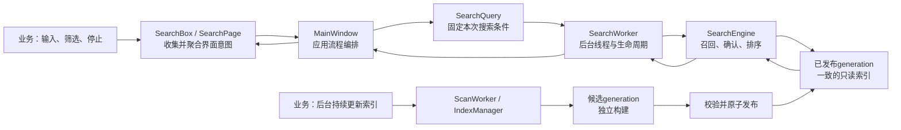
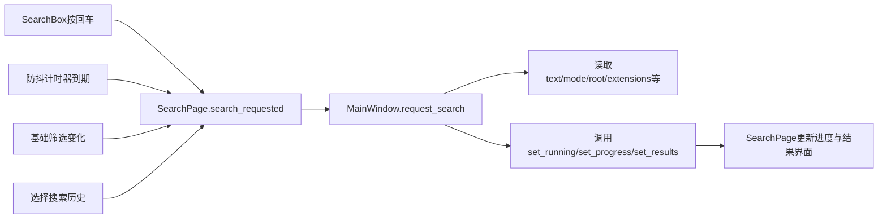
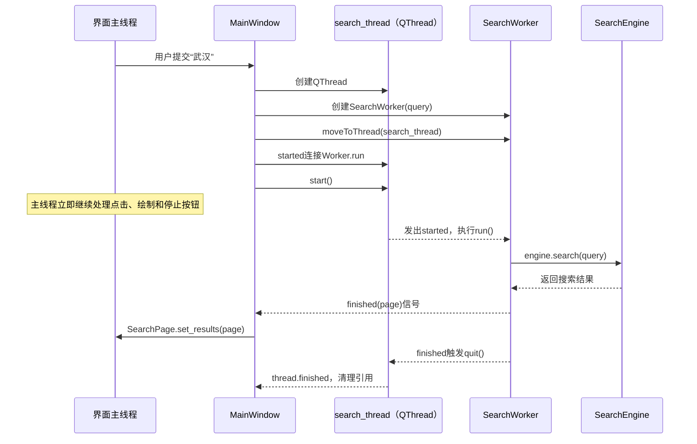
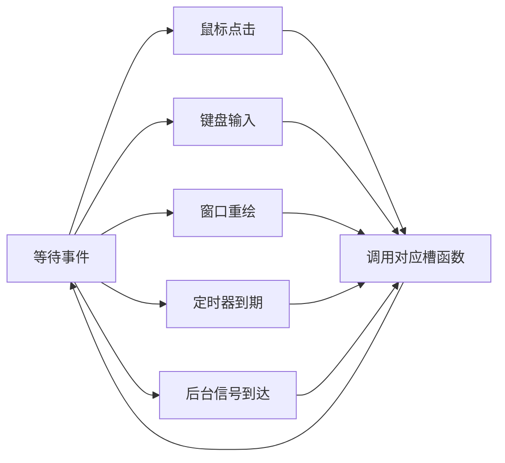
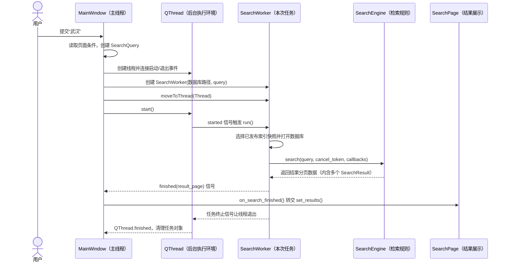
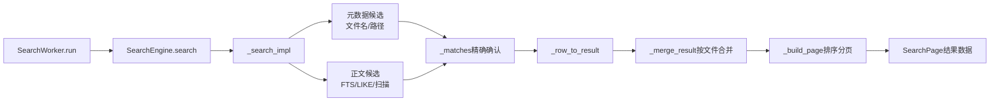
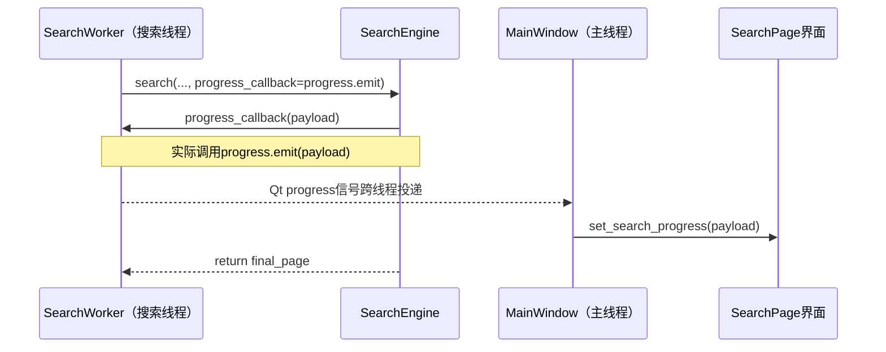

# 资料智能检索工具：架构学习笔记

## 文档的两层记忆结构

这份笔记以后同时维护两个视角。

### 视角一：经典业务场景

用于记忆具体问题。每个场景固定记录：

```text
业务现场
→ 如果直接实现会出现什么问题
→ 当前项目怎样调用
→ 哪个设计解决了问题
→ 带来了什么业务效果
→ 可以迁移到哪些其他项目
```

场景是细粒度记忆单位。例如：“搜索武汉尚未结束，用户又输入北京，怎样避免两套条件错乱？”

### 视角二：整体架构与业务目标

用于理解项目为什么要分层。每学习一个模块，都要回答：

```text
业务为什么需要这一层
→ 这一层负责什么
→ 它和上下游怎样协作
→ 如果删除或合并会出现什么具体问题
→ 对未来RAG/Agent开发有什么可复用价值
```

只记场景容易只见局部，只记分层又容易过于抽象；两种视角需要互相连接。

---

## 整体架构为什么这样设计（持续更新）

### 业务目标到代码设计的映射

| 真实业务目标 | 对应设计 | 主要代码模块 |
| --- | --- | --- |
| 回车、自动搜索、筛选等入口最终执行同一套搜索流程 | 页面聚合多个控件事件 | `SearchBox`、`SearchPage` |
| 用户继续修改界面时，旧搜索不能混入新条件 | 为每次搜索创建参数快照 | `SearchQuery` |
| 搜索较慢时界面仍能响应、停止和继续输入 | 将搜索任务移到后台线程 | `MainWindow`、`SearchWorker` |
| 搜索算法可以独立测试，将来可被CLI、API或Agent复用 | 把线程适配与检索算法分开 | `SearchWorker`、`SearchEngine` |
| 建索引可能耗时很久，但用户仍要搜索旧数据 | 新旧索引使用不同generation文件 | `ScanWorker`、`IndexGenerationStore` |
| 新索引必须完整后才能对用户可见 | 候选库校验后原子发布 | `IndexGenerationStore.publish()` |
| 多文件可以并行解析，但SQLite写入不能互相冲突 | 多进程解析、写入串行调度 | `IndexManager`、`DatabaseWriteDispatcher` |

### 从用户操作到结果显示



这套架构不是为了增加层数，而是分别解决四类会互相冲突的变化：

1. 界面交互经常变化。
2. 一次请求的数据必须保持一致。
3. 耗时任务不能阻塞界面。
4. 索引更新不能破坏正在进行的搜索。

后续章节会把表中每一项落实到真实函数。

---

## 经典业务场景库（持续追加）

| 编号 | 场景 | 核心设计 | 状态 |
| --- | --- | --- | --- |
| S001 | 搜索“武汉”尚未结束，用户又输入或提交“北京” | `SearchQuery`参数快照与任务切换 | 已学习 |
| S002 | 用户连续输入长关键词，不能每个字都查询一次 | `SearchPage.debounce`防抖 | 已学习 |
| S003 | 后台正在建立新索引，用户仍要搜索 | generation隔离 | 后续展开 |
| S004 | 用户快速连续提交多个搜索，只保留最新请求 | `pending_search`与取消清理 | 已学习 |
| S005 | 正文搜索较慢，先展示文件名和路径结果 | 部分结果信号 | 后续展开 |
| S006 | 多个文件并行解析，但SQLite不能并发乱写 | 多进程解析与串行写入 | 后续展开 |
| S007 | 搜索耗时期间界面仍要响应，并能安全停止 | `SearchWorker`、`QThread`与协作式取消 | 本章 |
| S008 | “武汉”命中同一文件多个位置，需要合并、排序和分页 | `SearchEngine`的候选召回、精确确认与结果封装 | 本章 |

### S001：搜索中修改或重新提交关键词

#### 业务现场

用户提交“武汉”后，后台搜索尚未结束。此时用户把输入框改成“北京”。

#### 必须满足的业务规则

- 已经开始的旧任务必须继续使用它收到的“武汉”条件，不能读到一半变成“北京”。
- 如果用户只是编辑，没有再次提交，旧任务继续运行。
- 如果用户再次提交“北京”，系统应取消旧任务，清理完成后用新条件创建新任务。

#### 容易出错的直接实现

如果`SearchWorker`在执行过程中不断读取`SearchPage`控件：

```text
查文件名时：输入框是“武汉”
用户修改输入框
查正文时：输入框变成“北京”
```

同一次搜索会混用两套条件，而且后台线程还会直接访问只能由Qt主线程操作的控件。

#### 当前项目的解决方案

第一次提交时，`MainWindow._run_search()`立即读取页面并创建：

```python
SearchQuery(text="武汉", ...)
```

随后把这个对象交给：

```text
SearchWorker
→ SearchEngine
```

页面之后变成“北京”，不会修改旧Worker持有的查询条件。

如果用户再次提交“北京”，真实调用链是：

```text
SearchPage.search_requested
→ MainWindow.request_search()
→ 发现search_thread仍存在
→ pending_search = True
→ cancel_search()
→ 旧SearchWorker结束
→ cleanup_search_thread()
→ 再次调用_run_search()
→ 从当前页面创建SearchQuery(text="北京")
```

#### 业务效果

1. 每次搜索内部条件一致。
2. 用户可以继续输入，不必等待旧搜索完成。
3. 新请求不会与旧线程同时更新同一结果页面。
4. 取消、清理、新建的生命周期顺序清楚。

#### 可迁移的通用模式

```text
可编辑的实时界面状态
→ 提交时复制为请求对象
→ 后台任务只读取请求对象
```

适用于：

- RAG聊天请求；
- 导出报表任务；
- 文件批量处理；
- 视频转码参数；
- 订单提交；
- HTTP接口请求。

#### 面试表达

> 为避免用户在搜索过程中修改输入导致同一任务条件漂移，项目在提交时把页面状态转换成独立SearchQuery，再交给后台Worker。若用户提交新关键词，MainWindow先标记pending_search并取消旧任务，线程清理后再根据当前页面创建新Query。因此每次任务的数据一致，同时界面仍可继续编辑。

### S002：连续输入时避免重复搜索

本场景的完整实现见第二章“防抖为什么是实际业务能力”。核心链路是：

```text
textChanged
→ SearchPage._on_text_changed()
→ debounce重新计时
→ 用户停止输入
→ timeout只发出一次search_requested
```

它解决的不是抽象的“性能优化”，而是避免连续输入导致大量后台搜索、取消操作和结果闪烁。

### S004：旧搜索未结束时，只执行最新请求

#### 业务现场

用户先搜索“武汉”，搜索还在后台执行，又连续提交了“湖北”和“北京”。业务真正关心的是最后一次请求“北京”，而不是把三次请求排队全部执行。

#### 容易出错的直接实现

如果每次提交都立刻创建一个新线程，会同时出现多个任务：

```text
武汉搜索 ───────────────→ 最后返回
湖北搜索 ────────→ 返回
北京搜索 ───→ 返回
```

“武汉”可能最晚完成，并把“北京”的结果覆盖掉。进度条、停止按钮和状态文字也会被三个任务同时修改。

另一种错误做法是：调用旧Worker的`cancel()`后立刻把引用清空并创建新Worker。`cancel()`只是发出协作式取消请求，旧线程此时不一定已经真正退出，两个任务仍可能短暂重叠。

#### 当前项目的真实调用链

相关实现位于`local_full_text_search/ui/main_window.py`：

```text
SearchPage.search_requested
→ MainWindow.request_search()
→ 发现 self.search_thread 仍存在
→ self.pending_search = True
→ MainWindow.cancel_search()
→ SearchWorker.cancel()
→ 旧Worker发出 cancelled / finished / failed等终止信号
→ QThread.quit()
→ QThread.finished
→ MainWindow.cleanup_search_thread()
→ 清空旧thread和worker引用
→ self._run_search()
→ 从页面此刻的最新状态创建SearchQuery(text="北京")
```

`pending_search`只是一个布尔值，不保存“湖北”和“北京”的队列。因此连续提交多次会折叠成一次待执行任务；等旧线程清理完，`_run_search()`读取页面最新状态，最终执行“北京”。

#### 为什么必须等`QThread.finished`

```text
调用cancel()
≠ 后台任务已经结束

收到QThread.finished
= 线程已经真正退出，可以清引用并启动下一次
```

这条边界让同一时间最多只有一套搜索流程更新结果页面。

#### 业务效果

1. 快速连续输入时，不浪费时间依次完成已经过时的请求。
2. 旧结果不会覆盖最新结果。
3. 进度、状态、停止按钮只有一个任务负责，不会互相打架。
4. 关闭程序时，`MainWindow`知道还有哪个线程需要取消和等待。

#### 可迁移的通用模式

这是“最新请求优先”（latest wins）模式：

```text
新请求到达
→ 取消旧任务
→ 等旧任务真正清理
→ 读取最新状态
→ 启动一个新任务
```

适合搜索联想、筛选预览、地图拖动查询、报表参数预览等场景。它不一定适合订单提交或聊天消息发送，因为那些请求通常不能丢弃中间项；设计前必须先判断业务要“全部执行”还是“只保留最新”。

#### 30秒面试表达

> 项目的交互式搜索采用latest-wins策略。用户在旧搜索运行时再次提交，MainWindow不会并发创建第二个Worker，而是设置pending_search并请求旧Worker取消。只有收到QThread.finished、完成资源清理后，才根据页面最新状态重新创建SearchQuery和Worker。这样既避免旧结果覆盖新结果，也避免多个任务竞争同一套进度和结果界面。

---

## 第一章：SearchBox 与信号分层

### 一、本系列的学习方式

后续每个模块都按以下顺序学习，一次只讲一个主要模块：

1. 这个模块解决什么业务问题。
2. 对象在哪里创建，`__init__()` 如何初始化。
3. 从哪个函数进入，依次调用哪些函数，最后返回什么。
4. 为什么要这样设计，而不是把代码合并到一起。
5. 这种设计给当前业务带来什么好处。
6. 能提炼出什么通用原则，以后开发时如何复用。
7. 用一至两个问题确认是否真正理解。

讲解必须以当前仓库的真实代码为依据。源码中的新增教学注释使用中文。

---

### 二、本课目标

理解以下两个问题：

1. `SearchBox` 是怎样被创建和初始化的？
2. 用户按回车以后，信号为什么要经过 `SearchPage`，再到 `MainWindow`？

关键代码：

- `app.py:2836`
- `local_full_text_search/ui/main_window.py:284`
- `local_full_text_search/ui/main_window.py:319`
- `local_full_text_search/ui/main_window.py:346`
- `local_full_text_search/ui/main_window.py:2780`
- `local_full_text_search/ui/main_window.py:2822`
- `local_full_text_search/ui/main_window.py:2828`
- `local_full_text_search/ui/main_window.py:3037`
- `local_full_text_search/ui/main_window.py:3368`
- `local_full_text_search/ui/main_window.py:3401`

---

### 三、三个对象分别负责什么

| 对象 | 负责 | 不负责 |
| --- | --- | --- |
| `SearchBox` | 输入框、清空按钮、停止按钮、回车事件 | 创建查询、启动线程、访问数据库 |
| `SearchPage` | 组合搜索框、筛选条件、结果区域，并对外提供统一的页面级事件 | 执行数据库检索 |
| `MainWindow` | 协调整个应用，决定何时创建查询和后台任务 | 处理输入框的具体显示细节 |

它们的包含关系是：

```text
MainWindow
└── SearchPage
    └── SearchBox
        ├── QLineEdit 输入框
        ├── 清空按钮
        ├── 历史按钮
        └── 停止按钮
```

---

### 四、初始化调用链

程序启动后，调用顺序如下：

```text
app.py 的 main()
  ↓ 创建
MainWindow(...)
  ↓ Python 自动调用
MainWindow.__init__()
  ↓ 调用
MainWindow._build_shell()
  ↓ 创建
SearchPage(settings)
  ↓ Python 自动调用
SearchPage.__init__()
  ↓ 调用
SearchPage._build()
  ↓ 创建
SearchBox()
  ↓ Python 自动调用
SearchBox.__init__()
```

#### 1. app.py 创建 MainWindow

```python
window = MainWindow(...)
```

创建对象时，Python 自动进入 `MainWindow.__init__()`。

#### 2. MainWindow 创建 SearchPage

`MainWindow.__init__()`调用：

```python
self._build_shell()
```

`MainWindow._build_shell()`内部创建搜索页面：

```python
self.search_page = SearchPage(self.settings)
```

#### 3. SearchPage 创建 SearchBox

`SearchPage.__init__()`调用：

```python
self._build()
```

`SearchPage._build()`内部创建搜索框：

```python
self.search_box = SearchBox()
```

执行这行代码时，Python自动调用`SearchBox.__init__()`。

#### 4. SearchBox 初始化内部控件

`SearchBox.__init__()`主要完成：

```python
super().__init__()              # 初始化Qt父类
self.input = QLineEdit()        # 创建输入框
self.clear_button = QPushButton()  # 创建清空按钮
self.history_button = QPushButton() # 创建历史按钮
self.stop_button = QPushButton("停止") # 创建停止按钮
```

初始化的含义是“创建对象并建立连接”，不是立即执行搜索。

---

### 五、connect 和 emit 的区别

真实代码：

```python
self.input.returnPressed.connect(self.search_requested.emit)
```

可以拆成：

```text
returnPressed                 输入框自带的“按下回车”信号
connect(...)                  登记将来要调用谁
self.search_requested.emit    将来真正发出SearchBox的搜索信号
```

`connect()`在初始化阶段执行，只建立关系。

`emit()`在用户操作发生时执行，才真正通知接收者。

---

### 六、按回车后的真实调用链

用户输入“武汉”并按回车：

```text
QLineEdit 发出 returnPressed
  ↓ 初始化时已经建立 connect
SearchBox 执行 search_requested.emit()
  ↓ SearchPage 初始化时已经建立 connect
SearchPage 执行 search_requested.emit()
  ↓ MainWindow 初始化时已经建立 connect
MainWindow.request_search()
```

对应三处真实连接：

```python
# SearchBox.__init__()
self.input.returnPressed.connect(self.search_requested.emit)

# SearchPage._build()
self.search_box.search_requested.connect(self.search_requested.emit)

# MainWindow._build_shell()
self.search_page.search_requested.connect(self.request_search)
```

因此，给`MainWindow`发出最终搜索信号的是`SearchPage`。最初的用户操作来自`SearchBox`中的输入框。

---

### 七、关键词怎样取得

`search_requested = Signal()`只表达“用户要求搜索”，没有携带关键词。

需要关键词时，外层调用`SearchPage.text()`：

```python
def text(self) -> str:
    return self.search_box.input.text().strip()
```

调用链：

```text
MainWindow
  ↓ 调用
SearchPage.text()
  ↓ 读取
SearchBox.input.text()
  ↓ 返回
"武汉"
```

这里把两类信息分开了：

- 信号表达：发生了什么——用户要求搜索。
- 方法返回值表达：具体数据是什么——关键词是“武汉”。

---

### 八、为什么不让 MainWindow 直接监听 SearchBox

下面的写法技术上能够运行：

```python
self.search_page.search_box.search_requested.connect(self.request_search)
```

但这会让`MainWindow`知道`SearchPage`的内部结构：

```text
MainWindow必须知道
SearchPage里面有search_box
search_box里面有search_requested
```

这叫作对内部实现的深层耦合。

当前写法是：

```python
self.search_page.search_requested.connect(self.request_search)
```

`MainWindow`只依赖`SearchPage`公开的页面级事件，不依赖内部使用了输入框、按钮还是其他组件。

---

### 九、为什么 SearchPage 要提供统一信号

当前项目中，搜索请求并不只有“按回车”一个来源。

#### 来源一：按回车

```text
SearchBox.search_requested
→ SearchPage.search_requested
```

#### 来源二：自动搜索计时器到期

```python
self.debounce.timeout.connect(self.search_requested.emit)
```

调用链：

```text
输入文字
→ SearchPage._on_text_changed()
→ debounce.start()
→ debounce.timeout
→ SearchPage.search_requested
```

#### 来源三：基础筛选条件改变

```python
def _filter_changed(self) -> None:
    if self.text():
        self.search_requested.emit()
```

三个来源最终统一为：

```text
SearchPage.search_requested
→ MainWindow.request_search()
```

因此`MainWindow`不需要分别监听回车、计时器和每个筛选控件。

---

### 十、这种设计给业务带来的好处

#### 1. 可以方便增加新的搜索入口

以后可以增加：

- 搜索按钮；
- 全局快捷键；
- 语音输入；
- 搜索历史中的“再次搜索”；
- 修改筛选条件后自动重搜。

这些入口只需要最终发出`SearchPage.search_requested`，`MainWindow`的后台搜索逻辑可以保持不变。

#### 2. 可以替换页面内部控件

以后把`SearchBox`换成新的组件，只要`SearchPage`仍然提供相同的公开信号，`MainWindow`不需要修改。

#### 3. 更容易测试

可以分别测试：

- `SearchBox`按回车后是否发出信号；
- `SearchPage`是否正确汇总各种搜索入口；
- `MainWindow`收到页面信号后是否启动搜索流程。

问题出现时更容易判断属于哪一层。

#### 4. 避免子组件直接依赖主窗口

`SearchBox`不需要保存`MainWindow`引用，也不需要导入`MainWindow`。它可以在其他页面或测试中独立创建。

---

### 十一、可以复用的通用原则

#### 原则一：子组件表达意图，不直接操纵上层

推荐：

```text
子组件发出“用户想做什么”
→ 上层决定“具体怎么做”
```

不推荐：

```text
子组件找到主窗口
→ 直接启动线程、访问数据库、修改其他页面
```

#### 原则二：页面负责聚合控件事件

当多个控件都会触发同一业务动作时，由页面统一转换成一个业务信号。

```text
控件事件
→ 页面级业务事件
→ 应用级用例
```

在当前项目中就是：

```text
回车/计时器/基础筛选变化
→ SearchPage.search_requested
→ MainWindow.request_search
```

#### 原则三：上层依赖公开接口，不依赖内部结构

推荐：

```python
self.search_page.search_requested.connect(...)
```

谨慎使用：

```python
self.search_page.search_box.input.returnPressed.connect(...)
```

后者跨越了多层对象，内部结构一改，上层也必须修改。

#### 原则四：同一种业务意图使用同一个入口

无论请求来自按钮、回车、快捷键还是语音，都应尽量汇总到同一个应用入口，避免复制业务流程。

---

### 十二、什么时候值得使用这种设计

适合：

- 一个业务动作有多个触发入口；
- 页面内部结构以后可能调整；
- 子组件需要复用或单独测试；
- 最终动作涉及线程、数据库或全局状态；
- 项目会持续迭代，而不是一次性演示。

不必过度设计的情况：

- 只有一个简单按钮和一个本地函数；
- 页面不会复用，也几乎不会变化；
- 增加信号转发只会制造没有收益的层级。

判断标准不是“层数越多越专业”，而是：

> 这一层是否隐藏了内部变化，或者统一了多个业务入口？

如果答案是否定的，就不应该为了分层而分层。

---

### 十三、面试表达

可以这样回答：

> `SearchBox`只负责采集用户操作并发出控件级信号；`SearchPage`聚合回车、自动搜索和基础筛选变化等多个入口，统一对外发出页面级`search_requested`；`MainWindow`只监听这个公开事件并编排后台任务。这样可以降低主窗口对页面内部控件的耦合，方便替换组件、增加搜索入口和分层测试。

---

### 十四、理解检查

1. 创建`SearchBox`的直接函数是`MainWindow._build_shell()`还是`SearchPage._build()`？
2. `connect()`是在执行搜索，还是登记以后信号发生时要调用的函数？
3. 为什么`MainWindow`监听`SearchPage.search_requested`，而不是深入访问`SearchPage.search_box.input.returnPressed`？
4. 如果增加语音搜索，应该让它最终汇入哪个统一信号？

---

## 第二章：SearchPage——搜索功能的页面聚合层

### 一、本章先给出结论

`SearchPage`不是搜索算法，也不是后台任务执行器。它解决的是一个页面级问题：

> 把搜索框、基础筛选、高级筛选、索引状态、进度、结果列表和分页组合成一个完整搜索页面，并向`MainWindow`提供稳定的输入、输出接口。

可以把它理解成“搜索功能的前台服务台”：

- 内部接收多个控件产生的操作；
- 对外只发出少量页面级业务信号；
- 外部需要搜索条件时，通过公开方法统一读取；
- 外部返回搜索状态和结果时，通过公开方法统一显示。

真实代码位于：

- `local_full_text_search/ui/main_window.py`中的`SearchPage`
- `SearchPage.__init__()`
- `SearchPage._build()`
- `SearchPage._on_text_changed()`
- `SearchPage._filter_changed()`
- `SearchPage.text()`及其他条件读取方法
- `SearchPage.set_running()`
- `SearchPage.set_search_progress()`
- `SearchPage.set_partial_results()`
- `SearchPage.set_results()`

### 二、SearchPage的输入与输出

| 方向 | 内容 | 代码形式 |
| --- | --- | --- |
| 控件进入页面 | 回车、文字变化、基础筛选变化、翻页、打开文件 | Qt控件信号 |
| 页面通知外层 | 搜索、停止、翻页、打开文件等业务意图 | `SearchPage`公开信号 |
| 外层读取页面 | 关键词、模式、目录、扩展名、OCR开关等 | getter方法 |
| 外层更新页面 | 运行状态、进度、部分结果、完整结果 | `set_*()`方法 |

核心结构如下：



图中最重要的关系是：多个入口汇总成一个`search_requested`，多项页面数据通过一组公开方法提供给`MainWindow`。

### 三、初始化调用链

上一章已经走到：

```text
MainWindow._build_shell()
  ↓
self.search_page = SearchPage(self.settings)
```

执行`SearchPage(self.settings)`时，Python自动进入：

```python
SearchPage.__init__(settings)
```

`SearchPage.__init__()`的主要顺序是：

```text
1. super().__init__()
2. 初始化页面状态字段
3. 创建防抖计时器 debounce
4. 调用 self._build() 创建全部控件
5. 调用 self.apply_settings(settings) 应用配置
```

对应代码骨架：

```python
def __init__(self, settings: AppSettings) -> None:
    super().__init__()
    self._stats = {}
    self._index_ready = False

    self.debounce = QTimer(self)
    self.debounce.setSingleShot(True)
    self.debounce.timeout.connect(self.search_requested.emit)

    self._build()
    self.apply_settings(settings)
```

这里有两个重要设计点。

第一，先`_build()`再`apply_settings()`，因为必须先创建下拉框和复选框，才能把默认搜索模式、OCR开关等设置写入控件。

第二，`SearchPage.__init__()`只在页面创建时执行一次；后面每次搜索不会重新创建整个页面。

### 四、_build()具体创建了什么

`SearchPage._build()`大致按以下顺序组装页面：

```text
SearchBox
→ 基础筛选区
→ AdvancedFilters高级筛选
→ 状态文字和耗时
→ 搜索进度条
→ 空状态/结果列表切换区
→ 翻页控件
→ 建立所有信号连接
```

#### 1. 创建并连接SearchBox

```python
self.search_box = SearchBox()
self.search_box.input.textChanged.connect(self._on_text_changed)
self.search_box.search_requested.connect(self.search_requested.emit)
self.search_box.stop_requested.connect(self.stop_requested.emit)
self.search_box.history_requested.connect(self._show_history)
```

这里不是所有信号都简单转发：

- 搜索和停止属于应用级动作，所以转发给外层；
- 历史菜单属于页面内部展示，所以由`SearchPage._show_history()`自己处理；
- 文字变化需要处理防抖和空状态，所以进入`_on_text_changed()`。

这说明信号是否转发，要根据职责决定，不能机械地全部向上抛。

#### 2. 创建基础筛选

页面创建四个主要下拉框：

```python
self.mode_combo       # 完全包含、完整短语、全部词、任意词、正则
self.file_type_combo  # PDF、Word、Excel等文件类型分组
self.scope_combo      # 全部范围或某一个索引根目录
self.sort_combo       # 相关性、时间、大小、文件名排序
```

下拉框显示给用户的是中文标签，内部保存的是稳定值。例如：

```python
self.mode_combo.addItem("全部关键词", "all")
```

用户看到“全部关键词”，程序取得的是`"all"`。这样修改界面文案时，不会影响搜索算法使用的模式值。

#### 3. 创建结果显示区

```python
self.content_stack = QStackedWidget()
self.empty_state = EmptyState()
self.result_view = ResultView()
```

`QStackedWidget`同一时间只显示一个子控件：

- 没有搜索时显示`EmptyState`；
- 有结果时显示`ResultView`；
- 没有结果、索引未就绪或搜索中断时，重新使用`EmptyState`展示不同内容。

这避免了多个状态控件同时显示和互相覆盖。

### 五、用户输入文字时的函数链

`SearchPage._build()`建立了连接：

```python
self.search_box.input.textChanged.connect(self._on_text_changed)
```

用户每输入或删除一个字符，调用链是：

```text
QLineEdit文字变化
→ QLineEdit.textChanged(text)
→ SearchPage._on_text_changed(text)
```

真实处理逻辑：

```python
def _on_text_changed(self, text: str) -> None:
    self.search_box.update_clear_button()
    if not text.strip():
        self.debounce.stop()
        self.show_idle_state()
        return
    if self.auto_search_enabled:
        self.debounce.start()
```

分成三种情况：

1. 无论输入什么，都先更新“清空”按钮是否显示。
2. 输入被删空时，取消尚未触发的自动搜索，并恢复空闲页面。
3. 输入不为空且开启自动搜索时，重新启动防抖计时器。

### 六、防抖为什么是实际业务能力

假设用户连续输入“武汉人工智能”：

如果没有防抖，可能产生：

```text
武 → 搜索一次
武汉 → 搜索一次
武汉人 → 搜索一次
武汉人工 → 搜索一次
……
```

这会反复创建后台搜索任务、取消旧任务、查询数据库并刷新界面。

现在的逻辑是：

```text
每输入一个字
→ debounce.start()重新计时
→ 用户暂时停止输入
→ debounce.timeout只触发一次
→ SearchPage.search_requested
```

实际好处：

- 减少无效数据库查询；
- 减少线程创建和取消；
- 避免结果列表频繁闪烁；
- 用户输入长关键词时仍保持界面流畅。

这是可以直接用于搜索框、接口联想、表单校验和实时预览的通用模式。

### 七、筛选变化时的函数链

基础下拉框连接到同一个函数：

```python
self.file_type_combo.currentIndexChanged.connect(self._filter_changed)
self.mode_combo.currentIndexChanged.connect(self._filter_changed)
self.scope_combo.currentIndexChanged.connect(self._filter_changed)
self.sort_combo.currentIndexChanged.connect(self._filter_changed)
```

调用链：

```text
用户修改基础筛选
→ currentIndexChanged
→ SearchPage._filter_changed()
→ 如果已有关键词，发出search_requested
```

```python
def _filter_changed(self) -> None:
    if self.text():
        self.search_requested.emit()
```

这里先判断是否有关键词，避免用户尚未输入内容时，仅切换筛选框就发起一次空搜索。

需要注意当前真实实现：高级复选框的`toggled`只连接`_update_filter_button()`，主要用于更新“筛选 · N”的提示，不会在勾选瞬间自动发起搜索。这是理解和测试当前行为时必须区分的细节。

### 八、SearchPage怎样向MainWindow提供搜索条件

`SearchPage`没有直接创建`SearchQuery`，而是提供一组读取方法：

```python
text()
mode_value()
root_ids()
extensions()
sort_value()
search_filename()
search_path()
search_content()
include_ocr()
include_ocr_fuzzy()
case_sensitive()
```

例如：

```python
def mode_value(self) -> str:
    return str(self.mode_combo.currentData())
```

```python
def root_ids(self) -> list[int]:
    value = self.scope_combo.currentData()
    return [int(value)] if value is not None else []
```

```python
def extensions(self) -> list[str]:
    label = str(self.file_type_combo.currentData())
    return sorted(FILE_TYPE_GROUPS.get(label, set()))
```

这些方法做了两件事：

1. 隐藏控件细节，外层不需要知道页面使用的是哪个下拉框或复选框。
2. 把界面数据转换成业务需要的类型，例如把“PDF”分组转换成扩展名列表。

下一章学习`MainWindow`时，会看到它怎样调用这些方法组装`SearchQuery`。

### 九、外层怎样把搜索状态交回SearchPage

页面对外提供一组更新方法：

```python
set_running(running)
set_search_progress(payload)
set_partial_results(page)
set_results(page)
show_no_results()
show_interrupted_state(title)
```

它们形成另一条方向相反的链路：

```text
后台搜索状态/结果
→ MainWindow对应槽函数
→ SearchPage的set_*方法
→ 页面控件更新
```

例如搜索开始时：

```python
self.search_page.set_running(True)
```

`SearchPage.set_running(True)`负责：

- 显示停止按钮；
- 显示进度条；
- 计算预计时间；
- 显示“正在检索索引”；
- 必要时切换正在检索的空状态。

它不会创建线程，也不会执行数据库查询。

搜索完成时，`set_results(page)`负责：

- 更新实际耗时；
- 统计正文、OCR和疑似OCR命中；
- 更新状态文字；
- 把结果交给`ResultView`；
- 决定是否显示分页。

注意：`set_results(self, page)`中的参数`page`是“一页搜索结果数据”，不是当前这个UI类`SearchPage`。两者同名容易造成初学者混淆，这也是阅读代码时应主动识别的命名上下文。

### 十、为什么不把SearchPage合并到MainWindow

如果删除`SearchPage`，`MainWindow`就必须直接负责：

- 创建搜索框和全部筛选控件；
- 处理文字变化和防抖；
- 读取每个控件的值；
- 管理空状态、进度条、结果列表和分页；
- 同时创建线程、Worker并处理应用关闭。

具体后果不是一句抽象的“耦合高”，而是：

1. 修改搜索页面布局时容易碰到线程调度代码。
2. 增加一个筛选项时，需要在巨大的MainWindow中查找多个位置。
3. 搜索页面难以单独测试和复用。
4. MainWindow会逐渐成为什么都负责的超大类。
5. UI显示错误与后台搜索错误更难分开定位。

当前设计让`MainWindow`只关心：

```text
页面要求做什么
→ 我怎样调度应用任务
→ 任务状态和结果怎样交回页面
```

让`SearchPage`只关心：

```text
搜索功能页面有哪些控件
→ 用户当前选择了什么
→ 当前状态和结果应该怎样显示
```

### 十一、这种设计方便哪些业务

#### 1. 增加搜索入口

可以增加搜索按钮、快捷键、历史记录再次搜索，只要最后发出统一的`search_requested`。

#### 2. 增加筛选条件

可以在SearchPage内部增加作者、时间、文件大小或标签筛选，再提供对应getter；MainWindow仍然通过页面公开接口读取。

#### 3. 支持渐进式结果

项目可以先调用`set_partial_results()`显示文件名和路径命中，再调用`set_results()`显示完整正文结果，而不需要让Worker直接操作界面。

#### 4. 支持不同索引状态

同一个页面可以展示尚未添加目录、索引未完成、搜索中、没有结果、部分结果和完整结果。

#### 5. 方便故障定位

可以按边界排查：

```text
输入没反应
→ 检查SearchBox到SearchPage的信号

搜索条件不正确
→ 检查SearchPage的getter转换

任务已完成但界面没结果
→ 检查MainWindow到SearchPage.set_results
```

### 十二、可以复用的通用模式

#### 模式一：页面作为功能门面

页面把内部许多控件包装成少量稳定接口：

```text
多个内部控件
→ 页面公开信号和方法
→ 外层应用协调器
```

这与后端开发中的Service接口、API接口有相似思想：调用者依赖公开能力，不依赖内部实现。

#### 模式二：事件聚合

多个界面事件表达同一种业务意图时，汇总为一个业务事件：

```text
回车 / 自动搜索 / 基础筛选 / 历史记录
→ search_requested
```

#### 模式三：表单适配

界面控件保存的是展示数据，getter把它转换成业务数据：

```text
下拉框“PDF”
→ extensions()
→ [".pdf"]等扩展名集合
```

#### 模式四：命令和展示分离

页面发出“开始搜索”的命令意图，但不执行搜索；页面接收结果数据，但不计算搜索结果。

这个原则以后可以迁移到RAG应用：

```text
聊天页面收集问题和知识库范围
→ 发出提问请求
→ 编排层调用检索与大模型
→ 页面只展示流式状态、引用和答案
```

### 十三、当前设计的边界与代价

这套设计不是没有代价：

- 信号需要经过一层转发，初学时调用链不够直观；
- `SearchPage`本身已经包含较多状态和展示逻辑；
- 如果继续增加复杂筛选、预览和历史管理，它也可能变成新的“大类”。

如果未来继续增长，可以进一步拆分：

```text
SearchForm       负责输入与筛选
SearchResults    负责结果和分页
SearchPresenter  负责页面状态转换
```

但当前阶段不应为了“层数更多”提前拆分。判断是否继续拆的标准是：是否已经出现独立变化、独立复用或独立测试的真实需求。

### 十四、30秒面试表达

> 项目中的SearchPage是搜索功能的页面聚合层。它组合SearchBox、检索模式、文件类型、目录范围、OCR选项、进度和结果列表，把回车、自动搜索、基础筛选变化等入口统一成search_requested信号。MainWindow通过公开getter读取页面条件并创建SearchQuery，后台返回后再调用set_progress或set_results更新页面。这样既避免MainWindow直接依赖所有控件，也支持防抖搜索、渐进式结果和后续增加新筛选项。

### 十五、理解检查

1. `SearchPage.__init__()`为什么必须先调用`_build()`，再调用`apply_settings()`？
2. 用户连续输入“武汉人工智能”时，防抖计时器怎样避免执行多次搜索？
3. `SearchPage`为什么提供`mode_value()`和`extensions()`，而不是让`MainWindow`直接读取下拉框？
4. `SearchPage.set_results()`负责展示结果还是计算检索结果？

### 十六、SearchPage与SearchQuery看起来重复，实际区别是什么

两者确实都出现了关键词、模式、目录和扩展名，但它们处在不同阶段：

```text
SearchPage中的实时控件状态
  ↓ MainWindow读取并转换
SearchQuery中的单次请求快照
  ↓ 交给后台线程
SearchWorker / SearchEngine执行
```

| 对比项 | `SearchPage` | `SearchQuery` |
| --- | --- | --- |
| 本质 | Qt界面对象 | 普通Python数据对象 |
| 生命周期 | 主窗口存在期间一直存在 | 每发起一次搜索就创建一个 |
| 所在线程 | Qt界面主线程 | 创建后传给搜索Worker使用 |
| 内容 | 控件、信号、状态、进度、结果展示 | 本次搜索所需的参数值 |
| 状态特点 | 用户随时可以继续修改 | 代表点击搜索那一刻固定下来的条件 |
| 是否显示界面 | 是 | 否 |
| 是否访问搜索算法 | 不直接访问 | 被SearchEngine读取 |

#### 为什么字段名称会重复

因为`SearchPage`是搜索条件的来源，`SearchQuery`是这些条件经过整理后的业务数据。

真实转换发生在`MainWindow._run_search()`：

```python
query = SearchQuery(
    text=self.search_page.text(),
    mode=self.search_page.mode_value(),
    root_ids=self.search_page.root_ids(),
    extensions=self.search_page.extensions(),
    search_content=self.search_page.search_content(),
    include_ocr=self.search_page.include_ocr(),
    page=self.page,
    sort_by=self.search_page.sort_value(),
)
```

等号右边读取“当前页面是什么状态”，等号左边构造“这一次搜索要使用什么参数”。

此外，`SearchQuery`并不只来自页面。它还组合了应用设置和MainWindow状态：

```python
ocr_min_confidence=self.settings.ocr_min_confidence
page_size=min(max(self.settings.page_size, 10), 100)
max_results=self.settings.max_results
page=self.page
```

所以`SearchQuery`是多个来源汇总后的完整请求，不是SearchPage的简单复制。

#### 为什么不能直接把SearchPage传给SearchWorker

假设用户输入“武汉”并开始搜索，搜索尚未完成时又把输入框改成“北京”。

如果后台线程不断读取`SearchPage`：

```text
查询文件名时可能读到“武汉”
查询正文时可能读到“北京”
```

同一次搜索就可能使用两套条件，结果不一致。

当前实现先创建：

```python
SearchQuery(text="武汉", ...)
```

随后即使页面显示已经改成“北京”，正在运行的Worker仍然使用本次收到的“武汉”查询对象。新的“北京”会形成下一次`SearchQuery`。

还有一个更重要的原因：Qt界面控件属于主线程。后台线程直接读取`QLineEdit`、`QComboBox`等控件，会破坏Qt的线程边界，产生不稳定行为。普通数据对象`SearchQuery`不包含Qt控件，可以安全地作为线程之间的任务数据传递。

#### 这种分离解决了什么具体问题

1. 保证一次搜索从开始到结束使用同一组条件。
2. 后台算法不依赖Qt，可以单独测试。
3. 将来增加命令行、HTTP API或Agent入口时，也能直接构造`SearchQuery`复用`SearchEngine`。
4. 页面可以继续响应用户输入，不会改变正在运行的旧请求。
5. 搜索历史可以保存参数数据，而不需要保存一个界面对象。

#### 通用开发原则

这可以提炼为：

> 界面负责维护用户正在编辑的状态；请求对象负责保存某次操作提交时的数据快照。

在其他系统中也很常见：

```text
网页表单 → HTTP请求JSON
订单编辑页面 → CreateOrderRequest
RAG聊天页面 → RetrievalQuery
配置界面 → 执行任务参数对象
```

不要因为两边字段相似就认为职责重复。判断是否应该分开，要看它们是否具有不同的生命周期、线程边界和变化原因。

#### 30秒面试表达

> SearchPage保存用户正在编辑的实时界面状态，而SearchQuery是发起搜索时创建的一次性参数快照。MainWindow把页面值、分页状态和系统配置汇总成SearchQuery，再交给后台Worker。这样用户继续修改界面时不会影响已经运行的搜索，同时避免后台线程直接访问Qt控件，SearchEngine也可以脱离UI独立测试和复用。

---

## 第三章：MainWindow——搜索流程的应用编排层

### 一、先记住一句话

> `MainWindow`不负责“怎样匹配关键词”，它负责“什么时候可以搜、用哪些条件搜、由哪个后台任务搜、结果交给谁展示，以及任务何时可以安全结束”。

可以把它理解为搜索流程的调度员：调度员认识页面、任务和线程，但不亲自执行检索算法。

### 二、MainWindow为什么会有SearchWorker

`MainWindow`持有：

```python
self.search_thread: QThread | None = None
self.search_worker: SearchWorker | None = None
```

“持有一个对象”和“承担这个对象的业务职责”不是一回事。

| MainWindow对Worker做的事 | MainWindow不做的事 |
| --- | --- |
| 创建本次Worker | 不编写SQL |
| 把Worker移入后台线程 | 不判断文件是否匹配 |
| 连接开始、结果、失败和取消信号 | 不计算相关性分数 |
| 响应停止按钮 | 不读取文件正文 |
| 在线程结束后清理引用 | 不生成SearchResult |

它必须知道`SearchWorker`，因为窗口拥有以下应用级信息：

1. 搜索页面是否又提交了新请求。
2. 数据库是否正在迁移。
3. 应用是否正在关闭。
4. 当前有没有搜索线程在运行。
5. 搜索结果应该交给哪个页面。

这些都不是检索算法本身应该知道的事情。

### 三、对象怎样一步步初始化

#### 第1步：app.py创建MainWindow

入口函数创建主窗口：

```text
app.py: main()
→ MainWindow(...)
→ MainWindow.__init__()
```

构造参数中已经传入数据库、设置、设置服务和generation基础路径。`MainWindow`因此能协调应用中的页面和后台任务。

#### 第2步：先声明“当前没有搜索任务”

`local_full_text_search/ui/main_window.py:186-231`：

```python
self.search_thread = None
self.search_worker = None
self.pending_search = False
```

三项状态分别表示：

- `search_thread`：后台执行环境是否存在。
- `search_worker`：本次搜索任务对象是否存在。
- `pending_search`：旧任务结束后，是否还要按最新页面状态再搜一次。

注意：程序启动时并没有提前创建`SearchWorker`。每次真正搜索时才创建一个新的Worker，因为每个Worker都要绑定本次独立的`SearchQuery`。

#### 第3步：MainWindow创建SearchPage

`MainWindow.__init__()`调用`_build_shell()`：

```text
MainWindow.__init__()
→ MainWindow._build_shell()
→ SearchPage(settings)
→ SearchPage.__init__()
→ SearchPage._build()
→ SearchBox()
```

所以对象包含关系是：

```text
MainWindow
└── SearchPage
    └── SearchBox
```

#### 第4步：初始化时只连接信号

`MainWindow._build_shell()`中的关键代码：

```python
self.search_page.search_requested.connect(self.request_search)
self.search_page.stop_requested.connect(self.cancel_search)
```

这里的`connect()`只是建立规则：

```text
将来SearchPage发出search_requested
→ Qt调用MainWindow.request_search
```

初始化到这里不会立即搜索，也还没有创建`SearchWorker`。

### 四、用“武汉”走一遍完整入口

用户在搜索框输入“武汉”并按回车：

```text
QLineEdit.returnPressed
→ SearchBox.search_requested
→ SearchPage.search_requested
→ MainWindow.request_search()
```

`request_search()`位于`local_full_text_search/ui/main_window.py:2067`。它先做业务门禁，而不是立刻执行SQL。

#### 门禁1：数据库是否正在迁移

```python
if self.database_migration_thread is not None:
    self.search_page.set_status("数据库正在迁移，请等待完成")
    return
```

原因：迁移期间数据库位置或结构可能变化，此时启动搜索会得到不稳定状态。

#### 门禁2：是否存在完整发布的索引

```python
if self.index_generation_store.active() is None:
    self.search_page.show_index_not_ready_state()
    return
```

原因：正在构建的候选索引可能只包含一部分文件，不能把半成品当成完整搜索结果。

#### 门禁3：关键词是否为空

```python
if not self.search_page.text():
    self.page = 1
    self.search_page.show_idle_state()
    return
```

空关键词无需占用一个后台线程。

#### 门禁4：旧搜索是否仍在运行

```python
if self.search_thread is not None:
    self.pending_search = True
    self.cancel_search()
    return
```

如果没有旧搜索，才进入：

```python
self._run_search()
```

这说明`request_search()`解决的是“现在能不能开始”，不是“具体怎样查”。

### 五、_run_search怎样组装一次后台任务

`MainWindow._run_search()`位于`local_full_text_search/ui/main_window.py:2095`。它可以分成七步。

#### 第1步：冻结本次搜索条件

```python
query = SearchQuery(
    text=self.search_page.text(),
    mode=self.search_page.mode_value(),
    root_ids=self.search_page.root_ids(),
    extensions=self.search_page.extensions(),
    search_content=self.search_page.search_content(),
    ocr_min_confidence=self.settings.ocr_min_confidence,
    page_size=min(max(self.settings.page_size, 10), 100),
    page=self.page,
    sort_by=self.search_page.sort_value(),
)
```

它把三个来源汇总成一次请求：

```text
SearchPage：关键词、模式、筛选项
AppSettings：分页大小、OCR阈值、结果上限
MainWindow：当前页码
               ↓
          SearchQuery
```

#### 第2步：创建线程和任务

```python
self.search_thread = QThread()
self.search_worker = SearchWorker(self.generation_base_path, query)
```

每次搜索都有自己的`SearchQuery`和`SearchWorker`。字段保存在`MainWindow`上，而不是只使用局部变量，原因有三点：

1. 停止按钮随后还要找到这个Worker并调用`cancel()`。
2. 程序关闭时还要判断线程是否存在并等待退出。
3. Qt对象运行期间需要保留可靠引用，不能让Python过早回收。

#### 第3步：把Worker移到后台线程

```python
self.search_worker.moveToThread(self.search_thread)
```

创建对象时，Worker最初仍属于当前主线程。`moveToThread()`明确指定：以后与该Worker关联的执行应在搜索线程中进行。

#### 第4步：规定线程启动后调用哪个函数

```python
self.search_thread.started.connect(self.search_worker.run)
```

真实含义是：

```text
QThread发出started
→ SearchWorker.run()
→ 创建本次只读DatabaseManager
→ 创建SearchEngine
→ SearchEngine.search(...)
```

所以启动线程的不是`SearchWorker`；`MainWindow`启动`QThread`，`QThread.started`再触发`SearchWorker.run()`。

#### 第5步：规定结果怎样回到界面

```python
self.search_worker.finished.connect(self.on_search_finished)
self.search_worker.partial.connect(self.on_search_partial)
self.search_worker.progress.connect(self.on_search_progress)
self.search_worker.failed.connect(self.on_search_failed)
```

Worker只发出数据和状态，不直接修改界面。`MainWindow`收到后转交给`SearchPage`：

```text
SearchWorker.finished(page)
→ MainWindow.on_search_finished(page)
→ SearchPage.set_results(page)
```

这保证Qt控件仍由主线程更新。

#### 第6步：规定所有终止路径都退出线程

```python
self.search_worker.finished.connect(self.search_thread.quit)
self.search_worker.cancelled.connect(self.search_thread.quit)
self.search_worker.failed.connect(self.search_thread.quit)
self.search_thread.finished.connect(self.cleanup_search_thread)
```

正常完成、用户取消和异常失败都必须收尾。只处理成功路径，会留下无法退出的后台线程。

#### 第7步：真正启动

```python
self.search_page.set_running(True)
self.search_thread.start()
```

`start()`之后，`_run_search()`会返回，Qt主线程继续处理输入、点击和窗口刷新；耗时搜索在后台线程运行。

### 六、一张图看清谁调用谁

```mermaid
sequenceDiagram
    actor User as 用户
    participant Box as SearchBox
    participant Page as SearchPage
    participant Main as MainWindow
    participant Thread as QThread
    participant Worker as SearchWorker
    participant Engine as SearchEngine

    User->>Box: 输入“武汉”并按回车
    Box-->>Page: search_requested
    Page-->>Main: search_requested
    Main->>Main: request_search()检查门禁
    Main->>Main: _run_search()创建SearchQuery
    Main->>Thread: 创建并连接信号
    Main->>Worker: 创建Worker并moveToThread
    Main->>Thread: start()
    Thread-->>Worker: started → run()
    Worker->>Engine: search(query)
    Engine-->>Worker: SearchResultPage
    Worker-->>Main: finished(page)
    Main->>Page: set_results(page)
    Worker-->>Thread: finished → quit()
    Thread-->>Main: thread.finished
    Main->>Main: cleanup_search_thread()
```

要区分图中的两类箭头：

- 普通函数调用：调用方当场执行目标函数。
- Qt信号连接：初始化时先登记关系，将来事件发生时由Qt触发对应槽函数。

### 七、结果为什么要经过MainWindow再交给SearchPage

`on_search_finished()`位于`local_full_text_search/ui/main_window.py:2196`：

```python
def on_search_finished(self, page: object) -> None:
    self.total_confirmed = page.available_results
    self.search_page.set_results(page)
```

MainWindow在转交结果时还要处理应用级状态，例如总结果数、搜索历史和预览面板。这些信息跨越了Worker和页面，不适合塞进检索算法。

如果让Worker直接操作页面，会产生两个问题：

1. Worker在后台线程运行，直接修改Qt控件不安全。
2. Worker将依赖具体页面，将来很难被CLI、API或测试复用。

### 八、为什么不让SearchPage自己创建Worker

表面上看，搜索页面最了解搜索功能，似乎可以直接创建Worker。但它不知道完整的应用状态：

```text
SearchPage知道：
- 当前输入和筛选
- 当前进度和结果如何显示

MainWindow知道：
- 数据库迁移是否进行中
- 应用是否正在关闭
- 后台搜索、扫描等线程是否存在
- 当前页码和全局设置
- 结果之外还要更新历史、预览和顶栏状态
```

如果SearchPage直接管理线程，它会从“搜索页面”膨胀成“应用控制中心”，索引页、设置页和关闭流程也必须反过来了解它的内部状态。

### 九、为什么不让MainWindow自己执行搜索算法

如果把`SearchWorker`、`SearchEngine`的代码都放进MainWindow：

1. SQL和匹配算法会与按钮、页面切换、窗口关闭混在一起。
2. 算法测试必须先创建Qt窗口。
3. 搜索一耗时，界面主线程就会卡住。
4. 将来增加HTTP API或Agent入口时，无法复用一套独立搜索能力。

当前边界是：

```text
MainWindow：编排一次应用流程
SearchWorker：把同步搜索适配到Qt后台线程
SearchEngine：执行可独立测试的检索算法
```

### 十、这个设计方便哪些真实业务

#### 业务1：用户点击停止

```text
SearchPage.stop_requested
→ MainWindow.cancel_search()
→ 当前SearchWorker.cancel()
```

窗口持有当前Worker，因此停止按钮能准确取消当前任务。

#### 业务2：快速提交新关键词

MainWindow统一执行“取消旧任务—等待线程退出—按最新状态重启”，不会让页面自己猜测哪个结果是最新的。完整场景见S004。

#### 业务3：程序退出

`MainWindow.closeEvent()`会检查`search_thread`，清除`pending_search`并调用`cancel_search()`。等所有后台线程安全结束后，应用才真正退出。

#### 业务4：先显示部分结果

`SearchWorker.partial`到达后，`MainWindow.on_search_partial()`调用`SearchPage.set_partial_results()`；最终结果仍走`finished`。页面不需要知道后台用了几个检索阶段。

#### 业务5：以后接入RAG

可以把MainWindow理解为应用层编排的雏形。未来RAG请求也会经历：

```text
页面提交问题
→ 应用层检查状态并创建请求快照
→ 后台任务执行检索和生成
→ 进度/引用/答案通过事件返回
→ 应用层协调取消、重试和页面更新
```

检索和模型调用不应该直接塞进窗口类。

### 十一、可以复用的通用设计

#### 1. 应用编排层

当一个业务动作跨越页面、后台任务和全局状态时，需要一个地方负责安排顺序。它不承担每个步骤的内部算法。

#### 2. 生命周期所有者

谁创建并持有后台任务，谁就应负责启动、取消、异常处理和清理，避免“创建者不知道怎么结束，使用者不知道谁创建”。

#### 3. 事件驱动的线程边界

界面通过信号发送意图，后台通过信号返回数据；两边不直接修改对方内部状态。

#### 4. latest-wins任务策略

交互式搜索通常只关心最后一次请求。取消不是瞬间完成，因此新任务要等旧任务清理后再启动。

### 十二、当前设计的取舍

`MainWindow`现在还协调扫描、迁移、快照、排除范围等多种任务，文件已经较大。这在桌面应用早期便于集中掌握全局生命周期，但功能继续增长时可能演变成“巨型窗口类”。

将来如果搜索编排继续变复杂，可以抽出`SearchController`或`SearchCoordinator`：

```text
MainWindow
→ SearchController（搜索生命周期）
→ SearchWorker
→ SearchEngine
```

是否拆分要根据变化和测试成本决定，而不是看到代码长就机械增加一层。

### 十三、30秒面试表达

> MainWindow在项目中是应用编排层，不负责SQL和匹配算法。它监听SearchPage的搜索意图，检查数据库迁移和已发布索引等前置条件，再把页面状态、全局设置和页码组装成SearchQuery。随后它创建QThread和SearchWorker，连接启动、进度、结果、取消、失败及清理信号。Worker在后台调用SearchEngine，结果通过信号回到主线程，再由MainWindow交给SearchPage展示。这样既保持界面响应，也能统一处理取消、连续搜索和应用退出。

### 十四、理解检查

1. 用户搜索“武汉”尚未结束又提交“北京”时，为什么不能在调用`cancel()`后马上创建第二个Worker，而要等`QThread.finished`？
2. `MainWindow`虽然保存了`search_worker`，但真正执行关键词匹配和排序的是哪个模块？`MainWindow`保存它的主要目的是什么？

### 十五、补充答疑：QThread和Worker到底是什么关系

#### 1. 每次搜索和索引都会创建Worker吗

需要按“实际启动了一轮任务”来理解。

| 业务动作 | 实际创建方式 | 不是怎样创建 |
| --- | --- | --- |
| 一次真正开始的搜索 | 一个新`SearchQuery`、一个新`SearchWorker`、一个新`QThread` | 不是程序启动时创建一个Worker永久复用 |
| 一轮真正开始的索引 | 一个新`ScanWorker`、一个新`QThread` | 不是每个文件创建一个ScanWorker |

搜索的创建位置是`MainWindow._run_search()`：

```python
self.search_thread = QThread()
self.search_worker = SearchWorker(self.generation_base_path, query)
```

但用户快速提交多个搜索时，不是每个操作都一定创建Worker。若旧搜索仍在运行，`request_search()`会先设置`pending_search`并取消旧任务；中间的过时请求可能被合并，最后只为最新条件创建下一只Worker。

索引的创建位置是`MainWindow.start_scan()`：

```python
self.scan_thread = QThread()
self.scan_worker = ScanWorker(...)
```

如果已有索引线程，新的索引请求会先合并到待处理状态，不会立即创建第二个`ScanWorker`，避免两份候选generation同时写入。一个`ScanWorker`负责一整轮索引；该轮中的多个文件之后由`IndexManager`分配到解析进程池，这和界面层的`ScanWorker`不是同一概念。

#### 2. 先区分三个对象

```text
QThread      = 提供一条独立执行通道
SearchWorker = 封装“这次搜索任务怎样开始、取消、报错和发信号”
SearchEngine = 执行关键词召回、确认、评分和分页算法
```

`SearchWorker`继承`QObject`，它本身不是线程。只写：

```python
worker = SearchWorker(path, query)
```

只是创建了一个普通任务对象，并不会自动在后台执行。

`QThread`也不知道应该搜索什么。只写：

```python
thread = QThread()
thread.start()
```

只是启动了一条线程执行通道，并不会自动猜测要调用哪个Worker。

项目用下面两行把“任务对象”和“执行通道”关联起来：

```python
self.search_worker.moveToThread(self.search_thread)
self.search_thread.started.connect(self.search_worker.run)
```

第一行表示：Worker后续接收Qt事件和执行槽函数时，线程归属是`search_thread`。

第二行表示：当`search_thread`启动后，由Qt触发`SearchWorker.run()`。

所以它们不是创建时天然绑定，而是`MainWindow`通过`moveToThread()`和信号连接，为这一次任务建立一对一协作关系。

#### 3. 完整启动顺序



`self.search_thread.start()`启动的是线程；真正的业务入口则是之前连接好的`SearchWorker.run()`。

#### 4. 什么叫“后台线程”

桌面程序启动后，Qt界面运行在主线程。主线程不断处理一个事件循环：

```text
检查鼠标点击
→ 处理键盘输入
→ 重绘窗口
→ 更新进度条
→ 再处理下一个事件
```

如果在主线程直接调用：

```python
self.search_worker.run()
```

那么主线程必须等搜索全部完成后才能继续处理下一个界面事件。在这段时间中：

- 输入框不能及时响应；
- 窗口不能正常重绘；
- 停止按钮的点击也得不到处理；
- Windows可能显示“未响应”。

“后台线程”不是另一个隐藏程序，而是同一个应用进程中的另一条执行通道。搜索在线程B运行时，线程A仍能服务界面：

```text
同一个应用进程
├── 主线程A：Qt界面、按钮、重绘、结果展示
└── 搜索线程B：SearchWorker.run() → SearchEngine.search()
```

两个线程共享同一进程中的对象和内存，但各自拥有独立的执行栈，可以由操作系统交替调度。

#### 5. 为什么后台Worker不能直接修改界面

Qt控件属于界面主线程。`SearchWorker`在搜索线程中运行，因此它只发出信号：

```python
self.finished.emit(page)
```

`MainWindow`在主线程接收：

```python
self.search_worker.finished.connect(self.on_search_finished)
```

然后由`on_search_finished()`调用`SearchPage.set_results()`。因此数据可以跨线程返回，但界面控件仍只在主线程中修改。

#### 6. 为什么不把QThread和SearchWorker写成一个类

当前代码采用Qt常见的“Worker Object”模式：线程只负责运行环境，Worker负责任务生命周期。好处是：

1. 同一套`SearchWorker`代码不需要继承和管理底层线程。
2. `MainWindow`能统一连接成功、取消、失败和清理信号。
3. `SearchEngine`仍然是普通同步算法，可以脱离Qt单独测试。
4. 以后改变线程调度方式时，不必重写检索算法。

可以提炼为：

> 线程回答“代码在哪里执行”，Worker回答“这项任务怎样执行和汇报”，Engine回答“核心业务算法是什么”。

#### 7. 一个形象类比

```text
MainWindow   = 店长，安排任务并接收结果
界面主线程   = 前台服务员，要持续接待点击、输入和窗口刷新
QThread      = 新开的后台工位
SearchWorker = 被安排到该工位的搜索任务负责人
SearchEngine = 搜索任务负责人使用的检索方法
```

如果让前台服务员自己去仓库找两分钟资料，前台就无人接待；新开后台工位后，前台仍可响应用户，资料找到后再通知前台展示。

#### 8. 面试表达

> 项目采用QThread加Worker Object模式。QThread只提供后台执行环境，SearchWorker封装一次搜索的生命周期和跨线程信号，真正的召回、确认和排序由SearchEngine同步完成。MainWindow创建Worker后用moveToThread指定线程归属，再通过QThread.started触发Worker.run。这样耗时搜索不会阻塞Qt主事件循环，结果通过信号安全返回主线程更新界面。每轮实际搜索创建独立Worker和线程；索引同样按整轮任务创建ScanWorker，而不是每个文件一个Worker。

---

## 第四章：SearchQuery——任务参数，不是任务执行者

### 一、前置基础：什么是Qt程序

Qt是跨平台桌面图形界面框架，项目通过PySide6在Python中使用Qt。普通脚本通常从第一行执行到最后一行后退出；Qt程序则进入事件循环，持续等待用户操作。

当前项目在`app.py`中的真实启动顺序是：

```text
main()
→ QApplication(sys.argv)
→ MainWindow(...)
→ window.show()
→ app.exec()
```

各对象的作用是：

```text
QApplication：代表整个桌面应用
MainWindow：应用的主窗口
show()：请求显示窗口
app.exec()：进入主事件循环
```

事件循环可以理解为永不停止的接待队列：



这些事件默认由Qt主线程依次处理。因此主线程中的函数需要尽快返回事件循环。如果某个槽函数连续搜索数据库十秒钟，后面的点击、输入和重绘就只能排队等待，窗口表现为卡顿或“未响应”。

后台线程的意义不是让每一段代码都并行，而是把少数耗时工作从这条界面事件队列中移走。

### 二、SearchQuery在哪里定义

真实文件：`local_full_text_search/models/search_query.py`

核心结构：

```python
@dataclass(slots=True)
class SearchQuery:
    text: str
    mode: str = "exact"
    root_ids: list[int] = field(default_factory=list)
    extensions: list[str] = field(default_factory=list)
    search_filename: bool = True
    search_path: bool = True
    search_content: bool = True
    include_ocr: bool = True
    page_size: int = 100
    page: int = 1
    sort_by: str = "relevance"
```

`@dataclass`让Python自动生成初始化方法，所以可以直接写：

```python
query = SearchQuery(
    text="武汉",
    mode="exact",
    extensions=[".pdf"],
    page=1,
)
```

`slots=True`限制对象只能使用已经声明的字段，减少拼错字段或随意附加状态的机会。它不表示线程，也不负责执行搜索。

### 三、SearchQuery解决什么业务问题

它保存“某一次搜索确定使用的完整参数”。

用户提交时，`MainWindow._run_search()`从三个来源收集信息：

```text
SearchPage
├── 关键词
├── 搜索模式
├── 目录和扩展名
└── OCR、大小写等开关

AppSettings
├── 每页数量
├── 最大结果数
└── OCR置信度

MainWindow
└── 当前页码

以上内容
→ SearchQuery
```

例如：

```python
SearchQuery(
    text="武汉",
    mode="exact",
    extensions=[".pdf"],
    search_filename=True,
    search_path=True,
    search_content=True,
    page_size=100,
    page=1,
    sort_by="relevance",
)
```

它相当于一次搜索的“申请单”或“任务参数快照”。

### 四、SearchQuery与SearchWorker为什么必须区分

两者的差别不是字段多少，而是一个代表数据，一个代表执行过程。

| 对比项 | SearchQuery | SearchWorker |
| --- | --- | --- |
| 本质 | 普通参数数据 | Qt任务对象 |
| 回答的问题 | 这次要搜什么 | 这次任务怎样启动、取消和汇报 |
| 主要内容 | 关键词、模式、筛选、分页 | CancelToken、数据库引用、锁、信号、run() |
| 是否继承QObject | 否 | 是 |
| 是否有Qt信号 | 否 | 有finished、progress、failed等 |
| 是否负责线程生命周期 | 否 | 配合QThread管理一次任务 |
| 能否直接交给SearchEngine测试 | 能 | 测试算法时不需要它 |

真实创建代码：

```python
query = SearchQuery(...)
self.search_worker = SearchWorker(
    self.generation_base_path,
    query,
)
```

这里的关系是：

```text
SearchQuery是申请单
→ 交给SearchWorker保管
→ SearchWorker在后台调用SearchEngine
→ SearchEngine读取申请单并执行搜索
```

类比成快递：

```text
SearchQuery  = 快递单：地址、物品、配送要求
SearchWorker = 快递员：接单、执行、取消、报告状态
QThread      = 快递员工作的运输通道
SearchEngine = 具体的路线和配送方法
```

快递单不会自己送货；快递员也不应该把地址、物品和配送规则全部写死在自己的身体里。

### 五、如果把SearchQuery合并进SearchWorker会怎样

可以把`text`、`mode`等字段直接写进`SearchWorker`，程序短期仍可能运行，但会产生以下问题。

#### 问题1：检索算法依赖Qt

现在测试可以直接调用：

```python
engine.search(SearchQuery(text="武汉"))
```

仓库中的大量`test_search_engine.py`测试就是这样构造查询。若查询参数只能存在于`SearchWorker`中，测试搜索算法也要创建Qt对象，边界会变重。

#### 问题2：数据和运行状态混在一起

关键词属于业务数据；取消标记、数据库锁和finished信号属于任务运行状态。两类内容的变化原因不同，混合后对象很难理解和保存。

#### 问题3：其他入口难以复用

将来增加CLI、HTTP API或RAG检索入口时，它们可以构造`SearchQuery`并调用`SearchEngine`，不需要伪造一个Qt Worker。

#### 问题4：搜索历史难以表达

历史记录需要保存“搜过什么”，适合保存Query中的参数；不需要保存线程、锁、取消令牌和Qt信号。

因此通用原则是：

> 请求对象描述意图，Worker管理一次执行，Engine实现核心规则。

### 六、为什么会出现这么多线程冲突

线程本身不等于冲突。只有满足下面的条件才会发生并发冲突：

```text
两个执行单元在相近时间运行
+ 访问同一个可变资源
+ 至少一个执行单元修改它
= 可能发生冲突
```

项目需要并发，是因为业务同时要求：

1. 搜索时界面仍能点击和停止。
2. 建索引时界面仍能使用。
3. 后台建立新索引时仍能搜索旧索引。
4. 用户可以快速提交新关键词。
5. 程序关闭时不能留下数据库连接和后台任务。

如果所有操作都放在主线程排队，冲突少了，但用户每次搜索或索引时整个软件都会卡住。因此项目选择并发，再明确管理共享资源。

### 七、当前项目中四类真实冲突

#### 冲突1：后台线程修改Qt控件

```text
SearchWorker线程
→ 直接修改结果列表
→ 与Qt主线程重绘同一控件
→ 可能崩溃或显示异常
```

当前解决方案：Worker只发信号，`MainWindow`在主线程调用`SearchPage.set_results()`。

#### 冲突2：旧搜索结果覆盖新搜索结果

```text
武汉任务先开始、后完成
北京任务后开始、先完成
→ 武汉结果最后到达并覆盖北京结果
```

当前解决方案：同时只保留一个搜索线程；新请求设置`pending_search`，取消并清理旧任务后再启动最新任务。

#### 冲突3：多个任务同时写SQLite

```text
文件解析任务A写数据库
文件解析任务B也写同一数据库
→ database is locked或事务状态互相影响
```

当前解决方案：解析可以并行，但`DatabaseWriteDispatcher.execution_lock`把同一数据库的写事务串行化。

#### 冲突4：索引发布或清理时，搜索仍在读取旧数据库

```text
SearchWorker仍在读gen-5.db
索引任务发布gen-6.db并准备清理旧版本
→ 如果立即删除gen-5.db，搜索可能失败
```

当前解决方案：搜索获取generation租约；旧搜索释放租约前，旧数据库不能被清理。新搜索则读取已经发布的最新generation。

### 八、项目不是制造冲突，而是在隔离冲突

最重要的架构变化是generation隔离：

```text
搜索线程：读取 gen-5.db
索引线程：写入 gen-6.building.db
```

两个任务使用不同SQLite文件，大量读写冲突从根源上消失。待gen-6完整校验并发布后，新搜索才读取gen-6；旧搜索继续使用租约保护的gen-5。

因此，多线程相关代码看起来很多，并不一定说明设计混乱。它反映的是项目在处理：

```text
界面响应性
+ 后台耗时任务
+ 数据一致性
+ 安全取消和退出
```

真正应该追求的不是“完全没有并发”，而是让每一种共享资源都有明确所有者和访问规则。

### 九、30秒面试表达

> 这是一个PySide6 Qt桌面应用。QApplication启动主事件循环，主线程负责处理输入、点击和界面重绘，因此耗时搜索与索引不能直接在主线程执行。项目把一次搜索的业务参数封装成SearchQuery，把任务生命周期、取消和跨线程信号放在SearchWorker中，再由SearchEngine执行检索算法。并发带来的共享资源风险通过主线程更新UI、latest-wins搜索策略、SQLite写入串行化以及generation快照租约来控制。

### 十、理解检查

1. `SearchQuery(text="武汉")`创建后会不会自己启动搜索？如果不会，谁负责把它交给`SearchEngine`？
2. 如果后台索引写`gen-6.building.db`，用户搜索读`gen-5.db`，为什么这两个任务可以同时运行而不争用同一个SQLite文件？

### 十一、补充答疑：Qt信号、Qt控件与合理分层

#### 1. 怎样判断SearchWorker依赖Qt

看它直接导入和继承了什么：

```python
from PySide6.QtCore import QObject, Signal, Slot

class SearchWorker(QObject):
    finished = Signal(object)
    partial = Signal(object)
    progress = Signal(object)
    cancelled = Signal()
    failed = Signal(str)

    @Slot()
    def run(self) -> None:
        ...
```

这表示`SearchWorker`使用了三项Qt机制：

1. 继承`QObject`，进入Qt对象生命周期和线程归属体系。
2. 使用`Signal`声明通知出口。
3. 使用`@Slot()`把`run()`标记为Qt可以调度的槽函数。

因此“依赖Qt”不是抽象评价，而是：没有PySide6时该模块无法正常导入；Worker的跨线程执行和信号投递需要遵循Qt规则。

`SearchQuery`则只导入Python标准库：

```python
from dataclasses import dataclass, field
from datetime import datetime
```

它不继承`QObject`，没有`Signal`和`Slot`，因此是普通Python数据对象。

#### 2. Qt信号究竟是什么

信号可以理解为“发生了某件事”的通知出口。

定义出口：

```python
finished = Signal(object)
```

MainWindow登记接收者：

```python
self.search_worker.finished.connect(self.on_search_finished)
```

Worker搜索完成后发出通知：

```python
self.finished.emit(page)
```

Qt随后调用：

```python
self.on_search_finished(page)
```

信号的价值不只是“少写一次函数调用”，而是发送者不需要保存接收者引用；跨线程时，Qt还会按照对象的线程归属把槽函数安排到正确线程。

```mermaid
flowchart LR
    Worker[SearchWorker<br/>搜索线程] -->|finished.emit(page)| Qt[Qt信号队列]
    Qt -->|调用槽函数| Main[MainWindow.on_search_finished<br/>主线程]
    Main --> Page[SearchPage.set_results]
```

#### 3. 为什么普通算法测试不需要Qt Worker

真实`SearchEngine.search()`签名是：

```python
def search(
    self,
    query: SearchQuery,
    cancel_token: CancelToken | None = None,
    ...,
) -> SearchPage:
```

所以仓库中的真实测试可以直接写：

```python
database = DatabaseManager(test_database_path)
database.initialize()
engine = SearchEngine(database)
query = SearchQuery(text="真空")

page = engine.search(query)

assert page.total_confirmed == 1
```

测试的目标是确认搜索算法是否正确，因此只准备：

```text
测试数据库
+ 查询条件
→ 调用SearchEngine
→ 直接检查返回值
```

不需要准备：

- `QApplication`；
- `QThread`；
- `moveToThread()`；
- `finished.connect(...)`；
- 等待异步信号返回。

如果删除`SearchQuery`，把所有查询字段只放进`SearchWorker`，并让`SearchEngine`读取Worker，那么测试会变成：

```python
worker = SearchWorker(
    test_database_path,
    text="武汉",
    mode="exact",
    ...,
)
result = engine.search(worker)  # Engine开始依赖Qt类型
```

或者只能运行`worker.run()`并监听`finished`信号：

```python
results = []
worker.finished.connect(results.append)
worker.run()
# 还要等待或处理Qt事件，才能检查results
```

语法上并非绝对不能测试，但算法测试被迫认识Qt任务机制，准备成本和失败原因都会增加。

如果为了避免Qt依赖，又把Worker字段复制成字典传给Engine：

```python
params = {
    "text": worker.text,
    "mode": worker.mode,
}
```

这个`params`实际上又承担了`SearchQuery`的职责，只是失去了明确类型和字段校验。

#### 4. CLI、HTTP和RAG为什么更适合使用SearchQuery

桌面Qt入口使用：

```text
SearchPage → SearchQuery → SearchWorker → SearchEngine
```

命令行可以使用：

```text
命令行参数 → SearchQuery → SearchEngine
```

HTTP接口可以使用：

```text
JSON请求 → SearchQuery → SearchEngine
```

RAG检索可以使用：

```text
用户问题/检索改写 → SearchQuery → SearchEngine
```

后三种入口有自己的并发和生命周期机制，不应该为了复用检索算法而引入桌面Qt的`QObject`、`QThread`和信号。

#### 5. Qt控件是什么

Qt控件（Widget）是窗口上可显示、可交互或负责展示状态的界面对象。当前项目中的真实例子包括：

| 控件类型 | 项目中的用途 |
| --- | --- |
| `QLineEdit` | 搜索关键词输入框 |
| `QPushButton` | 搜索、停止、上一页、下一页按钮 |
| `QComboBox` | 搜索模式、文件类型、目录范围选择 |
| `QCheckBox` | 是否搜索正文、OCR、大小写敏感 |
| `QProgressBar` | 搜索和索引进度 |
| `QLabel` | 状态文字 |
| `QMainWindow` | 整个主窗口 |

例如`SearchBox.__init__()`中：

```python
self.input = QLineEdit()
self.clear_button = QPushButton()
self.stop_button = QPushButton("停止")
```

它们不只是普通数据对象，还包含系统窗口资源、绘制状态、焦点、鼠标事件和父子对象关系。Qt要求这些图形界面对象由主线程创建和操作。

所以正确流程是：

```text
主线程读取QLineEdit
→ 转换成普通字符串
→ 放入SearchQuery
→ 后台Worker只读取SearchQuery
```

而不是让后台线程不断访问`QLineEdit.text()`。

#### 6. 分层是不是越细越好

不是。分层本身有成本：类更多、调用跳转更多、理解路径更长、修改时可能需要穿过更多文件。

合理目标不是“层数最多”，而是：

> 把变化原因、生命周期或技术边界真正不同的职责分开；没有独立变化理由的代码不要为了形式强行加层。

可以用五个问题判断是否值得分开：

1. 生命周期是否不同？例如`SearchPage`长期存在，`SearchQuery`每次搜索新建。
2. 所在线程是否不同？例如界面控件在主线程，Worker在搜索线程。
3. 技术依赖是否不同？例如Worker依赖Qt，Engine不依赖Qt。
4. 是否有多个消费者？例如SearchQuery未来可供GUI、CLI、HTTP和RAG使用。
5. 是否需要独立测试和替换？例如搜索算法应脱离窗口测试。

满足其中一项重要边界，就可能值得分开；如果一个类只是把参数原样转发给下一个类，没有策略、生命周期或复用价值，通常是过度分层。

#### 7. 当前搜索链路为什么这些层基本合理

| 模块 | 独立存在的具体原因 |
| --- | --- |
| `SearchBox` | 可复用输入控件，处理回车、停止、清空 |
| `SearchPage` | 聚合整页筛选、结果、分页和状态 |
| `SearchQuery` | 一次请求的普通数据快照 |
| `MainWindow` | 应用级门禁和任务生命周期编排 |
| `SearchWorker` | Qt线程适配、取消和跨线程信号 |
| `SearchEngine` | 可独立测试的检索算法 |
| `DatabaseManager` | SQLite连接、事务和持久化规则 |

这不是为了“看起来架构高级”，而是每一层恰好跨越了不同的生命周期、线程或技术依赖。

但也存在继续观察的地方：`MainWindow`已经很大，如果搜索、扫描、迁移继续增长，可以按业务变化抽出Controller；如果功能没有继续增长，提前再加很多Controller、Service和Facade反而会使调用链更难追踪。

#### 8. 判断分层好坏的两个反例

过少分层：

```text
MainWindow
├── 读取输入框
├── 启动线程
├── 写SQL
├── 匹配关键词
├── 计算分数
└── 绘制结果
```

结果是无法独立测试，任何变化都修改同一个巨型类。

过度分层：

```text
SearchStarter
→ SearchRequestForwarder
→ SearchCommandAdapter
→ SearchExecutionFacade
→ SearchWorker
```

如果前四层都只是原样传递同一组参数，它们没有解决新问题，只增加理解成本。

更好的原则是高内聚、低耦合：

```text
同一变化原因的代码放在一起
不同生命周期和依赖的代码适度分开
```

#### 9. 面试表达

> 我不会把分层理解成越多越好，而是根据生命周期、线程边界、技术依赖、复用入口和可测试性划分。在这个项目中，SearchQuery是普通请求数据，SearchWorker是Qt线程适配器，SearchEngine是检索算法，因此分开有明确收益。反过来，如果某个新类只是原样转发参数，没有独立规则和变化原因，我会保留在现有模块中，避免过度设计。

### 十二、重点答疑：停止链路与“合并以后究竟坏在哪里”

#### 1. 用户点击停止以后，其实有两段方向相反的链路

用户描述的：

```text
SearchBox → SearchPage → MainWindow → SearchWorker
```

基本正确，但它只表示“主线程发出停止请求”。如果说的是搜索，应称为“停止搜索”；停止索引走的是`IndexPage → MainWindow → ScanWorker`，不是`SearchWorker`。

##### 第一段：把停止意图送到Worker

真实代码关系：

```text
用户点击停止按钮
→ QPushButton.clicked                      Qt信号
→ SearchBox.stop_requested.emit            Qt信号转发
→ SearchPage.stop_requested.emit           Qt信号转发
→ MainWindow.cancel_search()               Qt调用已连接的接收函数
→ SearchWorker.cancel()                    普通Python方法调用
→ 设置CancelToken并中断SQLite连接          发出取消请求
```

对应代码：

```python
# SearchBox
self.stop_button.clicked.connect(self.stop_requested.emit)

# SearchPage
self.search_box.stop_requested.connect(self.stop_requested.emit)

# MainWindow
self.search_page.stop_requested.connect(self.cancel_search)

def cancel_search(self):
    self.search_worker.cancel()
```

##### 第二段：Worker确认任务确实已经停止

```text
SearchEngine检查到CancelToken
→ 抛出CancelledError
→ SearchWorker捕获异常
→ SearchWorker.cancelled.emit()             Qt跨线程信号
├── MainWindow.on_search_cancelled()        更新界面文字
└── QThread.quit()                          请求线程退出
→ QThread.finished                          Qt信号
→ MainWindow.cleanup_search_thread()        清理Worker和线程引用
```

对应代码：

```python
except CancelledError:
    self.cancelled.emit()

self.search_worker.cancelled.connect(self.on_search_cancelled)
self.search_worker.cancelled.connect(self.search_thread.quit)
self.search_thread.finished.connect(self.cleanup_search_thread)
```

因此取消不是一条单向链路，而是：

```mermaid
sequenceDiagram
    actor User as 用户
    participant Box as SearchBox
    participant Page as SearchPage
    participant Main as MainWindow
    participant Worker as SearchWorker
    participant Thread as QThread

    User->>Box: 点击停止
    Box-->>Page: stop_requested信号
    Page-->>Main: stop_requested信号
    Main->>Worker: cancel()普通调用
    Note over Worker: 设置取消标记并中断SQLite
    Worker-->>Main: cancelled信号
    Worker-->>Thread: cancelled → quit()
    Thread-->>Main: thread.finished
    Main->>Main: cleanup_search_thread()
```

第一段是“请停止”，第二段是“我已经停止”。不能刚发出请求就直接把线程当作已经结束。

#### 2. 信号和普通函数调用有什么本质区别

普通调用：

```python
self.search_worker.cancel()
```

调用者明确知道接收对象和函数，并在当前调用路径中直接进入该函数。

Qt信号：

```python
self.cancelled.emit()
```

发送者只宣布“取消已经发生”，不必知道有谁接收。可能没有接收者，也可能同时连接多个接收者。在本项目中，同一个`cancelled`同时连接了界面状态处理和线程退出。

跨线程时，Qt还会把接收函数安排到接收对象所属的线程执行。这是`SearchWorker`使用Qt信号的核心原因。

#### 3. 为什么Engine接收SearchWorker就依赖Qt类型

“A依赖B”不只表示文件中出现`import B`。只要A要正常工作就必须知道B的结构、创建B或调用B的方法，也属于依赖。

假设把接口改成：

```python
def search(self, worker: SearchWorker):
    text = worker.text
    mode = worker.mode
```

此时调用`SearchEngine.search()`必须先提供一个`SearchWorker`。而创建`SearchWorker`需要：

```text
SearchWorker
→ 继承QObject
→ 使用Signal和Slot
→ 来自PySide6.QtCore
```

依赖链变成：

```text
SearchEngine.search的输入契约
→ SearchWorker
→ PySide6 / Qt
```

即使使用“只要对象有text字段就行”的鸭子类型，Engine仍然知道Worker字段和生命周期结构，只是没有写显式import，耦合仍然存在。

若再创建一个不依赖Qt的对象只保存`text`、`mode`等字段给Engine，这个对象就是`SearchQuery`承担的角色。

#### 4. 合并实验一：把SearchPage和SearchQuery合并

假设不创建Query，直接把页面传给Worker：

```python
worker = SearchWorker(path, self.search_page)
```

Worker执行中读取：

```python
text = page.search_box.input.text()
mode = page.mode_combo.currentData()
```

立即产生两个问题：

1. Worker在后台线程访问Qt控件，破坏主线程边界。
2. 用户把“武汉”改成“北京”后，同一任务不同阶段可能读到不同参数。

若解决办法是在启动前把页面值复制到一个字典：

```python
params = {
    "text": page.text(),
    "mode": page.mode_value(),
}
```

这个字典实际上又是一个缺少类型定义的`SearchQuery`。

结论：这里分开主要解决线程安全和一次请求的数据一致性，属于强边界。

#### 5. 合并实验二：把SearchQuery和SearchWorker合并

合并后Worker可能变成：

```python
class SearchWorker(QObject):
    def __init__(
        self,
        db_path,
        text,
        mode,
        root_ids,
        extensions,
        search_filename,
        search_path,
        search_content,
        include_ocr,
        page_size,
        page,
        sort_by,
        ...,
    ):
        ...
```

短期看只是少了一个类，但查询条件与以下运行状态进入同一个对象：

```text
普通业务数据：text、mode、extensions、page
Qt任务机制：Signal、Slot、QObject线程归属
取消状态：CancelToken、threading.Event
共享资源保护：threading.Lock、DatabaseManager引用
诊断状态：request_id、日志字段
```

具体后果：

- 搜索历史想保存关键词和筛选条件，却要从一个带锁和信号的运行对象中挑字段。
- HTTP/RAG只想表达查询，却必须创建Qt Worker，或重新复制一份参数结构。
- 单元测试只想验证匹配算法，却需要构造包含无关生命周期状态的对象。
- 查询字段变化与线程机制变化都修改同一个类，回归范围扩大。

结论：不是绝对不能合并，而是合并后每一个查询使用者都被迫接触桌面任务机制。

#### 6. 合并实验三：把SearchWorker和SearchEngine合并

合并后：

```python
class SearchWorker(QObject):
    def run(self):
        # 这里直接包含所有SQL、候选召回、确认、评分和分页代码
```

具体后果：

1. 检索算法变成Qt对象的方法。
2. CLI、HTTP或RAG想复用算法时只能创建SearchWorker，或复制算法。
3. 测试失败时很难快速区分是SQL算法、线程、取消还是信号问题。
4. 更换任务运行方式时，容易误改检索算法；修改算法时也可能破坏任务收尾。

当前设计中：

```text
SearchWorker变化：取消方式、线程信号、任务日志、generation租约
SearchEngine变化：召回策略、匹配规则、相关度评分、分页
```

两者的变化原因明显不同，因此分开有价值。

#### 7. 合并实验四：把MainWindow和SearchWorker合并

MainWindow拥有Qt控件，必须留在主线程；耗时搜索必须在后台线程。

如果让MainWindow直接运行搜索算法：

```text
MainWindow在主线程搜索
→ Qt事件循环被占用
→ 界面卡住，停止按钮也无法处理
```

如果试图把MainWindow移动到搜索线程：

```text
MainWindow及其子控件离开GUI主线程
→ 违反Qt图形控件线程规则
```

同一个对象不能同时既作为主线程窗口，又作为后台耗时任务执行者。这是最强的线程边界之一。

#### 8. 哪些合并没有那么严重

并非所有层都同样“不能合并”。

```text
SearchBox + SearchPage
```

技术上可以合并，通常不会立刻造成线程错误；代价主要是页面变大、输入组件难以复用、控件事件与整页状态混在一起。

```text
SearchPage + MainWindow
```

也可以合并，但MainWindow会继续膨胀，搜索页的局部变化会影响整个应用窗口。

因此边界强度可以这样理解：

| 分离 | 主要价值 | 边界强度 |
| --- | --- | --- |
| MainWindow / SearchWorker | GUI主线程与后台线程安全 | 很强 |
| SearchWorker / SearchEngine | Qt任务机制与纯检索算法复用 | 很强 |
| SearchPage / SearchQuery | 可变控件与单次参数快照 | 很强 |
| SearchQuery / SearchWorker | 普通请求数据与任务生命周期 | 较强 |
| SearchBox / SearchPage | 组件复用和页面可维护性 | 中等 |
| SearchPage / MainWindow | 控制文件规模和职责范围 | 中等 |

#### 9. 用三个未来变化检验设计价值

##### 场景A：增加命令行搜索

当前设计：

```text
解析命令行
→ SearchQuery(text="武汉")
→ SearchEngine.search(query)
```

不需要窗口和QThread。

全部合并后：命令行要么引入Qt Worker，要么复制搜索算法和参数字段。

##### 场景B：给RAG增加检索入口

当前设计：RAG把改写后的问题放进Query，再调用Engine；桌面的Worker不参与。

全部合并后：RAG服务被迫认识`QObject`、`Signal`、桌面取消流程和窗口生命周期。

##### 场景C：把桌面界面换成Web

当前设计可以保留`SearchQuery + SearchEngine + DatabaseManager`，主要替换Qt页面、MainWindow和SearchWorker适配层。

全部合并后，检索算法埋在窗口和Worker里，界面迁移接近重写搜索功能。

#### 10. 最核心的设计价值

分层不是为了减少当前代码行数，而是为了限制变化的传播范围：

```text
界面变化，尽量只影响界面层
线程变化，尽量只影响Worker和编排层
算法变化，尽量只影响Engine
查询字段变化，通过Query形成统一契约
数据库变化，尽量集中在DatabaseManager
```

可以把这理解成防火墙：不是让每个房间距离更远，而是一个房间发生变化时，不要让整栋楼一起改造。

---

## 第五章：谁负责接收结果，以及怎样设计另一个项目

### 一、搜索结果到底先回到谁

答案是：先回到`MainWindow`，再由`MainWindow`交给`SearchPage`显示。

这里有一个容易混淆的同名对象：`SearchEngine`返回的`page`是`core/search_engine.py`中的结果分页数据类`SearchPage`；`self.search_page`则是`ui/main_window.py`中的界面类`SearchPage(QWidget)`。前者是数据，后者是界面。命名上更清楚的做法可以是把结果数据类改称`SearchResultPage`，但当前代码尚未改名。

真实调用链：

```text
SearchEngine.search()
→ 返回搜索结果数据page
→ SearchWorker.finished.emit(page)
→ MainWindow.on_search_finished(page)
→ SearchPage.set_results(page)
→ ResultView.set_results(page.results, query_text)
```

关键代码：

```python
def on_search_finished(self, page):
    self.total_confirmed = page.available_results
    self.search_page.set_results(page)

    if self.settings.save_search_history:
        self._start_search_history_update(...)

    if page.total_confirmed <= 0:
        self.hide_preview()
```

因此`MainWindow`确实先收到结果。它处理应用级影响：

- 保存可用结果总数；
- 决定是否记录搜索历史；
- 没有结果时关闭预览；
- 协调搜索任务和其他页面状态。

随后`SearchPage.set_results()`处理页面级展示：

- 设置“第几页”；
- 计算并展示正文、OCR命中数量；
- 更新耗时文字；
- 切换空状态或结果列表；
- 控制分页按钮；
- 把文件结果交给`ResultView`绘制。


“负责整个应用”不等于“亲自完成所有细节”。更准确的理解是：

```text
MainWindow决定结果交给谁、还要影响哪些全局功能
SearchPage决定搜索页面怎样展示
ResultView决定结果列表每一项怎样绘制
```

类似公司负责人：经理接收项目结果、决定后续动作，但不会亲自绘制每张报表。

若直接连接：

```python
self.search_worker.finished.connect(self.search_page.set_results)
```

Qt跨线程投递本身可以工作，但保存历史、预览状态、应用级统计等逻辑仍需要另一个地方处理，流程会分散。当前统一经过MainWindow更容易看清一次搜索完成后的全部应用动作。

### 二、是不是每个应用都有MainWindow

不是。`MainWindow`是当前Qt桌面应用选择的一种顶层窗口形式，不是所有程序的必备架构层。

| 应用类型 | 可能的顶层入口 |
| --- | --- |
| Qt桌面主窗口应用 | `QMainWindow` |
| 简单Qt工具或弹窗 | `QWidget`或`QDialog` |
| Qt/QML应用 | `ApplicationWindow` |
| 托盘后台程序 | `QSystemTrayIcon`，可能没有主窗口 |
| 命令行工具 | `main()`函数，没有窗口 |
| Web后端 | HTTP路由/控制器，没有MainWindow |
| 后台服务 | 服务入口和任务调度器，没有界面 |
| 多窗口桌面应用 | 多个顶层窗口，不一定有唯一MainWindow |

当前项目适合使用`MainWindow`，因为它有：

- 搜索页、索引页、失败页和设置页；
- 顶栏、侧边栏、页面切换；
- 搜索、扫描、迁移等多个后台任务；
- 应用关闭时统一清理线程的需求。

通用概念不是“每个项目必须有MainWindow”，而是：

> 一个跨越多个功能页面和后台任务的应用，通常需要某种应用级编排者；它可能叫MainWindow、AppController、Coordinator、Router或ApplicationService。

### 三、设计其他项目时的核心口诀

推荐记住：

> 先场景，画主链；数据定契约，流程归编排；规则归能力，外部做适配；同变放一起，异变再拆开；耗时过边界，结果用事件回来。

逐句解释。

#### 1. 先场景，画主链

不要一开始先设计十个类，先写清楚用户真正完成什么。

```text
用户输入什么
→ 系统做什么
→ 数据从哪里来
→ 最终向用户返回什么
```

当前项目是：

```text
输入关键词
→ 形成一次查询
→ 后台检索索引
→ 匹配和排序
→ 展示文件结果
```

#### 2. 数据定契约

先定义跨模块传递的普通数据：

```text
输入：SearchQuery
输出：SearchResult / SearchPage结果数据
```

数据契约让UI、后台任务和算法对“传什么”达成一致，不互相读取内部控件或状态。

#### 3. 流程归编排

谁负责安排先后顺序、检查门禁、开始、取消和收尾？

当前项目由`MainWindow`负责：

```text
检查索引是否可用
→ 创建Query
→ 创建Worker和线程
→ 接收结果
→ 清理线程
```

编排者负责顺序，不负责每一步内部算法。

#### 4. 规则归能力

把真正的业务规则集中到可独立调用的能力模块：

```text
SearchEngine
├── 候选召回
├── 精确确认
├── 相关度评分
└── 分页
```

这些规则不应该埋在按钮事件或线程类中。

#### 5. 外部做适配

Qt、HTTP、数据库、文件系统、模型API都是外部技术。用适配层把它们接到核心能力，而不是让核心能力依赖所有框架。

```text
Qt线程适配：SearchWorker
SQLite适配：DatabaseManager
Qt页面适配：SearchPage / MainWindow
```

#### 6. 同变放一起，异变再拆开

判断两段代码是否应该放在一起，不看名字像不像，而看它们是否因为同一原因变化。

```text
修改匹配算法 → SearchEngine变化
修改线程取消 → SearchWorker变化
修改页面布局 → SearchPage变化
增加筛选字段 → SearchQuery契约变化
```

不同变化原因混在一个类里，才值得拆分。若两个小函数总是一起修改，也没有独立复用和生命周期，就不必强行分层。

#### 7. 耗时过边界，结果用事件回来

只有真正耗时且会阻塞入口的任务才进入后台执行环境：

```text
主线程收集普通数据
→ 后台任务执行
→ 信号/事件返回普通结果数据
→ 主线程更新界面
```

没有界面或任务很快时，不需要为了“架构完整”强行加Worker和线程。

### 四、设计新项目的七步法

#### 第1步：写一个具体业务场景

例如“用户上传合同，系统提取条款并生成风险摘要”。

#### 第2步：画最短成功链路

```text
上传合同
→ 解析文本
→ 分析条款
→ 生成摘要
→ 展示结果
```

#### 第3步：圈出输入和输出数据

```text
ContractAnalysisRequest
ContractAnalysisResult
```

#### 第4步：找到核心业务能力

```text
ContractAnalyzer
```

它负责条款识别和风险规则，不负责按钮、HTTP或线程。

#### 第5步：识别外部依赖

```text
文件解析器
数据库
大模型API
桌面Qt或Web框架
```

把这些放在适配器或基础设施边界。

#### 第6步：决定是否需要编排和异步

若流程包含上传、解析、模型调用、取消和进度，就增加`AnalysisController`与`AnalysisWorker`。若只是一个几十毫秒的同步命令，就直接调用`ContractAnalyzer`，不要预先增加线程层。

#### 第7步：用变化问题检验边界

问自己：

1. 换成Web界面，核心算法要不要重写？
2. 换数据库，页面需不需要大改？
3. 增加CLI入口，能不能直接复用能力？
4. 测试算法时，能不能绕过界面和线程？
5. 新增一个字段，需要改多少无关文件？

如果每次变化都会穿透整个系统，边界太少；如果一个小字段需要经过十个纯转发类，边界太多。

### 五、一个可以套用但不能机械照搬的框架

```text
输入/展示层
→ 请求与结果数据
→ 应用编排层
→ 异步/框架适配层（需要时才有）
→ 核心业务能力
→ 数据库、文件、外部API
```

映射到当前项目：

```text
SearchBox / SearchPage
→ SearchQuery / SearchResult
→ MainWindow
→ SearchWorker
→ SearchEngine
→ DatabaseManager / SQLite
```

这个结构不是固定模板。命令行小工具可能只有：

```text
命令行参数
→ Request
→ Service
→ 文件/数据库
```

没有必要创建MainWindow、Page或Worker。

### 六、最短版设计检查表

开始写代码前先回答：

```text
1. 用户场景是什么？
2. 输入和输出数据是什么？
3. 核心业务规则在哪里？
4. 谁安排流程和生命周期？
5. 哪些是框架或外部依赖？
6. 哪些任务真的耗时，需要异步？
7. 未来最可能变化什么，能否只改一小块？
```

### 七、面试表达

> 我设计架构时不会先套层数，而是先从用户场景画出端到端主链，定义输入输出契约，再区分应用编排、核心业务规则和外部技术适配。只有生命周期、线程、技术依赖或变化原因不同，才拆成独立模块；耗时任务通过Worker等适配器离开入口线程，结果以事件返回。最后用换界面、换数据库、增加CLI和独立测试等变化场景验证边界，避免既有巨型类，也避免纯转发式过度设计。

## 第六章：SearchWorker——把一次搜索放进后台并管好它

### 一、本章只解决一个问题

用户在武汉的资料目录里搜索“武汉”，如果数据库查询、正文命中确认和排序都在界面主线程中同步完成，窗口就要等搜索结束后才能继续处理输入、点击和重绘。`SearchWorker`负责把“这一次搜索”接入后台线程，并把结果、进度、取消和错误等状态通知给应用层。

先记住这个定位：

> `SearchWorker`不是搜索算法，也不是线程本身；它是一次搜索任务的Qt工作对象，负责任务启动、资源准备、取消协作和状态通知。

本课依据的真实实现：

- `local_full_text_search/workers/search_worker.py`：`SearchWorker`、`__init__()`、`run()`、`cancel()`。
- `local_full_text_search/ui/main_window.py`：`MainWindow._run_search()`、`cancel_search()`、`on_search_finished()`、`cleanup_search_thread()`。
- `local_full_text_search/core/search_engine.py`：`SearchEngine.search()`和结果数据类`SearchPage`。
- `local_full_text_search/models/search_query.py`：一次搜索的条件；`local_full_text_search/models/search_result.py`：单个文件结果`SearchResult`。

### 二、先看对象关系，而不是背类名



图里最值得分清的是三个对象：

| 对象 | 它是什么 | 在本次武汉搜索中做什么 |
| --- | --- | --- |
| `QThread` | 后台执行环境 | 提供与界面主线程分开的执行通道 |
| `SearchWorker` | 一次搜索任务的Qt工作对象 | 准备数据连接、调用算法、发进度/结果/失败/取消通知 |
| `SearchEngine` | 可同步调用的检索能力 | 根据`SearchQuery`从数据库召回、确认、排序并分页 |

`SearchWorker`通过`moveToThread()`被安排到`QThread`的执行环境中；这不等于把`QThread`对象本身搬进后台。可以把`QThread`想成后台工位，`SearchWorker`是被安排去这个工位工作的任务对象，`SearchEngine`是它执行任务时调用的一套检索方法。

### 三、谁创建它，什么时候创建

程序启动时，`MainWindow.__init__()`把`self.search_worker`初始化为`None`，表示当前没有搜索任务。用户真正提交搜索后，才进入`MainWindow._run_search()`。

当前项目中的关键顺序在`local_full_text_search/ui/main_window.py`的`MainWindow._run_search()`（约2095行）：

```python
# 1. 主线程把当前界面值整理为本次搜索的参数快照。
query = SearchQuery(
    text=self.search_page.text(),
    mode=self.search_page.mode_value(),
    # 这里还会收集目录、扩展名、正文/OCR开关、页码和排序方式。
)

# 2. 创建后台执行环境和本次搜索任务对象。
self.search_thread = QThread()
self.search_worker = SearchWorker(self.generation_base_path, query)

# 3. 指定Worker的线程归属；然后登记线程启动时要调用的任务入口。
self.search_worker.moveToThread(self.search_thread)
self.search_thread.started.connect(self.search_worker.run)

# 4. 登记结果、取消、失败等通知的接收者，以及线程退出后的清理函数。
self.search_worker.finished.connect(self.on_search_finished)
self.search_thread.finished.connect(self.cleanup_search_thread)

# 5. 真正启动后台执行；_run_search()不会等到检索完成才返回。
self.search_thread.start()
```

注意两个常见误解：

1. `SearchWorker(...)`只是创建任务对象，本身还没有开始检索；`moveToThread(...)`指定线程归属，也不会自动运行`run()`。
2. `self.search_thread.start()`才启动线程。线程发出`started`后，先前登记的连接才调用`SearchWorker.run()`。

为什么保存为`self.search_worker`，不只写成`worker = SearchWorker(...)`局部变量？因为搜索期间`MainWindow`还需要接收它的信号、响应停止按钮、记录搜索历史，并在真实线程结束后清理这一轮任务。主窗口是本轮任务的生命周期协调者，所以保留对象引用。

### 四、`__init__()`为这一轮任务准备了什么

真实位置：`local_full_text_search/workers/search_worker.py`的`SearchWorker.__init__()`（约37行）。

```python
def __init__(self, db_path: Path, query: SearchQuery) -> None:
    super().__init__()                       # 初始化Qt对象基类
    self.db_path = db_path                    # 这套索引的基础数据库路径
    self.query = query                        # 本轮固定使用的搜索条件
    self.token = CancelToken()                # 给搜索算法检查是否收到停止请求
    self._database = None                     # 暂存活动数据库管理器，便于请求SQLite中断
    self._database_lock = threading.Lock()    # 保护主线程和搜索线程共享的数据库引用
    self._cancel_event = threading.Event()    # 记录取消请求已经到达
    self.request_id = ...                     # 为日志和诊断标识本轮请求
```

用武汉搜索来理解这些输入：

- `query`相当于搜索申请单，包含关键词“武汉”、检索模式、目录/文件类型、是否搜正文、当前页等条件。
- `db_path`告诉Worker去哪里定位已发布索引；Worker之后会通过`IndexGenerationStore`选取可以安全读取的版本。
- `token`是算法可观察到的取消状态。用户点停止时，Worker把取消请求写入token；`SearchEngine.search()`在执行过程中检查它。
- `_database`和锁不是搜索条件，而是任务运行时需要协调的资源状态：取消方需要找到正在执行SQL的数据库连接管理器，并请求中断。
- `request_id`让“武汉”这轮搜索的日志可以和别的请求区分开。

因此`SearchQuery`与`SearchWorker`不重复：一个回答“要搜什么”，另一个回答“这一轮任务如何运行、如何停止、怎样汇报”。

### 五、`run()`怎样把任务交给检索算法

真实位置：`search_worker.py`的`SearchWorker.run()`（约48行）。函数大体按下面顺序走：

```text
先检查是否已经取消
→ 找到当前已完整发布的索引generation
→ 为正在读取的generation取得租约
→ 打开数据库（已发布快照使用只读模式）
→ 创建SearchEngine
→ 调用SearchEngine.search(query, token, callbacks)
→ 收到SearchPage结果后发出Worker.finished
→ finally中释放租约、清理数据库引用
```

把“武汉”放进这条链路：

1. Worker先检查用户是否在搜索实际开始前就按了停止。
2. Worker从`IndexGenerationStore`选出当前可读的已发布索引，例如`gen-12.db`。如果后台正在生成`gen-13`，搜索仍可读取已发布版本，不会读半成品。
3. Worker取得该generation的租约，表示“我还在读这份索引，请暂时不要清理它”。
4. 创建`DatabaseManager`并打开数据库；generation快照以只读方式打开。
5. Worker创建`SearchEngine`，把本轮`SearchQuery`与取消token交给`engine.search()`。算法实际执行期间，`run()`在搜索线程里同步等待；因为它不在界面主线程，窗口仍可响应。
6. `SearchEngine.search()`返回核心层的结果分页对象`core.search_engine.SearchPage`。它里面的`results`是若干`SearchResult`文件结果，并携带候选/确认数量、页码、页大小、是否部分结果等分页信息。
7. Worker发出自己的`finished`信号。`MainWindow.on_search_finished()`接收结果、更新应用状态并调用界面`SearchPage.set_results(page)`。
8. 不论成功、失败还是取消，`finally`都会发送租约状态、归还generation租约并清理数据库引用，避免搜索结束后继续占用旧索引。

这里有两个都叫“SearchPage”的东西，读代码时必须按文件识别：

- `core/search_engine.py`的`SearchPage`：结果数据，不是界面控件。
- `ui/main_window.py`的`SearchPage(QWidget)`：真正展示搜索框、结果列表和分页的UI页面。

`SearchWorker`还把`QuiesceTimeout`、超时、取消和其他异常映射到不同信号，因此应用能显示不同的中断原因，而不是把所有情况都当成“没有结果”。

### 六、信号到底报告什么

真实信号定义在`search_worker.py`的`SearchWorker`类开头（约27行）：

| Worker发出的信号 | 含义 | MainWindow后续处理 |
| --- | --- | --- |
| `finished(object)` | 本次检索成功返回一页结果数据 | `on_search_finished()`记录数量、交给页面展示 |
| `partial(object)` | 一部分结果已先准备好 | `on_search_partial()`先显示部分结果 |
| `progress(object)` | 进度信息发生变化 | `on_search_progress()`更新页面进度 |
| `cancelled()` | 算法响应取消并退出 | `on_search_cancelled()`更新“已停止”等状态 |
| `failed(str)` | 搜索遇到未分类错误 | `on_search_failed()`显示失败信息 |
| `timed_out(str)` | 搜索超过允许时间 | `on_search_timed_out()`显示超时状态 |
| `quiesce_timeout(str)` | 等待索引安全条件超时 | 显示索引协调超时 |
| `lease_status(str)` | 索引/搜索租约状态变化 | 更新“等待索引”“正在使用旧快照”等提示 |

#### 重要区分：Worker的`finished`与线程的`finished`

它们不是同一个通知：

- `SearchWorker.finished`表示：`run()`成功拿到了搜索结果，并把结果数据发出来。
- `QThread.finished`表示：后台线程已真正退出。

结果信号到达后，`MainWindow.on_search_finished()`可以先更新UI；而`cleanup_search_thread()`连接的是`QThread.finished`，它负责把`search_thread`和`search_worker`清为`None`，并在有更新搜索排队时启动最新请求。

这就是为什么取消一个搜索后不能马上假定它结束：取消只是请求，Worker还需要从数据库调用中返回、释放租约并走完`finally`。等到`QThread.finished`，才说明这条后台执行通道确实收尾完毕。

### 七、点击停止时发生什么

真实函数位置：

- `ui/main_window.py`：`SearchPage.stop_requested`连接到`MainWindow.cancel_search()`（约356行）；`cancel_search()`约2151行。
- `workers/search_worker.py`：`SearchWorker.cancel()`约146行。

```text
用户点停止
→ SearchPage.stop_requested
→ MainWindow.cancel_search()
→ SearchWorker.cancel()
→ CancelToken标记取消 + 请求中断活动SQLite连接
→ SearchEngine检查取消状态/从SQL中返回
→ SearchWorker.run()发出cancelled并执行finally
→ QThread退出并发出QThread.finished
→ MainWindow.cleanup_search_thread()
```

为什么不只做`token.cancel()`？因为如果后台正卡在一条耗时SQLite语句里，算法暂时没有机会运行到下一次token检查。`cancel()`还会通过`DatabaseManager.interrupt_active_connections()`请求SQLite中断活动查询，帮助它尽快返回。

还有一个线程细节值得记住：当前`MainWindow.cancel_search()`是直接调用`self.search_worker.cancel()`这个Python方法，不是通过Worker信号排队调用。这个方法会从调用它的主线程立即执行，因此实现用`threading.Lock`安全读取数据库管理器引用，并使用线程安全的取消原语。真正的搜索循环仍在Worker所属的搜索线程中。

取消是“请求尽快停止”，不是强行杀掉线程。强制终止会让数据库连接、租约或其他清理逻辑来不及收尾。

### 八、为什么Worker和Engine要分开

把Worker理解成“本轮任务的运行壳”，把Engine理解成“检索能力本身”：

```text
SearchWorker：线程、取消、Qt信号、请求ID、数据库/快照生命周期、错误上报
SearchEngine：根据SearchQuery执行检索规则并返回结果分页数据
```

如果把检索算法塞进Worker，CLI、HTTP API或RAG想复用检索时就会被迫创建Qt对象，或者复制一份算法；纯算法测试也会被线程和Qt信号干扰。现在算法测试可以直接构造`SearchQuery(text="武汉")`并调用`SearchEngine.search(...)`，不必启动窗口和`QThread`。

反过来，如果把所有取消信号、Qt对象、线程锁和UI生命周期塞进`SearchEngine`，一个命令行搜索也会依赖Qt任务机制。那会让检索算法因“桌面界面怎样启动任务”而变化。

所以分开的价值不是类越多越好，而是两种变化原因不同：

- 算法/排序/分页策略变化，主要改`SearchEngine`。
- Qt任务信号、取消及线程收尾变化，主要改`SearchWorker`。

### 九、武汉业务场景：为什么这个设计值得保留

设想你在武汉的共享办公点，临时要从几万份合同、方案和会议纪要中找到“武汉”相关材料。正文检索需要时间，但你可能同时想缩小目录范围，或者发现查询词输错后立即停止。

如果搜索在主线程：窗口会像“按下搜索后暂时失去响应”，无法正常停止或继续操作。

现在的安排是：主窗口从页面读取条件并创建`SearchQuery`；`SearchWorker`负责把本轮任务移出界面线程、执行并发出进度/部分结果/终态；`SearchEngine`专注检索规则；MainWindow在收到结果后再交给页面显示。于是用户可以继续操作，任务可取消，检索算法又能脱离Qt复用。

以后这些业务都能借鉴同一思路：

- 上传很多文件并生成索引：`ScanWorker`负责后台任务生命周期，索引服务负责解析和入库规则。
- 批量导入客户数据：导入Worker负责进度、取消和错误报告，导入Service负责校验与落库。
- 调用耗时模型生成摘要：模型任务Worker负责状态、取消与UI事件，摘要Service负责提示词/模型调用流程。

前提是任务确实耗时并需要异步状态；很快的同步操作不必为了套结构而增加Worker和线程。

### 十、这一层可以记成的通用设计

> 把“执行能力”与“任务运行机制”分开：能力接受普通请求数据并返回普通结果；任务适配层负责线程、进度、取消、错误和生命周期。

判断一个工作类是否有价值，可以问：

1. 这个操作是否耗时，会阻塞GUI或接口请求线程吗？
2. 是否需要进度、取消、超时和明确的结束状态？
3. 核心能力是否还要从CLI、API、测试或RAG入口复用？

若前两项为“是”而第三项也希望成立，Worker + 可同步调用的核心Service通常有清楚的收益。不要只看项目里有几个类来判断架构好坏。

### 十一、30秒面试表达

> 这个项目采用QThread加Worker Object模式。MainWindow在主线程把界面条件汇总成SearchQuery，创建QThread和SearchWorker，并把Worker迁移到后台线程。线程启动后触发Worker.run()；Worker选择可读索引、管理数据库和generation租约，再同步调用SearchEngine完成检索。结果、进度、部分结果和错误通过Qt信号交回MainWindow，主线程再更新SearchPage。取消则通过CancelToken并请求中断SQLite查询；线程真正结束后再释放任务对象。这样GUI保持响应，同时SearchEngine不需要依赖Qt，可以独立测试和复用。

### 十二、理解检查——请先用自己的话回答

1. 搜索“武汉”时，`QThread`、`SearchWorker`、`SearchEngine`分别承担什么角色？为什么`SearchWorker.finished`不等于`QThread.finished`？
2. 用户按停止后，为什么代码既设置`CancelToken`，又中断SQLite连接；为什么`MainWindow`要等`QThread.finished`再清理本轮Worker？

### 十三、答疑：CLI、HTTP和RAG为什么更适合使用`SearchQuery`

先把`SearchQuery`理解成：

> 项目内部统一描述“这次要怎样搜索”的普通请求数据对象。

它不是Qt控件，不是线程，也不负责执行。真实定义在`local_full_text_search/models/search_query.py`的`SearchQuery`类（约8行），是一个Python dataclass，字段包括关键词`text`、匹配模式`mode`、目录范围`root_ids`、文件类型`extensions`、是否搜文件名/路径/正文、OCR选项、分页和排序等。检索入口在`local_full_text_search/core/search_engine.py`的`SearchEngine.search(query, ...)`（约86行），它接收这个普通数据对象。

这就让不同入口都可以把自己的输入转成同一种内部请求：

| 使用入口 | 入口拿到的原始信息 | 转为内部请求 | 后续调用 |
| --- | --- | --- | --- |
| Qt桌面界面 | 输入框、筛选控件、当前页 | `MainWindow._run_search()`组装`SearchQuery` | 交给`SearchWorker`，再由它调用`SearchEngine` |
| CLI命令 | 命令行参数，例如关键词“武汉” | CLI入口把参数解析/校验后创建`SearchQuery` | 可同步调用`SearchEngine.search()` |
| HTTP接口 | JSON请求体 | API入口校验外部字段，再转换为`SearchQuery` | 调用应用服务或搜索能力；不需要创建Qt Worker |
| RAG流程 | Agent/RAG检索步骤产生的关键词和过滤条件 | 检索适配器把适合全文检索的部分转换为`SearchQuery` | 调用全文检索能力，再把结果交给后续RAG步骤 |

用业务例子说：无论用户是在桌面搜索框输入“武汉”，在终端执行搜索命令，还是HTTP客户端发来“搜索武汉”的请求，最后都能把“关键词是武汉、搜正文、限制武汉项目资料目录、取第1页”等条件整理成同一种结构。核心检索算法只需读取这份结构，不用知道条件来自哪个入口。

```text
桌面控件 ──┐
CLI参数 ────┼→ 转换为 SearchQuery → SearchEngine.search(query)
HTTP JSON ─┤
RAG检索步骤 ┘
```

#### 为什么不把`SearchWorker`当成通用请求对象

`SearchWorker`在`local_full_text_search/workers/search_worker.py`继承`QObject`，并使用PySide6信号、`QThread`线程归属、取消状态及数据库连接中断。它解决的是“Qt桌面程序如何运行并管理一次后台搜索”，不是“搜索条件是什么”。

- CLI没有Qt界面时，通常可以直接调用同步的`SearchEngine.search()`，不必创建`QApplication`、`QThread`和`SearchWorker`。
- HTTP服务有自己的请求生命周期和并发模型；若需要后台执行，也应由Web框架/应用任务机制管理，而不是引入桌面Qt Worker。
- RAG或Agent应该调用一项检索能力，不应为了搜一批候选材料而创建桌面窗口和Qt对象。

仓库里已有这种“请求对象与能力解耦”的真实用法：`tests/test_search_engine.py`大量直接创建`SearchQuery`并调用`SearchEngine.search()`；`benchmarks/index_benchmark.py`和`local_full_text_search/core/corpus_validation.py`也不通过搜索界面和Worker来测检索。这说明搜索算法可独立使用。需要区分的是：当前仓库没有一个面向用户的通用CLI搜索命令，也没有HTTP搜索API或完整RAG模块；这里说的是这些入口以后可以怎样复用现有核心能力，并非声称它们已经实现。

#### 一个重要边界：`SearchQuery`不是万能的RAG请求

当前`SearchQuery`描述的是这个项目的全文检索条件。如果未来RAG只想用关键词检索候选资料，可以把问题和过滤条件映射到`SearchQuery`。如果未来增加向量检索、混合检索、重排、权限过滤等能力，则可能需要更丰富的`RetrievalQuery`或RAG专用请求，再由检索服务分别调用全文和向量检索。可复用的是“入口适配器把外部输入转成核心可理解的数据契约”这个思路，不是保证所有未来查询都塞进当前这个类。

#### 关于“快照”的准确说法

`SearchQuery`定义使用`@dataclass(slots=True)`，没有`frozen=True`，所以从Python类型机制上它不是不可变对象。这里称它为“本次搜索的参数快照”，是因为`MainWindow._run_search()`在启动Worker前创建一份请求，之后搜索流程使用这份对象，不再逐次读取页面控件；不是因为Python强制禁止修改它。当前构造传入的目录和扩展名列表也应避免在搜索过程中被其他代码改动。

### 十四、答疑：为什么停止后要等`QThread.finished`再清理Worker

核心区别是：

> `cancel()`表示“请尽快停止”；`QThread.finished`表示“后台执行已经真正结束”。

在当前实现中，`MainWindow.cancel_search()`调用`SearchWorker.cancel()`。`cancel()`设置线程安全的`CancelToken`，并在数据库已打开时调用`interrupt_active_connections()`。但此刻`SearchWorker.run()`可能仍在`SearchEngine.search()`中，也可能正在处理SQLite中断结果；它必须先从当前调用返回，继续执行`finally`里的收尾，再让`run()`返回。

```text
主线程                                  搜索线程
MainWindow.cancel_search()
  → SearchWorker.cancel()
  → 设置CancelToken / 请求中断SQL ───→ SearchEngine.search()察觉取消或SQL中断
                                         → run()捕获取消/结束
                                         → finally释放generation租约
                                         → 清理数据库引用
                                         → run()返回
                                         → QThread退出
MainWindow.cleanup_search_thread() ←─── QThread.finished
```

为什么Worker自己的终态信号还不够？看`SearchWorker.run()`的结构：

```text
try:
    ...
    self.finished.emit(result)     # 成功时发；取消/错误有各自的终态信号
finally:
    释放generation租约
    清理数据库引用
```

成功、取消或失败信号是在`finally`清理之前发出的。因此，收到`SearchWorker.finished`或`cancelled`只能说明任务已经走到某个业务终态，不能说明数据库引用和generation租约等资源都已经释放，也不能证明线程已经退出。

当前`MainWindow._run_search()`把Worker的`finished`、`cancelled`、`failed`、超时等终态信号连接到`search_thread.quit()`，请求线程退出；而`search_thread.finished`才连接`cleanup_search_thread()`。所以清理发生在`run()`返回、线程退出之后。此时`MainWindow`才把`self.search_worker`和`self.search_thread`置空；如果用户期间又提交了新条件（`pending_search=True`），这里再按最新页面条件启动下一轮。

#### 太早清理的具体风险

1. **旧任务还在使用资源。** 它可能仍在访问数据库或generation文件，过早放弃Worker/线程对象会让对象生命周期和后台执行脱节。
2. **资源清理顺序被打乱。** 取消请求不是数据库连接、generation租约已经释放的证明；下一次搜索若立刻启动，就可能和旧任务重叠使用资源或页面状态。
3. **新旧任务交错。** 当前项目采用“旧线程真实结束—清理—再启动最新搜索”的顺序，避免旧任务尚未退出时新任务已经开始。
4. **Qt线程对象不能带着运行状态被丢弃。** 如果线程对象仍在运行就销毁或失去正确管理，Qt会报告线程仍运行时对象被销毁，严重时造成不稳定退出。

所以精确地说，不是“取消后一定要等待很久”，而是“把清理挂在真实的线程结束事件上”。若取消后马上响应，`QThread.finished`很快到来；若SQLite或清理步骤还没返回，就要等它安全收尾。

### 十五、把两个问题合成一句面试表达

> 我把SearchQuery作为跨入口的普通查询契约，因为它不依赖Qt，桌面、脚本、测试或服务层都能把各自输入映射成同一种请求，再调用SearchEngine。SearchWorker则只服务Qt桌面任务生命周期。取消时我只发出协作式停止请求，不立即销毁Worker；Worker仍需退出检索调用并执行finally释放数据库和generation租约，所以主窗口等到QThread.finished后才清理对象或启动排队的新搜索。

## 第七章：SearchEngine——真正执行“找哪些文件、为什么命中、怎样排序”的核心

### 一、本章先记住一句话

`SearchWorker`解决“这次搜索如何在后台运行”；`SearchEngine`解决“输入关键词后，哪些文件算命中，以及结果应该怎样返回”。

以用户搜索“武汉”为例，`SearchEngine`要完成的不是简单地执行一句SQL，而是一条完整的检索业务链：

```text
检查索引是否可搜索
→ 解析并归一化关键词
→ 从文件名/路径/正文召回候选
→ 读取真实文本做精确确认
→ 把数据库行转换成SearchResult
→ 合并同一文件的多个命中
→ 计算相关度并排序
→ 按页封装SearchPage
```

真实代码主要在：

- `local_full_text_search/core/search_engine.py`：`SearchEngine.__init__()`、`search()`、`_search_impl()`。
- 同文件中的`_metadata_query()`、`_content_query()`：生成文件名/路径和正文候选查询。
- 同文件中的`_matches()`：最终确认文本是否真的命中。
- 同文件中的`_row_to_result()`、`_merge_result()`、`_build_page()`：生成、合并和分页结果。
- `local_full_text_search/models/search_result.py`：`SearchHit`和`SearchResult`数据模型。

### 二、从Worker进入SearchEngine

上一课的`SearchWorker.run()`中有这段调用关系：

```python
# SearchWorker已经在QThread中运行，所以这里调用同步检索不会卡住界面。
engine = SearchEngine(
    db,
    generation_isolated=active is not None,
    snapshot_generation=active.generation if active is not None else None,
)

# SearchEngine只接收普通SearchQuery、取消token和可选回调函数。
result_page = engine.search(
    self.query,
    self.token,
    request_id=self.request_id,
    status_callback=self.lease_status.emit,
    progress_callback=self.progress.emit,
    partial_callback=self.partial.emit,
)
```

随后Worker才发出：

```python
# SearchEngine返回的是结果数据，不是Qt控件。
self.finished.emit(result_page)
```

因此完整链路是：



这里的`SearchPage`仍然是`core/search_engine.py`中的**结果数据类**；不是`ui/main_window.py`中负责展示控件的`SearchPage(QWidget)`。

### 三、`SearchEngine.__init__()`初始化的是什么

真实位置：`local_full_text_search/core/search_engine.py`约72行。

```python
def __init__(
    self,
    db: DatabaseManager,
    *,
    generation_isolated: bool = False,
    snapshot_generation: int | None = None,
) -> None:
    self.db = db
    # True表示正在读取不可变的已发布generation，不需要暂停另一个索引文件的写入。
    self.generation_isolated = bool(generation_isolated)
    # 记录当前读取的是哪一版索引，便于日志和问题定位。
    self.snapshot_generation = snapshot_generation
    # 检查数据库是否是紧凑快照结构，后面选择对应的读取表/视图。
    self.compact_snapshot = self._detect_compact_snapshot()
    # 缓存某个FTS表是否使用trigram，避免每次查询都读取表结构。
    self._trigram_tables: dict[str, bool] = {}
    # 一次完整搜索期间复用同一个只读连接和事务快照。
    self._snapshot_connection = None
```

它没有创建线程，也没有创建Qt对象。它只准备数据库访问、索引版本和查询策略所需的状态。

### 四、`search()`是外层保护和一致性协调器

真实位置：`SearchEngine.search()`约86行。它不是所有匹配细节都写在里面，而是负责给一次搜索建立安全的执行环境：

```text
记录请求日志
→ 判断是generation隔离模式还是旧版共享数据库模式
→ 必要时申请搜索租约
→ 启动120秒超时取消计时器
→ 打开只读连接并开始事务快照
→ 调用_search_impl执行检索规则
→ finally中取消计时器、释放租约
```

#### 1. generation隔离时

搜索读取例如`gen-12.db`，索引器可以同时写另一份`gen-13.building.db`。`SearchEngine`不需要为了读取而暂停索引器。

#### 2. 旧版共享数据库时

如果搜索和索引可能访问同一个数据库，`search()`会向`get_search_index_coordinator().request_search(...)`申请搜索租约，让写入在这段读取期间安全协调。

#### 3. 为什么使用同一个只读连接和事务快照

一次搜索可能先查文件名，再查正文。如果每个阶段随意创建连接，索引恰好在中间发布新版本，就可能出现：文件名来自版本A，正文来自版本B。当前代码用：

```python
# 整次搜索使用同一个只读连接和事务快照。
with self.db.connect_read_only(timeout_seconds=2.0) as connection:
    connection.execute("BEGIN")
    self._snapshot_connection = connection
    try:
        result = self._search_impl(query, token, ...)
        return result
    finally:
        self._snapshot_connection = previous
```

这保证“武汉”这一次搜索看到的是一致的数据视图。

### 五、为什么`search()`接收回调函数，而不是直接依赖Qt信号

`SearchEngine.search()`的参数是：

```python
progress_callback: Callable[[dict[str, object]], None] | None = None
partial_callback: Callable[[SearchPage], None] | None = None
```

它只知道“有一个可调用函数”，不知道这个函数是Qt的`Signal.emit()`、日志函数，还是测试中的普通列表追加函数。

桌面端才把Qt信号的`emit`方法传进来：

```python
# Worker把自己的Qt信号适配成普通回调参数。
progress_callback=self.progress.emit
partial_callback=self.partial.emit
```

这是一种很实用的“依赖倒置”：核心算法向外报告进度，但不认识Qt。于是：

- 测试可以传一个普通函数，收集进度后断言结果；
- CLI可以不传回调，直接等待最终结果；
- HTTP服务可以把进度转成日志、WebSocket事件或任务状态；
- RAG调用可以只拿最终结果，不引入桌面线程机制。

### 六、`_search_impl()`第一步：先判断索引能不能搜索

真实位置：`_search_impl()`约266行。

它首先调用`self._compact_readiness()`或`self.db.search_projection_readiness()`。如果索引尚未完成、投影不可用或仍有阻塞文件，就抛出`IndexNotReadyError`，而不是返回一个容易误解的“0条结果”。

业务上，这个门禁很重要：用户搜索“武汉”没有结果，可能是关键词确实不存在，也可能是索引还没有准备好。两种情况应该给出不同提示。

### 七、关键词怎样被解析和归一化

`_search_impl()`随后执行三步：

```python
# 1. 按exact/all/any/regex等模式切分原始输入。
raw_terms = parse_terms(query.text, query.mode)

# 2. 使用和建立索引时一致的规则规范化关键词。
normalized_terms = [
    normalize_text(
        term,
        case_sensitive=query.case_sensitive,
        ignore_spaces=query.ignore_spaces,
        ignore_hyphens=query.ignore_hyphens,
    )
    for term in raw_terms
    if term.strip()
]

# 3. 过滤归一化后为空的项。
normalized_terms = [term for term in normalized_terms if term]
```

例如用户输入：

```text
武汉  人工智能
```

如果是中文普通模式且没有主动要求保留空格，代码会复制一份`SearchQuery`并打开`ignore_spaces`，避免输入法或用户分隔词语产生不符合预期的匹配。它不会直接修改调用方原来的查询对象。

如果归一化后没有有效关键词，函数会直接返回空的`SearchPage`，不去扫描大表。

注意：代码中的`exact`模式不是要求整个文件内容必须与关键词完全相等；`_matches()`当前是检查规范化文本中是否包含完整查询串（`terms[0] in text`）。可以把它理解为“完整查询短语连续出现”，而不是“整份文档完全等于关键词”。

### 八、`_source_flags()`决定查哪些数据来源

`SearchQuery`中有三个重要开关：

```text
search_filename：搜索文件名
search_path：搜索路径
search_content：搜索正文
```

`_source_flags(query)`会把它们转换成真正的执行范围。特殊的`filename`模式会强制只搜文件名；如果三个开关都关闭，代码会默认开启正文搜索，避免出现“用户提交了查询却完全没有数据源”的情况。

所以用户搜索“武汉”时，系统可能分别从：

1. `files`/`files_fts`中的文件名和路径；
2. `content_blocks`或紧凑快照`search_blocks`中的正文块；
3. OCR正文块（根据`include_ocr`和置信度过滤）

得到候选。

### 九、最关键的概念：候选召回不等于最终命中

这是理解搜索引擎最重要的一步。

#### 1. 候选召回

`_metadata_query()`和`_content_query()`先用数据库能力快速找出“可能相关”的行：

- 关键词长度和索引条件合适时，使用SQLite FTS匹配；
- 不适合FTS时，使用`LIKE`兼容查询；
- 正则、忽略空格/连字符等情况需要更完整的扫描；
- 短中文词无法使用trigram FTS时，代码会走兼容扫描/LIKE路径。

这些结果只是候选，目的是缩小范围，不能直接当作最终结果。

#### 2. 精确确认

`_matches()`读取真实文本或已经存储的规范化文本，再按照查询模式确认：

```python
if mode in {"exact", "phrase", "filename"}:
    return terms[0] in text        # 完整目标串出现
if mode == "all":
    return all(term in text for term in terms)
if mode == "any":
    return any(term in text for term in terms)
if mode == "regex":
    return regex_pattern.search(text) is not None
```

为什么必须分两步？

假设“武汉”被某个FTS/LIKE策略召回，但它可能因为分词、规范化、索引兼容策略或查询表达式产生假阳性。只有经过`_matches()`对真实文本确认，才会进入`confirmed_by_file`。

这个模式可以概括为：

> 先用便宜的索引扩大候选覆盖，再用准确规则确认命中。

它也是很多RAG检索系统中“召回—重排/过滤”思想的基础，只是当前项目的确认规则是全文匹配，不是向量相似度模型。

### 十、用“武汉”走一遍候选与确认

假设数据库中有三个文件：

```text
武汉项目方案.docx       文件名中命中“武汉”
2025会议纪要.docx        正文第3页出现“武汉”
湖北资料.xlsx             正文OCR中出现“武汉”，置信度0.72
```

用户选择搜索文件名、路径和正文，并开启OCR：

1. `_metadata_candidates()`可能召回第一个文件。
2. `_content_candidates()`可能召回第二、第三个文件的正文块。
3. `consume()`逐行检查取消状态，并统计候选数量。
4. `_matches()`确认原文确实包含“武汉”。
5. `_row_to_result()`为每个确认行创建一个`SearchResult`，并记录具体页码、上下文、来源和命中次数。
6. 如果第二个文件有第3页和第8页两个正文块命中，`_merge_result()`会把两个`SearchHit`合并到同一个文件级结果中，而不是在结果列表重复显示两行。

### 十一、`_row_to_result()`怎样把数据库行变成可展示结果

真实数据模型在`local_full_text_search/models/search_result.py`：

- `SearchHit`：文件内部的一处命中，例如PDF第3页、Excel某个单元格或OCR位置。
- `SearchResult`：用户结果列表中的一个文件，可以包含多个`SearchHit`。

`_row_to_result()`主要完成四类工作：

1. 从数据库行取得文件路径、文件名、扩展名、大小和修改时间。
2. 统计命中次数，并调用`make_context()`生成关键词附近的上下文摘要。
3. 记录来源：`metadata`、`native_text`或`ocr`，以及页码、工作表、行号等定位信息。
4. 计算基础相关度分数。

当前代码中的分数规则是可读的业务规则：

```text
正文命中次数                         基础分
文件名完全等于关键词                 +1000
文件名以关键词开头                   +500
文件名包含关键词                     +250
文件名/路径等元数据命中               +50
OCR命中                              -25
```

这解释了为什么搜索“武汉”时，文件名叫“武汉项目方案.docx”的结果通常排在只有正文命中的文件前面；OCR结果在同等情况下略微降权。

### 十二、同一文件多个命中为什么要合并

数据库是按正文块、页、表格单元格等粒度存储内容的，所以同一个文件可能产生多行候选。用户却更希望看到：

```text
武汉项目方案.docx
  ├─ 第3页：武汉项目背景……
  ├─ 第8页：武汉实施计划……
  └─ 共命中2处
```

`confirmed_by_file`以`file_id`为字典键：

```python
# 一个文件只保留一个顶层SearchResult。
confirmed_by_file: dict[int, SearchResult] = {}

if existing is None:
    confirmed_by_file[result.file_id] = result
else:
    # 后续命中并入同一个文件结果。
    self._merge_result(existing, result)
```

`_merge_result()`会去重命中位置、累加分数和命中次数，并保留更高的OCR置信度。随后`_finalize_result()`会把命中位置排序、合并上下文，并确定文件的主要来源类型。

这是一个典型的“存储粒度”和“展示粒度”不同的设计：数据库按块存，界面按文件展示。

### 十三、排序、分页和几个数量分别代表什么

`_build_page()`负责最后的结果整理：

```text
复制确认结果
→ finalize每个文件的命中信息
→ 按sort_by排序
→ 应用max_results上限
→ 计算当前页的起止位置
→ 返回SearchPage
```

默认`sort_by="relevance"`时，`_result_sort_key()`按：

```text
相关度分数降序
→ 修改时间降序
→ 文件名升序
→ 路径升序
```

其他选项还包括按修改时间、文件大小或文件名排序。

结果对象中的几个数量不要混淆：

| 字段 | 含义 |
| --- | --- |
| `total_candidates` | 数据库阶段检查过多少候选行，不等于最终文件数 |
| `total_confirmed` | 引擎用于分页展示的匹配文件总数；普通/扫描路径会根据确认结果统计 |
| `available_results` | 应用`max_results`后允许提供的结果数 |
| `results` | 当前页实际返回的`SearchResult`列表 |
| `truncated` | 是否因为`max_results`上限而截断 |

例如引擎用于分页的总数为47，`page_size=10`、`page=2`、`max_results=1000`：

```text
total_confirmed = 47
available_results = 47
results = 排序后第11～20个文件，共10个
truncated = False
```

实现细节：当正文查询走非全扫描的延迟加载路径时，代码会遍历轻量候选行以统计候选文件ID，但只加载当前窗口候选文件的原文并执行`_matches()`精确确认。这是为了避免大索引时把所有正文块都读入内存。因此`total_confirmed`是当前引擎用于分页的数量字段；不要仅凭字段名推断“每一个候选文件在所有页面上都已逐一加载原文并确认”。

如果`max_results=15`，则只允许返回前15个：

```text
total_confirmed = 47
available_results = 15
truncated = True
```

如果正文候选已经按当前窗口延后确认，`_build_page()`还会使用`page_already_selected`避免对结果再次错误偏移。这是为了在大索引中控制正文加载量，同时保持分页语义。

### 十四、部分结果和进度怎样返回

`_search_impl()`先搜索文件名和路径。若已经有确认结果，会调用：

```python
# 先构造一页“部分结果”，让用户不用等正文全部确认。
partial_callback(
    self._build_page(
        confirmed_by_file,
        query,
        total_candidates,
        started,
        partial=True,
    )
)
```

之后再搜索正文，最后返回`partial=False`的完整结果。

进度则通过`_report_progress()`传递：搜索阶段、已检查候选数、已确认文件数、耗时、是否可取消和慢速原因都会放在普通字典中。`SearchWorker`再把这个字典通过Qt信号送给主窗口。

这体现了三层分工：

```text
SearchEngine：产生业务进度数据
SearchWorker：把回调适配为Qt信号
MainWindow/SearchPage：决定怎样显示进度
```

### 十五、为什么SearchEngine没有继续拆成很多小服务

当前`SearchEngine`已经有不少私有辅助函数，但它们仍围绕同一个核心变化原因：搜索策略变化。它们共享：

- `DatabaseManager`和当前只读连接；
- `SearchQuery`的匹配条件；
- 候选、确认、结果合并的中间状态；
- FTS表结构和快照模式判断。

所以把候选查询、匹配确认、结果封装、分页放在同一个核心类中，目前比拆成十几个只转发参数的类更容易追踪。

但它没有把以下内容塞进来：

- Qt线程启动和停止：属于`SearchWorker`；
- 页面控件更新：属于`SearchPage`/`MainWindow`；
- 具体SQLite连接实现：属于`DatabaseManager`；
- 一次搜索的输入字段：属于`SearchQuery`。

判断边界的口诀是：

> SearchEngine管“搜索规则”，SearchWorker管“任务运行”，SearchQuery管“搜索条件”，SearchPage管“界面展示”。

### 十六、武汉场景下的设计价值

当用户输入“武汉”时，系统不是把所有文件全文读入内存再逐个判断，而是：

1. 先利用索引或兼容查询缩小候选范围；
2. 再对真实文本精确确认，减少假阳性；
3. 将多个块命中合并成文件级结果；
4. 通过相关度、时间和文件名稳定排序；
5. 只返回当前页，避免一次把几万个结果全部交给UI。

这个设计方便的真实业务包括：

- 大量资料中的关键词搜索；
- 搜索结果分页和排序；
- 文件名、正文、OCR同时参与检索；
- 先展示元数据命中、后补充正文命中；
- 将全文检索结果作为RAG的候选资料来源。

### 十七、30秒面试表达

> SearchEngine是项目的核心检索能力，不负责Qt线程。它先检查索引可用性，解析并归一化SearchQuery，再分别从文件元数据和正文索引召回候选。候选只代表可能命中，随后通过_matches读取真实文本做精确确认；确认结果按file_id合并多个命中位置，_row_to_result生成上下文和相关度分数，_build_page完成排序、max_results限制和分页。SearchEngine通过普通回调报告进度和部分结果，因此可以脱离SearchWorker被测试、脚本或未来RAG入口复用。

### 十八、理解检查——请先回答这两个问题

1. 为什么`SearchEngine`要分“候选召回”和“精确确认”两步？如果直接相信FTS或`LIKE`返回的行，可能出现什么问题？
2. “武汉”确认命中47个文件，`page_size=10`、`page=2`时，`total_confirmed`、`available_results`和`results`分别代表什么？

## 第八章：SearchEngine进阶答疑——FTS、LIKE、元数据、回调与分页

这一章专门回答上一课中容易混淆的五个概念。先给出总流程：

```text
数据库中的文件记录/正文块记录
→ FTS或LIKE先找“可能相关”的候选
→ _matches()读取真实文本确认
→ 同一file_id的多个命中合并
→ 生成SearchResult
→ _build_page()排序和分页
→ 通过回调把进度/部分结果交给SearchWorker
```

### 一、FTS是什么？LIKE是什么？

#### 1. LIKE：数据库提供的“包含字符串”条件

SQL中的`LIKE`可以理解成：在某个字段里查找符合模式的文本。当前项目的`_like_predicates()`（`core/search_engine.py`约1235行）会为关键词生成类似条件：

```sql
LOWER(f.filename) LIKE '%武汉%'
```

- `%`表示前后可以有任意字符。
- `'%武汉%'`表示字段中只要包含“武汉”就先作为候选。
- 它可以用于文件名、路径或兼容正文查询。

| 文件名 | `LIKE '%武汉%'`结果 |
| --- | --- |
| `武汉项目方案.docx` | 候选 |
| `2025武汉会议纪要.pdf` | 候选 |
| `北京项目.docx` | 不是候选 |

LIKE简单、兼容性好；但数据量很大时可能扫描很多文本，而且它只负责字符串粗筛，不理解相关度和业务语义。

#### 2. FTS：全文检索索引

FTS是`Full-Text Search`的缩写，即全文检索。当前项目使用SQLite FTS表：

- `files_fts`：文件名和路径索引；
- `content_fts`：正文块索引。

它们不是普通业务表，而是为快速搜索文字准备的索引结构。建立索引时，程序把可搜索文本放入FTS结构；搜索时使用：

```sql
content_fts MATCH ?
```

快速定位可能包含关键词的记录。

当前`_can_use_fts_match()`（约1012行）只有在以下条件满足时才使用FTS：

```text
不是正则或强制全扫描
关键词已经归一化
每个关键词长度至少3
FTS表确实使用trigram结构
```

`trigram`可以先理解为把文本拆成连续三个字符的片段，便于较长关键词快速定位。因此只有两个字的“武汉”在当前判断中不能走trigram FTS，会进入LIKE或兼容扫描；“武汉项目”长度足够时才可能走FTS。

#### 3. 怎么进入候选

`SearchEngine._search_impl()`先用`_source_flags(query)`确定搜索文件名、路径和正文中的哪些来源。

```text
_metadata_candidates()
→ _metadata_query()
→ files_fts MATCH ...               条件适用时
   或 LOWER(filename) LIKE '%武汉%' 条件不适用时
→ 文件名/路径候选行

_content_candidates()
→ _content_query()
→ content_fts MATCH ...             条件适用时
   或正文LIKE/兼容扫描              条件不适用时
→ 正文块候选行
```

候选行进入`consume()`。正文延迟加载时，代码先保留轻量的`file_id`和`block_id`；真正确认时，由`_hydrate_content_row()`读取正文，再交给`_matches()`。

所以“进入候选”不是指用户已经看到结果，而是数据库先把某一行交给引擎，表示“这行值得进一步检查”。

#### 4. 为什么候选还要确认

FTS和LIKE的目标是快速缩小范围，不完全等于业务规则：

- FTS分词可能和完整短语要求不同；
- LIKE不了解`all`、`any`和正则模式；
- OCR、空格、连字符和大小写需要统一处理；
- 兼容搜索可能只提供较粗的候选条件。

因此`_matches()`还会根据`query.mode`确认`exact/phrase`、`all`、`any`或`regex`。

> FTS/LIKE负责“尽快找出可能命中的行”，`_matches()`负责“最终能不能算命中”。

### 二、为什么同一个文件最终只显示一条顶层结果

先区分三个层次：

```text
文件（用户关心的资料）
└── 正文块/页面/表格单元格（数据库存储和定位单位）
    └── 一处关键词命中
```

#### 1. 为什么数据库有多条正文块

一个PDF有几十页，Word可拆成多个段落，Excel有多个工作表和单元格。为了支持定位和预览，索引不会把整份文件只存成一条巨大字符串，而会拆成正文块：

```text
武汉项目方案.pdf
├── block_id=101，第3页
├── block_id=102，第8页
└── block_id=103，第12页
```

如果“武汉”在第3页和第8页出现，候选查询可能返回两行。这是正确的，因为每行保留各自页码、上下文和位置。

#### 2. 为什么UI按文件展示

用户真正想知道的通常是“哪些资料与武汉有关、应该打开哪个文件”，而不是“数据库有多少正文块包含武汉”。

如果一个文件命中10个正文块，结果页直接显示10行相同文件名：

- 同一文件会占满列表；
- 用户看不出有多少份不同资料；
- 排序和分页会把同一文件重复计算；
- 点击打开的是同一个文件，却需要看很多重复行。

所以当前产品选择：顶层按文件显示，文件内部保留多个命中位置。

```text
武汉项目方案.pdf             页面只显示一个文件
  命中1：第3页，项目背景……
  命中2：第8页，实施计划……
```

这不是丢掉两处信息，而是把它们放在一个文件结果的`matches`中。

#### 3. 代码怎样合并

```python
# file_id作为字典键，因此每个文件只有一个顶层SearchResult。
confirmed_by_file: dict[int, SearchResult] = {}

if existing is None:
    confirmed_by_file[result.file_id] = result
else:
    self._merge_result(existing, result)
```

- `SearchHit`表示文件内部一处命中。
- `SearchResult`表示列表中的一个文件汇总结果。
- `_merge_result()`把同一文件后续命中加入`matches`，并累加命中次数和分数。

如果未来产品决定“每个命中位置显示一行”，也可以更改展示策略；当前按文件聚合是面向资料查找业务的产品选择，不是数据库强制要求。

### 三、元数据是什么

元数据就是**描述文件的信息，而不是文件正文本身**。

```text
元数据：文件名、路径、扩展名、文件大小、修改时间、所属根目录、解析状态
正文：文件中真正写的句子、段落、页面和单元格文字
```

搜索“武汉”可能出现：

```text
元数据命中：文件名叫“武汉项目方案.docx”
正文命中：文件名普通，但正文第3页写了“武汉”
```

`_metadata_query()`负责文件名和路径候选，并在SQL结果中设置：

```sql
'metadata' AS source_type
```

`_row_to_result()`看到`source_type == "metadata"`时，将位置标为文件名/路径并给予元数据命中加分。元数据检索很有用，因为用户可能只记得文件名或目录，而且它通常比加载正文便宜，可以先展示这些结果。

### 四、`search()`接收回调函数是什么意思

“回调函数”就是：**把一个函数作为参数传给另一个函数，等某个时机发生时，由后者反过来调用它。**

先看一个普通Python例子：

```python
def download(on_progress=None):
    for percent in (0, 50, 100):
        if on_progress is not None:
            on_progress(percent)       # 到达某个阶段时通知外部

def show_progress(percent):
    print(f"进度：{percent}%")

download(show_progress)               # 把函数本身传进去，没有括号
```

可以把回调理解成“留下一个电话号码”：`SearchEngine`搜索到某个阶段时，按这个号码通知外部。它不需要知道接电话的是界面、日志、测试还是HTTP服务。

#### 1. 当前项目中传了什么函数

`SearchWorker.run()`调用`SearchEngine.search()`时传入：

```python
engine.search(
    self.query,
    self.token,
    status_callback=self.lease_status.emit,
    progress_callback=self.progress.emit,
    partial_callback=self.partial.emit,
)
```

这里没有写`self.progress.emit()`，因为不是现在立刻发信号；传入的是`self.progress.emit`这个可调用函数，让Engine稍后需要时调用。

完整链路是：

```text
SearchEngine调用progress_callback(payload)
→ 实际等于SearchWorker.progress.emit(payload)
→ MainWindow.on_search_progress(payload)
→ SearchPage.set_search_progress(payload)
```

`SearchEngine`只知道自己调用了一个函数，并不知道它是Qt信号。

#### 2. 进度回调传什么

`_report_progress()`构造普通字典，例如：

```python
{
    "stage": "searching_content",
    "phase_label": "正在搜索正文...",
    "checked_candidates": 1200,
    "confirmed_files": 86,
    "percent": None,
    "can_cancel": True,
}
```

然后执行`callback(payload)`。桌面端的callback恰好是Worker的`progress.emit`，于是MainWindow收到进度字典并更新界面。

测试时则可以完全不用Qt：

```python
progress_events = []
page = engine.search(
    SearchQuery(text="武汉"),
    progress_callback=progress_events.append,
)
```

这里回调是Python列表的`append`方法。每当Engine报告进度，字典就被追加到列表中，测试可以检查这些事件。

#### 3. 部分结果回调传什么

Engine先搜索文件名和路径。如果先找到“武汉项目方案.docx”，但正文仍在搜索，会构造`partial=True`的结果页并执行：

```python
partial_callback(partial_page)
```

实际链路：

```text
SearchEngine.partial_callback(partial_page)
→ SearchWorker.partial.emit(partial_page)
→ MainWindow.on_search_partial(partial_page)
→ UI SearchPage.set_partial_results(partial_page)
→ 先显示文件名/路径结果，正文继续搜索
```

这就是“边搜索边展示”。Engine没有直接操作进度条或结果列表，只报告普通数据。

#### 4. 状态回调传什么

`status_callback`发送较粗粒度的状态字符串，例如：

```text
waiting_for_index：等待索引完成
waiting：等待搜索租约
active：已经取得搜索租约
snapshot_active：正在使用已发布快照
```

Worker把它适配成`lease_status`信号，MainWindow再决定显示什么中文提示。

#### 5. 为什么不用Engine直接调用MainWindow

如果Engine直接写`mainwindow.progress_bar.setValue(...)`，检索算法就依赖Qt窗口，测试、CLI、HTTP和RAG都会被迫创建界面。回调让Engine只报告“发生了什么”，由外层决定“怎样显示或记录”。

> 回调是核心能力向外通知事件的普通Python接口；Qt信号是Worker把这些通知送过线程边界的框架机制。

### 五、截图中的分页变量逐行解释

截图条件：

```text
total_confirmed = 47
page_size = 10
page = 2
max_results = 1000
```

#### 1. `total_confirmed = 47`

表示引擎用于分页的匹配**文件**总数是47，不是正文块数。

```text
武汉方案.docx：内部命中5处 → 算1个文件
武汉纪要.pdf：内部命中2处 → 算1个文件
```

上述例子对`total_confirmed`贡献2，不是7。

当前正文延迟加载路径为了性能，会先遍历轻量候选文件ID，只对当前窗口的候选加载有限正文块并精确确认。因此这里应理解成“引擎用于文件级分页的总数”，不要据字段名推断所有页面的每个正文块都已经加载进内存。

#### 2. `available_results = 47`

代码计算：

```python
available_results = min(total_confirmed, max_results)
```

`min(47, 1000)=47`，表示47个结果都在允许展示的上限内。

如果`max_results=15`：

```text
available_results = min(47, 15) = 15
```

即只允许用户查看前15个结果。

#### 3. `results = 第11～20个文件，共10个`

`page_size=10`表示每页最多10个文件，`page=2`表示第二页：

```text
第1页：第1～10个文件
第2页：第11～20个文件
第3页：第21～30个文件
第4页：第31～40个文件
第5页：第41～47个文件
```

所以`results`是当前页的列表，包含排序后的第11～20个文件，不是全部47个，也不是“第2条结果”。

#### 4. `truncated = False`

代码计算：

```python
truncated = total_confirmed > available_results
```

当前`47 > 47`为False：没有因为`max_results`上限截断，只是通过分页每次展示10个。

若`max_results=15`：

```text
total_confirmed = 47
available_results = 15
truncated = True
```

这表示实际用于分页的总数有47，但产品设置只允许展示前15个，后面的不会进入可查看结果。

#### 5. `page_already_selected`是什么意思

普通情况是`confirmed`包含全部结果，所以`_build_page()`自己计算：

```python
start = (page - 1) * page_size
end = start + page_size
```

但为了节省正文加载量，搜索过程可能已经提前只收集当前页窗口的候选。例如第二页已经只收集第11～20个候选，传给`_build_page()`的`confirmed`本来就只有这批结果。

如果此时再跳过10个，就会把已有的10个全部跳过，第二页变成空页或错位。因此：

```python
page_already_selected=True
```

让`_build_page()`使用：

```python
start = 0
end = len(confirmed)
```

也就是“不要再次偏移，这批结果之前已经按当前页窗口选过了”。

```text
状态A：confirmed包含全部结果
→ _build_page负责取第11～20个

状态B：confirmed本来就只包含第11～20个候选窗口
→ _build_page直接使用，不能再跳过10个
```

### 六、把五个问题串起来

```text
“武汉”
→ FTS或LIKE找可能相关的文件/正文块
→ _matches精确确认
→ _row_to_result生成命中信息
→ _merge_result把同一文件的多个SearchHit合成一个SearchResult
→ _build_page排序、限制最大结果数、取当前页
→ 回调报告进度或部分结果
→ SearchWorker转成Qt信号
→ MainWindow交给UI显示
```

### 七、面试版总结

> FTS是SQLite全文检索索引，LIKE是字符串包含的兼容查询；两者先召回候选，再由匹配函数按业务规则确认。数据库按页、段落或内容块保存文本，所以一个文件可能产生多条命中；UI按文件展示，内部保留多个SearchHit，避免同一文件占满列表。元数据是文件名、路径、大小和修改时间等描述信息。SearchEngine通过普通回调报告进度、状态和部分结果，不直接依赖Qt，Worker再把回调适配成跨线程信号。分页中total_confirmed是文件级总数，available_results受max_results限制，results只包含当前页，truncated表示是否被最大结果数截断。

### 八、理解检查

1. “武汉项目方案.pdf”在第3页和第8页都命中，为什么数据库可以有两条正文块记录，而UI只显示一个文件？用户还能不能看到两处命中？
2. `progress_callback=self.progress.emit`中，SearchEngine知道它在调用Qt信号吗？测试时可以传什么替代函数？
3. `page=2`、`page_size=10`时，为什么不能把`results`理解成第2条结果？

### 九、补充答疑：为什么需要回调，什么时候使用

#### 1. 返回值只能在结束时返回一次，回调可以在过程中通知多次

如果`SearchEngine.search()`只使用`return`：

```text
开始搜索
→ 搜索文件名
→ 搜索正文
→ 排序
→ 全部结束后return SearchPage
```

外部只能在最后收到一次结果。搜索10秒时，前9秒外部不知道当前在等待索引、搜索文件名、搜索正文还是排序，也无法先显示部分结果。

使用回调后：

```text
等待索引时       → status_callback("waiting_for_index")
开始搜索文件名   → progress_callback({...})
文件名结果已找到 → partial_callback(partial_page)
搜索正文过程中   → progress_callback({...})，可以多次
全部完成         → return final_page
```

因此当前项目的选择是：

- 最终完整结果用`return`；
- 搜索过程中的状态、进度和部分结果用回调。

#### 2. 回调把“产生事件”和“怎样处理事件”分开

`SearchEngine`知道“现在查了1200条候选”“先找到5个文件名结果”，但它不应该决定：

- Qt进度条怎样显示；
- CLI是否打印一行文字；
- HTTP服务是否写任务状态；
- 测试是否把事件加入列表。

它只执行：

```python
progress_callback(payload)
```

外层传入什么函数，就采用什么处理方式。这使核心搜索规则不依赖Qt界面。

#### 3. 当前真实调用时机

`SearchWorker.run()`传入：

```python
status_callback=self.lease_status.emit
progress_callback=self.progress.emit
partial_callback=self.partial.emit
```

`SearchEngine`在搜索线程中同步调用这些函数。因为实际函数是Qt信号的`emit`，信号再把数据安全投递给主线程的`MainWindow`。



回调本身不等于多线程，也不等于异步。这里回调是在搜索线程里由`SearchEngine`直接调用；真正负责跨线程投递的是Worker的Qt信号。

#### 4. 什么时候适合使用回调

适合：

1. 一个操作执行较久，中间要多次报告进度。
2. 最终结果前就能产生部分结果或流式数据。
3. 核心模块需要通知事件，但不想依赖UI、日志或网络框架。
4. 调用者需要自定义处理方式，例如测试收集事件、GUI发信号、CLI打印文字。

不一定需要：

1. 函数执行很快，只返回一个最终值——直接`return`更清楚。
2. 被调用方明确只服务一个内部对象，不存在替换、复用或线程边界——直接调用普通方法可能更简单。
3. 为每一行简单顺序代码都增加回调，会使调用链难以追踪，属于过度设计。

可以记成：

> 最终答案用返回值；过程事件用回调；跨Qt线程再由Worker把回调适配成信号。

### 十、补充答疑：LIKE到底作用于什么对象

`LIKE`不是一张表，它是SQL的字符串匹配运算符，可以作用于查询中可访问的任何文本列。FTS表则是一种专门用于全文检索的虚拟表。两者不要放在同一维度比较：

```text
LIKE：怎样比较文本
普通表/FTS表/视图：文本存放在哪里
MATCH：使用FTS全文索引进行检索的专用运算
```

因此，技术上`LIKE`也可以写在FTS表的文本列上，但这不等于使用了FTS的`MATCH`索引能力。

#### 1. 文件名和路径查询

`_metadata_query()`先构造字段：

```python
if search_filename:
    fields.append("LOWER(f.filename)")
if search_path:
    fields.append("LOWER(f.path)")
```

能够使用FTS时：

```sql
FROM files_fts
JOIN files f ON ...
WHERE files_fts MATCH ?
```

不能使用FTS且不要求全扫描时：

```sql
FROM files f
WHERE LOWER(f.filename) LIKE '%武汉%'
   OR LOWER(f.path) LIKE '%武汉%'
```

所以元数据的LIKE作用于普通`files`表中的`filename`和`path`列，不搜索文件大小或修改时间，也不在这条路径上使用`files_fts MATCH`。

#### 2. 正文查询

能够使用FTS时：

```sql
FROM content_fts
WHERE content_fts MATCH ?
```

不能使用FTS时分两种数据库形态：

- 普通/旧结构：代码对`content_fts.normalized_text`使用`LIKE`，然后取得对应正文块ID。此时确实读取FTS虚拟表中的文本列，但使用的是`LIKE`，不是FTS的`MATCH`索引查询。
- 紧凑快照：代码对`search_blocks`视图的`raw_text`使用`LIKE`，再取得正文块ID。

例如两字中文“武汉”不符合当前trigram FTS的长度条件：

```text
文件名/路径 → files表的filename/path LIKE
正文普通结构 → content_fts.normalized_text LIKE
正文紧凑快照 → search_blocks.raw_text LIKE
```

如果查询是“武汉项目”，条件合适时则可能变成：

```text
文件名/路径 → files_fts MATCH
正文 → content_fts MATCH
```

#### 3. LIKE到底搜索哪些内容，由传入字段决定

通用函数`_like_predicates(fields, ...)`并不知道“文件名”或“正文”，它只对调用者传入的字段生成条件：

```python
for field in fields:
    field_predicates.append(f"{field} LIKE ?")
```

因此：

```text
传入LOWER(f.filename) → 搜文件名
传入LOWER(f.path) → 搜路径
传入normalized_text → 搜规范化正文
传入raw_text → 搜原始正文
```

这也说明LIKE不是只搜索名字。它的作用对象取决于SQL左边写的是哪一个字段。

### 十一、这一轮最简结论

```text
回调：让SearchEngine在最终return之前，多次报告状态、进度和部分结果；
      同时避免SearchEngine直接依赖Qt界面。

LIKE：字符串匹配运算符，不限定只能搜文件名；
      当前项目会用它搜files表的文件名/路径，也会在兼容路径中搜正文列。

FTS：专门的全文索引结构；真正使用其索引检索能力时，SQL写的是MATCH。
```

### 十二、理解检查

1. 为什么`SearchEngine.search()`最终结果适合用`return`，而“正在搜索正文”适合用回调？
2. 查询“武汉”时，如果SQL是`content_fts.normalized_text LIKE '%武汉%'`，这条语句虽然读取FTS表，是否等于使用了FTS的`MATCH`全文索引能力？

### 十三、MATCH是什么，以及为什么不能所有查询都使用FTS

#### 1. MATCH不是表，而是FTS专用查询入口

当前项目中：

```sql
content_fts MATCH '武汉项目'
```

可以理解为“到`content_fts`已经建立好的全文索引中查找与查询表达式匹配的正文块”。它与LIKE的核心区别是：

```text
LIKE：拿文本列逐条做字符串模式比较
MATCH：利用FTS预先建立的词元/字符片段索引定位候选
```

当前项目使用trigram索引。例如“武汉项目”可拆出连续三字符片段：

```text
武汉项
汉项目
```

索引建立阶段已经记录“每个片段出现在哪些正文块”。查询时MATCH先查这些映射，得到可能同时含有这些片段的block_id，再由`_matches()`读取真实文本确认完整的“武汉项目”是否连续出现。

所以MATCH负责快速召回，不负责替代最后的业务确认。

#### 2. FTS的优势

1. 大数据量下不用从头比较所有长文本，候选召回通常明显快于兼容扫描。
2. 文件名、路径和正文可分别建立专用索引。
3. 支持组合查询表达式，例如多个词的AND/OR。
4. 先召回少量候选，再加载正文确认，可以降低磁盘读取和内存压力。

#### 3. FTS的代价和限制

1. 需要额外建立、更新、发布和存储FTS索引。
2. 能查什么受tokenizer和建索引时的归一化规则限制。
3. 当前trigram查询至少需要3个字符；“武汉”只有2个字符，没有完整三字符片段。
4. 正则表达式不能直接等价翻译成当前MATCH表达式。
5. `ignore_spaces`或`ignore_hyphens`会改变文字形态，可能与已建立索引中的字符片段不一致。
6. MATCH给出的仍是候选，项目还要通过`_matches()`避免假阳性。

#### 4. 为什么代码要先判断能不能用FTS

真实判断在`SearchEngine._can_use_fts_match()`：

```python
return (
    not self._requires_full_scan(query)
    and bool(normalized_terms)
    and all(len(term) >= 3 for term in normalized_terms)
    and self._fts_table_uses_trigram(table)
)
```

而`_requires_full_scan()`判断：

```python
return query.mode == "regex" or query.ignore_spaces or query.ignore_hyphens
```

这不是单纯的性能判断，而是“先保证不漏结果，再争取速度”：

```text
FTS能够表达当前查询语义
→ 用MATCH快速召回

FTS不能表达，或可能漏掉正确结果
→ 使用LIKE或全扫描保证正确性
```

例如：

| 查询 | 当前策略 | 为什么 |
| --- | --- | --- |
| `武汉项目` | 条件合适时FTS MATCH | 长度至少3，可由trigram索引召回 |
| `武汉` | LIKE/兼容扫描 | 只有2字，无法形成完整trigram |
| 正则`武汉.*项目` | 全扫描后Python正则确认 | 当前MATCH不能表达完整正则语义 |
| 忽略空格搜索 | 全扫描 | 查询归一化与既有字符片段可能不一致 |

如果为了速度强行对所有查询使用MATCH，最危险的结果不是“慢”，而是**漏掉本该命中的文件**。因此当前设计采用“快速路径+正确性兜底路径”。

#### 5. 可以迁移到其他项目的设计原则

> 索引是有适用前提的性能优化，不是业务真相；先判断索引能否完整表达查询语义，能则走快速路径，不能则回退到更慢但正确的验证路径。

在RAG中同样适用：向量召回很快但可能不精确，通常仍需关键词过滤、权限检查或重排；不能因为已有向量索引，就强迫所有问题只走一种检索方式。

### 十四、后续固定教学格式

从本节开始，每个新技术点都按以下顺序讲解：

```text
1. 它解决什么真实业务问题
2. 当前项目从哪个函数进入
3. 核心执行链是什么
4. 为什么这样设计
5. 好处与代价分别是什么
6. 什么时候适用，什么时候不适用
7. 能提炼成什么通用设计原则
8. 面试时怎样结合项目表达
```

只解释“是什么”只能帮助阅读名词；补齐“为什么、适用边界和取舍”，才能帮助以后独立设计项目和回答面试问题。
